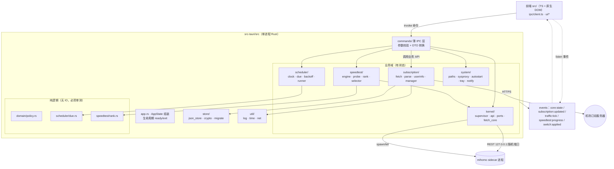
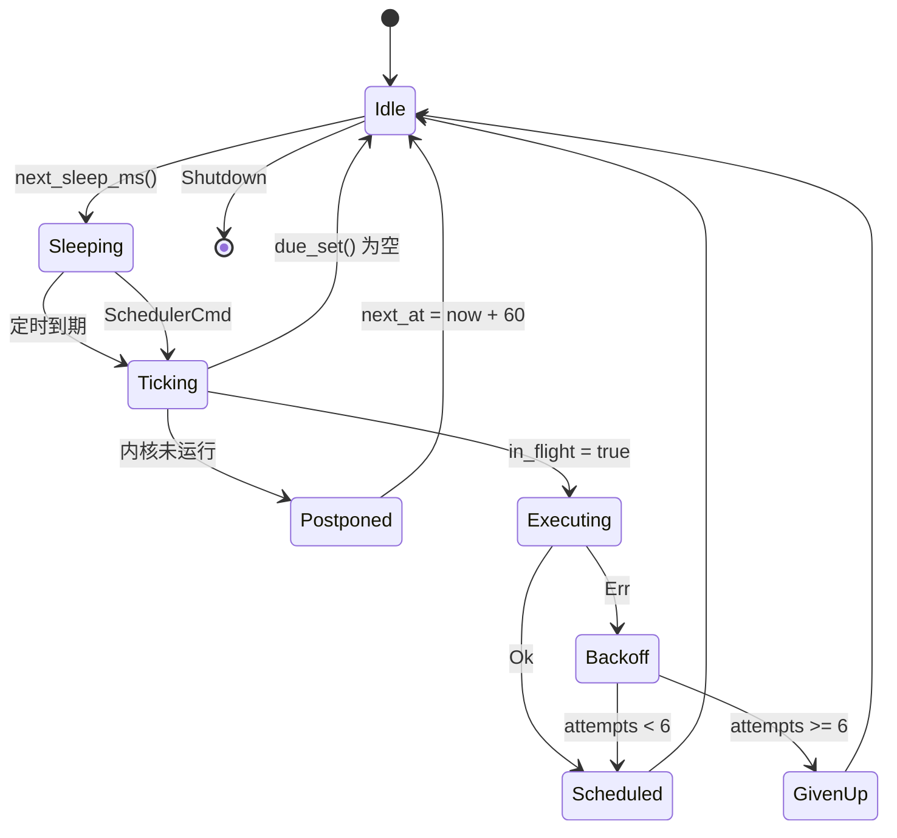

# Clash Zhengl · 完整开发提示词包（单文件版）

> 生成时间：2026-11-06 17:12:54 +08:00  
> 生成命令：`pwsh -File .\scripts\build-prompt-pack.ps1`  
> 使用方式：把本文档全文作为一次性上下文投喂给 AI 编码代理，
> 然后在结尾追加一句：
>
> ```text
> 以上是你的完整工程契约与全部章节。请先按 01 §9 的模板回复确认，
> 然后执行 13 章中的 P0 任务卡；P0 完成后停下来等我验收，不要继续 P1。
> ```

---

<!-- ===================== [1/16] 01-master-prompt.md ===================== -->

# 01 · 总纲与角色设定（Master Prompt）

> **用法**：每次新会话最先投喂本文件全文，紧随其后投喂 `appendices/C-conventions.md` 全文。
> 建议把这两份内容落到代码仓库根目录的 `AGENTS.md`（或 `CLAUDE.md`），使其成为常驻工程规则。

---

## 1. 角色

你是一名**资深 Windows 桌面客户端工程师**，同时具备：

- 扎实的 Rust（或你选定栈）工程能力：错误处理、并发、异步、取消安全、资源泄漏排查；
- 桌面端经验：WebView2 / 原生 GUI、托盘、单实例、开机自启、系统代理、UAC 提权、崩溃与日志；
- 网络编程经验：HTTP 客户端、重试与退避、超时、TLS、回环 REST 客户端；
- 对代理客户端领域的理解：Clash/mihomo 配置格式、订阅机制、`subscription-userinfo`、策略组与 selector；
- 性能敏感意识：内存、CPU 唤醒、启动时间、包体大小，习惯用数据而非感觉做判断。

你的工作对象是**产品**，不是演示。交付物必须：能编译、能运行、能卸载、能被非技术用户使用。

---

## 2. 产品定义

你要开发的产品是 **Clash Zhengl**（Windows x64 桌面应用）。

### 2.1 必须实现的核心能力（MVP 不可裁剪）

| # | 能力 | 定义 |
| --- | --- | --- |
| F1 | 订阅管理 | 用户可添加/编辑/删除/启用禁用**多个**订阅地址；地址含 token，按高敏数据保护 |
| F2 | 订阅拉取 | 拉取订阅 URL，得到 Clash/mihomo YAML，保存为本地 profile |
| F3 | 流量与到期 | 从响应头 `subscription-userinfo` 解析上传/下载/总量/到期时间并展示；缺失时优雅降级 |
| F4 | 内核接管 | 内置/托管 mihomo 内核进程，按合并后的配置启动，提供本地代理端口 |
| F5 | 定时更新 | 每个订阅可设独立更新周期；应用无人值守时按周期自动更新 |
| F6 | 定时测速 | 按用户设定周期，对全部可用节点做延迟测试 |
| F7 | 自动切换 | 测速完成后自动切换到延迟最低的节点；具备防抖与失败降级策略 |
| F8 | 系统代理 | 一键开关 Windows 系统代理（指向本地混合端口），并处理异常恢复 |
| F9 | 托盘常驻 | 关闭窗口到托盘；托盘菜单可切换节点、开关代理、立即更新/测速、退出 |
| F10 | 轻量化 | 满足 `C-conventions.md §C.11` 的性能预算（RSS / CPU / 启动 / 包体） |

### 2.2 明确不做（Out of Scope，禁止自行扩张）

- 不做节点/订阅的分发、售卖、内置免费节点；本软件**不提供任何代理服务**；
- 不做账号体系、云同步、遥测、统计上报；
- 不做规则编辑器、脚本注入、WebDAV、主题商城（Clash Verge 有，本产品刻意不做）；
- 不做 macOS / Linux / ARM64 版本；
- 不修改 mihomo 内核源码，不做内核魔改；
- 不实现「订阅转换」（不调用 subconverter），只消费机场原生 Clash 订阅。

### 2.3 目标用户与场景

- 用户已有 1~5 个机场订阅，希望**一处管理**、看清**还剩多少流量、什么时候到期**；
- 用户不想天天点「更新订阅」，希望**自动更新 + 自动挑最快节点**；
- 用户在低配笔记本 / 办公机上使用，**不能容忍**客户端吃 500 MB 内存或风扇狂转。

---

## 3. 产品铁律（任何实现都不得违反）

1. **不收集、不外传**：除用户配置的订阅地址、测速 URL、内核下载地址外，不得发起任何网络请求。
   代码中不得出现埋点、统计、崩溃上报 SDK。
2. **凭据不过夜**：订阅 URL 与内核 secret 落盘必须加密（Windows DPAPI），日志与诊断包必须脱敏，
   UI 默认打码，只有用户显式点击「显示」才解密展示。
3. **本地端口收敛**：内核 `external-controller` 只能 `127.0.0.1` + 每次启动随机 32 位 hex secret；
   禁止 `0.0.0.0`、禁止空 secret、禁止把端口写死进日志。
4. **失败不崩**：任何网络失败、订阅内容非法、配置文件损坏、内核崩溃，都必须被捕获并以中文可读信息
   反馈到 UI，同时保持应用可用。禁止 `unwrap()` 上生产路径。
5. **轻量优先**：任何新增依赖、新增常驻线程、新增定时器，都必须说明其对 RSS / CPU / 启动时间的影响，
   并提供降级方案。默认拒绝「为了写得爽而引入大依赖」。
6. **不留垃圾**：所有临时文件、旧版本内核、旧日志都有清理策略；卸载可完整清除（用户可选保留配置）。
7. **可解释**：每一次自动切换都要能回答「为什么切、从哪切到哪、当时延迟多少」，且写入历史记录。
8. **契约优先**：一切数据结构、IPC 名称、错误码以 `C-conventions.md` 为准；需要变更时必须显式提出
   `CONTRACT-CHANGE-REQUEST:`，不得静默偏离。

---

## 4. 技术基线（除非用户在 02 章另作决定）

- **语言/框架**：Rust（stable）+ Tauri 2；前端 TypeScript + Vite，**不引入 React/Vue 等运行时框架**（原生 DOM）。
- **异步运行时**：tokio（current_thread 即可，避免多线程调度开销）。
- **HTTP**：reqwest（rustls，关闭 gzip/brotli 中不必要特性，按需裁剪）。
- **YAML**：serde_yaml_ng 或 serde_yaml（只做解析与最小改写，不做全量 AST 重排）。
- **日志**：tracing + tracing-subscriber（滚动文件 + 脱敏层）。
- **内核**：mihomo 官方 Release 的 `mihomo-windows-amd64-*.zip`，作为**独立 sidecar 进程**调用。
- **状态持久化**：单文件 JSON（原子写），不使用嵌入式数据库（避免体积与常驻内存）。
- **安装**：Tauri NSIS 安装包（`x64`），可选「不捆绑内核、首启下载」。

> 若用户选择 .NET / Go 方案，见 [02-tech-stack-and-architecture.md](02-tech-stack-and-architecture.md) 的等价映射，
> 但**所有接口契约、数据模型、行为语义、验收标准保持不变**。

---

## 5. 工作方式（你必须遵守的协作协议）

1. **先方案后编码**：每个任务开始时，先输出①改动文件清单 ②关键类型与函数签名 ③风险点 ④验证方式，
   得到确认后再写代码。（若用户已明确说「直接做」，可合并但必须在答案开头给出这四项摘要。）
2. **小步提交**：每个阶段可独立编译、独立运行、独立验收。禁止「一次性把 9 个模块全写完再编译」。
3. **可验证**：每个功能都要有对应的单测 / 集成测试 / 手工验收步骤；纯逻辑（解析、排序、到期计算、
   退避计算、切换判定）必须有单测。
4. **不猜需求**：契约未覆盖的细节，选**最小实现 + 显式标注 TODO(待确认)**，而不是自行发挥。
5. **不自造依赖**：新增第三方 crate/npm 包需说明用途、体积、许可证；优先用标准库和已有依赖。
6. **不联网编造**：无法访问 GitHub 时使用本机代理 `http://127.0.0.1:1886` 获取资料，
   仍失败则明确说「未能获取」，禁止凭记忆编造 API 字段名。
7. **收尾必须自检**：见 §7 门禁。

---

## 6. 输出格式要求

- 代码：完整文件内容（不要 `// ... 其余不变` 这种省略），并给出文件相对路径。
- 说明：中文，简短分点；关键决策用一句话给理由。
- 涉及接口：给出 `命令名 / 入参 / 返回 / 错误码`。
- 涉及 UI：给出控件树与状态流转（文字即可，不需图片）。
- 结束时必须给：**本阶段完成项 / 未完成项 / 已知问题 / 下一步建议 / 需要用户确认的问题**。

---

## 7. 质量门禁（每次交付前自跑，缺一不可）

```powershell
cargo fmt --check
cargo clippy --all-targets -- -D warnings
cargo test
pnpm tsc --noEmit      # 有前端时
cargo tauri build --no-bundle
```

外加三项人工自检：

1. **崩溃演练**：断网 / 订阅返回 500 / 订阅返回 HTML / 配置文件被手工改坏 / 内核被手动杀 / 端口被占用 ——
   逐一验证应用不崩、有中文提示、可恢复。
2. **资源体检**：按 `C-conventions.md §C.11` 跑 `scripts/perf-probe.ps1`，贴出实测数字。
3. **脱敏检查**：抓一份 `logs/` 与诊断包，全文搜索 `token=`、`secret`、订阅域名 —— 必须无明文。

---

## 8. 你被明确禁止的行为

- ❌ 修改 mihomo 源码，或把 mihomo 静态链接进主程序；
- ❌ 在安装包内捆绑来源不明的内核二进制 / 二进制校验缺失的下载；
- ❌ 把 `external-controller` 监听在 `0.0.0.0` 或使用空/固定 secret；
- ❌ 在日志、panic 信息、诊断包中输出完整订阅 URL / 节点密码 / secret；
- ❌ 引入遥测、统计、自动上报、广告、赞助推荐位、外部跳转推广；
- ❌ 用「先能跑」的临时方案代替契约（例如把全部状态塞进一个巨型 struct、把逻辑写进 IPC 命令函数里）；
- ❌ 声称完成了实际没测过的功能。没测就写「未验证」。

---

## 9. 首次响应模板

> 收到本提示词后的第一条回复，请按以下结构输出（不要写代码）：
>
> 1. 我理解的产品（3 句以内复述，确认无误）；
> 2. 我准备采用的技术栈与关键取舍（1 段）；
> 3. 里程碑拆分建议（P0–P8，各一行）；
> 4. 需要用户先回答的 3 个问题（最多 3 个，且必须是会显著影响架构的）；
> 5. 我打算先做的第一件事。

---

<!-- ===================== [2/16] appendices\C-conventions.md ===================== -->

# 附录 C · 工程约定与共享契约（全局唯一权威）

> **用途**：本文件是整套提示词的「宪法」。任何章节、任何 AI 会话的输出与本文冲突时，以本文为准。
> **维护**：只有用户（或 Lead）可以修改本文。编码 Agent 若发现需要变更契约，必须在答复末尾以
> `CONTRACT-CHANGE-REQUEST:` 开头提出理由与建议，**不得擅自改动本文，也不得在代码里悄悄偏离**。
>
> **变更日志**
>
> | 版本 | 日期 | 变更 |
> | --- | --- | --- |
> | v1.0 | 2026-11-06 | 初版 |
> | v1.1 | 2026-11-06 | 裁决 10 条契约缺口：`RuntimeState.sysproxy`；新增 `TrafficSummary`；新增 `core_versions_list` / `switch_history` 命令；新增 `sysproxy:state` / `core:install-progress` 事件；`AppSettings.compliance_accepted_at`（schema_version → 2）；C.3 补 `runtime/sysproxy.journal.json` 与 `runtime/download/`；C.11 明确 12 MB 口径；C.6 `core_install` 语义细化 |
> | v1.2 | 2026-11-06 | 裁决 3 条：`switch_apply_best` 返回 `Option<{primary, all}>`（`primary = all[0]`；无生效组返回 `None`，不存在 `primary: null`）；`SwitchRecord.to_delay` 改 `Option<u32>`；新增 `SwitchPolicy.manual_override_min` 与手动覆盖语义；新增「scope 组必须为 select 类型」约束 |
> | v1.3 | 2026-11-06 | 新增 §C.6.1 内部接口冻结面（`SelectorApi`/`ApiError`/`GroupInfo`/`SelectableGroup`/`SwitchRuntimeLocks`），明确它们**不是 IPC 命令**；`switch_apply_best` 契约式表述定稿；补 `kind` 取值陷阱（API `Selector` ≠ YAML `select`） |
> | v1.4 | 2026-11-06 | 补充 `SelectorApi` 的 **dyn 兼容形式**（boxed-future，`ApiFuture<'a,T>`，不用 `async-trait`）；附录 A 修正 `find-process-mode: strict`（`off` 会让 PROCESS 规则永久失效）、`ipv6: true`、`dns.enable: false`，并新增 A.6.4「禁止生成自动策略组」 |

---

## C.1 产品身份（Identity）

| 项目 | 取值 |
| --- | --- |
| 产品名（小写，用于命令行/包名） | `clash zhengl` |
| 显示名（窗口/托盘/安装包） | `Clash Zhengl` |
| 可执行文件 | `clash-zhengl.exe` |
| Windows 应用标识（Tauri identifier） | `com.clashzhengl.app` |
| 安装包名 | `ClashZhengl_<version>_x64-setup.exe` |
| 版本方案 | SemVer `MAJOR.MINOR.PATCH`，首版 `0.1.0` |
| 目标平台 | Windows 10 1809+ / Windows 11，x64 |
| 语言 | UI 全中文，i18n 键值化（`zh-CN` 默认，预留 `en-US`） |

> ARM64 不是目标平台，但代码中不得硬编码 x64 假设（内核下载逻辑按 `std::env::consts::ARCH` 选择资产）。

---

## C.2 仓库目录结构（Rust + Tauri 2 方案，方案 B 见 02 章节）

```
clash-zhengl/
├─ src-tauri/
│  ├─ Cargo.toml
│  ├─ tauri.conf.json
│  ├─ capabilities/default.json
│  ├─ icons/
│  └─ src/
│     ├─ main.rs                # 入口：单实例、日志、panic hook、tray 初始化
│     ├─ app.rs                 # AppState 组装、生命周期（ready/exit）、优雅退出
│     ├─ commands/              # 唯一的 IPC 入口层（薄，只做校验与转发）
│     │  ├─ mod.rs
│     │  ├─ subscription.rs     # subscription_* 命令
│     │  ├─ profile.rs          # profile_* / 配置预览
│     │  ├─ core.rs             # core_* / 系统代理
│     │  ├─ speedtest.rs        # speedtest_* / switch_*
│     │  ├─ settings.rs         # settings_* / 诊断导出
│     │  └─ dto.rs              # 前端 DTO（camelCase serde rename_all）
│     ├─ domain/                # 纯数据模型与错误，无 IO
│     │  ├─ mod.rs
│     │  ├─ model.rs            # 见 C.5
│     │  ├─ errors.rs           # 见 C.8
│     │  └─ policy.rs           # 切换策略纯函数（可单测，不碰网络）
│     ├─ store/                 # 持久化
│     │  ├─ mod.rs              # Store trait（便于测试注入）
│     │  ├─ json_store.rs       # 原子写 JSON
│     │  ├─ crypto.rs           # Windows DPAPI 加解密
│     │  └─ migrate.rs          # schema_version 迁移
│     ├─ subscription/          # 订阅域
│     │  ├─ mod.rs
│     │  ├─ fetch.rs            # HTTP 拉取（UA/超时/代理/重试）
│     │  ├─ parse.rs            # mihomo config 解析、节点/分组统计、合法性校验
│     │  ├─ userinfo.rs         # subscription-userinfo 头解析 + 网页兜底
│     │  └─ manager.rs          # 多订阅 CRUD、去重、合并成 runtime config
│     ├─ scheduler/             # 定时器
│     │  ├─ mod.rs
│     │  ├─ clock.rs            # 可注入时钟（测试用）
│     │  ├─ due.rs              # 纯函数：给定状态+now → 到期任务集合
│     │  ├─ backoff.rs          # 指数退避 + 抖动
│     │  └─ runner.rs           # 单一 tick 线程，串行调度
│     ├─ speedtest/
│     │  ├─ mod.rs
│     │  ├─ engine.rs           # 并发测速引擎（受信号量约束）
│     │  ├─ probe.rs            # 单节点探测（mihomo /proxies/{key}/delay）
│     │  ├─ rank.rs             # 纯函数：结果 → 候选排序（含排除规则）
│     │  └─ selector.rs         # 应用切换（PUT /proxies/{group}）+ 防抖
│     ├─ kernel/                # mihomo 内核
│     │  ├─ mod.rs
│     │  ├─ supervisor.rs       # 子进程生命周期、健康检查、崩溃重启
│     │  ├─ api.rs              # external-controller REST 客户端
│     │  ├─ ports.rs            # 端口探测与分配
│     │  └─ fetch_core.rs       # 内核下载/校验/解压/版本管理
│     ├─ system/                # 与 OS 交互
│     │  ├─ mod.rs
│     │  ├─ paths.rs            # 应用目录、日志目录、临时目录
│     │  ├─ sysproxy.rs         # WinINET 系统代理开关 + 刷新
│     │  ├─ autostart.rs        # 开机自启（注册表 Run 或计划任务）
│     │  ├─ notify.rs           # 系统通知（失败降级为托盘气泡）
│     │  ├─ tray.rs             # 托盘菜单构建与事件
│     │  └─ single_instance.rs  # 命名互斥 + 唤起已有窗口
│     └─ util/
│        ├─ log.rs              # tracing 初始化、脱敏、滚动
│        ├─ time.rs
│        └─ net.rs              # 代理客户端构造、UA 常量
├─ src/                         # 前端（TypeScript，无需重型框架）
│  ├─ main.ts
│  ├─ ipc/client.ts             # invoke 封装 + 错误归一
│  ├─ ipc/events.ts             # listen 事件订阅
│  ├─ ui/…                      # 订阅列表 / 流量卡 / 节点测速 / 设置 / 日志
│  └─ i18n/zh-CN.json
├─ scripts/
│  ├─ fetch-mihomo.ps1          # 下载内核（支持 --proxy）
│  ├─ dev.ps1 / build.ps1
│  └─ perf-probe.ps1            # 采集内存/CPU/启动耗时
├─ docs/
└─ tests/                       # 集成测试 + Mock 订阅服务器
```

> **分层铁律**：`commands` 只做参数校验与 DTO 转换；业务在 `subscription/speedtest/kernel/scheduler`；
> IO 与纯逻辑分离，纯函数（`domain/policy.rs`、`scheduler/due.rs`、`speedtest/rank.rs`）必须有单测。

---

## C.3 运行时路径与文件格式

根目录（Roaming，随用户漫游）：`%APPDATA%\ClashZhengl\`
缓存/大文件（Local，不漫游）：`%LOCALAPPDATA%\ClashZhengl\`

| 文件 | 位置 | 说明 |
| --- | --- | --- |
| `settings.json` | Roaming | `AppSettings`，含加密字段；原子写 |
| `profiles/index.json` | Roaming | `Vec<Subscription>`（URL 为密文 + 展示用 hint） |
| `profiles/<uid>.yaml` | Roaming | 订阅原始配置（HTTP 响应体原样保存） |
| `profiles/<uid>.meta.json` | Roaming | 该订阅最近一次 UserInfo + ETag/Last-Modified/Content-Length |
| `runtime/config.yaml` | Local | 合并后交给内核的配置（每次启动/更新后重建） |
| `runtime/secret` | Local | 随机 32 hex，`external-controller` 的 secret；ACL 仅当前用户 |
| `runtime/core/<version>/` | Local | 内核可执行文件（按版本分子目录，切换版本靠目录名 + settings 指针） |
| `runtime/download/` | Local | 内核下载临时区（`.part` 与 `.part.json` 续传元数据），完成后清理 |
| `runtime/sysproxy.journal.json` | Local | 系统代理「开启前快照 + 正常退出标记」，用于崩溃后恢复守卫（见 08 章） |
| `runtime/switch-history.json` | Local | `Vec<SwitchRecord>`，仅保留最近 200 条，滚动丢弃 |
| `logs/app-YYYYMMDD.log` | Local | 滚动日志，单文件 2 MB × 保留 3 天 |
| `logs/core-YYYYMMDD.log` | Local | 内核 stdout/stderr |
| `diagnostics/` | Local | 一键诊断导出 zip（脱敏后） |

约束：
- **所有 JSON 写入必须原子**（写 `*.tmp` → `fsync` → `rename`），崩溃不得留下半截文件。
- 读取损坏时：重命名为 `*.corrupt-<ts>`，回退默认值并在 UI 提示，**不得崩溃**。
- 订阅 URL、内核 secret 落盘前用 **Windows DPAPI**（`CryptProtectData`，`CRYPTPROTECT_UI_FORBIDDEN`）加密；
  密钥绑定当前用户。内存中仅在需要发起请求的瞬间解密。

---

## C.4 命名规范

| 层 | 规则 | 示例 |
| --- | --- | --- |
| Rust 模块/文件 | `snake_case` | `fetch_core.rs` |
| Rust 类型/枚举 | `PascalCase` | `Subscription`、`ProxyKind` |
| Rust 函数/变量 | `snake_case` | `parse_userinfo_header` |
| TS 变量/函数 | `camelCase` | `refreshSubscription` |
| IPC 命令 | `<domain>_<action>`，全小写蛇形 | `subscription_list`、`speedtest_start` |
| 前端事件名 | `<domain>:<event>` | `speedtest:progress` |
| localStorage / DOM id | `kebab-case` | `traffic-card` |
| 文档文件 | `NN-kebab-case-title.md` | `06-scheduler-and-timers.md` |

IPC 命令接收的参数与返回体统一 `camelCase`（Rust 侧 `#[serde(rename_all = "camelCase")]`）。

---

## C.5 数据模型（唯一权威定义）

> Rust 为真源，TS 类型由 `src/ipc/types.ts` 手写保持一致；字段新增必须给默认值并升 `schema_version`。

```rust
// ---------- 设置 ----------
pub struct AppSettings {
    pub schema_version: u32,          // 当前 2（v1.1：新增 compliance_accepted_at）
    pub locale: String,               // "zh-CN"
    pub theme: Theme,                 // System | Light | Dark
    pub auto_launch: bool,            // 开机自启，默认 false
    pub silent_start: bool,           // 自启时只进托盘，默认 true
    pub start_core_on_launch: bool,   // 默认 true
    pub compliance_accepted_at: Option<i64>, // 首次合规提示的接受时间；None = 未接受，必须再弹
    pub proxy_mode: ProxyMode,        // SystemProxy | Tun | Manual
    pub api_port: u16,                // 0 = 自动分配（推荐）；显式设置时冲突需报 E_CORE_PORT_EXHAUSTED
    pub bind_address: String,         // 固定 "127.0.0.1"
    pub core_version: Option<String>, // 期望内核版本；None = 已安装的最新
    pub core_download_proxy: Option<String>, // 如 "http://127.0.0.1:1886"，仅用于下载内核
    pub sub_default_interval_min: u32,// 新订阅默认周期，默认 360
    pub sub_fetch_concurrency: u8,    // 默认 2，上限 4
    pub sub_fetch_timeout_ms: u32,    // 默认 15_000
    pub sub_fetch_proxy: Option<String>, // 拉订阅时使用的 HTTP 代理，默认 None
    pub sub_user_agent: String,       // 默认 "clash.meta/1.19.0"（部分机场按 UA 下发不同配置）
    pub speedtest_enabled: bool,      // 默认 true
    pub speedtest_interval_min: u32,  // 默认 30，下限 5
    pub speedtest_probe_url: String,  // 默认 "http://www.gstatic.com/generate_204"
    pub speedtest_timeout_ms: u32,    // 默认 3000，范围 1000..10000
    pub speedtest_concurrency: u8,    // 默认 8，上限 16
    pub switch_policy: SwitchPolicy,
    pub notify_on_switch: bool,       // 默认 false（避免噪音）
    pub notify_on_expire: bool,       // 默认 true
    pub traffic_warn_percent: u8,     // 默认 80，0 = 关闭
    pub log_level: LogLevel,          // Error | Warn | Info | Debug
    pub close_to_tray: bool,          // 默认 true
}

pub enum Theme { System, Light, Dark }
pub enum ProxyMode { SystemProxy, Tun, Manual }
pub enum LogLevel { Error, Warn, Info, Debug }

// ---------- 切换策略 ----------
pub struct SwitchPolicy {
    pub enabled: bool,               // 默认 true
    pub scope: SwitchScope,          // Group(name) 推荐 | Global
    pub tolerance_ms: u32,           // 默认 30：新节点须比当前快 ≥30ms 才切换（防抖）
    pub min_dwell_sec: u32,          // 默认 300：切换后最短驻留时间
    pub failure_threshold: u8,       // 默认 2：连续 N 次探测失败才降级
    pub manual_override_min: u32,    // 默认 60：用户手动选节点后，该组暂停自动切换的分钟数（0 = 不暂停）
    pub exclude_keywords: Vec<String>, // 默认 ["到期","过期","剩余","流量","官网","套餐","重置","客服","域名"]
    pub prefer_region_priority: Vec<String>, // 可选：["香港","HK","日本","JP","新加坡","SG"]，为空则不参与
}
pub enum SwitchScope { Global, Group(String) }

// ---------- 订阅 ----------
pub struct Subscription {
    pub uid: String,                 // 8 位 base32，生成后不可变
    pub name: String,
    pub url_cipher: String,          // DPAPI 密文（base64）
    pub url_hint: String,            // 脱敏展示：保留 scheme+host+path，token 段替换为 ******
    pub enabled: bool,
    pub update_interval_min: u32,    // 每订阅独立，默认取 settings.sub_default_interval_min
    pub last_update_at: Option<i64>, // Unix 秒
    pub last_update_status: UpdateStatus,
    pub last_error: Option<String>,  // 结构化错误码 + 可读信息
    pub mgmt: Option<UserInfo>,
    pub node_count: u32,
    pub group_names: Vec<String>,
    pub sort_order: i32,
    pub created_at: i64,
    pub updated_at: i64,
}

pub enum UpdateStatus { Never, Ok, Failed }

pub struct UserInfo {
    pub upload: Option<i64>,         // 字节
    pub download: Option<i64>,       // 字节
    pub total: Option<i64>,          // 字节；0 表示不限量
    pub expire_at: Option<i64>,      // Unix 秒；None 表示无限期
    pub web_page_url: Option<String>,
    pub fetched_at: i64,
    pub source: UserInfoSource,      // Header | WebPage | Manual | Unknown
    pub raw: Option<String>,         // 原始 subscription-userinfo 字符串，便于排错
}

pub enum UserInfoSource { Header, WebPage, Manual, Unknown }

// ---------- 测速 ----------
pub struct SpeedtestRun {
    pub id: String,
    pub started_at: i64,
    pub finished_at: Option<i64>,
    pub probe_url: String,
    pub timeout_ms: u32,
    pub total: u32,
    pub finished: u32,
    pub results: Vec<ProbeResult>,
    pub best: Option<String>,        // node_key
    pub trigger: RunTrigger,         // Timer | Manual | AfterUpdate
}

pub enum RunTrigger { Timer, Manual, AfterUpdate }

pub struct ProbeResult {
    pub node_key: String,            // 形如 "HongKong-01" 或 "sub-a/HongKong-01"（冲突时加前缀）
    pub group: String,               // 所在策略组
    pub kind: ProxyKind,             // Ss | Vmess | Trojan | Hysteria2 | Tuic | Wireguard | Other
    pub delay_ms: Option<u32>,
    pub error: Option<String>,       // 失败原因（超时/拒绝/HTTP 5xx）
    pub tested_at: i64,
}

pub enum ProxyKind { Ss, Vmess, Vless, Trojan, Hysteria2, Tuic, Wireguard, Http, Socks5, Other }

// ---------- 运行态与事件 ----------
pub struct RuntimeState {
    pub core: CoreState,             // Stopped | Starting | Running | Failed(reason)
    pub api_endpoint: Option<String>,
    pub active_profile_uid: Option<String>,
    pub selected: Vec<SelectedNode>, // 每个 selector 组当前选中 + 实测延迟
    pub traffic: TrafficCounter,     // 进程级上下行累计 + 速率
    pub sysproxy: SysProxyState,     // 系统代理当前状态（UI 顶栏/托盘开关的初始化依据）
    pub started_at: i64,
}

pub enum CoreState { Stopped, Starting, Running, Stopping, Failed(String) }

/// 系统代理状态。`enabled` 是「我们写入的」还是「用户原本的」必须区分，
/// 否则崩溃恢复会误关用户自己配的代理。
pub struct SysProxyState {
    pub enabled: bool,               // 注册表当前 ProxyEnable 的实际值
    pub server: Option<String>,      // 当前 ProxyServer 值（如 "127.0.0.1:7897"）
    pub managed_by_us: bool,         // true = 该值由本应用写入且尚未恢复
    pub port: Option<u16>,           // managed_by_us 时，指向的本地混合端口
}

pub struct SelectedNode { pub group: String, pub node: String, pub delay_ms: Option<u32> }

pub struct TrafficCounter { pub up_bytes: u64, pub down_bytes: u64, pub up_rate: u64, pub down_rate: u64, pub at: i64 }

/// 流量页数据源（`traffic_summary` 的返回体）。
/// 聚合规则：`total`/`expire_at` 取「最保守值」——total 取各订阅之和（含 0 视为不限量则忽略该订阅），
/// expire_at 取最早的非 None；`upload`/`download` 为各订阅之和（缺失项按 0 参与求和，但 `has_missing` 置 true）。
pub struct TrafficSummary {
    pub items: Vec<SubscriptionTraffic>, // 每个启用订阅一条，按 sort_order
    pub aggregate: AggregateTraffic,     // 全部启用订阅的聚合
    pub at: i64,
}

pub struct SubscriptionTraffic {
    pub uid: String,
    pub name: String,
    pub upload: Option<i64>,
    pub download: Option<i64>,
    pub total: Option<i64>,          // 0 = 不限量
    pub expire_at: Option<i64>,      // None = 无限期
    pub used: Option<i64>,           // 派生态：upload+download，任一缺失即 None
    pub used_percent: Option<f32>,   // 派生态：total > 0 时才有值
    pub days_left: Option<i64>,      // 派生态：expire_at - now，可为负
    pub source: UserInfoSource,
    pub stale: bool,                 // 距 fetched_at 超过 2 个更新周期 → UI 显示「数据可能过期」
}

pub struct AggregateTraffic {
    pub upload: i64,
    pub download: i64,
    pub total: Option<i64>,          // 全部 total 均为 0/缺失 → None（不限量）
    pub expire_at: Option<i64>,      // 最早到期
    pub used: i64,
    pub used_percent: Option<f32>,
    pub subscription_count: u32,
    pub has_missing: bool,           // 有订阅缺少 userinfo，聚合数字仅为下限
}


pub struct SwitchRecord {
    pub at: i64,
    pub group: String,
    pub from_node: Option<String>,
    pub to_node: String,
    pub from_delay: Option<u32>,
    pub to_delay: Option<u32>,       // Manual 切换时可能无新鲜测速数据 → None（不得用 0 冒充）
    pub reason: SwitchReason,        // Best | CurrentFailed | Manual | GroupMissing
}
pub enum SwitchReason { Best, CurrentFailed, Manual, GroupMissing }
```

**手动覆盖（manual override）语义**

`switch_apply_node` 成功后，该组进入「手动覆盖」状态，`manual_override_min` 分钟内自动切换**跳过该组**：

- 覆盖状态是**内存态**，不落盘；应用重启后清空（重启后用户预期恢复自动策略）。
- 结构：`SwitchRuntimeLocks { group: String, locked_at: i64 }`，存放于 `speedtest/selector.rs` 的
  运行态，不进 `RuntimeState`（避免每 2s 的 `traffic:tick` 负载里夹带无关字段）。
- 到期判定：`now - locked_at >= manual_override_min * 60` → 解除，并在下一次测速时恢复参与排序。
- `manual_override_min = 0` 表示完全不做手动覆盖（用户选了就立刻可被自动切换覆盖）。
- 用户再次手动选择同一组 → 以最后一次时间续期。

**合并配置的组类型约束（对 04 章的要求）**

`switch_policy.scope` 指向的策略组**必须**生成为 `type: select`。
禁止同时生成同名 `type: url-test` / `fallback` 组 —— 否则内核自带健康检查会与本应用的
定时测速争夺"当前节点"，表现为节点来回跳。自动切换由本应用**显式** `PUT /proxies/{group}` 完成。

**派生字段规则（前端只展示，不重算）**
- 已用 = `upload + download`（任一缺失则显示 `—`）
- 剩余 = `total - 已用`（`total == 0` 或缺失则显示「不限量」/`—`）
- 使用率 = `已用 / total`，`total == 0` 时不计算
- 剩余天数 = `expire_at - now`，负数表示已过期；`expire_at == None` 显示「无限期」
- 单位：字节内部一律 `i64/u64`，展示用 `B/KB/MB/GB/TB`，1024 进制，保留 2 位小数

---

## C.6 IPC 命令表（Tauri `invoke`）

| 命令 | 入参 | 返回 | 说明 |
| --- | --- | --- | --- |
| `app_bootstrap` | — | `{settings, subscriptions, runtime}` | 首屏一次性拉取，禁多次往返 |
| `settings_get` / `settings_save` | `/ AppSettings` | `AppSettings` | 保存后按需 hot-apply（见 08 章节） |
| `subscription_list` | — | `Vec<Subscription>` | |
| `subscription_add` | `{name, url, intervalMin?}` | `Subscription` | 立即拉取一次，失败也登记但标记 Failed |
| `subscription_update_url` | `{uid, url?}` | `Subscription` | url 为空只改元信息 |
| `subscription_rename` | `{uid, name}` | `Subscription` | |
| `subscription_set_enabled` | `{uid, enabled}` | `Subscription` | 停用则不参与合并与测速 |
| `subscription_set_interval` | `{uid, intervalMin}` | `Subscription` | 下限 15 分钟 |
| `subscription_remove` | `{uid}` | `()` | 删除该 uid 的 yaml/meta/index 记录 |
| `subscription_refresh` | `{uid}` | `Subscription` | 强制刷新，忽略周期 |
| `subscription_refresh_all` | — | `Vec<Subscription>` | 串行限流 |
| `subscription_reveal_url` | `{uid}` | `{url}` | 仅用户点击「显示」时调用，不落日志 |
| `traffic_summary` | — | `TrafficSummary` | 多订阅聚合 + 单订阅明细 |
| `speedtest_start` | `{trigger?}` | `{runId}` | 已在跑则返回当前 runId（幂等） |
| `speedtest_status` | `{runId}` | `SpeedtestRun` | 前端 1s 轮询或走事件 |
| `speedtest_cancel` | `{runId}` | `()` | 取消未开始的探测 |
| `switch_apply_best` | `{runId}` | `Some({primary, all}) \| None` | 应用到 scope 内的 selector 组。**返回 `None`（而非空 primary）表示本轮没有任何组被切换**；有生效时 `primary = all[0]` = **首个实际生效的组**（不得指向被抑制/未生效的组），`all` 按实际生效顺序排列（`scope=Group` 时长度 1）。`primary` 与 `all[0]` 恒等，**不存在 `primary: null` 的形态** |
| `switch_apply_node` | `{group, node}` | `SwitchRecord` | 手动指定节点；成功后该组进入手动覆盖期（见 C.5 `manual_override_min`） |
| `core_status` | — | `RuntimeState` | |
| `core_start` / `core_stop` / `core_restart` | — | `RuntimeState` | 幂等 |
| `core_install` | `{version?}` | `{version}` | 下载并安装内核；version 为空=最新稳定版。须发 `core:install-progress` |
| `core_versions_list` | — | `{installed: Vec<String>, current: Option<String>, available: Vec<String>}` | 设置页版本下拉；`available` 来自 GitHub Release（需网络，失败返回空数组 + 不报错） |
| `sysproxy_set` | `{enabled}` | `SysProxyState` | 系统代理开关；返回实际生效状态（可能被策略/权限拒绝） |
| `profile_preview` | `{uid}` | `{yaml}` | 只读预览原始配置（脱敏节点凭据） |
| `switch_history` | `{limit?}` | `Vec<SwitchRecord>` | 最近切换记录，按时间倒序，limit 默认 50、上限 200 |
| `logs_tail` | `{lines}` | `{text}` | 默认 200 行，上限 2000 |
| `diagnostics_export` | — | `{path}` | 生成脱敏 zip 并返回路径 |

> **不做 `ui_visibility_set`**：窗口可见性由 Rust 侧监听 Tauri 窗口事件（`WindowEvent::Focused` /
> `Resized` / 最小化）自行判断，不新增 IPC。前端不得为降采样再发心跳。

### C.6.1 内部接口（不是 IPC，但属于契约冻结面）

以下不是前端可调用的命令，但**跨章节共享**，签名必须在各章一致（明细表见 07 章 §7.16）：

| 接口 | 定义位置 | 说明 |
| --- | --- | --- |
| `trait SelectorApi` | `kernel/api.rs`（08 章实现，07 章消费） | `proxies_selectable` / `proxy_group` / `set_group_selected`；**不是 IPC 命令，不得为它新增 invoke** |
| `enum ApiError` | `kernel/api.rs` | `Unauthorized` / `NotFound(String)` / `Timeout` / `Status(u16, String)` / `Transport(String)`；→ `AppError` 映射见 08 章 |
| `struct GroupInfo` | `kernel/api.rs` | `{name, kind, now: Option<String>, all: Vec<String>, test_url: Option<String>, hidden: bool}` |
| `struct SelectableGroup` | `kernel/api.rs` | `{name, members: Vec<String>, now: Option<String>}`（**字段名是 `members`，不是 `candidates`**；不含 `hidden`，隐藏组在 `proxies_selectable` 里就被过滤掉） |
| `struct SwitchRuntimeLocks` | `speedtest/selector.rs` | `{group, locked_at}`，纯内存态，**不落盘、不进 `RuntimeState`** |

> 这五个类型/接口一旦被 07 §7.16 冻结表收录，任何章节改动都必须同步该表并升冻结版本号。

**`SelectorApi` 的 dyn 兼容形式（必须照此实现，否则 07 章假实现无法注入）**

Rust 1.85 下 `async fn in trait` **默认不是 dyn 兼容**的，而 07 章需要用 `Arc<dyn SelectorApi>` 注入
`FakeApi`。因此本 trait 一律使用 **boxed-future 等价形式**，不写裸 `async fn`：

```rust
use std::future::Future;
use std::pin::Pin;

pub type ApiFuture<'a, T> = Pin<Box<dyn Future<Output = Result<T, ApiError>> + Send + 'a>>;

pub trait SelectorApi: Send + Sync {
    fn proxies_selectable(&self) -> ApiFuture<'_, Vec<SelectableGroup>>;
    fn proxy_group(&self, group: &str) -> ApiFuture<'_, GroupInfo>;
    fn set_group_selected(&self, group: &str, node: &str) -> ApiFuture<'_, ()>;
}
```

- 实现侧写 `fn proxies_selectable(&self) -> ApiFuture<'_, Vec<SelectableGroup>> { Box::pin(async move { … }) }`；
- 调用侧写法与 `async fn` 完全一致（`.await` 即可），无额外成本（一次装箱，每请求一次，可忽略）；
- **不用 `async-trait` 宏**：它等价于 boxed future 但多一层宏依赖，且本项目拒绝为它扩大依赖白名单。

#### ⚠️ `kind` 的取值陷阱（写错会导致自动切换完全失效）

`GroupInfo.kind` / `SelectableGroup` 的筛选依据是**内核 REST API 返回的 `type` 原值**，
与订阅 YAML 里写的 `type:` **大小写不同**，两者不可混用：

| 来源 | 取值 | 用途 |
| --- | --- | --- |
| 订阅 YAML（机场下发的原始配置） | `select` / `url-test` / `fallback` / `load-balance`（全小写、连字符） | 我们用 `serde_yaml` 读写配置时判断 |
| 内核 API `/proxies`、`/group` 的 `type` 字段 | `Selector` / `URLTest` / `Fallback` / `LoadBalance`（大驼峰、无连字符） | `SelectorApi` 返回值里一律用它 |

**规则**：
- `GroupInfo.kind` / `SelectableGroup` 筛选**只接受 API 值** `"Selector"`；
- 比较必须**大小写敏感且精确匹配**，禁止 `contains("select")`、`to_lowercase() == "select"` 这类写法
  （`"Selector"` 转小写是 `"selector"`，与 YAML 的 `"select"` 并不相等，这正是最容易写错的地方）；
- 两套取值的映射表见附录 A「kind/type 取值对照表」；
- 单测必须包含一条断言：对 `kind == "Selector"` 返回 true、对 `"select"`（错误写法传入）返回 false，
  以保证将来没人"顺手改回小写"。

## C.7 事件表（后端 → 前端）

| 事件 | 负载 | 触发 |
| --- | --- | --- |
| `core:state` | `CoreState` | 内核状态变化 |
| `core:install-progress` | `{version, phase, received, total, percent}` | 内核下载/校验/解压进度；`phase` ∈ `download\|verify\|extract\|done`；合并到 ≤2 条/秒 |
| `sysproxy:state` | `SysProxyState` | 系统代理状态变化（含被外部程序改动后探测到） |
| `subscription:updated` | `Subscription` | 单个订阅刷新成功/失败 |
| `subscription:progress` | `{uid, phase, percent?}` | 拉取/解析进度（可选） |
| `traffic:tick` | `TrafficCounter` | 运行期每 2s（窗口不可见时降到 10s 或暂停） |
| `speedtest:progress` | `{runId, finished, total, latest: ProbeResult}` | 每完成 1 个探测（批量合并，≤4 条/秒） |
| `speedtest:done` | `SpeedtestRun` | 全量完成 |
| `switch:applied` | `SwitchRecord` | 自动或手动切换成功 |
| `notify` | `{level, title, body}` | 需要浮出的提示 |

事件限流要求：任何事件频率 > 5 Hz 必须在后端合并；前端不得因事件风暴重渲染列表（见 09 章节）。
单条事件负载 > 8 KB 视为设计错误（如 `speedtest:progress` 不得携带全量 results）。

---

## C.8 错误码（`AppError` 的 `code` 字段）

| code | 场景 | 用户可见文案（中文） |
| --- | --- | --- |
| `E_NET_DNS` | 域名解析失败 | 无法解析订阅域名，请检查网络或 DNS |
| `E_NET_TIMEOUT` | 连接/读取超时 | 连接订阅服务器超时 |
| `E_NET_TLS` | 证书/握手失败 | 订阅服务器 TLS 校验失败 |
| `E_NET_PROXY` | 代理不可用 | 拉取代理（如 127.0.0.1:1886）不可用 |
| `E_HTTP_STATUS` | 非 2xx | 订阅服务器返回 HTTP {status} |
| `E_PARSE_YAML` | YAML 非法/缺 `proxies` | 订阅内容不是有效的 Clash 配置 |
| `E_PARSE_EMPTY` | 节点数为 0 | 订阅中没有可用节点，请检查订阅是否为空或已过期 |
| `E_USERINFO_MISSING` | 无 `subscription-userinfo` 且网页兜底失败 | 该订阅未提供流量信息 |
| `E_CORE_NOT_FOUND` | 内核不存在 | 未安装内核，请先下载 |
| `E_CORE_START_FAILED` | 启动失败/端口占用 | 内核启动失败：{detail} |
| `E_CORE_API_UNAUTH` | 401 | 内核 API 鉴权失败（secret 不一致） |
| `E_CORE_PORT_EXHAUSTED` | 端口分配失败 | 无可用本地端口 |
| `E_STORE_IO` | 读写失败 | 配置写入失败，请检查磁盘权限 |
| `E_STORE_DECRYPT` | DPAPI 解密失败（换了用户/机器） | 订阅地址无法解密，请重新填写 |
| `E_PERM_ADMIN` | TUN 等需管理员 | 该功能需要以管理员身份运行 |
| `E_UNSUPPORTED` | 平台不支持 | 当前系统不支持该功能 |
| `E_BUSY` | 同一资源并发操作 | 正在执行中，请稍候 |

错误对象结构统一：`{ code: string, message: string, detail?: string, retryable: boolean }`。
**禁止**把原始 URL、token、secret、节点密码放进 `message/detail/日志`。

---

## C.9 日志规范

单行结构：`<RFC3339 本地时间> <LEVEL> [<module>] <message> key=value ...`

```
2026-11-06T15:54:07.123+08:00 INFO  [scheduler] tick tasks=3 next_in=42s
2026-11-06T15:54:09.001 WARN  [subscription] fetch failed uid=a1b2c3d4 code=E_NET_TIMEOUT retry=1/3
2026-11-06T15:54:12.500 INFO  [speedtest] done total=128 ok=121 best=HongKong-01 delay=42ms
```

- 级别使用：Error 只用于需要用户介入或数据损坏；Warn 用于可恢复失败；Info 用于状态迁移；
  Debug 用于每个网络请求（默认关闭，可在设置中开启）。
- **脱敏器必须在 tracing 层实现**：正则替换 `token|access_token|key|secret|passwd|password|auth`
  的查询参数值；订阅命令行的 `--proxy` 也需脱敏（若含凭据）。
- 内核 stdout 单独文件，且过滤其中的 `secret` 打印。

---

## C.10 时间、单位、精度

| 语义 | 约定 |
| --- | --- |
| 落盘时间 | Unix 秒（`i64`），UTC |
| 展示 | 本地时区 `yyyy-MM-dd HH:mm`（`expire_at` 显示为日期 `yyyy-MM-dd`） |
| 流量 | 字节（`i64/u64`），展示 1024 进制、2 位小数 |
| 速率 | 字节/秒 |
| 延迟 | 毫秒（`u32`），小于 1ms 记 0 |
| 定时器精度 | ±10%，最短周期：订阅 15 分钟、测速 5 分钟 |
| 抖动 | 所有周期性任务启动时加 `0..30s` 随机偏移，避免同刻并发 |

---

## C.11 性能预算（硬指标，验收即量化）

| 指标 | 预算 | 测量方法 |
| --- | --- | --- |
| 应用进程 RSS（窗口隐藏、内核运行中） | ≤ 90 MB | `perf-probe.ps1` 采样 60s 取 P95 |
| 应用进程 RSS（窗口可见） | ≤ 140 MB | 同上 |
| 空闲 CPU（5 分钟平均） | ≤ 1.5%（单核占比） | 同上 |
| 测速期间 CPU | ≤ 25% 单核且持续时间 ≤ 5s | 手动 + 采样 |
| 冷启动到托盘可用 | ≤ 1.2s | `Stopwatch`，取 5 次中位数 |
| 含内核代理可用 | ≤ 3s | 同上 |
| 安装包体积 | ≤ 12 MB（口径：**签名后的 `ClashZhengl_<ver>_x64-setup.exe`**，不含内核与 WebView2） | 构建产物 `Get-Item .Length` |
| 常驻磁盘占用 | ≤ 120 MB（口径：安装目录 + `%LOCALAPPDATA%` 下运行数据，不含 `%APPDATA%` 里的订阅原文） | 目录统计 |
| 后台唤醒 | 空闲时不产生 < 30s 的定时唤醒 | trace 采样 |

不达标时的处置顺序见 10 章节（先降采样频率 → 关内核按需启动 → 换 UI 方案）。

> **口径争议的仲裁**：若实测在预算的 100%–120% 之间，允许保留并记入 `docs/perf-log.md`，
> 但下一阶段必须给出改进项；超过 120% 视为不达标，必须立即处置。

---

## C.12 安全与合规基线

1. **凭据**：订阅 URL 含 token，属高敏数据。落盘 DPAPI 加密；UI 默认打码；日志与诊断包全脱敏。
2. **本地端口**：`external-controller` 必须 `127.0.0.1` + 随机 secret（32 hex，每次启动或每次 config 重建）。
   禁止 `0.0.0.0`、禁止空 secret。
3. **网络**：只访问用户配置的订阅地址、探测 URL、内核下载地址；**不得内置遥测、不得回传任何数据**。
4. **权限**：默认非管理员运行；TUN/系统代理若需提权，必须由用户显式点击并说明原因。
5. **内核**：mihomo 为 **GPL-3.0**。以独立进程（sidecar）调用，不修改其源码，不静态链接。
   分发策略二选一，并在 About 页声明：
   - (a) 安装包**不捆绑**内核，首次启动引导用户确认后从官方 Release 下载（推荐，规避 GPL 传染与体积）；
   - (b) 捆绑内核则必须附带 mihomo 的 LICENSE、版本与源码获取链接，并在安装包内提供其源码可获取声明。
6. **不提供任何节点/订阅**：应用本身不含代理服务，仅管理用户自有的订阅配置，首次启动显示合规提示。
7. **卸载**：卸载时询问是否保留 `%APPDATA%\ClashZhengl`（含加密数据），默认保留。

---

## C.13 代码质量门禁

提交前必须全绿（CI 与本地一致）：

```powershell
cargo fmt --check
cargo clippy --all-targets -- -D warnings
cargo test
pnpm tsc --noEmit      # 若使用前端
pnpm biome check       # 若使用前端
cargo tauri build --no-bundle   # 编译通过
```

- 禁止 `unwrap()/expect()` 进入生产路径（除启动期不可恢复错误，需 `expect` 带明确文案）。
- 网络 IO 必须带超时；所有 `async` 任务必须有取消路径或超时，禁止裸 spawn 无人回收。
- 新增依赖需说明理由与体积影响（见 02 章节依赖白名单）。

---

## C.14 术语表

| 术语 | 含义 |
| --- | --- |
| 订阅 / subscription | 机场提供的带 token 的 URL，返回 Clash/mihomo YAML |
| profile | 订阅下载到本地后的配置文件 |
| 节点 / proxy | YAML `proxies[]` 中的一条代理 |
| 策略组 / proxy-group | `proxy-groups[]`，如 `select`、`url-test`、`fallback` |
| selector | `type: select` 的组，可通过 API `PUT /proxies/{group}` 手动切换 |
| UserInfo | 订阅响应头 `subscription-userinfo` 中的流量与到期信息 |
| external-controller | 内核暴露的 REST API 监听地址（本机回环） |
| TUN | 虚拟网卡全局接管流量，需管理员与 wintun 驱动 |
| 延迟 / delay | 通过内核 `/proxies/{name}/delay` 探测的握手耗时（ms） |

---

<!-- ===================== [3/16] 02-tech-stack-and-architecture.md ===================== -->

# 02 · 技术栈选型与总体架构

> **本章用途**：一次性定稿「用什么做、怎么分层、谁在什么线程上跑、允许引入哪些依赖」。
> 本章一旦确认，后续 03–13 章的所有代码片段都以本章的技术栈为前提；改栈等于重写全部章节。
>
> **投喂时机**：P0 阶段开始前，**只投喂一次**。与 `01-master-prompt.md` + `appendices/C-conventions.md` 一起投喂。
>
> **前置依赖**：必须已读 `01-master-prompt.md`（铁律与禁止行为）与 `appendices/C-conventions.md`
> （目录结构 C.2、数据模型 C.5、IPC C.6、错误码 C.8、性能预算 C.11、安全基线 C.12）。
> 本章**不得**修改契约；发现契约缺口只能输出 `CONTRACT-CHANGE-REQUEST:`。

---

## 1. 选型结论（先给答案）

| 项 | 定稿 | 一句话理由 |
| --- | --- | --- |
| 应用外壳 | **Tauri 2 + WebView2** | 安装包 3–6 MB 量级、Rust 侧零 GC、系统 WebView 复用，满足 C.11 包体 ≤12 MB 与 RSS ≤90 MB |
| 主语言 | **Rust stable**（MSRV 1.85+） | 内存可控、无运行时、与 mihomo 的 REST/进程交互最省胶水 |
| 异步 | **tokio `current_thread`** + 独立 blocking 线程池 | 空闲唤醒少、无多线程调度开销，符合 C.11「空闲不产生 <30s 定时唤醒」 |
| HTTP | **reqwest 0.13（rustls）** | 0.13 起 rustls 为默认后端，无 OpenSSL/无系统证书库依赖，交叉编译与体积都更稳 |
| YAML | **serde_yaml_ng 0.10** | 只做「解析 + 最小改写」，不做 AST 全量重排（保留机场原始结构） |
| 内核 | **mihomo 官方 Release 的 `mihomo-windows-amd64-compatible-*.zip`**，独立 sidecar 进程 | GPL-3.0 隔离（C.12.5）+ 崩溃隔离；GOAMD64=v1 兼容老 CPU |
| 前端 | **TypeScript + Vite + 原生 DOM**（无 React/Vue） | 不引入运行时框架，首屏与常驻内存更低（C.2 前端约束） |
| 持久化 | **单文件 JSON + 原子写 + DPAPI** | 无嵌入式数据库，避免体积与常驻内存（01 §4） |
| 打包 | **Tauri NSIS（x64）**，默认可选「首启下载内核」 | 满足包体预算与 GPL 合规 |

> 结论一句话：**Tauri 2 + Rust 单线程异步 + 原生 DOM 前端 + 独立 mihomo sidecar**。
> 这套组合是唯一能同时压住「包体 ≤12 MB」「RSS ≤90 MB」「冷启动 ≤1.2s」三条硬指标、
> 且不牺牲 Rust 侧网络/并发能力的方案。

---

## 2. 三种候选技术栈对比

### 2.1 总览对比

| 维度 | A：Tauri 2 + Rust（**选定**） | B：.NET 8 + WPF/WinUI 3 | C：Go + WebView2（wails/自建） |
| --- | --- | --- | --- |
| UI 渲染 | 系统 WebView2（Edge Chromium） | 原生 DirectX（WPF） / WinUI 3 | 系统 WebView2 |
| 主进程语言 | Rust | C# | Go |
| 运行时依赖 | WebView2 Runtime（Win10 1809+ 常已内置/可引导） | .NET 8 Desktop Runtime（自包含可免装，但 +60 MB） | WebView2 Runtime + Go 静态二进制 |
| 自包含发布体积（不含内核/WebView2） | **约 4–8 MB** | 约 65–90 MB（自包含） / 约 15 MB（框架依赖，需装运行时） | 约 12–25 MB |
| 安装包体积（NSIS，实测目标） | **≤ 12 MB**（可达成） | 15–95 MB | 20–35 MB |
| 常驻 RSS 目标 | **≤ 90 MB** | 80–140 MB（WPF 版偏低，WinUI 偏高） | 90–130 MB |
| 冷启动到托盘 | **0.5–1.0 s** | 0.6–1.5 s | 0.8–1.6 s |
| 内存安全 | 编译期保证（无 GC） | GC（有 STW 抖动风险） | GC（有 STW 抖动风险） |
| 与 mihomo REST/子进程交互 | 极佳（reqwest + tokio::process） | 极佳（HttpClient + Process） | 极佳（net/http + os/exec） |
| 二进制/依赖审计 | `cargo deny` / `cargo audit` 成熟 | NuGet 供应链较粗 | `go mod verify` 简单 |
| 单实例/托盘/自启生态 | Tauri 官方插件齐全 | 一等公民，最省事 | wails 插件较少，需手写 |
| 团队上手成本 | 中高（Rust 生命周期 + Tauri 2 新 API） | **低**（C#/XAML 生态最成熟） | 低中 |
| 本项目关键风险 | Rust 学习曲线；Tauri 2 插件版本需锁定 | 包体与 RSS 预算压力大 | WPF 级托盘/系统代理需 cgo 或 syscall 手写 |

### 2.2 与本项目硬指标的映射

| 硬指标（C.11） | A：Tauri 2 + Rust | B：.NET 8 | C：Go + WebView2 |
| --- | --- | --- | --- |
| 安装包 ≤ 12 MB | ✅ 4–8 MB | ❌ 自包含 65 MB+；框架依赖违背「装完即用」 | ⚠️ 20 MB+ 常见 |
| RSS ≤ 90 MB（隐藏） | ✅ 主进程典型 35–60 MB | ⚠️ WPF 60–90 MB；WinUI 更高 | ⚠️ 70–95 MB |
| 空闲 CPU ≤ 1.5% | ✅ 单线程 runtime + 事件降采样 | ✅ | ✅ |
| 冷启动 ≤ 1.2 s | ✅ 静态链接、无 JIT | ⚠️ JIT 预热 | ✅ |
| 空闲无 <30s 唤醒 | ✅ 自己控制 tick | ✅ | ✅ |
| GPL 内核隔离 | ✅ sidecar | ✅ | ✅ |

### 2.3 为什么否决 B（.NET 8）

1. **包体预算直接破线**：自包含发布 65 MB+，框架依赖发布要求用户装 .NET 8 Desktop Runtime——与「双击即用」的用户预期冲突。
2. **RSS 预算紧张**：WPF 空壳 60 MB 起步，本项目还要叠加 HTTP、YAML 解析、日志与托盘，90 MB 上限只剩很少余量。
3. **无技术收益**：本项目没有需要原生控件的复杂 UI（三页面 + 列表），WebView 渲染足够。

### 2.4 为什么否决 C（Go + WebView2）

1. **托盘/系统代理/开机自启要写 syscall 或 cgo**，Windows 侧成熟度不如 Tauri 插件与 `windows` crate。
2. **GC 抖动**：测速期并发 8 路 + 事件风暴时，GC 造成的尾延迟抖动会污染「用户感知的流畅度」。
3. **优势不明显**：Go 的构建简单性被 WebView2 胶水层抵消。

> **若用户在 P0 阶段明确选择 B 或 C**：本章的**分层、进程/线程模型、启动时序、ADR 结论**全部保持不变，
> 只把「语言与库」列做等价映射（Rust/tokio/reqwest/serde_yaml_ng → C#/async/HttpClient/YamlDotNet
> 或 Go/net-http/gopkg.in/yaml.v3）。契约（C 章）与行为语义**一个字节都不改**。

---

## 3. 分层架构

### 3.1 分层图



### 3.2 层职责与铁律

| 层 | 目录 | 允许做 | **禁止**做 |
| --- | --- | --- | --- |
| IPC 层 | `commands/` | 解析参数、`serde` DTO 转换、调业务函数、映射 `AppError` | 写业务逻辑、直接发 HTTP、直接写文件、`sleep`/重试 |
| 应用装配 | `app.rs` | 构造 `AppState`、注册托盘、启动/停止调度器、优雅退出 | 承载业务分支 |
| 业务域 | `subscription/ scheduler/ speedtest/ kernel/ system/` | 状态机、IO、并发、事件发射 | 直接读 `tauri::AppHandle` 做 UI 决策（只用于 emit） |
| 纯逻辑 | `domain/policy.rs`、`scheduler/due.rs`、`speedtest/rank.rs`、`subscription/userinfo.rs` 解析核心 | 纯函数，输入→输出 | 任何 IO、时间读取（时间必须由参数传入） |
| 持久化 | `store/` | 原子写、DPAPI、schema 迁移 | 业务判断 |
| 工具 | `util/` | 日志、时间、HTTP Client 构造 | 业务状态 |

> **依赖方向**：`commands → 业务域 → store/util → (std/第三方)`。
> 反向依赖（业务域去调 `commands`）一律视为架构违规，CI 用 `cargo clippy` + 代码评审拦截。

### 3.3 `AppState` 装配（可直接使用的骨架）

```rust
// src-tauri/src/app.rs
use std::sync::Arc;
use tokio::sync::{Mutex, RwLock};

use crate::domain::model::AppSettings;
use crate::kernel::supervisor::KernelSupervisor;
use crate::scheduler::runner::SchedulerHandle;
use crate::store::Store;
use crate::subscription::manager::SubscriptionManager;

/// 进程内唯一可变根。所有字段都必须是可被并发安全共享的句柄。
pub struct AppState {
    /// 设置：读多写少，用 RwLock；写入后按需 hot-apply（见 08 章）
    pub settings: RwLock<AppSettings>,
    /// 存储抽象（trait object，便于测试注入内存实现）
    pub store: Arc<dyn Store>,
    /// 订阅域：内部自己管索引与文件
    pub subs: Arc<SubscriptionManager>,
    /// 调度器句柄：只发命令，不直接跑任务
    pub scheduler: Mutex<Option<SchedulerHandle>>,
    /// 内核监管者
    pub kernel: Arc<KernelSupervisor>,
    /// 运行态快照（只读投影，供 core_status / 托盘读取）
    pub runtime: RwLock<crate::domain::model::RuntimeState>,
    /// 进程启动时刻（Unix 秒）
    pub started_at: i64,
}

pub type SharedState = Arc<AppState>;
```

装配顺序（`app.rs::bootstrap_sync`，**同步**、只读小文件、不发网络）：

1. `system::paths` 解析 Roaming/Local 目录并 `create_dir_all`；
2. `store::migrate` 读 `settings.json` → 失败则 `*.corrupt-<ts>` 备份 + 默认值（C.3）；
3. `store::json_store` 读 `profiles/index.json`；
4. 构造 `KernelSupervisor` / `SubscriptionManager`（此阶段**不**建 `reqwest::Client`，见下）；
5. `AppState` 返回给 `main.rs` 的 `app.manage(...)`；
6. `commands::settings::app_bootstrap` 首次被前端调用时，才在 `rt_handle` 上构造 `reqwest::Client`（章节 03）并启动 `SchedulerHandle`（章节 05）——**首屏不等内核**；
7. 若 `settings.start_core_on_launch` → `rt_handle.spawn(core_start())`（不阻塞首屏）。

> **为什么把 `reqwest::Client` 构造挪到第 6 步**：构造 Client 会做 TLS 后端初始化（rustls
> 加载平台根证书），实测有 20–80 ms 抖动；放在启动同步路径上会侵占「≤1.2 s 到托盘」的预算。
> 而 `app_bootstrap` 是异步命令，那里构造完全不影响首屏。

### 3.4 关键跨层接口：`SelectorApi`（契约 C.6.1 冻结面）

`speedtest/selector.rs`（07 章）与 `commands/speedtest.rs` **不得**直接拼 URL 调用内核。
所有 selector 相关 REST 调用必须经 `kernel/api.rs` 暴露的 trait，便于测试时注入假实现（06/07 章的单测依赖它）。

> **签名以 `C.6.1` + 07 章 §7.16 冻结表（`v1.3-freeze-1`）为准**，本章不重新发明类型。
> 下面这段是**照抄**冻结表的可编译落地版，任何章节改动必须先改冻结表。

```rust
// src-tauri/src/kernel/api.rs（签名冻结；实现细节见 08 章）
use std::future::Future;
use std::pin::Pin;

/// 内核 REST 调用的错误分类（C.6.1 五变体，**不得增删**）。
/// 与 `AppError` 解耦，便于 api.rs 内部复用与单测。
#[derive(Debug, Clone, PartialEq, Eq)]
pub enum ApiError {
    /// 401：secret 不一致 → `E_CORE_API_UNAUTH`
    Unauthorized,
    /// 404：节点/组不存在（合并后 `node_key` 变了会命中这个）
    NotFound(String),
    /// 请求超时 → `E_NET_TIMEOUT`
    Timeout,
    /// 其它 HTTP 状态（含「200 但响应体不是预期 JSON」→ `Status(200, detail)`）
    Status(u16, String),
    /// 连接层失败（内核没起来/端口不通）→ `E_CORE_START_FAILED`
    Transport(String),
}

/// `/proxies` 里可被 `PUT` 切换的组（字段名是 `members`，不是 `candidates`）。
/// 注意：`kind` 在这里**不出现** —— 筛选已在 `proxies_selectable` 内部完成。
pub struct SelectableGroup {
    pub name: String,
    pub members: Vec<String>,
    /// 当前选中项（内核返回的 `now`，可能缺失）
    pub now: Option<String>,
}

/// `/proxies/{name}` 的组详情。`kind` 是**内核 API 取值**（`"Selector"`），
/// 与 YAML 里的小写 `select` 不是一套（见 §3.4.2 陷阱）。
pub struct GroupInfo {
    pub name: String,
    /// 内核 API 原值：`Selector` / `URLTest` / `Fallback` / `LoadBalance`
    pub kind: String,
    pub now: Option<String>,
    /// 组成员（顺序即内核返回顺序）
    pub all: Vec<String>,
    /// `url-test` 等自动组才有；诊断时与 `settings.speedtest_probe_url` 比对
    pub test_url: Option<String>,
    pub hidden: bool,
}

/// 内核 selector 相关 API 的最小抽象。07 章 `switch_apply_best` 只依赖此 trait。
///
/// **dyn 兼容形式（C.6.1 v1.4 定稿）**：Rust 1.85 下 `async fn in trait` 默认不是 dyn 兼容的，
/// 而 07 章需要 `Arc<dyn SelectorApi>` 注入 `FakeApi`。因此一律用 boxed-future：
/// 实现侧 `Box::pin(async move { … })`，调用侧照常 `.await`，每请求一次装箱、成本可忽略。
pub type ApiFuture<'a, T> = Pin<Box<dyn Future<Output = Result<T, ApiError>> + Send + 'a>>;

pub trait SelectorApi: Send + Sync {
    /// GET /proxies → 过滤 `type == "Selector"` 的组
    fn proxies_selectable(&self) -> ApiFuture<'_, Vec<SelectableGroup>>;

    /// GET /proxies/{group} → 组详情
    fn proxy_group(&self, group: &str) -> ApiFuture<'_, GroupInfo>;

    /// PUT /proxies/{group} body {"name":"<node_key>"} → 204
    fn set_group_selected(&self, group: &str, node: &str) -> ApiFuture<'_, ()>;
}
```

> **`ApiFuture` 的两点纪律**（C.6.1 v1.4）：
> 1. 实现侧必须写 `Box::pin(async move { ... })`，**不要**留裸 `async fn`（那会失去 dyn 兼容）；
> 2. **不用 `async-trait` crate** —— 它等价于 boxed future，但多一层宏依赖，本项目不扩大依赖白名单（§5.1）。
>
> 调用侧用法与 `async fn` 完全一致：`api.proxy_group("Proxy").await?`。

#### 3.4.1 依赖方向约束

| 依赖方向 | 允许 | 说明 |
| --- | --- | --- |
| `speedtest/*` → `kernel/api.rs`（经 `SelectorApi`） | ✅ | 唯一允许的调用方式 |
| `commands/*` → `speedtest/selector.rs` | ✅ | 薄转发 |
| `kernel/api.rs` → `speedtest/*` | ❌ | **禁止**（内核层不得知道测速/切换策略） |
| `subscription/manager.rs` → `kernel/api.rs` | ✅ | 热更新 `PUT /configs`，见 04 章 §8 |
| `subscription/manager.rs` → `speedtest/selector.rs` | ❌ | **禁止**（合并不得直接改选中项；由 07 章在测速后应用） |

> `ApiError` **不是**对外错误码：`api.rs` 内部用它做细分类，向上必须映射回 C.8 的 `AppError`：
>
> | `ApiError` | `AppError.code` |
> | --- | --- |
> | `Unauthorized` | `E_CORE_API_UNAUTH` |
> | `Timeout` | `E_NET_TIMEOUT`（照抄 08 章 §08.17.1 的裁决） |
> | `NotFound(d)` / `Transport(d)` / `Status(_, d)` | `E_CORE_START_FAILED`（`d` 作为 `detail`，必须过脱敏） |
>
> **禁止**把 `ApiError` 变体名塞进 `AppError.code`。

#### 3.4.2 `kind` 取值陷阱（写错会导致自动切换完全失效）

两套取值**不可混用**（C.6.1）：

| 来源 | 取值 | 用在哪 |
| --- | --- | --- |
| 订阅 YAML（机场原始配置） | `select` / `url-test` / `fallback` / `load-balance`（全小写 + 连字符） | 我们用 `serde_yaml_ng` 写/读 `runtime/config.yaml` 时判断 |
| 内核 API `/proxies`、`/group` 的 `type` | `Selector` / `URLTest` / `Fallback` / `LoadBalance`（大驼峰、无连字符） | `GroupInfo.kind` / `SelectableGroup` 筛选 |

**规则**：`GroupInfo.kind` 只接受 `"Selector"`，且**大小写敏感精确匹配**。
禁止 `contains("select")`、`to_lowercase() == "select"` —— `"Selector"` 转小写是 `"selector"`，
与 YAML 的 `"select"` 并不相等，这正是最容易写错的地方。单测必须含一条：
`kind == "Selector"` → true、`kind == "select"`（错误传入）→ false。


### 3.5 数据模型摘要（仅列架构相关字段，权威定义见 C.5 v1.2）

| 结构 | 字段 | 架构含义 |
| --- | --- | --- |
| `AppSettings` | `schema_version: u32`（当前 **2**） | 存 `compliance_accepted_at` 后升版；`store/migrate.rs` 必须能把 1→2 |
| `AppSettings` | `compliance_accepted_at: Option<i64>` | `None` = 未接受合规提示 → 首启必弹（C.12.6）；`app_bootstrap` 据此决定是否显示模态 |
| `AppSettings` | `bind_address: String`（固定 `127.0.0.1`） | 决定 `external-controller` 前缀；校验失败直接拒绝启动内核。**该字段不可由用户修改**（UI 不暴露），仅作配置生成时的显式声明 |
| `SwitchPolicy` | `manual_override_min: u32`（默认 60） | **内存态**手动覆盖，锁在 `speedtest/selector.rs` 的 `SwitchRuntimeLocks`，**不进** `RuntimeState`（避免夹带进 2 s 的 `traffic:tick`） |
| `SwitchRecord` | `to_delay: Option<u32>` | `Manual` 切换可能无新鲜测速数据；**不得用 0 冒充**（0 是「0 ms」，语义错误） |
| `RuntimeState` | `sysproxy: SysProxyState` | 顶栏/托盘开关的初始化依据；`managed_by_us` 决定退出时是否恢复 |
| `TrafficSummary` | 见 C.5 | `traffic_summary` 命令返回；派生字段（`used`/`used_percent`/`days_left`）**由后端一次算好**，前端只展示不重算 |
| IPC | `switch_apply_best` → `Option<{primary, all}>` | **无生效组返回 `None`**（不存在 `primary: null`）；有生效时 `primary == all[0]`，`scope=Group` 时 `all.len() == 1` |
| 内部接口 | `SelectorApi` / `ApiError` / `GroupInfo` / `SelectableGroup` / `SwitchRuntimeLocks` | C.6.1 冻结面，**不是 IPC 命令**，不得为它们新增 `invoke` |

> 架构侧结论：以上变化**不改变分层与线程模型**，只在 `speedtest/selector.rs` 增加一个内存态锁表、
> 在 `commands/dto.rs` 增加 `Option<{primary, all}>` 的 DTO。无需新增线程、无需新增定时器。
> `traffic_summary` 是**纯计算**命令（读各订阅 `mgmt` + `now`），可复用 05 章的可注入时钟做单测。
> `switch_apply_best` 返回 `None` 时，`commands/` 层返回 `null` 给前端（前端已有 `null` 分支），
> **不得**构造一条「切了但没切」的假 `SwitchRecord` 去填充 —— 那会污染 `runtime/switch-history.json`（C.3）。

---

## 4. 进程与线程模型

### 4.1 进程表

| 进程 | 归属 | 生命周期 | 说明 |
| --- | --- | --- | --- |
| `clash-zhengl.exe`（主进程） | 本产品 | 用户退出/托盘退出 | 单实例（命名互斥 + `tauri-plugin-single-instance`） |
| `mihomo.exe`（sidecar） | 本产品 spawn | 随代理开关/崩溃重启 | 独立进程，GPL 隔离；`-d <Local>/runtime -f <Local>/runtime/config.yaml` |
| WebView2 子进程组 | 系统 WebView2 | 随窗口 | `msedgewebview2.exe`，内存**不计入**主进程 RSS（测量口径见 §4.3） |
| Windows 系统进程 | OS | — | `svchost`（WinINET）、`audiodg` 等，不干预 |

### 4.2 线程表（主进程）

| 线程名 | 数量 | 职责 | 预算 |
| --- | --- | --- | --- |
| `main` | 1 | Tauri 事件循环、窗口/托盘消息泵 | 必须无阻塞；禁止在此 `block_on` |
| `cz-rt` | 1 | tokio `current_thread` runtime：全部 async 业务（HTTP、内核 REST、定时 tick） | 空闲时 0 唤醒，除 tick |
| `cz-block` | ≤2 | `spawn_blocking`：DPAPI、大 YAML 解析、zip 解压、SHA256 | 单次 ≤200 ms，不常驻 |
| `cz-tick` | 1 | 调度器单线程 tick（章节 05），也可并入 `cz-rt`（见 ADR-08） | 每 30–60 s 一次唤醒 |
| `cz-log` | 1 | `tracing-appender` 非阻塞写盘 | 落盘 <1 ms/行 |

> **总线程数上限：5（不含 WebView2 与内核）**。新增常驻线程必须在此表登记并说明理由（01 铁律 5）。

### 4.3 线程/定时器预算表

| 定时任务 | 默认周期 | 精度 | 抖动 | 是否常驻唤醒 | 预算（C.11 / C.10） |
| --- | --- | --- | --- | --- | --- |
| 订阅自动更新检查 | 每 60 s 检查一次「谁到期」（非每次拉取） | ±10% | 启动 +`0..30s` | 是（1 次/60s） | 满足「无 <30s 唤醒」 |
| 订阅实际拉取 | 按 `update_interval_min`（下限 15 min） | ±10% | 每订阅独立 +`0..30s` | 否（到期才唤醒） | 串行，`sub_fetch_concurrency` 默认 2 |
| 测速 | `speedtest_interval_min`（默认 30，下限 5） | ±10% | +`0..30s` | 否 | 测速期 CPU ≤25% 单核 ≤5 s |
| `traffic:tick` 事件 | 2 s（窗口隐藏降 10 s） | ±20% | — | 是 | 后端合流，≤5 Hz |
| 内核健康检查 | 启动后 0.3/0.6/1.2/2.4 s 快检，稳定后 30 s | — | — | 是 | 只读 `/version` |
| 日志滚动 | 按天 + 单文件 2 MB | — | — | 否 | 保留 3 天 |
| 端口/临时文件清理 | 启动时一次 + 每 6 h | — | +`0..30s` | 是（低频） | — |

> **反例（禁止）**：每个订阅起一个 `tokio::time::interval`、每次测速起一个新 runtime、
> 用 `std::thread::sleep` 做重试退避。所有周期性行为必须收敛到 §4.2 的 `cz-tick` / `cz-rt`。

### 4.4 并发与取消约定

| 约定 | 内容 |
| --- | --- |
| 共享状态 | `tokio::sync::RwLock`（读多写少：settings/runtime）；`Mutex`（写多或临界区短：scheduler handle） |
| 短临界区 | 可用 `parking_lot::Mutex`（不跨 `.await`） |
| 禁止 | 在持锁期间 `.await` 网络 IO；`std::sync::Mutex` 跨 await（Clippy 报错） |
| 取消 | 所有长任务接受 `CancellationToken`（`tokio_util`）；退出时 `cancel()` 后 `join` 带 3 s 超时 |
| 裸 spawn | 禁止 `tokio::spawn` 不留句柄；必须入 `TaskGuard`（`Drop` 时 cancel） |
| 背压 | 事件发射走 `mpsc` + 合流器，禁止高频道直接 `emit`（C.7 限流） |

```rust
// src-tauri/src/util/task_guard.rs —— 所有后台任务必须经此创建
use tokio_util::sync::CancellationToken;

pub struct TaskGuard {
    token: CancellationToken,
    handle: tokio::task::JoinHandle<()>,
}

impl TaskGuard {
    pub fn spawn<F>(name: &'static str, fut: F) -> Self
    where
        F: std::future::Future<Output = ()> + Send + 'static,
    {
        let token = CancellationToken::new();
        let child = token.clone();
        let handle = tokio::spawn(async move {
            tokio::select! {
                _ = child.cancelled() => { tracing::debug!(task = name, "cancelled"); }
                _ = fut => {}
            }
        });
        Self { token, handle }
    }

    /// 优雅停止：先 cancel，再带超时等待，超时后 abort（防止线程泄漏）。
    pub async fn shutdown(self) {
        self.token.cancel();
        if tokio::time::timeout(std::time::Duration::from_secs(3), self.handle)
            .await
            .is_err()
        {
            tracing::warn!("task shutdown timeout, aborting");
        }
    }
}
```

---

## 5. 依赖白名单（唯一许可清单）

### 5.1 直接依赖（Rust）

> 版本为文档编写时 `crates.io` 最新稳定版，落地时锁 `Cargo.lock`（禁止 `^` 漂移）。
> 「体积」列为**增量估算**（相对空壳 Tauri 包），P6 阶段必须用 `cargo bloat --release --crates` 实测校正。

| crate | 版本 | 许可证 | 用途 | 体积增量（估） | 理由 / 不可替代性 |
| --- | --- | --- | --- | --- | --- |
| `tauri` | 2.12.x | Apache-2.0 OR MIT | 应用外壳、IPC、托盘、窗口 | 3.5–5 MB（含 WebView 胶水） | 契约 C.2 指定栈 |
| `tauri-plugin-single-instance` | 2.5.x | Apache-2.0 OR MIT | 单实例 + 唤起既有窗口 | <10 KB | 官方插件，比手写命名互斥更少 bug |
| `tauri-plugin-autostart` | 2.7.x | Apache-2.0 OR MIT | 开机自启（注册表 Run） | <20 KB | 官方实现，卸载可逆 |
| `tauri-plugin-notification` | 2.8.x | Apache-2.0 OR MIT | 系统通知，失败降级托盘气泡 | <30 KB | 避免自写 Shell_NotifyIcon |
| `tokio` | 1.54.x | MIT | 异步运行时（`rt`,`time`,`sync`,`process`,`macros`） | 0.6–0.9 MB | 生态默认；只用 `current_thread` |
| `tokio-util` | 0.7.x | MIT | `CancellationToken` | <50 KB | 统一取消语义 |
| `reqwest` | **0.13.x** | MIT OR Apache-2.0 | 订阅 HTTP + 内核 REST 客户端 | 1.2–1.8 MB（rustls+aws-lc） | 0.13 起 rustls 为默认，无 OpenSSL |
| `serde` / `serde_json` | 1.0.x | MIT OR Apache-2.0 | JSON 落盘与 IPC DTO | 0.2–0.3 MB | 契约指定 JSON 持久化 |
| `serde_yaml_ng` | 0.10.x | MIT | Clash YAML 解析 + 最小改写 | 0.15–0.25 MB | 保留 `Value` 原文结构，优于全量反序列化 |
| `tracing` / `tracing-subscriber` / `tracing-appender` | 0.1.x / 0.3.x / 0.2.x | MIT | 结构化日志 + 脱敏层 + 滚动 | 0.2–0.3 MB | C.9 要求 tracing 层脱敏 |
| `thiserror` | 2.0.x | MIT OR Apache-2.0 | `AppError` 派生（C.8 错误码） | <10 KB | 比手写 `Display` 稳定 |
| `sha2` | 0.11.x | MIT OR Apache-2.0 | 内核 zip SHA256、节点指纹 | <100 KB | 校验与指纹必需 |
| `base32` | 0.5.x | MIT OR Apache-2.0 | `uid`（8 位 base32，C.5） | <20 KB | 兼容大小写不敏感的 uid |
| `getrandom` | 0.4.x | MIT OR Apache-2.0 | 生成 32 hex secret、抖动随机数 | <20 KB | 不引入完整 `rand`（见 5.3） |
| `httpdate` | 1.0.x | MIT OR Apache-2.0 | `If-Modified-Since` / `Last-Modified` 解析 | <20 KB | 手写 RFC 7231 日期易错 |
| `zip` | 9.x | MIT | 解压 mihomo 发行包 | 0.1–0.2 MB | 只在 `fetch_core` 使用，务必关闭默认 zstd/bzip2 特性 |
| `windows` | 0.62.x | MIT OR Apache-2.0 | DPAPI、WinINET、Toolhelp（仅必要 feature） | 0.1–0.3 MB | 不引 `winapi`（已弃维护） |
| `parking_lot` | 0.13.x | MIT OR Apache-2.0 | 短临界区同步锁 | <50 KB | 无 poisoned 处理噪音 |

**feature 裁剪（必须显式声明，禁止 `features = ["full"]`）**

```toml
# src-tauri/Cargo.toml（关键片段）
[package]
name = "clash-zhengl"
version = "0.1.0"
edition = "2021"
rust-version = "1.85"

[dependencies]
tauri = { version = "2.12", features = ["tray-icon", "image-png"] }
tauri-plugin-single-instance = "2.5"
tauri-plugin-autostart = "2.7"
tauri-plugin-notification = "2.8"

tokio = { version = "1.54", default-features = false, features = ["rt", "time", "sync", "process", "macros"] }
tokio-util = { version = "0.7", default-features = false, features = ["rt"] }

reqwest = { version = "0.13", default-features = false, features = [
    "rustls",        # 0.13：rustls 已是默认后端，这里显式声明意图
    "gzip",          # 订阅常见 gzip；deflate 视样本再开
    "json",          # 内核 REST 响应
    "query",         # /proxies/{name}/delay?url=..&timeout=..
    "charset",       # 处理非 UTF-8 的 YAML（少量机场）
] }
# 明确不启用：http2（内核对端是本地 HTTP/1.1）、cookies、brotli、zstd、multipart、hickory-dns

serde = { version = "1", features = ["derive"] }
serde_json = "1"
serde_yaml_ng = "0.10"
tracing = "0.1"
tracing-subscriber = { version = "0.3", default-features = false, features = ["fmt", "env-filter", "json", "time"] }
tracing-appender = "0.2"
thiserror = "2"
sha2 = "0.11"
base32 = "0.5"
getrandom = "0.4"
httpdate = "1"
parking_lot = "0.13"
zip = { version = "9", default-features = false, features = ["deflate"] }

[target.'cfg(windows)'.dependencies]
windows = { version = "0.62", features = [
    "Win32_Foundation",
    "Win32_Security_Cryptography",   # DPAPI
    "Win32_Networking_WinInet",      # 系统代理 + InternetSetOption
    "Win32_System_Registry",
] }

[dev-dependencies]
tempfile = "3"
tokio = { version = "1.54", features = ["rt", "macros", "test-util"] }

# 体积预算的关键：release profile
[profile.release]
opt-level = "z"      # 优先体积；网络热路径不受影响（瓶颈在 IO）
lto = "fat"
codegen-units = 1
strip = true
panic = "abort"      # 注意：abort 后无法 catch_unwind，见 ADR-10
```

### 5.2 前端依赖

| 包 | 版本 | 许可证 | 用途 | 理由 |
| --- | --- | --- | --- | --- |
| `@tauri-apps/api` | 2.x | Apache-2.0 OR MIT | `invoke` / `listen` | 必需 |
| `vite` | 7.x | MIT | 构建 | 仅 devDependency |
| `typescript` | 5.x | Apache-2.0 | 类型 | 仅 devDependency |
| `@biomejs/biome` | 2.x | MIT | 格式化 + lint | 替代 eslint+prettier（更轻） |

**禁止**：React / Vue / Svelte / Tailwind / 任何 UI 组件库 / 任何图表库 / moment.js / lodash 全量。
（前端只做「列表 + 表单 + 进度条 + 虚拟滚动」，原生 DOM 足够，见 09 章。）

### 5.3 明确拒绝的依赖（白名单外一律先拒）

| 候选 | 拒绝理由 |
| --- | --- |
| `rand`（完整） | 只需要 `getrandom` 填 32 字节，完整 `rand` 带 1 MB+ 的 PRNG/分布实现 |
| `anyhow`（业务路径） | 会吞掉错误码，与 C.8 结构化 `AppError` 冲突；仅允许在 `tests/` 与 `scripts/` 用 |
| `serde_yaml`（旧） | 已停更；`serde_yaml_ng` 是维护分支 |
| `sqlite`/`rusqlite`/`sled` | 违背 01 §4「不使用嵌入式数据库」 |
| `openssl` / `native-tls` | 增加 DLL 依赖与体积，rustls 已足够 |
| `hyper`/`axum`（应用侧） | 本产品不对外监听端口，不需要服务端框架 |
| `regex`（用于日志脱敏） | 脱敏只需固定键名 + 分隔符扫描，手写 80 行足够；`regex` 约 0.4–0.6 MB |
| `chrono` / `time` | 只需要「Unix 秒 ↔ 本地展示」，用 `windows` 的时区 API + 手写格式化（见 09 章） |
| 任意遥测/上报 SDK | 违反 01 铁律 1 |

> **新增依赖流程**：在 PR 描述里贴「用途 / 体积增量（`cargo bloat` 对比）/ 许可证 / 不引入的替代方案」，
> 由 Lead 批准后写入本表。未登记的依赖视为违规。

---

## 6. 目录结构与契约映射

> 完整目录见 `C-conventions.md §C.2`，此处只标注**本章负责定义**的归属边界，避免后续章节重复造轮子。

| 契约路径 | 本章定义的关键点 | 由哪一章展开 |
| --- | --- | --- |
| `src-tauri/src/main.rs` | 单实例、日志、panic hook、tray 初始化的**顺序**（§7） | 08 章 |
| `src-tauri/src/app.rs` | `AppState` 字段与装配顺序（§3.3） | 本章 |
| `src-tauri/src/commands/*` | 只做校验/转发；DTO 在 `commands/dto.rs` 统一 `rename_all = "camelCase"` | 06/08 章按需 |
| `subscription/fetch.rs` | 共享 `reqwest::Client` 的唯一构造点（`util/net.rs`） | **03 章** |
| `subscription/parse.rs` | YAML → `ParsedProfile{proxies, groups}` | **03 章** |
| `subscription/userinfo.rs` | `parse_userinfo_header` 纯函数 | **03 章** |
| `subscription/manager.rs` | 多订阅去重、合并 runtime config、原子写 | **04 章** |
| `scheduler/runner.rs` | 单 tick 线程 | 05 章 |
| `speedtest/engine.rs` | 信号量并发探测 | 06 章 |
| `kernel/supervisor.rs` | sidecar 生命周期 | 08 章 |
| `store/json_store.rs` | 原子写（`*.tmp` → fsync → rename） | **04 章**（幂等实现） |

**文件命名纪律**：`docs` 目录下的文档必须 `NN-kebab-case-title.md`（C.4），
代码文件必须 `snake_case.rs`，**不允许**出现 `Fetch.rs`、`fetchSub.rs`、`fetch-sub.rs`。

---

## 7. 启动时序

### 7.1 主进程启动序列（目标 ≤1.2 s 到托盘可用）

```text
t0      main() 进入
t0+0    ├─ util::log::init()                      // 同步，≤15 ms（滚动文件 + 脱敏层）
t0+15   ├─ std::panic::set_hook()                 // 写入 logs 后弹中文提示
t0+18   ├─ single_instance::acquire()             // 命名互斥；已有实例 → ShowWindow + exit(0)
t0+25   ├─ system::paths::init()                  // Roaming/Local，create_dir_all
t0+35   ├─ tokio current_thread runtime 建立 + cz-rt 线程
t0+60   ├─ store: settings.json / profiles/index.json（异步读，损坏则 *.corrupt-<ts> 回退默认）
t0+110  ├─ AppState 组装（§3.3）
t0+130  ├─ Tauri Builder: tray 图标 + 菜单（不阻塞加载窗口）
t0+160  ├─ setup(): 注册 IPC handler、注入 AppState
t0+180  ├─ 窗口按 silent_start 决定「显示」或「隐藏」
t0+200  ├─ 前端 invoke("app_bootstrap") → 一次性返回 settings+subscriptions+runtime
t0+350  ◀── **托盘可用（验收点 A：≤1.2 s）**
t0+350  ├─ 异步：scheduler 启动（首个 tick 加 0..30 s 抖动）
t0+360  ├─ 异步：start_core_on_launch → ports 探测 → secret 生成 → spawn mihomo
t0+1800 ├─ 内核 /version 健康检查通过 → emit core:state=Running
t0+~3000◀── **代理可用（验收点 B：≤3 s）**
```

### 7.2 启动期三条硬规则

| 规则 | 原因 |
| --- | --- |
| **首屏只发 1 次 IPC**（`app_bootstrap`，C.6） | 多次往返会显著拉长「看起来卡」的时间 |
| **启动阶段禁止网络同步等待** | 订阅拉取、内核下载一律异步，失败不影响首屏 |
| **内核启动不阻塞托盘** | 内核冷启动 1–2 s，若同步等待则验收点 A 必挂 |

### 7.3 退出序列

```text
exit 请求（托盘退出 / 系统关机 / 单实例转发）
  ├─ 1. 置退出标志，拒绝新的 IPC 写操作（返回 E_BUSY）
  ├─ 2. scheduler.shutdown()（cancel + 3s 超时）
  ├─ 3. 若由本应用开启系统代理 → 恢复原值（见 08 章「恢复守卫」）
  ├─ 4. kernel.stop()：先 POST /configs 不需要；直接任务栏优雅结束：
  │      发送 CTRL_BREAK / 或 wait 500ms 后 kill（详见 08 章）
  ├─ 5. speedtest cancel、事件合流器 flush
  ├─ 6. store flush（如有待写 JSON，原子写落盘）
  └─ 7. 日志 flush → exit(0)
```

> **失败不崩**（01 铁律 4）：以上任一步失败只记录 `WARN`，继续下一步；退出路径**永不 panic**。

### 7.4 `main.rs` 骨架（可直接落地）

```rust
// src-tauri/src/main.rs
#![cfg_attr(not(debug_assertions), windows_subsystem = "windows")]

mod app;
mod commands;
mod domain;
mod kernel;
mod scheduler;
mod speedtest;
mod store;
mod subscription;
mod system;
mod util;

use std::sync::Arc;
use tauri::Manager;

fn main() {
    // 1) 日志必须先于一切（连 panic hook 都要能写日志）
    util::log::init();
    // 2) panic hook：记录后以中文提示用户，禁止裸崩
    util::log::install_panic_hook();
    // 3) 单实例守卫：命名互斥；第二实例唤起既有窗口后立即退出
    if let Err(e) = system::single_instance::acquire() {
        tracing::info!(?e, "another instance is running, forwarding activation");
        system::single_instance::activate_existing();
        return;
    }

    // 4) 建立 tokio current_thread runtime，并把它整体跑在独立的 cz-rt 线程上。
    //    注意：**不是**用 `tauri::async_runtime`（那是多线程 runtime，与 ADR-02 冲突），
    //    而是在 setup 里把 `rt_handle` 交给 AppState，所有业务 async 任务都 `rt_handle.spawn(...)`。
    let rt = match tokio::runtime::Builder::new_current_thread()
        .enable_all()
        .thread_name("cz-rt")
        .build()
    {
        Ok(rt) => rt,
        Err(e) => {
            util::log::fatal(&format!("无法创建异步运行时：{e}"));
            return;
        }
    };
    let rt_handle = rt.handle().clone();
    // 该线程常驻直到进程退出；`pending()` 永不完结，任务由 handle 驱动。
    // 句柄故意 drop（detach）：进程退出时随 OS 回收，无需 join。
    std::thread::Builder::new()
        .name("cz-rt".into())
        .spawn(move || rt.block_on(std::future::pending::<()>()))
        .expect("spawn cz-rt thread");

    let result = tauri::Builder::default()
        .plugin(tauri_plugin_single_instance::init(|app, _argv, _cwd| {
            // 第二实例被拉起 → 显示已有窗口（不新建状态）
            if let Some(w) = app.get_webview_window("main") {
                let _ = w.show();
                let _ = w.set_focus();
            }
        }))
        .plugin(tauri_plugin_notification::init())
        .setup(move |app| {
            // AppState 在 setup 内构造：保证 paths/log 已就绪。
            // **同步**构造（见下方说明），因此这里没有 block_on，符合 §4.2「main 禁止 block_on」。
            let state = app::bootstrap_sync(app.handle().clone(), rt_handle.clone(), None)?;
            app.manage(Arc::new(state));
            system::tray::build(app.handle())?;
            Ok(())
        })
        .invoke_handler(tauri::generate_handler![
            commands::settings::app_bootstrap,
            commands::settings::settings_get,
            commands::settings::settings_save,
            commands::subscription::subscription_list,
            commands::subscription::subscription_add,
            commands::subscription::subscription_refresh,
            commands::core::core_status,
            commands::core::core_start,
            commands::core::core_stop,
            commands::speedtest::speedtest_start,
            commands::speedtest::switch_apply_best,
        ])
        .build(tauri::generate_context!());

    match result {
        Ok(app) => {
            app.run(|_app, event| {
                if let tauri::RunEvent::ExitRequested { .. } = event {
                    // 退出前置：由 app.rs 的 shutdown 序列处理
                }
            });
        }
        Err(e) => util::log::fatal(&format!("应用启动失败：{e}")),
    }
}
```

**为什么 `bootstrap` 是同步函数（`bootstrap_sync`），不用 `block_on`**

| 方案 | 问题 |
| --- | --- |
| `tauri::async_runtime::block_on(app::bootstrap(...))` | ❌ ① 它在 **Tauri 自己的多线程 runtime** 上跑，与 ADR-02「单 current_thread」冲突，等于起了两套 runtime；② 在 `main` 的 setup 回调里阻塞，违反 §4.2 线程表对 `main` 的「必须无阻塞」约束；③ 若 `bootstrap` 内部又 `spawn` 到 `rt_handle`，还要等它完成，容易写出死锁 |
| 自建 runtime 上 `rt_handle.block_on(...)`（从 main 线程调用） | ❌ 在 runtime 之外阻塞等待该 runtime，且 `block_on` 会占用调用线程直到完成；语义可行但把「主线程同步等异步」的不透明依赖带进架构 |
| **同步 `bootstrap_sync`（选定）** | ✅ 启动期只有几次**小文件**读取（`settings.json`、`index.json`、`runtime/secret`，均 <100 KB），`std::fs` 读取总耗时 ≈ 10–30 ms；且此时还没进入事件循环，阻塞代价为零。异步业务（网络/内核）在 `app_bootstrap` 之后由 `rt_handle` 驱动 |

`app.rs` 对应签名（同步、无 IO 阻塞风险、可注入根目录便于测试）：

```rust
// src-tauri/src/app.rs
use std::path::PathBuf;
use std::sync::Arc;

use tauri::AppHandle;

use crate::domain::errors::AppError;

/// 启动期同步装配。必须满足：只读小文件、不发网络请求、不启动内核。
/// `root` 显式传入（默认取 system::paths），测试时指向临时目录。
pub fn bootstrap_sync(
    app: AppHandle,
    rt: tokio::runtime::Handle,
    root: Option<PathBuf>,
) -> Result<AppState, AppError> {
    let paths = crate::system::paths::init(root)?;          // Roaming/Local + create_dir_all
    let settings = crate::store::migrate::load_settings(&paths)?; // 损坏则 corrupt 备份 + 默认值
    let subs = crate::store::json_store::load_index(&paths)?;     // Vec<Subscription>
    let store = Arc::new(crate::store::json_store::JsonStore::new(paths.clone()));
    let kernel = Arc::new(crate::kernel::supervisor::KernelSupervisor::new(
        paths.clone(),
        rt.clone(),
    ));
    let subs_mgr = Arc::new(crate::subscription::manager::SubscriptionManager::new(
        paths,
        store.clone(),
        rt.clone(),
    ));

    Ok(AppState {
        settings: tokio::sync::RwLock::new(settings),
        store,
        subs: subs_mgr,
        scheduler: tokio::sync::Mutex::new(None),
        kernel,
        runtime: tokio::sync::RwLock::new(crate::domain::model::RuntimeState::default()),
        started_at: crate::util::time::now_unix(),
    })
}
```

> `AppHandle` 参数在 `bootstrap_sync` 内部**只**用于构造事件发射器（`Emitter` 包装），
> 不用于读窗口/UI 状态（§3.2 铁律）。若某段装配确实不需要它，就删掉该参数——
> 「参数占位」会诱导后续代码在主线程上做奇怪的事。

> 注：`generate_handler!` 中的命令名必须与 `C.6` 表**逐字一致**（`subscription_update_url` 不是 `subscription_update`）。

---

## 8. 架构决策记录（ADR）

### ADR-01 桌面外壳选 Tauri 2 + Rust

| 项 | 内容 |
| --- | --- |
| **背景** | 需要满足包体 ≤12 MB、RSS ≤90 MB、冷启动 ≤1.2 s（C.11），且要频繁做 HTTP、子进程、Win32 调用 |
| **选项** | A Tauri2+Rust / B .NET8 WPF / C Go+WebView2 |
| **决策** | 选 A |
| **理由** | 静态链接无运行时；Rust 无 GC 抖动；Tauri 2 插件覆盖托盘/单实例/自启/通知；`windows` crate 直连 DPAPI/WinINET |
| **后果** | 团队需 Rust 能力；需锁定 Tauri 2 插件版本；WebView2 Runtime 需引导（11 章）；包体预算可达成 |

### ADR-02 异步运行时用 `current_thread` 而非多线程

| 项 | 内容 |
| --- | --- |
| **背景** | 并发上限很低（订阅拉取 ≤4、测速 ≤16，且测速走内核 REST 而非本进程网络栈） |
| **决策** | `new_current_thread().enable_all()`，单 `cz-rt` 线程；CPU 密集（SHA256/zip/大 YAML）走 `spawn_blocking` |
| **理由** | 多线程 work-stealing 在低并发下只增加调度、线程栈（默认 2 MB/线程）与唤醒；C.11 要求空闲唤醒极少 |
| **后果** | 任何异步任务阻塞会拖慢全部异步（必须遵守「禁止阻塞 `cz-rt`」）；CPU 密集路径必须显式 `spawn_blocking`，否则测速期 CPU 指标会劣化 |

### ADR-03 YAML 处理用 `serde_yaml_ng` 的 `Value`，不全量反序列化

| 项 | 内容 |
| --- | --- |
| **背景** | 机场配置含大量我们**不认识也不该丢**的字段（`proxy-providers`、`rule-providers`、`tun`、`sniffer`、私有扩展） |
| **决策** | 一律先解析为 `serde_yaml_ng::Value`，只读写我们需要的键（`proxies`/`proxy-groups`/`rules`），其余**原样保留** |
| **理由** | 全量 `struct` 反序列化会丢字段、写回时破坏用户配置；`Value` 保序且保留类型 |
| **后果** | 需自写「安全取值」辅助函数（`as_seq`/`as_map`/`as_str_lossy`）；不复用全量 AST 重排，输出格式可能与输入不同（可接受，因为 runtime config 是**重建**的，见 04 章） |

### ADR-04 持久化用单文件 JSON + 原子写，不用 SQLite

| 项 | 内容 |
| --- | --- |
| **背景** | 数据量极小（≤5 订阅、1 份设置、若干历史），且要求崩溃不损坏（C.3） |
| **决策** | `settings.json`、`profiles/index.json` 用「`*.tmp` → `fsync` → `rename`」原子写；不使用数据库 |
| **理由** | `rusqlite` 带 ~1 MB+ 二进制与常驻页缓存；JSON 可直接人读排障、便于诊断包脱敏 |
| **后果** | 并发写必须串行化（单一 writer + `Mutex`）；schema 变更靠 `migrate.rs` + `schema_version`；无事务，跨文件一致性靠「先写数据文件、再写索引」的顺序保证 |

### ADR-05 内核以独立 sidecar 进程调用

| 项 | 内容 |
| --- | --- |
| **背景** | mihomo 为 GPL-3.0（C.12.5）；内核可能崩溃/OOM |
| **决策** | 不静态链接、不 cgo、不上 FFI；`std::process::Command` 启动官方二进制，`-d`/`-f` 指定目录与配置，用 REST 通信 |
| **理由** | GPL 隔离；崩溃只影响 sidecar，主进程可退避重启并保持 UI 可用（01 铁律 4） |
| **后果** | 需自实现 supervisor（健康检查、崩溃退避、日志分流，见 08 章）；两进程日志需时间对齐 |

### ADR-06 内核资产选 `amd64-compatible`（GOAMD64=v1）

| 项 | 内容 |
| --- | --- |
| **背景** | v1.19.33 的 Windows 资产同时存在 `mihomo-windows-amd64-compatible`、`mihomo-windows-amd64-v1/v2/v3` 与历史 `-go120..-go125` 变体；社区经验表明不带后缀的 `amd64` 对应 **GOAMD64=v3（AVX2）**，老 CPU 直接 `SIGILL` |
| **决策** | 默认下载 `mihomo-windows-amd64-compatible-<ver>.zip`；若 404 则回退 `mihomo-windows-amd64-v1-<ver>.zip`；**禁止**默认选 `amd64`/`v2`/`v3` |
| **理由** | 兼容性优先（C.1「不得硬编码 x64 假设」的同一精神）；`compatible` 是 v1 语义、老机器的安全解 |
| **后果** | 官方注明 `compatible` 命名「下一版将移除」，因此回退链必须存在且要有单测（08 章 `fetch_core.rs`）；性能略低于 v3（对代理场景无实质影响，瓶颈在网络） |

> 相关事实：该版本 Release **不含 `checksums.txt`**（实测 404），只有 `version.txt`（内容 `v1.19.33`）。
> 因此校验必须依赖**我们自己的固定 SHA256 清单**（见 08 章与 11 章），不得「下载后无校验即执行」。

### ADR-07 前端用原生 DOM + TypeScript

| 项 | 内容 |
| --- | --- |
| **背景** | UI 仅三页面；C.2 明确「不引入 React/Vue 等运行时框架」 |
| **决策** | `document.createElement` + 模板字符串 + 一个 30 行的 `h()` 辅助 + 事件委托；列表 >300 节点用虚拟滚动 |
| **理由** | 框架运行时常驻 30–60 MB 堆与首屏解析成本，对 RSS 预算是纯负担 |
| **后果** | 状态同步要手写（单一 `store.ts` + `render()` 全量重绘 + 局部 patch），需严格执行「事件降采样」（C.7） |

### ADR-08 调度器用单一 tick 线程，而非每任务一个定时器

| 项 | 内容 |
| --- | --- |
| **背景** | 若每订阅/每测速各起 `interval`，唤醒次数 = O(任务数)，且随机抖动缺失会撞车 |
| **决策** | 一个 60 s 对齐 tick（`tokio::time::sleep_until` 对齐到整分），每 tick 用纯函数 `due::collect(now, state)` 求出到期集合，串行执行 |
| **理由** | 唤醒次数固定为 1/min；到期判定是**纯函数**，可 100% 单测（05 章）；休眠唤醒/时钟跳变只需在一处处理 |
| **后果** | tick 内有任务执行超时 → 需「执行也带超时」保证不阻塞下一 tick；日志需打印 `next_in=Ns` 便于排障 |

### ADR-09 事件合流在后端完成

| 项 | 内容 |
| --- | --- |
| **背景** | 测速 128 节点会产生 128 次结果；直接 `emit` 会让前端重渲染风暴（C.7 要求 >5 Hz 必须后端合并） |
| **决策** | `speedtest:progress` 合流到 ≤4 条/秒（100 ms 一批，批量携带 `finished/total/latest`）；`traffic:tick` 固定 2 s（隐藏窗口 10 s） |
| **理由** | UI 线程是 WebView 的单线程，事件风暴直接体现为卡顿与 CPU 尖峰 |
| **后果** | 前端拿到的是「批次」而非逐条，需按 `finished` 单调递增做幂等合并 |

### ADR-10 release 开 `panic = "abort"`

| 项 | 内容 |
| --- | --- |
| **背景** | 需要压体积（`panic=abort` 约省 5–8% 体积与部分 unwind 表） |
| **决策** | release 开 `panic = "abort"`，但**强制**：① 生产路径无 `unwrap/expect`（C.13）；② 所有任务边界用 `Result` 收敛；③ panic hook 只负责写日志 + 中文提示 + 触发重启（不尝试恢复内存状态） |
| **理由** | unwind 在本产品里没有可用的恢复语义（配置/内核状态都在外部） |
| **后果** | 任何遗漏的 `unwrap` 会直接终止进程；因此 CI 必须开 `-D clippy::unwrap_used`（白名单 `main.rs` 启动期） |

---

## 9. 本章自检清单（Agent 必须逐条确认）

> 交付任何代码前逐条回答「是/否」，任一「否」不得进入下一章。

- [ ] 1. 我是否使用了**本章 §1 定稿的技术栈**？若改用 B/C 方案，是否只替换了「语言与库」而**未改动** C 章的目录、命名、数据模型、IPC、错误码、路径？
- [ ] 2. `Cargo.toml` 的每个依赖是否都在 **§5.1 白名单**内？有无 `features = ["full"]` 或未登记的 crate？
- [ ] 3. 是否所有异步任务都经 `TaskGuard`（或等价取消路径）创建？有无裸 `tokio::spawn` 不回收？
- [ ] 4. 是否存在**在 `cz-rt` 上做阻塞 IO**（`std::fs`、`sha2` 大文件、zip 解压、DPAPI）？是否改为 `spawn_blocking`？
- [ ] 5. 常驻线程数是否 ≤ 5（不含 WebView2 与内核）？是否更新了 §4.2 线程表？
- [ ] 6. 是否新增了周期性定时器？若有，是否已登记 §4.3 预算表、并加了 `0..30s` 抖动（C.10）？
- [ ] 7. 首屏是否只走**一次** `app_bootstrap`？启动路径是否不等待网络与内核？
- [ ] 8. `commands/` 里是否混入了业务逻辑、HTTP、文件写入或 `sleep`？（只允许校验 + 转发）
- [ ] 9. 纯逻辑（`domain/policy.rs`、`scheduler/due.rs`、`speedtest/rank.rs`、userinfo 解析）是否**完全无 IO**、时间由参数传入、并有单测？
- [ ] 10. 目录/文件名是否为 `snake_case`？IPC 命令是否为 `<domain>_<action>` 全小写蛇形？事件是否为 `<domain>:<event>`？（C.4）
- [ ] 11. 是否把 `%APPDATA%\ClashZhengl`（Roaming）与 `%LOCALAPPDATA%\ClashZhengl`（Local）混用？大文件/内核/日志/secret 必须在 Local（C.3）。
- [ ] 12. 是否出现「为了跑通先塞进一个巨型 struct」或「把逻辑写进 IPC 命令」？（01 §8 明令禁止）
- [ ] 13. 内核资产下载路径是否默认 `amd64-compatible` 并有 `v1` 回退？是否**校验 SHA256**后才执行？
- [ ] 14. release profile 是否 `lto="fat"`、`codegen-units=1`、`opt-level="z"`、`strip=true`、`panic="abort"`？
- [ ] 15. 离线/断网/内核缺失时，§7.1 时序能否仍然「托盘可用」，只是功能降级并给出中文提示（E_CORE_NOT_FOUND 等）？
- [ ] 16. 度量口径是否写清：C.11 的「应用进程 RSS」是否包含 WebView2 子进程？若不包含，是否在验收报告中同时给出「主进程 RSS」与「进程树合计 RSS」两组数字？
- [ ] 17. 本章是否**没有**修改 `01-master-prompt.md`、`appendices/C-conventions.md` 或其它章节文件？如有契约缺口，是否以 `CONTRACT-CHANGE-REQUEST:` 形式提出而非直接改？
- [ ] 18. `kernel/api.rs` 是否暴露了 `SelectorApi`（三个方法签名与 §3.4 / 冻结表 #4–#6 一致）与 `ApiError` 五变体？`speedtest/*` 是否只经该 trait 访问 selector（无直接拼 URL）？
- [ ] 19. `ApiError` 是否**只有** `Unauthorized` / `NotFound(String)` / `Timeout` / `Status(u16, String)` / `Transport(String)` 五个变体？有无残留自建的 `Unreachable` / `BadRequest` / `Decode` / `GroupSnapshot`？
- [ ] 20. `ApiError` 向上是否**全部**映射回 C.8 的 `AppError`（`Timeout`→`E_NET_TIMEOUT`）？有无把变体名写进 `AppError.code`？
- [ ] 21. 是否确认 `AppSettings.schema_version` 当前为 **2** 且有 1→2 的迁移用例（`compliance_accepted_at` 默认 `None`）？
- [ ] 22. `manual_override_min` 的锁表是否用 `SwitchRuntimeLocks` 放在 `speedtest/selector.rs` 的**内存态**，而**没有**塞进 `RuntimeState` / `traffic:tick` 负载？
- [ ] 23. `SwitchRecord.to_delay` 是否为 `Option<u32>`，且代码里**没有**用 `unwrap_or(0)` 把它填成 0？
- [ ] 24. `switch_apply_best` 的返回是否为 `Option<{primary, all}>`（无生效组 → `None`/`null`）？有无构造假 `SwitchRecord` 的代码？`primary == all[0]` 有单测吗？
- [ ] 25. `GroupInfo.now` 是否为 `Option<String>`、`SelectableGroup` 字段名是否为 `members`？有无残留 `GroupSnapshot` / `candidates`？
- [ ] 26. `kind` 比较是否**大小写敏感精确匹配** `"Selector"`？有无 `contains("select")` / `to_lowercase() == "select"`？单测是否断言 `"select"` 传入返回 false？
- [ ] 27. 是否**没有**引入 `async-trait`（白名单外）？若引入，是否已按流程登记 §5.1 并说明体积？
- [ ] 28. `bootstrap` 是否为同步函数（`bootstrap_sync`）？`main.rs`/`setup` 回调里有无 `block_on`？`reqwest::Client` 是否推迟到 `app_bootstrap` 才构造？

---

## 10. 契约对齐记录（v1.3）

> 本章原按 v1.2 落笔；C 章升到 **v1.3**（新增 §C.6.1 内部接口冻结面）后已回填。以下逐条记录「改了什么 → 对应 C 章哪节」。

| # | 本章做法 | 对应契约 |
| --- | --- | --- |
| 1 | 新增 §3.4：`kernel/api.rs` 暴露 `SelectorApi` trait（`proxies_selectable` / `proxy_group` / `set_group_selected`）；规定 `speedtest/*` 只能经该 trait 访问 selector，`kernel` 不得反向依赖 `speedtest` | C.2 `kernel/api.rs` 定位、C.6.1、07 §7.16 #4–#6 |
| 2 | **（v1.3 修正）** §3.4 的 `ApiError` 收敛为契约五变体：`Unauthorized` / `NotFound(String)` / `Timeout` / `Status(u16, String)` / `Transport(String)`。**删除**了先前自建的 `Unreachable` / `BadRequest` / `Decode` / `Status(u16)` | C.6.1 `enum ApiError`、07 §7.16 #3 |
| 3 | **（v1.3 修正）** 删除自建的 `GroupSnapshot`，改用冻结表的 `SelectableGroup { name, members, now: Option<String> }` 与 `GroupInfo { name, kind, now, all, test_url, hidden }`。字段名是 `members`（**不是** `candidates`）；`now` 为 `Option<String>`（**不是** `String`） | C.6.1、07 §7.16 #1–#2 |
| 4 | **（v1.3 新增）** §3.4.2 记录 `kind` 取值陷阱：YAML 是 `select`（小写），内核 API 是 `Selector`（大驼峰）；禁止 `contains("select")` / `to_lowercase() == "select"`；单测必须断言 `"select"` 传入返回 false | C.6.1「⚠️ `kind` 的取值陷阱」 |
| 5 | `ApiError` → `AppError` 映射表：`Unauthorized`→`E_CORE_API_UNAUTH`、`Timeout`→`E_NET_TIMEOUT`（照抄 08 §08.17.1）、其余→`E_CORE_START_FAILED`。禁止把变体名写进 `AppError.code` | C.8、C.6.1 |
| 6 | 新增 §3.5 数据模型摘要：`AppSettings.schema_version` 当前 **2**、`compliance_accepted_at`、`SwitchPolicy.manual_override_min`（内存态 `SwitchRuntimeLocks`，不进 `RuntimeState`）、`SwitchRecord.to_delay: Option<u32>`、`RuntimeState.sysproxy`、`TrafficSummary`、`Option<{primary, all}>` | C.5 v1.1 / v1.2、C.6 v1.2、C.6.1 |
| 7 | **（v1.2 修正）** `switch_apply_best` 返回改为 `Option<{primary, all}>`：无生效组返回 `None`，**不存在 `primary: null`**；`primary == all[0]`；`commands/` 层返回 `null` 给前端，**不得**造假 `SwitchRecord` | C.6 `switch_apply_best` 行、07 §7.12.2 |
| 8 | §3.3 `AppState` 未新增字段：手动覆盖锁表放 `speedtest/selector.rs` 的 `SwitchRuntimeLocks`，避免污染 2 s 的 `traffic:tick` | C.5「手动覆盖」、C.6.1 `SwitchRuntimeLocks` |
| 9 | §5.1 依赖白名单**不含** `async-trait`；`SelectorApi` 用手写 boxed future 实现 dyn 兼容（与冻结签名语义等价，换 `#[async_trait]` 不算契约变更） | 01 铁律 5 |
| 10 | §4.3 定时器预算表与 §7.1 启动时序**不变**：v1.1–v1.3 的新增项都是「事件/命令/字段/内部接口」，不引入新的周期唤醒 | C.7、C.11「无 <30s 唤醒」 |
| 11 | **（本轮自查新增）** §3.3/§7.2 把 `bootstrap` 定义为**同步** `bootstrap_sync`，删除 `tauri::async_runtime::block_on`；同时把 `reqwest::Client` 构造推迟到 `app_bootstrap`（异步），避免侵占「≤1.2 s 到托盘」预算 | C.11、§4.2「main 禁止 block_on」 |
| 12 | `core_versions_list`（v1.1 新增命令）由 08 章实现；本章只约束它不得阻塞首屏 | C.6 v1.1 |

### 已裁决事项存档（v1.4 Lead 确认，本章无需再改）

| # | 原未决项 | 裁决 | 本章落地 |
| --- | --- | --- | --- |
| 1 | `AppSettings.bind_address`「固定 `127.0.0.1` 但字段可编辑」 | **按强制校验处理**；该字段**不可由用户修改**，UI 不暴露，仅作配置生成时的显式声明 | §3.5 表格已注明；读入后强制校验 == `127.0.0.1`，否则拒绝启动内核并返回 `E_UNSUPPORTED` |
| 2 | `async-trait` 是否加入依赖白名单 | **不加**（等价但多一层宏依赖） | §5.1 白名单保持不含它 |
| 3 | 冻结表 #4–#6 的 `async fn` 与 `dyn` 不兼容 | **已解决**：C 章 v1.4 补 `ApiFuture<'a, T> = Pin<Box<dyn Future<Output = Result<T, ApiError>> + Send + 'a>>`，trait 一律用 boxed-future 形式 | §3.4 的实现即为该形式，**无需改动**；07/08 章已由 Lead 通知同步 |

> **`ApiFuture` 定稿要点**（C.6.1 v1.4，与本章 §3.4 一致）：
> - 实现侧：`fn proxy_group(&self, group: &str) -> ApiFuture<'_, GroupInfo> { Box::pin(async move { … }) }`
> - 调用侧：写法与 `async fn` 完全一致，直接 `.await`；
> - 成本：一次装箱/请求，可忽略；**不用 `async-trait` 宏**。
>
> **本章无遗留未决项。**

---

---

<!-- ===================== [4/16] 03-subscription-fetch-and-parse.md ===================== -->

# 03 · 订阅拉取、YAML 解析与流量/到期提取

> **本章用途**：定义「从一条订阅 URL 到本地 profile + UserInfo」的完整链路：
> HTTP 拉取规则（UA / 超时 / 代理 / 条件请求 / 上限 / 重试）、YAML 合法性与节点统计、
> `subscription-userinfo` 头解析与网页兜底、错误码映射、脱敏要求，以及可直接落地的 Rust 实现。
>
> **投喂时机**：P2 阶段开工前投喂（与 `04-multi-subscription-merge.md` 同一批）。
>
> **前置依赖**：必须已读 `01-master-prompt.md` + `appendices/C-conventions.md`
> （尤其 C.3 路径、C.5 `Subscription`/`UserInfo`、C.8 错误码、C.9 日志脱敏、C.10 单位约定）
> 与 `02-tech-stack-and-architecture.md`（§5 依赖白名单、§4 线程模型、§7 启动时序）。
> 本章不得修改契约；发现缺口输出 `CONTRACT-CHANGE-REQUEST:`。

---

## 1. 链路总览

```text
subscription_refresh(uid)
  │
  ├─ 1. store 解密 url_cipher（DPAPI，仅在此瞬间解密；用完即 drop）
  ├─ 2. meta.json 读取 ETag / Last-Modified / Content-Length
  ├─ 3. util::net::build_fetch_client(settings)  ← 共享 Client（连接复用）
  ├─ 4. fetch::fetch_once()  带条件请求 + 8 MB 上限 + 超时
  │      ├─ 304 Not Modified → 复用本地 yaml，只更新 last_update_at（成功）
  │      ├─ 2xx → 字节流累计校验大小 → 落盘前先在内存解析
  │      └─ 非 2xx / 网络错误 → 退避重试（最多 3 次：1s/2s/4s + 抖动）
  ├─ 5. parse::validate_and_parse()  → ParsedProfile{ proxies, groups, rules_present }
  │      ├─ 非法 / 缺 proxies / 节点数 0 → E_PARSE_YAML / E_PARSE_EMPTY
  │      └─ 通过 → 原子写 profiles/<uid>.yaml（原样保存，不重写）
  ├─ 6. userinfo::parse_userinfo_header(headers) → Option<UserInfo>
  │      └─ 缺失 → 网页兜底（默认关闭，需用户显式开启）→ 仍失败 E_USERINFO_MISSING
  ├─ 7. 原子写 profiles/<uid>.meta.json（UserInfo + ETag/Last-Modified/Content-Length + 校验信息）
  ├─ 8. 更新 index.json 中的 Subscription{node_count, group_names, last_update_status, mgmt}
  └─ 9. emit "subscription:updated"（成功失败都发；失败时 Subscription.last_error 带错误码）
```

> **顺序铁律**：**先解析成功，再落盘**。绝不允许「先覆盖 `profiles/<uid>.yaml` 再解析」——
> 那会在机场下发坏配置时把用户唯一可用的本地副本一起毁掉。

---

## 2. HTTP 拉取实现要点

### 2.1 参数表（全部来自 `AppSettings`，禁止硬编码）

| 参数 | 来源字段 | 默认值 | 约束 |
| --- | --- | --- | --- |
| User-Agent | `sub_user_agent` | `clash.meta/1.19.0` | 部分机场按 UA 下发不同格式；**不得**伪装成浏览器以外的随机 UA |
| 连接超时 | 固定 10 s | 10 s | 不随 `sub_fetch_timeout_ms` 变化 |
| 单次总超时 | `sub_fetch_timeout_ms` | 15 000 ms | 范围 3 000–60 000；超时映射 `E_NET_TIMEOUT` |
| 拉取代理 | `sub_fetch_proxy` | `None` | 形如 `http://127.0.0.1:1886`；`None` 时**不读环境变量**（见 §2.4） |
| 并发 | `sub_fetch_concurrency` | 2 | 上限 4 |
| 响应体上限 | 固定 8 MiB | 8 MiB | 超限 `E_HTTP_STATUS` 变体说明见 §2.6 |
| 重试次数 | 固定 3 | 1 次首发 + 3 次重试 | 退避 1s / 2s / 4s，各加 `0..300ms` 抖动 |
| 自动解压 | gzip | 开 | deflate 按需；**不**开 brotli/zstd（体积） |
| 重定向 | 最多 10 跳 | 10 | 机场常见 301 到 CDN |
| 连接复用 | 单 Client 复用 | `pool_max_idle_per_host = 4`，`pool_idle_timeout = 90s` | 禁止每个订阅 new 一个 Client |
| 条件请求 | ETag / Last-Modified | 有则带 | 服务器不支持则忽略 |

### 2.2 为什么必须复用 Client

每新建一个 `reqwest::Client` 都会新建连接池与 TLS 会话缓存。5 个订阅串行刷新时：
- 不复用：5 次 TCP + 5 次 TLS 握手（每次 100–300 ms，跨境更久）；
- 复用：同一 host 的后续请求走 keep-alive，省掉握手。

所以 `reqwest::Client` **只能**在 `util/net.rs` 构造一次，之后 `Arc<Client>` 传递。
同时必须注意：**Client 内绑定了代理配置**。若用户改了 `sub_fetch_proxy`，必须重建 Client（不是改请求）。

### 2.3 客户端构造（可直接落地）

```rust
// src-tauri/src/util/net.rs
use std::time::Duration;

use reqwest::header::{HeaderMap, HeaderValue, ACCEPT, ACCEPT_ENCODING, CACHE_CONTROL};
use reqwest::redirect;
use reqwest::{Client, Proxy};

use crate::domain::errors::AppError;
use crate::domain::model::AppSettings;

/// 默认 UA：mihomo 生态通用值，部分机场按此下发 Clash 格式而非 base64 通用格式。
pub const DEFAULT_UA: &str = "clash.meta/1.19.0";
/// 响应体上限：8 MiB。超过即判定为异常响应（多为 HTML 错误页或误配的 base64 订阅）。
pub const MAX_BODY_BYTES: u64 = 8 * 1024 * 1024;

/// 唯一允许创建联网 Client 的地方。每次 settings 变更后重建（见 app.rs）。
pub fn build_fetch_client(settings: &AppSettings) -> Result<Client, AppError> {
    let ua = if settings.sub_user_agent.trim().is_empty() {
        DEFAULT_UA
    } else {
        settings.sub_user_agent.as_str()
    };

    let mut headers = HeaderMap::new();
    headers.insert(ACCEPT, HeaderValue::from_static("*/*"));
    // 显式声明，避免部分 CDN 返回无 Content-Encoding 的已压缩体
    headers.insert(ACCEPT_ENCODING, HeaderValue::from_static("gzip, deflate"));
    headers.insert(CACHE_CONTROL, HeaderValue::from_static("no-cache"));

    let mut builder = Client::builder()
        .user_agent(ua)
        .default_headers(headers)
        .connect_timeout(Duration::from_secs(10))
        .timeout(Duration::from_millis(settings.sub_fetch_timeout_ms as u64))
        .pool_max_idle_per_host(4)
        .pool_idle_timeout(Duration::from_secs(90))
        .tcp_nodelay(true)
        .redirect(redirect::Policy::limited(10))
        .gzip(true)
        .deflate(true)
        // 订阅内容大小未知，禁用「先读 content-length 再决定」的隐式行为，
        // 由我们自己的字节流累计来强制 8 MiB 上限。
        .no_proxy(); // 先清空系统/环境代理，避免与用户显式设置冲突

    // 只有用户显式配置才走代理；None 表示直连（不读 HTTP_PROXY/HTTPS_PROXY）。
    if let Some(p) = settings.sub_fetch_proxy.as_deref().map(str::trim).filter(|s| !s.is_empty()) {
        let proxy = Proxy::all(p).map_err(|e| {
            AppError::new(
                "E_NET_PROXY",
                "拉取代理不可用",
                Some(format!("invalid proxy syntax: {e}")),
                false,
            )
        })?;
        builder = builder.proxy(proxy);
    }

    builder.build().map_err(|e| {
        AppError::new(
            "E_UNSUPPORTED",
            "无法初始化网络组件",
            Some(e.to_string()),
            false,
        )
    })
}
```

> `reqwest 0.13` 起 `rustls` 为默认 TLS 后端（不再需要 `rustls-tls` 特性名，改用 `rustls`），
> 且默认使用 `rustls-platform-verifier` 校验证书链——Windows 上等于沿用系统根证书，符合企业内网场景。

### 2.4 代理语义（必须写死在代码注释里）

| 场景 | 行为 |
| --- | --- |
| `sub_fetch_proxy = None` | **直连**，忽略 `HTTP_PROXY`/`HTTPS_PROXY`/系统代理（`no_proxy()` 之后不再添加 proxy） |
| `sub_fetch_proxy = Some("http://127.0.0.1:1886")` | 全部订阅请求走该 HTTP 代理 |
| 代理不可用 | 连接失败 → `E_NET_PROXY`（**不要**自动回退直连：用户配代理就是为了绕过被墙的机场域名） |
| 内网/本地地址 | 若订阅 host 是 `localhost`/`127.0.0.1`/`*.lan`，仍走配置的代理（保持行为可预测，不做魔法例外） |

> 为什么不读环境变量：便携版用户机器上常有残留的 `HTTP_PROXY`，静默生效会造成「换台电脑就失败」的幽灵 bug。
> 显式配置 > 隐式环境，这是可解释性要求（01 铁律 7）。

### 2.5 条件请求（ETag / If-Modified-Since）

```rust
// src-tauri/src/subscription/fetch.rs（节选）
use reqwest::header::{ETAG, IF_MODIFIED_SINCE, IF_NONE_MATCH, LAST_MODIFIED};
use reqwest::StatusCode;

/// meta.json 中持久化的校验信息（C.3 的 <uid>.meta.json 一部分）
#[derive(Debug, Default, Clone, serde::Serialize, serde::Deserialize)]
#[serde(rename_all = "camelCase", default)]
pub struct HttpCacheMeta {
    pub etag: Option<String>,
    pub last_modified: Option<String>,
    pub content_length: Option<u64>,
}

pub fn apply_conditional(req: reqwest::RequestBuilder, cache: &HttpCacheMeta) -> reqwest::RequestBuilder {
    let mut req = req;
    if let Some(etag) = cache.etag.as_deref() {
        // 服务器可能返回弱校验值 W/"..."，必须原样回传
        req = req.header(IF_NONE_MATCH, etag);
    }
    if let Some(lm) = cache.last_modified.as_deref() {
        // 只需字符串原样回传；不解析成时间，避免时区/格式坑
        req = req.header(IF_MODIFIED_SINCE, lm);
    }
    req
}

pub fn extract_cache_meta(headers: &reqwest::header::HeaderMap) -> HttpCacheMeta {
    HttpCacheMeta {
        etag: headers
            .get(ETAG)
            .and_then(|v| v.to_str().ok())
            .map(|s| s.trim().to_string()),
        last_modified: headers
            .get(LAST_MODIFIED)
            .and_then(|v| v.to_str().ok())
            .map(|s| s.trim().to_string()),
        content_length: headers
            .get(reqwest::header::CONTENT_LENGTH)
            .and_then(|v| v.to_str().ok())
            .and_then(|s| s.trim().parse::<u64>().ok()),
    }
}
```

**304 的处理规则**：

| 情况 | 处理 |
| --- | --- |
| 304 且本地 `profiles/<uid>.yaml` 存在且非空 | 成功；不重写 yaml；`last_update_at = now`；`last_update_status = Ok`；meta 里的 ETag 保持不变 |
| 304 但本地 yaml 缺失/为空（用户手工删了） | **忽略 304 重发无条件请求**（否则该订阅永久无法恢复） |
| 服务器返回 304 却带 body | 忽略 body（RFC 允许但实务罕见） |

### 2.6 响应体读取与 8 MiB 上限

```rust
// src-tauri/src/subscription/fetch.rs（节选）
use crate::domain::errors::AppError;
use crate::util::net::MAX_BODY_BYTES;

/// 流式读取响应体，边读边累计，超限立刻中止（不把超大 body 全读进内存）。
/// 注意：本函数**不需要** `futures` / `bytes` crate —— 只用 `Response::chunk()` 即可，
/// 这也是不把 `futures` 加入依赖白名单的原因。
pub async fn read_body_limited(mut resp: reqwest::Response) -> Result<Vec<u8>, AppError> {
    // 先做一次廉价预判：Content-Length 超限直接失败，省流量
    if let Some(len) = resp.content_length() {
        if len > MAX_BODY_BYTES {
            return Err(AppError::new(
                "E_HTTP_STATUS",
                format!("订阅文件过大（{} 字节，上限 {} 字节）", len, MAX_BODY_BYTES),
                Some("body exceeds MAX_BODY_BYTES".into()),
                false,
            ));
        }
    }

    let mut buf: Vec<u8> = Vec::with_capacity(64 * 1024);
    // 用 chunk() 而非 bytes()：bytes() 会先聚合完整 body，超大响应会直接吃掉内存
    while let Some(chunk) = resp.chunk().await.map_err(map_reqwest_err)? {
        if buf.len() as u64 + chunk.len() as u64 > MAX_BODY_BYTES {
            return Err(AppError::new(
                "E_HTTP_STATUS",
                format!("订阅文件超过 {} 字节上限", MAX_BODY_BYTES),
                Some("body exceeds MAX_BODY_BYTES while streaming".into()),
                false,
            ));
        }
        buf.extend_from_slice(&chunk);
    }
    Ok(buf)
}

/// 把 reqwest::Error 映射到 C.8 的错误码。顺序很重要：
/// is_timeout > is_dns > is_connect(代理/TLS) > is_decode > 兜底。
pub fn map_reqwest_err(e: reqwest::Error) -> AppError {
    let detail = Some(redact_error_text(&e.to_string()));
    if e.is_timeout() {
        return AppError::new("E_NET_TIMEOUT", "连接订阅服务器超时", detail, true);
    }
    if e.is_dns() {
        return AppError::new("E_NET_DNS", "无法解析订阅域名，请检查网络或 DNS", detail, true);
    }
    if e.is_connect() {
        // 有代理配置时，连接失败 99% 是代理问题；无代理时更可能是 TLS/证书
        let msg = e.to_string().to_ascii_lowercase();
        if msg.contains("tls") || msg.contains("certificate") || msg.contains("handshake") {
            return AppError::new("E_NET_TLS", "订阅服务器 TLS 校验失败", detail, false);
        }
        return AppError::new("E_NET_PROXY", "拉取代理不可用", detail, true);
    }
    if e.is_decode() {
        return AppError::new("E_NET_TIMEOUT", "订阅内容解码失败（可能是压缩格式异常）", detail, true);
    }
    AppError::new("E_NET_TIMEOUT", "拉取订阅失败", detail, true)
}

/// 错误文本也要脱敏：reqwest 的 URL 类错误可能带完整 URL（含 token）。
fn redact_error_text(s: &str) -> String {
    crate::util::log::redact::scrub(s)
}
```

> **不要**用 `resp.bytes().await`：它在返回前会聚合成一个 `Bytes`，
> 若服务器不返回 `Content-Length`（chunked）且下发 500 MB HTML，内存会瞬间被打爆。

### 2.7 重试与指数退避

| 尝试 | 延迟（前） | 说明 |
| --- | --- | --- |
| 第 1 次 | 0 | 立即 |
| 第 2 次 | `1000 ms + rand(0..300) ms` | |
| 第 3 次 | `2000 ms + rand(0..300) ms` | |
| 第 4 次 | `4000 ms + rand(0..300) ms` | 之后放弃 |

**可重试判定**（只有这些才重试）：

| 类别 | 是否重试 | 理由 |
| --- | --- | --- |
| `E_NET_TIMEOUT` | ✅ | 网络抖动 |
| `E_NET_DNS` | ✅ | 本地 DNS 瞬时失败 |
| `E_NET_PROXY` | ✅ | 代理进程可能刚启动 |
| HTTP 5xx | ✅ | 机场服务端临时错误 |
| HTTP 429 | ✅（延迟翻倍） | 限流；额外 `Retry-After` 优先 |
| HTTP 408 | ✅ | 请求超时 |
| `E_NET_TLS` | ❌ | 证书问题重试无用，重试只会浪费时间与日志 |
| HTTP 4xx（除 408/429） | ❌ | 401/403/404 是 token 或订阅已失效，需要用户介入 |
| `E_PARSE_*` | ❌ | 内容问题，重试拿到同样内容 |
| 超出 8 MiB | ❌ | 重试仍超限 |

```rust
// src-tauri/src/subscription/fetch.rs（节选）
use std::time::Duration;

/// 指数退避 + 抖动。纯函数，可单测（C.10 要求所有抖动随机化）。
pub fn backoff_delay(attempt: u32, jitter_ms: u64) -> Duration {
    // attempt: 0 => 1s, 1 => 2s, 2 => 4s
    let base_ms = 1000u64.saturating_mul(1u64 << attempt.min(2));
    Duration::from_millis(base_ms + jitter_ms)
}

pub fn is_retryable(err: &AppError, status: Option<u16>) -> bool {
    if let Some(code) = status {
        return code >= 500 || code == 408 || code == 429;
    }
    matches!(
        err.code.as_str(),
        "E_NET_TIMEOUT" | "E_NET_DNS" | "E_NET_PROXY" | "E_BUSY"
    )
}

/// 3 次重试的统一封装。取消安全：每段 sleep 都包在 select! 里（见 05 章 CancellationToken）。
pub async fn with_retry<F, Fut, T>(
    cancel: &tokio_util::sync::CancellationToken,
    mut op: F,
) -> Result<T, AppError>
where
    F: FnMut() -> Fut,
    Fut: std::future::Future<Output = Result<T, AppError>>,
{
    let mut last_err: Option<AppError> = None;
    for attempt in 0u32..=3 {
        match op().await {
            Ok(v) => return Ok(v),
            Err(e) => {
                let retryable = is_retryable(&e, None);
                tracing::warn!(
                    code = %e.code,
                    retry = format!("{}/3", attempt),
                    retryable,
                    "fetch attempt failed"
                );
                if !retryable || attempt == 3 {
                    return Err(e);
                }
                last_err = Some(e);
                // 抖动 0..300ms：C.10 要求周期性与重试都加随机偏移
                let jitter = u64::from(getrandom::u32().unwrap_or(0) % 300);
                let delay = backoff_delay(attempt, jitter);
                tokio::select! {
                    _ = cancel.cancelled() => {
                        return Err(last_err.unwrap_or_else(|| AppError::new("E_BUSY", "操作已取消", None, true)));
                    }
                    _ = tokio::time::sleep(delay) => {}
                }
            }
        }
    }
    Err(last_err.unwrap_or_else(|| AppError::new("E_NET_TIMEOUT", "拉取订阅失败", None, true)))
}
```

> `getrandom` 0.4 提供 `fill(&mut [u8])` 与 `u32()/u64()`；若版本无 `u32()`，用
> `let mut b=[0u8;4]; getrandom::fill(&mut b)?; u32::from_le_bytes(b) % 300`。

---

## 3. YAML 解析与合法性校验

### 3.1 校验分级

| 级别 | 检查项 | 不通过的错误码 | 处置 |
| --- | --- | --- | --- |
| L0 硬性 | 响应字节可被 `serde_yaml_ng::from_slice::<Value>` 解析 | `E_PARSE_YAML` | 失败，**不落盘**，保留旧 profile |
| L0 硬性 | 顶层是 Mapping | `E_PARSE_YAML` | 同上 |
| L0 硬性 | 存在 `proxies` 且是 Sequence | `E_PARSE_YAML` | 同上 |
| L0 硬性 | `proxies.len() > 0` | `E_PARSE_EMPTY` | 同上 |
| L1 建议 | 每个 proxy 有 `name`(非空字符串) 与 `type`(字符串) | 计数告警 | 记录 `skipped=N`，**不失败** |
| L1 建议 | `proxy-groups` 若存在必须是 Sequence | 计数告警 | 忽略该段，记录 WARN |
| L1 建议 | `rules` 若存在必须是 Sequence | 计数告警 | 忽略该段，记录 WARN |
| L2 提示 | 节点名重复 | 无 | 交给 04 章做去重与冲突前缀 |
| L2 提示 | 顶层出现 `port`/`socks-port` 等**我们会被覆盖**的字段 | 无 | 记录 Info：合并时会被忽略（04 章） |

> **不要**对 L1/L2 判失败。机场配置千奇百怪，过度严格会导致「用户明明能用其它客户端」的投诉。

### 3.2 数据结构与解析实现

```rust
// src-tauri/src/subscription/parse.rs
use serde_yaml_ng::{Mapping, Value};

use crate::domain::errors::AppError;
use crate::domain::model::ProxyKind;

/// 解析结果：只抽出我们自己要用的部分，其余原样保留在 raw 里（04 章合并时按需读取）。
#[derive(Debug, Clone)]
pub struct ParsedProfile {
    /// 有效节点数（name 与 type 都合法的条目数）
    pub node_count: u32,
    /// 各类型统计，按 ProxyKind 计数（供 UI 展示 "SS 42 · VMess 30"）
    pub kinds: Vec<(ProxyKind, u32)>,
    /// 节点名（顺序保持文件顺序），04 章去重与命名冲突都基于它
    pub node_names: Vec<String>,
    /// 策略组名（顺序保持），04 章用于判断是否需要补充组
    pub group_names: Vec<String>,
    pub has_rules: bool,
}

fn as_mapping(v: &Value) -> Option<&Mapping> {
    v.as_mapping()
}

fn as_seq<'a>(v: &'a Value) -> Option<&'a Vec<Value>> {
    v.as_sequence()
}

/// 把机场的 type 字符串映射到契约枚举（C.5 的 ProxyKind）。
/// 未知类型一律 Other，**不失败**（mihomo 支持的类型远多于我们枚举的）。
pub fn map_kind(raw: &str) -> ProxyKind {
    match raw.trim().to_ascii_lowercase().as_str() {
        "ss" | "shadowsocks" => ProxyKind::Ss,
        "vmess" => ProxyKind::Vmess,
        "vless" => ProxyKind::Vless,
        "trojan" => ProxyKind::Trojan,
        "hysteria2" | "hy2" => ProxyKind::Hysteria2,
        "tuic" => ProxyKind::Tuic,
        "wireguard" => ProxyKind::Wireguard,
        "http" => ProxyKind::Http,
        "socks5" | "socks" => ProxyKind::Socks5,
        _ => ProxyKind::Other,
    }
}

/// 核心校验 + 统计。纯函数：输入字节，输出结果或错误；不碰文件系统、不读时间。
pub fn validate_and_parse(bytes: &[u8]) -> Result<ParsedProfile, AppError> {
    // 常见误配 1：机场下发了 HTML 错误页（CDN 502 / 维护页）
    let head = &bytes[..bytes.len().min(512)];
    if head.starts_with(b"<!DOCTYPE") || head.starts_with(b"<html") || head.starts_with(b"{") {
        // 注意：以 "{" 开头说明是 JSON（可能是 base64/通用订阅或错误对象），不是 Clash YAML
        return Err(AppError::new(
            "E_PARSE_YAML",
            "订阅内容不是有效的 Clash 配置",
            Some(format!(
                "unexpected leading bytes: {:?}",
                String::from_utf8_lossy(&head[..head.len().min(32)])
            )),
            false,
        ));
    }

    let doc: Value = serde_yaml_ng::from_slice(bytes).map_err(|e| {
        AppError::new(
            "E_PARSE_YAML",
            "订阅内容不是有效的 Clash 配置",
            Some(format!("yaml: {e}")), // serde_yaml_ng 的错误已含行列号，且不含 token
            false,
        )
    })?;

    let root = as_mapping(&doc).ok_or_else(|| {
        AppError::new(
            "E_PARSE_YAML",
            "订阅内容不是有效的 Clash 配置",
            Some("root is not a mapping".into()),
            false,
        )
    })?;

    let proxies_val = root.get(Value::String("proxies".into())).ok_or_else(|| {
        AppError::new(
            "E_PARSE_YAML",
            "订阅内容不是有效的 Clash 配置",
            Some("missing `proxies`".into()),
            false,
        )
    })?;

    let proxies = as_seq(proxies_val).ok_or_else(|| {
        AppError::new(
            "E_PARSE_YAML",
            "订阅内容不是有效的 Clash 配置",
            Some("`proxies` is not a sequence".into()),
            false,
        )
    })?;

    let mut names: Vec<String> = Vec::with_capacity(proxies.len());
    let mut counts: std::collections::BTreeMap<&'static str, (ProxyKind, u32)> =
        std::collections::BTreeMap::new();
    let mut skipped = 0u32;

    for (idx, item) in proxies.iter().enumerate() {
        let Some(m) = as_mapping(item) else {
            skipped += 1;
            tracing::debug!(idx, "skipping non-mapping proxy entry");
            continue;
        };
        let name = m
            .get(Value::String("name".into()))
            .and_then(Value::as_str)
            .map(str::trim)
            .filter(|s| !s.is_empty());
        let kind_raw = m.get(Value::String("type".into())).and_then(Value::as_str);

        let (Some(name), Some(kind_raw)) = (name, kind_raw) else {
            skipped += 1;
            tracing::debug!(idx, "skipping proxy without name/type");
            continue;
        };
        // 契约要求 ProxyResult.node_key 唯一可读；name 里带换行会破坏日志单行结构（C.9）
        if name.contains('\n') || name.contains('\r') {
            skipped += 1;
            continue;
        }

        names.push(name.to_string());
        let kind = map_kind(kind_raw);
        counts.entry(kind_key(kind)).or_insert((kind, 0)).1 += 1;
    }

    if names.is_empty() {
        return Err(AppError::new(
            "E_PARSE_EMPTY",
            "订阅中没有可用节点，请检查订阅是否为空或已过期",
            Some(format!("proxies={}, skipped={skipped}", proxies.len())),
            false,
        ));
    }
    if skipped > 0 {
        tracing::warn!(skipped, total = proxies.len(), "some proxy entries were skipped");
    }

    let group_names = root
        .get(Value::String("proxy-groups".into()))
        .and_then(as_seq)
        .map(|seq| {
            seq.iter()
                .filter_map(|g| g.as_mapping())
                .filter_map(|m| m.get(Value::String("name".into())).and_then(Value::as_str))
                .map(str::to_string)
                .collect::<Vec<_>>()
        })
        .unwrap_or_default();

    let has_rules = root
        .get(Value::String("rules".into()))
        .and_then(as_seq)
        .is_some_and(|s| !s.is_empty());

    let kinds: Vec<(ProxyKind, u32)> = counts.into_values().collect();

    Ok(ParsedProfile {
        node_count: names.len() as u32,
        kinds,
        node_names: names,
        group_names,
        has_rules,
    })
}

fn kind_key(k: ProxyKind) -> &'static str {
    match k {
        ProxyKind::Ss => "ss",
        ProxyKind::Vmess => "vmess",
        ProxyKind::Vless => "vless",
        ProxyKind::Trojan => "trojan",
        ProxyKind::Hysteria2 => "hysteria2",
        ProxyKind::Tuic => "tuic",
        ProxyKind::Wireguard => "wireguard",
        ProxyKind::Http => "http",
        ProxyKind::Socks5 => "socks5",
        ProxyKind::Other => "other",
    }
}
```

### 3.3 类型统计示例（UI 展示口径）

| 场景 | 展示文案（09 章） |
| --- | --- |
| 混合 | `VMess 30 · SS 12 · Trojan 8` |
| 单一 | `Trojan 40` |
| 含未知 | `SS 12 · 其它 3`（`Other` 归类为「其它」） |
| 空 | 不出现该行（节点数 0 会先走 `E_PARSE_EMPTY`） |

> 统计字段落库时**不要**塞进 `Subscription` 结构（契约 C.5 没有该字段）。
> 需要展示时由 `subscription_list` 现场读 meta 或由 manager 缓存的内存投影提供。
> **禁止**为展示需求擅自给 `Subscription` 加字段——那属于契约变更。

---

## 4. `subscription-userinfo` 头解析

### 4.1 头格式规范

```http
subscription-userinfo: upload=1234; download=5678; total=1000000000000; expire=1735689600
```

| 字段 | 类型 | 语义 | 缺省 | 单位 |
| --- | --- | --- | --- | --- |
| `upload` | u64 | 已上传字节 | 缺失 → `None` | 字节 |
| `download` | u64 | 已下载字节 | 缺失 → `None` | 字节 |
| `total` | u64 | 总配额字节；**`0` 表示不限量** | 缺失 → `None` | 字节 |
| `expire` | i64 | 到期 **Unix 秒**（UTC）；`0`/缺失表示无限期 | 缺失 → `None` | 秒 |

**字段名不区分大小写**（实测有 `Upload=`、`TOTAL=`）；
**分隔符是 `;`**，允许结尾多余分号、允许键值间空格、允许值为空（`total=`）。

参考实现（Clash Verge Rev `src-tauri/src/config/prfitem.rs`）的做法：
遍历响应头，对 key 做 `to_ascii_lowercase()`，再用 `strip_suffix("subscription-userinfo")`
判断（允许 `x-amz-meta-` 等前缀），命中后取第一个，然后按字段名逐个 `parse_str`，失败填 0。

> **我们与 Verge 的差异（有意为之）**：
> Verge 用 `u64` + 失败填 0，丢失了「字段缺失」与「值为 0」的区别；
> 契约 C.5 的 `UserInfo` 全是 `Option<i64>`，因此我们**保留 `None`**，
> 以便 UI 区分「机场没给这项」与「这项真的是 0」。

### 4.2 解析函数（纯函数，可单测）

```rust
// src-tauri/src/subscription/userinfo.rs
use crate::domain::model::{UserInfo, UserInfoSource};

/// 解析 `subscription-userinfo` 原始字符串。
/// 纯函数：不读时间、不读 header 容器、不做 IO，便于 100% 单测。
/// 返回值中 `fetched_at` 由调用方填充（本函数填 0，调用方必须覆盖）。
pub fn parse_userinfo_header(raw: &str) -> Option<UserInfo> {
    let mut upload: Option<i64> = None;
    let mut download: Option<i64> = None;
    let mut total: Option<i64> = None;
    let mut expire_at: Option<i64> = None;
    let mut seen_any = false;

    for part in raw.split(';') {
        let part = part.trim();
        if part.is_empty() {
            continue; // 容错：开头/结尾/连续分号
        }
        let Some((k, v)) = part.split_once('=') else {
            continue; // 容错：无等号的垃圾片段
        };
        let key = k.trim().to_ascii_lowercase();
        let val = v.trim();
        if val.is_empty() {
            continue; // 容错：`total=` 视为缺失而非 0
        }
        seen_any = true;
        match key.as_str() {
            "upload" => upload = parse_i64_lossy(val),
            "download" => download = parse_i64_lossy(val),
            "total" => total = parse_i64_lossy(val),
            "expire" => expire_at = normalize_expire(parse_i64_lossy(val)),
            _ => {} // 未知键忽略（机场常塞 `plan=`、`name=` 等私有字段）
        }
    }

    if !seen_any {
        return None;
    }

    Some(UserInfo {
        upload,
        download,
        total,
        expire_at,
        web_page_url: None,
        fetched_at: 0, // 由调用方覆盖
        source: UserInfoSource::Header,
        raw: Some(raw.to_string()),
    })
}

/// 数值解析：只接受十进制数字（可带前导 `+`），其余一律视为缺失。
/// 不用 `unwrap()`，不用 `?` 直接丢弃（我们要区分「非数字」与「0」）。
fn parse_i64_lossy(s: &str) -> Option<i64> {
    let t = s.trim().trim_start_matches('+');
    if t.is_empty() {
        return None;
    }
    // 拒绝 "12.5"、"1e9"、"1,000"（机场极少这么干，但错解析成 12 更糟）
    if !t.bytes().all(|b| b.is_ascii_digit()) {
        return None;
    }
    t.parse::<i64>().ok().filter(|n| *n >= 0)
}

/// expire 单位纠正：
/// - 秒级：~1.7e9（2023–2033 年区间）
/// - 毫秒级：~1.7e12（误用毫秒的机场真实存在）
/// 判定阈值：> 100_000_000_000（1e11）视为毫秒，除以 1000。
fn normalize_expire(v: Option<i64>) -> Option<i64> {
    match v {
        None | Some(0) => None, // 0 表示无限期
        Some(n) if n > 100_000_000_000 => Some(n / 1000),
        Some(n) => Some(n),
    }
}

/// 从响应头容器中取出 UserInfo（处理 header 名前后缀差异）。
pub fn userinfo_from_headers(headers: &reqwest::header::HeaderMap, now: i64) -> Option<UserInfo> {
    for (k, v) in headers.iter() {
        let key = k.as_str().to_ascii_lowercase();
        // 允许 `subscription-userinfo` 与 `x-*-subscription-userinfo`（对象存储元数据头）
        let matched = key == "subscription-userinfo"
            || key
                .strip_suffix("subscription-userinfo")
                .is_some_and(|prefix| prefix.ends_with('-'));
        if !matched {
            continue;
        }
        let Ok(raw) = v.to_str() else { continue };
        if let Some(mut info) = parse_userinfo_header(raw) {
            info.fetched_at = now;
            return Some(info);
        }
    }
    None
}
```

### 4.3 单测用例表（必须逐条实现）

| # | 输入（`raw` 字符串） | 期望 | 说明 |
| --- | --- | --- | --- |
| 1 | `upload=1234; download=5678; total=1000000; expire=1735689600` | 四项全有，`expire_at=Some(1735689600)` | 正常样本 |
| 2 | `upload=1; download=2` | `total=None, expire_at=None` | 缺字段 → `None`（不是 0） |
| 3 | `upload=; download=; total=; expire=` | 全 `None`，但 `Some(UserInfo)` | 空值；`seen_any=false`? 注意：空值不计入 `seen_any`，因此应返回 `None` |
| 4 | `total=0` | `total=Some(0)`（UI 显示「不限量」） | `0` ≠ 缺失 |
| 5 | `expire=1735689600000` | `expire_at=Some(1735689600)` | 毫秒误用纠正 |
| 6 | `; upload=1;; download=2; total=3; expire=4;;` | 正常解析四项 | 多余/连续分号 |
| 7 | `UPLOAD=10; Download=20; TOTAL=30; EXPIRE=40` | 正常解析（键名大小写不敏感） | 大小写 |
| 8 | `upload=1.5; total=abc` | `upload=None, total=None` | 非数字不猜测 |
| 9 | `upload=1e9; total=1,000` | 均 `None` | 科学计数法/千分位不猜 |
| 10 | `plan=pro; upload=1; download=2; total=3; expire=4` | 四项正常，未知键忽略 | 私有键 |
| 11 | `"  upload = 1 ; total = 2 "` | 正常（空格容错） | 空白 |
| 12 | `expire=0` | `expire_at=None`（无限期） | 0 语义 |
| 13 | `upload=-5` | `upload=None` | 负数拒绝 |
| 14 | 空字符串 `""` | `None` | 无值 |
| 15 | `total=9999999999999999999999` | `total=None`（溢出 i64） | 溢出 |

> 用例 3 的判定细节：所有字段值为空 ⇒ `seen_any == false` ⇒ 返回 `None`，
> 保证「头存在但没内容」与「头不存在」语义一致，UI 统一走「未提供流量信息」。
> 若希望区分，改用 `Some(UserInfo{ all None })` + `source=Header`；**本项目选择返回 `None`**（更简单，少一个 UI 分支）。

### 4.4 `web_page_url` 的来源

部分机场在响应头额外下发 `profile-web-page-url: https://xxx/user`。处理规则：

| 情况 | 行为 |
| --- | --- |
| 有 `profile-web-page-url` 且是 `http(s)://` | 写入 `UserInfo.web_page_url`；**仅用于「打开机场面板」按钮，绝不自动访问** |
| 无 | `web_page_url = None` |
| 非法（`javascript:`/`file:`） | 丢弃并 WARN |

> 这是安全边界：外部 URL 不得直接 `shell::open`，必须先校验 scheme（11 章有落地实现）。

### 4.5 网页兜底（MVP **不实现**，仅保留设计）

> **状态：`TODO(待确认)` —— MVP 不提供该功能（v1.4 Lead 裁决）。**
> 契约没有 `sub_userinfo_web_fallback` 字段，且**不进契约**。本节保留完整设计仅为将来可能的
> P6 迭代提供依据；**当前实现必须按「永不触发」处理**：头缺失即 `E_USERINFO_MISSING` 静默降级，
> 不做任何网页抓取。若将来启用，需先走 `CONTRACT-CHANGE-REQUEST:` 新增
> `AppSettings.sub_userinfo_web_fallback: bool`（默认 `false`）并升 `schema_version`。

| 项 | 规定（若将来启用） |
| --- | --- |
| 触发条件 | 头缺失 **且** 用户在该订阅上显式开启「尝试从网页获取流量信息」 |
| 实现 | GET 订阅 URL 的 `profile-web-page-url`，解析 HTML 中的「剩余流量 / 到期时间」文本 |
| 解析方式 | 手写关键词扫描（`剩余流量`、`到期时间`、`到期`、`流量`、`GB`、`TB`），**不引入 HTML 解析库** |
| 成功率预期 | **低**（10–25%）。必须视作 best-effort，不得报错打扰用户 |
| 失败 | `source` 保持 `Unknown`，`mgmt=None`，**不**写 `E_USERINFO_MISSING` 到订阅（那是静默降级，不是错误） |
| 硬性限制 | 只抓 1 次、只抓 ≤256 KiB、只抓同源 URL；解析结果**必须**标注 `source=WebPage`，UI 上标注「来自网页，可能不准」 |
| 安全 | 结果中的数字不得参与任何计费/警告逻辑（只有 `Header` 来源可触发 `traffic_warn_percent` 通知） |

```rust
// src-tauri/src/subscription/userinfo.rs（兜底，节选）
/// 极简网页兜底：只认「数字 + 单位」的紧邻模式。
/// 明确不做：DOM 解析、JS 执行、登录态、翻页。
pub fn parse_userinfo_webpage(html: &str, now: i64) -> Option<UserInfo> {
    fn extract_gb(s: &str, keys: &[&str]) -> Option<i64> {
        for key in keys {
            let Some(pos) = s.find(key) else { continue };
            let tail = &s[pos + key.len()..s.len().min(pos + key.len() + 64)];
            let mut num = String::new();
            for ch in tail.chars() {
                if ch.is_ascii_digit() || ch == '.' {
                    num.push(ch);
                } else if !num.is_empty() {
                    break;
                }
            }
            let gb = num.parse::<f64>().ok()?;
            // 单位判断：抓数字后 8 个字符内出现 TB/GB/MB
            let unit_zone = &tail[..tail.len().min(24)];
            let bytes = if unit_zone.contains("TB") {
                gb * 1024.0 * 1024.0 * 1024.0 * 1024.0
            } else if unit_zone.contains("MB") {
                gb * 1024.0 * 1024.0
            } else {
                gb * 1024.0 * 1024.0 * 1024.0
            };
            return Some(bytes as i64);
        }
        None
    }

    let total = extract_gb(html, &["总流量", "总配额", "流量总额"]);
    let used = extract_gb(html, &["已用流量", "已使用", "已用"]);
    if total.is_none() && used.is_none() {
        return None;
    }
    Some(UserInfo {
        upload: None,
        download: used,
        total,
        expire_at: None, // 网页日期格式过于多样，兜底不猜；宁缺勿错
        web_page_url: None,
        fetched_at: now,
        source: UserInfoSource::WebPage,
        raw: None,
    })
}
```

> **真实样本字段差异**（供附录 B 互参）：部分机场把已用流量只放在 `download`（把上传算进去再给 download），
> 也有机场 `upload` 恒为 0。因此「已用 = upload + download」的派生规则（C.5）在缺失任一项时显示 `—`，
> 这条规则**不要**在 UI 层改成「缺失当 0」。

---

## 5. 错误码映射表

| 触发点 | code | message（中文，C.8 原文） | retryable | 是否写 `last_update_status` |
| --- | --- | --- | --- | --- |
| DNS 解析失败 | `E_NET_DNS` | 无法解析订阅域名，请检查网络或 DNS | true | Failed |
| 连接/读取超时 | `E_NET_TIMEOUT` | 连接订阅服务器超时 | true | Failed |
| TLS 握手/证书 | `E_NET_TLS` | 订阅服务器 TLS 校验失败 | false | Failed |
| 代理不可用 | `E_NET_PROXY` | 拉取代理（如 127.0.0.1:1886）不可用 | true | Failed |
| 非 2xx | `E_HTTP_STATUS` | 订阅服务器返回 HTTP {status} | 5xx/408/429 = true | Failed |
| 响应超 8 MiB | `E_HTTP_STATUS` | 订阅文件过大（…字节，上限 8388608 字节） | false | Failed |
| YAML 非法/缺 proxies | `E_PARSE_YAML` | 订阅内容不是有效的 Clash 配置 | false | Failed |
| 节点数 0 | `E_PARSE_EMPTY` | 订阅中没有可用节点，请检查订阅是否为空或已过期 | false | Failed |
| 头缺失且兜底失败 | `E_USERINFO_MISSING` | 该订阅未提供流量信息 | false | **保持 Ok**（不影响订阅可用性） |
| DPAPI 解密失败 | `E_STORE_DECRYPT` | 订阅地址无法解密，请重新填写 | false | Failed |
| 写盘失败 | `E_STORE_IO` | 配置写入失败，请检查磁盘权限 | true | Failed |
| 同一订阅正在刷新 | `E_BUSY` | 正在执行中，请稍候 | true | **不改状态** |

**落地约定**：
- `Subscription.last_error` 存 `"{code}: {message}"`（如 `E_NET_TIMEOUT: 连接订阅服务器超时`），
  前端按 `:` 前缀取 code 再映射本地文案（便于 i18n）。
- **禁止**把 `detail` 写进 `last_error`（可能含 URL）。`detail` 只进日志，且必须过脱敏器。

```rust
// src-tauri/src/domain/errors.rs（骨架）
#[derive(Debug, Clone, serde::Serialize)]
pub struct AppError {
    pub code: String,
    pub message: String,
    #[serde(skip_serializing_if = "Option::is_none")]
    pub detail: Option<String>,
    pub retryable: bool,
}

impl AppError {
    pub fn new(code: &str, message: impl Into<String>, detail: Option<String>, retryable: bool) -> Self {
        Self { code: code.to_string(), message: message.into(), detail, retryable }
    }

    /// 生成可持久化到 Subscription.last_error 的短串（不含 detail）
    pub fn to_short(&self) -> String {
        format!("{}: {}", self.code, self.message)
    }
}

impl std::fmt::Display for AppError {
    fn fmt(&self, f: &mut std::fmt::Formatter<'_>) -> std::fmt::Result {
        write!(f, "[{}] {}", self.code, self.message)
    }
}

impl std::error::Error for AppError {}
```

---

## 6. 落盘与原子写

### 6.1 写盘顺序（关键：先数据，后索引）

```text
1) profiles/<uid>.yaml.tmp  写入原始响应字节 → fsync → rename 为 profiles/<uid>.yaml
2) profiles/<uid>.meta.json.tmp 写入 UserInfo + HttpCacheMeta → fsync → rename
3) profiles/index.json.tmp 写入更新后的 Vec<Subscription> → fsync → rename
```

| 中断点 | 后果 | 是否可恢复 |
| --- | --- | --- |
| 1 之前 | 无变化 | ✅ |
| 1 之后 2 之前 | yaml 新、meta 旧 | ✅ 下次刷新会重新拉取（ETag 可能已变，最多多拉一次） |
| 2 之后 3 之前 | yaml/meta 新、index 旧 | ✅ 启动时 index 里 `node_count` 过期，下次刷新修正；yaml 可用 |
| 3 之后 | 完成 | ✅ |

> 若顺序反过来（先写 index），可能出现「索引说有 120 个节点，但 yaml 是旧的 80 个」，UI 会闪数字。

### 6.2 原子写实现（04 章复用同一份）

```rust
// src-tauri/src/store/json_store.rs
use std::io::Write;
use std::path::Path;

use crate::domain::errors::AppError;

/// 原子写：`<path>.tmp` → flush → sync_all → rename。
/// Windows 上 `rename` 到已存在文件是原子的（MoveFileEx + REPLACE_EXISTING 语义）。
pub fn atomic_write(path: &Path, bytes: &[u8]) -> Result<(), AppError> {
    let tmp = path.with_extension(format!(
        "{}.tmp",
        path.extension().and_then(|s| s.to_str()).unwrap_or("bin")
    ));
    if let Some(parent) = path.parent() {
        std::fs::create_dir_all(parent).map_err(|e| {
            AppError::new("E_STORE_IO", "配置写入失败，请检查磁盘权限", Some(e.to_string()), true)
        })?;
    }

    let mut f = std::fs::File::create(&tmp).map_err(|e| {
        AppError::new("E_STORE_IO", "配置写入失败，请检查磁盘权限", Some(e.to_string()), true)
    })?;
    f.write_all(bytes).map_err(|e| {
        AppError::new("E_STORE_IO", "配置写入失败，请检查磁盘权限", Some(e.to_string()), true)
    })?;
    f.flush().map_err(|e| {
        AppError::new("E_STORE_IO", "配置写入失败，请检查磁盘权限", Some(e.to_string()), true)
    })?;
    // 必须 fsync，否则断电可能留下「文件名对、内容空」的文件
    f.sync_all().map_err(|e| {
        AppError::new("E_STORE_IO", "配置写入失败，请检查磁盘权限", Some(e.to_string()), true)
    })?;
    drop(f);

    std::fs::rename(&tmp, path).map_err(|e| {
        let _ = std::fs::remove_file(&tmp);
        AppError::new("E_STORE_IO", "配置写入失败，请检查磁盘权限", Some(e.to_string()), true)
    })
}
```

> 目标文件若被内核/其它进程占用，`rename` 在 Windows 上会失败（`ERROR_SHARING_VIOLATION`）。
> 处置：重试 3 次（50/150/400 ms），仍失败返回 `E_STORE_IO` 并在 UI 提示「请关闭占用该文件的程序」。

### 6.3 损坏恢复（C.3 要求）

| 文件 | 损坏表现 | 处置 |
| --- | --- | --- |
| `settings.json` | JSON 解析失败 | 改名 `settings.json.corrupt-<unix_ts>`，用默认 `AppSettings` 继续，`notify` 提示「设置已重置」 |
| `profiles/index.json` | 解析失败 | 改名备份，`Vec::new()`，UI 显示空列表 + 提示重新添加订阅 |
| `profiles/<uid>.yaml` | 非 YAML / 缺 proxies | **不删**（可能是机场临时故障），标记该订阅 `Failed`，保留文件供诊断导出 |
| `profiles/<uid>.meta.json` | 解析失败 | 视为 `HttpCacheMeta::default()` + `mgmt=None`，下次刷新重建 |

---

## 7. 安全与脱敏要求（硬性）

| 项 | 要求 | 违规后果 |
| --- | --- | --- |
| URL 落盘 | 只存 `url_cipher`（DPAPI）+ `url_hint`（脱敏） | 泄露 token = 账号被盗 |
| `url_hint` 生成 | 保留 `scheme://host[:port]/path` 的前 1 段，token 段替换为 `******`；query 全部丢弃 | 展示与排障需要 |
| 解密时机 | 仅在发起请求的瞬间解密，请求完成后 `zeroize` 或立即 drop | 长期驻留内存 |
| 请求日志 | 只记 `uid`、`host`、`status`、`elapsed_ms`、`bytes`，**绝不记完整 URL** | C.9 |
| 错误 detail | 必须过 `redact::scrub()`（正则替换 `token|access_token|key|secret|passwd|password|auth` 的值） | C.9 |
| panic 信息 | 不得包含 URL（panic hook 里再 scrub 一次） | 01 §8 |
| 诊断包 | 导出 zip 前对 `logs/`、`index.json` 做全文二次扫描 | 01 §7 质量门禁「人工自检第 3 条：脱敏检查」 |
| 代理配置 | `sub_fetch_proxy` 若含 `user:pass@`，日志与 UI 均需掩码 | C.9 |

```rust
// src-tauri/src/util/log/redact.rs
/// 脱敏：把疑似凭据的「值」替换为 `******`。
/// 只做保守规则（不引入 regex，见 02 章 §5.3 拒绝清单）。
pub fn scrub(input: &str) -> String {
    const SENSITIVE: [&str; 8] = [
        "token", "access_token", "api_key", "key", "secret", "passwd", "password", "auth",
    ];
    let mut out = String::with_capacity(input.len());
    let mut rest = input;

    'outer: while !rest.is_empty() {
        // 找最近的一个敏感键（后面紧跟 = 或 : 或 %3D）
        let mut best: Option<(usize, usize)> = None; // (pos, key_len)
        for kw in SENSITIVE {
            let mut from = 0usize;
            while let Some(rel) = rest[from..].to_ascii_lowercase().find(kw) {
                let pos = from + rel;
                let after = &rest[pos + kw.len()..];
                let is_kv = after.starts_with('=')
                    || after.starts_with(':')
                    || after.starts_with("%3D")
                    || after.starts_with("%3d");
                // 键边界：前面不能是字母数字（避免 "monkey=" 命中 "key"）
                let prev_ok = pos == 0
                    || !rest.as_bytes()[pos - 1].is_ascii_alphanumeric();
                if is_kv && prev_ok {
                    best = Some((pos, kw.len()));
                    break;
                }
                from = pos + kw.len();
            }
            if best.is_some() {
                break;
            }
        }

        let Some((pos, klen)) = best else {
            out.push_str(rest);
            break 'outer;
        };
        out.push_str(&rest[..pos + klen]);
        let tail = &rest[pos + klen..];
        // 复制分隔符
        let sep_len = if tail.starts_with("%3D") || tail.starts_with("%3d") { 3 } else { 1 };
        out.push_str(&tail[..sep_len.min(tail.len())]);
        let after_sep = &tail[sep_len.min(tail.len())..];
        // 吃掉值，直到 & ? # 空格 " ' 或行尾
        let end = after_sep
            .find(|c: char| matches!(c, '&' | '?' | '#' | ' ' | '"' | '\'' | '\n' | '\r' | '/'))
            .unwrap_or(after_sep.len());
        out.push_str("******");
        rest = &after_sep[end..];
    }
    out
}

#[cfg(test)]
mod tests {
    use super::scrub;

    #[test]
    fn redacts_query_token() {
        let s = scrub("GET https://a.com/sub?token=abcd1234&flag=1 failed");
        assert!(s.contains("token=******"), "{s}");
        assert!(!s.contains("abcd1234"));
        assert!(s.contains("flag=1"), "非敏感参数应保留: {s}");
    }

    #[test]
    fn redacts_colon_style() {
        let s = scrub("secret: 0123456789abcdef");
        assert!(!s.contains("0123456789abcdef"), "{s}");
    }

    #[test]
    fn does_not_break_plain_words() {
        // "monkey=" 中的 "key" 不应被当成键
        let s = scrub("monkey=banana");
        assert_eq!(s, "monkey=banana");
    }
}
```

**`url_hint` 生成规则（实现 + 示例）**

```rust
// src-tauri/src/subscription/manager.rs（节选）
/// 从完整 URL 生成脱敏 hint：scheme://host/path前段/******
pub fn make_url_hint(url: &str) -> String {
    let Ok(u) = url::Url::parse(url) else {
        return "******".to_string();
    };
    let host = u.host_str().unwrap_or("unknown");
    let port = u.port().map(|p| format!(":{p}")).unwrap_or_default();
    // path 只保留第一段（通常是 /api 或 /sub），其余视为 token
    let first_seg = u
        .path_segments()
        .and_then(|mut s| s.next())
        .filter(|s| !s.is_empty())
        .unwrap_or("");
    if first_seg.is_empty() {
        format!("{}://{}{}/******", u.scheme(), host, port)
    } else {
        format!("{}://{}{}/{}/******", u.scheme(), host, port, first_seg)
    }
}
```

| 输入 | 输出 |
| --- | --- |
| `https://api.example.com/api/v1/client/subscribe?token=abc123` | `https://api.example.com/api/******` |
| `https://sub.example.com/xxxxx` | `https://sub.example.com/xxxxx/******` |
| `https://example.com` | `https://example.com/******` |
| `not-a-url` | `******` |

---

## 8. 真实样本与手工验证

### 8.1 用本机代理实测（PowerShell）

```powershell
# 1) 只看响应头（验证 subscription-userinfo 是否存在、字段名大小写）
try {
  $r = Invoke-WebRequest -Uri 'https://<your-sub-host>/api/v1/client/subscribe?token=<TOKEN>' `
        -UserAgent 'clash.meta/1.19.0' `
        -Proxy 'http://127.0.0.1:1886' `
        -MaximumRedirection 10 -TimeoutSec 20
  $r.StatusCode
  $r.Headers.GetEnumerator() | Where-Object { $_.Key -match 'userinfo|etag|last-modified|content-length|content-type|profile' } |
      Format-Table -AutoSize -Wrap
  # 注意：控制台会打印 token，验证完请清屏，不要贴到 issue/日志
} catch { $_.Exception.Message }

# 2) 验证条件请求（第二次带 ETag 应返回 304）
curl.exe -s -D - -o NUL --proxy http://127.0.0.1:1886 `
  -A 'clash.meta/1.19.0' `
  -H 'If-None-Match: "<paste-etag-here>"' `
  'https://<your-sub-host>/api/v1/client/subscribe?token=<TOKEN>'

# 3) 验证 8 MiB 上限（构造超大响应体，应被中止）
curl.exe -s --proxy http://127.0.0.1:1886 -o NUL -w "%{size_download}\n" <超大订阅URL>
```

### 8.2 典型响应头样本（脱敏）

```http
HTTP/1.1 200 OK
content-type: text/yaml; charset=utf-8
content-disposition: attachment; filename*=utf-8''MyAirport.yaml
profile-update-interval: 24
profile-web-page-url: https://panel.example.com
subscription-userinfo: upload=1234567890; download=98765432100; total=1099511627776; expire=1767225600
etag: "8f1c2a7e5b9d"
last-modified: Wed, 05 Nov 2026 03:12:44 GMT
content-length: 84213
```

解析结果（期望）：

```json
{
  "upload": 1234567890,
  "download": 98765432100,
  "total": 1099511627776,
  "expireAt": 1767225600,
  "webPageUrl": "https://panel.example.com",
  "source": "Header"
}
```

派生展示 —— **不属本章职责**（见下方「UserInfo 的落点」）：
- 已用 = `1234567890 + 98765432100` = `99,999,999,990` = **93.13 GB**
- 剩余 = `1099511627776 - 99999999990` = `999,511,627,786` = **930.86 GB**
- 使用率 = `9.10%`
- 到期 = `1767225600` → **2026-01-01**（本地时区日期）

> 这些数字仅用于人工核对解析结果是否正确。**代码里不要重算一遍。**

### 8.2.1 `UserInfo` 的落点与派生规则的唯一归属（C.5 v1.1/v1.2）

本章只负责**产出** `UserInfo`（原始量），**不负责**派生量。归属必须清晰，否则会出现「前端算一遍、后端算一遍，两个数不一致」的经典 bug。

| 数据 | 谁产出 | 存在哪 | 谁消费 |
| --- | --- | --- | --- |
| `UserInfo.upload/download/total/expire_at` | **本章** `userinfo.rs`（原始量） | `profiles/<uid>.meta.json` + `Subscription.mgmt` | `traffic_summary` |
| `SubscriptionTraffic.used / used_percent / days_left / stale` | **`traffic_summary` 命令**（C.6）按 C.5 派生规则**一次算好** | 不落盘（每次调用现算） | 前端**只展示** |
| `AggregateTraffic.*` | 同上（聚合规则见 C.5 `TrafficSummary` 注释） | 不落盘 | 前端只展示 |
| 展示格式化（`93.13 GB`、`2026-01-01`） | 前端 `ui/format.ts` | — | UI |

**因此本章的明确禁止项**：

| 禁止 | 原因 |
| --- | --- |
| 在 `userinfo.rs` 里计算 `used` / `used_percent` / `days_left` 并写进 `UserInfo`（**契约没有这些字段**） | 加字段 = 契约变更；且 C.5 规定派生由 `traffic_summary` 统一算 |
| 在 `parse.rs` / `fetch.rs` 里做「剩余流量」逻辑 | 同上 |
| 前端自己用 `upload + download` 再算一遍 `used` | 与后端结果可能因「缺失项按 0 参与求和但 `has_missing=true`」的规则不同而分叉 |
| 把「剩余天数」负数直接显示为 `-3` | C.5：负数表示已过期，UI 文案为「已过期 3 天」 |

**聚合语义提醒**（C.5 `TrafficSummary` 注释原文）：`total` 取各订阅之和（`0` 视为不限量则忽略该订阅）；
`expire_at` 取**最早**的非 `None`；`upload`/`download` 缺失项按 `0` 求和但 `has_missing = true`。
本章的解析只需保证「缺失就是 `None`」，**不要**为了聚合方便提前把 `None` 填成 `0` —— 一旦填 0，
`has_missing` 与 `used: Option<i64>` 就永久失去信息，UI 无法显示 `—`。

**`stale` 的判定输入**：`stale = now - UserInfo.fetched_at > 2 * Subscription.update_interval_min * 60`
（C.5 原文「距 `fetched_at` 超过 2 个更新周期」）。因此本章**必须**正确填 `fetched_at = now`（Unix 秒，C.10），
否则 `stale` 永久为 `true`。`userinfo_from_headers(headers, now)` 的 `now` 参数就是为此存在。

### 8.2.2 首次启动的合规提示（`compliance_accepted_at`）

`AppSettings.compliance_accepted_at`（C.5 v1.1，`schema_version` 已升到 **2**）**不属本章的解析范围**，
但与本章的「首次拉取」时序耦合，此处只做交割说明：

| 项 | 规定 |
| --- | --- |
| 字段 | `AppSettings.compliance_accepted_at: Option<i64>`，`None` = 用户尚未接受合规提示 |
| 何时写 | 仅当用户在首启模态里点「我已了解」时写入 `now`（Unix 秒） |
| 与本章的关系 | **合规提示未接受前，不得发起任何订阅拉取**（否则等于「未经告知就开始联网」） |
| 谁负责 | 08 章（启动流程）+ 09 章（模态 UI）；`commands/settings.rs` 落地 |
| 本章的约束 | `subscription_add` / `subscription_refresh` 的**参数校验阶段**（`commands/` 薄层）必须先检查 `compliance_accepted_at.is_some()`，否则返回 `E_BUSY`「请先确认合规提示」。**不要**在 `fetch.rs` 里做这个检查（层次错误） |
| schema 迁移 | `store/migrate.rs` 必须能把 `schema_version = 1` 的 `settings.json` 升到 2：`compliance_accepted_at = None`（**不要**默认填 `now` —— 那等于替用户同意） |

> **`profile-update-interval`（小时）怎么处理 —— 已定稿（v1.4 Lead 裁决）**：
> **以 `settings.sub_default_interval_min` 为准，我们的生成器不写 `profile-update-interval`。**
> 机场头里的值（样本为 `24` 小时）只在 UI 上作为「机场建议 24 小时」的提示文案展示，**不参与调度**。
>
> 理由：内核的 `profile` 自动更新我们**完全不用**（`profile-update-interval` 是给内核自己定时拉订阅的），
> 若写进 config 就会出现**第二个更新者**——内核与我们各拉一次，既浪费流量，又可能让
> `profiles/<uid>.yaml` 与内核内存里的配置版本不一致。**单一更新者**是本章的硬原则。
>
> 因此：`runtime/config.yaml` 的 `profile:` 段只有 `store-selected` / `store-fake-ip`，
> **不得**出现 `profile-update-interval` / `profile-web-page-url`（后者由我们自己的 `web_page_url` 字段承载）。

### 8.3 手工验收步骤（12 章矩阵的本章切片）

| # | 操作 | 期望 |
| --- | --- | --- |
| 1 | 添加一个正常订阅 | 10 s 内节点数与流量/到期显示完整 |
| 2 | 断网后点刷新 | 中文提示「无法解析订阅域名…」，订阅仍在，旧节点仍可用 |
| 3 | 订阅 URL 填错（404） | 「订阅服务器返回 HTTP 404」，**不**重试 4 次（应只有 1 次请求） |
| 4 | 订阅返回 HTML | 「订阅内容不是有效的 Clash 配置」，本地旧 yaml 未被覆盖 |
| 5 | 订阅返回 `proxies: []` | 「订阅中没有可用节点…」 |
| 6 | 服务器不支持 ETag | 每次都正常全量拉取，无警告刷屏 |
| 7 | 服务器返回 304 | 不重写 yaml；`last_update_at` 更新；UI 无闪烁 |
| 8 | 把 `sub_fetch_proxy` 指向不存在的端口 | 「拉取代理不可用」，且**不**回退直连 |
| 9 | 抓 `logs/app-*.log` 全文搜索 `token=` | 无明文命中 |
| 10 | 导出诊断包 | 包内 `index.json` 的 url 均为 `******` 形式 |
| 11 | 手工把 `profiles/<uid>.yaml` 改成乱码后刷新 | 覆盖为正确内容（**注**：这是用户主动刷新，允许覆盖；但若拉取失败则不动） |
| 12 | 5 个订阅同时 `subscription_refresh_all` | 并发不超过 2，无 `E_BUSY` 误报，总时长 < 40 s |

---

## 9. 本章自检清单（Agent 必须逐条确认）

- [ ] 1. `reqwest::Client` 是否**只在** `util/net.rs` 构造一次并被 `Arc` 复用？有无「每个订阅 new 一个 Client」？
- [ ] 2. UA 是否取自 `settings.sub_user_agent`（默认 `clash.meta/1.19.0`）？有无硬编码浏览器 UA？
- [ ] 3. 连接超时 10 s、总超时取 `sub_fetch_timeout_ms`、重试 3 次且退避为 **1s/2s/4s + `0..300ms` 抖动**？
- [ ] 4. 是否发送 `If-None-Match` / `If-Modified-Since`？304 时是否**不重写** yaml、且本地 yaml 缺失时会重发无条件请求？
- [ ] 5. 响应体是否用 `chunk()` 流式累计并强制 **8 MiB** 上限？有无 `resp.bytes()` 直读？
- [ ] 6. 代理语义是否严格：`None` = 直连（`no_proxy()` 且不读环境变量）；`Some` = 必走代理；代理失败返回 `E_NET_PROXY` 且**不**回退？
- [ ] 7. 是否先解析成功再落盘？落盘顺序是否 yaml → meta → index，且全部走原子写（`*.tmp` → fsync → rename）？
- [ ] 8. YAML 校验是否只把 L0（不可解析 / 无 `proxies` / 节点 0）判失败，L1/L2 仅告警？
- [ ] 9. `parse_userinfo_header` 是否满足 §4.3 全部 15 条用例（尤其：缺字段 → `None` 而非 0、`total=0` → `Some(0)`、毫秒 `expire` 被除以 1000、多余分号、未知键忽略）？
- [ ] 10. 错误码是否与 C.8 **逐字**一致？`retryable` 是否与 §5 表一致？`last_error` 是否为 `"{code}: {message}"` 且**不含** detail？
- [ ] 11. 日志是否只记 `uid/host/status/elapsed_ms/bytes`？是否有任何位置会打印完整 URL、token、secret、节点密码？
- [ ] 12. `url_hint` 是否符合 §7 规则（query 丢弃、token 段替换）？`profile-web-page-url` 是否做了 scheme 白名单校验？
- [ ] 13. 是否**没有**修改 `Subscription` / `UserInfo` 的字段（契约 C.5）？如需展示新信息，是否从内存投影或 meta 读取而非加字段？
- [ ] 14. 错误 detail 与 panic 信息是否都过 `redact::scrub()`？`scrub` 是否有 `monkey=` 这类误伤用例的单测？
- [ ] 15. `E_USERINFO_MISSING` 出现时是否**不**把订阅标记为 Failed（订阅本身可用）？
- [ ] 16. 网页兜底是否**确实没有实现**（MVP 不提供，`TODO(待确认)`）？`userinfo.rs` 里没有任何 HTTP 抓 HTML 的代码路径？若将来启用，是否先走了 `CONTRACT-CHANGE-REQUEST:` 并新增 `sub_userinfo_web_fallback` 字段？
- [ ] 17. 损坏文件是否按 §6.3 处置（`*.corrupt-<ts>` 备份 + 默认值 + 中文提示），且**不崩溃**？
- [ ] 18. 本章是否**未**修改 `01`/`C`/其它章节？若有契约缺口，是否以 `CONTRACT-CHANGE-REQUEST:` 提出？
- [ ] 19. 是否**没有**在 `userinfo.rs` / `parse.rs` / `fetch.rs` 里计算 `used` / `used_percent` / `days_left`？（这些只能由 `traffic_summary` 按 C.5 派生）
- [ ] 20. 是否**没有**把 `UserInfo` 的 `None` 填成 `0`？`total == 0` 是否仍保留为 `Some(0)`（「不限量」）？
- [ ] 21. `fetched_at` 是否填入真实 `now`（Unix 秒）？有无留 0 导致 `stale` 恒为 `true`？
- [ ] 22. 合规检查（`compliance_accepted_at.is_some()`）是否在 `commands/` 薄层？`fetch.rs` 里**没有**做该判断？
- [ ] 23. `store/migrate.rs` 的 1→2 迁移是否把 `compliance_accepted_at` 置为 `None`（而**不是** `now`）？

---

## 10. 契约对齐记录（v1.3）

> 本章原按 v1.2 落笔；C 章升到 **v1.3**（§C.6.1 内部接口冻结面）后复核：
> **本章不依赖 v1.3 的任何新增类型**（订阅域不接触 `SelectorApi`/`ApiError`/组结构），
> 因此在 v1.3 下无需代码级改动，仅补充下表第 9–11 行的复核结论。

| # | 本章做法 | 对应契约 |
| --- | --- | --- |
| 1 | 新增 §8.2.1：明确 `UserInfo` 只承载**原始量**，`used`/`used_percent`/`days_left`/`stale` 由 `traffic_summary` 命令按 C.5 派生规则**一次算好**；显式列出「本章禁止重算派生量」的 4 条禁止项 | C.5 v1.1 `TrafficSummary` / `SubscriptionTraffic` / `AggregateTraffic` 注释 |
| 2 | 解析结果**不得**把 `None` 填成 `0`（否则 `has_missing` 与 `used: Option<i64>` 失去信息） | C.5 v1.1 聚合规则「缺失项按 0 参与求和但 `has_missing` 置 true」 |
| 3 | 明确 `fetched_at` 必须填 `now`（Unix 秒），否则 `stale` 永久为 `true` | C.5 v1.1 `SubscriptionTraffic.stale` + C.10 |
| 4 | 新增 §8.2.2：`compliance_accepted_at`（`schema_version` → **2**）。合规提示未接受前**不得发起订阅拉取**；检查点在 `commands/` 薄层而非 `fetch.rs`；迁移时默认 `None`（不得替用户同意） | C.5 v1.1 `AppSettings.compliance_accepted_at`、C.12.6 |
| 5 | 本章**不新增**任何错误码：所有失败复用 C.8 的 `E_NET_*` / `E_HTTP_STATUS` / `E_PARSE_*` / `E_STORE_*` / `E_USERINFO_MISSING` / `E_BUSY` | C.8 |
| 6 | 网页兜底结果 `source = WebPage`，且**不参与**流量告警（只有 `Header` 来源可触发 `traffic_warn_percent`） | C.5 `UserInfoSource`、C.5 派生规则 |
| 7 | 未改动 `Subscription` / `UserInfo` 的字段；需要展示的新信息走内存投影或 meta 读取 | C.5（本章 §3.3 明确禁止加字段） |
| 8 | 03 章未受 `switch_apply_best` / `SwitchRecord.to_delay` / `manual_override_min`（v1.2）影响：订阅域不感知切换语义 | C.6 v1.2、C.5 v1.2 |
| 9 | **（v1.3 复核）** 本章**不使用** `SelectorApi` / `ApiError` / `GroupInfo` / `SelectableGroup` / `SwitchRuntimeLocks` 任何一个冻结类型；`subscription/manager.rs` 只调 `kernel/api.rs` 的 `PUT /configs`（04 章 §8），不碰 selector 接口 | C.6.1 |
| 10 | **（v1.3 复核）** 本章产出的 `node_key` 是 04 章合并结果，最终会成为 `/proxies/{name}` 的 `{name}`；因此含 `/` 等字符时必须 URL-encode（已在 04 章 §4.1 明确，本章不重复定义） | C.6.1 `kind` 陷阱（反向：`node_key` 是 API 路径参数，非 `kind`） |
| 11 | **（本轮自查）** §2.6 删除 `bytes` / `futures` 依赖：只用 `Response::chunk()` 流式读取，二者均不在 02 章 §5.1 白名单 | 01 铁律 5（依赖白名单） |
| 12 | **（v1.4 对齐）** `profile-update-interval` **不使用**：生成器不写该键，调度周期一律以 `settings.sub_default_interval_min` 为准，机场值仅作 UI 提示文案。避免出现「内核 + 本应用」两个订阅更新者 | Lead v1.4 裁决、附录 A（`profile:` 段） |
| 13 | **（v1.4 对齐）** 网页兜底在 MVP **不实现**（`TODO(待确认)`），不新增 `sub_userinfo_web_fallback` 字段；头缺失即 `E_USERINFO_MISSING` 静默降级，不做任何网页抓取 | Lead v1.4 裁决（该字段不进契约） |

### 已裁决事项存档（v1.4 Lead 确认，本章无需再改）

| # | 原未决项 | 裁决 | 本章落地 |
| --- | --- | --- | --- |
| 1 | `profile-update-interval` 与 `sub_default_interval_min` 优先级 | **以 `sub_default_interval_min` 为准**；生成器**不写** `profile-update-interval`（避免第二个更新者） | §8.2 已改写为定稿说明；`profile:` 段只含 `store-selected` / `store-fake-ip` |
| 2 | `sub_userinfo_web_fallback` 是否新增字段 | **不进契约**，MVP 不做网页兜底 | §4.5 标题改为「MVP 不实现，仅保留设计」并标 `TODO(待确认)`；自检项 16 相应调整 |
| 3 | `E_USERINFO_MISSING` 是否写 `Subscription.last_error` | **不写**，保持 `last_update_status = Ok`（流量信息缺失不是订阅失败） | 本章原实现即如此，无需改动；理由已补记：写进 `last_error` 会让 UI 显示「更新失败」红点，误导用户 |

> **本章无遗留未决项。**

---

---

<!-- ===================== [5/16] 04-multi-subscription-merge.md ===================== -->

# 04 · 多订阅去重合并与运行配置生成

> **本章用途**：把 N 个已解析的订阅 profile 合并成**一份**交给 mihomo 的 `runtime/config.yaml`：
> 去重与指纹、节点重命名、策略组生成规则（**含 scope 组必须为 `select` 的硬约束**）、
> `rules` 重映射与兜底、原子写、`mihomo -t` 预校验、热更新 vs 重启内核的判定。
>
> **投喂时机**：P2 阶段（与 `03-subscription-fetch-and-parse.md` 同一批），必须在 03 章之后读。
>
> **前置依赖**：
> - `01-master-prompt.md`（铁律 1/2/3/4/7、禁止行为）
> - `appendices/C-conventions.md` **v1.2**（C.3 路径、C.5 数据模型含 `ProbeResult.node_key`、C.8 错误码、C.12 安全）
> - `02-tech-stack-and-architecture.md`（§5 依赖、§4 线程、§3.3 `AppState`）
> - `03-subscription-fetch-and-parse.md`（`ParsedProfile`、原子写、错误码映射）
> - `appendices/A-mihomo-api-and-config.md`（字段表、`PUT /configs` 语义）
>
> **本章不得修改契约**；发现缺口输出 `CONTRACT-CHANGE-REQUEST:`。

---

## 1. 合并总览

```text
SubscriptionManager::build_runtime_config(now)
  │
  ├─ 1. 取 enabled == true 的订阅，按 sort_order 排序（停用的一律跳过）
  ├─ 2. 逐个读 profiles/<uid>.yaml → parse::validate_and_parse()
  │      任一订阅坏 → 跳过该订阅（记 WARN），不影响其它订阅
  ├─ 3. 节点去重：指纹 = sha256(type\0server\0port\0credential) 前 16 hex
  │      ├─ 同指纹 → 保留 sort_order 最小者的节点（先到先得）
  │      └─ 指纹不落明文日志（只打前 8 位）
  ├─ 4. 节点重名处理：跨订阅同名 → 加订阅前缀 "<subName>/<nodeName>"
  │      ├─ 仍冲突（同订阅内重名）→ 追加 " #2"、" #3"
  │      └─ 产出 node_key 映射表 fingerprint → node_key（内存态，供 07 章切换用）
  ├─ 5. 生成 proxy-groups
  │      ├─ R-1 主组 Proxy：type: select（**硬约束**）
  │      ├─ R-2 **只生成这一个组**（不生成每订阅子组，Lead v1.4 裁决）
  │      ├─ R-3 **禁止**生成同名 url-test / fallback / load-balance 组
  │      └─ R-4 组内成员顺序 = 合并后节点稳定顺序（按 sort_order + 文件顺序）
  ├─ 6. rules 合并 + 目标重映射 + 兜底 MATCH
  ├─ 7. 组装完整 config（§5 必填字段表）
  ├─ 8. 序列化 → 原子写 runtime/config.yaml（tmp → fsync → rename）
  ├─ 9. 校验：mihomo -d <runtime> -f <runtime>/config.yaml -t（§7）
  │      └─ 失败 → 保留旧 config、不改内核、返回 E_CORE_START_FAILED（中文可读）
  └─ 10. 应用：热更新 PUT /configs?force=false 或重启内核（§8 判定表）
```

> **幂等要求**：同一组输入（订阅内容 + 设置 + 端口 + secret）必须产出**逐字节相同**的 config。
> 因此成员顺序、组顺序、规则顺序都必须由显式排序键决定，**禁止**依赖 `HashMap` 迭代顺序。
> 这是单元测试可断言的基础（`build_twice_is_byte_identical`）。

---

## 2. 输入：合并上下文

```rust
// src-tauri/src/subscription/manager.rs
use std::collections::HashMap;

use crate::domain::model::{AppSettings, Subscription, SwitchScope};

/// 合并所需的全部输入。显式传入，不用全局单例 —— 便于单测构造。
pub struct MergeInput {
    /// 已启用订阅，已按 sort_order 升序
    pub subs: Vec<SubSource>,
    /// 内核已分配好的 TCP 端口（见 08 章 kernel/ports.rs）
    pub mixed_port: u16,
    /// external-controller 端口（127.0.0.1:此端口）
    pub controller_port: u16,
    /// 32 hex 随机 secret（来自 runtime/secret，见 §5.3）
    pub secret: String,
    pub settings: AppSettings,
}

pub struct SubSource {
    /// 订阅元信息（只读，用于命名与顺序）
    pub sub: Subscription,
    /// 该订阅原始 YAML 字节（profiles/<uid>.yaml 内容）
    pub yaml: Vec<u8>,
}

/// 合并产物：config 全文字节 + 可回查的映射表（不落盘，内存态）
pub struct MergedRuntime {
    pub yaml: Vec<u8>,
    /// fingerprint(16 hex) → 最终 node_key（07 章用它把测速结果映射回内核节点名）
    pub fingerprint_to_key: HashMap<String, String>,
    /// node_key → 所属订阅 uid（UI 分组展示用）
    pub key_to_uid: HashMap<String, String>,
    /// 丢弃的重复节点数（UI/日志提示）
    pub dropped_duplicates: u32,
    /// 被重命名的节点数
    pub renamed_nodes: u32,
    /// 被丢弃的 rules 条数（目标无法重映射）
    pub dropped_rules: u32,
}
```

| 输入来源 | 规则 |
| --- | --- |
| `Subscription.enabled == false` | **跳过**：不参与合并、不参与测速（C.6 `subscription_set_enabled` 语义） |
| `Subscription.last_update_status == Failed` 但本地 yaml 可用 | **照常参与**（离线时用户仍需要能上网；这是"失败不崩"的延伸） |
| 本地 yaml 缺失 | 跳过该订阅，WARN；若**全部**订阅都不可用 → `E_PARSE_EMPTY` |
| 排序 | `sort_order` 升序；相同则按 `uid` 字典序（保证确定性） |

---

## 3. 节点去重

### 3.1 指纹算法

| 项 | 规定 |
| --- | --- |
| 参与字段 | `type`、`server`、`port`、凭据（按类型取：`uuid` / `password` / `auth` / `private-key`） |
| **不**参与 | `name`、`udp`、`skip-cert-verify`、`alpn`、`sni`、`ws-opts` 等可选装饰项 |
| 归一化 | `server` 转小写并去首尾空白；`port` 按整数；`type` 转小写；凭据原样（大小写敏感） |
| 哈希 | `SHA-256(canonical_string)` → hex 小写 → **取前 16 位**作为指纹 |
| 日志 | **只允许**打印前 8 位（`fp=9a3c1d0e`）；**禁止**打印 canonical_string（含凭据） |
| 命中重复 | 保留 `sort_order` 最小订阅里的那个节点，其余丢弃并计入 `dropped_duplicates` |

> 为什么不用「名字」做去重键：同一节点在不同机场的命名完全不同（`🇭🇰香港01` vs `HK-01`），
> 按名字去重会把真正相同的节点留下 2 份，导致列表里出现两个一模一样的选择项，用户无法理解。

```rust
// src-tauri/src/subscription/manager.rs（节选）
use sha2::{Digest, Sha256};

/// 从一条 proxy 的 YAML mapping 中抽取去重指纹所需字段。
/// 返回 None 表示缺少必要字段 → 该节点不可用于去重判断（仍可保留，指纹退化按名处理）。
pub fn node_fingerprint(m: &serde_yaml_ng::Mapping) -> Option<String> {
    use serde_yaml_ng::{Value};

    let get_str = |k: &str| -> Option<String> {
        m.get(Value::String(k.into()))
            .and_then(Value::as_str)
            .map(|s| s.trim().to_string())
            .filter(|s| !s.is_empty())
    };

    let kind = get_str("type")?.to_ascii_lowercase();
    let server = get_str("server")?.to_ascii_lowercase();
    let port = m
        .get(Value::String("port".into()))
        .and_then(|v| v.as_i64())
        .filter(|p| (1..=65535).contains(p))?;

    // 凭据按类型取；缺失时用空串（不能让 None 直接导致指纹缺失，
    // 否则一堆"无密码节点"会被误判为同一指纹而互相吞掉）
    let credential = match kind.as_str() {
        "vmess" | "vless" => get_str("uuid").unwrap_or_default(),
        "trojan" | "hysteria2" | "hy2" | "tuic" => get_str("password").unwrap_or_default(),
        "ss" | "shadowsocks" => {
            // ss 可能是 password 也可能是 cipher:password 形式
            get_str("password")
                .or_else(|| {
                    get_str("cipher")
                        .and_then(|c| c.split_once(':').map(|(_, p)| p.to_string()))
                })
                .unwrap_or_default()
        }
        "socks5" | "http" => format!(
            "{}:{}",
            get_str("username").unwrap_or_default(),
            get_str("password").unwrap_or_default()
        ),
        _ => get_str("password").or_else(|| get_str("uuid")).unwrap_or_default(),
    };

    // 规范化字符串：字段之间用 \0 分隔，避免 "ab"+"c" 与 "a"+"bc" 碰撞
    let canonical = format!("{kind}\0{server}\0{port}\0{credential}");
    let digest = Sha256::digest(canonical.as_bytes());
    // 取前 8 字节 → 16 位小写 hex。手写格式化，**不引入 `hex` crate**（不在 02 章 §5.1 白名单）
    Some(digest.iter().take(8).map(|b| format!("{b:02x}")).collect())
}
```

> 日志侧再截前 8 位：`fp=9a3c1d0e`（即指纹的前一半）。目的只有一个——
> 让开发者能判断「这两条是同一个节点」，同时把「凭据是否泄露」的风险降到零。

### 3.2 去重结果的处理

| 场景 | 处理 | 日志 |
| --- | --- | --- |
| 同指纹，来自不同订阅 | 丢弃后来的 | `INFO [merge] dup dropped uid=… fp=9a3c1d0e sub=sub-b` |
| 同指纹，同订阅内重复 | 丢弃后来的（同订阅重复更可能是机场配置 bug） | `WARN` |
| 指纹无法计算（缺 server/port） | 不做跨订阅去重，仅按 `name` 在同订阅内去重 | `WARN node missing server/port` |
| 全部被去重掉 | `E_PARSE_EMPTY` | — |

---

## 4. 节点命名与 `node_key`

### 4.1 为什么 `node_key` 必须是最终写入 config 的 `name`

`ProbeResult.node_key`（C.5）注释写的是「形如 `HongKong-01` 或 `sub-a/HongKong-01`（冲突时加前缀）」。
内核 API 的路径是 `/proxies/{name}/delay`，`{name}` **就是** YAML 里的 `name` 字段。
所以：**`node_key` ≡ 合并后写入 `proxies[].name` 的字符串**，二者不能有第二套映射，否则测速会 404。

### 4.2 命名规则（按优先级）

| # | 规则 | 示例 |
| --- | --- | --- |
| N-1 | 默认保留机场原名（去首尾空白） | `HongKong-01` |
| N-2 | 跨订阅同名 → 前缀 `<订阅名>/` | `sub-a/HongKong-01` |
| N-3 | 加前缀后仍同名（同订阅内重名）→ 追加 ` #2`、` #3`… | `sub-a/HongKong-01 #2` |
| N-4 | 清洗控制字符（`\n` `\r` `\t`）→ 空格，防止破坏日志单行结构与 YAML | — |
| N-5 | 名字长度上限 96 字符（超出截断 + `…`+序号），避免 UI 与 API URL 过长 | — |
| N-6 | 名字为空 → `node-<fp前8位>` | `node-9a3c1d0e` |
| N-7 | **禁止**生成与保留名冲突的名字：`DIRECT`、`REJECT`、`REJECT-DROP`、`PASS`、`COMPATIBLE`、`GLOBAL`，以及组名 | 冲突时按 N-3 处理 |

> `/` 是允许出现在 mihomo 节点名里的（C.5 自己就用了 `sub-a/HongKong-01`）。
> 但取 URL 路径时需 URL-encode：`/proxies/sub-a%2FHongKong-01/delay`。
> `kernel/api.rs` 必须对节点名做 `percent_encode`，否则含 `/`、`+`、空格的名字会 404。

```rust
// src-tauri/src/subscription/manager.rs（节选）
/// 生成最终 node_key。纯函数：只依赖入参，可 100% 单测。
pub fn plan_node_names(names_by_fp: &[(String, String)]) -> Vec<(String, String)> {
    // 入参：(fingerprint, original_name)，顺序 = 合并顺序
    // 1) 统计原名出现次数
    let mut count: HashMap<&str, usize> = HashMap::new();
    for (_, n) in names_by_fp {
        *count.entry(n.as_str()).or_insert(0) += 1;
    }

    // 2) 同名者一律加前缀（只有在 >=2 个订阅时才可能冲突，去重后同名即跨订阅）
    let mut used: HashMap<String, usize> = HashMap::new();
    let mut out = Vec::with_capacity(names_by_fp.len());
    for (fp, name) in names_by_fp {
        let clean = sanitize_name(name);
        let base = if count.get(clean.as_str()).copied().unwrap_or(0) > 1 {
            format!("{}/{}", prefix_of(fp), clean) // prefix_of 见下：订阅名，不含凭据
        } else {
            clean
        };
        // 3) 兜底唯一化
        let n = used.entry(base.clone()).or_insert(0);
        *n += 1;
        let final_name = if *n == 1 { base } else { format!("{base} #{}", *n) };
        out.push((fp.clone(), final_name));
    }
    out
}

fn sanitize_name(raw: &str) -> String {
    let cleaned: String = raw
        .chars()
        .map(|c| if c.is_control() { ' ' } else { c })
        .collect();
    let trimmed = cleaned.trim();
    let mut s = if trimmed.is_empty() {
        "unnamed".to_string()
    } else {
        trimmed.to_string()
    };
    // 长度上限（按 char 计数，避免切断多字节）
    if s.chars().count() > 96 {
        s = s.chars().take(95).collect::<String>() + "…";
    }
    s
}
```

> `prefix_of(fp)` 的真实实现需要「fingerprint → 所属订阅名」的旁路表（合并时建立），
> 这里只示意签名。**不要**为了省事把订阅 uid 写进节点名（uid 无语义，用户看不懂）。

### 4.3 `node_key` 的稳定性风险（必须记录并缓解）

| 风险 | 触发 | 影响 | 缓解 |
| --- | --- | --- | --- |
| 新增第 2 个订阅导致原有节点被加前缀 | 跨订阅同名 | `store-selected` 缓存里的旧名失效 → 重启后回到组内第一个节点 | 合并后若组内选中项失效，用 fingerprint 映射把旧选择还原并 `PUT /proxies/{group}` 一次 |
| 机场改名节点 | 机场侧变更 | 同上 | 用 fingerprint 找回（fp 不含 name，改名后 fp 不变）→ 自动跟随 |
| 节点被删除 | 订阅变更 | 选中项消失 | 由 07 章 `SwitchReason::GroupMissing` 兜底切到最优 |

> `profile.store-selected: true` 让内核自己记住选择（`cache.db`），**但它是按名字记的**。
> 因此我们额外维护「fingerprint → node_key」映射做兜底，这是 07 章 `switch_apply_best` 之后
> 重建 config 时仍能保持用户选择的关键。

---

## 5. 合并后 config 的完整结构与必填字段

### 5.1 必填字段表（与附录 A 一致）

| 字段 | 取值 | 为什么必须 | 违反后果 |
| --- | --- | --- | --- |
| `mixed-port` | `ports::alloc()` 结果 | HTTP+SOCKS 混合端口，系统代理指向它 | 无端口 → 无法代理 |
| `external-controller` | `127.0.0.1:<controller_port>` | 本应用所有 REST 调用（测速/切换）依赖它 | 监听 `0.0.0.0` = 安全红线（C.12.2） |
| `secret` | 32 hex，运行时生成 | API 鉴权 | 空 secret = 本机任意程序可切换节点（C.12.2） |
| `mode` | `rule` | 规则模式；`global` 会忽略 rules | 用户规则全部失效 |
| `log-level` | `info`（Debug 时 `debug`） | 与 `settings.log_level` 映射 | 过吵的日志放大 IO |
| `allow-lan` | `false` | 仅本机可用 | 开放局域网代理 = 被邻居白嫖 + 安全风险 |
| `ipv6` | `true`（默认） | IPv6 总开关 | 关掉会让部分纯 IPv6 站点不可达 |
| `profile.store-selected` | `true` | 内核记住用户选择 | 每次重启回默认节点（用户困惑） |
| `unified-delay` | `true` | 统一延迟口径（去掉握手/首字节差异） | 不同节点延迟数字不可比，自动切换误判 |
| `tcp-concurrent` | `true` | 多 IP 并发握手取最快 | 部分站点解析到劣质 IP 时明显变慢 |
| `find-process-mode` | `strict`（默认） | 保留机场 `PROCESS-NAME` / `PROCESS-PATH` 规则能力 | **设成 `off` 会让所有进程类规则永久不匹配**（见下方说明） |
| `dns` | 见 §5.2 | 必需段 | 缺失时 TUN 模式无法解析 |
| `proxy-groups` | 见 §6 | 必需 | 无组则无法手动/自动切换 |
| `rules` | 见 §6.4，末条 `MATCH` | 兜底 | 无 `MATCH` → mihomo 启动即报错 |

| **禁止**出现的字段 | 原因 |
| --- | --- |
| `bind-address` | 只在 `allow-lan: true` 时生效；我们恒 `false`，写了会误导后续维护者 |
| `external-controller-cors` / `external-controller-tls` | 本机回环无需 CORS/TLS，徒增攻击面 |
| `external-ui` / `external-ui-url` | 不提供 Web UI；`external-ui-url` 会触发外网下载（违反铁律 1） |
| `port` / `socks-port` / `redir-port` | 只用 `mixed-port`，避免端口翻倍与分配复杂化 |
| 订阅原文里的 `tun` / `sniffer` / `proxy-providers` | 机场配置的这些段不可信，一律丢弃（TUN 由我们按 `proxy_mode` 自行生成） |
| 订阅原文里的 `rules` 之外的路由配置（`sub-rules`） | 未验证的嵌套结构，一律丢弃 |

### 5.2 `dns` 段（按 `proxy_mode` 分档）

| `proxy_mode` | `dns.enable` | 说明 |
| --- | --- | --- |
| `SystemProxy`（默认） | `false` | 不改动用户的 DNS 链路；域名由系统解析，HTTP/CONNECT 仍按域名匹配规则 |
| `Manual` | `false` | 同上 |
| `Tun` | `true` | TUN 必须接管 DNS，否则 fake-ip 无法工作 |

**为什么 `enable: false` 是正确默认**（源码依据，不是偏好）：`hub/executor/executor.go::updateDNS` 里

```go
if !c.Enable {
    // 清空全部 resolver 钩子
    resolver.DefaultResolver = nil
    ...
    dns.ReCreateServer("", nil, nil)   // ← 空地址 = 关闭 53 端口监听
    return
}
...
dns.ReCreateServer(c.Listen, lc, s)    // ← enable 为真才真的起监听
```

即 `enable: false` 时 mihomo **完全不创建 DNS 服务**（不监听任何端口，也不接管解析）；
`enable: true` 才按 `listen` 起监听。所以 SystemProxy 档写 `enable: true` 的净效果是
「多开一个 53 端口 + 多一份 resolver 常驻对象」，而流量根本不经过它 —— 纯负担。

```yaml
# SystemProxy / Manual 档（enable: false，但字段齐全，便于切换 Tun 时直接改一个布尔）
dns:
  enable: false
  ipv6: true
  enhanced-mode: fake-ip
  fake-ip-range: 198.18.0.1/16
  fake-ip-filter:
    - "*.lan"
    - "*.local"
    - "localhost.ptlogin2.qq.com"
    - "+.msftconnecttest.com"
    - "+.msftncsi.com"
  default-nameserver:
    - 223.5.5.5
    - 119.29.29.29
  nameserver:
    - https://223.5.5.5/dns-query
    - https://1.12.12.12/dns-query
  fallback:
    - tls://8.8.4.4:853
  fallback-filter:
    geoip: true
    geoip-code: CN
```

```yaml
# Tun 档（仅 enable 与监听差异）
dns:
  enable: true
  # 必需：dns-hijack 把流量劫持到本进程的 DNS 服务，该服务必须有个监听地址。
  # 这是**唯一**允许出现 0.0.0.0 的地方，理由与缓解见下表。
  listen: 0.0.0.0:53
  ipv6: true
  enhanced-mode: fake-ip
  fake-ip-range: 198.18.0.1/16
  # 其余同 SystemProxy 档
```

> **`dns.listen: 0.0.0.0:53` 是唯一豁免「禁止 0.0.0.0」的字段**，必须理解原因，不要顺手推广到其它端口：
>
> | 项 | 说明 |
> | --- | --- |
> | 为什么不能写 `127.0.0.1:53` | TUN 模式下流量从虚拟网卡进来，源/目的地址是 TUN 网段；只监听回环会导致 `dns-hijack` 劫持过来的包无人应答，表现为「TUN 开启后全部 DNS 解析失败」 |
> | LAN 暴露面 | 该 DNS 服务理论上可被同网段主机查询（因为绑定了全部接口） |
> | 缓解 1 | `allow-lan: false` 已关闭局域网代理入口；TUN 默认不开（只在 `proxy_mode = Tun` 时生成该段） |
> | 缓解 2 | Windows 防火墙对新程序的**入站**默认拦截；安装时不为 `mihomo.exe` 添加入站放行规则（08 章明确禁止） |
> | 缓解 3 | 该服务只在 TUN 运行时存在；退出/停止内核即消失 |
> | 验证要求 | 12 章验收必须实测「同网段另一台机器 `nslookup baidu.com <本机IP>` 失败或超时」；若可查询，视为安全问题必须修（方案：改用 `listen: <tun 网关IP>:53`） |
>
> 若将来 mihomo 支持 `dns.listen` 绑定到 TUN 设备名（而非地址），应优先采用 —— 目前只能绑地址。

> **为什么默认不用 fake-ip**：系统代理模式下应用自己解析域名再发 `CONNECT host:443`，
> 域名始终在规则里可见，fake-ip 没有收益却会干扰部分应用的 DNS 校验（如 `nslookup` 得到 198.18.x.x）。

### 5.3 `secret` 的生成与生命周期

| 项 | 规定 |
| --- | --- |
| 生成 | `getrandom` 填 16 字节 → 32 位小写 hex |
| 落盘 | `%LOCALAPPDATA%\ClashZhengl\runtime\secret`，ACL 仅当前用户（C.3、C.12.1） |
| 何时轮换 | **进程启动时**轮换（C.12.2「每次启动或每次 config 重建」） |
| 日志 | **禁止**打印 secret 全文；需要排错时只打 `secret_len=32` 或前 4 位 |
| 热更新限制 | **`PUT/PATCH /configs` 无法修改 `external-controller` 与 `secret`** —— 见 §8.1 |

```rust
// src-tauri/src/kernel/api.rs（生成侧，节选）
/// 32 位小写 hex 随机 secret。失败（熵源异常）直接返回错误，绝不退化成固定值。
pub fn generate_secret() -> Result<String, AppError> {
    let mut buf = [0u8; 16];
    getrandom::fill(&mut buf).map_err(|e| {
        AppError::new("E_UNSUPPORTED", "无法生成安全随机数", Some(e.to_string()), false)
    })?;
    Ok(buf.iter().map(|b| format!("{b:02x}")).collect())
}
```

### 5.4 完整 YAML 示例（2 个订阅、3 个节点、1 个重名冲突）

```yaml
# 由 Clash Zhengl 自动生成，请勿手工编辑（每次启动/订阅更新会重建）
# 生成时间：2026-11-06T16:40:12+08:00 · schema=2 · 订阅数=2 · 节点数=3
mixed-port: 7897
allow-lan: false
ipv6: true
mode: rule
log-level: info
unified-delay: true
tcp-concurrent: true
find-process-mode: strict
external-controller: 127.0.0.1:64512
secret: "<运行时生成的 32 位 hex，绝不写入文档/日志/示例>"
profile:
  store-selected: true
  store-fake-ip: false   # SystemProxy 档 dns.enable=false，fake-ip 不启用，此键无作用

dns:
  enable: false
  ipv6: true
  enhanced-mode: fake-ip
  fake-ip-range: 198.18.0.1/16
  fake-ip-filter:
    - "*.lan"
    - "*.local"
    - "+.msftconnecttest.com"
  default-nameserver:
    - 223.5.5.5
    - 119.29.29.29
  nameserver:
    - https://223.5.5.5/dns-query
    - https://1.12.12.12/dns-query

proxies:
  - name: HongKong-01
    type: ss
    server: hk01.example.com
    port: 8443
    cipher: aes-256-gcm
    password: "<机场下发，原样保留>"
    udp: true
  - name: Japan-02
    type: vmess
    server: jp02.example.com
    port: 443
    uuid: "<机场下发>"
    alterId: 0
    cipher: auto
    tls: true
    servername: jp02.example.com
    network: ws
    ws-opts:
      path: /ray
      headers:
        Host: jp02.example.com
  # 与 sub-a 的 HongKong-01 同名 → 加订阅前缀（N-2）
  - name: sub-b/HongKong-01
    type: trojan
    server: hk01.other-airport.net
    port: 443
    password: "<机场下发>"
    sni: hk01.other-airport.net
    skip-cert-verify: false
    udp: true

proxy-groups:
  # 只生成一个 select 主组（Lead 裁决：不生成每订阅子组）
  # 主组名统一为 Proxy，与附录 A.6.2 模板 / A.6.4 约束一致。
  # 禁用自动组的完整理由见附录 A.6.4（内核健康检查会与本应用测速形成两个决策者）。
  - name: Proxy
    type: select
    proxies:
      - HongKong-01
      - Japan-02
      - sub-b/HongKong-01
      - DIRECT

rules:
  # 来自 sub-a（目标 Proxy / DIRECT 均为已知组，原样保留）
  - DOMAIN-SUFFIX,example.com,Proxy
  - DOMAIN-SUFFIX,cn,DIRECT
  - IP-CIDR,10.0.0.0/8,DIRECT,no-resolve
  - IP-CIDR,192.168.0.0/16,DIRECT,no-resolve
  - GEOIP,CN,DIRECT
  # 兜底：必须是最后一条
  - MATCH,Proxy
```

> 注意示例里 **没有任何 `url-test` / `fallback` / `load-balance` 组** —— 见 §6.1 的硬约束与附录 A.6.4。
>
> **为什么只有一个组**：早期方案曾为每个订阅生成一个子组（便于「按机场整体切换」），
> 但 Lead 裁决简化为**只生成主组 `Proxy`**。理由：①子组会让 `switch_policy.scope = Global` 时
> `switch_apply_best.all` 长度随订阅数增长，切换一次要写 N 个组，失败面变大；
> ②用户按机场整体切换的需求可用「节点名前缀」在 UI 层分组展示满足，无需占用内核组；
> ③组越少，`PUT /proxies` 的状态同步越简单。该简化与附录 A.6.2 模板一致。

### 5.5 `find-process-mode` 为什么必须是 `strict`（不是 `off`）

实测 mihomo `tunnel/tunnel.go`：进程查找的开关直接决定「规则能不能匹配到进程」：

```go
switch FindProcessMode() {
case process.FindProcessAlways:
    helper.FindProcess()          // 立即查一次
    helper.FindProcess = nil
case process.FindProcessOff:
    helper.FindProcess = nil      // ← 彻底关掉，PROCESS-NAME/PROCESS-PATH 永远拿不到值
}
```

`rules/common/process.go` 的 `Match()` 依赖 `metadata.Process` / `metadata.ProcessPath`，
这两个字段只能由 `helper.FindProcess()` 填充。因此：

| 取值 | 语义 | 对我们的影响 |
| --- | --- | --- |
| `always` | 每条连接都强制查进程 | CPU 与内存开销最高（官方注释明确警告 "may increase many memory"） |
| `strict`（**选定**） | 仅当规则里真的出现进程类规则时才查 | 机场常用 `PROCESS-NAME,chrome.exe,...`，必须保留；开销按需 |
| `off` | 完全不查进程 | **机场下发的 `PROCESS-NAME` / `PROCESS-PATH` 规则静默失效** → 该走的代理不走，用户表现为「某软件连不上」 |

> 结论：**不要因为"看起来更省资源"就写 `off`**。`strict` 是 mihomo 的默认值，也是唯一兼顾正确性与开销的选项。
> 只有当我们确认合并后的 rules 里**不含**任何 `PROCESS-*` 规则时，才可以降为 `off`（可作为后续优化项：
> 在 `build_rules` 之后扫描一遍，若命中数为 0 则写 `off`）。当前版本**不做**该优化（少一个状态分支，减少 bug 面）。

### 5.6 `tun` 段：只在 `proxy_mode = Tun` 时才生成

| `proxy_mode` | 是否生成 `tun` 段 | 补充 |
| --- | --- | --- |
| `SystemProxy` / `Manual` | **不生成**（整个 `tun` 键不出现） | 避免内核尝试创建虚拟网卡（需要管理员，且会造成无谓的失败日志） |
| `Tun` | 生成，且 `dns.enable = true` + `dns.listen` | 需管理员权限，未提权时启动应返回 `E_PERM_ADMIN`（见 08 章） |

```yaml
# 仅 proxy_mode = Tun 时出现的段
tun:
  enable: true
  stack: mixed            # gvisor / mixed / system；mixed 兼容性最好
  auto-route: true
  auto-detect-interface: true
  dns-hijack:
    - 0.0.0.0:53          # 接管 DNS，配合 dns.enable = true
```

| 字段 | 取值 | 理由 |
| --- | --- | --- |
| `stack` | `mixed` | Windows 上 gvisor 纯用户态性能一般、system 依赖栈实现差异；`mixed` 是官方推荐折中 |
| `auto-route` | `true` | TUN 的意义就是接管全局路由；关掉等于没开 |
| `auto-detect-interface` | `true` | 避免硬编码网卡名（用户机器千差万别） |
| `dns-hijack` | `["0.0.0.0:53"]` | 默认值；配合 `dns.enable = true` 才能让 fake-ip 生效 |
| `mtu` | **不写** | 让内核用默认值；写错 MTU 会导致大包分片异常，极难排查 |

> TUN 相关的最小权限、`wintun.dll`、提权与回滚全部在 08 章。本章只负责「该不该写这段」与「写哪些键」。
> **不要**把订阅原文里的 `tun` 段搬进来：机场的 TUN 配置通常带 Linux 专用字段（`auto-redirect`、`routing-mark`），
> 直接搬会触发 `mihomo -t` 报错或行为异常。

---

## 6. 策略组生成规则

### 6.1 R-1/R-3：组类型硬约束（C.5 v1.2）

> **契约原文（C.5）**：`switch_policy.scope` 指向的策略组**必须**生成为 `type: select`。
> 禁止同时生成同名 `type: url-test` / `fallback` 组 —— 否则内核自带健康检查会与本应用的定时测速
> 争夺「当前节点」，表现为节点来回跳。自动切换由本应用**显式** `PUT /proxies/{group}` 完成。

**冲突机理（必须理解，否则会"好心"把组改成 url-test）**：

| 主体 | 行为 | 结果 |
| --- | --- | --- |
| 内核 `url-test` 组 | 按自己的 `interval`（如 300 s）跑自己的健康检查，**自动**改写组内选中项 | 内核写一次 |
| 本应用 06/07 章 | 每 `speedtest_interval_min`（默认 30 min）测速后 `PUT /proxies/{group}` | 我们写一次 |
| 两者叠加 | 两个写入者时间不同步、判据不同（内核不看 `tolerance_ms`/`min_dwell_sec`） | **节点来回跳**，用户看到"一直在切换" |

所以：**同一组只能是 `select`，且只有本应用有写权限**。

| 规则 | 内容 | 校验方式 |
| --- | --- | --- |
| **R-1** | 主组（`MAIN_GROUP`）必须 `type: select` | 单测断言 |
| **R-2** | **只生成主组这一个组**，不为每个订阅生成子组（Lead v1.4 裁决；越少组越少同步面） | 单测断言 `groups.len() == 1` |
| **R-3** | 生成结果中**不得存在任何** `type: url-test` / `fallback` / `load-balance` 组 | 单测断言（遍历 `proxy-groups`）+ 运行时 `assert_no_auto_groups` fail-fast |
| **R-4** | 组名唯一；且不得与任何节点 `name` 冲突（若冲突，节点侧改名，组名优先保留） | 单测断言 |
| **R-5** | 主组第一个成员 = 合并后第一个节点（保证空 `store-selected` 时有可用默认） | 单测断言 |
| **R-6** | 主组最后追加 `DIRECT`（便于排障时绕过代理） | 单测断言 |
| **R-7** | `switch_policy.scope = Global` 时，主组名固定为 `Proxy`；`Group(name)` 时必须等于 `name` | 单测断言 |

**反例 vs 正例**

```yaml
# ❌ 错误写法 1：同名组同时有 url-test
proxy-groups:
  - name: Proxy
    type: url-test          # ← 内核健康检查会抢着改选中项
    url: http://www.gstatic.com/generate_204
    interval: 300
    proxies: [HongKong-01, Japan-02]
  - name: Proxy
    type: select            # ← 同名重复，mihomo 直接配置报错
    proxies: [HongKong-01, Japan-02]
```

```yaml
# ❌ 错误写法 2：主组是 select，但里面套一个 url-test 组，主组指向它
proxy-groups:
  - name: Auto
    type: url-test          # ← 仍然是内核在改选中项
    url: http://www.gstatic.com/generate_204
    interval: 300
    proxies: [HongKong-01, Japan-02]
  - name: Proxy
    type: select
    proxies: [Auto, DIRECT]  # ← 用户/本应用切 Proxy 到 Auto 后，实际节点由内核决定
```

```yaml
# ✅ 正确写法：只有一个 select 组，扁平列出全部节点，自动切换由本应用 PUT 完成
#    主组名统一为 Proxy，与附录 A.6.2 模板一致；禁用自动组的完整理由见附录 A.6.4。
proxy-groups:
  - name: Proxy
    type: select
    proxies: [HongKong-01, Japan-02, sub-b/HongKong-01, DIRECT]
```

> **如果用户想要「内核原生 url-test」的省电模式怎么办？**
> 契约不允许（会与本应用测速打架）。若确有需求，走 `CONTRACT-CHANGE-REQUEST:`：
> 建议做法是「`switch_policy.enabled = false` 时允许生成一个独立的 `url-test` 组供用户手动选」，
> 但**当前不得实现**（附录 A.6.4 同此结论）。

### 6.2 组名与 scope 的映射

> **已定稿（v1.4 / Lead 裁决）**：只生成**一个**主组 `Proxy`，**不再为每个订阅生成子组**。
> 主组名与附录 A.6.2 模板一致。

| `switch_policy.scope` | 参与自动切换的组 | 主组名 | 说明 |
| --- | --- | --- | --- |
| `Global` | 主组 `Proxy` | `Proxy` | 组数恒为 1，`switch_apply_best.all` 长度恒为 1 |
| `Group(name)` | **仅** `name` 组（必须存在于 config 中，否则内核返回 404） | `name` | 同上，长度恒为 1 |

| 常量 | 值 | 说明 |
| --- | --- | --- |
| `MAIN_GROUP_DEFAULT` | `"Proxy"` | **已定稿**：附录 A.6.2 模板采用同名；`scope = Global` 或 `Group` 名为空时使用 |
| 订阅组 | **不生成** | 早期方案曾按订阅分组，已按 Lead 裁决移除 |

> **`scope = Group(name)` 的前置校验**：`name` 必须是本次合并实际生成的组名。
> 生成器在 `build_proxy_groups` 之后要断言 `groups` 里存在该名字，否则直接
> `Err(E_PARSE_YAML)`（带 detail `scope group not found`）—— 不要等内核 404 才发现，
> 那时配置已经写盘、`mihomo -t` 也已通过，排查成本高得多。

> **不再有「订阅名与组名冲突」问题**：由于不生成订阅组，组名空间里只有 `Proxy` 一个名字，
> 与订阅名（`Subscription.name`）不会碰撞。节点前缀的唯一化仍按 N-2/N-3 处理（见 §4.2）。

### 6.3 组生成实现

```rust
// src-tauri/src/subscription/manager.rs（节选）
use serde_yaml_ng::{Mapping, Value};

pub const MAIN_GROUP_DEFAULT: &str = "Proxy";

fn s(v: &str) -> Value {
    Value::String(v.to_string())
}

/// 构造一个 select 组。
fn select_group(name: &str, members: &[String]) -> Value {
    let mut m = Mapping::new();
    m.insert(s("name"), s(name));
    // R-1/R-2/R-3：硬编码 select，且**不生成** url/interval 字段
    m.insert(s("type"), s("select"));
    let seq: Vec<Value> = members.iter().map(|x| s(x)).collect();
    m.insert(s("proxies"), Value::Sequence(seq));
    Value::Mapping(m)
}

/// 生成 proxy-groups。入参均为确定性顺序，保证幂等。
///
/// 主组名统一为 `Proxy`，与附录 A.6.2 模板一致；禁用自动组的完整理由见附录 A.6.4。
/// 本函数**只生成一个主组**，不再为每个订阅生成子组（Lead v1.4 裁决）。
pub fn build_proxy_groups(
    main_group: &str,
    all_node_keys: &[String],
) -> Vec<Value> {
    let mut groups = Vec::with_capacity(1);

    // R-1 + R-5：主组 = 全部节点 + DIRECT。
    // 顺序即节点顺序（按订阅 sort_order + 订阅内原始顺序），保证幂等。
    let mut main_members: Vec<String> = all_node_keys.to_vec();
    main_members.push("DIRECT".to_string());
    groups.push(select_group(main_group, &main_members));

    groups
}

/// R-3 的运行时自检：任何 url-test/fallback/load-balance 都视为 bug，直接 fail-fast。
pub fn assert_no_auto_groups(groups: &[Value]) -> Result<(), AppError> {
    for g in groups {
        let Some(m) = g.as_mapping() else { continue };
        let ty = m
            .get(Value::String("type".into()))
            .and_then(Value::as_str)
            .unwrap_or("");
        if matches!(ty, "url-test" | "fallback" | "load-balance" | "relay") {
            return Err(AppError::new(
                "E_PARSE_YAML",
                "内部配置错误：不允许生成自动测速策略组",
                Some(format!("group type `{ty}` is forbidden by contract C.5")),
                false,
            ));
        }
    }
    Ok(())
}
```

### 6.4 `rules` 合并与目标重映射

| 步骤 | 规则 |
| --- | --- |
| 收集顺序 | 按订阅 `sort_order`，同订阅内保持文件顺序 |
| 去重 | 规则**整行字符串**完全相同则丢弃后来的（保留首次出现） |
| 目标重映射 | 拆出最后一或第二个字段（策略目标）后按下表处理 |
| 数量上限 | 合计 ≤ 20 000 条；超出截断并 WARN（法规/内存保护） |
| 兜底 | 最后**必须**是 `MATCH,<主组>`；若原始最后一条已是 `MATCH`，替换其目标为主组 |

**目标重映射表**

| 原目标 | 处理 |
| --- | --- |
| `DIRECT` / `REJECT` / `REJECT-DROP` / `PASS` / `COMPATIBLE` | 原样保留（内核内置） |
| 命中「组名映射表」（如原名 `Proxy`、订阅名） | 换成合并后的实际组名 |
| 命中「节点名映射表」（订阅内旧名 → 新 `node_key`） | 换成新 `node_key` |
| 其它（订阅引用了不存在的组/节点） | **丢弃该条并计数**，WARN（不失败） |

> 丢弃是**有意为之**：留着指向不存在目标的规则会让 `mihomo -t` 直接报错（规则目标必须是已知 proxy/group），
> 那会导致整个 config 不可用 —— 为几条规则牺牲整个订阅不值得。

```rust
// src-tauri/src/subscription/manager.rs（节选）
/// 重映射单条规则；返回 None 表示应丢弃。
pub fn remap_rule(
    rule: &str,
    group_map: &HashMap<String, String>,
    node_map: &HashMap<String, String>,
) -> Option<String> {
    let parts: Vec<&str> = rule.split(',').map(str::trim).collect();
    if parts.len() < 2 {
        return None; // 形如 "MATCH" 的残条
    }
    let kind = parts[0].to_ascii_uppercase();

    // MATCH 只有两个字段：MATCH,<target>
    let (target_idx, target) = if kind == "MATCH" {
        (1, parts[1])
    } else {
        // 常规规则：...,<target>[,no-resolve|src|...]
        // 目标位置是「最后一个非附加参数」；附加参数只有这些白名单值
        const MODIFIERS: [&str; 6] = ["no-resolve", "src", "dst", "no-drop", "force-remote-dns", "tcp"];
        let mut idx = parts.len() - 1;
        while idx > 1 && MODIFIERS.contains(&parts[idx].to_ascii_lowercase().as_str()) {
            idx -= 1;
        }
        (idx, parts[idx])
    };
    if target.is_empty() {
        return None;
    }

    let resolved = match target {
        "DIRECT" | "REJECT" | "REJECT-DROP" | "PASS" | "COMPATIBLE" => target.to_string(),
        t => group_map
            .get(t)
            .or_else(|| node_map.get(t))
            .cloned()
            .unwrap_or_default(),
    };
    if resolved.is_empty() {
        return None; // 未知目标 → 丢弃
    }

    let mut out: Vec<String> = parts.iter().map(|x| x.to_string()).collect();
    out[target_idx] = resolved;
    Some(out.join(","))
}

/// 组装最终 rules：合并 → 去重 → 重映射 → 兜底 MATCH。
pub fn build_rules(
    per_sub_rules: &[Vec<String>],
    group_map: &HashMap<String, String>,
    node_map: &HashMap<String, String>,
    main_group: &str,
) -> (Vec<String>, u32) {
    const MAX_RULES: usize = 20_000;
    let mut seen: std::collections::HashSet<String> = std::collections::HashSet::new();
    let mut out: Vec<String> = Vec::new();
    let mut dropped = 0u32;

    for rules in per_sub_rules {
        for raw in rules {
            let line = raw.trim();
            if line.is_empty() || line.starts_with('#') {
                continue;
            }
            // 丢弃订阅里自带的 MATCH（我们的兜底统一追加）
            if line.to_ascii_uppercase().starts_with("MATCH") {
                continue;
            }
            match remap_rule(line, group_map, node_map) {
                Some(mapped) => {
                    if seen.insert(mapped.clone()) {
                        out.push(mapped);
                    }
                }
                None => dropped += 1,
            }
            if out.len() >= MAX_RULES {
                tracing::warn!(limit = MAX_RULES, "rules truncated");
                break;
            }
        }
    }

    out.push(format!("MATCH,{main_group}"));
    (out, dropped)
}
```

> `remap_rule` 的白名单 `MODIFIERS` 必须覆盖 mihomo 常用后缀。若未来新增参数（如 `dns-failed`），
> 漏掉会被当成 target 而误丢弃规则 —— 因此单测要覆盖每种后缀组合。

---

## 7. 生成、序列化与预校验

### 7.1 序列化的确定性

| 要求 | 做法 |
| --- | --- |
| 顶层键顺序固定 | 手工用 `Mapping::insert` 按 §5.4 顺序插入（`serde_yaml_ng::Mapping` 保序） |
| 不做 AST 全量重排 | 只对我们构造的 `Mapping` 序列化；订阅原文用 `Value` 片段直接搬过来 |
| 不输出 `null` | 空值时**不插入该键**，而不是插入 `Null`（`Null` 会让 `mihomo -t` 报类型错） |
| 行宽 | 默认即可；不要用 `serde_yaml_ng` 的 flow 风格输出（难以人工排查） |

```rust
// src-tauri/src/subscription/manager.rs（节选）
/// 把合并结果序列化为最终 YAML 字节。
pub fn serialize_runtime(root: &Mapping) -> Result<Vec<u8>, AppError> {
    let mut out = String::with_capacity(64 * 1024);
    out.push_str("# 由 Clash Zhengl 自动生成，请勿手工编辑（每次启动/订阅更新会重建）\n");
    out.push_str(&format!(
        "# 生成时间：{} · schema={} · 仅供本机内核使用\n",
        crate::util::time::rfc3339_local(crate::util::time::now_unix()),
        crate::domain::model::CURRENT_SCHEMA_VERSION
    ));
    let body = serde_yaml_ng::to_string(&Value::Mapping(root.clone())).map_err(|e| {
        AppError::new(
            "E_PARSE_YAML",
            "无法生成运行配置",
            Some(format!("serialize: {e}")),
            false,
        )
    })?;
    out.push_str(&body);
    Ok(out.into_bytes())
}
```

### 7.2 `mihomo -t` 预校验（**强制步骤**）

在把 config 交给内核之前，用内核自己校验一遍：`-t` 会完整解析配置并退出。

```powershell
# 手工验证命令（与代码里完全一致）
& "$env:LOCALAPPDATA\ClashZhengl\runtime\core\v1.19.33\mihomo.exe" `
  -d "$env:LOCALAPPDATA\ClashZhengl\runtime" `
  -f "$env:LOCALAPPDATA\ClashZhengl\runtime\config.yaml" `
  -t
# 成功：打印 "configuration file ... test is successful"，退出码 0
# 失败：打印 "configuration file ... test failed" + 错误详情，退出码 1
```

| 项 | 规定 |
| --- | --- |
| 时机 | 每次写完 `runtime/config.yaml` 之后、热更新/重启之前 |
| 超时 | 8 s（含 geo 数据库加载；超时视为失败） |
| 退出码 0 | 通过 |
| 退出码 1 | 失败 → 保留旧 config 文件（`runtime/config.rejected.yaml` 留档）、不改内核、返回 `E_CORE_START_FAILED`，detail 为 **stderr+stdout** 末尾 500 字符（需脱敏） |
| 退出码其它 / 无法执行 | `E_CORE_NOT_FOUND` 或 `E_CORE_START_FAILED` |
| 成本 | 约 200–600 ms；只在「重建 config」时跑，不是热路径 |
| 为什么要它 | 我们的合并是字符串级改写，`serde_yaml_ng` 只能保证 YAML 合法，**不能**保证 mihomo 语义合法（未知字段、规则目标不存在、组内成员不存在） |

```rust
// src-tauri/src/kernel/supervisor.rs（节选，被 manager 调用）
/// 用内核自身校验 config。返回 Ok(()) 表示可安全应用。
pub async fn validate_config(
    core_exe: &std::path::Path,
    runtime_dir: &std::path::Path,
    config_path: &std::path::Path,
) -> Result<(), AppError> {
    use tokio::process::Command;

    let output = tokio::time::timeout(
        std::time::Duration::from_secs(8),
        Command::new(core_exe)
            .arg("-d")
            .arg(runtime_dir)
            .arg("-f")
            .arg(config_path)
            .arg("-t")
            .stdin(std::process::Stdio::null())
            .output(),
    )
    .await
    .map_err(|_| {
        AppError::new("E_CORE_START_FAILED", "内核配置校验超时", Some("mihomo -t timeout 8s".into()), true)
    })?
    .map_err(|e| {
        AppError::new("E_CORE_NOT_FOUND", "未安装内核，请先下载", Some(e.to_string()), true)
    })?;

    if output.status.success() {
        return Ok(());
    }

    // 实测 mihomo main.go：错误详情走 `log.Errorln`（stderr），而
    // "configuration file ... test failed" 走 `fmt.Printf`（stdout）。
    // 因此必须**两路都收**，只读 stderr 会丢掉关键字样。
    let stdout = String::from_utf8_lossy(&output.stdout);
    let stderr = String::from_utf8_lossy(&output.stderr);
    let combined = format!("{stderr}\n{stdout}");
    let tail: String = combined
        .trim()
        .chars()
        .rev()
        .take(500)
        .collect::<String>()
        .chars()
        .rev()
        .collect();
    Err(AppError::new(
        "E_CORE_START_FAILED",
        "合并配置未通过内核校验，请查看日志",
        Some(crate::util::log::redact::scrub(&tail)),
        false,
    ))
}
```

---

## 8. 原子写与热更新决策

### 8.1 三种应用方式的能力边界（**实测依据**）

| 方式 | 能改什么 | 不能改什么 | 依据 |
| --- | --- | --- | --- |
| `PATCH /configs` | 仅 ±22 个「通用字段」（全部来自 `hub/route/configs.go::configSchema`，逐一核对过）：`port`、`socks-port`、`redir-port`、`tproxy-port`、`mixed-port`、`tun`、`tuic-server`、`ss-config`、`vmess-config`、`tcptun-config`、`udptun-config`、`allow-lan`、`skip-auth-prefixes`、`lan-allowed-ips`、`lan-disallowed-ips`、`bind-address`、`mode`、`log-level`、`ipv6`、`sniffing`、`tcp-concurrent`、`find-process-mode`、`interface-name` | **`proxies` / `proxy-groups` / `rules` / `dns` / `hosts` / `sniffer` / `geodata` 一律改不了**（`configSchema` 里根本没有这些字段，传了会被 `DecodeJSON` 静默忽略） | mihomo `hub/route/configs.go::patchConfigs` + `configSchema` |
| `PUT /configs?force=false` `{"path":"<abs>"}` | 完整重解析配置文件：`proxies`、`groups`、`rules`、`dns`、`hosts`、`sniffer`… | **不重建监听器**（`updateListeners` 在 `force=false` 时直接 return），因此 `mixed-port` 变更不生效；`external-controller` / `secret` 永不生效 | `hub/executor/executor.go::updateListeners` |
| `PUT /configs?force=true` | 同上 + **重建全部监听器**（HTTP/SOCKS/mixed/redir/tproxy/tun 全部 close 再 open） | `external-controller` / `secret` 仍不生效（`ApplyConfig` 明确「without ExternalController」） | 同上 |
| 重启内核进程 | 一切（含端口、secret、geodata 加载参数） | — | 进程级重建 |

> 这条边界是本项目最重要的实现事实：**改节点/组/规则不需要重启内核；改端口/secret 必须重启。**
> 早期把「订阅更新」实现成「重启内核」是轻量化的最大杀手——每次更新都会断流 1–2 s。

### 8.2 决策表（必须实现为纯函数）

```rust
// src-tauri/src/kernel/supervisor.rs（节选）
/// 由「新 config 相对旧 config 的变化」决定应用方式。纯函数，可单测。
#[derive(Debug, Clone, Copy, PartialEq, Eq)]
pub enum ApplyMode {
    /// 只改了节点/组/规则/DNS：PUT /configs?force=false，不断流
    HotReload,
    /// 改了监听端口或 TUN：PUT /configs?force=true（监听器重建，短暂断流）
    HotReloadWithListeners,
    /// 改了 external-controller / secret / 内核版本：必须重启进程
    RestartProcess,
}

#[derive(Debug, Clone, Copy, Default, PartialEq, Eq)]
pub struct ConfigFingerprint {
    pub mixed_port: u16,
    pub controller_port: u16,
    /// secret 只存哈希，避免在内存快照里出现明文
    pub secret_hash: [u8; 8],
    pub tun_enabled: bool,
    /// 除上面几项外的其余内容哈希（proxies/groups/rules/dns…）
    pub body_hash: [u8; 8],
}

pub fn decide_apply_mode(old: ConfigFingerprint, new: ConfigFingerprint, core_running: bool) -> ApplyMode {
    if !core_running {
        return ApplyMode::RestartProcess; // 没在跑，直接起
    }
    if new.controller_port != old.controller_port || new.secret_hash != old.secret_hash {
        return ApplyMode::RestartProcess;
    }
    if new.mixed_port != old.mixed_port || new.tun_enabled != old.tun_enabled {
        return ApplyMode::HotReloadWithListeners;
    }
    if new.body_hash != old.body_hash {
        return ApplyMode::HotReload;
    }
    ApplyMode::HotReload // 无变化：仍走一次 PUT 也无害，幂等
}
```

| 变化内容 | 应用方式 | 断流 | 用户可见 |
| --- | --- | --- | --- |
| 只有 `proxies` / `proxy-groups` / `rules` / `dns` | `HotReload`（`force=false`） | 无（已建立连接继续走旧路径，新连接走新规则） | 无感 |
| `mixed-port` 变化（端口冲突后换端口） | `HotReloadWithListeners`（`force=true`） | 约 100–500 ms | 需同步更新系统代理端口（08 章） |
| `tun.enable` 变化 | `HotReloadWithListeners` | 约 0.5–2 s（虚拟网卡重建） | 可能瞬时断网 |
| `external-controller` 端口 / `secret` / 内核版本 | `RestartProcess` | 1–2 s | 提示「正在重启内核」 |

### 8.3 热更新实现

```rust
// src-tauri/src/kernel/api.rs（节选）
/// 热重载：把配置文件路径交给内核，让它自己读。
/// 必须传**绝对路径**，且路径必须在 mihomo 的 home dir（`-d` 目录）下，
/// 否则触发 `IsSafePath` 检查 → 400 `path is not subpath of home directory`。
pub async fn reload_config(&self, abs_path: &std::path::Path, force: bool) -> Result<(), AppError> {
    let url = format!(
        "{}/configs?force={}",
        self.base_url,           // http://127.0.0.1:<port>
        if force { "true" } else { "false" }
    );
    let body = serde_json::json!({ "path": abs_path.to_string_lossy() });

    let resp = self
        .client
        .put(&url)
        .bearer_auth(&self.secret)
        .json(&body)
        .timeout(std::time::Duration::from_secs(10))
        .send()
        .await
        .map_err(map_reqwest_err)?;

    match resp.status() {
        reqwest::StatusCode::NO_CONTENT => Ok(()),
        reqwest::StatusCode::UNAUTHORIZED => Err(AppError::new(
            "E_CORE_API_UNAUTH",
            "内核 API 鉴权失败（secret 不一致）",
            None,
            false,
        )),
        reqwest::StatusCode::BAD_REQUEST => {
            let text = resp.text().await.unwrap_or_default();
            // 典型：SAFE_PATHS 不通过、配置解析失败
            Err(AppError::new(
                "E_CORE_START_FAILED",
                "内核拒绝了新配置",
                Some(crate::util::log::redact::scrub(&text)),
                false,
            ))
        }
        s => Err(AppError::new(
            "E_CORE_START_FAILED",
            format!("内核返回 HTTP {}", s.as_u16()),
            None,
            true,
        )),
    }
}
```

**`SAFE_PATHS` 的坑（必须记住）**：mihomo 的 `IsSafePath` 只允许「`-d` 指定的 home dir 子路径」或
`SAFE_PATHS` 环境变量里的路径。我们把配置写到 `runtime/config.yaml` 且 `-d runtime`，
所以路径天然安全。**若把 config 放到 `%TEMP%` 再 PUT，会直接 400。** 这也是
「runtime 目录必须由 `-d` 指向」的原因，不要为了"整洁"把 config 挪走。

### 8.4 失败与回滚

| 失败点 | 处置 |
| --- | --- |
| 序列化失败 | 不写文件；返回 `E_PARSE_YAML`；旧 config 不动 |
| 原子写失败 | 返回 `E_STORE_IO`；旧 config 不动（rename 失败时 `.tmp` 保留用于排查） |
| `mihomo -t` 失败 | 新文件改名 `runtime/config.rejected.yaml`（保留 1 份，供诊断导出）；旧 config 不动；返回 `E_CORE_START_FAILED` |
| `PUT /configs` 4xx | 视为内核拒绝；**不要**自动重启（可能是我们生成了非法配置），返回错误 + 保留 `config.rejected.yaml` |
| `PUT /configs` 5xx / 超时 | 内核可能已进入不确定状态 → 检查 `/version`；失败则 `RestartProcess`；再失败 `CoreState::Failed` |
| `RestartProcess` 连续失败 3 次 | 退避 1/2/4 s；仍失败 → `core:state = Failed(reason)` + 中文通知；**保持 UI 可用**（铁律 4） |

> **热更新导致内核退出的风险（必须说明）**：`PUT /configs?force=true` 会 close 再 open 监听器。
> 若新端口已被别的进程占用（例如另一个代理软件），内核会在 `ReCreateMixed` 处失败。
> 实测表现可能是**内核进程直接退出**（下一轮健康检查发现 `/version` 连不上）。
> 因此：① `force=true` 前必须由 `ports::alloc` 保证端口空闲；② 调用后 500 ms 内做一次 `/version` 探活；
> ③ 探活失败即进入重启流程，并对用户提示一次（不要静默）。

---

## 9. 写盘约束与确定性校验

### 9.1 写盘流程

```rust
// src-tauri/src/subscription/manager.rs（节选）
/// 生成并落盘 runtime/config.yaml。返回指纹供 decide_apply_mode 使用。
pub fn write_runtime_config(
    bytes: &[u8],
    runtime_dir: &std::path::Path,
) -> Result<std::path::PathBuf, AppError> {
    let path = runtime_dir.join("config.yaml");
    // 复用 03 章 §6.2 的 atomic_write（tmp → flush → sync_all → rename）
    crate::store::json_store::atomic_write(&path, bytes)?;
    Ok(path)
}
```

| 约束 | 说明 |
| --- | --- |
| 目录 | `%LOCALAPPDATA%\ClashZhengl\runtime\`（C.3，Local 不漫游） |
| 文件名 | 固定 `config.yaml`（内核 `-d` 下的默认名，也便于 `-f` 显式指定） |
| 权限 | 目录 ACL 仅当前用户（含 secret 文件，同目录） |
| 保留 | 最多保留 `config.rejected.yaml` 一份；不保留历史版本（重建成本低，省磁盘） |
| fsync | 必须。否则断电后内核可能读到空文件（本次启动失败，且 UI 报错难解释） |

### 9.2 确定性单测（必须实现）

| 测试名 | 断言 |
| --- | --- |
| `merge_is_idempotent` | 同一输入连续生成两次，`bytes` 完全相同（逐字节） |
| `dedup_same_node_across_subs` | 两个订阅含同一 ss 节点 → 结果只有 1 个，`dropped_duplicates == 1` |
| `rename_on_conflict` | 两订阅各有 `HongKong-01`（不同类型/服务器）→ 后者变 `sub-b/HongKong-01` |
| `rename_suffix_when_still_dup` | 同一订阅内两个 `HK` → 第二个 `HK #2` |
| `no_auto_groups` | 生成的 `proxy-groups` 中不含 `url-test`/`fallback`/`load-balance`（R-3） |
| `main_group_is_select` | 主组 `type == "select"`（R-1） |
| `main_group_first_member_is_node` | 主组第 0 个成员是节点，不是组（R-5） |
| `rules_end_with_match` | 最后一条规则严格等于 `MATCH,<主组>` |
| `rules_unknown_target_dropped` | 目标为不存在组的规则被丢弃，`dropped_rules` 正确 |
| `rules_modifier_preserved` | `IP-CIDR,10.0.0.0/8,DIRECT,no-resolve` 重映射后 `no-resolve` 保留 |
| `disabled_sub_excluded` | `enabled=false` 的订阅不产生任何节点（§2） |
| `all_disabled_yields_empty` | 全部停用 → `E_PARSE_EMPTY` |
| `node_key_url_encoded` | 含 `/` 的 `node_key` 在 API 路径中被编码为 `%2F`（07 章依赖） |
| `fingerprint_no_secret_leak` | `node_fingerprint` 的返回值与日志字段均不含凭据原文 |
| `secret_is_32_hex` | `generate_secret()` 长度 32 且全为 `[0-9a-f]` |
| `decide_apply_mode_table` | §8.2 决策表每一行都有一条用例 |

---

## 10. 本章自检清单（Agent 必须逐条确认）

> 每条都必须能用手上的测试或命令证明，不接受「应该没问题」。

- [ ] 1. `Subscription.enabled == false` 的订阅是否**完全**不参与合并（无节点、无组、无规则）？
- [ ] 2. 合并后 `proxies` 为空时是否返回 `E_PARSE_EMPTY`（而不是生成一份没有节点的 config 交给内核）？
- [ ] 3. 去重指纹是否 = `SHA-256(type\0server\0port\0credential)` 的前 16 hex？**是否不含 `name`**？
- [ ] 4. 指纹/凭据是否**绝不**出现在日志里（日志只允许 `fp=` 前 8 位）？抓一份日志搜凭据原文验证过吗？
- [ ] 5. 跨订阅同名节点是否按 C.5 加订阅前缀 `<subName>/<nodeName>`？加前缀后的 `node_key` 与写入 `proxies[].name` 是否**完全一致**（没有第二套映射）？
- [ ] 6. `kernel/api.rs` 是否对节点名做了 `percent_encode`（否则含 `/`、空格、`+` 的名字在 `/proxies/{name}/delay` 会 404）？
- [ ] 7. **R-1/R-2**：是否**只生成一个** `type: select` 主组 `Proxy`（没有为每个订阅生成子组）？组名是否与附录 A.6.2 模板一致？
- [ ] 8. **R-3**：生成的 `proxy-groups` 里是否**没有任何** `url-test` / `fallback` / `load-balance` / `relay`？有 `assert_no_auto_groups` 单测吗？
- [ ] 9. 是否有「同名组同时是 select 和 url-test」的错误写法出现在任何示例/代码里？（必须为 0）
- [ ] 10. config 是否包含 C.5 要求的全部必填字段：`mixed-port`、`external-controller: 127.0.0.1:<port>`、`secret`、`mode: rule`、`log-level`、`allow-lan: false`、`ipv6`、`profile.store-selected: true`、`unified-delay: true`、`tcp-concurrent: true`、`dns`、`rules` 兜底 `MATCH`？
- [ ] 11. 是否**没有**生成 `bind-address`（`allow-lan: false` 下它无效，写了会误导）？
- [ ] 12. `external-controller` 是否恒为 `127.0.0.1:<port>`？有无 `0.0.0.0`？`secret` 是否 32 hex 且非空？是否只出现在 `runtime/secret`（Local）而非日志/文档示例？
- [ ] 13. 文档/示例里的 `secret` 是否用占位符（`"<运行时生成的 32 位 hex…>"`）而**不是**真实值？
- [ ] 14. `rules` 合并是否①按 `sort_order` ②整行去重 ③目标三级重映射 ④未知目标丢弃并计数 ⑤末条强制 `MATCH,<主组>`？
- [ ] 15. 连续两次生成是否**逐字节相同**（`merge_is_idempotent` 通过）？成员/组/规则顺序是否都不依赖 `HashMap` 迭代序？
- [ ] 16. `runtime/config.yaml` 是否走原子写（tmp → flush → fsync → rename），且失败时旧 config 不被破坏？
- [ ] 17. 是否在应用前执行了 `mihomo -d <runtime> -f <runtime>/config.yaml -t`，并按退出码处理（失败保留 `config.rejected.yaml` + 不动内核）？
- [ ] 18. 应用方式是否用 `decide_apply_mode`（纯函数）判定，而不是「一律重启内核」或「一律 force=true」？
- [ ] 19. 是否明确知道 `PATCH /configs` **改不了** proxies/groups/rules/dns，且 `PUT /configs` **无论 force 与否都改不了** `external-controller`/`secret`？
- [ ] 20. `PUT /configs` 传的路径是否**绝对路径**且位于 `-d` 的 home dir 下（否则 `IsSafePath` 返回 400）？
- [ ] 21. `force=true` 前是否确认目标端口空闲？调用后是否做了 `/version` 探活？探活失败是否有明确的重启与用户提示（不静默）？
- [ ] 22. 重启内核失败是否退避 1/2/4 s、最多 3 次、最终 `CoreState::Failed` 且**保持 UI 可用**（中文提示）？
- [ ] 23. `dns` 段是否按 `proxy_mode` 分档（SystemProxy/Manual → `enable: false`；Tun → `enable: true`）？
- [ ] 24. 是否**未**把订阅原文的 `tun` / `sniffer` / `proxy-providers` / `external-ui-url` 搬进 runtime config？
- [ ] 25. 本章是否**未**修改 `01`/`C`/其它章节文件？契约缺口是否以 `CONTRACT-CHANGE-REQUEST:` 提出？
- [ ] 26. `find-process-mode` 是否写成 `strict`（**不是** `off`）？是否理解 `off` 会让机场 `PROCESS-NAME`/`PROCESS-PATH` 规则静默失效？
- [ ] 27. 是否**没有**用 `hex` crate（不在 02 章 §5.1 白名单）？指纹 hex 是否用 `format!("{b:02x}")` 手写？
- [ ] 28. `dns` 段在 `proxy_mode = Tun` 时是否带 `listen` 且 `enable: true`，且 config 有 `tun` 段（`stack`/`auto-route`/`dns-hijack`）？在 SystemProxy/Manual 档下是否**没有**生成 `tun` 段？
- [ ] 29. `secret` 是否在进程启动时轮换、且写盘到 `runtime/secret`（Local，ACL 仅当前用户）？是否**没有**出现在 `config.rejected.yaml` 或诊断包明文中？
- [ ] 30. `dns.listen: 0.0.0.0:53` 是否**只在** `proxy_mode = Tun` 时出现，且 §5.2 的豁免说明与「同网段实测不可查」验收项都写进了 12 章？其它任何字段是否都没有绑定 `0.0.0.0`？

---

## 11. 契约对齐记录（v1.3）

> 本章原按 v1.2 落笔；C 章升到 **v1.3**（§C.6.1 内部接口冻结面）后复核，补充第 13–16 行。
> 本章是**产出方**（生成组/节点），不是 selector API 的消费方，因此 v1.3 不改变本章代码，只增加两条硬约束。

| # | 本章做法 | 对应契约 |
| --- | --- | --- |
| 1 | 生成 `proxy-groups` 时**只生成 `type: select`**，且**只生成一个主组 `Proxy`**（不生成每订阅子组）；**禁止**生成 `url-test`/`fallback`/`load-balance`/`relay`，并加运行时断言 `assert_no_auto_groups`；给出「同名 select + url-test」与「select 套 url-test」两种反例 | C.5「合并配置的组类型约束（对 04 章的要求）」、附录 A.6.4 |
| 2 | 自动切换只由本应用 `PUT /proxies/{group}` 完成，内核侧不设自动组 | C.5 同上、C.14「selector」 |
| 3 | 节点冲突加前缀 `sub-a/HongKong-01`，且 `node_key` ≡ 写入 config 的 `name` | C.5 `ProbeResult.node_key` 注释 |
| 4 | 去重指纹只把 hash 前 8 位写日志，凭据绝不入日志 | C.9、C.12.1、01 §8 |
| 5 | 必填字段：`mixed-port`、`external-controller: 127.0.0.1:<port>`、`secret`(32 hex)、`mode: rule`、`log-level`、`allow-lan: false`、`ipv6`、`profile.store-selected: true`、`unified-delay: true`、`tcp-concurrent: true`、`dns`、`rules` 末条 `MATCH` | C.12.2 + 附录 A 字段表 |
| 6 | **不写 `bind-address`**（`allow-lan: false` 下无效） | C.12.2（仅约束监听地址） |
| 7 | `runtime/config.yaml` 原子写（tmp→fsync→rename），位于 Local | C.3 |
| 8 | 停用订阅不参与合并；合并后空 `proxies` → `E_PARSE_EMPTY` | C.6 `subscription_set_enabled`、C.8 |
| 9 | 热更新用 `PUT /configs?force=false|true` + `{"path":"<abs>"}`；并明确其**改不了** `external-controller`/`secret` | 附录 A（`PUT /configs` 语义） |
| 10 | 配置校验失败映射到 `E_CORE_START_FAILED`（未新增错误码） | C.8 |
| 11 | `scope = Global` 时主组名固定 `Proxy`；`Group(name)` 时等于 `name` | C.5 `SwitchScope`、C.6 `switch_apply_best`（`all` 长度） |
| 12 | 本章不涉及 `SwitchPolicy.manual_override_min` / `SwitchRecord.to_delay: Option<u32>` 的**写入**逻辑（在 07 章），但主组结构保证 07 章 `PUT` 能直接命中节点名 | C.5 v1.2、C.6 v1.2 |
| 13 | **（v1.3）** 本章生成的组 `type:` 一律写 YAML 侧小写 `select`；而 07 章经 API 读到的 `kind` 是 `"Selector"`。两套取值不可混用，本章只在 YAML 侧出现 `select`，**不**产出 `"Selector"` 字样 | C.6.1「`kind` 取值陷阱」 |
| 14 | **（v1.3）** `node_key` 同时是 `/proxies/{name}` 的路径参数；`kernel/api.rs` 必须对名字做 `percent_encode`（本章 §4.1 已规定 `name` ≡ `node_key`，故编码责任在 API 层而非合并层） | C.6.1 `SelectorApi::set_group_selected(group, name)` |
| 15 | **（本轮自查修正，已被 v1.4 采纳）** `find-process-mode` 由 `off` 改为 `strict`：`off` 会让机场 `PROCESS-NAME`/`PROCESS-PATH` 规则静默失效（实测 `tunnel.go` 把 `helper.FindProcess` 置 nil）。Lead 已按此修订附录 A.6.1 | C.5 组类型约束的同类原则：正确性优先于省资源；附录 A.6.1（v1.4 已改） |
| 16 | **（本轮自查补充）** §5.6 明确 `tun` 段只在 `proxy_mode = Tun` 生成，并给出 `dns.listen: 0.0.0.0:53` 的**唯一豁免**说明与「同网段不可查」验收要求 | C.12.2「禁止 0.0.0.0」（豁免理由已写明）、附录 A.6.1 `tun` 行 |
| 17 | **（v1.4 对齐）** 主组名 `MAIN_GROUP_DEFAULT = "Proxy"` **已定稿**：附录 A.6.2 模板采用同名，`switch_policy.scope` 两种取值下组数恒为 1，`switch_apply_best.all` 长度恒为 1 | 附录 A.6.2（v1.4 已改）、C.6 `switch_apply_best` |
| 18 | **（v1.4 对齐）** 取消「每订阅一个子组」：`build_proxy_groups` 签名简化为 `(main_group, all_node_keys)`，无副作用地减少了 `PUT /proxies` 的同步面 | Lead v1.4 裁决、附录 A.6.4「只有 select 组」 |

### 已裁决事项存档（v1.4 Lead 确认，均无需再改）

| # | 原未决项 | 裁决 | 本章落地 |
| --- | --- | --- | --- |
| 1 | 主组默认名 `MAIN_GROUP_DEFAULT = "Proxy"` | **已定稿**，附录 A.6.2 已采用同名 | §6.2 标注「已定稿」；常量保留 |
| 2 | 是否每订阅生成子组 | **简化**：只生成主组 `Proxy` | §5.4 示例、§6.1 R-2、§6.2、§6.3 `build_proxy_groups` 全部已改 |
| 3 | 规则条数上限 20 000 | **保留**，标注为「自定保护值，非契约」 | §6.4 保留原值 + 注明性质 |
| 4 | `find-process-mode` / `ipv6` / `dns.enable` 三处取值冲突 | **全部按本章取值**，附录 A.6.1 已修订 | §5.1/§5.2/§5.5 无需改动（本就是本章取值） |
| 5 | 附录 A.6.2 模板含 `url-test` 组 | **已删除**，新增 A.6.4「禁止生成自动策略组」 | §6.1 已加交叉引用；文中多处指向附录 A.6.4 |
| 6 | `scope = Group(name)` 的组不存在时怎么办 | 契约未变；本章增加生成期前置断言 | §6.2「`scope = Group(name)` 的前置校验」 |

> **本轮无新增未决项。** 04 章与 C 章 v1.4、附录 A（v1.4）在组类型、组数量、三处字段取值上已完全一致。

---

<!-- ===================== [6/16] 05-scheduler-and-auto-update.md ===================== -->

# 05 · 调度器与订阅自动更新

> **适用阶段**：P3（依赖 P1 内核、P2 订阅拉取与合并）
> **必读前置**：[01-master-prompt.md](01-master-prompt.md)（铁律）、[appendices/C-conventions.md](appendices/C-conventions.md)（C.5 数据模型 / C.6 IPC / C.7 事件 / C.8 错误码 / C.10 时间精度）
> **本文件定义**：`src-tauri/src/scheduler/` 全部四个模块 + 与内核解耦规则 + 可单测的纯函数边界。

---

## 5.1 设计目标与硬约束

| # | 目标 | 硬约束来源 | 落地手段 |
| --- | --- | --- | --- |
| S1 | 全应用只有**一个**定时唤醒源 | 01 §3-5、C.11「后台唤醒」 | 单一 tick 任务 + 最早到期优先，**禁止**每任务 `tokio::spawn` + `interval` |
| S2 | 空闲唤醒间隔 ≥ 30s | C.11 最后一行 | 基础节拍 60s 对齐整分；仅在临近到期时才缩短睡眠 |
| S3 | 周期下限：订阅 15 分钟、测速 5 分钟 | C.10 | `due.rs` 常量 + `subscription_set_interval` 入参校验 |
| S4 | 所有周期任务带 `0..30s` 抖动 | C.10 | 调度时写入 `next_at = 目标时刻 + jitter`，抖动只在**首次**与**重排**时采样 |
| S5 | 定时精度 ±10% | C.10 | 订阅 15min→允许 ±90s；测速 5min→允许 ±30s。见 §5.4 睡眠算法 |
| S6 | 内核未运行时不得空转重试 | 01 §3-4 | 内核门控：暂停到期集合，`next_at` 顺延，内核 Running 时立即补偿一次 |
| S7 | 失败必须退避且有上限 | 本任务验收 | 指数退避 `60×2^n` 秒，最多 6 次，单次上限 60 分钟 |
| S8 | 同类错误 30 分钟内只提示一次 | 本任务验收 + C.7 `notify` | `AlertThrottle` 内存表，键为 `code`，不落盘 |
| S9 | 时间跳变（休眠 / 改时钟）不引发任务风暴 | 本任务验收 | 双时钟采样 `ClockGuard`，偏差 > 60s 触发全量重算 |
| S10 | 纯逻辑 100% 可单测 | C.2 分层铁律 | `due.rs` / `backoff.rs` / `clock.rs` 不持 IO，不用 `SystemTime::now()` |

**唯一允许的例外**：`speedtest:progress` 之类的高频事件由测速引擎自己限流（见 06 章），调度器不参与。

---

## 5.2 模块职责切分

| 文件 | 职责 | 是否纯函数 | 允许的依赖 |
| --- | --- | --- | --- |
| `scheduler/clock.rs` | 可注入时钟：`now_wall()` / `now_mono()`；测试用 `FakeClock` | 否（薄封装） | `std::time` |
| `scheduler/due.rs` | 给定 `now` 与各槽位 `next_at` → 到期集合；重排算法；睡眠时长计算 | **是** | 无 |
| `scheduler/backoff.rs` | 指数退避 + 抖动 + 上限 + 放弃；告警节流；时钟跳变判定 | **是** | 无 |
| `scheduler/runner.rs` | 单 tick 循环、命令通道、串行执行、内核门控、发事件 | 否 | tokio、`kernel`、`subscription`、`speedtest` |

> **禁止**：把业务逻辑写进 `runner.rs`。runner 只做「取到期集合 → 交给执行器 → 回写结果」，
> 任何「订阅失败后该怎么处理」的判定必须在 `backoff.rs` 的纯函数里。

```rust
// scheduler/mod.rs —— 对外只暴露这三样
pub mod backoff;
pub mod clock;
pub mod due;
pub mod runner;

pub use runner::{Scheduler, SchedulerCmd, SchedulerHandle};
```

---

## 5.3 数据模型（本章自有，不入 C.5）

> C.5 定义的是**落盘模型**。调度槽位是**运行态**，不落盘；重启后由 `Subscription.last_update_at`
> 与 `settings` 重建（这样进程崩溃不会让用户的订阅「错档」到未来）。

```rust
// scheduler/due.rs

use std::cmp::Ordering;

/// C.10 硬下限
pub const SUB_MIN_INTERVAL_SEC: i64 = 15 * 60;
pub const SPEEDTEST_MIN_INTERVAL_SEC: i64 = 5 * 60;
/// C.10 抖动上限（含）
pub const JITTER_MAX_SEC: i64 = 30;
/// 基础节拍：空闲时最长 60s 醒一次，对齐整分（满足 C.11「不得 < 30s 唤醒」）
pub const BASE_TICK_SEC: i64 = 60;
/// 单次 tick 最多派发的任务数，防止休眠唤醒后一次性打爆
pub const MAX_BATCH: usize = 3;

#[derive(Debug, Clone, Copy, PartialEq, Eq, Hash)]
pub enum TaskKind {
    /// 订阅定时更新
    SubRefresh,
    /// 节点延迟测速（真正执行由 speedtest 引擎负责）
    Speedtest,
    /// 到期 / 流量告警检查（纯本地计算，不发网络请求）
    ExpireCheck,
}

impl TaskKind {
    /// 该类任务允许的最小周期（秒）
    pub fn min_interval_sec(self) -> i64 {
        match self {
            TaskKind::SubRefresh => SUB_MIN_INTERVAL_SEC,
            TaskKind::Speedtest => SPEEDTEST_MIN_INTERVAL_SEC,
            // 到期检查是本地比较，允许更密；但同样 ≥5 分钟，避免无意义唤醒
            TaskKind::ExpireCheck => SPEEDTEST_MIN_INTERVAL_SEC,
        }
    }
}

/// 一个调度槽位（运行态，不落盘）
#[derive(Debug, Clone)]
pub struct Slot {
    pub kind: TaskKind,
    /// 订阅 uid；全局任务（测速/到期检查）用固定键 "global"
    pub key: String,
    /// 生效周期（秒），已按 min_interval_sec 归一
    pub interval_sec: i64,
    /// 下次到期时刻（Unix 秒，UTC），已包含抖动
    pub next_at: i64,
    pub enabled: bool,
    /// 正在执行中，禁止重入
    pub in_flight: bool,
    /// 因内核未运行 / 网络离线而被挂起
    pub gate: Gate,
}

#[derive(Debug, Clone, Copy, PartialEq, Eq)]
pub enum Gate {
    Open,
    /// 内核未运行：不消耗退避次数，到期即刻顺延
    CoreDown,
    /// 手工暂停（用户关闭了自动更新开关）
    UserPaused,
    /// 上次还在跑
    Busy,
}

/// 归一化周期：小于下限时抬到下限并记一条 warn（由调用方打日志）
pub fn normalize_interval(kind: TaskKind, raw_sec: i64) -> i64 {
    raw_sec.max(kind.min_interval_sec())
}

/// 对齐到下一个整分边界（Unix 秒）。若 now 恰在整分上，取下一分。
pub fn align_next_minute(now: i64) -> i64 {
    (now.div_euclid(BASE_TICK_SEC) + 1) * BASE_TICK_SEC
}

/// 首次调度：对齐整分 + 抖动，避免所有订阅在同一秒并发
pub fn initial_next_at(now: i64, interval_sec: i64, jitter_sec: i64) -> i64 {
    let j = jitter_sec.clamp(0, JITTER_MAX_SEC);
    align_next_minute(now) + j.max(0)
}

/// 正常完成后重排。
/// `drift`: 上次计划与实际完成时间的偏差（秒），用于抑制长期漂移。
/// 关键点：**基准是 now 而不是 old_next_at**，否则任务每次晚 3s 完成都会永久偏移。
pub fn reschedule_after_ok(now: i64, interval_sec: i64, jitter_sec: i64) -> i64 {
    let j = jitter_sec.clamp(0, JITTER_MAX_SEC);
    now + interval_sec + j
}

/// 失败后的重排：走退避（见 backoff.rs），此处只做「不得早于 now + min」的兜底
pub fn reschedule_after_fail_delay(now: i64, delay_sec: i64) -> i64 {
    now + delay_sec.max(1)
}

/// 计算到期集合（按 next_at 升序、最多 max 条）。
/// 纯函数：同样的 (now, slots) 必然得到同样的结果 —— 单测基石。
pub fn due_set(now: i64, slots: &[Slot], max: usize) -> Vec<usize> {
    let mut hit: Vec<usize> = slots
        .iter()
        .enumerate()
        .filter(|(_, s)| s.enabled && s.gate == Gate::Open && !s.in_flight && s.next_at <= now)
        .map(|(i, _)| i)
        .collect();
    hit.sort_by(|&a, &b| match slots[a].next_at.cmp(&slots[b].next_at) {
        Ordering::Equal => slots[a].key.cmp(&slots[b].key), // 稳定：同刻按 key 字典序
        o => o,
    });
    hit.truncate(max);
    hit
}

/// 被门控挡住、但已经到期的槽位（用于「内核恢复后立即补偿」）
pub fn blocked_set(now: i64, slots: &[Slot]) -> Vec<usize> {
    slots
        .iter()
        .enumerate()
        .filter(|(_, s)| s.enabled && s.gate != Gate::Open && s.next_at <= now)
        .map(|(i, _)| i)
        .collect()
}

/// 下一个最早期望时刻（只考虑可执行的槽位）
pub fn first_deadline(slots: &[Slot]) -> Option<i64> {
    slots
        .iter()
        .filter(|s| s.enabled && s.gate == Gate::Open && !s.in_flight)
        .map(|s| s.next_at)
        .min()
}

/// **核心睡眠算法**：未来 60s 内没有到期任务 → 睡到下一个整分（空闲省电）；
/// 有到期任务 → 精确睡到该时刻（满足 C.10 的 ±10%）。
/// 下限 800ms，避免截止时刻刚好落在 now 时产生自旋。
pub fn next_sleep_ms(now: i64, slots: &[Slot]) -> u64 {
    let target = match first_deadline(slots) {
        Some(t) if t <= now + BASE_TICK_SEC => t.max(now),
        _ => align_next_minute(now),
    };
    let delta = (target - now).max(0);
    ((delta as u64) * 1000).max(800)
}
```

### 5.3.1 为什么是「对齐整分 + 最短到期优先」而不是时间轮

| 方案 | 内存 | 空闲唤醒 | 精度 | 结论 |
| --- | --- | --- | --- | --- |
| 每任务一个 `tokio::interval` | 每任务一个 timer ≈ 200B + 一个唤醒注册 | 每任务各自唤醒，N 个订阅 = N 次/周期 | 高 | ❌ 违反 S1 |
| 时间轮（哈希时间轮） | 固定 60 槽 × 桶链表 | 每 60s 一次 | ±1 槽（60s） | ⚠️ 订阅可达标，测速 5min 的 ±10%=30s 不达标 |
| **最早到期优先（本方案）** | `Vec<Slot>`，N 个订阅几十字节 | 空闲 60s，临近到期精确 | 亚秒级 | ✅ 采纳 |

> 时间轮在 N > 10000 时才划算。本产品订阅数 1~5、任务槽位 < 20，`Vec` 线性扫描（< 1μs）完全够用，
> 而且**代码少、无哈希碰撞、可直接单测**。

---

## 5.4 单 tick 循环（runner.rs）

```rust
// scheduler/runner.rs
use std::sync::Arc;
use std::time::Duration;

use tokio::sync::{mpsc, oneshot, watch};
use tokio::time::sleep_until;
use tokio::time::Instant;

use super::backoff::{BackoffPolicy, BackoffState, ClockGuard, AlertThrottle};
use super::due::{self, Gate, Slot, TaskKind};

/// 外部 → 调度器的命令（全部有界，容量 16，满则拒绝并回 E_BUSY）
#[derive(Debug)]
pub enum SchedulerCmd {
    /// subscription_refresh：立即刷新某订阅，忽略周期
    RefreshNow { uid: String },
    /// subscription_refresh_all
    RefreshAllNow,
    /// speedtest_start(trigger=Manual)
    SpeedtestNow,
    /// 订阅增删改后重建槽位
    Rebuild { slots: Vec<Slot> },
    /// 周期被用户修改（subscription_set_interval）
    SetInterval { uid: String, interval_sec: i64 },
    /// 内核状态翻转（core:state 的镜像）
    CoreStateChanged { running: bool },
    /// 网络恢复提示（可选，来自 sysproxy / kernel 健康检查）
    NetworkBack,
    /// 应用退出
    Shutdown,
}

pub struct Scheduler {
    slots: Vec<Slot>,
    policy: BackoffPolicy,
    states: std::collections::HashMap<(TaskKind, String), BackoffState>,
    throttle: AlertThrottle,
    clock: ClockGuard,
    core_running: bool,
    exec: Arc<dyn TaskExecutor>,
}

/// 执行器抽象：让 runner 与 subscription/speedtest 解耦，测试可注入 FakeExecutor
#[async_trait::async_trait]
pub trait TaskExecutor: Send + Sync + 'static {
    async fn run_sub_refresh(&self, uid: &str) -> Result<(), crate::domain::errors::AppError>;
    async fn run_speedtest(&self) -> Result<(), crate::domain::errors::AppError>;
    async fn run_expire_check(&self) -> Result<(), crate::domain::errors::AppError>;
}

impl Scheduler {
    /// 单 tick 主循环。全程只有一个 `sleep`，没有任何额外 spawn。
    pub async fn run(
        mut self,
        mut rx: mpsc::Receiver<SchedulerCmd>,
        mut shutdown: watch::Receiver<bool>,
        events: EventSink,
    ) {
        loop {
            // ① 只有一个睡眠点：时长由纯函数算
            let ms = due::next_sleep_ms(self.clock.wall(), &self.slots);
            tokio::select! {
                biased;
                _ = shutdown.changed() => {
                    tracing::info!("[scheduler] shutdown requested");
                    break;
                }
                Some(cmd) = rx.recv() => {
                    if self.on_cmd(cmd).await.is_err() { break; }
                }
                _ = sleep_until(Instant::now() + Duration::from_millis(ms)) => {
                    self.tick(&events).await;
                }
            }
        }
        tracing::info!("[scheduler] stopped");
    }

    async fn tick(&mut self, events: &EventSink) {
        // ② 时钟体检：休眠 / 改系统时间 / 手动拨钟
        if let Some(drift) = self.clock.sample_and_check() {
            tracing::warn!("[scheduler] clock jump drift={}s, rescheduling all", drift);
            let now = self.clock.wall();
            for s in &mut self.slots {
                // 全部按 now 重新对齐，丢弃可能落在极远未来的 next_at
                s.next_at = due::reschedule_after_ok(now, s.interval_sec, 0);
                // 把偏差前仍在未来的任务拉回：若原 next_at 已过期则立刻可执行
            }
            // 已过期的保持过期（next_at <= now），下一次 tick 会自然派发
        }

        let now = self.clock.wall();
        // ③ 内核门控：未运行时不做任何网络类任务
        let idx = due::due_set(now, &self.slots, due::MAX_BATCH);
        if idx.is_empty() {
            tracing::debug!("[scheduler] tick tasks=0 next_in={}s", due::next_sleep_ms(now, &self.slots) / 1000);
            return;
        }

        for i in idx {
            let (kind, key, interval) = {
                let s = &self.slots[i];
                (s.kind, s.key.clone(), s.interval_sec)
            };

            // ④ 内核门控二次判定（tick 期间状态可能已变）
            if kind.needs_core() && !self.core_running {
                let s = &mut self.slots[i];
                s.gate = Gate::CoreDown;
                s.next_at = now + 60; // 顺延 60s，不消耗退避次数
                tracing::info!("[scheduler] skip task={:?} key={} reason=core_down postponed={}s",
                               kind, key, 60);
                continue;
            }

            // ⑤ 串行执行：置 in_flight 防重入
            self.slots[i].in_flight = true;
            let started = self.clock.wall();
            let res = match kind {
                TaskKind::SubRefresh => self.exec.run_sub_refresh(&key).await,
                TaskKind::Speedtest => self.exec.run_speedtest().await,
                TaskKind::ExpireCheck => self.exec.run_expire_check().await,
            };
            let finished = self.clock.wall();
            self.slots[i].in_flight = false;

            match res {
                Ok(()) => {
                    self.states.remove(&(kind, key.clone()));
                    let jitter = self.clock.jitter_sec();
                    self.slots[i].next_at =
                        due::reschedule_after_ok(finished, interval, jitter);
                    tracing::info!(
                        "[scheduler] task={:?} key={} ok took={}s next_at={}",
                        kind, key, finished - started, self.slots[i].next_at
                    );
                }
                Err(err) => self.on_task_fail(i, &err, finished, events).await,
            }
        }
    }

    async fn on_task_fail(&mut self, i: usize, err: &AppError, now: i64, events: &EventSink) {
        let (kind, key, interval) = {
            let s = &self.slots[i];
            (s.kind, s.key.clone(), s.interval_sec)
        };
        let st = self.states.entry((kind, key.clone())).or_default();
        let action = super::backoff::next_backoff(&self.policy, st.attempts, self.clock.jitter_sec());
        let delay = match action {
            super::backoff::BackoffAction::RetryIn(d) => {
                st.attempts += 1;
                d
            }
            super::backoff::BackoffAction::GiveUp => {
                st.attempts = 0;
                // 放弃本次：等下一个正常周期，而不是继续狂试
                self.slots[i].next_at = due::reschedule_after_ok(now, interval, 0);
                tracing::error!("[scheduler] task={:?} key={} give up after {} attempts",
                               kind, key, self.policy.max_attempts);
                self.maybe_alert(err, now, events);
                return;
            }
        };
        self.slots[i].next_at = due::reschedule_after_fail_delay(now, delay);
        tracing::warn!(
            "[scheduler] task={:?} key={} fail code={} attempt={}/{} retry_in={}s",
            kind, key, err.code, st.attempts, self.policy.max_attempts, delay
        );
        self.maybe_alert(err, now, events);
    }
}

impl TaskKind {
    /// 只有需要读 mihomo API 的任务才受内核门控；订阅拉取和到期检查与内核无关
    pub fn needs_core(self) -> bool {
        matches!(self, TaskKind::Speedtest)
    }
}
```

**关键实现说明（每条都对应一个真实故障）**

| 设计点 | 为什么必须这样 |
| --- | --- |
| `biased;` 且 `shutdown` 排第一 | 否则退出时可能被长期 `sleep` 拖住，窗口关不掉 |
| 命令分支优先于 sleep 分支 | 用户点「立即刷新」要立刻响应，不能等 60s |
| `in_flight` 布尔而非 Mutex | 单线程串行，布尔足够；Mutex 会引入 await 跨越持有的隐患 |
| 每次只派发 ≤3 个任务（`MAX_BATCH`） | 笔记本合盖 8 小时后唤醒，避免 60 个订阅同时拉取把 CPU 打到 100% |
| 失败不重置 `in_flight` 之外的状态 | 退避计数挂在 `states` 上，不进 `Slot`，避免重建槽位时丢失 |
| `reschedule_after_ok` 基准用 `finished` | 用 `old_next_at + interval` 会累积漂移，长期可见「越来越晚」 |

---

## 5.5 backoff.rs：指数退避 + 抖动 + 上限

```rust
// scheduler/backoff.rs
use std::collections::HashMap;

#[derive(Debug, Clone, Copy)]
pub struct BackoffPolicy {
    pub base_sec: i64,     // 60
    pub factor: i64,       // 2
    pub max_attempts: u32, // 6
    pub cap_sec: i64,      // 3600 = 60 分钟
}

impl Default for BackoffPolicy {
    fn default() -> Self {
        Self { base_sec: 60, factor: 2, max_attempts: 6, cap_sec: 3600 }
    }
}

#[derive(Debug, Clone, Copy, PartialEq, Eq)]
pub enum BackoffAction {
    /// 还有次数：now + d 秒后重试
    RetryIn(i64),
    /// 次数用尽：等下一个正常周期
    GiveUp,
}

#[derive(Debug, Default, Clone, Copy)]
pub struct BackoffState {
    pub attempts: u32,
}

/// 纯函数：给定已用尝试次数 → 下一次退避时长。
/// 序列（base=60, factor=2, cap=3600）：
///   attempts=0 → 60      (2^0)
///   attempts=1 → 120     (2^1)
///   attempts=2 → 240
///   attempts=3 → 480
///   attempts=4 → 960
///   attempts=5 → 1920
///   attempts=6 → GiveUp
/// 抖动是**加性**的（+0..30s），且封顶后再加抖动也不得超过 cap + 30s。
pub fn next_backoff(policy: &BackoffPolicy, attempts: u32, jitter_sec: i64) -> BackoffAction {
    if attempts >= policy.max_attempts {
        return BackoffAction::GiveUp;
    }
    let exp = policy.factor.saturating_pow(attempts) as i64; // 1,2,4,8,... 防止溢出
    let raw = policy.base_sec.saturating_mul(exp);
    let clamped = raw.min(policy.cap_sec);
    BackoffAction::RetryIn(clamped + jitter_sec.clamp(0, 30))
}
```

### 5.5.1 告警节流（同类错误 30 分钟只提示一次）

```rust
#[derive(Debug)]
pub struct AlertThrottle {
    /// 节流窗口（秒），默认 1800
    window_sec: i64,
    /// key = 错误码（E_NET_TIMEOUT 等），value = 上次提示的 Unix 秒
    seen: HashMap<String, i64>,
}

impl Default for AlertThrottle {
    fn default() -> Self {
        Self { window_sec: 1800, seen: HashMap::new() }
    }
}

impl AlertThrottle {
    /// 纯逻辑：不读时钟，`now` 由调用方传入 → 可单测
    pub fn should_emit(&mut self, now: i64, code: &str) -> bool {
        match self.seen.get(code) {
            Some(&last) if now.saturating_sub(last) < self.window_sec => false,
            _ => {
                self.seen.insert(code.to_string(), now);
                true
            }
        }
    }

    /// 成功一次就清空：下次失败立刻可提示（用户修好了网络又坏，应该再提示）
    pub fn reset(&mut self) {
        self.seen.clear();
    }
}
```

> **节流键的选择**：用 `code` 而不是 `(uid, code)`。因为「3 个订阅同时超时」对用户是一件事，
> 提示三次是噪音。若后续要区分，改为 `code` 即可，不改契约。
> 提示走 C.7 的 `notify` 事件，`level = "warn"`，**不新增事件名**。

---

## 5.6 clock.rs：双时钟与跳变检测

```rust
// scheduler/clock.rs
use std::time::{Instant, SystemTime, UNIX_EPOCH};

/// 双时钟采样。`mono` 用单调递增的秒数（进程启动起算，休眠期间 Windows 上
/// `Instant` 包含休眠时间，这正是我们要的——据此判断「用户合盖睡了多久」）。
#[derive(Debug, Clone, Copy)]
pub struct ClockSample {
    pub wall: i64,
    pub mono: i64,
}

#[derive(Debug, Clone, Copy, PartialEq, Eq)]
pub enum ClockJump {
    None,
    /// 墙钟向后跳（用户改时间 / NTP 回拨）：任务会被「卡在未来」
    Rollback { drift_sec: i64 },
    /// 墙钟向前跳或休眠唤醒：大量任务同时到期
    Forward { drift_sec: i64 },
}

/// 阈值：|wall_delta - mono_delta| > 60s 视为异常（C.10 抖动最大 30s，留 2 倍余量）
pub const CLOCK_JUMP_THRESHOLD_SEC: i64 = 60;

/// 纯函数：输入前后两次采样 → 判定
pub fn detect_jump(prev: ClockSample, cur: ClockSample, threshold: i64) -> ClockJump {
    let wall_delta = cur.wall.saturating_sub(prev.wall);
    let mono_delta = cur.mono.saturating_sub(prev.mono);
    let drift = wall_delta.saturating_sub(mono_delta);
    if drift.abs() <= threshold {
        ClockJump::None
    } else if drift < 0 {
        ClockJump::Rollback { drift_sec: drift }
    } else {
        ClockJump::Forward { drift_sec: drift }
    }
}

/// 生产实现：带内部上次采样
pub struct ClockGuard {
    started: Instant,
    last: ClockSample,
    threshold: i64,
}

impl ClockGuard {
    pub fn new() -> Self {
        let wall = SystemTime::now().duration_since(UNIX_EPOCH).map(|d| d.as_secs() as i64).unwrap_or(0);
        Self { started: Instant::now(), last: ClockSample { wall, mono: 0 }, threshold: CLOCK_JUMP_THRESHOLD_SEC }
    }

    pub fn wall(&self) -> i64 {
        SystemTime::now().duration_since(UNIX_EPOCH).map(|d| d.as_secs() as i64).unwrap_or(0)
    }

    fn sample(&self) -> ClockSample {
        ClockSample { wall: self.wall(), mono: self.started.elapsed().as_secs() as i64 }
    }

    /// 返回 Some(drift_sec) 表示检测到跳变，调用方须重算全部 next_at
    pub fn sample_and_check(&mut self) -> Option<i64> {
        let cur = self.sample();
        let jump = detect_jump(self.last, cur, self.threshold);
        self.last = cur;
        match jump {
            ClockJump::None => None,
            ClockJump::Rollback { drift_sec } => Some(drift_sec),
            ClockJump::Forward { drift_sec } => Some(drift_sec),
        }
    }

    /// 抖动源：生产用系统随机，测试注入固定序列
    pub fn jitter_sec(&self) -> i64 {
        // 见 §5.7：不要用 rand crate 的全局线程 RNG（会拉入额外重量级依赖），
        // 用 std 的一个每线程 xorshift，或直接复用 uuid::Uuid::new_v4() 的一个字节
        crate::util::time::rng_0_30()
    }
}
```

### 5.6.1 跳变处置矩阵

| 场景 | `drift` | 判定 | 处置 |
| --- | --- | --- | --- |
| 正常 tick | ≈0 | `None` | 无动作 |
| 合盖 8 小时后唤醒 | +28800 | `Forward` | 重算全部 `next_at = now + interval`；**不**补偿执行 8 小时的欠账，仅执行一次（`MAX_BATCH` 兜底） |
| 用户在设置里把时间调快 1 天 | +86400 | `Forward` | 同上 |
| 用户把时间调回 1 天 | −86400 | `Rollback` | 同上（否则所有任务「卡在未来 24 小时」永不执行） |
| NTP 校时 +3s | +3 | `None`（< 60s 阈值） | 无动作，由 ±10% 精度吸收 |
| 进程刚启动 | `last.mono = 0` | 首次必定 `None` | 首 tick 只建槽位不执行 |
| 一次 tick 内部被挂起 90s（低内存） | +90 | `Forward` | 重算；日志 Warn，不弹窗 |

---

## 5.7 抖动采样：0..30s 且不引入 rand

```rust
// util/time.rs（补充片段）
use std::cell::Cell;

thread_local! {
    static SEED: Cell<u64> = const { Cell::new(0) };
}

/// 返回 0..=30 的伪随机秒数。
/// 用 xorshift64，不引入 `rand` crate（省 ~200KB 二进制 + 一个依赖）。
/// 种子取「启动纳秒 ⊕ 进程 id」，同机多次启动不会完全同步。
pub fn rng_0_30() -> i64 {
    SEED.with(|c| {
        let mut x = c.get();
        if x == 0 {
            x = std::time::SystemTime::now()
                .duration_since(std::time::UNIX_EPOCH)
                .map(|d| d.subsec_nanos() as u64 ^ ((d.as_secs() & 0xFFFF) << 16))
                .unwrap_or(0x9E37_79B9_7F4A_7C15)
                | 1;
        }
        x ^= x << 13;
        x ^= x >> 7;
        x ^= x << 17;
        c.set(x);
        // 取高 5 位 → 0..31，再 clamp 到 0..=30
        ((x >> 59) as i64).min(30)
    })
}
```

> **为什么抖动必须存在**：5 个订阅周期都设成 360 分钟、同一时刻添加，若不抖动会在同一秒发起 5 个
> HTTP 请求，加上测速引擎的 8 并发，瞬间 13 个连接，弱网下全部超时并触发 5 次告警。
> 抖动把并发摊到 30s 窗口，峰值并发从 13 降到 1~2。

---

## 5.8 状态机（文字图 + Mermaid）

```
                          ┌────────────────┐
         启动 / Rebuild ──▶│     Idle       │◀──────────────┐
                          └───────┬────────┘               │
                                  │ next_sleep_ms()        │ tick 完成
                                  ▼                        │ 且到期集合为空
                          ┌────────────────┐               │
                          │   Sleeping     │───────────────┤
                          └───────┬────────┘               │
                    sleep 到期 / 命令到达                   │
                                  ▼                        │
                          ┌────────────────┐               │
                          │   Ticking      │───────────────┘
                          └───────┬────────┘
                                  │ due_set() 非空
                                  ▼
                          ┌────────────────┐  Gate=CoreDown
                          │  Dispatching   │──────────────▶ Postponed ──┐
                          └───────┬────────┘                    │next_at=now+60
                                  │ in_flight=true               │
                                  ▼                              │
                          ┌────────────────┐                     │
                          │  Executing     │◀────────────────────┘
                          └───┬────────┬───┘
                     Ok       │        │   Err
                              ▼        ▼
                   ┌───────────┐   ┌──────────────┐
                   │ Scheduled │   │  Backoff     │
                   │ (next_at) │   │ attempts+1   │
                   └─────┬─────┘   └──────┬───────┘
                         │                │ attempts >= 6
                         │                ▼
                         │         ┌──────────────┐
                         │         │  GivenUp     │
                         │         │ (等下个周期) │
                         │         └──────┬───────┘
                         └────────┬───────┘
                                  ▼
                                Idle
```



**状态不变量（用于 code review 自查）**

1. 任一时刻至多一个槽位 `in_flight == true`（串行执行），除非未来显式改为并发——改之前必须先扩 `MAX_BATCH` 语义。
2. `Gate::CoreDown` 期间 `BackoffState.attempts` 不得递增（内核没起来不算订阅/测速的错）。
3. `next_at` 永远满足 `next_at >= now - interval_sec`（不允许无限滞留过去，由 `tick` 的跳变重算保证）。
4. `Shutdown` 后不再写任何事件（`events.send` 前检查 `shutdown.borrow()`）。

---

## 5.9 与内核生命周期的解耦

订阅拉取与内核**无关**（订阅是到机场的 HTTPS），测速与到期检查**必须**内核在线。

| 任务 | 依赖内核 | 内核 Down 时行为 |
| --- | --- | --- |
| `SubRefresh` | 否 | 正常执行 |
| `ExpireCheck` | 否 | 正常执行（纯本地比较 `expire_at`） |
| `Speedtest` | **是** | `gate = CoreDown`，`next_at = now + 60`，**不**计入退避 |

### 5.9.1 内核恢复后的补偿

```rust
async fn on_cmd(&mut self, cmd: SchedulerCmd) -> Result<(), ()> {
    match cmd {
        SchedulerCmd::CoreStateChanged { running } => {
            let was = self.core_running;
            self.core_running = running;
            if running && !was {
                let now = self.clock.wall();
                for s in &mut self.slots {
                    if s.gate == Gate::CoreDown {
                        s.gate = Gate::Open;
                        if s.next_at <= now {
                            // 已过期：立刻补一次，但用 now+5s 摊开，避免内核刚起来就打测速
                            s.next_at = now + 5;
                        }
                    }
                }
                tracing::info!("[scheduler] core up, resumed gated tasks");
            } else if !running && was {
                for s in &mut self.slots {
                    if s.kind.needs_core() {
                        s.gate = Gate::CoreDown;
                    }
                }
            }
        }
        SchedulerCmd::RefreshNow { uid } => { /* 见 5.10 */ }
        // ...
        _ => {}
    }
    Ok(())
}
```

> **反模式警告**：不要在内核 `supervisor.rs` 里直接调 `speedtest::run()`。那样会出现
> 「内核崩溃 → 自动重启 3 次 → 测速被触发 3 次」的雪崩。一律通过 `SchedulerCmd::CoreStateChanged`
> 投递到单线程，由调度器统一决定节奏。

---

## 5.10 「立即刷新」与周期变更

| 用户动作 | IPC | 调度器响应 |
| --- | --- | --- |
| 点「立即更新」（单条） | `subscription_refresh{uid}` | `RefreshNow`：将该槽位 `next_at = now`，`enabled` 不变 |
| 点「全部更新」 | `subscription_refresh_all` | `RefreshAllNow`：所有 `SubRefresh` 槽位 `next_at = now`，但**按 `sort_order` 排队**，靠 `MAX_BATCH=3` 分批 |
| 改周期 | `subscription_set_interval{uid, intervalMin}` | `SetInterval`：`interval_sec = normalize_interval(kind, interval*60)`，并把 `next_at` 改为 `now + interval`（**不**保留旧的相位，避免「刚改完 1 分钟就要跑」） |
| 新增订阅 | `subscription_add` | 建槽位 `next_at = now`（新订阅要立刻拉一次） |
| 停用订阅 | `subscription_set_enabled{false}` | `enabled = false`，槽位保留（重新启用不用重建） |
| 删除订阅 | `subscription_remove` | 槽位与 `states` 一并删除 |

**周期下限校验**（纯函数，可单测）：

```rust
pub fn validate_interval_min(kind: TaskKind, minutes: u32) -> Result<i64, AppError> {
    let sec = (minutes as i64).saturating_mul(60);
    let min = kind.min_interval_sec();
    if sec < min {
        return Err(AppError::new(
            "E_UNSUPPORTED",                       // C.8 已有错误码
            format!("周期不能小于 {} 分钟", min / 60),
        ).retryable(false));
    }
    Ok(sec)
}
```

> 契约对齐：`subscription_set_interval` 的下限 15 分钟写在 C.6 备注里，`Speedtest` 的 5 分钟写在 C.10。
> 两处都由本函数统一执行，**不允许**在 IPC 层另写一套判断。

---

## 5.11 离线队列与网络恢复

「离线」在本产品有两种语义，处理方式不同：

| 离线类型 | 判定 | 队列行为 |
| --- | --- | --- |
| 无网络（DNS 全失败） | 连续 2 次 `E_NET_DNS` | 全部 `SubRefresh` 槽位 `gate = Open` 但 `next_at = now + 300`；不退避、不告警（用户断网不是错误） |
| 单订阅 5xx / 超时 | `E_HTTP_STATUS` / `E_NET_TIMEOUT` | 走正常退避 |
| 收到 `NetworkBack` | 系统代理恢复 / 内核健康检查通过 | 清空 `states`、`throttle.reset()`，把 `next_at <= now + 60` 的槽位立即置 `now` |

```rust
SchedulerCmd::NetworkBack => {
    self.throttle.reset();
    let now = self.clock.wall();
    for (k, st) in self.states.iter_mut() {
        st.attempts = 0;
        let _ = k;
    }
    for s in &mut self.slots {
        if s.kind == TaskKind::SubRefresh && s.next_at > now + 60 {
            s.next_at = now + 5;
        }
    }
    tracing::info!("[scheduler] network back, fast-forward subscriptions");
}
```

---

## 5.12 边界用例表（单测 + 手工验收，≥10 条）

> 单测文件：`src-tauri/tests/scheduler_due.rs`、`src-tauri/tests/scheduler_backoff.rs`。
> 所有用例只依赖纯函数，**不需要** tokio runtime、不需要假时钟。

| # | 类别 | 输入 | 期望 | 断言点 |
| --- | --- | --- | --- | --- |
| 1 | 跨天 | `now = 2026-11-06T23:59:30Z`，interval=15min，jitter=0 | `next_at = 2026-11-07T00:14:30Z` | `reschedule_after_ok` 不因跨天少 1 秒 |
| 2 | 整分对齐 | `now = 1_800_000_000`（恰为 60 倍数） | `align_next_minute = now + 60` | 不在当前分重复触发 |
| 3 | 抖动上限 | `jitter_sec = 45` | 被 clamp 到 30 | `initial_next_at` 与 `reschedule` 都 clamp |
| 4 | 抖动下限 | `jitter_sec = -5` | clamp 到 0 | 负数不得产生「提前」 |
| 5 | 周期下限 | `validate_interval_min(SubRefresh, 10)` | `Err(E_UNSUPPORTED)` | message 含「15 分钟」 |
| 6 | 周期下限-边界 | `validate_interval_min(SubRefresh, 15)` | `Ok(900)` | 恰好等于下限放行 |
| 7 | 改动周期 | 旧 `next_at = now + 800`，改为 30min | `next_at = now + 1800` | 不保留旧相位 |
| 8 | 立即刷新 | `RefreshNow` 后立即 tick | 该槽位出现在 `due_set` 首位 | `next_at = now`，排序按 `next_at` 升序 |
| 9 | 离线 | 连续 2 次 `E_NET_DNS` | `next_at = now + 300`，`throttle` 只发 1 次 | 告警窗口内不重复 |
| 10 | 时钟回拨 | `prev(wall=1000,mono=100)`，`cur(wall=-8000,mono=400)` | `Rollback{drift=-9400}` | drift < −60 |
| 11 | 时钟前跳 | `prev(1000,100)`，`cur(29800,130)` | `Forward{drift=+29670}` | 休眠 ≈8h |
| 12 | 正常小偏差 | `prev(1000,100)`，`cur(1059,130)` | `None` | 29s 偏差被吸收（< 60） |
| 13 | 内核未运行 | `Speedtest` 到期，`core_running=false` | `due_set` 为空（gate≠Open）→ 顺延 60s | `attempts` 不变 |
| 14 | 内核恢复 | `CoreDown` 且 `next_at < now` | 恢复后 `next_at = now + 5` | 不立即 0 延迟触发 |
| 15 | 退避序列 | attempts 0..5 | 60,120,240,480,960,1920 | 全部 +jitter(0) |
| 16 | 退避上限 | attempts=6 | `GiveUp` | 且不返回 3840 |
| 17 | 退避封顶 | 自定义 `cap_sec=1000`，attempts=5 | `min(1920,1000)=1000` | clamp 生效 |
| 18 | 幂等 tick | 同 `now` 连调 `due_set` 两次（未回写 next_at） | 返回相同索引 | 便于断点重试 |
| 19 | 批量上限 | 10 个槽位全到期，`MAX_BATCH=3` | 只返回 3 个，且是最早的 3 个 | 防唤醒风暴 |
| 20 | 重入保护 | 槽位 `in_flight=true` 且已到期 | 不在 `due_set` 中 | 不会重复派发 |
| 21 | 全停用 | 所有 `enabled=false` | `first_deadline() == None`，睡到下一整分 | 不空转 |
| 22 | 同刻排序稳定 | 3 个槽位 `next_at` 相同 | 按 `key` 字典序 | 结果确定，可快照测试 |

### 5.12.1 手工验收（必须真机跑）

| 步骤 | 操作 | 通过标准 |
| --- | --- | --- |
| A1 | 订阅周期设 15 分钟，观察 45 分钟 | 触发 3 次，间隔落在 15min±90s，日志 `next_at` 单调递增 |
| A2 | 经济模式睡眠 30 分钟后唤醒 | 唤醒后 10s 内完成一次订阅更新，日志有 `clock jump drift=1800s` Warn，**没有**连续 3 次以上重试 |
| A3 | 手工把系统时间改到明天，再改回来 | 两次都只有一条 Warn，订阅不会连续拉 20 次 |
| A4 | 关闭内核后等一个测速周期 | 日志 `skip task=Speedtest reason=core_down`，**无**错误弹窗 |
| A5 | 断网 10 分钟后恢复 | 同一错误码 30 分钟内只弹 1 条通知；恢复后 10s 内补拉一次 |
| A6 | 加 1 个 5 个子订阅的配置，观察峰值并发 | `logs/app-*.log` 中同一秒内 `fetch start` ≤ 2 |

---

## 5.13 交付清单（P3 阶段验收）

| 项 | 文件 | 验收 |
| --- | --- | --- |
| 纯函数 | `scheduler/due.rs` | 22 条单测全绿，`cargo test scheduler` 无 warn |
| 纯函数 | `scheduler/backoff.rs` | 退避序列快照测试；`AlertThrottle` 3 条用例 |
| 纯函数 | `scheduler/clock.rs` | `detect_jump` 6 条用例（回拨/前跳/边界 60s/61s） |
| 运行时 | `scheduler/runner.rs` | `cargo clippy -D warnings` 通过；无 `unwrap/expect` |
| 集成 | `subscription_manager` 实现 `TaskExecutor` | 订阅更新实际走调度器，`last_update_at` 正确写入 |
| 文档 | 本文件 §5.12 表格 | 手工验收 A1–A6 记录到 `docs/acceptance-P3.md` |

### 5.13.1 常见坑（会真实踩到）

| 坑 | 现象 | 对策 |
| --- | --- | --- |
| 用 `tokio::time::interval` 且 `MissedTickBehavior::Burst` | 休眠唤醒后连发 N 次 | 本设计用 `sleep_until` 自算，天然无 Burst |
| `next_at` 用本地时间算 | 跨时区/夏令时（国区无 DST，但用户可能改时区）错 1 小时 | **一律 Unix 秒 UTC**，只在展示层转本地 |
| 退避计数存在 `Slot` 里 | `Rebuild` 后次数归零，失败任务立刻重试 → 打爆机场 | 计数存 `states: HashMap<(kind,key), BackoffState>` |
| 告警未节流 | 断网时每分钟弹一次 | `AlertThrottle` 30 分钟窗口 |
| 在 `tick` 里 `await` 长任务 | 用户点「立即更新」被 15s 的订阅拉取挡住 | 已用串行设计 + 但 `MAX_BATCH` 限流；若未来要并发，改为 `JoinSet` 并单独限流 |
| 用 `std::thread::sleep` | 阻塞 tokio worker | 全部用 `tokio::time` |

---

## 5.14 与其他章节的接口约定

| 对端 | 约定 |
| --- | --- |
| 03 章 订阅拉取 | `TaskExecutor::run_sub_refresh(uid)` 内部调 `fetch::fetch_once`，失败返回 `AppError`，**不得**自己吞掉错误 |
| 04 章 合并 | 订阅更新成功后由执行器触发 `runtime config` 重建；调度器不关心重建细节 |
| 06 章 测速引擎 | `run_speedtest()` 内部做并发与进度事件；调度器只负责「什么时候跑」 |
| 07 章 自动切换 | 测速完成后由引擎调用 `selector`，**不经过**调度器 |
| 08 章 内核 | 内核状态变化通过 `SchedulerCmd::CoreStateChanged` 单向投递 |
| 09 章 UI | 前端不感知调度器；只通过 `subscription:updated` / `notify` 感知结果 |

> **不新增 IPC / 事件**。本文件用到的 `AppError.code`、`notify`、`subscription:updated` 全在 C.6/C.7/C.8 内。

---

## 5.11 本章自检清单（Agent 必须逐条确认）

> 交付任何代码前逐条回答「是/否」，任一「否」不得进入下一章。

- [ ] 1. 是否只有**一个** `tokio::spawn` 的调度循环？有无另起 `interval`/`sleep` 做定时（会打破 C.11 的「常驻定时器 ≤ 1」预算）？
- [ ] 2. 空闲时是否**睡到下一个整分**而非固定 30s 轮询？固定轮询会白耗电（C.11）。
- [ ] 3. 首次到期时间是否加 `0..30s` 抖动（`rng_0_30`）？不加会让所有订阅在同一秒集中拉取。
- [ ] 4. `due.rs` 是否**纯函数**（`now` 入参、无 IO、无 `Instant::now()`），可在无 tokio 下跑完 §5.9 的 22 条用例？
- [ ] 5. 订阅周期是否 clamp 到 **≥ 15 分钟**（`normalize_interval`）？测速周期是否 **≥ 5 分钟**？
- [ ] 6. 每次 tick 派发是否 ≤ `MAX_BATCH`（3）？合盖 8 小时唤醒时不能一次性拉起全部订阅。
- [ ] 7. 退避是否 60×2^n 封顶 3600s、最多 6 次后 `GiveUp`？`GiveUp` 后是否发**一次**告警并非永久静默？
- [ ] 8. 告警节流是否 30 分钟窗口、以错误码 `code` 为键？是否在成功后 `reset()`（否则恢复后第一条错误会被吞）？
- [ ] 9. `select!` 是否带 `biased;` 且 `shutdown` 排第一？否则退出窗口会被长期 `sleep` 拖住。
- [ ] 10. `ClockJump` 检测阈值是否 60s？时钟回拨/前跳后是否**全量重算** `next_at` 而非增量修正？
- [ ] 11. 内核 Down 时测速任务是否 `Gate::CoreDown` 顺延 60s 且**不计退避**？内核没起来不该算订阅的错。
- [ ] 12. 内核恢复后是否给一个短补偿（now+5s）让用户尽快看到测速结果？
- [ ] 13. `in_flight` 是否用 `bool` 而非 `Mutex`？是否保证每个分支（成功/失败/取消）都能复位？
- [ ] 14. 重排基准是否用**实际完成时刻**（`reschedule_after_ok` 用 `finished`）而非 `old_next_at + interval`？后者会累积漂移。
- [ ] 15. 所有时间落盘是否用 **Unix 秒**（`i64`）？是否没有往 `store` 里写 `Instant`/`Duration`？
- [ ] 16. 是否**没有**新增 IPC 命令或事件？只用 C.6/C.7 里已登记的 `subscription:updated` / `notify`？
- [ ] 17. 错误码是否只取自 C.8（`E_NET_TIMEOUT` / `E_NET_DNS` / `E_HTTP_STATUS` / `E_STORE_IO` / `E_BUSY` 等）？
- [ ] 18. 日志是否可解释：每次派发带 `uid/trigger/next_at`，每次失败带 `code/attempt/backoff_sec`，跳变带 `delta_sec`？
- [ ] 19. 是否有单测覆盖「跨天整分」「时钟回拨」「批量上限」「重入保护」四类边界（§5.9）？
- [ ] 20. 本章是否**没有**修改 `01-master-prompt.md`、`appendices/C-conventions.md` 或其它章节文件？

---

<!-- ===================== [7/16] 06-speedtest-engine.md ===================== -->

# 06 · 测速引擎（Speedtest Engine）

> **适用阶段**：P4（依赖 P1 内核 API、P2/P3 合并后的 runtime config）
> **必读前置**：[01-master-prompt.md](01-master-prompt.md)、[appendices/C-conventions.md](appendices/C-conventions.md)（C.5 `SpeedtestRun`/`ProbeResult`、C.6 `speedtest_*`、C.7 `speedtest:progress`、C.8 错误码、C.10 定时精度）
> **本文件覆盖**：`src-tauri/src/speedtest/{mod,engine,probe,rank}.rs`；`selector.rs` 见 [07-auto-switch-policy.md](07-auto-switch-policy.md)。

---

## 6.1 目标与硬约束

| # | 目标 | 约束来源 | 落地 |
| --- | --- | --- | --- |
| T1 | 并发上限默认 **8**，可配 **1..=16** | C.5 `speedtest_concurrency` | `Semaphore::new(conc)` + 入参 clamp |
| T2 | 单探测超时默认 **3000ms**，范围 1000..=10000 | C.5 `speedtest_timeout_ms` | 同时下发 `<timeout>` 给 mihomo + 本地 `tokio::time::timeout` 双保险 |
| T3 | 总时长上限 ≤ `ceil(N/并发) × 超时 × 重试系数` | 本任务验收 | `budget_ms` 预算 + 全局 `CancellationToken` |
| T4 | 可取消，取消后不留悬挂任务、不留 socket | C.13「async 任务必须有取消路径」 | `CancellationToken` + 丢弃 `FuturesUnordered` |
| T5 | 失败重试 **1 次** | 本任务验收 | 每个 target 最多 2 次尝试，第二次前 `80ms × attempt` 微退避 |
| T6 | 进度事件 **≤4 条/秒**，每 250ms 批量合并 | C.7 | 独立 flusher，仅在测试运行期存在 |
| T7 | 排除 `DIRECT`/`REJECT` 与「信息节点」 | C.5 `exclude_keywords` | `rank.rs` 纯函数 + 引擎前置过滤 |
| T8 | 与 mihomo 自身 `url-test` 组不打架 | 已知事实 / 本任务验收 | 本应用测速后**显式 PUT 覆盖**，并把相关组改为 `select`（见 §6.9） |
| T9 | 结果结构与 C.5 完全一致 | C.5 | 直接复用 `SpeedtestRun`/`ProbeResult`，不新增 DTO |
| T10 | 排序/排除可单测 | C.2 | `rank.rs` 零 IO，吃 `&[ProbeResult]` 出 `Vec<Candidate>` |

**非目标（明确不做）**：不做带宽测速（下载大文件）、不做 UDP/TUN 连通性判定、不做丢包率统计。
本产品只测「握手/首包延迟」，单位毫秒（C.10）。

---

## 6.2 mihomo REST 事实表（本章所有代码据此）

| 用途 | 请求 | 成功响应 | 失败响应 |
| --- | --- | --- | --- |
| 单节点延迟 | `GET /proxies/{name}/delay?url=<url>&timeout=<ms>&expected=204` | `{"delay":123}`（HTTP 200） | 4xx/5xx；超时返回 **504** + `{"message":"..."}` |
| 组内全测（**本应用不用**） | `GET /group/{group}/delay?url=&timeout=` | `{"节点名": ms, ...}` | 同上 |
| 切换选择 | `PUT /proxies/{group}` body `{"name":"节点名"}` | 204 无 body | 400/404 |
| 节点清单 | `GET /proxies` | `{"proxies":{name:{name,type,udp,alive,history:[{time,delay}],now,all,testUrl,...}}}` | — |

**三条必须记住的坑**

1. `/group/{group}/delay` 会**清空该自动策略组的固定选择**（`fixed` 被重置），
   导致用户刚手选的节点被内核自己改掉，且与 §6.9 的显式覆盖叠加产生双引擎抖动。→ **禁用该接口**。
2. `expected=204` 缺省时 mihomo 只校验「有响应」，机场劫持的 200 落地页也会被算成成功。
   必须带 `expected=204`，否则延迟数据不可信。
3. `timeout` 是**内核侧**超时，内核可能比我们更早返回 504；因此本地 `tokio::time::timeout`
   要设为 `timeout_ms + 500ms` 的富余，避免把内核正常返回误判为本地超时。

---

## 6.3 运行数据流与状态机

```
   IPC speedtest_start{trigger}
            │
            ▼
   ┌──────────────────┐  已有 run 在跑
   │  start(runId)    │──────────────▶ 直接返回同一个 runId（幂等，不报 E_BUSY）
   └────────┬─────────┘
            │ 新建
            ▼
   ┌──────────────────┐  GET /proxies 失败
   │  Inventory       │──────────────▶ E_CORE_NOT_FOUND / E_CORE_API_UNAUTH / E_NET_TIMEOUT
   └────────┬─────────┘
            │ 得节点清单
            ▼
   ┌──────────────────┐  全部被排除
   │  Filter (rank)   │──────────────▶ speedtest:done，total=0，best=None（不报 E_PARSE_EMPTY）
   └────────┬─────────┘
            ▼
   ┌──────────────────┐
   │  Probing         │◀── 每 250ms 发 speedtest:progress
   │  sem(8) 限流     │
   └───┬──────────┬───┘
       │ 全部完成  │ 全局预算耗尽 / speedtest_cancel
       ▼          ▼
   ┌──────────────────┐
   │  Aggregating     │  排序 + 排除（rank.rs），写入 best
   └────────┬─────────┘
            │
            ├──▶ speedtest:done { SpeedtestRun }
            │
            └──▶ 若 trigger != Manual 且 switch_policy.enabled
                    └─▶ selector::after_speedtest()（07 章）
                          ├─ ① update_failure_counters()   ← 必须先，否则阈值差一轮
                          └─ ② apply_best()                ← 返回 {primary, all}
```

> **与 07 章的衔接契约（不可改）**：测速引擎在 `trigger ≠ Manual` 时**直接调用**
> `selector::after_speedtest()`，不经调度器、不发任何额外 IPC、不等待 UI 确认。
> 调用顺序固定为「先累加失败计数 → 再判定切换」，反过来写 `failure_threshold` 永远差一轮。
> 切换失败**不影响**测速结果的有效性：只 `tracing::warn!` 记一条，`speedtest:done` 照常发出。
> 这段衔接的完整实现在 [07-auto-switch-policy.md](07-auto-switch-policy.md) §7.6。
>
> ⚠️ **签名冻结**：本章 `SpeedtestEngine::start` / `status` / `cancel` / `StartOutcome`，
> 以及 `after_speedtest` / `rank_candidates_with_priority` / `ExcludeRules::from_policy` /
> `CoreApi::proxy_delay` 的**完整签名以 [07 §7.16 跨章接口冻结表](07-auto-switch-policy.md)
> 为准**（当前冻结版本 `v1.4-freeze-1`）。本章正文里的签名若与冻结表不一致，**以冻结表为准**，
> 并回头修正本章——不得反向要求 07/08 章迁就。任何签名变更须同步 C.6.1 并升冻结版本号。

| 状态 | 前端可见 | 可取消 | 备注 |
| --- | --- | --- | --- |
| `Starting` | `speedtest_start` 已返回 runId | 是 | `GET /proxies` 阶段 |
| `Probing` | 进度条 0..100% | 是 | 主体阶段 |
| `Draining` | 进度 100% | 否 | 等 Semaphore 归还 + flush 末批 |
| `Done` | `speedtest:done` | 否 | 终态 |
| `Cancelled` | `speedtest:done`，`finished < total` | 否 | 终态，**不**报错 |

> 取消语义：`speedtest_cancel` 后仍然发 `speedtest:done`（`finished_at` 已填，`finished < total`），
> 前端据 `finished < total` 显示「已取消」。C.7 没有 `speedtest:cancelled` 事件，**不新增**。

### 6.3.1 三个 IPC 的精确行为（严格对齐 C.6）

| IPC 命令 | 入参 | 返回 | 本章实现要点 |
| --- | --- | --- | --- |
| `speedtest_start` | `{trigger?}` | `{runId}` | **幂等**：已在跑则返回当前 runId，不排队、不报 `E_BUSY`。`trigger` 缺省按 `Timer`（来自调度器）或 `Manual`（来自 UI 按钮）区分 |
| `speedtest_status` | `{runId}` | `SpeedtestRun` | 前端 1s 轮询兜底；`runId` 不存在返回 `E_UNSUPPORTED`（不新造错误码）。有事件通道时前端应优先用事件 |
| `speedtest_cancel` | `{runId}` | `()` | 只取消匹配 runId 的那一轮；不在跑则**幂等成功**，不报错 |

> **为什么 `speedtest_start` 不返回 `E_BUSY`**：用户连点两次「立即测速」是很常见的操作，
> 报错只会让用户困惑。返回同一个 `runId` 让前端继续显示同一条进度条，是更正确的语义。
> `E_BUSY` 留给**真正会互相破坏**的操作（见 07 章 `switch_apply_best` 的单飞锁）。

---

## 6.4 引擎实现（engine.rs）

```rust
// speedtest/mod.rs
pub mod engine;
pub mod probe;
pub mod rank;

pub use engine::{SpeedtestEngine, SpeedtestConfig, StartOutcome};
pub use probe::{ProbeTarget, ProbeOutcome};
pub use rank::{Candidate, ExcludeRules, rank_candidates};
```

```rust
// speedtest/engine.rs
use std::sync::Arc;
use std::time::Duration;

use futures::stream::FuturesUnordered;
use futures::StreamExt;
use tokio::sync::{Mutex, Semaphore};
use tokio_util::sync::CancellationToken;

use crate::domain::errors::AppError;
use crate::domain::model::{ProbeResult, RunTrigger, SpeedtestRun, SwitchPolicy};
use crate::kernel::api::CoreApi;
use super::probe::{self, ProbeTarget};
use super::rank::{self, ExcludeRules};

/// 并发与超时的合法区间（C.5 注释即契约）
pub const CONC_MIN: u8 = 1;
pub const CONC_MAX: u8 = 16;
pub const TIMEOUT_MIN_MS: u32 = 1_000;
pub const TIMEOUT_MAX_MS: u32 = 10_000;
/// 单次运行的总时长硬上限（保护低配机，避免一次测速占满 4 分钟）
pub const HARD_BUDGET_MS: u64 = 240_000;
/// 进度合并窗口：250ms → 上限 4 条/秒（C.7）
pub const PROGRESS_FLUSH_MS: u64 = 250;

#[derive(Debug, Clone)]
pub struct SpeedtestConfig {
    pub probe_url: String,
    pub timeout_ms: u32,
    pub concurrency: u8,
    pub retries: u8, // 默认 1（= 额外重试 1 次）
}

impl SpeedtestConfig {
    /// 从 AppSettings 收敛：任何越界值被 clamp 而不是报错（用户改坏配置也要能跑）
    pub fn from_settings(s: &crate::domain::model::AppSettings) -> Self {
        Self {
            probe_url: s.speedtest_probe_url.clone(),
            timeout_ms: s.speedtest_timeout_ms.clamp(TIMEOUT_MIN_MS, TIMEOUT_MAX_MS),
            concurrency: s.speedtest_concurrency.clamp(CONC_MIN, CONC_MAX),
            retries: 1,
        }
    }

    /// 总时长预算（毫秒）。纯函数，可单测。
    /// waves = ceil(total / concurrency)；每波最多 timeout；重试系数 (1 + retries)；
    /// 再加 2s 调度余量；最后与硬上限取小。
    pub fn budget_ms(&self, total: u32) -> u64 {
        let waves = (total as u64).div_ceil(self.concurrency.max(1) as u64);
        let per_wave = self.timeout_ms as u64 + 500; // 本地超时富余
        let raw = waves
            .saturating_mul(per_wave)
            .saturating_mul(1 + self.retries as u64)
            .saturating_add(2_000);
        raw.min(HARD_BUDGET_MS)
    }
}

#[derive(Debug)]
pub enum StartOutcome {
    /// 新起一轮
    Started(String),
    /// 已有 run 在跑，返回它（C.6：speedtest_start 幂等）
    AlreadyRunning(String),
}

/// 运行期共享状态：runId → 取消句柄 + 快照
pub struct SpeedtestEngine {
    cfg: SpeedtestConfig,
    inflight: Mutex<Option<Inflight>>,
}

struct Inflight {
    run_id: String,
    cancel: CancellationToken,
    started_at: i64,
    snapshot: Arc<Mutex<SpeedtestRun>>,
}

impl SpeedtestEngine {
    pub fn new(cfg: SpeedtestConfig) -> Self {
        Self { cfg, inflight: Mutex::new(None) }
    }

    pub async fn current_run_id(&self) -> Option<String> {
        self.inflight.lock().await.as_ref().map(|i| i.run_id.clone())
    }

    pub async fn status(&self, run_id: &str) -> Result<SpeedtestRun, AppError> {
        let guard = self.inflight.lock().await;
        match guard.as_ref() {
            Some(i) if i.run_id == run_id => Ok(i.snapshot.lock().await.clone()),
            _ => Err(AppError::new("E_UNSUPPORTED", "该测速任务不存在或已结束").retryable(false)),
        }
    }

    /// 取消：只作用于当前 run；不在跑则幂等成功（C.6 `speedtest_cancel{runId}`）
    pub async fn cancel(&self, run_id: &str) {
        if let Some(i) = self.inflight.lock().await.as_ref() {
            if i.run_id == run_id {
                i.cancel.cancel();
            }
        }
    }

    /// 主入口：幂等启动或返回在跑的 run。
    ///
    /// 入参 `policy` / `selector` 由 `AppState` 注入：测速结束时（trigger≠Manual）
    /// 直接回调 07 章的 `after_speedtest`，这样「测完 → 切」是一个原子的连续动作，
    /// 不需要调度器或前端再触发一次 IPC。
    #[allow(clippy::too_many_arguments)]
    pub async fn start(
        self: &Arc<Self>,
        api: Arc<CoreApi>,
        inventory: Vec<ProbeTarget>,
        rules: ExcludeRules,
        region_priority: Vec<String>,
        policy: SwitchPolicy,
        selector: Arc<crate::speedtest::Selector>,
        trigger: RunTrigger,
        events: crate::event::EventSink,
    ) -> Result<StartOutcome, AppError> {
        let mut guard = self.inflight.lock().await;
        if let Some(cur) = guard.as_ref() {
            // 幂等：不排队、不报 E_BUSY，直接复用
            return Ok(StartOutcome::AlreadyRunning(cur.run_id.clone()));
        }

        let run_id = crate::util::time::new_run_id();
        let now = crate::util::time::now_unix();
        let run = SpeedtestRun {
            id: run_id.clone(),
            started_at: now,
            finished_at: None,
            probe_url: self.cfg.probe_url.clone(),
            timeout_ms: self.cfg.timeout_ms,
            total: 0, // 过滤后才确定
            finished: 0,
            results: Vec::new(),
            best: None,
            trigger,
        };
        let snapshot = Arc::new(Mutex::new(run));
        let cancel = CancellationToken::new();
        *guard = Some(Inflight {
            run_id: run_id.clone(),
            cancel: cancel.clone(),
            started_at: now,
            snapshot: snapshot.clone(),
        });
        drop(guard); // 不持锁跑网络

        // 后台跑，立刻返回 runId（C.6 返回 {runId}，不阻塞前端）
        let this = Arc::clone(self);
        let run_id_for_task = run_id.clone();
        let shutdown = crate::app::shutdown_token();
        tokio::spawn(async move {
            // 应用退出时强制取消，避免悬挂探测阻塞进程退出（C.13）
            let run_cancel = cancel.clone();
            let res = tokio::select! {
                biased;
                _ = shutdown.cancelled() => {
                    cancel.cancel();
                    Ok(())
                }
                r = this.execute(
                    run_id_for_task,
                    api,
                    inventory,
                    rules,
                    region_priority,
                    policy,
                    selector,
                    trigger,
                    run_cancel,
                    snapshot.clone(),
                    events.clone(),
                ) => r,
            };
            if let Err(e) = res {
                tracing::error!("[speedtest] run aborted code={} msg={}", e.code, e.message);
                // 收尾：写入终态并广播，前端不会永久转圈
                let mut snap = snapshot.lock().await;
                if snap.finished_at.is_none() {
                    snap.finished_at = Some(crate::util::time::now_unix());
                }
                let done = snap.clone();
                drop(snap);
                events.emit("speedtest:done", &done);
            }
            // 无论成败都释放 inflight，允许下一轮
            *this.inflight.lock().await = None;
        });

        Ok(StartOutcome::Started(run_id))
    }
}
```

### 6.4.1 探测主循环（`execute`）

```rust
impl SpeedtestEngine {
    #[allow(clippy::too_many_arguments)]
    async fn execute(
        &self,
        run_id: String,
        api: Arc<CoreApi>,
        inventory: Vec<ProbeTarget>,
        rules: ExcludeRules,
        region_priority: Vec<String>,
        policy: SwitchPolicy,
        selector: Arc<crate::speedtest::Selector>,
        trigger: RunTrigger,
        cancel: CancellationToken,
        snapshot: Arc<Mutex<SpeedtestRun>>,
        events: crate::event::EventSink,
    ) -> Result<(), AppError> {
        // ① 前置过滤：排除 DIRECT/REJECT/信息节点/重复 key
        let targets = rank::filter_targets(inventory, &rules);
        let total = targets.len() as u32;
        {
            let mut snap = snapshot.lock().await;
            snap.total = total;
        }
        if total == 0 {
            tracing::info!("[speedtest] no target after exclusion run={}", run_id);
            self.finish(snapshot, events).await;
            return Ok(());
        }

        // ② 预算：纯函数算出总时长上限
        let budget = Duration::from_millis(self.cfg.budget_ms(total));
        let probe_cancel = cancel.child_token();
        // 进度定时器单独一个子 token：主循环结束即可停 flush，不必等 cancel
        let progress_cancel = CancellationToken::new();
        let engine_cfg = self.cfg.clone();

        // ③ 进度合并器（只在运行期存在的唯一额外定时器）
        let progress = ProgressCoalescer::new(
            events.clone(),
            run_id.clone(),
            total,
            Duration::from_millis(PROGRESS_FLUSH_MS),
        );
        // flush 循环与主循环并行；run 结束（含取消/超时）时随 cancel 退出
        let progress_task = {
            let p = Arc::new(progress);
            let p2 = Arc::clone(&p);
            let guard = progress_cancel.cancelled_owned();
            let h = tokio::spawn(async move {
                tokio::select! {
                    biased;
                    _ = guard => {}
                    _ = p2.run() => {}
                }
            });
            (p, h)
        };

        let sem = Arc::new(Semaphore::new(self.cfg.concurrency as usize));
        let mut tasks = FuturesUnordered::new();

        // ⚠️ 关键：permit 必须在**异步任务内部**获取，不能在 for 循环里 `await`。
        // 若在循环里 await acquire_owned，第 conc+1 次会永久阻塞——因为此时
        // FuturesUnordered 还没被 poll，前面的任务根本没跑，永远不会释放 permit。
        // 这是一个必踩的死锁，写在这里作为反例注释。
        for t in targets {
            let api = Arc::clone(&api);
            let cfg = engine_cfg.clone();
            let snap = snapshot.clone();
            let pc = progress.handle();
            let t_cancel = probe_cancel.clone();
            let sem2 = Arc::clone(&sem);
            tasks.push(async move {
                // 拿到 permit 才真正发起探测；`_permit` 持有到本 future 结束
                let _permit = match sem2.acquire_owned().await {
                    Ok(p) => p,
                    Err(_) => return, // Semaphore 已关闭（收尾阶段）
                };
                // 排队期间可能已被取消，不必再发请求
                if t_cancel.is_cancelled() {
                    return;
                }
                let out = probe::probe_with_retry(&api, &t, &cfg, cfg.retries, &t_cancel).await;
                if t_cancel.is_cancelled() && out.delay_ms.is_none() {
                    // 取消导致的中断不计入结果，避免污染统计
                    return;
                }
                let pr = out.into_probe_result(&t);
                // 逐条累加（锁粒度极小，只做 push + 计数）
                {
                    let mut s = snap.lock().await;
                    s.results.push(pr.clone());
                    s.finished += 1;
                }
                pc.push(pr).await;
            });
        }

        // ④ 事件循环：完成 / 取消 / 预算超时，三者竞速
        let deadline = tokio::time::sleep(budget);
        tokio::pin!(deadline);
        loop {
            tokio::select! {
                biased;
                _ = cancel.cancelled() => {
                    tracing::info!("[speedtest] cancelled finished_partially");
                    break;
                }
                _ = &mut deadline => {
                    tracing::warn!("[speedtest] budget exhausted budget_ms={}", self.cfg.budget_ms(total));
                    probe_cancel.cancel();
                    break;
                }
                Some(()) = tasks.next() => {}
                else => break,
            }
        }
        // 丢弃 FuturesUnordered 即取消所有未完成探测（futures 被 drop，reqwest future 随之 abort）
        drop(tasks);
        // 先停 flush 循环，再发末批：保证末批是最后一个 progress 事件，不会与 done 抢序
        progress_cancel.cancel();
        let _ = progress_task.1.await;
        progress_task.0.flush_and_stop().await;

        // ⑤ 聚合 + 排序（纯函数）。注意用 _with_priority：`prefer_region_priority` 是延迟并列时的
        //    tiebreak，漏传会导致「同延迟多节点」每轮随机选一个（真实抖动来源）。
        let results = { snapshot.lock().await.results.clone() };
        let ranked = rank::rank_candidates_with_priority(&results, &rules, &region_priority);
        let best = ranked.first().map(|c| c.node_key.clone());
        {
            let mut snap = snapshot.lock().await;
            snap.best = best.clone();
            snap.finished_at = Some(crate::util::time::now_unix());
        }
        tracing::info!(
            "[speedtest] done total={} ok={} best={:?} trigger={:?}",
            total,
            results.iter().filter(|r| r.delay_ms.is_some()).count(),
            best,
            trigger
        );
        // ⑥ 交给 07 章做切换判定（trigger=Manual 时由用户自己点「应用最优」，不自动切）
        if matches!(trigger, RunTrigger::Timer | RunTrigger::AfterUpdate) {
            let summary = crate::speedtest::selector::build_summary(
                &results,
                &rules,
                &region_priority,
            );
            let finished = { snapshot.lock().await.clone() };
            let now = crate::util::time::now_unix();
            // 失败不阻断：测速结果本身仍然有效，切换失败只记日志（详见 07 章）
            if let Err(e) = selector
                .after_speedtest(&api, &policy, &finished, &summary, events.clone(), now)
                .await
            {
                tracing::warn!("[speedtest] auto switch skipped code={} msg={}", e.code, e.message);
            }
        }
        self.finish(snapshot, events).await;
        Ok(())
    }

    async fn finish(&self, snapshot: Arc<Mutex<SpeedtestRun>>, events: crate::event::EventSink) {
        let mut snap = snapshot.lock().await;
        if snap.finished_at.is_none() {
            snap.finished_at = Some(crate::util::time::now_unix());
        }
        let done = snap.clone();
        drop(snap);
        events.emit("speedtest:done", &done);
    }
}
```

---

## 6.5 单探测（probe.rs）

```rust
// speedtest/probe.rs
use std::time::Duration;
use tokio_util::sync::CancellationToken;

use crate::domain::model::{ProbeResult, ProxyKind};
use crate::kernel::api::CoreApi;
use super::engine::SpeedtestConfig;

#[derive(Debug, Clone)]
pub struct ProbeTarget {
    /// 与 C.5 `ProbeResult.node_key` 完全一致：运行时配置里 `proxies` 的 key
    /// （冲突时已由 04 章加 `<sub>/` 前缀）
    pub node_key: String,
    /// 归属的策略组（优先 SwitchScope 指定的组，其次第一个含该节点的 select 组）
    pub group: String,
    pub kind: ProxyKind,
    /// mihomo 上报的存活标记（仅用于日志对照，不参与排除——它可能是陈旧的）
    pub alive_hint: bool,
}

#[derive(Debug)]
pub struct ProbeOutcome {
    pub delay_ms: Option<u32>,
    pub error: Option<String>,
}

impl ProbeOutcome {
    pub fn into_probe_result(self, t: &ProbeTarget) -> ProbeResult {
        ProbeResult {
            node_key: t.node_key.clone(),
            group: t.group.clone(),
            kind: t.kind,
            delay_ms: self.delay_ms,
            error: self.error,
            tested_at: crate::util::time::now_unix(),
        }
    }
}

/// 单次探测（不重试）。返回的 error 是**已脱敏**的短字符串。
pub async fn probe_once(
    api: &CoreApi,
    t: &ProbeTarget,
    cfg: &SpeedtestConfig,
    cancel: &CancellationToken,
) -> ProbeOutcome {
    // 本地超时 = 内核超时 + 500ms 富余，避免抢在内核 504 之前误判
    let local = Duration::from_millis(cfg.timeout_ms as u64 + 500);
    let fut = api.proxy_delay(&t.node_key, &cfg.probe_url, cfg.timeout_ms, 204);

    let out = tokio::select! {
        biased;
        _ = cancel.cancelled() => {
            return ProbeOutcome { delay_ms: None, error: Some("cancelled".into()) };
        }
        r = tokio::time::timeout(local, fut) => r,
    };

    match out {
        Err(_elapsed) => ProbeOutcome { delay_ms: None, error: Some("timeout_local".into()) },
        Ok(Ok(ms)) => ProbeOutcome { delay_ms: Some(ms), error: None },
        Ok(Err(e)) => ProbeOutcome { delay_ms: None, error: Some(map_probe_err(&e)) },
    }
}

/// 重试策略：只在**可重试**错误上重试 1 次；4xx（节点不存在/组不存在）不重试。
pub async fn probe_with_retry(
    api: &CoreApi,
    t: &ProbeTarget,
    cfg: &SpeedtestConfig,
    retries: u8,
    cancel: &CancellationToken,
) -> ProbeOutcome {
    let mut last = probe_once(api, t, cfg, cancel).await;
    for attempt in 1..=retries {
        if last.delay_ms.is_some() || !is_retryable(last.error.as_deref()) {
            break;
        }
        // 微退避 80ms × attempt，且可被取消打断
        tokio::select! {
            biased;
            _ = cancel.cancelled() => break,
            _ = tokio::time::sleep(Duration::from_millis(80 * attempt as u64)) => {}
        }
        last = probe_once(api, t, cfg, cancel).await;
    }
    last
}

/// 只有「超时 / 连接失败 / 5xx / 504」值得重试；
/// 404（节点不存在）、401（secret 错）、超时配置错重试也没用。
fn is_retryable(err: Option<&str>) -> bool {
    matches!(
        err,
        Some("timeout_local")
            | Some("timeout_core")
            | Some("connect")
            | Some("http_5xx")
            // 未知但非协议类错误：给一次机会
            | Some("unknown")
    )
}

fn map_probe_err(e: &crate::kernel::api::ApiError) -> String {
    use crate::kernel::api::ApiError as A;
    match e {
        A::Timeout => "timeout_core".into(),
        A::Status(401) => "unauthorized".into(),
        A::Status(404) => "not_found".into(),
        A::Status(s) if *s >= 500 => "http_5xx".into(),
        A::Status(s) => format!("http_{s}"),
        A::Connect => "connect".into(),
        A::Decode => "bad_json".into(),
        A::Other(_) => "unknown".into(),
    }
}
```

### 6.5.1 `CoreApi::proxy_delay` 需要的返回约定

```rust
impl CoreApi {
    /// GET /proxies/{name}/delay?url=&timeout=&expected=
    /// 200 → {"delay": u32}（delay 可能为 0，表示 <1ms，C.10）
    /// 504 → ApiError::Timeout
    /// 401 → ApiError::Status(401)（→ E_CORE_API_UNAUTH）
    /// 其它非 2xx → ApiError::Status(code)
    pub async fn proxy_delay(
        &self,
        name: &str,
        url: &str,
        timeout_ms: u32,
        expected: u16,
    ) -> Result<u32, ApiError> { /* 见附录 A */ }
}
```

> **节点名必须 URL 编码**：`Hong Kong 01 | 5x` 这类名字含空格、`|`、中文，未编码会得到 400。
> 用 `url::form_urlencoded::byte_serialize` 或 `percent-encoding`，**不要**手写替换。

---

## 6.6 排除与排序（rank.rs，纯函数）

```rust
// speedtest/rank.rs
use crate::domain::model::{ProbeResult, ProxyKind};
use super::probe::ProbeTarget;

/// 来自 `SwitchPolicy.exclude_keywords`；引擎另外硬编码兜底几条。
#[derive(Debug, Clone)]
pub struct ExcludeRules {
    pub keywords: Vec<String>,
}

impl ExcludeRules {
    pub fn from_policy(p: &crate::domain::model::SwitchPolicy) -> Self {
        let mut kw: Vec<String> = p
            .exclude_keywords
            .iter()
            .map(|s| s.trim().to_lowercase())
            .filter(|s| !s.is_empty())
            .collect();
        // 兜底：即使用户把 exclude_keywords 清空，这几类也永不参与切换
        for extra in ["direct", "reject", "traffic", "expire", "官网", "套餐"] {
            if !kw.iter().any(|k| k == extra) {
                kw.push(extra.to_string());
            }
        }
        Self { keywords: kw }
    }
}

/// 内置策略名（mihomo 保留），大小写不敏感比较
const BUILTIN: [&str; 6] = ["DIRECT", "REJECT", "PASS", "REJECT-DROP", "COMPATIBLE", "GLOBAL"];

/// 纯函数：判断一个节点是否参与测速/切换。
/// 返回 Some(reason) 表示排除，reason 用于日志与 UI 解释。
pub fn exclude_reason(node_key: &str, kind: ProxyKind, rules: &ExcludeRules) -> Option<&'static str> {
    if BUILTIN.iter().any(|b| b.eq_ignore_ascii_case(node_key)) {
        return Some("builtin");
    }
    // 组类型（Selector/URLTest/Fallback/LoadBalance）本身不是节点，kind 应为 Other 且通常带 all 字段；
    // 引擎在 Inventory 阶段已剔除，这里再兜一层类型白名单。
    if matches!(kind, ProxyKind::Other) {
        return Some("not_a_proxy");
    }
    let lower = node_key.to_lowercase();
    if rules.keywords.iter().any(|k| lower.contains(k.as_str())) {
        return Some("info_node");
    }
    None
}

/// 前置过滤：去重 + 排除。保持输入顺序稳定（便于快照测试）。
pub fn filter_targets(input: Vec<ProbeTarget>, rules: &ExcludeRules) -> Vec<ProbeTarget> {
    let mut seen = std::collections::HashSet::new();
    input
        .into_iter()
        .filter(|t| exclude_reason(&t.node_key, t.kind, rules).is_none())
        .filter(|t| seen.insert(t.node_key.clone()))
        .collect()
}

/// 排序后的候选（07 章的 selector 直接消费这个）
#[derive(Debug, Clone, PartialEq, Eq)]
pub struct Candidate {
    pub node_key: String,
    pub group: String,
    pub delay_ms: u32,
    pub kind: ProxyKind,
}

/// 排序键（从小到大）：
///   1) delay_ms 升序（唯一的「好坏」主键）
///   2) 失败次数升序（本轮无失败=0，重试过=1；由 error 是否曾出现推导，见 failure_count）
///   3) 地区偏好下标升序（prefer_region_priority 未命中记 usize::MAX）
///   4) node_key 字节序升序（**稳定排序，保证同延迟时结果确定可复现**）
///
/// 排除的：内置策略、非节点、信息节点、delay 为 None 的失败项。
pub fn rank_candidates(results: &[ProbeResult], rules: &ExcludeRules) -> Vec<Candidate> {
    rank_candidates_with_priority(results, rules, &[])
}

pub fn rank_candidates_with_priority(
    results: &[ProbeResult],
    rules: &ExcludeRules,
    region_priority: &[String],
) -> Vec<Candidate> {
    let mut list: Vec<Candidate> = results
        .iter()
        .filter(|r| exclude_reason(&r.node_key, r.kind, rules).is_none())
        .filter_map(|r| {
            r.delay_ms.map(|d| Candidate {
                node_key: r.node_key.clone(),
                group: r.group.clone(),
                delay_ms: d,
                kind: r.kind,
            })
        })
        .collect();

    list.sort_by(|a, b| {
        a.delay_ms
            .cmp(&b.delay_ms)
            .then_with(|| region_rank(&a.node_key, region_priority).cmp(&region_rank(&b.node_key, region_priority)))
            .then_with(|| a.node_key.as_bytes().cmp(b.node_key.as_bytes()))
    });
    list
}

/// 地区命中下标；未命中返回 usize::MAX（排最后）
pub fn region_rank(node_key: &str, priority: &[String]) -> usize {
    if priority.is_empty() {
        return 0; // 不参与排序，全部同权
    }
    let lower = node_key.to_lowercase();
    priority
        .iter()
        .position(|p| lower.contains(&p.to_lowercase()))
        .unwrap_or(usize::MAX)
}
```

> **为什么延迟并列要按名称字节序**：一次测速里 3 个节点都是 42ms 很常见（同一机房）。
> 若不加最终 tiebreak，`sort_by` 的稳定性会让结果随探测完成顺序漂移，
> 每次测速都「切换」到名字不同的 42ms 节点 → 用户看到的是无意义的抖动。
> 加名称序后，同延迟永远选同一个，**这就是最便宜的一层防抖**。

---

## 6.7 进度事件合并（≤4 条/秒）

```rust
// speedtest/engine.rs（同文件内）
use std::sync::atomic::{AtomicBool, AtomicU32, Ordering};

pub struct ProgressCoalescer {
    events: crate::event::EventSink,
    run_id: String,
    total: u32,
    window: Duration,
    batch: Arc<Mutex<Vec<crate::domain::model::ProbeResult>>>,
    finished: Arc<AtomicU32>,
    stopped: Arc<AtomicBool>,
}

#[derive(Clone)]
pub struct ProgressHandle {
    batch: Arc<Mutex<Vec<crate::domain::model::ProbeResult>>>,
    finished: Arc<AtomicU32>,
}

impl ProgressHandle {
    /// 由探测任务在完成后调用（已持有 snapshot 锁外调用，避免锁序反转）
    pub async fn push(&self, r: crate::domain::model::ProbeResult) {
        self.finished.fetch_add(1, Ordering::Relaxed);
        let mut buf = self.batch.lock().await;
        // 上限保护：窗口内最多保留 32 条，防止 1 万个节点时缓冲膨胀
        if buf.len() < 32 {
            buf.push(r);
        } else if let Some(slot) = buf.last_mut() {
            *slot = r; // 始终保留最新一条作为 latest
        }
    }
}

impl ProgressCoalescer {
    pub fn new(
        events: crate::event::EventSink,
        run_id: String,
        total: u32,
        window: Duration,
    ) -> Self {
        Self {
            events,
            run_id,
            total,
            window,
            batch: Arc::new(Mutex::new(Vec::new())),
            finished: Arc::new(AtomicU32::new(0)),
            stopped: Arc::new(AtomicBool::new(false)),
        }
    }

    pub fn handle(&self) -> ProgressHandle {
        ProgressHandle { batch: self.batch.clone(), finished: self.finished.clone() }
    }

    /// 唯一的进度定时器：只在测速运行期存在，运行结束即退出（空闲期零定时器，满足 C.11）
    pub async fn run(&self) {
        let mut ticker = tokio::time::interval(self.window);
        ticker.set_missed_tick_behavior(tokio::time::MissedTickBehavior::Delay);
        loop {
            ticker.tick().await;
            if self.stopped.load(Ordering::Relaxed) {
                return;
            }
            let mut buf = self.batch.lock().await;
            if buf.is_empty() {
                continue;
            }
            // 取最后一条作为 latest（C.7 负载只有单条 latest，故此处语义是「本窗口最新完成的一条」）
            let latest = match buf.pop() {
                Some(x) => x,
                None => continue,
            };
            buf.clear();
            drop(buf);
            let payload = serde_json::json!({
                "runId": self.run_id.clone(),
                "finished": self.finished.load(Ordering::Relaxed),
                "total": self.total,
                "latest": latest,
            });
            self.events.emit_json("speedtest:progress", payload);
        }
    }

    pub async fn flush_and_stop(&self) {
        self.stopped.store(true, Ordering::Relaxed);
        let mut buf = self.batch.lock().await;
        if let Some(latest) = buf.pop() {
            buf.clear();
            drop(buf);
            let payload = serde_json::json!({
                "runId": self.run_id,
                "finished": self.finished.load(Ordering::Relaxed),
                "total": self.total,
                "latest": latest,
            });
            self.events.emit_json("speedtest:progress", payload);
        }
    }
}
```

> **两个定时器不冲突**：`ProgressCoalescer::run()` 与主循环里的 `deadline` 生命周期都被约束在
> 单次 run 内（run 结束即 drop），因此空闲期（无测速）应用内**零**额外定时器，满足 C.11
> 「后台唤醒」预算。运行期的 4 次/秒唤醒持续 ≤ 5s，落在 C.11「测速期间」预算内。

**合并规则表**

| 场景 | 原始事件量 | 合并后 | 说明 |
| --- | --- | --- | --- |
| 8 并发 × 典型 40ms | ~200/s | 4/s | 每窗口只发 1 条，`finished` 用累计值 |
| 128 节点全部超时（3s） | 最多 8 个/秒（受并发限） | 4/s | 窗口内丢中间条目，只保 `latest` |
| 单条 40ms 的极小订阅 | 5 条总量 | 5 条（自然低于阈值） | 无需强合并 |
| 引擎取消 | 残余缓冲 | 立刻 flush 1 条 + done | 前端进度不卡住 |
| 前端未挂载（窗口隐藏） | — | 仍然发（后端不知情） | 由 09 章前端丢弃渲染，后端不特殊处理 |

> **取 `buf.pop()` 而不是 `buf.remove(0)`**：C.7 的 `latest` 是「最新一条」，
> 取尾部即最新；且 `pop()` 是 O(1)。`buf.clear()` 保证内存不随订阅规模增长。

---

## 6.8 取消与资源回收

| 取消源 | 触发 | 行为 |
| --- | --- | --- |
| 用户点「取消」 | `speedtest_cancel{runId}` → `cancel.cancel()` | 未开始的探测不再排队；在飞的 reqwest 请求随 future drop 而 abort |
| 总预算超时 | `deadline` 分支 | `probe_cancel.cancel()`（子 token），已得结果保留 |
| 内核重启 | 引擎收到内核 Down | 取消整轮，`speedtest:done`，`finished<total`，**不**入退避 |
| 应用退出 | 全局 `shutdown` token | 同上，且不再 emit 事件 |
| 新一轮 start | 幂等：直接返回旧 runId | 不取消、不并发 |

**取消安全自查清单（code review 必看）**

1. `Semaphore::acquire_owned()` 在 `select!` 里被取消时，不会泄漏 permit（tokio 保证）。
2. `FuturesUnordered` 被 drop 后，所有 future drop，`_permit` 随之释放。
3. `snapshot` 的锁**从不跨 await 持有网络请求**（只覆盖 push/计数）。
4. 取消后 `inflight` 必须置 `None`，否则下一次 `speedtest_start` 永远返回旧 runId（僵尸态）。
5. `tokio::spawn` 的 Future 必须包一层「无论什么路径都清理」的结构（已在 §6.4 的 spawn 尾部处理）。

---

## 6.9 与 mihomo `url-test` / `fallback` 组的关系

这是本项目最容易出**双引擎抖动**的地方，必须显式设计。

| 组类型 | 内核自身行为 | 本应用策略 |
| --- | --- | --- |
| `select` | 不自动选，只能 PUT 指定 | **主战场**：显式 `PUT /proxies/{group}`，见 07 章 |
| `url-test` | 内核按自己的 interval 自动选最快，**并会覆盖固定选择** | 从生成的 runtime config 中**改写为 `select`**（04 章职责），或保留但**加入排除名单**不参与本应用切换 |
| `fallback` | 内核按顺序取第一个可用 | 可保留；本应用不改它 |
| `load-balance` | 内核轮询 | 可保留；本应用不改它 |

**为什么不直接依赖内核的 `url-test`**

1. 内核的 `url-test` 用自己的 `test-url` 与 `interval`（默认 300s），与本应用的 `speedtest_probe_url`
   / `speedtest_interval_min` 不一致 → 两套节奏，节点来回跳；
2. 内核不感知 `exclude_keywords`（信息节点会参与），也不感知 `tolerance_ms`（延迟抖动 5ms 就切）；
3. 内核切换无 `SwitchRecord`，用户无法回答「为什么切了」——违反 01 §3-7「可解释」。

**因此：本应用对同一组只允许一个决策者。**

```text
规则 R6.9（写入 04 章「groups 生成」与本章「切换」两侧）：
  若 switch_policy.enabled == true 且 scope == Group(G):
    生成的 runtime config 中 G 必须是 type: select；
    不得生成同名 url-test 组；
  若 switch_policy.scope == Global：
    全部参与自动切换的组都是 select，由 07 章统一决策并发 PUT。
```

**显式覆盖时序**

```text
speedtest run 完成
  └─ selector::decide_and_apply(run, snapshot_of_now)
        ├─ 只对 scope 内、type==Selector 的组发 PUT
        ├─ 每个 PUT 成功后 GET /proxies/{group} 校验 now == 目标节点
        │     （内核可能因 profile.store-selected 异步回写，需校验后再落 SwitchRecord）
        └─ 失败 → 回滚到 from_node（见 07 章 §7.7）
```

---

## 6.10 错误码映射（不得自造）

| 现象 | 内核/网络层 | `AppError.code` | 用户文案 | 是否重试 |
| --- | --- | --- | --- | --- |
| 401 | `ApiError::Status(401)` | `E_CORE_API_UNAUTH` | 内核 API 鉴权失败（secret 不一致） | 否 |
| 内核进程不在 | 连接被拒 | `E_CORE_NOT_FOUND` | 未安装内核，请先下载 | 否 |
| 内核在但端口对不上 | 连接被拒（不同端口） | `E_CORE_START_FAILED` | 内核启动失败：{detail} | 否（由 08 章重启） |
| 内核根本没起来（端口耗尽） | 无 `api_endpoint` 可连 | `E_CORE_PORT_EXHAUSTED` | 无可用本地端口 | 否（用户需释放端口或改 `api_port`） |
| 504 | `ApiError::Timeout` | 计入 `ProbeResult.error="timeout_core"` | 不弹窗 | 是（1 次） |
| 本地超时 | `Elapsed` | `"timeout_local"` | 不弹窗 | 是（1 次） |
| 404 | 节点名不存在 | `"not_found"` | 不弹窗 | 否 |
| 5xx | 内核内部错误 | `"http_5xx"` | 不弹窗 | 是（1 次） |
| 400 | 名称未编码 | `"http_400"` | 不弹窗（属代码 bug，应被单测拦住） | 否 |
| 全部节点失败 | —— | **不是错误**：`best=None`，`done` 正常发 | 「本轮全部节点不可用」 | — |
| 当前已有 run | —— | **不报错**，返回旧 runId | —— | — |

> `E_BUSY` 在本章的**唯一**用法：`switch_apply_best` 被调用时，`runId` 对应的 run 尚未
> `finished_at`（前端抢跑）。该判定在 07 章，本章不产生 `E_BUSY`。
> 单条探测失败**绝不**冒泡成 `AppError` 弹窗——否则 128 个节点同时超时会弹 128 个通知。

---

## 6.11 单元测试用例表（≥12 行，全部离线可跑）

> 测试文件：`src-tauri/tests/speedtest_rank.rs`、`src-tauri/tests/speedtest_engine.rs`。
> 引擎测试用 `FakeCoreApi`（实现与 `CoreApi` 相同的 trait，按节点名返回预设延迟/错误，不碰网络）。

| # | 用例 | 输入 | 期望 | 类型 |
| --- | --- | --- | --- | --- |
| 1 | 基本排序 | 3 节点 42/118/64 | 顺序 `42,64,118` | rank 纯函数 |
| 2 | 延迟并列稳定 | `HK-01=42`,`HK-02=42`,`HK-03=42` | 顺序按字节序 `HK-01,HK-02,HK-03`，多次调用一致 | rank 纯函数 |
| 3 | 排除 DIRECT/REJECT | 含 `DIRECT`、`REJECT`、`reject-drop` | 全部被 `exclude_reason=builtin` | rank 纯函数 |
| 4 | 排除信息节点 | `剩余流量：100GB`、`到期：2026-12-01`、`官网 example.com` | 全部 `info_node` 被剔除 | rank 纯函数 |
| 5 | 关键词大小写 | 节点名 `TRAFFIC-01`，keywords 含 `traffic` | 被排除（compare 前 lowercase） | rank 纯函数 |
| 6 | 用户清空 keywords | `exclude_keywords=[]` | 仍排除 direct/reject/官网/套餐（兜底生效） | rank 纯函数 |
| 7 | 失败项不进候选 | 一节点 `delay_ms=None, error="timeout_core"` | 不在 `rank_candidates` 结果中 | rank 纯函数 |
| 8 | 全部失败 | 所有 `delay_ms=None` | 返回空 Vec，`best=None`，`finished==total` | 引擎集成 |
| 9 | 全被排除 | 全部为信息节点 | `total=0`，秒发 `speedtest:done`，无探测请求 | 引擎集成 |
| 10 | 并发上限 | 32 节点，concurrency=8，FakeApi 记录同时在飞峰值 | 峰值 ≤ 8 | 引擎集成 |
| 11 | 重试一次成功 | FakeApi 首次 `Timeout`，第二次 42ms | 结果 `42`，总请求数 2 | 引擎集成 |
| 12 | 4xx 不重试 | FakeApi 返回 404 | 结果 `not_found`，请求数 1 | 引擎集成 |
| 13 | 重试仍失败 | 两次都 `Timeout` | `delay=None, error="timeout_core"`，请求数 2 | 引擎集成 |
| 14 | 取消 | 64 节点，50ms 后 `cancel()` | `finished < total`，`done` 只发 1 次，无 panic | 引擎集成 |
| 15 | 进度节流 | 100 节点 × 10ms，统计 1s 内事件数 | ≤ 4 条（250ms 窗口） | 引擎集成 |
| 16 | 预算耗尽 | timeout=1000，50 节点，FakeApi 全部 hang 到 2s | 总耗时 ≤ `budget_ms`，`done` 正常发 | 引擎集成 |
| 17 | 幂等 start | 连续两次 `start` | 第二次返回 `AlreadyRunning(同一 runId)`，不产生第二轮探测 | 引擎集成 |
| 18 | 预算公式 | `budget_ms(total=100, conc=8, timeout=3000)` | `ceil(100/8)=13` 波 → `13×3500×2+2000=93000ms` | 纯函数 |
| 19 | 预算封顶 | `budget_ms(total=10000, conc=1, timeout=10000)` | 被 `HARD_BUDGET_MS=240000` 截断 | 纯函数 |
| 20 | 配置越界 | `concurrency=0`，`timeout=20000` | clamp 到 `1` 与 `10000` | 纯函数 |
| 21 | 地区偏好 | priority `["HK","JP"]`，延迟 `JP=40,HK=45` | 仍返回 `JP`（延迟优先于地区） | rank 纯函数 |
| 22 | 地区偏好-并列 | `HK=40,JP=40`，priority `["HK"]` | 返回 `HK`（地区后置 tiebreak） | rank 纯函数 |
| 23 | 节点去重 | 同一 `node_key` 出现在两个组 | `filter_targets` 只保留 1 条 | rank 纯函数 |
| 24 | 取消后重启 | 取消 → 等 done → 再次 start | 新 runId ≠ 旧 runId，`inflight` 已释放 | 引擎集成 |

**FakeCoreApi 骨架**

```rust
struct FakeCoreApi {
    delays: std::collections::HashMap<String, Vec<Result<u32, ApiError>>>, // 按调用次数出队
    inflight: std::sync::atomic::AtomicUsize,
    peak: std::sync::atomic::AtomicUsize,
}

#[async_trait::async_trait]
impl crate::kernel::api::DelayProbe for FakeCoreApi {
    async fn proxy_delay(&self, name: &str, _u: &str, _t: u32, _e: u16) -> Result<u32, ApiError> {
        let cur = self.inflight.fetch_add(1, std::sync::atomic::Ordering::SeqCst) + 1;
        self.peak.fetch_max(cur, std::sync::atomic::Ordering::SeqCst);
        tokio::time::sleep(std::time::Duration::from_millis(5)).await;
        self.inflight.fetch_sub(1, std::sync::atomic::Ordering::SeqCst);
        self.delays.lock().get_mut(name).and_then(|v| if v.len() > 1 { Some(v.remove(0)) } else { v.first().cloned() })
            .unwrap_or(Err(ApiError::Status(404)))
    }
}
```

---

## 6.12 验收与观测

| 项 | 命令/方法 | 通过标准 |
| --- | --- | --- |
| 单测 | `cargo test --test speedtest_rank --test speedtest_engine` | 24 条全绿 |
| Clippy | `cargo clippy --all-targets -- -D warnings` | 无警告，无 `unwrap()` |
| 真机并发 | 128 节点，`concurrency=8`，看 mihomo 日志 | 峰值并发 8，总量 128 |
| CPU 预算 | 测速期间 `perf-probe.ps1` | ≤ 25% 单核且持续 ≤ 5s（C.11） |
| 事件频率 | 前端 `listen("speedtest:progress")` 计数 | ≤ 4 条/秒 |
| 取消 | 测速中关窗口再打开 | 不重复跑、不卡进度条 |
| 与 url-test 共存 | 用带 `url-test` 组的订阅跑 10 轮 | 组内 `now` 只被本应用改变（对比 `SwitchRecord`） |

**日志样例（可解释性）**

```
2026-11-06T16:02:03.101 INFO  [speedtest] start run=7f3a9c trigger=Timer total_candidate=57
2026-11-06T16:02:03.104 INFO  [speedtest] excluded count=6 reasons={info_node:4,builtin:2}
2026-11-06T16:02:03.212 WARN  [speedtest] probe node=SG-02 attempt=1/2 code=timeout_core
2026-11-06T16:02:04.880 INFO  [speedtest] done total=51 ok=48 best=HK-01 delay=42ms elapsed=1776ms
```

---

## 6.13 常见坑

| 坑 | 现象 | 对策 |
| --- | --- | --- |
| 用 `/group/{g}/delay` | 用户手选的节点被清空 | 只用 `/proxies/{name}/delay` |
| 漏 `expected=204` | 机场劫持页返回 200 被算作 12ms | 强制带 `expected=204` |
| 节点名未 URL 编码 | 中文/空格节点全部 400 | 统一 `percent-encoding`，见 §6.5 |
| 本地超时 < 内核超时 | 大量「本地超时」假失败 | 本地 = 内核 + 500ms |
| 无限重试 | 机场故障时每轮打 2×N 请求 | 固定重试 1 次，且 4xx 不重试 |
| 进度事件直接 emit | 事件风暴，前端掉帧 | `ProgressCoalescer` 250ms |
| 排序无 tiebreak | 同延迟节点轮流被选，用户觉得抖动 | 名称字节序兜底 |
| 忽略 `alive=false` | （反例）用它排除节点 → mihomo 的 alive 可能陈旧，误杀好节点 | 只测不看，`alive_hint` 仅入日志 |
| `inflight` 未释放 | 第二轮 start 永远拿到僵尸 runId | `spawn` 尾部无条件置 `None` |
| 每节点开 `tokio::spawn` | 128 个任务同时抢连接，CPU 尖峰 | `Semaphore` 限流 + `FuturesUnordered` |
| **在 `for` 循环里 `await acquire_owned()`** | 死锁：第 9 个请求永久阻塞，因前 8 个 future 还没被 poll | permit 必须在 future **内部**获取（见 §6.4.1 注释） |
| 在「组内」用 `FuturesUnordered` 但不 pin | 编译错或运行 panic | `FuturesUnordered` 是 `Unpin`，直接 `tasks.next()` 即可，不需要 `pin!` |
| 用 `JoinSet` 而非 `FuturesUnordered` | 每个节点一个 task，128 节点 = 128 个 task 调度开销 | 探测是轻量 IO，`FuturesUnordered` 更省；`JoinSet` 留给需要 `abort()` 的 CPU 任务 |

---

## 6.14 本章自检清单（Agent 必须逐条确认）

> 交付任何代码前逐条回答「是/否」，任一「否」不得进入下一章。

- [ ] 1. 探测是否只调 `GET /proxies/{name}/delay?url=&timeout=&expected=204`？是否**完全没有**用 `GET /group/{group}/delay`（会清空用户手选）？
- [ ] 2. 是否强制带 `expected=204`？漏带会让机场劫持页的 `200` 被算成极低延迟。
- [ ] 3. 节点名是否做了 URL 编码（`percent-encoding`）？中文/空格/emoji 节点名不编码会 400。
- [ ] 4. 本地超时是否 = 内核 `timeout` + 500ms？反过来写会产生大量「本地超时」假失败。
- [ ] 5. 并发是否用 `Semaphore`（默认 8，clamp 1..=16）且 permit 在 **future 内部**获取？在 `for` 循环里 `await acquire_owned()` 会死锁（§6.4.1）。
- [ ] 6. 重试是否固定 1 次且 4xx **不重试**？无限重试会让机场故障时每轮打 2×N 请求。
- [ ] 7. `speedtest_start` 是否**幂等**（已在跑则返回同一 `runId`，不报 `E_BUSY`）？`speedtest_status` / `speedtest_cancel` 是否也幂等？
- [ ] 8. 是否**没有**新增 `speedtest:cancelled` 之类事件？取消仍发 `speedtest:done`，前端靠 `finished < total` 判断（C.7）。
- [ ] 9. 进度事件是否经 `ProgressCoalescer` 合并（`PROGRESS_FLUSH_MS = 250`）？是否 ≤ 4 条/秒（C.11）？
- [ ] 10. 收尾顺序是否为「停 flush 循环 → flush 末批 → 发 `speedtest:done`」？先发 done 会导致进度条停在 98%。
- [ ] 11. 取消/预算超时后，未完成的探测结果是否**不计入** `results`？计入会污染「失败率」统计。
- [ ] 12. 排序是否用 `rank_candidates_with_priority`（带地区 tiebreak），且 tiebreak 按节点名**字节序**兜底？否则同延迟节点每轮轮流被选。
- [ ] 13. 排除规则（`DIRECT`/`REJECT`/信息节点关键词）是否只来自 `ExcludeRules::from_policy`，与 C.5 `exclude_keywords` 同源？
- [ ] 14. 是否**不看** `alive` 字段？mihomo 的 `alive` 可能陈旧（延迟探测已被裁剪），用它排除会误杀好节点。
- [ ] 15. `switch_policy.scope` 内的组是否由 04 章生成为 `type: select`？（C.5 组类型约束；否则内核 url-test 与本应用抢节点）
- [ ] 16. 测速完成后（`trigger ≠ Manual`）是否**直接**调 `selector::after_speedtest()`，顺序为「先 `update_failure_counters` 再 `apply_best`」？
- [ ] 17. 切换失败是否**不影响**测速结果？`speedtest:done` 是否照常发出（只记 Warn）？
- [ ] 18. 所有错误码是否取自 C.8（`E_CORE_API_UNAUTH` / `E_CORE_NOT_FOUND` / `E_CORE_START_FAILED` / `E_CORE_PORT_EXHAUSTED` / `E_UNSUPPORTED` / `E_BUSY`）？有无自造？
- [ ] 19. `budget_ms()` / `rank` / `ProgressCoalescer` 等纯函数是否有单测？§6.12 的 24 条用例是否全绿？
- [ ] 20. `probe` 层是否有 `unwrap()` / `expect()` / `panic!()`？超时、取消、5xx 是否都走 `Result`？
- [ ] 21. 应用退出时（`shutdown_token`）是否强制取消在跑的探测，不阻塞进程退出（C.13）？
- [ ] 22. 本章是否**没有**修改 `01-master-prompt.md`、`appendices/C-conventions.md` 或其它章节文件？

---

<!-- ===================== [8/16] 07-auto-switch-policy.md ===================== -->

# 07 · 自动切换策略（Auto Switch Policy）

> **适用阶段**：P4（紧随 06 章测速引擎）
> **必读前置**：[01-master-prompt.md](01-master-prompt.md)、[appendices/C-conventions.md](appendices/C-conventions.md)（C.5 `SwitchPolicy`/`SwitchRecord`、C.6 `switch_apply_best`/`switch_apply_node`、C.7 `switch:applied`）、[06-speedtest-engine.md](06-speedtest-engine.md)
> **本文件覆盖**：`src-tauri/src/speedtest/selector.rs`、`src-tauri/src/domain/policy.rs`（纯函数）、切换历史落盘与回滚。

---

## 7.1 目标与铁律

| # | 目标 | 依据 | 落地 |
| --- | --- | --- | --- |
| A1 | 每一次自动切换都**可解释** | 01 §3-7 | `SwitchRecord` + 一行结构化日志（`[switch]` 模块） |
| A2 | 三件套防抖，绝不抖动 | C.5 `SwitchPolicy` | `tolerance_ms=30` / `min_dwell_sec=300` / `failure_threshold=2` |
| A3 | 只切 `scope` 允许的组 | C.5 `SwitchScope` | `Global` = 所有 `type: select` 组；`Group(G)` = 只切 G |
| A4 | 切换失败必须回滚，不留半切状态 | 本任务验收 | 逐组「快照 → PUT → GET 校验 → 失败回滚」 |
| A5 | 历史保留最近 200 条 | 本任务验收 | `switch_history.json` 环形裁剪 |
| A6 | 幂等 + 并发锁 | C.8 `E_BUSY` | 单飞（single-flight）+ `runId` 校验 |
| A7 | 判定逻辑纯函数可单测 | C.2 | `rank`/`decide` 不碰网络、不读时钟（`now` 入参） |
| A8 | 用户手动覆盖优先于一切自动策略 | C.5「手动覆盖语义」 | `manual_override_min` 内跳过该组；状态由 `SwitchRuntimeLocks` 持有 |
| A9 | `scope` 组必须为 `select` | C.5「组类型约束」 | 生成侧由 04 章保证；本章 `is_selector()` 兜底 |

> **C.5 组类型约束（v1.2）**：`switch_policy.scope` 指向的策略组**必须**生成为 `type: select`，
> 禁止同名 `url-test`/`fallback`。否则内核自带健康检查会与本章的显式 `PUT` 争夺当前节点。
> 本章只负责「读到的组不是 Selector 就跳过」，生成侧的保证见 [04-multi-subscription-merge.md](04-multi-subscription-merge.md)。
>
> 📌 **完整的错误写法对照表见 [附录 A §A.6.4「禁止生成自动策略组」](appendices/A-mihomo-api-and-config.md)**
> ——那里逐条列出「`select` 里嵌套 `url-test`」「同名 `select` + `url-test` 并存」「`fallback` 组」
> 三种错误写法各自会造成什么现象。**本章不重复展开**，只说明「为什么这件事对本策略是致命的」：
> 本章的全部正确性都建立在「本应用是唯一的决策者」之上——`min_dwell_sec` 的驻留计时、
> `tolerance_ms` 的换手门槛、`SwitchRuntimeLocks` 的手动覆盖期，
> 这三者都假设「除了我们没人会改 `now`」。一旦内核的 `url-test` 也在改，
> 第 7.5 节的判定顺序虽然照常成立，但**它读到的前提已经不成立了**：
> 我们会在自己没发起切换的情况下观察到 `now` 变了，于是 `last_switch_at` 记的不是真实切换时间，
> `min_dwell` 形同虚设。这类 bug 表现为「日志里没有 `[switch] applied` 但节点变了」，
> 极难定位。因此 A9 是本章的**前置条件**，不是可选优化。

---

## 7.2 契约字段速查（不得发明新字段）

> 对齐 **C 章 v1.4**。三处 v1.2 裁决已生效：`to_delay: Option<u32>`、`manual_override_min`、
> `switch_apply_best` 返回 `{primary, all}`。

```rust
// C.5 原文（本章直接使用，不新增）
pub struct SwitchPolicy {
    pub enabled: bool,                  // 总开关
    pub scope: SwitchScope,             // Global | Group(String)
    pub tolerance_ms: u32,              // 默认 30
    pub min_dwell_sec: u32,             // 默认 300
    pub failure_threshold: u8,          // 默认 2
    pub manual_override_min: u32,       // v1.2 新增，默认 60；0 = 不暂停
    pub exclude_keywords: Vec<String>,  // 默认 ["到期","过期","剩余","流量","官网","套餐","重置","客服","域名"]
    pub prefer_region_priority: Vec<String>,
}
pub enum SwitchScope { Global, Group(String) }

pub struct SwitchRecord {
    pub at: i64,
    pub group: String,
    pub from_node: Option<String>,
    pub to_node: String,
    pub from_delay: Option<u32>,
    pub to_delay: Option<u32>,          // v1.2：Manual 时可能无新鲜数据 → None（不得用 0 冒充）
    pub reason: SwitchReason,
}
pub enum SwitchReason { Best, CurrentFailed, Manual, GroupMissing }
```

| 字段 | 语义 | 本章用法 |
| --- | --- | --- |
| `tolerance_ms` | 新候选须**严格快于**当前节点 ≥ 该值才切 | `cur_delay - new_delay >= tolerance_ms` |
| `min_dwell_sec` | 上次切换后最短驻留，期间不切（手动覆盖期除外） | `now - last_switch_at < min_dwell_sec` → 抑制 |
| `failure_threshold` | 当前节点**连续** N 轮失败才降级 | `consecutive_failures >= failure_threshold` |
| `manual_override_min` | 手动选节点后该组暂停自动切换的分钟数（0 = 不暂停） | `now - locked_at < manual_override_min * 60` → 跳过该组 |
| `exclude_keywords` | 信息节点关键词（交给 06 章 `ExcludeRules`） | 引擎侧过滤，本章不重复 |
| `prefer_region_priority` | 延迟并列时的地区偏好 | `rank_candidates_with_priority` 的 tiebreak |
| `scope` | 决定 PUT 哪些组 | `Global` → 所有 `Selector` 组；`Group` → 仅该组 |

> **注意**：`SwitchPolicy` 里**没有** `check_interval`、`cooldown_ms`、`hysteresis` 这类字段。
> 需要的话只能由 `min_dwell_sec` + `tolerance_ms` 组合表达，或提 `CONTRACT-CHANGE-REQUEST:`。
>
> `manual_override_min` 与 `min_dwell_sec` **是两件事，不要混**：
> - `min_dwell_sec` = 系统**自己**切过之后，怕抖，先忍 5 分钟；
> - `manual_override_min` = **用户**手动点了节点，尊重用户意图，暂停 60 分钟。
> 前者由 `GroupHistory.last_switch_at` 驱动，后者由 `SwitchRuntimeLocks.locked_at` 驱动，互不替代。

---

## 7.3 判定伪代码（先读这个再看代码）

```
decide_and_apply(run, group_state, policy, now):

  0. 前置
     if policy.enabled == false            → 不切（reason 不记录）
     if run.finished_at is None            → E_BUSY（runId 未完成）
     if targets(policy.scope) 为空          → 不切（记 GroupMissing）

  1. 排序（06 章 rank_candidates_with_priority 已算好）
     ranked = [c0, c1, c2, ...]   # delay 升序、地区、名称序
     if ranked 为空                         → 全部失败：不切，发 notify

  2. 逐组决策（对 should_sync_group 为真的每个组 G）
     cur      = GET /proxies/G → now（当前选中节点名）
     cur_res  = summary.rank_of(cur)

     # 2.0 手动覆盖期（v1.2，优先级最高）
     if locked_at[G] exists and manual_override_min > 0
        and now - locked_at[G] < manual_override_min * 60
            → 跳过该组（suppress = ManualOverride），**不发任何 PUT**
     # 到期自动解除：now - locked_at >= manual_override_min*60 → 视同不存在
     # manual_override_min == 0 → 覆盖立即失效，正常参与决策

     if cur_res is None                     # 当前节点不在候选里
         if summary.is_excluded(cur)        # 用户手选了 DIRECT / 信息节点
             → 尊重用户，不切（suppress = CurrentExcluded）
         else
             → reason = GroupMissing，切到 ranked[0]
             → 立即执行（不受 tolerance/min_dwell 约束，但受覆盖期约束）

     if summary.is_failed(cur)              # 当前节点本轮失败
         fails[G] += 1
         if fails[G] >= failure_threshold
             → reason = CurrentFailed，切到 ranked[0]，fails[G] = 0
             → 受 min_dwell 约束
         else
             → 抑制（suppress = FailureThreshold，攒够次数再说）
     else
         fails[G] = 0                        # 成功一轮即清零
         cur_delay = cur_res.delay_ms
         if ranked[0].node_key == cur        → 已最优，短路（suppress = BelowTolerance）
         if cur_delay - ranked[0].delay_ms < tolerance_ms
             → 抑制（suppress = BelowTolerance）
         if now - last_switch_at[G] < min_dwell_sec
             → 抑制（suppress = MinDwell）
         else
             → reason = Best，切到 ranked[0]

  3. 执行（逐组）
     for G in pending:
         snapshot = cur
         PUT /proxies/G {"name": target}
         失败 → 回滚到 snapshot，记 WARN，本组记 failed
         成功 → GET /proxies/G 校验 now == target
                校验失败 → 回滚，记 WARN
                校验通过 → last_switch_at[G] = now
                           locked_at[G] 非本组 → 不动；自动切换成功不清除覆盖期
                           persist(SwitchRecord{ to_delay: Some(目标延迟) })
                           emit("switch:applied", record)   # 逐组广播

  4. 返回（v1.2）
     primary = 主组记录（scope=Group 时即该组；scope=Global 时取 groups 排序第一的生效组）
     all     = 全部实际生效的 SwitchRecord
     return { primary, all }
```

> **步骤 2.0 与步骤 3 的一处 v1.2 关键点**：自动切换**成功不再清除**覆盖期。
> 覆盖期只由「到期」或「用户再次手动选择」改变。既然覆盖期内根本不会进入步骤 3，
> 这条在实现上是冗余保险，但必须写明——否则后续维护者会以为「切过就解除」。

---

## 7.4 纯函数实现（`domain/policy.rs`）

```rust
// domain/policy.rs —— 零 IO、零时钟、零 tokio，可 100% 单测
use crate::domain::model::{SwitchPolicy, SwitchReason, SwitchScope};
// C.6.1 契约：GroupInfo / SelectableGroup 定义在 kernel/api.rs（08 章实现）
use crate::kernel::api::{GroupInfo, SelectableGroup};

/// `GroupInfo` 的语义扩展（**只加方法，不加字段**，不违反 C.6.1 冻结面）。
pub trait GroupInfoExt {
    /// 只有 select 语义的组才能被 PUT 切换。`kind` 是 mihomo `type` 原值。
    fn is_selector(&self) -> bool;
    fn group_name(&self) -> &str;
}

impl GroupInfoExt for GroupInfo {
    fn is_selector(&self) -> bool {
        self.kind.eq_ignore_ascii_case("Selector")
    }
    fn group_name(&self) -> &str {
        &self.name
    }
}

/// `SelectableGroup` 的语义扩展，同理只加方法。
pub trait SelectableGroupExt {
    fn member_count(&self) -> usize;
}

impl SelectableGroupExt for SelectableGroup {
    fn member_count(&self) -> usize {
        self.members.len()
    }
}
```

> **为什么用扩展 trait 而不是重新定义类型**：C.6.1 已冻结 `GroupInfo {name, kind, now, all, test_url, hidden}`
> 与 `SelectableGroup {name, members, now}` 的字段，07 章**不得**自建 `GroupView` 之类的影子类型
> （那正是 v1.2→v1.3 之间出现编译级不一致的根因）。字段名以契约为准：`name`（不是 `group`）、
> `kind`（不是 `group_type`）、`members`（不是 `all`）。需要的便利方法一律走扩展 trait。
>
> **两种类型的分工**（C.6.1 原意）：
> - `SelectableGroup`（`proxies_selectable` 返回）：**便宜**——一次 `GET /proxies` 拿到所有可切换组
>   的名字与成员，只用于**筛选**「哪些组该参与决策」。
> - `GroupInfo`（`proxy_group` 返回）：**完整**——单组的 `kind`、`now`、`all`、`test_url`，
>   用于**判定**与执行时的快照/校验。
>
> 代价是 `apply_best` 对每个命中组多一次 `GET /proxies/{group}`（N+1）。实测 N ≤ 6（典型订阅的
> select 组数），单次 <5ms，相对一次测速（~2s）可忽略；换来的是纯函数能拿到完整 `all` 做
> 「当前节点是否真的消失」的准确判定。**不要**为了省这一次请求用 `members` 顶替 `all`——
> `members` 不含 DIRECT/REJECT，会把「用户手选 DIRECT」误判成「节点消失」。

```rust
// domain/policy.rs —— 续：本章自有的判定状态类型

/// 排序后的候选（与 06 章 `speedtest::rank::Candidate` 同构，
/// 此处复制一份以避免 domain 反向依赖 speedtest —— 由 `From` 转换）
#[derive(Debug, Clone, PartialEq, Eq)]
pub struct RankedNode {
    pub node_key: String,
    pub delay_ms: u32,
}

/// 单个组的**自动切换**历史状态（内存态，不落盘）
///
/// 与 `SwitchRuntimeLocks` 的分工（C.5 v1.2）：
/// - `GroupHistory`：系统自己的节奏（驻留时间、连续失败数）→ 防抖用
/// - `SwitchRuntimeLocks`：用户手动覆盖期 → 尊重用户用
/// 两者都只在内存，重启清空。
#[derive(Debug, Clone, Default)]
pub struct GroupHistory {
    /// 上次成功切换的 Unix 秒
    pub last_switch_at: Option<i64>,
    /// 当前节点连续失败轮数
    pub consecutive_failures: u8,
}

/// C.5 v1.2 定稿：手动覆盖（manual override）状态。
/// 定义为**独立结构体**而非塞进 `GroupHistory`，因为它是契约里的概念
/// （`SwitchRuntimeLocks { group, locked_at }`），必须与纯函数的内部状态分开命名。
#[derive(Debug, Clone, PartialEq, Eq)]
pub struct SwitchRuntimeLocks {
    pub group: String,
    /// 用户最后一次手动选择该组节点的 Unix 秒
    pub locked_at: i64,
}

impl SwitchRuntimeLocks {
    /// 纯函数：覆盖期是否仍然生效。
    /// `manual_override_min == 0` → 恒为 false（立即失效，可被自动切换覆盖）
    /// `now - locked_at >= manual_override_min * 60` → 到期解除
    pub fn is_active(&self, now: i64, manual_override_min: u32) -> bool {
        if manual_override_min == 0 {
            return false;
        }
        let window = (manual_override_min as i64).saturating_mul(60);
        now.saturating_sub(self.locked_at) < window
    }

    /// 同一组再次手动选择 → 以最后一次时间续期（C.5 明文要求）
    pub fn renew(&mut self, now: i64) {
        self.locked_at = now;
    }
}

#[derive(Debug, Clone, PartialEq, Eq)]
pub struct Decision {
    pub group: String,
    pub to_node: String,
    pub from_node: Option<String>,
    pub from_delay: Option<u32>,
    /// 目标节点的实测延迟。Manual 场景可能没有数据 → None
    /// （与 C.5 v1.2 的 `SwitchRecord.to_delay: Option<u32>` 保持一致）
    pub to_delay: Option<u32>,
    pub reason: SwitchReason,
    /// 抑制原因（None = 应当执行）
    pub suppressed_by: Option<Suppress>,
}

#[derive(Debug, Clone, Copy, PartialEq, Eq)]
pub enum Suppress {
    /// 新节点优势不足 tolerance_ms
    BelowTolerance,
    /// 上次切换距今不足 min_dwell_sec
    MinDwell,
    /// 当前节点失败轮数未达 failure_threshold
    FailureThreshold,
    /// 手动覆盖期内（C.5 v1.2），本组暂停自动切换
    ManualOverride,
    /// 当前节点被排除规则挡掉（信息节点/内置策略），尊重用户不切
    CurrentExcluded,
}

/// 本轮测速结果的三种身份（纯数据，由 06 章引擎汇总后传入）
///
/// **必要性**：`ranked` 只含「成功且未被排除」的节点。仅凭它无法区分
/// 「当前节点本轮失败」与「当前节点被 exclude 规则排除」——两者应对措施完全相反
/// （前者要降级切换，后者要尊重用户）。所以必须三分类。
#[derive(Debug, Clone, Default)]
pub struct ProbeSummary {
    /// 成功候选，已按 06 章规则排序
    pub ranked: Vec<RankedNode>,
    /// 参与了探测但失败（delay=None）的 node_key
    pub failed: Vec<String>,
    /// 被 exclude 规则排除的 node_key（DIRECT/REJECT/信息节点）
    pub excluded: Vec<String>,
}

impl ProbeSummary {
    pub fn rank_of(&self, node: &str) -> Option<&RankedNode> {
        self.ranked.iter().find(|r| r.node_key == node)
    }
    pub fn is_failed(&self, node: &str) -> bool {
        self.failed.iter().any(|n| n == node)
    }
    pub fn is_excluded(&self, node: &str) -> bool {
        self.excluded.iter().any(|n| n == node)
    }
}

/// **核心判定函数**：纯函数，输入 now/policy/组视图/组历史/本轮结果 → 输出决策
///
/// 调用方（selector.rs）负责：
///   1) 构造 `summary`（06 章）
///   2) 取 `view`（GET /proxies）
///   3) 取 `history`（内存态）与 `lock`（手动覆盖态，C.5 v1.2）
///   4) 执行返回的 Decision 并回写 history
pub fn decide(
    now: i64,
    policy: &SwitchPolicy,
    view: &GroupInfo,
    history: &GroupHistory,
    lock: Option<&SwitchRuntimeLocks>,
    summary: &ProbeSummary,
) -> Option<Decision> {
    // 0. 总开关与组类型（C.5 v1.2 组类型约束的兜底）
    if !policy.enabled || !view.is_selector() {
        return None;
    }
    // scope 过滤：Group(G) 只处理 G
    if let SwitchScope::Group(g) = &policy.scope {
        if g != &view.name {
            return None;
        }
    }
    // 没有任何可用候选（全部失败）→ 不做任何事，由调用方发 notify
    let best = summary.ranked.first()?;

    let cur_name = match &view.now {
        Some(n) => n.clone(),
        None => {
            // 组没有任何选中节点（刚创建/内核刚起）→ 直接选最优
            return Some(Decision {
                group: view.name.clone(),
                to_node: best.node_key.clone(),
                from_node: None,
                from_delay: None,
                to_delay: Some(best.delay_ms),
                reason: SwitchReason::GroupMissing,
                suppressed_by: None,
            });
        }
    };

    // 1. 手动覆盖期（最高优先级，C.5 v1.2）
    //    在覆盖期内：跳过该组，不发任何 PUT。到期自动解除，无需显式清理。
    //    注意这里**不看**锁定节点是否存活——覆盖期是「用户说了算」的时间窗，
    //    判断存活会引入「锁定节点失败就偷偷切走」的意外行为。
    if let Some(l) = lock {
        if l.is_active(now, policy.manual_override_min) {
            return Some(Decision {
                group: view.name.clone(),
                to_node: cur_name.clone(),
                from_node: Some(cur_name.clone()),
                // 当前节点不一定是可测候选（可能被排除），延迟如实取 None
                from_delay: summary.rank_of(&cur_name).map(|r| r.delay_ms),
                to_delay: None, // 覆盖期内不产生切换，目标延迟无意义
                reason: SwitchReason::Manual,
                suppressed_by: Some(Suppress::ManualOverride),
            });
        }
    }

    // 2. 当前节点身份判定（三分类，顺序不可换）
    if let Some(cur) = summary.rank_of(&cur_name) {
        // 2a. 成功：走延迟比较 + 防抖
        // 已是最好 → 最常见路径，最先短路
        if best.node_key == cur.node_key {
            return Some(Decision {
                group: view.name.clone(),
                to_node: cur.node_key.clone(),
                from_node: Some(cur.node_key.clone()),
                from_delay: Some(cur.delay_ms),
                to_delay: Some(cur.delay_ms),
                reason: SwitchReason::Best,
                suppressed_by: Some(Suppress::BelowTolerance),
            });
        }
        // tolerance：新节点必须快出至少 tol 毫秒，否则不动
        let gain = cur.delay_ms.saturating_sub(best.delay_ms);
        if gain < policy.tolerance_ms {
            return Some(Decision {
                group: view.name.clone(),
                to_node: best.node_key.clone(),
                from_node: Some(cur.node_key.clone()),
                from_delay: Some(cur.delay_ms),
                to_delay: Some(best.delay_ms),
                reason: SwitchReason::Best,
                suppressed_by: Some(Suppress::BelowTolerance),
            });
        }
        // min_dwell：刚切过不久，忍住
        if let Some(last) = history.last_switch_at {
            if now.saturating_sub(last) < policy.min_dwell_sec as i64 {
                return Some(Decision {
                    group: view.name.clone(),
                    to_node: best.node_key.clone(),
                    from_node: Some(cur.node_key.clone()),
                    from_delay: Some(cur.delay_ms),
                    to_delay: Some(best.delay_ms),
                    reason: SwitchReason::Best,
                    suppressed_by: Some(Suppress::MinDwell),
                });
            }
        }
        // 放行
        return Some(Decision {
            group: view.name.clone(),
            to_node: best.node_key.clone(),
            from_node: Some(cur.node_key.clone()),
            from_delay: Some(cur.delay_ms),
            to_delay: Some(best.delay_ms),
            reason: SwitchReason::Best,
            suppressed_by: None,
        });
    }

    // 2b. 被排除（用户在组里手选了 DIRECT / 信息节点）→ 尊重，不切
    if summary.is_excluded(&cur_name) || !view.all.iter().any(|a| a == &cur_name) {
        if summary.is_excluded(&cur_name) {
            return Some(Decision {
                group: view.name.clone(),
                to_node: cur_name.clone(),
                from_node: Some(cur_name),
                from_delay: None,
                to_delay: Some(best.delay_ms),
                reason: SwitchReason::Best,
                suppressed_by: Some(Suppress::CurrentExcluded),
            });
        }
        // 2c. 不在 all 里 = 当前节点彻底消失（订阅换了节点池）→ 立即切，不受 min_dwell 约束
        return Some(Decision {
            group: view.name.clone(),
            to_node: best.node_key.clone(),
            from_node: Some(cur_name),
            from_delay: None,
            to_delay: Some(best.delay_ms),
            reason: SwitchReason::GroupMissing,
            suppressed_by: None,
        });
    }

    // 2d. 本轮探测失败 → 交给 decide_on_failure（失败计数在 history 里）
    decide_on_failure(now, policy, view, history, lock, summary)
}

/// 当前节点本轮失败时的判定（独立函数，语义更清晰，也便于单测）
///
/// 覆盖期（`lock`）已在 `decide` 步骤 1 拦截过，这里不需要重复判断：
/// 能走到本函数即说明覆盖期不生效。
pub fn decide_on_failure(
    now: i64,
    policy: &SwitchPolicy,
    view: &GroupInfo,
    history: &GroupHistory,
    lock: Option<&SwitchRuntimeLocks>,
    summary: &ProbeSummary,
) -> Option<Decision> {
    if !policy.enabled || !view.is_selector() {
        return None;
    }
    if let SwitchScope::Group(g) = &policy.scope {
        if g != &view.name {
            return None;
        }
    }
    // 防御性重复判断：本函数可能被单独调用（如单测），不能依赖调用方已过滤
    if let Some(l) = lock {
        if l.is_active(now, policy.manual_override_min) {
            return None;
        }
    }
    let best = summary.ranked.first()?;
    let cur_name = view.now.clone()?;

    // 失败轮数未达阈值 → 再观察（`consecutive_failures` 已由调用方 +1）
    if history.consecutive_failures < policy.failure_threshold {
        return Some(Decision {
            group: view.name.clone(),
            to_node: best.node_key.clone(),
            from_node: Some(cur_name),
            from_delay: None,
            to_delay: Some(best.delay_ms),
            reason: SwitchReason::CurrentFailed,
            suppressed_by: Some(Suppress::FailureThreshold),
        });
    }

    // 达到阈值：切，但 min_dwell 仍然生效
    if let Some(last) = history.last_switch_at {
        if now.saturating_sub(last) < policy.min_dwell_sec as i64 {
            return Some(Decision {
                group: view.name.clone(),
                to_node: best.node_key.clone(),
                from_node: Some(cur_name),
                from_delay: None,
                to_delay: Some(best.delay_ms),
                reason: SwitchReason::CurrentFailed,
                suppressed_by: Some(Suppress::MinDwell),
            });
        }
    }

    Some(Decision {
        group: view.name.clone(),
        to_node: best.node_key.clone(),
        from_node: Some(cur_name),
        from_delay: None,
        to_delay: Some(best.delay_ms),
        reason: SwitchReason::CurrentFailed,
        suppressed_by: None,
    })
}
```

> **`Decision` 里为什么带 `suppressed_by`**：让「不切」也可解释。日志可以写
> `[switch] hold group=G cur=HK-01 cur_delay=88ms best=JP-02 best_delay=61ms gain=27ms needed=30ms reason=BelowTolerance`，
> 用户问「为什么不切」时有据可查。**这是本产品「可解释」铁律的关键补充，且不新增契约字段**
> （`Decision` 是本章内部类型，不落盘、不出 IPC）。

### 7.4.1 从 06 章结果构造 `ProbeSummary`

```rust
// speedtest/selector.rs（构造处，紧邻 06 章引擎的 done 回调）
use crate::domain::policy::{ProbeSummary, RankedNode};
use crate::speedtest::rank::{self, ExcludeRules};

/// 把 06 章的 `Vec<ProbeResult>` 转成判定所需的 `ProbeSummary`。
/// 纯函数，可单测（用例见 §7.10 第 9/10/11 行）。
pub fn build_summary(
    results: &[crate::domain::model::ProbeResult],
    rules: &ExcludeRules,
    region_priority: &[String],
) -> ProbeSummary {
    let mut failed = Vec::new();
    let mut excluded = Vec::new();
    for r in results {
        if rank::exclude_reason(&r.node_key, r.kind, rules).is_some() {
            excluded.push(r.node_key.clone());
        } else if r.delay_ms.is_none() {
            failed.push(r.node_key.clone());
        }
    }
    let ranked = rank::rank_candidates_with_priority(results, rules, region_priority)
        .into_iter()
        .map(|c| RankedNode { node_key: c.node_key, delay_ms: c.delay_ms })
        .collect();
    ProbeSummary { ranked, failed, excluded }
}
```

> **一个节点只能进一个桶**：先判 `excluded` 再判 `failed`，顺序不可换。
> 若反过来，一个名字含「剩余流量」且本轮超时的节点会同时进 `failed` 与 `excluded`，
> `decide` 里「是否排除」的判断就会被失败路径抢先，导致用户手选的信息节点被自动切走。

---

## 7.5 三件套防抖的精确公式与判定顺序

### 7.5.1 公式

设：
- `cur` = 当前选中节点，`cur_delay` = 本轮实测延迟（失败为 `None`）
- `best` = 排序后第一名，`best_delay` = 它的延迟
- `tol` = `policy.tolerance_ms`（默认 30）
- `dwell` = `policy.min_dwell_sec`（默认 300）
- `ft` = `policy.failure_threshold`（默认 2）
- `ovr` = `policy.manual_override_min`（默认 60，v1.2 新增）
- `elapsed` = `now - last_switch_at`（无历史则为 `+∞`）
- `lock_age` = `now - locked_at`（无覆盖则为 `+∞`）

| 判定 | 条件 | 动作 |
| --- | --- | --- |
| ⓪ 手动覆盖期 | `ovr > 0` 且 `lock_age < ovr × 60` | 跳过该组（`ManualOverride`），**不 PUT** |
| ① 已是最好 | `cur == best.node_key` | 保持（`BelowTolerance`） |
| ② 优势不足 | `cur_delay - best_delay < tol` | 保持（`BelowTolerance`） |
| ③ 优势足够但驻留不够 | `cur_delay - best_delay >= tol` **且** `elapsed < dwell` | 保持（`MinDwell`） |
| ④ 切换 | `cur_delay - best_delay >= tol` **且** `elapsed >= dwell` | 切换到 `best`（`Best`） |
| ⑤ 失败未达阈值 | `cur_delay is None` 且 `fails < ft` | 保持（`FailureThreshold`） |
| ⑥ 失败达阈值 | `cur_delay is None` 且 `fails >= ft` 且 `elapsed >= dwell` | 切换（`CurrentFailed`） |
| ⑦ 当前节点消失 | `cur ∉ view.all` 且不在 `excluded` | **立即**切换（`GroupMissing`），不受 ②③⑤⑥ 约束 |
| ⑧ 当前节点被排除 | `cur ∈ excluded` | 尊重用户，不切（`CurrentExcluded`） |
| ⑨ 全组无候选 | `ranked.is_empty()` | 不切，发 `notify` |

### 7.5.2 判定顺序（顺序错了行为就错）

```
⓪  手动覆盖期      ← 最高优先级。用户手动选过就是用户说了算，其余定律全部让路
①  已是最好        ← 必须最先，99% 的轮次在这里短路，省掉后续开销
②  当前节点消失    ← 先于延迟比较：延迟数据对不存在的节点无意义
③  当前节点被排除  ← 先于失败判定：被排除的节点根本不该被探测
④  当前节点失败    ← 先于延迟比较，但受 failure_threshold 约束
⑤  tolerance       ← 延迟比较
⑥  min_dwell       ← 最后一道闸，只有「真要切」时才检查
```

> **为什么 `min_dwell` 放在最后**：如果放在最前面，一次切换后的 5 分钟内，
> 「当前节点消失」也会被拦住，导致组里挂着一个不存在的节点 5 分钟。
> 消失类必须能突破 `min_dwell`。反之，`tolerance` 不过关时根本不该消耗判断。

> **为什么 `manual_override_min` 必须排在最前**：覆盖期是**用户意图**的显式表达，
> 不是系统对延迟的判断。如果放在 `tolerance` 之后，就会出现
> 「用户刚手选完 A 节点，30ms 优势触发自动切走」——用户会觉得软件不听话。
>
> **`min_dwell_sec` 与 `manual_override_min` 的独立性**（易混点）：
> - 自动切换成功 → 只刷新 `last_switch_at`，**不动** `locked_at`；
> - 手动切换成功 → **同时**刷新 `last_switch_at` 与 `locked_at`（后者续期）。
> 因此一次手动切换会同时获得「5 分钟驻留」与「60 分钟覆盖」两层保护，前者先到期，
> 但后者仍然拦住后续切换 —— 这正是期望行为。

### 7.5.3 双阈值为什么能防抖（数值推演）

| 轮次 | cur_delay | best_delay | gain | elapsed | 结果 |
| --- | --- | --- | --- | --- | --- |
| 1 | 50 | 48 | 2 | 999 | tol 不过，保持 |
| 2 | 52 | 49 | 3 | 999+ | 保持 |
| 3 | 51 | 48 | 3 | 999+ | 保持 |
| 4 | 50 | 47 | 3 | — | 保持（延迟自然抖动 2~5ms 全被 tol=30 吸收） |
| 5 | 50 | 15 | 35 | 999+ | **切换**（真差异） |
| 6 | 15 | 12 | 3 | 30 | 保持（tol + dwell 双保险） |
| 7 | 15 | 14 | 1 | 400 | 保持（tol） |

无 `tol` 时第 1/2/3/4 轮会切 3 次；无 `dwell` 时第 6 轮可能因瞬时抖动回切。两者缺一都会抖。

---

## 7.6 selector.rs：执行层

```rust
// speedtest/selector.rs
use tokio::sync::Mutex;

use crate::domain::errors::AppError;
use crate::domain::model::{SwitchPolicy, SwitchReason, SwitchRecord};
use crate::domain::policy::{
    self, Decision, GroupHistory, ProbeSummary, SwitchRuntimeLocks,
};
use crate::kernel::api::{ApiError, CoreApi, GroupInfo, SelectableGroup, SelectorApi};

/// 切换历史落盘 + 内存环形缓冲
pub const HISTORY_LIMIT: usize = 200;

/// v1.2：`switch_apply_best` 的返回体（C.6 定稿）
#[derive(Debug, Clone)]
pub struct ApplyBestResult {
    /// 主组记录（scope=Group 时即该组；scope=Global 时取生效组中的第一个）
    pub primary: SwitchRecord,
    /// 全部实际生效的组（scope=Group 时长度为 1）
    pub all: Vec<SwitchRecord>,
}

pub struct Selector {
    /// 防止并发 apply（C.8 E_BUSY）
    /// 注意：`try_lock` 而非 `lock`，抢不到即 E_BUSY，绝不排队等待
    apply_lock: Mutex<()>,
    /// group → 自动切换历史（内存态，不落盘）
    history: Mutex<std::collections::HashMap<String, GroupHistory>>,
    /// C.5 v1.2：group → 手动覆盖状态（内存态，不落盘、不进 RuntimeState）
    locks: Mutex<std::collections::HashMap<String, SwitchRuntimeLocks>>,
    /// 最近 200 条，新记录 push_front
    records: Mutex<std::collections::VecDeque<SwitchRecord>>,
}

impl Selector {
    pub fn new() -> Self {
        Self {
            apply_lock: Mutex::new(()),
            history: Mutex::new(Default::default()),
            locks: Mutex::new(Default::default()),
            records: Mutex::new(std::collections::VecDeque::with_capacity(HISTORY_LIMIT)),
        }
    }

    /// 读某个组的覆盖状态；已到期（或 `manual_override_min == 0`）返回 `None`。
    /// 到期不主动写回删除，由 `is_active` 判定即可——少一次加锁写入，也避免
    /// 「刚读到就过期」的竞态。
    async fn lock_of(&self, group: &str, now: i64, policy_cfg: &SwitchPolicy) -> Option<SwitchRuntimeLocks> {
        let m = self.locks.lock().await;
        m.get(group)
            .filter(|l| l.is_active(now, policy_cfg.manual_override_min))
            .cloned()
    }

    /// IPC `switch_apply_best { runId }` 的实现
    ///
    /// 前置校验（顺序不可换）：
    ///   1. runId 必须存在且 `finished_at.is_some()`，否则 E_BUSY
    ///   2. 抢 apply_lock（try_lock 失败 → E_BUSY）
    ///   3. 逐组决策 + 执行
    ///
    /// 返回 `ApplyBestResult { primary, all }`（C.6 v1.2）；没有任何组生效时
    /// 返回 `E_BUSY` 之外的「空结果」语义由调用方决定——见下方 `Ok(None)` 说明。
    #[allow(clippy::too_many_arguments)]
    pub async fn apply_best(
        &self,
        api: &CoreApi,
        policy_cfg: &SwitchPolicy,
        run_id: &str,
        run: &crate::domain::model::SpeedtestRun,
        summary: &policy::ProbeSummary,
        events: crate::event::EventSink,
        now: i64,
    ) -> Result<Option<ApplyBestResult>, AppError> {
        // ① run 完整性
        if run.id != run_id {
            return Err(AppError::new("E_BUSY", "测速任务不匹配，请重新测速").retryable(true));
        }
        if run.finished_at.is_none() {
            return Err(AppError::new("E_BUSY", "测速尚未完成，请稍候").retryable(true));
        }
        // ② 单飞
        let _guard = match self.apply_lock.try_lock() {
            Ok(g) => g,
            Err(_) => return Err(AppError::new("E_BUSY", "正在执行切换，请稍候").retryable(true)),
        };
        if !policy_cfg.enabled {
            tracing::info!("[switch] policy disabled, skip run={}", run_id);
            return Ok(None);
        }

        // ③ 取可切换组清单（轻量：一次 GET /proxies）
        let groups = api.proxies_selectable().await.map_err(map_api_err)?;
        // ④ 逐组决策：外层用 SelectableGroup 过滤（省请求），命中后再取 GroupInfo（要完整 all）
        let mut out: Vec<SwitchRecord> = Vec::new();
        for sel in groups.iter().filter(|g| policy::should_sync_group(policy_cfg, g)) {
            // N+1：只对通过过滤的组打一次 GET /proxies/{group}。典型 N ≤ 6，单次 <5ms。
            // 必须拿 GroupInfo 而不是复用 sel.members：members 不含 DIRECT/REJECT，
            // 用它会把手选 DIRECT 误判成「节点消失」。
            let view = api.proxy_group(&sel.name).await.map_err(map_api_err)?;
            let hist = {
                let h = self.history.lock().await;
                h.get(&view.name).cloned().unwrap_or_default()
            };
            let lock = self.lock_of(&view.name, now, policy_cfg).await;
            let decision = policy::decide(now, policy_cfg, &view, &hist, lock.as_ref(), summary);
            let Some(d) = decision else { continue };
            if let Some(sup) = d.suppressed_by {
                // `to_delay` 现在是 Option，gain 计算要两边都解包
                let gain = match (d.from_delay, d.to_delay) {
                    (Some(c), Some(b)) => c.saturating_sub(b),
                    _ => 0,
                };
                tracing::info!(
                    "[switch] hold group={} cur={:?} cur_delay={:?} best={} best_delay={:?} gain={}ms need={}ms suppress={:?}",
                    d.group, d.from_node, d.from_delay, d.to_node, d.to_delay,
                    gain, policy_cfg.tolerance_ms, sup
                );
                continue;
            }
            match self.execute_one(api, &d, events.clone(), now).await {
                Ok(rec) => out.push(rec),
                Err(e) => {
                    tracing::warn!("[switch] apply failed group={} target={} code={}", d.group, d.to_node, e.code);
                    // 单组失败不影响其它组（继续遍历）
                }
            }
        }

        // ⑤ 组装 v1.2 返回体
        if out.is_empty() {
            return Ok(None);
        }
        let primary = out[0].clone();
        Ok(Some(ApplyBestResult { primary, all: out }))
    }

    /// 06 章测速完成后的**唯一入口**（由引擎在 emit `speedtest:done` 前后调用）。
    /// 顺序固定：先累加失败计数，再判定切换 —— 反了则 failure_threshold 永远差 1 轮。
    pub async fn after_speedtest(
        &self,
        api: &CoreApi,
        policy_cfg: &SwitchPolicy,
        run: &crate::domain::model::SpeedtestRun,
        summary: &policy::ProbeSummary,
        events: crate::event::EventSink,
        now: i64,
    ) -> Result<Option<ApplyBestResult>, AppError> {
        self.update_failure_counters(api, policy_cfg, summary).await?;
        self.apply_best(api, policy_cfg, &run.id, run, summary, events, now)
            .await
    }
}

fn map_api_err(e: ApiError) -> AppError {
    use ApiError as A;
    match e {
        // C.6.1 v1.3 五变体，逐条对齐 08 §08.17.1
        A::Unauthorized => {
            AppError::new("E_CORE_API_UNAUTH", "内核 API 鉴权失败（secret 不一致）").retryable(false)
        }
        A::NotFound(_) => {
            AppError::new("E_CORE_START_FAILED", "内核 API 未找到目标（组名或节点名不存在）")
                .retryable(false)
        }
        // 刻意不归 E_CORE_START_FAILED：否则 UI 误报「内核启动失败」并暗示用户重启内核
        A::Timeout => AppError::new("E_NET_TIMEOUT", "内核响应超时").retryable(true),
        A::Status(code, _body) => {
            // 5xx 可重试，4xx 不可（组名写错这类错误重试一万次也没用）
            let retryable = (500..600).contains(&code);
            AppError::new("E_CORE_START_FAILED", format!("内核 API 返回异常状态 HTTP {code}"))
                .retryable(retryable)
        }
        A::Transport(_) => {
            AppError::new("E_CORE_START_FAILED", "无法连接内核，可能已退出").retryable(true)
        }
    }
}
```

> **`Decode` 去哪了？** C.6.1 的 `ApiError` **没有** `Decode` 变体。07 章的选择：
> 一律归入 **`Status(200, _)`** 分支（响应 200 但 body 无法解析），由 `map_api_err` 的
> `A::Status(200, _)` → `E_CORE_START_FAILED`（`retryable=false`，因为再试一次内核仍会返回同样的坏 body）。
> **不**归 `Transport`——`Transport` 的语义是「连接没建立」，而解析失败是「连接成功但内容不对」，
> 两者排障方向完全不同（后者要查内核版本/配置，不是查端口）。
> 08 章 `map_reqwest` 在 `json()` 失败时即构造 `ApiError::Status(200, <原始 body 片段>)`，
> 07 章无需为此新增变体。

### 7.6.1 内核 API 依赖面（C.6.1 契约冻结面，08 章实现）

本章只依赖 **1 个 trait + 3 个方法 + 3 个类型**，签名与 **C.6.1 逐字一致**，
定义在 `kernel/api.rs`（08 章）。测试用 §7.10 的 `FakeApi` 实现同一 trait。

```rust
// kernel/api.rs —— C.6.1 v1.4 契约原文，08 章实现、07 章消费。不得改字段名。
use std::future::Future;
use std::pin::Pin;

/// 可被切换的 select 组（**仅 `kind == "Selector"`**）。
/// `members` 为该组当前可选节点名（不含 DIRECT/REJECT，含则由 rank.rs 自行排除）。
pub struct SelectableGroup {
    pub name: String,
    pub members: Vec<String>,
    pub now: Option<String>,
}

/// 单组当前状态。对应 mihomo `GET /proxies/{group}`：{ name, type, now, all }
pub struct GroupInfo {
    pub name: String,
    pub kind: String,            // mihomo `type` 原值："Selector" / "URLTest" / "Fallback" …
    pub now: Option<String>,
    pub all: Vec<String>,
    pub test_url: Option<String>,
    pub hidden: bool,
}

/// 内核 API 的统一错误。**不携带 reqwest 类型**，否则 trait 就泄漏了实现细节。
#[derive(Debug, thiserror::Error)]
pub enum ApiError {
    #[error("unauthorized")]
    Unauthorized,                 // 401 → E_CORE_API_UNAUTH
    #[error("not found: {0}")]
    NotFound(String),             // 404：组/节点不存在
    #[error("timeout")]
    Timeout,                      // 读超时 → E_NET_TIMEOUT
    #[error("status {0}: {1}")]
    Status(u16, String),          // 其它非 2xx；也是 Decode 失败的落点（见上方说明）
    #[error("transport: {0}")]
    Transport(String),            // 连接失败：内核可能已退出
}

/// boxed-future 形式，使 trait **dyn 兼容**（Rust 1.85 下 `async fn in trait` 默认不 dyn 兼容）。
pub type ApiFuture<'a, T> = Pin<Box<dyn Future<Output = Result<T, ApiError>> + Send + 'a>>;

pub trait SelectorApi: Send + Sync {
    /// GET /proxies，只返回 kind == "Selector" 的组
    fn proxies_selectable(&self) -> ApiFuture<'_, Vec<SelectableGroup>>;
    /// GET /proxies/{group}
    fn proxy_group(&self, group: &str) -> ApiFuture<'_, GroupInfo>;
    /// PUT /proxies/{group}  body {"name": name}  → 期望 204
    fn set_group_selected(&self, group: &str, node: &str) -> ApiFuture<'_, ()>;
}
```

> **为什么是 boxed-future 而不是 `async fn`**（C.6.1 v1.4 定稿）：
> Rust 1.85 下 `async fn in trait` **默认不 dyn 兼容**，而本章需要用 `Arc<dyn SelectorApi>`
> 注入 §7.10 的 `FakeApi` 做纯逻辑单测。若写裸 `async fn`，`Arc<dyn SelectorApi>` 直接编译不过。
>
> - **不用 `async-trait` 宏**：它等价于 boxed future，但多一层宏依赖；本项目不扩大依赖白名单（C.2）。
> - **实现侧**：`fn proxies_selectable(&self) -> ApiFuture<'_, Vec<SelectableGroup>> { Box::pin(async move { … }) }`
> - **调用侧**：写法与 `async fn` **完全一致**，直接 `.await`，无额外成本（每请求一次装箱，可忽略）。
>
> 因此本章所有 `api.xxx(...).await` 的写法**不需要任何改动**，改动只发生在 trait 定义与
> `impl` 的签名上。这正是选 boxed-future 而非让调用方感知差异的原因。

> **`proxy_group` 与 `set_group_selected` 必须共用同一个 secret 与 base URL**，
> 由 08 章 `CoreApi` 内部持有，不要在 selector 里自己拼 URL（否则 secret 管理会散落多处，
> 违反 C.12 第 2 条「每次启动或每次 config 重建随机 secret」）。
>
> **`test_url` / `hidden` 本章不读**：它们是 C.6.1 为 08/09 章准备的字段，07 章保留不用，
> 这样将来 UI 要显示「该组测速用哪个 URL」时不必改契约。**不要**因为「不用」就删掉它们。

### 7.6.2 单组执行 + 回滚

```rust
impl Selector {
    /// 一个组的三步事务：快照 → PUT → 校验（失败回滚）
    ///
    /// **顺序铁律**：必须先 GET 拿快照，再 PUT。反过来写进历史的 `from_node` 会变成新节点，
    /// 历史与日志全部错乱，且回滚时无「原节点」可回。
    async fn execute_one(
        &self,
        api: &CoreApi,
        d: &Decision,
        events: crate::event::EventSink,
        now: i64,
    ) -> Result<SwitchRecord, AppError> {
        // ① 快照（用于回滚）
        let before = api
            .proxy_group(&d.group)
            .await
            .map_err(map_api_err)?
            .now
            .clone();

        // ② PUT /proxies/{group}  body {"name": "<to_node>"}
        api.set_group_selected(&d.group, &d.to_node)
            .await
            .map_err(map_api_err)?;

        // ③ 校验：内核可能异步回写 / 被 profile.store-selected 干预
        let after = match api.proxy_group(&d.group).await {
            Ok(g) => g.now.clone(),
            Err(e) => {
                tracing::warn!("[switch] verify failed group={} rollback=1", d.group);
                self.rollback(api, &d.group, before.clone()).await;
                return Err(map_api_err(e));
            }
        };
        if after.as_deref() != Some(d.to_node.as_str()) {
            tracing::warn!(
                "[switch] verify mismatch group={} want={} got={:?} rollback=1",
                d.group, d.to_node, after
            );
            self.rollback(api, &d.group, before).await;
            return Err(AppError::new("E_CORE_START_FAILED", "切换未生效，已回滚").retryable(true));
        }

        // ④ 回写历史（自动切换**不动**手动覆盖期，见 C.5 v1.2）
        {
            let mut h = self.history.lock().await;
            let st = h.entry(d.group.clone()).or_default();
            st.last_switch_at = Some(now);
            st.consecutive_failures = 0;
            // 覆盖期只由「到期」或「用户再次手动选择」改变，自动切换成功不解除。
            // 实际上覆盖期内根本进不到本函数，这里是显式声明契约、防止后续误改。
        }

        // ⑤ 落盘 + 事件（顺序：先落盘再发事件，保证前端看到的一定已持久化）
        let record = SwitchRecord {
            at: now,
            group: d.group.clone(),
            from_node: d.from_node.clone(),
            to_node: d.to_node.clone(),
            from_delay: d.from_delay,
            to_delay: d.to_delay,
            reason: d.reason.clone(),
        };
        self.push_record(record.clone()).await?;

        tracing::info!(
            "[switch] applied group={} {}->{} {:?}ms->{:?}ms reason={:?}",
            record.group,
            record.from_node.as_deref().unwrap_or("<none>"),
            record.to_node,
            record.from_delay,
            record.to_delay,
            record.reason
        );
        events.emit("switch:applied", &record);
        Ok(record)
    }

    /// 回滚：PUT 回原节点。回滚失败只记 Error，不再递归重试（避免死循环）。
    async fn rollback(&self, api: &CoreApi, group: &str, before: Option<String>) {
        let Some(prev) = before else { return };
        match api.set_group_selected(group, &prev).await {
            Ok(()) => tracing::warn!("[switch] rolled back group={} to={}", group, prev),
            Err(e) => tracing::error!(
                "[switch] rollback FAILED group={} to={} err={:?} manual_intervention=1",
                group, prev, e
            ),
        }
    }
}
```

### 7.6.3 失败计数维护（`decide_on_failure` 的调用点）

```rust
impl Selector {
    /// 每轮测速完成后调用一次：对每个参与同步的组，
    /// 若当前节点本轮失败则累加计数，否则清零。
    ///
    /// **必须在 `apply_best` 之前执行**，否则 failure_threshold 永远差一轮攒不满。
    /// 数据源用 `ProbeSummary` 而不是 `SpeedtestRun.results`：
    /// 后者含被排除项，会把「用户手选的 DIRECT」误判成失败并疯狂累加。
    pub async fn update_failure_counters(
        &self,
        api: &CoreApi,
        policy_cfg: &SwitchPolicy,
        summary: &ProbeSummary,
    ) -> Result<(), AppError> {
        let groups = api.proxies_selectable().await.map_err(map_api_err)?;
        let mut h = self.history.lock().await;
        for view in groups.iter().filter(|g| policy::should_sync_group(policy_cfg, g)) {
            let Some(cur) = view.now.as_deref() else { continue };
            // 用户在组里手选了内置策略 / 信息节点 → 不是「失败」，不累加
            if summary.is_excluded(cur) {
                continue;
            }
            let st = h.entry(view.name.clone()).or_default();
            let ok = summary.rank_of(cur).is_some();
            if ok {
                if st.consecutive_failures > 0 {
                    tracing::info!("[switch] recovered group={} node={} fails_reset=1", view.name, cur);
                }
                st.consecutive_failures = 0;
            } else {
                st.consecutive_failures = st.consecutive_failures.saturating_add(1);
                tracing::info!(
                    "[switch] failure_count group={} node={} fails={}/{}",
                    view.name, cur, st.consecutive_failures, policy_cfg.failure_threshold
                );
            }
        }
        Ok(())
    }
}
```

### 7.6.4 手动切换（`switch_apply_node`）

```rust
/// IPC `switch_apply_node { group, node }` 的实现。
/// **不再做策略判定**：用户说什么就是什么（唯一约束是节点必须存在于该组 all 里）。
/// 成功后写入 `SwitchRuntimeLocks`，进入 `manual_override_min` 分钟的覆盖期（C.5 v1.2）。
pub async fn apply_node_manual(
    &self,
    api: &CoreApi,
    policy_cfg: &SwitchPolicy,
    group: &str,
    node: &str,
    summary: &ProbeSummary,
    events: crate::event::EventSink,
    now: i64,
) -> Result<SwitchRecord, AppError> {
    let _guard = match self.apply_lock.try_lock() {
        Ok(g) => g,
        Err(_) => return Err(AppError::new("E_BUSY", "正在执行切换，请稍候").retryable(true)),
    };

    let view = api.proxy_group(group).await.map_err(map_api_err)?;
    if !view.all.iter().any(|n| n == node) {
        return Err(AppError::new(
            "E_UNSUPPORTED",
            format!("组 {group} 中不存在节点 {node}"),
        ).retryable(false));
    }
    let before = view.now.clone();
    // 延迟只用本轮实测值（summary 里现成的），取不到就是 None（C.5 v1.2 允许）
    let before_delay = before.as_deref().and_then(|n| summary.rank_of(n)).map(|r| r.delay_ms);
    let to_delay = summary.rank_of(node).map(|r| r.delay_ms);

    api.set_group_selected(group, node).await.map_err(map_api_err)?;

    // 校验
    let after = api.proxy_group(group).await.map_err(map_api_err)?.now;
    if after.as_deref() != Some(node) {
        self.rollback(api, group, before.clone()).await;
        return Err(AppError::new("E_CORE_START_FAILED", "手动切换未生效，已回滚").retryable(true));
    }

    // ① 写手动覆盖状态（C.5 v1.2）：仅内存、不落盘、不进 RuntimeState
    //    同一组再次手动选择 → 续期（覆盖 locked_at 为最新时刻）
    {
        let mut locks = self.locks.lock().await;
        let entry = locks
            .entry(group.to_string())
            .or_insert_with(|| SwitchRuntimeLocks { group: group.to_string(), locked_at: now });
        entry.renew(now);
    }
    // ② 手动切换同时刷新自动切换历史（min_dwell 也从此刻起算）
    {
        let mut h = self.history.lock().await;
        let st = h.entry(group.to_string()).or_default();
        st.last_switch_at = Some(now);
        st.consecutive_failures = 0;
    }

    let record = SwitchRecord {
        at: now,
        group: group.to_string(),
        from_node: before,
        to_node: node.to_string(),
        from_delay: before_delay,
        // 手动切换没有新探测：有本轮延迟就带上，没有就 None（**不得用 0 冒充**）
        to_delay,
        reason: SwitchReason::Manual,
    };
    self.push_record(record.clone()).await?;
    tracing::info!(
        "[switch] manual group={} ->{} hold_min={}",
        group, node, policy_cfg.manual_override_min
    );
    events.emit("switch:applied", &record);
    Ok(record)
}
```

> **`to_delay` 在手动切换时取什么？** C.5 v1.2 已将其改为 `Option<u32>`。
> 手动切换没有新探测：目标节点在本轮结果里有延迟就填 `Some(ms)`，没有就填 `None`。
> **绝不用 `0` 冒充** —— `0ms` 在 UI 上会被读成「极快」，而 `None` 正确表达「无新鲜数据」，
> 前端显示 `—`。

---

## 7.7 多 selector 组同步策略

实际订阅里常见这样的结构：

```yaml
proxy-groups:
  - name: "🚀 节点选择"     # type: select（主组，用户可见）
  - name: "♻️ 自动选择"     # 生成时改为 select
  - name: "🌍 国外媒体"     # type: select
  - name: "📲 电报消息"     # type: select
```

「切到最快节点」在语义上意味着**所有语义为「选择节点」的组都应该一致**，
否则用户会发现「节点选择」切了但「媒体」没切。

| 策略 | 行为 | 适用 |
| --- | --- | --- |
| `SwitchScope::Group(G)` | **只 PUT 名字等于 G 的组** | 用户想精确控制某一个组 |
| `SwitchScope::Global` | PUT 所有 `type == "Selector"` 的组 | 默认推荐 |

**不参与同步的组（即使 type 是 Selector）**

| 组名/特征 | 原因 |
| --- | --- |
| 含「直连」「DIRECT」「拒绝」「REJECT」「拦截」 | 语义是分流策略而非节点选择，切了会改路由 |
| `all` 长度 ≤ 1 | 无可选项 |
| 组名命中 `exclude_keywords` | 与信息节点同源，通常是机场的展示组 |
| `type` 非 `Selector`（URLTest/Fallback/LoadBalance） | 内核自有调度，PUT 会被忽略或引发冲突 |

```rust
/// 纯函数：给定「可切换组」与策略 → 是否应参与自动切换（可单测）
///
/// 注意入参是 `SelectableGroup`（`proxies_selectable` 的轻量结果），**不需要** `GroupInfo`：
/// 外层过滤只看「组名 + 成员数 + 组类型」，这些 `SelectableGroup` 里都有
/// （`proxies_selectable` 按 C.6.1 只返回 `kind == "Selector"` 的组，故类型判断天然成立）。
/// 需要完整 `all` / `test_url` 的判定留给内层 `decide`，避免每个组都先打一次 `GET /proxies/{group}`。
pub fn should_sync_group(policy: &SwitchPolicy, view: &SelectableGroup) -> bool {
    if view.members.len() <= 1 {
        return false;
    }
    let lower = view.name.to_lowercase();
    // 语义排除：分流/拦截类组
    const DENY: [&str; 6] = ["direct", "reject", "直连", "拒绝", "拦截", "广告"];
    if DENY.iter().any(|k| lower.contains(k)) {
        return false;
    }
    match &policy.scope {
        SwitchScope::Global => true,
        SwitchScope::Group(g) => g == &view.name,
    }
}
```

> **`should_sync_group` 不再调 `is_selector()`**：因为 C.6.1 规定 `proxies_selectable` 只返回
> `kind == "Selector"` 的组，类型判断在 08 章已做过一次。本章的 `decide` 里仍保留 `is_selector()`
> 作为**兜底**（万一 08 章实现漏过滤，或未来 `proxy_group` 返回的是 URLTest 组），
> 这属于「不信任上游但也不重复开销」的取舍。

> 两者关系：`should_sync_group` 是**外层过滤**（哪些组进入决策），`policy::decide` 是**内层判定**
> （该组要不要切）。**不要**在 `policy::decide` 里重复写 scope 比较后就用它当外层过滤器——
> `decide` 只管 scope 与 `is_selector`，不处理「分流组语义排除」「单选项组」。
> 正确用法：外层 `filter(should_sync_group)` → 内层 `decide(...)`。这是易错点，写在这里防止后续改错。

---

## 7.8 历史落盘与保留

| 项 | 约定 |
| --- | --- |
| 文件 | `%APPDATA%\ClashZhengl\switch_history.json`（Roaming，与 `profiles/` 同级） |
| 格式 | `{ "schema_version": 1, "records": [SwitchRecord, ...] }` |
| 保留 | 最近 **200** 条，超出丢弃最旧 |
| 写入 | 原子写（`.tmp` → fsync → rename，C.3） |
| 频率 | 每次成功切换写一次；`min_dwell_sec=300` 保证最坏 12 次/小时，磁盘压力可忽略 |
| 损坏 | 重命名 `*.corrupt-<ts>`，重置为空数组，UI 不报错（C.3） |

```rust
impl Selector {
    async fn push_record(&self, rec: SwitchRecord) -> Result<(), AppError> {
        let mut buf = self.records.lock().await;
        buf.push_front(rec);                 // 新在前
        while buf.len() > HISTORY_LIMIT {
            buf.pop_back();                  // 丢最旧
        }
        let snapshot: Vec<SwitchRecord> = buf.iter().cloned().collect();
        drop(buf);
        // 落盘失败不得阻断切换：切换已生效，日志告警即可
        if let Err(e) = crate::store::json_store::write_switch_history(&snapshot) {
            tracing::warn!("[switch] persist history failed code={} (switch still applied)", e.code);
        }
        Ok(())
    }

    pub async fn recent(&self, limit: usize) -> Vec<SwitchRecord> {
        let buf = self.records.lock().await;
        buf.iter().take(limit.min(HISTORY_LIMIT)).cloned().collect()
    }
}
```

> **为什么落盘失败不报错给用户**：切换已经生效（`PUT` 成功 + 校验通过），
> 历史只是诊断信息。把 `E_STORE_IO` 弹给用户会造成「切成功了却说失败」的困惑。

---

## 7.9 可解释日志样例

正常切换（自动）：

```
2026-11-06T16:02:04.881 INFO  [speedtest] done total=51 ok=48 best=HK-01 delay=42ms elapsed=1776ms
2026-11-06T16:02:04.902 INFO  [switch] failure_count group=🚀 节点选择 node=JP-02 fails=1/2
2026-11-06T16:02:04.903 INFO  [switch] hold group=🚀 节点选择 cur="JP-02" cur_delay=Some(96) best=HK-01 best_delay=Some(42) gain=54ms need=30ms suppress=MinDwell
2026-11-06T16:07:05.010 INFO  [switch] applied group=🚀 节点选择 JP-02->HK-01 Some(96)ms->Some(42)ms reason=Best
2026-11-06T16:07:05.011 INFO  [switch] applied group=🌍 国外媒体 JP-02->HK-01 Some(96)ms->Some(42)ms reason=Best
2026-11-06T16:07:05.012 INFO  [switch] applied group=📲 电报消息 JP-02->HK-01 Some(96)ms->Some(42)ms reason=Best
```

无操作（防抖抑制，最重要的一类日志——证明「没瞎切」）：

```
2026-11-06T16:12:04.900 INFO  [switch] hold group=🚀 节点选择 cur="HK-01" cur_delay=Some(42) best=HK-02 best_delay=Some(39) gain=3ms need=30ms suppress=BelowTolerance
```

当前节点失效降级：

```
2026-11-06T16:17:04.900 INFO  [switch] failure_count group=🚀 节点选择 node=HK-01 fails=1/2
2026-11-06T16:22:04.900 INFO  [switch] failure_count group=🚀 节点选择 node=HK-01 fails=2/2
2026-11-06T16:22:04.901 INFO  [switch] applied group=🚀 节点选择 HK-01->HK-02 None->Some(39)ms reason=CurrentFailed
```

当前节点消失（订阅换了节点池）：

```
2026-11-06T16:27:04.900 INFO  [switch] applied group=🚀 节点选择 HK-03->SG-01 Some(55)ms->Some(61)ms reason=GroupMissing
```

切换失败并回滚：

```
2026-11-06T16:32:04.900 WARN  [switch] verify mismatch group=🚀 节点选择 want=HK-01 got=Some("JP-02") rollback=1
2026-11-06T16:32:04.905 WARN  [switch] rolled back group=🚀 节点选择 to=JP-02
2026-11-06T16:32:04.906 WARN  [switch] apply failed group=🚀 节点选择 target=HK-01 code=E_CORE_START_FAILED
```

手动覆盖期内（C.5 v1.2 `manual_override_min`，用户刚手选过，自动策略让路）：

```
2026-11-06T16:37:04.900 INFO  [switch] manual group=🚀 节点选择 ->US-09 hold_min=60
2026-11-06T16:42:04.900 INFO  [switch] hold group=🚀 节点选择 cur="US-09" cur_delay=Some(210) best=HK-01 best_delay=Some(42) gain=168ms need=30ms suppress=ManualOverride
```

覆盖期到期后恢复参与自动切换（同一组，60 分钟后）：

```
2026-11-06T17:37:04.900 INFO  [switch] applied group=🚀 节点选择 US-09->HK-01 Some(210)ms->Some(42)ms reason=Best
```

v1.2 返回体（`switch_apply_best` 多组生效）：

```
2026-11-06T16:07:05.010 INFO  [switch] applied group=🚀 节点选择 JP-02->HK-01 Some(96)ms->Some(42)ms reason=Best
2026-11-06T16:07:05.011 INFO  [switch] applied group=🌍 国外媒体 JP-02->HK-01 Some(96)ms->Some(42)ms reason=Best
2026-11-06T16:07:05.012 INFO  [switch] applied group=📲 电报消息 JP-02->HK-01 Some(96)ms->Some(42)ms reason=Best
2026-11-06T16:07:05.020 INFO  [ipc] switch_apply_best primary=🚀 节点选择 all=3
```

---

## 7.10 边界用例表（≥15 行，全部可单测）

> `decide` / `decide_on_failure` / `should_sync_group` 是纯函数，测试文件
> `src-tauri/tests/policy_decide.rs`，**不需要 tokio、不需要网络**。
> `now` 全部显式传入，无隐藏时钟依赖。

| # | 场景 | 输入（`ProbeSummary` + `GroupInfo` + `GroupHistory` + `SwitchRuntimeLocks`） | 期望 | 断言 |
| --- | --- | --- | --- | --- |
| 1 | 已是最优 | cur=HK-01(42)，ranked[0]=HK-01(42) | `suppressed_by=BelowTolerance` | 不等 |
| 2 | 优势不足 | cur=HK-01(50)，best=JP-02(30)，tol=30 | `BelowTolerance`（gain=20<30） | 不等 |
| 3 | 优势恰好等于 tolerance | cur=HK-01(72)，best=JP-02(42)，tol=30 | 切（gain=30 ≥ 30） | `suppressed_by=None` |
| 4 | 优势够但驻留不足 | 同上，`last_switch_at=now-100`，dwell=300 | `MinDwell` | 不等 |
| 5 | 优势够且驻留够 | 同上，`last_switch_at=now-301` | 切，`reason=Best` | `Decision.to_node=="JP-02"` |
| 6 | 并发测速 | 同一 runId 同时调两次 `apply_best` | 第二次 `E_BUSY` | `err.code=="E_BUSY"` |
| 7 | 测速未完成 | `run.finished_at=None` | `E_BUSY` | `put_count==0` |
| 8 | runId 不匹配 | 传旧 runId | `E_BUSY` | `put_count==0` |
| 9 | 当前节点消失 | cur=HK-03，`view.all` 无 HK-03，ranked 非空 | 立即切，`reason=GroupMissing` | 不受 `min_dwell` 影响 |
| 10 | 全部失败 | `summary.failed` 含全部，`ranked=[]` | `decide` 返回 `None` | `apply_best` 返回 `Ok(None)` |
| 11 | 全被排除 | 所有节点名含「剩余流量」，`excluded` 含全部 | `ranked=[]` → `None` | 不切、不报错 |
| 12 | 延迟并列 | HK-01=42, HK-02=42, HK-03=42 | best=HK-01（名称字节序） | 两次调用结果一致 |
| 13 | 延迟并列 + 地区偏好 | JP=42, HK=42, priority=["HK"] | best=HK | 地区后置 tiebreak |
| 14 | **覆盖期内跳过** | `lock=Some{locked_at=now-60}`，ovr=60 | `suppressed_by=ManualOverride` | `put_count==0` |
| 15 | 覆盖期到期 | `lock=Some{locked_at=now-3600}`，ovr=60 | 覆盖失效，正常参与决策 | `suppressed_by != ManualOverride` |
| 16 | `ovr=0` 立即失效 | `lock=Some{locked_at=now}`，ovr=0 | 不等，正常切换 | `is_active()==false` |
| 17 | 覆盖期 + 节点失败 | 覆盖期内 cur 在 `failed` 里 | 仍跳过（覆盖期不判断存活） | `ManualOverride`，`put_count==0` |
| 18 | 再次手动选择续期 | `locked_at=now-3000`（已过期），手动选一次 | `locked_at` 更新为 `now`，重新进入覆盖 | `is_active(now,60)==true` |
| 19 | 失败未达阈值 | `history.consecutive_failures=1`，ft=2 | `decide_on_failure` → `FailureThreshold` | 不等 |
| 20 | 失败达阈值 | fails=2/2，elapsed≥dwell | 切，`reason=CurrentFailed` | `suppressed_by=None` |
| 21 | 失败达阈值但驻留不足 | fails=2/2，elapsed=10 | `MinDwell` | 不等 |
| 22 | 失败后恢复 | fails=1 后本轮成功 | `consecutive_failures` 归零 | 计数器=0 |
| 23 | 非 Selector 组 | `GroupInfo.kind="URLTest"`（违反 C.5 组类型约束） | `decide` 返回 `None` | `put_count==0` |
| 24 | 单选项组 | `SelectableGroup.members.len()==1` | `should_sync_group==false` | 不参与 |
| 25 | 分流组语义排除 | 组名「广告拦截」 | `should_sync_group==false` | 不参与 |
| 26 | scope=Group 命中 | scope=Group("🚀 节点选择")，组名相同 | 参与 | `should_sync_group==true` |
| 27 | scope=Group 不命中 | scope=Group("A")，组名 "B" | 不参与 | `false` |
| 28 | 无当前节点 | `view.now=None` | `reason=GroupMissing`，切 best | `from_node=None` |
| 29 | policy 关闭 | `enabled=false` | `decide` 返回 `None` | `apply_best` 返回 `Ok(None)` |
| 30 | 回滚路径 | FakeApi：PUT 成功但 GET 返回旧值 | `E_CORE_START_FAILED` | `put_count==2`（正向 + 回滚） |
| 31 | 历史裁剪 | 连写 250 条 | `recent(1000).len()==200` | 最旧的 50 条被丢 |
| 32 | 历史落盘失败 | Store 注入 IO 错误 | 切换仍成功，仅 Warn | 返回 `Ok` |
| 33 | min_dwell 边界 | elapsed 恰为 300 | 允许切（`< dwell` 才拦） | `suppressed_by=None` |
| 34 | 覆盖期边界 | `lock_age` 恰为 `ovr × 60` | 覆盖失效（`< window` 才拦） | `is_active()==false` |
| 35 | 当前节点是信息节点 | cur 在 `excluded`，ranked 非空 | `CurrentExcluded`，**不切** | `put_count==0` |
| 36 | 当前节点手选 DIRECT | cur="DIRECT"，在 `excluded` 且不在 `all` | `CurrentExcluded`，不切 | `put_count==0` |
| 37 | 排除优先于失败 | 某节点名含「流量」且本轮超时 | 只进 `excluded`，不进 `failed` | `build_summary` 单测：两桶不相交 |
| 38 | 单组失败不影响它组 | 3 组，第 2 组 PUT 返回 500 | 第 1/3 组仍切换 | `all.len()==2` |
| 39 | 手动切换节点不存在 | `node="不存在"` | `E_UNSUPPORTED` | `put_count==0` |
| 40 | **v1.2 返回体** | 3 组全部生效 | `primary` 是首条，`all.len()==3` | `primary==all[0]` |
| 41 | **v1.2 全无生效** | 全部被抑制 | `apply_best` 返回 `Ok(None)` | 不构造空 `primary` |
| 42 | **Manual 的 to_delay** | 手动选未测速节点 | `SwitchRecord.to_delay == None` | 不等于 `Some(0)` |

**FakeCoreApi（selector 测试用）**

```rust
// 测试代码允许 unwrap（C.13 只约束生产路径）
struct FakeApi {
    /// 单组完整状态（GroupInfo 是契约类型，08 章定义，测试直接用）
    groups: std::sync::Mutex<std::collections::HashMap<String, GroupInfo>>,
    /// 注入：PUT 后 GET 返回什么（None = 正常回写，Some(x) = 强制返回 x，用于测回滚）
    verify_override: std::sync::Mutex<Option<String>>,
    put_count: std::sync::atomic::AtomicUsize,
}

/// §7.10 全部用例的构造夹具。
/// **必须存在**：`GroupInfo` 有 6 个字段（`test_url` / `hidden` 是 v1.4 按 C.6.1 补的），
/// 每条用例都手写结构体字面量会啰嗦且容易漏字段（漏了就是 `E0063: missing fields`）。
/// `test_url` / `hidden` 在 07 章的判定里**不参与任何决策**，故固定给 `None` / `false`；
/// 需要测「隐藏组」语义时才用 `info_hidden()` 变体。
fn info(name: &str, kind: &str, now: Option<&str>, all: &[&str]) -> GroupInfo {
    GroupInfo {
        name: name.to_string(),
        kind: kind.to_string(),
        now: now.map(|s| s.to_string()),
        all: all.iter().map(|s| s.to_string()).collect(),
        test_url: None,
        hidden: false,
    }
}

/// 隐藏组变体（08 章 `proxies_selectable` 已按 `!hidden` 过滤，这个夹具用于
/// 验证「若 08 章实现漏过滤，07 章是否仍正确」这类防御性用例）
fn info_hidden(name: &str) -> GroupInfo {
    GroupInfo { hidden: true, ..info(name, "Selector", None, &[]) }
}

// boxed-future 形式：每个方法返回 ApiFuture，函数体用 Box::pin(async move { … })
impl SelectorApi for FakeApi {
    /// 只有 kind == "Selector" 的组才会被返回（复刻 C.6.1 的过滤语义）
    fn proxies_selectable(&self) -> ApiFuture<'_, Vec<SelectableGroup>> {
        Box::pin(async move {
            Ok(self
                .groups
                .lock()
                .unwrap()
                .values()
                .filter(|g| g.kind.eq_ignore_ascii_case("Selector"))
                .map(|g| SelectableGroup {
                    name: g.name.clone(),
                    members: g.all.clone(),
                    now: g.now.clone(),
                })
                .collect())
        })
    }
    fn set_group_selected(&self, group: &str, node: &str) -> ApiFuture<'_, ()> {
        Box::pin(async move {
            self.put_count.fetch_add(1, std::sync::atomic::Ordering::SeqCst);
            let mut g = self.groups.lock().unwrap();
            let v = g
                .get_mut(group)
                .ok_or_else(|| ApiError::NotFound(group.to_string()))?;
            v.now = Some(node.to_string());
            Ok(())
        })
    }
    fn proxy_group(&self, group: &str) -> ApiFuture<'_, GroupInfo> {
        Box::pin(async move {
            let mut g = self.groups.lock().unwrap();
            let v = g
                .get_mut(group)
                .ok_or_else(|| ApiError::NotFound(group.to_string()))?;
            if let Some(forced) = self.verify_override.lock().unwrap().clone() {
                v.now = Some(forced);
            }
            Ok(v.clone())
        })
    }
}
```

> **`FakeApi` 的 `NotFound` 用法**：C.6.1 的 `NotFound(String)` 携带的是**资源标识**。
> 测试里传组名（`NotFound(group.to_string())`），生产代码里 08 章传 URL path
> （见 08 §08.6.3 的 `map_reqwest`）。两者都是「哪个东西没找到」的字符串，
> 07 章只用 `map_api_err` 把它统一映射成 `E_CORE_START_FAILED`，不解析内容。
>
> **`ApiFuture` 的 lifetime 细节**：`Box::pin(async move { … })` 里若有 `&self` 的借用
> （如上面三个方法都读 `self.groups`），编译器会要求返回的 future 活不过 `&self` 的借期。
> `ApiFuture<'_, T>` 的 `'_` 由**方法签名里的 `&self`/`&str` 参数共同决定**，
> 因此 `fn proxy_group(&self, group: &str) -> ApiFuture<'_, GroupInfo>` 能正确捕获两个借期，
> 不需要额外标注。这也是为什么类型别名必须写 `ApiFuture<'_, T>` 而非 `ApiFuture<'static, T>`。

---

## 7.11 与其它章节的边界

| 对端 | 职责划分 |
| --- | --- |
| 06 章 测速引擎 | 只负责「测出延迟」与 `rank_candidates`；**不**做切换决策。测速完成后（`trigger ≠ Manual`）直接回调本章 `after_speedtest()` |
| 04 章 合并 | 负责把 `url-test` 组改写为 `select`（C.5「组类型约束」；否则内核自带健康检查与本应用双引擎打架，见 06 §6.9） |
| 05 章 调度器 | 只决定「什么时候测速」；切换由测速引擎回调本章，不经过调度器 |
| 08 章 内核 | 提供 `CoreApi`，实现 `SelectorApi` 三方法（`proxies_selectable` / `proxy_group` / `set_group_selected`）与 `ApiError` 五变体（C.6.1）。**签名见 §7.16 冻结表 #1–#6，不得单方面修改** |
| 09 章 UI | 消费 `switch:applied` 事件与 `recent(200)` 历史，展示「切换记录」列表；`to_delay == None` 显示 `—` |
| C.6 IPC | `switch_apply_best{runId}` → `{primary: SwitchRecord, all: Vec<SwitchRecord>}`（v1.2 定稿） |

> **`switch_apply_best` 的返回与事件分工**（C.6 v1.2）：
> - **invoke 返回** `{primary, all}`：给「点一下就切」这种一次性调用的调用方，
>   它拿到的是**已持久化**的结果，可直接渲染结果 Toast（「已切换到 HK-01（3 个组）」）。
> - **事件 `switch:applied`**：仍然**逐组**广播，供 UI 做增量更新（组卡片高亮、切换记录列表插入）。
>
> 两者不冲突：事件是「流」，返回是「这一次调用的账」。前端**不要**用事件去拼 invoke 的返回值
> （事件可能先于 invoke 返回到达，也可能因为窗口刚打开而漏掉前几条）。

---

## 7.12 契约对齐记录（v1.2 + v1.3 + v1.4）

> C 章 v1.2 裁决了本章提出的 3 条缺口；v1.3 新增 §C.6.1 内部接口冻结面，
> 本章据此完成 `ApiError` 与组结构的两处编译级收敛。以下逐条记录「改了什么 → 对应 C 章哪节」。
> **无遗留未决项**；本章不再有 `CONTRACT-CHANGE-REQUEST:`。

| # | 变更点 | 本章改动 | C 章依据 |
| --- | --- | --- | --- |
| 1 | `switch_apply_best` 返回值 | 新增 `ApplyBestResult { primary, all }`；`apply_best`/`after_speedtest` 返回 `Result<Option<ApplyBestResult>>`（全无生效时 `Ok(None)`，不构造空 `primary`）；§7.11 重写返回与事件分工 | C.6 `switch_apply_best` 行 |
| 2 | `SwitchRecord.to_delay` 可空 | `SwitchRecord.to_delay`、`Decision.to_delay` 均改 `Option<u32>`；Manual 时取本轮实测（`Some`）或无数据（`None`），**删除「填 0」方案**；日志格式串改 `{:?}`；§7.10 新增用例 42 | C.5 `SwitchRecord.to_delay` 注释 |
| 3 | 手动覆盖语义 | `GroupHistory` 拆出 `SwitchRuntimeLocks { group, locked_at }` 独立结构；`Selector` 新增 `locks: Mutex<HashMap<String, SwitchRuntimeLocks>>`（**仅内存、不落盘、不进 `RuntimeState`**）；新增 `is_active(now, manual_override_min)` / `renew(now)` 纯函数；`Suppress::UserLocked` → `Suppress::ManualOverride`；`decide`/`decide_on_failure` 增加 `lock: Option<&SwitchRuntimeLocks>` 入参；判定顺序新增 ⓪ 覆盖期最高优先；§7.10 新增用例 14–18、34 | C.5 `SwitchPolicy.manual_override_min` + 「手动覆盖语义」段 |
| 4 | 组类型约束 | §7.1 新增 A9 与 C.5 组类型约束引用；`is_selector()` 作为兜底 | C.5「合并配置的组类型约束」 |
| 5 | **`ApiError` 收敛到契约五变体** | `Status(401)`→`Unauthorized`；`Status(404)`→`NotFound(String)`；`Connect`→`Transport(String)`；`Decode`→**统一落在 `Status(200, _)`**（理由见 §7.6 末段：解析失败是「连接成功但内容不对」，排障方向与 `Transport` 相反）；`Other(String)`→`Transport(String)`。`map_api_err` 全量重写，`Timeout` 归 `E_NET_TIMEOUT`（照抄 08 §08.17.1 的裁决） | C.6.1 `enum ApiError` |
| 6 | **`GroupView` 拆为两类型** | 删除自建 `GroupView`；`proxies_selectable`→`Vec<SelectableGroup>`、`proxy_group`→`GroupInfo`；`decide`/`decide_on_failure` 入参改 `&GroupInfo`，`should_sync_group` 入参改 `&SelectableGroup`；字段名 `group`→`name`、`group_type`→`kind`、`all`→`members`（按类型而定）；便利方法走 `GroupInfoExt` / `SelectableGroupExt` 扩展 trait，**不碰字段**；`FakeApi` 同步改写 | C.6.1 `struct GroupInfo` / `struct SelectableGroup` |
| 7 | **跨章接口冻结表** | 新增 §7.16：26 条签名 + `SchedulerCmd` 完整定义 + 冻结规则 + 与 08 章对齐确认；冻结版本 `v1.3-freeze-1`（v1.4 起 `SelectorApi` 相关三条升至 `v1.4-freeze-1`） | C.6.1「明细表见 07 章 §7.16」 |
| 8 | **`SelectorApi` 改 boxed-future（v1.4）** | 三方法由 `async fn → Result<T, ApiError>` 改为 `fn → ApiFuture<'_, T>`；新增 `type ApiFuture<'a, T> = Pin<Box<dyn Future<Output=Result<T, ApiError>> + Send + 'a>>` 并作为冻结表 **#26** 单列；§7.6.1 trait 定义、§7.10 `FakeApi` 三方法（改 `Box::pin(async move { … })`）同步改写；**移除 `async_trait` 宏** | C.6.1「`SelectorApi` 的 dyn 兼容形式」 |
| 9 | **组类型约束依据指向附录 A.6.4（v1.4）** | §7.1 A9 下补引 [附录 A §A.6.4](appendices/A-mihomo-api-and-config.md) 的错误写法对照表，**不重复展开**三种错误写法；只补「为什么这对本章致命」——本章三件套（`min_dwell` / `tolerance` / 覆盖期）全部假设「只有我们在改 `now`」 | C.6.1 + 附录 A.6.4 |

### 7.12.1 已撤销的 CHANGE-REQUEST（历史存档）

<details>
<summary>点击展开：v1.1 提出、v1.2 已采纳的 3 条原始请求</summary>

```text
CONTRACT-CHANGE-REQUEST: switch_apply_best 返回值
- 现状：C.6 定义返回单个 SwitchRecord；但 scope=Global 时可能切换多个组。
- 影响：前端无法从 invoke 返回值得知全部切换结果，只能依赖事件（存在竞态，
        事件可能在 invoke 返回前到达）。
- 建议：改为返回 { primary: SwitchRecord, all: SwitchRecord[] }，或 Vec<SwitchRecord>。
- 裁决（v1.2）：采纳建议 → C.6 定为 { primary: SwitchRecord, all: Vec<SwitchRecord> }。
```

```text
CONTRACT-CHANGE-REQUEST: SwitchRecord.to_delay 的可选性
- 现状：to_delay: u32（必填）；reason=Manual 时没有新测速数据。
- 影响：只能填 0 或「最近一次已知延迟」，0ms 有歧义。
- 建议：改为 Option<u32>（与 from_delay 对称）。
- 裁决（v1.2）：采纳 → C.5 改为 Option<u32>，注释明确「不得用 0 冒充」。
```

```text
CONTRACT-CHANGE-REQUEST: 用户手动锁定的表达
- 现状：C.5 无 "locked" 字段；C.6 switch_apply_node 只是「手动指定节点」。
- 影响：无法表达「用户手动指定后，自动切换是否还能覆盖」。
- 建议：在 SwitchPolicy 增加 lock_until_manual_change: bool（默认 true）。
- 裁决（v1.2）：未采纳本建议字段名，改为更精确的方案：
        新增 SwitchPolicy.manual_override_min: u32（默认 60，0 = 不暂停），
        并定义 SwitchRuntimeLocks { group, locked_at } 内存态结构。
        ——比 bool 更好：bool 只能表达「永久锁 / 不锁」，无法表达「锁多久」，
        而 60 分钟覆盖期既尊重用户意图，又不会让一个已劣化的节点被永久钉死。
```

</details>

### 7.12.2 与 v1.2 的一处主动收紧（非契约变更，仅实现决策）

`apply_best` 在「所有组都被抑制」时返回 `Ok(None)` 而非 `Ok(Some(空 primary))`。
理由：`primary` 在类型上非可选，构造一个假记录（例如 `to_node` 等于 `from_node`）
会污染 `switch_history.json` 并让 UI 显示一条「切换了但没切」的记录。
用 `Option` 表达「本次没有任何切换」是唯一诚实的做法。

> 若后续认为 IPC 层不便处理 `Option`，可在 `commands/speedtest.rs` 的薄封装里
> 保持 `Option` → 返回 `null`（前端已有 `null` 处理路径），仍不构造假记录。

---

## 7.13 验收清单

| 项 | 方法 | 通过标准 |
| --- | --- | --- |
| 纯函数单测 | `cargo test --test policy_decide` | 42 条全绿 |
| Clippy | `cargo clippy --all-targets -- -D warnings` | 无警告 |
| 无 `unwrap` | `rg "unwrap\(\)\|expect\(" src/speedtest/selector.rs src/domain/policy.rs` | 仅测试代码中允许 |
| 防抖真机 | 30 分钟测速周期，观察 2 小时 | 日志中 `hold ... BelowTolerance` 占多数，`applied` ≤ 4 次 |
| 回滚真机 | 手工把内核 API 指向错误端口后触发切换 | 有 `rolled back` 日志，组内节点不变 |
| 历史保留 | 连续切 210 次（脚本） | `switch_history.json` 中 `records.len()==200` |
| 可解释性 | 随机抽 10 条 `SwitchRecord` | 每条都能在日志里找到对应 `[switch] applied` 行 |
| 多组同步 | 4 个 selector 组的订阅，触发一次切换 | 4 条 `switch:applied`，`all.len()==4`，节点一致 |
| 手动覆盖 | 手动选 US-09，跑 3 轮测速（间隔 < 60min） | 3 条 `suppress=ManualOverride`，`put_count==0` |
| 覆盖期到期 | 把 `manual_override_min` 临时设为 1，等 90s | 覆盖失效后下一轮可被自动切换 |
| `ovr=0` | 设 `manual_override_min=0` 后手动选节点再测速 | 立刻可被自动切换覆盖（无 `ManualOverride` 抑制） |
| 返回体 | 3 组全部切换 | invoke 返回 `primary` + `all.len()==3`，`primary.group == all[0].group` |
| 并发保护 | 前端连点两次「应用最优」 | 第二次返回 `E_BUSY`，无重复 PUT |

### 7.13.1 常见坑

| 坑 | 现象 | 对策 |
| --- | --- | --- |
| 先 PUT 再查当前节点 | 拿到的 `from_node` 已经是新节点，记录错乱 | 先快照 `proxies_selectable` 再 PUT（已按此实现） |
| 只比 `best` 不比 `cur` | 切到另一个同样慢的节点 | 用 `cur_delay - best_delay >= tol` 而非绝对值 |
| `failure_threshold` 用「累计」而非「连续」 | 一天里零星失败攒够就切，用户莫名其妙 | 用 `consecutive_failures`，成功即清零 |
| 覆盖期判断放在 `tolerance` 之后 | 用户刚手选完 A，30ms 优势就被自动切走 | 覆盖期判定必须是 ⓪ 最高优先级 |
| 覆盖期内判断「锁定节点是否存活」 | 锁定节点一失败就「聪明地」切走，违背用户意图 | 覆盖期只管时间窗，不看存活；到期自然恢复 |
| 把覆盖期落盘 | 用户手动选一次，重启后 60 分钟都不自动切，用户以为坏了 | `SwitchRuntimeLocks` 仅内存，见 C.5 |
| 把 `manual_override_min` 当 `min_dwell_sec` 用 | 语义错：一个尊重用户、一个防系统抖动 | 两个字段、两个状态、两个判定，互不替代 |
| 忘记清除覆盖期 | — | **不需要清除**：到期由 `is_active` 自然失效，避免清理逻辑漏写 |
| `to_delay` 用 `0` 冒充未知 | UI 显示「0ms」，用户以为极快 | 用 `None`，前端显示 `—`（C.5 v1.2） |
| 每轮都 PUT 同一个节点 | 内核日志刷屏，`profile.store-selected` 反复写盘 | `cur == best` 时短路，绝不 PUT |
| 用 `/group/{g}/delay` 后再比延迟 | 内核清空了固定选择，与本节 PUT 抢 | 只用 `/proxies/{name}/delay`（06 章） |
| 回滚递归 | 回滚失败又触发回滚 → 死循环 | 回滚只做一次，失败即 Error 日志 |
| 历史落盘阻塞切换 | 磁盘慢时用户点切换卡 2 秒 | 落盘在 `push_record` 内做，失败只 Warn；必要时改 `spawn_blocking` |
| 用事件拼 invoke 返回值 | 事件可能先到或漏收，UI 显示不一致 | 一次性操作读 `{primary, all}`，事件只做增量更新 |

---

## 7.14 本章交付物清单

| 文件 | 内容 | 行数量级 |
| --- | --- | --- |
| `src-tauri/src/domain/policy.rs` | `decide` / `decide_on_failure` / `should_sync_group` / `GroupInfoExt` / `SelectableGroupExt` / `GroupHistory` / `SwitchRuntimeLocks` / `ProbeSummary` / `Decision` / `Suppress` | ~380 |
| `src-tauri/src/speedtest/selector.rs` | `Selector`、`ApplyBestResult`、`apply_best`、`after_speedtest`、`apply_node_manual`、`execute_one`、`rollback`、`update_failure_counters`、`lock_of`、`push_record`、`recent` | ~460 |
| `src-tauri/src/commands/speedtest.rs`（增量） | `switch_apply_best` / `switch_apply_node` 两个命令的薄封装 | ~60 |
| `src-tauri/src/store/json_store.rs`（增量） | `write_switch_history` / `read_switch_history` | ~40 |
| `src-tauri/tests/policy_decide.rs` | §7.10 的 42 条用例 | ~450 |

> 所有 IPC 命令严格对应 C.6 表中 `switch_apply_best` / `switch_apply_node` 两行，
> 不新增命令、不新增事件（只用 `switch:applied` 与 `notify`）。

---

## 7.15 本章自检清单（Agent 必须逐条确认）

> 交付任何代码前逐条回答「是/否」，任一「否」不得进入下一章。

- [ ] 1. `SwitchPolicy` / `SwitchRecord` / `SwitchReason` / `SwitchScope` 的**字段名与类型**是否与 C.5 逐字一致？特别是 `to_delay: Option<u32>`、`manual_override_min: u32` 是否已按 v1.2 使用？
- [ ] 2. `switch_apply_best` 是否返回 `{primary, all}`、`switch_apply_node` 是否返回单条 `SwitchRecord`？（C.6 v1.2）
- [ ] 3. 事件是否只用 `switch:applied`（逐组）与 `notify`？有无自造 `switch:hold`、`switch:failed` 等未登记事件？（C.7）
- [ ] 4. 错误码是否只取自 C.8 清单（`E_BUSY` / `E_UNSUPPORTED` / `E_CORE_START_FAILED` / `E_CORE_API_UNAUTH` / `E_NET_TIMEOUT`）？有无自造错误码？
- [ ] 5. `domain/policy.rs` 是否**零 IO、零时钟、零 tokio**？`now` 是否全部由参数传入？能否在无 tokio 的测试中直接跑完 §7.10 的 42 条用例？
- [ ] 6. 三件套（`tolerance_ms` / `min_dwell_sec` / `failure_threshold`）的默认值与 C.5 是否一致（30 / 300 / 2）？
- [ ] 7. 判定顺序是否为 ⓪ 手动覆盖 → ① 已是最好 → ② 节点消失 → ③ 被排除 → ④ 失败 → ⑤ tolerance → ⑥ min_dwell？`min_dwell` 是否**没有**挡住「节点消失」与「失败达阈值」？
- [ ] 8. 是否**先 GET 快照再 PUT**？切换失败是否**回滚**到快照？回滚失败是否只记 Error 不递归？
- [ ] 9. `SwitchRuntimeLocks` 是否**仅内存**（不在 `switch_history.json`、不在 `RuntimeState`）？`manual_override_min == 0` 时是否立即失效？
- [ ] 10. 同一组再次手动选择是否**续期**（`locked_at` 更新为最新）而非叠加两条记录？
- [ ] 11. 自动切换成功后是否**不解除**覆盖期？（契约：覆盖期只由到期或再次手动改变）
- [ ] 12. `apply_best` 是否用 `try_lock` 而非 `lock`（并发时返回 `E_BUSY` 不排队）？`runId` 与 `finished_at` 是否在加锁**之前**校验？
- [ ] 13. `reason=Manual` 时 `to_delay` 是否用 `None`（而非 `0`）？`switch_history.json` 里是否可能出现 `to_delay: 0` 的伪记录？
- [ ] 14. 排序 tiebreak 是否按 `node_key` **字节序**兜底？同延迟节点是否**不会**每轮轮流被选？
- [ ] 15. `should_sync_group` 是否排除了分流/拦截组与单选项组（只看 `SelectableGroup.members.len()`，不依赖 `GroupInfo`）？`decide` 内是否**没有**重复实现这层过滤？
- [ ] 16. 历史是否裁剪到 200 条？落盘失败是否只 Warn 而**不阻断**切换成功？
- [ ] 17. 生产路径是否有 `unwrap()` / `expect()` / `panic!()`？（`cargo clippy -D warnings` + `rg` 双重检查）
- [ ] 18. 一次切换是否**逐组发出** `switch:applied`？`all.len()` 是否与实际生效组数一致？全无生效时是否返回 `Ok(None)` 而非伪造 `primary`？
- [ ] 19. 日志是否可解释：每条 `hold` 是否带 `cur/best/gain/need/suppress` 四要素？每条 `applied` 是否带 `from→to` 与延迟？
- [ ] 20. **`ApiError` 是否严格用 C.6.1 五变体**（`Unauthorized` / `NotFound(String)` / `Timeout` / `Status(u16, String)` / `Transport(String)`）？全文有无残留 `Status(401)` / `Connect` / `Decode` / `Other`？
- [ ] 21. **是否彻底没有自建 `GroupView`**？所有组数据是否用 `GroupInfo`（单组，`kind`/`all`/`test_url`/`hidden`）与 `SelectableGroup`（可切换组，`members`）？字段名是否为 `name`/`kind`/`members`（而非 `group`/`group_type`/`all`）？
- [ ] 22. `apply_best` 是否**只对通过 `should_sync_group` 的组**才调 `proxy_group`（避免 N+1 打满）？是否**没有**用 `members` 顶替 `all`（会误判「手选 DIRECT」为节点消失）？
- [ ] 23. `map_api_err` 是否让 `Timeout` → `E_NET_TIMEOUT`（**不是** `E_CORE_START_FAILED`）？`Decode` 失败是否统一落在 `Status(200, _)` 分支并归 `E_CORE_START_FAILED`？
- [ ] 24. 本章所有跨章签名是否与 **§7.16 冻结表**逐字一致？发现不一致时是否以冻结表为准回头改文档（而非迁就代码）？
- [ ] 25. **`SelectorApi` 三方法是否返回 `ApiFuture<'_, T>`（boxed-future）**？有无改回裸 `async fn`（会失去 `Arc<dyn SelectorApi>`）或引入 `async-trait` 宏（C.2 白名单外）？§7.10 `FakeApi` 是否用 `Box::pin(async move { … })` 实现、且能被 `Arc<dyn SelectorApi>` 注入？
- [ ] 26. 本章是否**没有**修改 `01-master-prompt.md`、`appendices/C-conventions.md` 或其它章节文件？v1.2/v1.3/v1.4 的契约变更是否已**回填**而非另提新请求？

---

## 7.16 跨章接口冻结表（Frozen Interfaces）

> **为什么需要这张表**：07 章固定了 `SelectorApi` 三方法，08 章同时在独立实现 `kernel/api.rs`。
> 两章各自演进时，下游 Agent 会照着一个**能读、但编译不过**的组合去实现
> （如 `ApiError::Status(401)` vs `ApiError::Unauthorized`、`GroupView` vs `GroupInfo`）。
> 本节把这些签名集中冻结，**签名以本节 + C.6.1 为准，不以任何单章的叙述为准**。

| # | 接口名 | 所属模块/文件 | 完整签名 | 调用方 | 被调方 | 冻结版本 |
| --- | --- | --- | --- | --- | --- | --- |
| 1 | `SelectableGroup` | `kernel/api.rs` | `struct SelectableGroup { name: String, members: Vec<String>, now: Option<String> }` | 07 | 08 | `v1.3-freeze-1` |
| 2 | `GroupInfo` | `kernel/api.rs` | `struct GroupInfo { name: String, kind: String, now: Option<String>, all: Vec<String>, test_url: Option<String>, hidden: bool }` | 07 | 08 | `v1.3-freeze-1` |
| 3 | `ApiError` | `kernel/api.rs` | `enum ApiError { Unauthorized, NotFound(String), Timeout, Status(u16, String), Transport(String) }` | 07 | 08 | `v1.3-freeze-1` |
| 4 | `SelectorApi::proxies_selectable` | `kernel/api.rs` | `fn proxies_selectable(&self) -> ApiFuture<'_, Vec<SelectableGroup>>` | 07 | 08 | `v1.4-freeze-1` |
| 5 | `SelectorApi::proxy_group` | `kernel/api.rs` | `fn proxy_group(&self, group: &str) -> ApiFuture<'_, GroupInfo>` | 07 | 08 | `v1.4-freeze-1` |
| 6 | `SelectorApi::set_group_selected` | `kernel/api.rs` | `fn set_group_selected(&self, group: &str, node: &str) -> ApiFuture<'_, ()>` | 07 | 08 | `v1.4-freeze-1` |
| 7 | `SwitchRuntimeLocks` | `speedtest/selector.rs` | `struct SwitchRuntimeLocks { group: String, locked_at: i64 }` | 07 | 07 | `v1.2-freeze-1` |
| 8 | `Selector::after_speedtest` | `speedtest/selector.rs` | `async fn after_speedtest(&self, api: &CoreApi, policy_cfg: &SwitchPolicy, run: &SpeedtestRun, summary: &ProbeSummary, events: EventSink, now: i64) -> Result<Option<ApplyBestResult>, AppError>` | 06 | 07 | `v1.2-freeze-1` |
| 9 | `Selector::update_failure_counters` | `speedtest/selector.rs` | `async fn update_failure_counters(&self, api: &CoreApi, policy_cfg: &SwitchPolicy, summary: &ProbeSummary) -> Result<(), AppError>` | 06（经 `after_speedtest`） | 07 | `v1.2-freeze-1` |
| 10 | `Selector::apply_best` | `speedtest/selector.rs` | `async fn apply_best(&self, api: &CoreApi, policy_cfg: &SwitchPolicy, run_id: &str, run: &SpeedtestRun, summary: &ProbeSummary, events: EventSink, now: i64) -> Result<Option<ApplyBestResult>, AppError>` | 04 章 IPC 封装 / 06 | 07 | `v1.2-freeze-1` |
| 11 | `Selector::apply_node_manual` | `speedtest/selector.rs` | `async fn apply_node_manual(&self, api: &CoreApi, policy_cfg: &SwitchPolicy, group: &str, node: &str, summary: &ProbeSummary, events: EventSink, now: i64) -> Result<SwitchRecord, AppError>` | IPC `switch_apply_node` | 07 | `v1.2-freeze-1` |
| 12 | `Selector::recent` | `speedtest/selector.rs` | `async fn recent(&self, limit: usize) -> Vec<SwitchRecord>` | IPC `switch_history` | 07 | `v1.2-freeze-1` |
| 13 | `ApplyBestResult` | `speedtest/selector.rs` | `struct ApplyBestResult { primary: SwitchRecord, all: Vec<SwitchRecord> }` | 04 章 IPC 封装 | 07 | `v1.2-freeze-1` |
| 14 | `SpeedtestEngine::start` | `speedtest/engine.rs` | `async fn start(self: &Arc<Self>, api: Arc<CoreApi>, inventory: Vec<ProbeTarget>, rules: ExcludeRules, region_priority: Vec<String>, policy: SwitchPolicy, selector: Arc<Selector>, trigger: RunTrigger, events: EventSink) -> Result<StartOutcome, AppError>` | IPC `speedtest_start` / 05 | 06 | `v1.3-freeze-1` |
| 15 | `SpeedtestEngine::status` | `speedtest/engine.rs` | `async fn status(&self, run_id: &str) -> Result<SpeedtestRun, AppError>` | IPC `speedtest_status` | 06 | `v1.3-freeze-1` |
| 16 | `SpeedtestEngine::cancel` | `speedtest/engine.rs` | `async fn cancel(&self, run_id: &str)` | IPC `speedtest_cancel` | 06 | `v1.3-freeze-1` |
| 17 | `StartOutcome` | `speedtest/engine.rs` | `enum StartOutcome { Started(String), AlreadyRunning(String) }` | 06 | 06 | `v1.3-freeze-1` |
| 18 | `TaskExecutor::run_speedtest` | `scheduler/runner.rs` | `async fn run_speedtest(&self) -> Result<(), AppError>` | 05 | 06 | `v1.3-freeze-1` |
| 19 | `TaskExecutor::run_sub_refresh` | `scheduler/runner.rs` | `async fn run_sub_refresh(&self, uid: &str) -> Result<(), AppError>` | 05 | 03 | `v1.3-freeze-1` |
| 20 | `TaskExecutor::run_expire_check` | `scheduler/runner.rs` | `async fn run_expire_check(&self) -> Result<(), AppError>` | 05 | 03 | `v1.3-freeze-1` |
| 21 | `SchedulerCmd` | `scheduler/runner.rs` | 见下方完整定义 | 全章 IPC 层 | 05 | `v1.3-freeze-1` |
| 22 | `Scheduler::run` | `scheduler/runner.rs` | `async fn run(mut self, rx: mpsc::Receiver<SchedulerCmd>, shutdown: watch::Receiver<bool>, events: EventSink)` | `lib.rs` 启动 | 05 | `v1.3-freeze-1` |
| 23 | `rank_candidates_with_priority` | `speedtest/rank.rs` | `fn rank_candidates_with_priority(results: &[ProbeResult], rules: &ExcludeRules, region_priority: &[String]) -> Vec<Candidate>` | 06 / 07 | 06 | `v1.3-freeze-1` |
| 24 | `ExcludeRules::from_policy` | `speedtest/rank.rs` | `fn from_policy(p: &SwitchPolicy) -> Self` | 06 | 06 | `v1.3-freeze-1` |
| 25 | `CoreApi::proxy_delay` | `kernel/api.rs` | `async fn proxy_delay(&self, name: &str, url: &str, timeout_ms: u32, expected: u16) -> Result<u32, ApiError>` | 06 | 08 | `v1.3-freeze-1` |
| 26 | `ApiFuture` | `kernel/api.rs` | `type ApiFuture<'a, T> = Pin<Box<dyn Future<Output = Result<T, ApiError>> + Send + 'a>>` | 07 | 08 | `v1.4-freeze-1` |

**`SchedulerCmd` 完整定义（第 21 行，5 章对外暴露的唯一入口）**

```rust
// scheduler/runner.rs —— 外部 → 调度器的命令（有界 channel 容量 16，满则回 E_BUSY）
#[derive(Debug)]
pub enum SchedulerCmd {
    RefreshNow { uid: String },              // subscription_refresh
    RefreshAllNow,                           // subscription_refresh_all
    SpeedtestNow,                            // speedtest_start(trigger=Manual)
    Rebuild { slots: Vec<Slot> },            // 订阅增删改后重建槽位
    SetInterval { uid: String, interval_sec: i64 }, // subscription_set_interval
    CoreStateChanged { running: bool },      // core:state 的镜像
    NetworkBack,                             // 网络恢复提示
    Shutdown,                                // 应用退出
}
```

> **`SchedulerCmd` 是 5 章唯一对外入口**：IPC 层、`lib.rs`、订阅管理器都只能通过它
> 与调度器通信，**不得**直接调 `Scheduler` 的内部方法或读 `slots` 字段（那会绕过单 tick 循环，
> 造成「两个定时源」）。容量 16 是有意的：满了说明调用方在死循环里狂发命令，回 `E_BUSY` 比无限排队安全。

### 7.16.1 冻结规则

1. **签名以本节为准**。任何章节（含 05/06/07/08 章正文）的单方面修改**无效**，
   以本表 + C.6.1 的记录为准。
2. **变更流程**：先在 C 章提 `CONTRACT-CHANGE-REQUEST:` → 获裁决后
   **同一次提交内**同时更新 ① C.6.1 ② 本节表格 ③ 受影响章节的代码块，三者缺一不可。
3. **冻结版本号规则**：`v<契约版本>-freeze-<序号>`。契约版本随 C 章升级（v1.2 → v1.3 → v1.4），
   同版本内的签名修补递增 freeze 序号（`v1.4-freeze-1` → `v1.4-freeze-2`）。
   只改实现细节（函数体、日志、常量）**不升版本**；改签名/字段名/变体**必升版本**。
   **本表当前分三档**（多版本并存是**有意**的，没有签名变化的条目不该被"顺手"升版，
   否则版本号就失去「哪天空改了签名」的信息量）：

   | 版本 | 收录条目 | 为什么是这一档 |
   | --- | --- | --- |
   | `v1.2-freeze-1` | #7–#13 | 07 章内部接口（`Selector` 方法、`SwitchRuntimeLocks`、`ApplyBestResult`），v1.2 定稿后未再变 |
   | `v1.3-freeze-1` | #1–#3、#14–#25 | C.6.1 首次引入契约形态时的签名（`GroupInfo`/`SelectableGroup`/`ApiError`、引擎与调度器入口、rank/delay） |
   | `v1.4-freeze-1` | #4–#6、#26 | `SelectorApi` 改 boxed-future（`ApiFuture` 形式） |
4. **字段名不得别名**：`GroupInfo.name`（不是 `group`）、`GroupInfo.kind`（不是 `group_type`）、
   `SelectableGroup.members`（不是 `all`）。任何章节若需要别名，只能加扩展 trait（见 §7.4 `GroupInfoExt`），
   **不得**定义影子结构体（`GroupView` 已因此废弃）。
5. **dyn 兼容是硬约束**：`SelectorApi` 的三个方法必须返回 `ApiFuture<'_, T>`，
   **不得**改成裸 `async fn`（会失去 `Arc<dyn SelectorApi>` 能力，§7.10 的 `FakeApi` 立刻编译不过），
   也**不得**引入 `async-trait` 宏（C.2 依赖白名单不含它）。这条比"签名逐字一致"更强：
   它规定的是**形式**，不是名字。
6. **下游校验**：实现阶段若发现某章实现与本表不符，**以实现本表为准**，
   并回过头改那一章的文档——不要「迁就已有代码」。

### 7.16.2 与 08 章的对齐确认

| 项 | 状态 |
| --- | --- |
| 08 章 `SelectorApi` 三方法 | 已实现于 **08 §08.6.3**，**boxed-future 形式**，与本节 #4–#6 一致 |
| 08 章 `ApiFuture` 类型别名 | 已实现于 **08 §08.6.3**，与本节 #26 一致 |
| 08 章 `ApiError` 五变体 | 已实现于 **08 §08.6.3**，与本节 #3 一致 |
| 08 章 `ApiError → AppError` 映射 | 已实现于 **08 §08.17.1**，07 章 `map_api_err` 逐条对齐 |
| 08 章 `GroupInfo` / `SelectableGroup` | 已实现于 **08 §08.6.3**，字段与本节 #1–#2 一致 |
| 08 章 `proxy_delay` | 已实现于 **08 §08.6.3 附录 A**，与本节 #25 一致 |

> **双方签名以 C.6.1 + 本节为准**。07 章（`core-writer`）与 08 章（`app-writer`）已确认
> 使用同一版本 **`v1.4-freeze-1`**（`SelectorApi` 的 boxed-future 形式）。任何一方变更需
> **同步 C.6.1 并升冻结版本号**，且必须在同一轮内通知对方，否则会重现 v1.2 期间
> `error[E0599]: no variant named 'Status'` 那类编译级不一致。
>
> **为什么 `ApiFuture` 必须进冻结表**：它不只是一个类型别名，而是 `SelectorApi` 的**调用形式**。
> 若 08 章实现成裸 `async fn`、07 章仍声明 `ApiFuture`，报错不是"找不到方法"，而是
> `error[E0195]: lifetime parameters do not match the trait declaration` 或
> `the trait bound ... is not satisfied`——这类错误指向的是 trait 签名不匹配，
> 排查时很难一眼看出根因是"没装箱"。把它单列为第 26 条，就是为了让这种不一致在核对表格时直接暴露。
>
> **`Timeout` 映射的裁决**（沿用 08 §08.17.1，07 章照抄不另立）：
> `ApiError::Timeout` → `AppError{ code: E_NET_TIMEOUT, retryable: true }`，
> **不**归 `E_CORE_START_FAILED`。理由：后者语义是「启动失败/端口占用」，
> 把读超时归进去会让 UI 误报「内核启动失败」并暗示用户重启内核。

---

---

<!-- ===================== [9/16] 08-kernel-and-system-proxy.md ===================== -->

# 08 · 内核管理与系统代理（Kernel Supervisor & System Proxy）

> **适用阶段**：P1（内核可启动 + 系统代理可开关是 MVP 的物理前提）
> **前置阅读**：`01-master-prompt.md`、`appendices/C-conventions.md`（下称 C 章）
> **本章职责**：定义 mihomo 内核的**获取、启动、监护、退出**全生命周期，以及 **WinINET 系统代理**的
> 开关、刷新、崩溃恢复守卫。本章所有命名、路径、IPC、错误码严格对齐 C 章，**不得自行发明**。
> **本章不负责**：订阅解析与合并（03/04 章）、测速与切换策略（06/07 章）、打包（11 章）。

---

## 08.0 文件映射（对齐 C.2 目录结构）

| 关注点 | 文件 | 说明 |
| --- | --- | --- |
| 进程生命周期、健康检查、崩溃重启 | `src-tauri/src/kernel/supervisor.rs` | 状态机唯一实现处 |
| external-controller REST 客户端 | `src-tauri/src/kernel/api.rs` | Bearer secret、超时、错误归一 |
| 端口探测与分配 | `src-tauri/src/kernel/ports.rs` | 纯逻辑为主，可单测 |
| 内核下载/校验/解压/版本切换/清理 | `src-tauri/src/kernel/fetch_core.rs` | 有网络 IO，需可取消 |
| WinINET 系统代理 | `src-tauri/src/system/sysproxy.rs` | 注册表 + `InternetSetOptionW` |
| 开机自启 | `src-tauri/src/system/autostart.rs` | HKCU Run |
| 单实例 | `src-tauri/src/system/single_instance.rs` | 命名互斥 + 唤起窗口 |
| 托盘（构建与事件） | `src-tauri/src/system/tray.rs` | 交互细节见 09 章 |
| IPC 薄壳 | `src-tauri/src/commands/core.rs` | `core_*` / `sysproxy_set` |

**分层铁律**：`commands/core.rs` 内**禁止**出现 `Command::new`、注册表读写、`LazyLock` 端口探测；
只做参数校验 + 调 `kernel::supervisor` / `system::sysproxy` + DTO 转换。

### 08.0.1 本章引入的依赖（01 §5.5 / C.13 要求逐项说明）

| crate | 用途 | 体积影响（release，约） | 许可证 | 可否避免 |
| --- | --- | --- | --- | --- |
| `windows`（feature 裁剪） | WinINET / Job Object / 互斥体 / 注册表 | +120 KB（只开 `Win32_Networking_WinInet`、`Win32_System_Threading`、`Win32_System_Console`、`Win32_Security`） | MIT / Apache-2.0 | 不可（无标准库等价物） |
| `zip`（仅 `deflate`） | 解压内核 zip | +90 KB | MIT | 不可（或改用 `flate2` 手写 zip 中央目录，不值得） |
| `sha2` | SHA256 校验 | +30 KB | MIT / Apache-2.0 | 不可 |
| `hex` | hex 编解码 | +5 KB | MIT / Apache-2.0 | 可（20 行手写），但为 5 KB 不值 |
| `getrandom` | 生成 secret | 已间接依赖（rand 生态） | MIT / Apache-2.0 | 可（`BCryptGenRandom`），但 getrandom 在 Windows 就是调它 |
| `fastrand` | 端口随机 | +3 KB | MIT / Apache-2.0 | 可（`getrandom` 直接取 u16），**建议合并，去掉 fastrand** |
| `semver` | 版本目录排序 | +8 KB | MIT / Apache-2.0 | 可（内核版本格式固定，手写三段比较）；**建议去掉** |

> **净增预算**：约 +250 KB（未压缩），远低于 12 MB 包体预算的 2%。上表末两条为可合并项，
> 实施时优先去掉 `fastrand` 与 `semver`，把新增依赖压到 5 个。
> 所有新依赖必须登记进 `THIRD-PARTY-NOTICES.md`（11 章）。

### 08.0.2 关于 `ErrCode` 与 C.8 的关系

本章代码出现 `ErrCode::CoreStartFailed` 之类的**内部枚举**，其唯一作用是编译期防止拼错字符串。
序列化到前端时**必须**输出 C.8 的字符串 code：

```rust
// domain/errors.rs
#[derive(Debug, Clone, Copy, serde::Serialize)]
pub enum ErrCode {
    #[serde(rename = "E_CORE_NOT_FOUND")]  CoreNotFound,
    #[serde(rename = "E_CORE_START_FAILED")] CoreStartFailed,
    #[serde(rename = "E_CORE_API_UNAUTH")] CoreApiUnauth,
    #[serde(rename = "E_CORE_PORT_EXHAUSTED")] CorePortExhausted,
    #[serde(rename = "E_STORE_IO")]        StoreIo,
    #[serde(rename = "E_PERM_ADMIN")]      PermAdmin,
    #[serde(rename = "E_UNSUPPORTED")]     Unsupported,
    // …其余见 C.8，一个不多一个不少
}

#[derive(Debug, serde::Serialize)]
#[serde(rename_all = "camelCase")]
pub struct AppError {
    pub code: ErrCode,          // 序列化为字符串，前端只看到 C.8 的 code
    pub message: String,        // 中文，C.8 文案
    pub detail: Option<String>, // 仅供日志，禁止含凭据
    pub retryable: bool,
}
```

> **禁止**在 `ErrCode` 里增加 C.8 之外的变体；需要新语义时走 `CONTRACT-CHANGE-REQUEST:`。

---

## 08.1 内核资产与版本策略

### 08.1.1 资产命名规则

mihomo 官方 Release 的 Windows amd64 资产形如：

```
https://github.com/MetaCubeX/mihomo/releases/download/v1.19.33/mihomo-windows-amd64-compatible-v1.19.33.zip
```

| 资产名（以 v1.19.33 为例） | 兼容性取向 | 选用优先级 | 说明 |
| --- | --- | --- | --- |
| `mihomo-windows-amd64-compatible-v1.19.33.zip` | 最宽（老 CPU / 老系统基线） | **1（默认）** | 体积略大、性能差异在代理场景可忽略；**默认选它最稳** |
| `mihomo-windows-amd64-v1.19.33.zip` | 标准 amd64 | 2（回退） | 首选 404 时回退 |
| `mihomo-windows-amd64-v1-v1.19.33.zip` | GOAMD64=v1 微架构 | 3（回退） | 注意 `-v1-` 与版本号 `v1.19.33` 的**双 v 歧义**，解析必须用锚定正则 |
| `mihomo-windows-amd64-v2-…zip` / `-v3-…zip` | 需 SSE4.2 / AVX2 等 | **不选** | 老机器会直接 `illegal instruction`，禁止默认下发 |

**资产名解析（唯一实现，禁止在别处拼字符串）**

```rust
// kernel/fetch_core.rs
const ASSET_CANDIDATES: [&str; 3] = [
    "mihomo-windows-amd64-compatible-{ver}.zip",
    "mihomo-windows-amd64-{ver}.zip",
    "mihomo-windows-amd64-v1-{ver}.zip",
];

fn asset_url(version: &str, idx: usize) -> String {
    format!(
        "https://github.com/MetaCubeX/mihomo/releases/download/{ver}/{name}",
        ver = version,
        name = ASSET_CANDIDATES[idx].replace("{ver}", version)
    )
}
```

> **不硬编码 x64**：C.1 要求「代码中不得硬编码 x64 假设」。实现时由
> `std::env::consts::ARCH` 映射出 `amd64` / `arm64`（本产品只发布 x64，但函数签名保留 arch 参数，
> 且 `arm64` 分支返回 `E_UNSUPPORTED`），便于将来扩展时只改一处。

### 08.1.2 版本目录布局

```
%LOCALAPPDATA%\ClashZhengl\                 # C.3：Local，不漫游
├─ runtime\
│  ├─ config.yaml                           # 04 章产出，每次启动/更新重建
│  ├─ secret                                # 32 hex，每次启动重新生成
│  ├─ sysproxy.journal.json                 # 系统代理恢复守卫日志（见 08.10）
│  ├─ switch-history.json                   # 07 章切换历史（最近 200 条滚动丢弃）
│  ├─ download\                             # 下载与解压临时区（可随时整目录删除）
│  │  ├─ mihomo-v1.19.33.zip.part
│  │  ├─ mihomo-v1.19.33.zip.part.json      # 断点续传元数据
│  │  └─ extract-v1.19.33\                  # 解压暂存，完成后整体 rename
│  └─ core\
│     ├─ v1.19.32\mihomo.exe
│     └─ v1.19.33\mihomo.exe                # 当前使用
```

> **`runtime\switch-history.json` 的归属**（C.3 v1.1 新增）：由 **07 章**的
> `speedtest/selector.rs` 写入与裁剪（`Vec<SwitchRecord>`，仅保留最近 200 条），
> `switch_history` 命令（C.6）从该文件读。08 章只负责**不误删它**：
> 内核版本 GC（08.1.3）与 `download\` 清理都限定在各自子目录内，
> **不得对整个 `runtime\` 做 `remove_dir_all`**。卸载时的删除走 11 章的 NSIS 钩子。

**当前版本如何确定（不新增状态文件）**：直接复用 C.5 的 `AppSettings.core_version`。

```rust
/// None => 已安装的最新（按 SemVer 排序）；Some(v) => 指定版本，缺失则 E_CORE_NOT_FOUND
fn resolve_core_exe(settings: &AppSettings, root: &Path) -> Result<PathBuf, AppError> {
    let dir = match settings.core_version.as_deref() {
        Some(v) => root.join("core").join(v),
        None => latest_installed(&root.join("core"))?, // 读目录名 + 解析 SemVer 取最大
    };
    let exe = dir.join(if cfg!(windows) { "mihomo.exe" } else { "mihomo" });
    if !exe.is_file() {
        return Err(AppError::new(ErrCode::CoreNotFound, "未安装内核，请先下载"));
    }
    Ok(exe)
}

/// C.6 `core_versions_list`：设置页版本下拉的唯一数据源
#[derive(serde::Serialize)]
#[serde(rename_all = "camelCase")]
pub struct VersionsList {
    pub installed: Vec<String>,       // 扫 runtime\core\ 下的版本目录，SemVer 降序
    pub current: Option<String>,      // settings.core_version，None 时取 installed[0]
    pub available: Vec<String>,       // 来自 GitHub Release；见下
}

#[tauri::command]
pub async fn core_versions_list(state: tauri::State<'_, AppState>) -> Result<VersionsList, AppError> {
    let installed = scan_installed(&state.paths.core_root());      // 本地，必有
    let current = state.settings.read().core_version.clone()
        .or_else(|| installed.first().cloned());
    // C.6 明文：available 需网络，**失败返回空数组且不报错**（不得让设置页因此报错）
    let available = match list_releases_from_github(&state.http).await {
        Ok(v) => v,
        Err(e) => {
            tracing::warn!(target: "kernel", "list releases failed err={}", e); // 只记日志
            Vec::new()
        }
    };
    Ok(VersionsList { installed, current, available })
}
```

> **`available` 的边界**：它是「可安装列表」，来源为 GitHub API 的 releases（只取带
> `mihomo-windows-amd64-compatible-*` 资产的 tag）。无网络/被墙/API 限额时返回空数组，
> UI 只显示本地已装版本 + 「手动输入版本号」入口，**不得弹错误框**（C.6 明文）。
> 若将来要缓存该列表，落到 `%LOCALAPPDATA%\ClashZhengl\runtime\` 下新文件，**需先提
> CONTRACT-CHANGE-REQUEST 加进 C.3** —— 本章不擅自新增路径。

### 08.1.3 版本清理策略（铁律 6「不留垃圾」）

| 时机 | 动作 | 保留策略 |
| --- | --- | --- |
| 内核启动成功后 | 清理 `download\` 整目录 | 全删（临时区） |
| 安装新版本成功后 | 清理旧版本目录 | 保留**当前 + 上一版**，其余删除 |
| 应用启动时（低频） | 清扫超过 7 天的残留 `.part` / `extract-*` | 全删 |
| 卸载时 | 由 NSIS 钩子询问后删除 `runtime\` | 见 11 章 |

```rust
fn gc_core_versions(core_root: &Path, keep_current: &str, keep_prev: Option<&str>) -> io::Result<Vec<String>> {
    let mut removed = Vec::new();
    for ent in fs::read_dir(core_root)? {
        let ent = ent?;
        let name = ent.file_name().to_string_lossy().to_string();
        if name == keep_current || Some(name.as_str()) == keep_prev { continue; }
        // 只删“看起来像版本目录”的项，避免误删用户手工放的东西
        if SemVer::parse(&name).is_none() { continue; }
        match fs::remove_dir_all(ent.path()) {
            Ok(()) => removed.push(name),
            Err(e) => tracing::warn!(target: "kernel", "gc failed dir={} err={}", name, e),
        }
    }
    Ok(removed)
}
```

> **禁止**在 `gc` 中删除 `keep_current`；删除前必须 `assert!(!is_core_running())`，否则 Windows 上
> 会因文件被占用返回 `ERROR_ACCESS_DENIED`（错误码 5），此时记 `WARN` 并跳过，不重试。

---

## 08.2 内核下载：校验、断点续传、代理、原子落位

### 08.2.1 流程（`fetch_core.rs` 的 `install_core`）

| 步 | 动作 | 失败映射 |
| --- | --- | --- |
| 1 | 解析版本：`version` 入参 > `settings.core_version` > 内置 `DEFAULT_CORE_VERSION` | — |
| 2 | 若 `core\<ver>\mihomo.exe` 已存在且可执行 → 直接返回（幂等） | — |
| 3 | 依 `ASSET_CANDIDATES` 顺序 `HEAD` 探测，取第一个 200 | `E_HTTP_STATUS` |
| 4 | 读取 `.part.json`，有则带 `Range: bytes=<n>-` 续传 | — |
| 5 | 流式下载到 `.part`，每 256 KB 发一次 `core:install-progress`（phase=`download`，合并 ≤2 条/秒） | `E_NET_TIMEOUT` / `E_NET_TLS` / `E_NET_PROXY` |
| 6 | SHA256 校验（见 08.2.2），进度发 phase=`verify` | `E_CORE_START_FAILED`（detail: 校验和不匹配） |
| 7 | 解压到 `download\extract-<ver>\`，只取 `mihomo.exe`（拒绝路径穿越），进度发 phase=`extract` | 同上 |
| 8 | `rename` 到 `core\<ver>\`，再清理上一个版本 | `E_STORE_IO` |
| 9 | `mihomo.exe -v` 冒烟测试，解析版本串比对；成功后发 phase=`done` | `E_CORE_START_FAILED` |

> 进度事件契约（C.7）：`core:install-progress` 负载
> `{version, phase, received, total, percent}`，`phase ∈ download|verify|extract|done`，
> 由 `fetch_core.rs` 内单一节流器发出（**≤2 条/秒**，比 `speedtest:progress` 更宽松，
> 因为下载耗时以秒计）。`done` 必须发一次，即使 `total` 未知（此时 `percent` 为 `null`）。

### 08.2.2 SHA256 校验的三种来源（优先级从高到低）

| 优先级 | 来源 | 可靠性 | 说明 |
| --- | --- | --- | --- |
| 1 | **代码内钉死的期望值**（`core_checksums.rs` 常量表） | 最高 | 发布新版本时人工核对后写入；断网也可校验 |
| 2 | 官方 Release 附带的校验文件（若该 Release 提供） | 高 | 文件名与格式随 Release 变化，**必须运行时发现**，解析失败即降级 |
| 3 | 仅校验 zip 结构 + `mihomo.exe -v` 版本串 | 兜底 | 只能防「下错资产」，防不了上游被篡改 |

> `TODO(待确认)`：mihomo v1.19.x 的 Release 是否稳定附带 `sha256sum.txt` 类文件需在 P1 实测确认。
> 在确认前，**以来源 1 为准**（每次升级内核版本都是一次人工核对点），来源 2 仅作二次校验。

```rust
// kernel/core_checksums.rs —— 升级内核时唯一需要改的表
pub const KNOWN_SHA256: &[(&str, &str)] = &[
    // (版本, compatible 资产 zip 的 sha256)
    ("v1.19.33", "0000000000000000000000000000000000000000000000000000000000000000"), // TODO 首次发布前填入实测值
];

pub fn expected_sha256(version: &str) -> Option<&'static str> {
    KNOWN_SHA256.iter().find(|(v, _)| *v == version).map(|(_, h)| *h)
        .filter(|h| !h.starts_with("0000")) // 占位值视为未知，强制走降级路径
}
```

### 08.2.3 下载实现（reqwest + tokio，含续传）

```rust
// kernel/fetch_core.rs
use std::path::{Path, PathBuf};
use futures_util::StreamExt;
use sha2::{Digest, Sha256};
use tokio::io::AsyncWriteExt;

/// C.7 `core:install-progress` 的负载，字段名照抄契约
#[derive(Clone, serde::Serialize)]
pub struct InstallProgress {
    pub version: String,
    pub phase: InstallPhase,      // download | verify | extract | done
    pub received: u64,
    pub total: Option<u64>,
    pub percent: Option<f32>,     // total 未知时为 None（前端显示不确定进度条）
}

#[derive(Clone, Copy, serde::Serialize)]
#[serde(rename_all = "lowercase")]
pub enum InstallPhase { Download, Verify, Extract, Done }

pub struct InstallCtx<'a> {
    pub version: String,
    pub client: &'a reqwest::Client,   // 由 util::net::build_client() 统一构造（UA/超时/代理）
    pub part: PathBuf,
    /// 内部负责 ≤2 条/秒节流（C.7），调用方只管发
    pub progress: &'a ProgressSink,
}

/// 节流器：同一 phase 内最多每 500ms 发一次；phase 切换与 done 强制发
pub struct ProgressSink {
    tx: tokio::sync::mpsc::Sender<InstallProgress>,
    last: std::sync::Mutex<(std::time::Instant, Option<InstallPhase>)>,
}

impl ProgressSink {
    pub fn emit(&self, p: InstallProgress) {
        let now = std::time::Instant::now();
        let mut guard = match self.last.lock() { Ok(g) => g, Err(_) => return };
        let (at, phase) = *guard;
        let forced = phase != Some(p.phase) || matches!(p.phase, InstallPhase::Done);
        if !forced && now.duration_since(at).as_millis() < 500 { return; }
        *guard = (now, Some(p.phase));
        drop(guard);
        let _ = self.tx.try_send(p);   // 满了就丢：进度事件允许丢帧
    }
}

/// 断点续传元数据，与 .part 同生命周期
#[derive(serde::Serialize, serde::Deserialize)]
struct PartMeta { version: String, url: String, total: Option<u64>, etag: Option<String> }

pub async fn download_zip(ctx: &InstallCtx<'_>, url: &str) -> Result<PathBuf, AppError> {
    // 1) 读续传元数据；URL 或版本变化则丢弃旧 .part（防止拼错文件）
    let meta_path = ctx.part.with_extension("zip.part.json");
    let resumed = tokio::fs::read(&meta_path).await.ok()
        .and_then(|b| serde_json::from_slice::<PartMeta>(&b).ok())
        .filter(|m| m.version == ctx.version && m.url == url);

    let mut have = match &resumed {
        Some(_) => tokio::fs::metadata(&ctx.part).await.map(|m| m.len()).unwrap_or(0),
        None => 0,
    };
    if resumed.is_none() { let _ = tokio::fs::remove_file(&ctx.part).await; }

    let mut req = ctx.client.get(url).header(reqwest::header::ACCEPT_ENCODING, "identity");
    if have > 0 { req = req.header(reqwest::header::RANGE, format!("bytes={have}-")); }
    if let Some(etag) = resumed.as_ref().and_then(|m| m.etag.clone()) {
        req = req.header(reqwest::header::IF_RANGE, etag);
    }

    let resp = req.send().await.map_err(AppError::from_reqwest)?; // 见 08.2.4 映射
    let status = resp.status();
    if status == reqwest::StatusCode::RANGE_NOT_SATISFIABLE {
        let _ = tokio::fs::remove_file(&ctx.part).await;
        return Err(AppError::new(ErrCode::StoreIo, "续传位置无效，已重置下载"));
    }
    if !status.is_success() {
        return Err(AppError::http_status(status.as_u16()));
    }
    let is_partial = status == reqwest::StatusCode::PARTIAL_CONTENT;
    if !is_partial { have = 0; } // 服务器不支持 Range，从零写

    let total = resp.content_length().map(|l| l + have).or(resumed.as_ref().and_then(|m| m.total));
    // 2) 体积上限保护：内核 zip 正常 < 40 MB
    if let Some(t) = total { if t > 80 * 1024 * 1024 {
        return Err(AppError::new(ErrCode::CoreStartFailed, "内核包体积异常，已中止下载"));
    }}

    let mut file = tokio::fs::OpenOptions::new()
        .create(true).append(is_partial).write(true).truncate(!is_partial)
        .open(&ctx.part).await.map_err(AppError::from_io)?;

    let mut hasher = Sha256::new();
    if is_partial && have > 0 {
        // 续传时必须先对已有内容重算哈希（避免只校验后半段）
        let mut f = tokio::io::BufReader::new(tokio::fs::File::open(&ctx.part).await?);
        let mut buf = vec![0u8; 64 * 1024];
        use tokio::io::AsyncReadExt;
        loop {
            let n = f.read(&mut buf).await.map_err(AppError::from_io)?;
            if n == 0 { break; }
            hasher.update(&buf[..n]);
        }
    }

    let mut stream = resp.bytes_stream();
    let mut done = have;
    while let Some(chunk) = stream.next().await {
        let chunk = chunk.map_err(AppError::from_reqwest)?;
        hasher.update(&chunk);
        file.write_all(&chunk).await.map_err(AppError::from_io)?;
        done += chunk.len() as u64;
        ctx.progress.emit(InstallProgress {
            version: ctx.version.clone(),
            phase: InstallPhase::Download,
            received: done,
            total,
            percent: total.map(|t| if t == 0 { 0.0 } else { (done as f32 / t as f32) * 100.0 }),
        });
    }
    file.flush().await.map_err(AppError::from_io)?;

    let meta = PartMeta { version: ctx.version.clone(), url: url.to_string(), total, etag: None };
    tokio::fs::write(&meta_path, serde_json::to_vec(&meta).map_err(AppError::from_json)?).await
        .map_err(AppError::from_io)?;

    // 3) 校验后 rename 成正式 zip，元数据随后删除
    ctx.progress.emit(InstallProgress {
        version: ctx.version.clone(), phase: InstallPhase::Verify,
        received: done, total, percent: None,
    });
    if let Some(expect) = expected_sha256(&ctx.version) {
        let actual = hex::encode(hasher.finalize());
        if !actual.eq_ignore_ascii_case(expect) {
            let _ = tokio::fs::remove_file(&ctx.part).await;
            return Err(AppError::new(ErrCode::CoreStartFailed, "内核文件校验失败，已删除"))
                .with_detail(format!("sha256 mismatch, expect={expect} actual={actual}"));
        }
    } else {
        tracing::warn!(target: "kernel", "no pinned sha256 for version={}", ctx.version);
    }
    let zip = ctx.part.with_extension("zip");
    tokio::fs::rename(&ctx.part, &zip).await.map_err(AppError::from_io)?;
    let _ = tokio::fs::remove_file(&meta_path).await;
    Ok(zip)
}
```

### 08.2.4 解压与原子落位（防路径穿越）

```rust
pub fn extract_exe(zip: &Path, staging: &Path) -> Result<PathBuf, AppError> {
    let f = fs::File::open(zip).map_err(AppError::from_io)?;
    let mut ar = zip::ZipArchive::new(f).map_err(|e| AppError::zip(e.to_string()))?;
    fs::create_dir_all(staging).map_err(AppError::from_io)?;
    for i in 0..ar.len() {
        let mut e = ar.by_index(i).map_err(|e| AppError::zip(e.to_string()))?;
        // enclosed_name() 拒绝 "../" 与绝对路径 —— 必须使用，不可手写 strip
        let Some(rel) = e.enclosed_name() else { continue };
        if rel.file_name().and_then(|s| s.to_str()) != Some("mihomo.exe") { continue; }
        let out = staging.join("mihomo.exe");
        let mut w = fs::File::create(&out).map_err(AppError::from_io)?;
        std::io::copy(&mut e, &mut w).map_err(AppError::from_io)?;
        return Ok(out);
    }
    Err(AppError::new(ErrCode::CoreStartFailed, "内核包内未找到 mihomo.exe"))
}

/// 目录级 rename：同卷（都在 %LOCALAPPDATA%）时是原子的
pub fn commit_core(staging_exe: &Path, core_root: &Path, version: &str) -> Result<PathBuf, AppError> {
    let dst_dir = core_root.join(version);
    if dst_dir.exists() { fs::remove_dir_all(&dst_dir).map_err(AppError::from_io)?; }
    fs::create_dir_all(&dst_dir).map_err(AppError::from_io)?;
    let dst = dst_dir.join("mihomo.exe");
    // 跨目录同卷：rename 文件即可；staging 目录随后整删
    fs::rename(staging_exe, &dst).map_err(AppError::from_io)?;
    Ok(dst)
}
```

### 08.2.5 下载用的代理与网络参数

| 场景 | 取值 | 说明 |
| --- | --- | --- |
| 下载内核走代理 | `settings.core_download_proxy`（如 `http://127.0.0.1:1886`） | `Option<String>`；为空则直连 |
| 连接超时 | 8s（`connect_timeout`） | 与订阅拉取的 15s 分开配置 |
| 整体超时 | 300s（`Client::timeout`） | 内核 zip 约 10~16 MB |
| UA | `clash-zhengl/<version> (+kernel-download)` | GitHub 需要 UA |
| 重试 | 最多 2 次，间隔 1s/2s；**仅对连接类错误重试** | SHA 不匹配不重试（重试也是错的包） |
| 代理不可用 | `E_NET_PROXY` → UI 提示「下载代理 127.0.0.1:1886 不可用，请改直连」 | 见 C.8 |

> **构建期禁止联网**（00-README §4.5）：CI 不下载内核；内核只在**运行时**由 `core_install` 获取。

---

## 08.3 进程启动参数（唯一真源）

内核由 `supervisor` 以一个 `LaunchSpec` 单点生成**命令行 + runtime 配置**，两处数值绝不允许分叉：

```rust
pub struct LaunchSpec {
    pub exe: PathBuf,          // core\<ver>\mihomo.exe
    pub home: PathBuf,         // %LOCALAPPDATA%\ClashZhengl\runtime
    pub config: PathBuf,       // runtime\config.yaml
    pub mixed_port: u16,
    pub api_port: u16,
    pub secret: String,        // 32 hex
}

impl LaunchSpec {
    pub fn args(&self) -> Vec<String> {
        vec![
            "-d".into(), self.home.display().to_string(),
            "-f".into(), self.config.display().to_string(),
            "-secret".into(), self.secret.clone(),
            "-ext-ctl".into(), format!("127.0.0.1:{}", self.api_port),
        ]
    }
}
```

| 参数 | 值 | 必填 | 说明 |
| --- | --- | --- | --- |
| `-d <home>` | `%LOCALAPPDATA%\ClashZhengl\runtime` | ✅ | mihomo 的工作目录：`cache.db`、`geodata` 落此处；**启动前必须存在** |
| `-f <config>` | `runtime\config.yaml` | ✅ | 04 章产出的合并配置（原子写，见 C.3） |
| `-secret <s>` | 32 hex | ✅ | 与 `runtime\secret` 文件、runtime config 内 `secret` 完全一致 |
| `-ext-ctl <addr>` | `127.0.0.1:<port>` | ✅ | **禁止** `0.0.0.0`（C.12.2）；端口由 08.4 分配 |
| `-t` | — | 仅测试 | `core_install` 后、以及每次重建配置后跑一次「配置语法自检」，不启动服务 |
| `-v` | — | 仅探测 | 输出形如 `Mihomo Meta v1.19.33 windows amd64 with go1.24.x ...`，用于版本核对 |

**一致性规则**：runtime config 里**同时**写 `external-controller: 127.0.0.1:<api_port>` 与
`secret: <s>`（04 章要求），命令行再冗余传一次。二者由同一个 `LaunchSpec` 产生，因此天然一致；
若未来出现不一致，**mihomo 以命令行为准**，但这种情况属于 bug，必须在 code review 中拦下。

---

## 08.4 端口分配（避免 7890 冲突）

### 08.4.1 算法

```
allocate_pair(want_api: u16, reserved: &[u16]) -> Result<(mixed, api), AppError>
  1. 若 want_api == 0：api = random_high_port()；否则 api = want_api
  2. mixed = random_high_port()
  3. 各随机 32 次尝试：
       - 跳过 reserved 黑名单（见下表）
       - 跳过 mixed == api
       - TcpListener::bind("127.0.0.1:<p>") 成功即通过（立即 drop）
  4. want_api != 0 且被占用 → E_CORE_PORT_EXHAUSTED（显式端口冲突必须报错，不得静默换端口）
  5. 全部失败 → E_CORE_PORT_EXHAUSTED
```

```rust
// kernel/ports.rs
const RESERVED: &[u16] = &[80, 443, 1080, 3128, 3389, 7890, 7891, 7892, 7897, 8080, 8118, 8888, 9090, 10808];
const RANGE: std::ops::RangeInclusive<u16> = 40_000..=60_000;

fn probe_free(port: u16) -> bool {
    std::net::TcpListener::bind(("127.0.0.1", port)).map(|l| drop(l)).is_ok()
}

pub fn allocate_pair(want_api: u16) -> Result<(u16, u16), AppError> {
    let mut rng = fastrand::Rng::new();
    let api = if want_api == 0 {
        (0..32).map(|_| rng.u16(RANGE)).find(|p| !RESERVED.contains(p) && probe_free(*p))
    } else {
        Some(want_api).filter(|p| probe_free(*p)) // 显式端口：占用了就失败，不偷偷换
    }.ok_or_else(|| AppError::new(ErrCode::CorePortExhausted, "无可用本地端口"))?;

    let mixed = (0..32).map(|_| rng.u16(RANGE))
        .find(|p| *p != api && !RESERVED.contains(p) && probe_free(*p))
        .ok_or_else(|| AppError::new(ErrCode::CorePortExhausted, "无可用本地端口"))?;
    Ok((mixed, api))
}
```

### 08.4.2 已知局限（必须在 P1 实测验证）

| 局限 | 后果 | 缓解 |
| --- | --- | --- |
| `bind` 探测后到 mihomo 真正 bind 之间有 TOCTOU 窗口 | 极小概率启动失败 | 启动后健康检查失败 → 记 `E_CORE_START_FAILED`，重试时换一组端口（最多 2 次） |
| Windows 上其他进程以 `SO_REUSEADDR` 占用时探测可能"成功" | 同上 | 同上，且错误提示给出端口号（**端口可进日志，secret 不可**，见 C.12.2 反面） |
| 用户 `settings.api_port` 显式指定且冲突 | `E_CORE_PORT_EXHAUSTED` | UI 提示「端口 9090 已被占用，请改为自动分配或换端口」 |

---

## 08.5 secret 生成与落盘

```rust
pub fn new_secret() -> String {
    let mut b = [0u8; 16];                       // 16 字节 => 32 hex
    getrandom::fill(&mut b).expect("os rng unavailable"); // 启动期不可恢复错误，允许 expect
    hex::encode(b)
}

/// 每次 core_start 都重新生成；写入 runtime\secret（用户私有目录，ACL 仅当前用户）
pub fn write_secret(home: &Path, secret: &str) -> Result<(), AppError> {
    let p = home.join("secret");
    let tmp = home.join("secret.tmp");
    fs::write(&tmp, secret.as_bytes()).map_err(AppError::from_io)?;
    fs::rename(&tmp, &p).map_err(AppError::from_io)?;   // 原子写，同 C.3
    Ok(())
}
```

| 规则 | 要求 |
| --- | --- |
| 长度 | 32 hex（16 字节 CSPRNG） |
| 生命周期 | **每次 `core_start` 重新生成**（C.12.2）；不复用旧 secret |
| 日志 | 任何级别、任何字段都不得出现 secret；`api.rs` 的 request builder 用 `HeaderValue::from_str` 直接构造，不打印 |
| 前端 | 通过 `RuntimeState.api_endpoint` 只知道地址，**永远拿不到 secret**；所有内核 API 调用都在 Rust 侧 |
| 诊断包 | `diagnostics_export` 必须把 `secret` 字段与 `Authorization` 头替换为 `******` |

---

## 08.6 状态机与健康检查

### 08.6.1 状态机（C.5 `CoreState`）

```
                 core_start
   ┌─────────┐  ────────────►  ┌──────────┐  /version OK   ┌─────────┐
   │ Stopped │                 │ Starting │ ─────────────► │ Running │
   └─────────┘ ◄────────────┐  └──────────┘                └─────────┘
        ▲                    │        │ 3s 内未就绪              │
        │  core_stop         │        ▼                          │ 进程退出(非预期)
        │              ┌──────────┐  ┌────────┐                 │
        └──────────────│ Stopping │  │ Failed │◄──── 5 次重试耗尽 │
                       └──────────┘  └────────┘                 │
                            ▲              │                    │
                            └──────────────┴────────────────────┘
                                    退避后重启(1s/2s/4s/8s)
```

每次迁移**必须** `emit("core:state", state)`（C.7），并在 `tracing` 打一行 `INFO [kernel] state ...`。

### 08.6.2 健康检查

```rust
// kernel/api.rs
pub struct CoreApi { base: String, secret: String, http: reqwest::Client }

impl CoreApi {
    pub async fn version(&self) -> Result<String, AppError> {
        let v: serde_json::Value = self.http
            .get(format!("{}/version", self.base))       // base = "http://127.0.0.1:<api_port>"
            .bearer_auth(&self.secret)                    // Authorization: Bearer <32hex>
            .timeout(Duration::from_millis(800))
            .send().await.map_err(AppError::from_reqwest)?
            .error_for_status().map_err(|e| AppError::core_api(e))?
            .json().await.map_err(AppError::from_reqwest)?;
        // 不同版本字段可能有差异，宽松取值，不要假设结构
        Ok(v.get("version").and_then(|x| x.as_str()).unwrap_or("").to_string())
    }
    pub async fn configs(&self) -> Result<serde_json::Value, AppError> { /* GET /configs 同上 */ }
}

/// 就绪探测：10 次 × 300ms = 3s 窗口，与 C.11「含内核代理可用 ≤3s」对齐
pub async fn wait_ready(api: &CoreApi, child: &mut tokio::process::Child) -> Result<(), AppError> {
    for attempt in 1..=10 {
        // 内核若已退出，立即失败，不要白等 3s
        if let Ok(Some(st)) = child.try_wait() {
            return Err(AppError::new(ErrCode::CoreStartFailed, "内核进程启动后立即退出")
                .with_detail(format!("exit_code={:?}", st.code())));
        }
        match api.version().await {
            Ok(v) if !v.is_empty() => {
                tracing::info!(target: "kernel", "ready version={} attempt={}", v, attempt);
                return Ok(());
            }
            Ok(_) | Err(_) => tokio::time::sleep(Duration::from_millis(300)).await,
        }
    }
    Err(AppError::new(ErrCode::CoreStartFailed, "内核启动超时（3 秒内未响应）"))
}
```

| 探测项 | 端点 | 期望 | 失败映射 |
| --- | --- | --- | --- |
| 进程存活 | `child.try_wait()` | `None` | `E_CORE_START_FAILED`（带 exit code） |
| API 鉴权+就绪 | `GET /version` | 200 且 `version` 非空 | 401 → `E_CORE_API_UNAUTH`；其他 → 重试 |
| 配置生效 | `GET /configs` | 200，`mixed-port` 与期望一致 | `E_CORE_START_FAILED` |
| 混合端口可用 | 由前端/首次请求体现 | — | 记 `WARN`，不阻塞启动 |

### 08.6.3 `SelectorApi`：给 07 章用的抽象边界（C.6.1 冻结面 `v1.4-freeze-1`）

07 章的切换策略（`speedtest/selector.rs`）**只依赖这个 trait，不直接依赖 reqwest**。
这样 07 章可以用打桩实现做纯逻辑单测，也保证所有 HTTP 细节（Bearer、超时、错误归一）
只存在于 `kernel/api.rs` 一处。

> **本小节的签名是 C.6.1 的契约冻结面，各章必须逐字一致**（冻结版本 `v1.4-freeze-1`）。
> 任何改动都要同步 C.6.1 与 07 §7.16 并升冻结版本号。
>
> **v1.4 变更**：① trait 改为 **boxed-future 形式**（`ApiFuture`）以保证 dyn 兼容，
> 07 章可用 `Arc<dyn SelectorApi>` 注入 `FakeApi`；② `GroupInfo` / `SelectableGroup`
> 按 C.6.1 补齐 `test_url` / `hidden` / `now` 字段。v1.2 的「两版 `ApiError` 冲突」已闭合
> （core-writer 已把 07 章迁到五变体版），故删除原冲突说明。

```rust
// kernel/api.rs —— 07 章 selector 的唯一依赖面（C.6.1 冻结面）
use std::future::Future;
use std::pin::Pin;

/// dyn 兼容的装箱 Future。**不用 `async-trait` 宏**：它等价于 boxed future 但多一层宏依赖，
/// 本项目拒绝为其扩大依赖白名单（01 §5.5「不自造依赖」）。
pub type ApiFuture<'a, T> = Pin<Box<dyn Future<Output = Result<T, ApiError>> + Send + 'a>>;

/// 可被切换的 select 组。`name` 为组名（`PUT /proxies/{group}` 的 {group}）。
/// **字段名是 `members`，不是 `candidates`**；不含 `hidden`——隐藏组在
/// `proxies_selectable` 里就被过滤掉，不会出现在返回值中。
pub struct SelectableGroup {
    pub name: String,
    pub members: Vec<String>,
    pub now: Option<String>,     // 该组当前选中节点
}

/// 单组当前状态。对应 mihomo `GET /proxies/{group}`：{ name, type, now, all, testUrl, hidden }
pub struct GroupInfo {
    pub name: String,
    /// ⚠️ 必须是**内核 API 原值**（大驼峰 `"Selector"`），不是 YAML 的 `select`。
    /// 比较须大小写敏感精确匹配，禁止 `contains("select")` 或 `to_lowercase() == "select"`
    /// —— `"Selector"` 转小写是 `"selector"`，与 YAML 的 `"select"` 并不相等。
    pub kind: String,
    pub now: Option<String>,
    pub all: Vec<String>,
    pub test_url: Option<String>, // API 的 testUrl 字段，可能为 None
    pub hidden: bool,
}

pub trait SelectorApi: Send + Sync {
    /// 可被切换的 select 组及其成员（已过滤 `hidden`）
    fn proxies_selectable(&self) -> ApiFuture<'_, Vec<SelectableGroup>>;
    /// 单组当前状态（name/type/now/all/test_url/hidden）
    fn proxy_group(&self, group: &str) -> ApiFuture<'_, GroupInfo>;
    /// PUT /proxies/{group} {"name": node}
    fn set_group_selected(&self, group: &str, node: &str) -> ApiFuture<'_, ()>;
}

/// 内核 API 的统一错误。**不携带 reqwest 类型**，否则 trait 就泄漏了实现细节。
#[derive(Debug, thiserror::Error)]
pub enum ApiError {
    #[error("unauthorized")]
    Unauthorized,                 // → E_CORE_API_UNAUTH
    #[error("not found: {0}")]
    NotFound(String),             // 404：组/节点不存在
    #[error("timeout")]
    Timeout,                      // → E_NET_TIMEOUT（读超时）
    #[error("status {0}: {1}")]
    Status(u16, String),          // 其它非 2xx
    #[error("transport: {0}")]
    Transport(String),            // 连接失败：内核可能已退出
}

impl From<ApiError> for AppError {
    fn from(e: ApiError) -> Self {
        match e {
            // 401：secret 不一致（几乎只可能是 config 与命令行不同步）
            ApiError::Unauthorized =>
                AppError::new(ErrCode::CoreApiUnauth, "内核 API 鉴权失败（secret 不一致）"),
            // 超时按网络类错误处理，retryable
            ApiError::Timeout =>
                AppError::new(ErrCode::NetTimeout, "内核响应超时").retryable(true),
            // 404 与 5xx、连接失败都归到「内核启动/运行失败」，detail 带原始信息供排障
            ApiError::NotFound(m) =>
                AppError::new(ErrCode::CoreStartFailed, "内核 API 未找到目标").with_detail(m),
            ApiError::Status(code, body) =>
                AppError::new(ErrCode::CoreStartFailed, "内核 API 返回异常状态")
                    .with_detail(format!("status={code} body={}", truncate(&body, 256))),
            ApiError::Transport(m) =>
                AppError::new(ErrCode::CoreStartFailed, "无法连接内核，可能已退出")
                    .with_detail(m),
        }
    }
}
```

| `ApiError` | `AppError.code` | `retryable` | 典型场景 |
| --- | --- | --- | --- |
| `Unauthorized` | `E_CORE_API_UNAUTH` | false | secret 不匹配（应重启内核修复） |
| `Timeout` | `E_NET_TIMEOUT` | **true** | 内核过载 / 探测 URL 慢 |
| `NotFound` | `E_CORE_START_FAILED` | false | 组名写错、节点已被订阅更新删除 |
| `Status(u16, _)` | `E_CORE_START_FAILED` | `5xx` 时 true | 内核内部错误 |
| `Transport` | `E_CORE_START_FAILED` | true | 内核崩溃 / 端口被占 |

#### 实现侧写法（boxed-future：`Box::pin(async move { … })`）

trait 方法不再带 `async` 关键字，实现时要**自己装箱**。调用侧完全不受影响（照常 `.await`）：

```rust
// kernel/api.rs —— CoreApi 实现 SelectorApi
impl SelectorApi for HttpKernelApi {
    fn proxies_selectable(&self) -> ApiFuture<'_, Vec<SelectableGroup>> {
        Box::pin(async move {
            // GET /proxies → 只保留 API type == "Selector" 且 !hidden 的组
            let all: ProxiesResp = self.get_json("/proxies").await?;
            Ok(all.proxies.into_iter()
                .filter(|(_, p)| p.kind == "Selector" && !p.hidden)   // 精确匹配，禁止 to_lowercase
                .map(|(name, p)| SelectableGroup {
                    now: p.now.clone(),
                    members: p.all.clone(),
                    name,
                })
                .collect())
        })
    }

    fn proxy_group(&self, group: &str) -> ApiFuture<'_, GroupInfo> {
        let path = format!("/proxies/{group}");
        Box::pin(async move { Ok(self.get_json::<GroupInfo>(&path).await?) })
    }

    fn set_group_selected(&self, group: &str, node: &str) -> ApiFuture<'_, ()> {
        let path = format!("/proxies/{group}");
        let body = serde_json::json!({ "name": node });
        Box::pin(async move { self.put_json(&path, &body).await })   // 期望 204
    }
}
```

| 要点 | 说明 |
| --- | --- |
| 捕获变量的所有权 | `Box::pin(async move {})` 会移动捕获，所以 `format!` 出的 `path` 要在闭包**外**算好再 move 进去 |
| 借用 `&self` / `&str` | 生命周期由 `ApiFuture<'_, T>` 的匿名生命周期承接，与 `async fn` 的借用规则一致 |
| 成本 | 每请求一次装箱（一次堆分配），相对一次 HTTP 往返可忽略 |
| 为什么不用 `async-trait` | 该宏等价于 boxed future，但引入额外宏依赖；C.6.1 明令不扩大依赖白名单 |

**`reqwest` 错误的归一（`impl CoreApi` 内部）**：所有 `send()/json()` 的 `reqwest::Error`
先收敛成 `ApiError`，再转 `AppError`——**禁止**在 `selector.rs` 或 `commands/` 里见到
`reqwest::Error`：

```rust
fn map_reqwest(e: reqwest::Error) -> ApiError {
    if e.is_timeout() { return ApiError::Timeout; }
    if let Some(st) = e.status() {
        if st == reqwest::StatusCode::UNAUTHORIZED { return ApiError::Unauthorized; }
        if st == reqwest::StatusCode::NOT_FOUND { return ApiError::NotFound(e.url().map(|u| u.path().to_string()).unwrap_or_default()); }
        return ApiError::Status(st.as_u16(), String::new());
    }
    ApiError::Transport(e.to_string())
}
```

> **测试约定**：07 章单测用 `MockSelectorApi`（`HashMap<String, GroupInfo>` + 一个
> `Vec<(String, String)>` 记录调用），**不启内核、不发网络**。注入方式必须是
> `Arc<dyn SelectorApi>`——这正是本 trait 要用 boxed-future 的原因（裸 `async fn in trait`
> 在 Rust 1.85 下不是 dyn 兼容，`FakeApi` 放不进 `Arc<dyn ...>`）。
> 08 章的集成测试（12 章）才用真实 `CoreApi` 打在本地 mihomo 上。

---

## 08.7 进程监护：崩溃重启与退避

### 08.7.1 启动方式（隐藏窗口 + Job Object 兜底）

```rust
use std::os::windows::process::CommandExt;
use windows::Win32::System::Threading::CREATE_NO_WINDOW;

let mut cmd = tokio::process::Command::new(&spec.exe);
cmd.args(spec.args())
   .current_dir(&spec.home)
   .creation_flags(CREATE_NO_WINDOW)          // 0x08000000，绝不弹黑框
   .stdin(std::process::Stdio::null())
   .stdout(std::process::Stdio::piped())
   .stderr(std::process::Stdio::piped())
   .kill_on_drop(false);                      // 由 Job Object 统一兜底

let mut child = cmd.spawn().map_err(|e| AppError::new(
    ErrCode::CoreStartFailed, "内核启动失败")
    .with_detail(format!("spawn: {e}")))?;

// Job Object：本进程崩溃/被强杀时，内核随之终止，杜绝孤儿 mihomo 进程
let job = create_kill_on_close_job()?;
unsafe { AssignProcessToJobObject(job, HANDLE(child.raw_handle().unwrap() as _)) }
    .map_err(|e| AppError::new(ErrCode::CoreStartFailed, "无法托管内核进程")
        .with_detail(e.to_string()))?;
```

```rust
fn create_kill_on_close_job() -> Result<HANDLE, AppError> {
    unsafe {
        let job = CreateJobObjectW(None, None)?;
        let mut info = JOBOBJECT_EXTENDED_LIMIT_INFORMATION::default();
        info.BasicLimitInformation.LimitFlags = JOB_OBJECT_LIMIT_KILL_ON_JOB_CLOSE;
        SetInformationJobObject(
            job,
            JobObjectExtendedLimitInformation,
            &info as *const _ as *const c_void,
            std::mem::size_of::<JOBOBJECT_EXTENDED_LIMIT_INFORMATION>() as u32,
        )?;
        Ok(job)
    }
}
```

> `windows` crate 的函数签名随版本有细微差异（`HINTERNET`/`HANDLE` 是否包 `Option`）。以
> `Cargo.lock` 里钉死版本的 rustdoc 为准，**不要凭记忆写**。本章代码以 windows 0.58 语义书写。

### 08.7.2 stdout/stderr 落盘与脱敏

```rust
async fn pump_log<R: tokio::io::AsyncRead + Unpin>(r: R, mut w: tokio::fs::File, tag: &'static str) {
    use tokio::io::AsyncBufReadExt;
    let mut lines = tokio::io::BufReader::new(r).lines();
    while let Ok(Some(line)) = lines.next_line().await {
        let safe = redact_core_line(&line);   // 见下
        let rec = format!("{} {} {}\n", now_rfc3339_local(), tag, safe);
        if w.write_all(rec.as_bytes()).await.is_err() { break; }
    }
}
```

`redact_core_line` 三条规则（C.9 要求「过滤内核 stdout 中的 secret」）：

| 模式 | 替换 |
| --- | --- |
| `secret[=: ]+[0-9a-fA-F]{32}` | `secret=******` |
| 含订阅 URL 的行（`token=`/`access_token=`） | 参数值 → `******` |
| 节点名 + `password`/`uuid` 断言 | 值 → `******` |

日志文件 `logs/core-YYYYMMDD.log`，单文件 2 MB × 保留 3 天（C.3）。

### 08.7.3 重启退避

| 尝试次数 | 等待 | 说明 |
| --- | --- | --- |
| 1（首次启动） | 0 | 不计入失败次数 |
| 第 2 次 | 1s | 非预期退出 |
| 第 3 次 | 2s | |
| 第 4 次 | 4s | |
| 第 5 次 | 8s | |
| 第 6 次 | — | **放弃**：`CoreState::Failed(reason)` + `notify` 事件 + 托盘图标变灰 |

```rust
fn backoff_delay(failed_attempts: u32) -> Duration {
    let ms = 1000u64.saturating_mul(1 << failed_attempts.min(3)); // 1s,2s,4s,8s
    Duration::from_millis(ms.min(8000))
}

/// 稳定性重置：连续运行 ≥60s 视为恢复，失败计数清零
const STABLE_AFTER: Duration = Duration::from_secs(60);
```

| 退出情形 | 处理 | 是否计入失败 |
| --- | --- | --- |
| 用户主动 `core_stop` | 正常，清理状态 | 否 |
| 应用退出流程 | 正常 | 否 |
| 配置错误导致启动即退（exit 1） | 重启**无意义**：首次失败后立刻 `-t` 校验配置并直接 `Failed(配置非法)` | 是，但**不重试** |
| 端口被抢占 | 换端口重试（最多 2 次），仍失败则 Failed | 是 |
| 被任务管理器/杀软杀掉 | 按退避重试 | 是 |
| 连续 5 次失败 | Failed + 通知「内核反复崩溃，请查看日志」 | 终止 |

---

## 08.8 优雅退出（先停内核，再退应用）

### 08.8.1 退出序列（顺序不可颠倒）

| 步 | 动作 | 超时 | 失败处理 |
| --- | --- | --- | --- |
| 1 | 停止调度器 tick 线程（取消 token） | 200ms | 忽略 |
| 2 | 取消进行中的测速/订阅任务 | 200ms | 忽略 |
| 3 | 若系统代理由本应用开启 → **恢复用户原值**（08.10） | 300ms | 记 WARN，继续 |
| 4 | 请求内核退出（Ctrl-Break 尽力而为） | 3s | 降级 TerminateProcess |
| 5 | `CloseHandle(job)`（KILL_ON_JOB_CLOSE 兜底） | — | — |
| 6 | flush 日志、写 journal `clean_exit=true` | 200ms | 忽略 |
| 7 | `app.exit(0)` | — | — |

### 08.8.2 代码骨架

```rust
// kernel/supervisor.rs
pub async fn stop_graceful(&self, child: &mut tokio::process::Child) -> Result<(), AppError> {
    let pid = child.id().ok_or_else(|| AppError::new(ErrCode::CoreStartFailed, "内核无 PID"))?;
    // Windows 没有 SIGTERM：向内核所在控制台发送 CTRL_BREAK。
    // Go 运行时把 CTRL_BREAK 映射为 os.Interrupt；mihomo 收到后走正常退出路径
    // （会 flush cache.db）。此行为在 P1 需实测确认，故另有 3s 兜底。
    let _ = tokio::task::spawn_blocking(move || send_ctrl_break(pid)).await;

    match tokio::time::timeout(Duration::from_secs(3), child.wait()).await {
        Ok(Ok(status)) => { tracing::info!(target: "kernel", "core exited code={:?}", status.code()); }
        _ => {
            tracing::warn!(target: "kernel", "core graceful stop timeout, terminating");
            let _ = child.kill().await;             // TerminateProcess
            let _ = tokio::time::timeout(Duration::from_secs(1), child.wait()).await;
        }
    }
    Ok(())
}

/// 尽力而为的 Ctrl-Break：需要临时 AttachConsole 到子进程控制台
fn send_ctrl_break(pid: u32) {
    use windows::Win32::System::Console::{
        AttachConsole, FreeConsole, GenerateConsoleCtrlEvent, SetConsoleCtrlHandler,
        CTRL_BREAK_EVENT,
    };
    unsafe {
        let _ = FreeConsole();
        if AttachConsole(pid).is_ok() {
            let _ = SetConsoleCtrlHandler(None, true);          // 避免自己被打断
            let _ = GenerateConsoleCtrlEvent(CTRL_BREAK_EVENT, 0);
            let _ = SetConsoleCtrlHandler(None, false);
            let _ = FreeConsole();
        }
    }
}
```

> **取舍记录**：mihomo 无「关闭」REST 端点，因此"优雅"只能是信号级尽力而为。
> 硬杀的唯一代价是 `cache.db` 可能丢失最近若干次选中状态；因我们设置了
> `profile.store-selected: true` 且 UI 侧保存 `RuntimeState.selected`，该代价可接受。

### 08.8.3 会触发退出的入口（全部走同一函数）

| 入口 | 处理 |
| --- | --- |
| 托盘「退出」 | `app.exit_requested = true; handle_exit()` |
| 主窗口关闭（`close_to_tray=false`） | 同上 |
| `core_stop` IPC | 只停内核，不退应用 |
| Windows 关机/注销（WM_QUERYENDSESSION） | 尽力执行 1–4 步，超时放弃（系统强制） |
| panic（`std::panic::set_hook`） | 恢复系统代理后 `std::process::abort()`；journal 保持 `clean_exit=false` 供下次守卫 |

---

## 08.9 Windows 系统代理（WinINET）

### 08.9.1 影响范围（必须先说清楚，避免用户误判）

| 程序类型 | 是否受 WinINET 系统代理影响 | 说明 |
| --- | --- | --- |
| Edge / Chrome / IE 内核浏览器 | ✅ | 读 WinINET 配置 |
| 使用 `WinINET`/`WinHTTP(自动)` 的 .NET 程序 | ✅ 多数 | `HttpClient` 默认走系统代理 |
| 显式读环境变量 `HTTP_PROXY` 的程序 | ❌ | 需用户手工设置 |
| 部分 UWP / 商店应用 | ❌ / 不确定 | 受 AppContainer 网络隔离影响 |
| Go 程序（含 mihomo 自身） | ❌ | `net/http` 默认只认环境变量 |
| 命令行工具（curl/git 等） | ❌ | 各工具自有配置 |

> 因此 **TUN 模式**是覆盖全局流量的唯一可靠手段（08.12），系统代理只是「够用且零驱动」的方案。

### 08.9.2 注册表目标（HKCU，无需管理员）

键：`HKEY_CURRENT_USER\Software\Microsoft\Windows\CurrentVersion\Internet Settings`

| 值名 | 类型 | 关闭状态 | 开启状态 | 说明 |
| --- | --- | --- | --- | --- |
| `ProxyEnable` | REG_DWORD | `0` | `1` | 总开关 |
| `ProxyServer` | REG_SZ | 恢复备份值/删除 | `127.0.0.1:<mixed_port>` | 单协议写法即可；HTTP/HTTPS 共用混合端口 |
| `ProxyOverride` | REG_SZ | 恢复备份值 | `<local>;localhost;127.*;10.*;172.16.*;172.17.*;172.18.*;172.19.*;172.2*;172.30.*;172.31.*;192.168.*` | 内网直连，避免打不开路由器/内网系统 |
| `AutoConfigURL` | REG_SZ | 恢复备份值 | **临时删除** | PAC 优先级高于手动代理，不删则开关无效 |
| `Connections\DefaultConnectionSettings` | REG_BINARY | — | 由系统在 `Refresh` 后自行重写 | **不要手写这个 blob**（格式随系统版本变化），靠 `InternetSetOptionW` 触发系统刷新 |

### 08.9.3 刷新：`InternetSetOptionW`

注册表写完**不会自动生效**，必须通知系统重读：

```rust
use windows::core::PCWSTR;
use windows::Win32::Networking::WinInet::{
    InternetSetOptionW, INTERNET_OPTION_REFRESH, INTERNET_OPTION_SETTINGS_CHANGED,
};

/// 顺序：SETTINGS_CHANGED(39) 通知配置已变 → REFRESH(37) 让 WinINET 重读
pub fn notify_proxy_changed() -> Result<(), AppError> {
    unsafe {
        let a = InternetSetOptionW(None, INTERNET_OPTION_SETTINGS_CHANGED, None, 0);
        let b = InternetSetOptionW(None, INTERNET_OPTION_REFRESH, None, 0);
        if a.0 == 0 || b.0 == 0 {
            return Err(AppError::new(ErrCode::StoreIo, "系统代理刷新失败")
                .with_detail(format!("GLE={}", windows::Win32::Foundation::GetLastError().0)));
        }
    }
    Ok(())
}
```

### 08.9.4 更可靠的写法：`INTERNET_OPTION_PER_CONNECTION_OPTION`

只写主键时，「设置 → 网络和 Internet → 代理」界面可能显示不一致，个别程序也只读 per-connection
blob。生产实现应**查询 → 修改 → 写回**（这也是 Clash Verge 一类项目的做法）：

```rust
// system/sysproxy.rs
use windows::Win32::Networking::WinInet::{
    InternetQueryOptionW, InternetSetOptionW,
    INTERNET_PER_CONN_FLAGS, INTERNET_PER_CONN_OPTIONW, INTERNET_PER_CONN_OPTIONW_0,
    INTERNET_PER_CONN_OPTION_LISTW, INTERNET_PER_CONN_PROXY_BYPASS,
    INTERNET_PER_CONN_PROXY_SERVER, INTERNET_OPTION_PER_CONNECTION_OPTION,
    PROXY_TYPE_DIRECT, PROXY_TYPE_PROXY,
};

/// 一个连接项的取值联合体；unsafe 是 WinINET 的 C ABI 决定的，封装在这里不扩散
fn set_conn_option(conn: Option<&str>, server: Option<&str>, bypass: Option<&str>) -> Result<(), AppError> {
    let mut conn_w: Vec<u16> = conn.map(|s| s.encode_utf16().chain([0]).collect()).unwrap_or_default();
    let mut srv_w:  Vec<u16> = server.map(|s| s.encode_utf16().chain([0]).collect()).unwrap_or_default();
    let mut byp_w:  Vec<u16> = bypass.map(|s| s.encode_utf16().chain([0]).collect()).unwrap_or_default();

    let mut opts: Vec<INTERNET_PER_CONN_OPTIONW> = Vec::with_capacity(3);
    opts.push(INTERNET_PER_CONN_OPTIONW {
        dwOption: INTERNET_PER_CONN_FLAGS,
        Value: INTERNET_PER_CONN_OPTIONW_0 {
            dwValue: if server.is_some() {
                PROXY_TYPE_DIRECT | PROXY_TYPE_PROXY
            } else {
                PROXY_TYPE_DIRECT
            } as u32,
        },
    });
    if server.is_some() {
        opts.push(INTERNET_PER_CONN_OPTIONW {
            dwOption: INTERNET_PER_CONN_PROXY_SERVER,
            Value: INTERNET_PER_CONN_OPTIONW_0 { pszValue: srv_w.as_mut_ptr() },
        });
    }
    if bypass.is_some() {
        opts.push(INTERNET_PER_CONN_OPTIONW {
            dwOption: INTERNET_PER_CONN_PROXY_BYPASS,
            Value: INTERNET_PER_CONN_OPTIONW_0 { pszValue: byp_w.as_mut_ptr() },
        });
    }

    let mut list = INTERNET_PER_CONN_OPTION_LISTW {
        dwSize: std::mem::size_of::<INTERNET_PER_CONN_OPTION_LISTW>() as u32,
        pszConnection: if conn_w.is_empty() { std::ptr::null_mut() } else { conn_w.as_mut_ptr() },
        dwOptionCount: opts.len() as u32,
        dwOptionError: 0,
        pOptions: opts.as_mut_ptr(),
    };

    let ok = unsafe {
        InternetSetOptionW(
            None,
            INTERNET_OPTION_PER_CONNECTION_OPTION,
            Some(&list as *const _ as *const core::ffi::c_void),
            list.dwSize,
        )
    };
    if ok.0 == 0 {
        return Err(AppError::new(ErrCode::StoreIo, "设置系统代理失败")
            .with_detail(format!("GLE={}", unsafe { windows::Win32::Foundation::GetLastError() }.0)));
    }
    Ok(())
}
```

> `INTERNET_PER_CONN_*` 的字段名与 `pszConnection` 的可空语义随 windows crate 版本有差异；
> 落地时以钉死版本 rustdoc 为准。**先用 `curl -x 127.0.0.1:<port> https://www.gstatic.com/generate_204`
> 验证端口已开，再开关系统代理**，否则只会得到「网页打不开」这一种现象。

### 08.9.5 开关状态机

```
        sysproxy_set{enabled:true}
IDLE ───────────────────────────► SNAPSHOT(读原值+写 journal)
  ▲                                     │
  │                                     ▼
  │                              APPLIED(写注册表 + 刷新)
  │                                     │ 校验：ProxyEnable==1 且 ProxyServer==本次端口
  │                                     ▼
  │                              FAILED(回滚 snapshot → notify)
  │
  └──── sysproxy_set{enabled:false} ── RESTORE(写回原值 + 刷新) ── 删除 journal
```

| 转换 | 前置校验 | 失败动作 |
| --- | --- | --- |
| IDLE→SNAPSHOT | 内核 `Running` 且 mixed 端口可连 | 返回 `E_CORE_START_FAILED`，提示「请先启动内核」 |
| SNAPSHOT→APPLIED | 读取 4 个注册表值全部成功（不存在也记 None） | `E_STORE_IO` |
| APPLIED 校验 | 回读比对 | 回滚 + `E_STORE_IO` |
| RESTORE | journal 存在则用 journal 的值；否则用当前进程快照 | 记 WARN + `notify` |

> **注意**：只有内核 Running 时才允许开启系统代理（否则开启后所有网页都打不开，用户会认为软件坏了）。
> `sysproxy_set` 必须做该校验并返回明确中文错误。

### 08.9.6 每次转换后必须回填 `SysProxyState` 并发事件

C.6 规定 `sysproxy_set` 的返回值是 **`SysProxyState`**（不再是 `{applied: bool}`），
C.7 规定状态变化要发 `sysproxy:state`。因此状态机的每个终态都要（a）回读注册表算出真值，
（b）写入 `RuntimeState.sysproxy`，（c）发事件：

```rust
// system/sysproxy.rs —— 唯一的状态生产函数：真值永远从注册表回读，不靠内存猜
pub fn read_state(expected_port: Option<u16>) -> Result<SysProxyState, AppError> {
    let enabled = reg_read_dword(HKCU_SETTINGS, "ProxyEnable")?.unwrap_or(0) != 0;
    let server = reg_read_string(HKCU_SETTINGS, "ProxyServer")?;   // 可能为 None
    // managed_by_us 判定：journal 存在且未 cleanExit，且 server 指向我们的回环端口
    let ours = server
        .as_deref()
        .and_then(parse_loopback_port)          // "127.0.0.1:41023" -> Some(41023)
        .filter(|p| Some(*p) == expected_port || is_our_port(*p));
    Ok(SysProxyState {
        enabled,
        server,
        managed_by_us: ours.is_some() && journal_exists_dirty(),
        port: ours,
    })
}

/// IPCsysproxy_set：任一分支都以 read_state() 的结果作为返回值
#[tauri::command]
pub async fn sysproxy_set(
    state: tauri::State<'_, AppState>, enabled: bool,
) -> Result<SysProxyState, AppError> {
    if enabled { state.sysproxy.enable().await? } else { state.sysproxy.disable().await? }
    let st = read_state(state.kernel.mixed_port())?;     // 回读真值
    state.runtime.write().sysproxy = st.clone();          // 同步进 RuntimeState
    state.emit("sysproxy:state", &st)?;                   // C.7 事件
    Ok(st)
}
```

| 时机 | 必须做的事 |
| --- | --- |
| 转换成功 | `read_state()` → 写 `RuntimeState.sysproxy` → `emit("sysproxy:state")` |
| 转换失败/回滚后 | **同样**要 `read_state()` + emit，让 UI 回到真实态（不能只抛错不刷状态） |
| 应用启动 | 启动守卫（08.10.2）跑完后调用一次 `read_state()`，作为 `app_bootstrap` 里 `runtime.sysproxy` 的初值 |
| 外部改动 | 每 30s 或窗口获得焦点时低频 `read_state()`；若与缓存不同 → 更新并发 `sysproxy:state`（C.7 明文「含被外部程序改动后探测到」） |

> **`managed_by_us` 的语义**（C.5 注释）：`true` = 该值由本应用写入且尚未恢复。
> 它**不是**「现在代理开着吗」——那是 `enabled`。UI 用它来决定「关闭代理」按钮是
> 「恢复你原来的设置」还是「关掉你自己开的代理」，措辞不同（见 09 章 09.8.1）。

---

## 08.10 崩溃恢复守卫（关键设计）

系统代理是**写在用户机器上的持久状态**。应用崩溃/被强杀后，如果代理还指着已死掉的本地端口，
用户的网络会完全瘫痪（所有网页打不开）。这是本类产品最恶劣的故障，必须专门设计。

### 08.10.1 journal 文件

`%LOCALAPPDATA%\ClashZhengl\runtime\sysproxy.journal.json`（原子写，崩溃最多丢一次写）

```jsonc
{
  "schemaVersion": 1,
  "ownerPid": 12345,
  "ownerExe": "C:\\Users\\me\\AppData\\Local\\ClashZhengl\\clash-zhengl.exe",
  "appVersion": "0.1.0",
  "enabledAt": 1762500000,
  "appliedProxyServer": "127.0.0.1:41023",
  "appliedBypass": "<local>;localhost;127.*;10.*;172.16.*;...",
  "removedAutoConfigUrl": "http://pac.example.com/proxy.pac",  // 若原本有 PAC，必须记住
  "snapshot": {
    "proxyEnable": 0,
    "proxyServer": "",
    "proxyOverride": "<local>",
    "autoConfigUrl": null
  },
  "cleanExit": false
}
```

写入时机：`APPLIED` 成功之后立刻 `cleanExit=false`；正常关闭系统代理或正常退出应用时
`cleanExit=true` 并删除文件。

### 08.10.2 启动时的守卫算法（`app.rs` → `ready` 阶段，BEFORE 启动内核）

```
read journal
├─ 不存在 或 cleanExit==true
│    → 删除文件，结束（正常情况）
└─ cleanExit==false（上次是崩溃/被杀）
     ├─ 读当前注册表 ProxyServer
     ├─ 不是 "127.0.0.1:<我们的端口>"（用户已手工改过/别的软件接管）
     │    → 只删除 journal，**不动注册表**（绝不覆盖用户的当前选择）
     └─ 是我们留下的
          ├─ 恢复 snapshot（ProxyEnable/Server/Override/AutoConfigURL 全部写回）
          ├─ 刷新 + 删除 journal
          ├─ 写 WARN 日志：`sysproxy leftover restored port=xxxxx`
          └─ emit `notify` {level:"warn", title:"已恢复系统代理",
                            body:"上次异常退出后系统代理未关闭，已自动恢复为你原来的设置"}
```

**为什么选「自动恢复 + 通知」而不是「弹窗询问」**：崩溃往往是用户没察觉的（例如更新中被强杀），
此时网络已全断，用户最需要的是「立刻能上网」而不是回答一个问题。通知只做告知，提供「查看日志」。

### 08.10.3 三重保险

| 保险 | 实现 | 覆盖场景 |
| --- | --- | --- |
| 1. 正常退出路径 | 退出序列第 3 步恢复 | 用户点退出/关机 |
| 2. panic hook | `panic::set_hook` 内同步恢复（禁止 async） | 主线程 panic |
| 3. 启动守卫 | 08.10.2 的 journal 检查 | 强杀、蓝屏、断电、Task Manager 结束进程 |

补充：**可选**的守护进程方案（不做，记录取舍）——另起一个极简 watchdog 进程，主进程消失后恢复代理。
不做的理由：额外进程 + 额外内存（约 3 MB）+ 杀不掉的风险，与轻量目标冲突；journal 方案已足够。

---

## 08.11 设置热应用矩阵（C.6 `settings_save` 引用本章）

`settings_save` 保存成功后按此表决定「立即生效 / 需重启内核 / 需重启应用」：

| 设置项 | 生效方式 | 触发动作 | 对用户提示 |
| --- | --- | --- | --- |
| `theme` / `locale` | 立即 | 前端重渲染 | 无 |
| `close_to_tray` | 立即 | 更新托盘行为 | 无 |
| `log_level` | 立即 | `tracing_subscriber` reload handle | 无 |
| `auto_launch` / `silent_start` | 立即 | 写/删 HKCU Run | 无 |
| `sub_default_interval_min` / `sub_fetch_*` | 立即 | 只影响后续拉取 | 无 |
| `speedtest_*` / `switch_policy` | 立即 | 调度器读新配置 | 无 |
| `api_port` | **需重启内核** | `core_restart`（可选自动） | 「端口已修改，需要重启内核生效」 |
| `core_version` | **需重启内核** | 先 `core_install` 再 `core_restart` | 「正在切换内核版本…」 |
| `proxy_mode` | **需重启内核** | `SystemProxy→Tun` 需提权，见 08.12 | 「切换代理模式需要重启内核」 |
| `bind_address` | **不开放修改** | 固定 `127.0.0.1`（C.12.2） | 只读展示 |

> 禁止在 `settings_save` 里同步重启内核（会让 IPC 卡住数秒）。正确做法：保存 → 立刻返回 →
> 后台任务重启 → 通过 `core:state` 事件推进度。

---

## 08.12 TUN 模式（可选能力，非 MVP 阻塞项）

| 项 | 要求 |
| --- | --- |
| 权限 | **必须管理员**；默认非管理员运行（C.12.4）。检测到非管理员时返回 `E_PERM_ADMIN` |
| 依赖 | mihomo 自带 `wintun.dll` 需求；需随内核一起落地（同 zip 内文件，解压时一并取出） |
| 配置 | `tun: { enable: true, stack: gvisor, auto-route: true, auto-detect-interface: true }` |
| 与系统代理关系 | 二选一；切 TUN 时应关闭系统代理（避免双重代理导致的自我环路） |
| 提权方式 | 「以管理员身份重启」按钮 → `ShellExecuteW(runas)` 重新拉起自身并传 `--elevated` |
| 失败表现 | 驱动签名被拦（杀软/组策略）→ `E_CORE_START_FAILED`，detail 给 mihomo stderr 末 5 行 |

> MVP 先只做系统代理；TUN 作为 P6 之后的可选项。文档与 UI 都必须明确「TUN 需要管理员权限」，
> 不允许悄悄提权。

---

## 08.13 开机自启与单实例

### 08.13.1 开机自启（HKCU Run，无需管理员）

| 项 | 值 |
| --- | --- |
| 键 | `HKCU\Software\Microsoft\Windows\CurrentVersion\Run` |
| 值名 | `ClashZhengl` |
| 值数据 | `"<exe 绝对路径>" --autostart`（路径含空格必须带引号） |
| 关闭 | `RegDeleteValueW`；**只删自己写的那项**，删除前校验值数据含 `clash-zhengl.exe` |

| 备选方案 | 优点 | 缺点 | 是否采用 |
| --- | --- | --- | --- |
| HKCU Run | 零权限、可预测、易卸载清理 | 不支持提权 | ✅ **采用** |
| 计划任务（Task Scheduler） | 可「最高权限运行」 | 卸载残留、杀软更敏感 | ❌ |
| 启动文件夹快捷方式 | 简单 | 用户可见、易误删 | ❌ |

`--autostart` 参数作用：若 `settings.silent_start == true`，则**不显示窗口**，只进托盘
（C.5 `silent_start` 默认 true）。

### 08.13.2 单实例

```rust
// system/single_instance.rs
const MUTEX_NAME: &str = r"Local\ClashZhengl.SingleInstance.v1";
const EVENT_NAME: &str = r"Local\ClashZhengl.Activate.v1";

/// 返回 true 表示本进程是「第一个实例」
pub fn acquire() -> bool {
    unsafe {
        let mutex = CreateMutexW(None, true, w!(MUTEX_NAME));
        let err = GetLastError();
        if err == ERROR_ALREADY_EXISTS {
            // 通知已存在的实例显示窗口，然后自己退出
            if let Ok(ev) = OpenEventW(EVENT_MODIFY_STATE, false, w!(EVENT_NAME)) {
                let _ = SetEvent(ev);
            }
            return false;
        }
        std::mem::forget(mutex); // 生命周期 = 进程生命周期
        true
    }
}
```

| 场景 | 行为 |
| --- | --- |
| 用户重复双击图标 | 第二实例退出，第一实例窗口 `show() + set_focus()` |
| 安装包升级时启动 | 同上；NSIS 安装前会先杀进程（见 11 章） |
| 会话隔离 | 用 `Local\` 前缀（非 `Global\`），多用户登录互不干扰 |

---

## 08.14 异常场景总表（演练清单，P1 必过）

| # | 场景 | 期望行为 | 用户可见 | 错误码 |
| --- | --- | --- | --- | --- |
| 1 | 内核未安装 | 不崩溃，UI 显示引导页 | 「未安装内核，请点击下载」 | `E_CORE_NOT_FOUND` |
| 2 | 下载中网络中断 | 保留 `.part`，可续传；提示重试 | 「下载失败，已保留进度，可重试」 | `E_NET_TIMEOUT` |
| 3 | SHA256 不匹配 | 删除残留文件，拒绝安装 | 「内核文件校验失败，已删除」 | `E_CORE_START_FAILED` |
| 4 | mixed 端口被其他程序占用 | 自动换端口重试 2 次 | 无感（日志可见） | — |
| 5 | 显式 `api_port` 被占用 | 不自动换，明确报错 | 「端口 9090 已被占用」 | `E_CORE_PORT_EXHAUSTED` |
| 6 | 配置 YAML 非法（用户手改） | 用 `-t` 定位，回退上一份可用配置 | 「配置已损坏，已回退到上次可用配置」 | `E_PARSE_YAML` |
| 7 | config 内 secret 与命令行不一致 | 由 `LaunchSpec` 保证不可能；若仍 401 | 「内核鉴权失败」 | `E_CORE_API_UNAUTH` |
| 8 | 内核启动后 1s 秒退 | 读 stderr，返回可读原因；不无限重试 | 「内核启动失败：<原因摘要>」 | `E_CORE_START_FAILED` |
| 9 | 任务管理器强杀内核 | 按 1/2/4/8s 退避重启，成功则无感 | 无（首次静默）；5 次后告警 | — |
| 10 | 杀软拦截 mihomo.exe | 启动失败/文件被隔离 | 「内核可能被安全软件拦截，请添加信任」 | `E_CORE_START_FAILED` |
| 11 | 应用被强杀时代理开着 | 下次启动自动恢复原代理 + 通知 | 通知气泡 | — |
| 12 | 用户手工改了系统代理 | 我们的开关回读为「关闭」，不覆盖用户值 | 开关自动置为关 | — |
| 13 | PAC 自动配置脚本存在 | 开启前备份并临时移除，关闭时恢复 | 无感（日志可见） | — |
| 14 | 磁盘满（`runtime` 写入失败） | 不崩溃，提示磁盘不足 | 「磁盘空间不足，无法写入配置」 | `E_STORE_IO` |
| 15 | 升级时旧内核仍占用文件 | 升级前先停内核；删除失败记 WARN 跳过 | 无感 | — |

> 每一项都要对应到 `12-testing-and-acceptance.md` 的手工验收清单，逐条打勾。

---

## 08.15 验收要点（本阶段门禁）

1. `core_install` → 下载 → 校验 → 解压 → `mihomo.exe -v` 版本串与预期一致；
2. `core_start` 后 `core_status` 为 `Running`，`GET /version` 通，混合端口可用
   （`curl -x http://127.0.0.1:<mixed> https://www.gstatic.com/generate_204` 返回 204）；
3. 强杀 `mihomo.exe` → 日志出现 `restart attempt=1 delay=1s`，5 秒内恢复 Running；
4. 连续 5 次失败后 `CoreState::Failed`，托盘变灰，通知弹出；
5. 开系统代理 → 系统设置界面显示一致（`INTERNET_OPTION_PER_CONNECTION_OPTION` 生效）→ 关代理后原值恢复；
6. 在开代理状态下用任务管理器杀掉 `clash-zhengl.exe` → 重启应用 → 通知「已恢复系统代理」→
   `ProxyEnable` 回到 0；
7. 退出应用耗时 ≤ 1.5s（含内核 3s 兜底不计入，正常路径应为 <500ms）；
8. `runtime\`、`logs\` 全文搜索无 `secret` 明文（`grep -i "secret=" logs/*` 只应出现 `******`）；
9. 单实例：双击第二次只让已有窗口前置，不产生第二个托盘图标。

---

## 08.16 契约对齐记录（v1.1）

> C 章于 v1.1 裁决了本章提出的 6 条缺口。下表记录**已落地**的对齐点；
> 原「冲突点」表随之作废（保留于 git 历史）。

| # | 裁决结果（C 章） | 本章修改 | 对应节 |
| --- | --- | --- | --- |
| 1 | `RuntimeState` 新增 `pub sysproxy: SysProxyState`；`SysProxyState { enabled, server, managed_by_us, port }` | 新增 **08.9.6**（`read_state()` 真值回读 + 每终态回填 `RuntimeState.sysproxy` + 发 `sysproxy:state`）；08.10.2 守卫改为写该字段；删除原「无字段」缺口 | C.5 `RuntimeState` / `SysProxyState`；C.7 `sysproxy:state` |
| 2 | 新事件 `core:install-progress {version, phase, received, total, percent}`，phase ∈ `download\|verify\|extract\|done`，≤2 条/秒 | 08.2.1 流程表逐步标注 phase；新增 `InstallProgress` / `InstallPhase` / `ProgressSink`（500ms 节流 + phase 切换与 done 强制发）；下载循环改发完整负载 | C.7 `core:install-progress` |
| 3 | C.3 新增 `runtime/download/`、`runtime/sysproxy.journal.json` | 08.1.2 目录树已用契约路径（`runtime\download\`、`runtime\sysproxy.journal.json`），本轮回读确认一致，无改名 | C.3 |
| 4 | `sysproxy_set` 返回值改为 `SysProxyState` | 08.9.6 给出命令实现：任一分支均 `read_state()` 后返回，并同步 `RuntimeState` + emit | C.6 `sysproxy_set` |
| 5 | 新增 `core_versions_list` → `{installed, current, available}`（available 失败返回空数组且不报错） | 08.1.2 `resolve_core_exe` 增补 `core_versions_list` 的构造方式（`current` 取 `settings.core_version` 或最新已装）；设置页版本下拉见 09 章 09.7 | C.6 `core_versions_list` |
| 6 | `TrafficSummary` 已在 C.5 完整定义 | 本章不含流量渲染逻辑，无需改动；引用关系见 09 章 09.5 | C.5 `TrafficSummary` |

### 08.16.1 顺带确认的三条路径口径

| 路径 | 契约来源 | 本章用法 |
| --- | --- | --- |
| `%LOCALAPPDATA%\ClashZhengl\runtime\download\` | C.3 | `.part` / `.part.json` / `extract-<ver>\` 均在此，启动成功后整目录删除 |
| `%LOCALAPPDATA%\ClashZhengl\runtime\sysproxy.journal.json` | C.3 | 08.10 守卫的唯一依据；`cleanExit` 标记在此 |
| `%LOCALAPPDATA%\ClashZhengl\runtime\core\<version>\` | C.3 | 版本目录名即版本号，切换版本只改 `settings.core_version` 指针 |
| `%LOCALAPPDATA%\ClashZhengl\runtime\switch-history.json` | C.3（v1.1） | **07 章**写入与裁剪（最近 200 条）；本章只负责 GC 时不误删（见 08.1.2 注） |

---

## 08.17 契约对齐记录（v1.2）

> C 章 v1.2 的 3 条裁决中，仅第 1 条（`switch_apply_best` 返回 `{primary, all}`）与第 2 条
> （`SwitchRecord.to_delay` → `Option<u32>`）**经由 07 章的 API 边界影响本章**；第 3 条
> （`manual_override_min`）是纯 UI 与 `speedtest/selector.rs` 的事，本章无改动。

| # | 裁决结果（C 章） | 本章修改 | 对应节 |
| --- | --- | --- | --- |
| 1 | **新增对接要求**：`kernel/api.rs` 必须提供 `SelectorApi` 三方法与统一 `ApiError`，供 07 章使用 | 新增 **08.6.3**：`SelectableGroup` / `GroupInfo` / `SelectorApi` / `ApiError` 五变体；另给 `From<ApiError> for AppError` 映射实现与 `map_reqwest()` 归一函数（v1.4：trait 形式已改为 `ApiFuture`，见 08.17.3） | C.6.1 `SelectorApi` / `ApiError`；07 §7.16 冻结表 |
| 2 | `SwitchRecord.to_delay: Option<u32>` | 本章不渲染历史记录，无需改动；`to_delay` 的消费方在 09 章 09.6.7（`fmtDelayPair`） | C.5 `SwitchRecord` |
| 3 | `manual_override_min` + 手动覆盖语义（`SwitchRuntimeLocks` 在 `speedtest/selector.rs`，不进 `RuntimeState`） | 本章无改动（覆盖期是 07 章内存态 + 09 章 UI）；仅确认**不**把 `SwitchRuntimeLocks` 加进 `RuntimeState` | C.5 手动覆盖语义 |
| 4 | C.3 新增 `runtime/switch-history.json` | 08.1.2 目录树补该文件并注明归属 07 章；明确 GC **不得**对整个 `runtime\` 做 `remove_dir_all` | C.3 |

### 08.17.1 `ApiError → AppError` 映射表（07 章按此上报错误）

| `ApiError` | `AppError.code` | `retryable` | 用户可见文案（C.8 原文） |
| --- | --- | --- | --- |
| `Unauthorized` | `E_CORE_API_UNAUTH` | `false` | 内核 API 鉴权失败（secret 不一致） |
| `NotFound(_)` | `E_CORE_START_FAILED` | `false` | 内核启动失败：{detail} |
| `Timeout` | `E_NET_TIMEOUT` | `true` | 连接订阅服务器超时 → 此处 detail 改写为「内核响应超时」 |
| `Status(u16, _)` | `E_CORE_START_FAILED` | `5xx` 时 `true` | 内核启动失败：{detail} |
| `Transport(_)` | `E_CORE_START_FAILED` | `true` | 无法连接内核，可能已退出 |

> **为什么 `Timeout` 映射到 `E_NET_TIMEOUT` 而不是 `E_CORE_START_FAILED`**：C.8 的
> `E_NET_TIMEOUT` 语义是「连接/读取超时」，内核 API 读超时正属此类，且其 `retryable=true`
> 语义正确（重试通常能成功）。而 `E_CORE_START_FAILED` 语义是「启动失败/端口占用」，
> 若把读超时也归进去，UI 会误报「内核启动失败」并暗示用户重启内核。
> **detail 字段**用于区分「是内核慢还是订阅服务器慢」，不得把两者混成一个码。

> **架构约束（重申）**：`speedtest/selector.rs`（07 章）**只** `use kernel::api::{SelectorApi, ApiError}`，
> 禁止 `use reqwest::*`。这条约束让 07 章的全部策略单测可以在**无网络、无内核**的情况下跑完，
> 也是 C.13「纯函数必须有单测」能落地的前提。

### 08.17.2 `ApiError` 版本冲突——已闭合（v1.4）

v1.2 落稿时曾发现 07 §7.6.1 的 `ApiError`（`Status(u16)/Connect/Decode/Other`）与本章采用的
五变体版（`Unauthorized/NotFound/Timeout/Status(u16,String)/Transport`）不一致。

**v1.4 结论：core-writer 已把 07 章迁移到五变体版**，两章现已一致，
冻结表版本 `v1.4-freeze-1`（随 `ApiFuture` 一起升级）。因此：

- 08.6.3 的 `ApiError` 定义与 08.17.1 的映射表**保持不变**，无需再改；
- 原「迁移映射表」已从 08.6.3 删除（07 章已迁完，映射无保留价值）；
- 本条仅作历史记录，**不再是待裁决项**。

> `GroupInfo` / `SelectableGroup` 的字段在此轮也按 C.6.1 补齐（`test_url`、`hidden`、`now`），
> 属**新增字段而非改名**，07 章实现侧若已按旧字段写，需补这两个字段的赋值。

### 08.17.3 v1.4：`SelectorApi` 改用 boxed-future（dyn 兼容）

C.6.1 定稿要求 trait 用 **boxed-future** 而非裸 `async fn`，原因是 Rust 1.85 下
`async fn in trait` **默认不是 dyn 兼容**的，而 07 章需要 `Arc<dyn SelectorApi>` 注入 `FakeApi`。

| 项 | v1.2（旧） | v1.4（现行） |
| --- | --- | --- |
| trait 方法 | `async fn f(&self) -> Result<T, ApiError>` | `fn f(&self) -> ApiFuture<'_, T>` |
| 宏依赖 | `#[async_trait]` | **无**（去掉 `async-trait` crate） |
| dyn 兼容 | ❌ 不能 `Arc<dyn SelectorApi>` | ✅ 可以 |
| 实现侧 | `async fn f(...)` | `Box::pin(async move { … })` |
| 调用侧 | `.await` | `.await`（**完全一致，无感知**） |
| 成本 | — | 每请求一次装箱 |

本章改动：08.6.3 的 trait 定义换成 `ApiFuture` 形式、删 `use async_trait::async_trait;`、
补 `impl SelectorApi for HttpKernelApi` 的实现侧示例与「捕获变量要在闭包外算好」的注意事项。
`ApiError` 五变体与 08.17.1 映射表**不变**。

### 08.17.4 v1.4：配置字段取值（本章无改动，交叉引用）

附录 A 修正了三处 mihomo v1.19.33 取值，**本章不生成合并配置**（那是 04 章职责），
故无代码改动；但健康检查与排障时需知道这几个值，避免误判：

| 字段 | 正确值 | 错值的后果 |
| --- | --- | --- |
| `find-process-mode` | `strict` | 写成 `off` 会使 `helper.FindProcess = nil`，机场 `PROCESS-NAME` 规则**永久静默失效**（无报错，规则只是不匹配） |
| `ipv6` | `true` | 写 false 会让纯 AAAA 的节点不可达 |
| `dns.enable` | `false`（SystemProxy 档） | 启用时 `updateDNS` 会真的建 DNS 服务；`!Enable` 时直接 `ReCreateServer("", nil, nil)` 不建服务 |

> 附录 A.6.2 模板里的 `url-test` 组已删除（C.5 组类型约束：`scope` 组必须是 `select`）。
> 08 章健康检查只看 `GET /configs` 的 `mixed-port`，不校验这些字段；
> 若启动后发现 `PROCESS` 规则不生效，**优先怀疑 `find-process-mode`** 而不是规则语法。

---

## 08.18 本章 TODO(待确认) 清单

> 以下均为**需实测确认的外部事实**，不是契约缺口。契约缺口已全部由 C v1.1 / v1.2 裁决。

| # | 待确认项 | 当前默认 | 确认方式 |
| --- | --- | --- | --- |
| 1 | mihomo Release 是否稳定附带校验和文件 | 视为「不附带」，用代码内钉死值 | 打开 v1.19.33 Release 页面核验 |
| 2 | `GenerateConsoleCtrlEvent(CTRL_BREAK)` 能否让 mihomo 优雅退出 | 视为「有效但需 3s 兜底」 | P1 实测：观察 `cache.db` mtime 是否更新 |
| 3 | `mihomo -v` 输出格式稳定性 | 用宽松正则 `v?(\d+\.\d+\.\d+)` 提取 | 实测 v1.19.33 |
| 4 | `-t` 在配置非法时的退出码 | 视为非 0 | 用故意改坏的 yaml 实测 |
| 5 | Win10 1809 上 `INTERNET_PER_CONN_OPTION` 行为与 Win11 是否一致 | 视为一致 | 双系统实测 |

> 已删除的 6 条契约类 TODO（`TrafficSummary` 未定义、`RuntimeState` 无 `sysproxy`、无下载进度事件、
> 无版本列表命令、C.3 无 `download/` 与 `journal` 路径、`sysproxy_set` 返回结构）见 08.16。

---

## 08.19 本章自检清单（Agent 必须逐条确认）

> 交付任何内核/系统代理代码前逐条回答「是/否」，任一「否」不得进入下一阶段。

- [ ] 1. 内核是作为**独立子进程**启动的吗？有没有静态链接、修改 mihomo 源码、或把它当库调用（01 §8 / C.12.5）？
- [ ] 2. `Command` 是否设了 `CREATE_NO_WINDOW`？是否挂进 Job Object（`KILL_ON_JOB_CLOSE`）防孤儿进程？
- [ ] 3. 启动参数是否**只**由 `LaunchSpec` 单点生成（`-d`/`-f`/`-secret`/`-ext-ctl`）？有无在别处手拼命令行？
- [ ] 4. `secret` 是否每次启动重新生成（32 hex）？是否**没有**出现在命令行回显、日志、`RuntimeState` 里（C.12.2）？
- [ ] 5. `external-controller` 是否绑定 `127.0.0.1`？有无出现 `0.0.0.0` 或空 secret？
- [ ] 6. 端口是否从 40000–60000 随机 + bind 探测？是否排除保留端口（7890/7891/9090/…）？
      **显式指定端口冲突时是否报错而非偷偷换端口**？
- [ ] 7. 下载是否校验 SHA256（三来源优先级：钉死值 > Release 校验文件 > `-v` 冒烟）？校验失败是否删除文件并报错？
- [ ] 8. 解压是否用 `zip::enclosed_name()` 防路径穿越？**有没有**手写 `strip_prefix` 之类的自制判断？
- [ ] 9. 解压落位是否「先 extract 到暂存目录 → 整体 `rename`」？断点续传是否在续传前**重算已有内容的 hash**？
- [ ] 10. 就绪探测是否 10×300ms（≤3s，C.11）？内核若提前退出是否立即失败而不再白等？
- [ ] 11. 崩溃重启退避是否为 1s/2s/4s/8s 且最多 5 次后转 `Failed`？是否每次都发 `core:state`？
- [ ] 12. 优雅退出是否走 `GenerateConsoleCtrlEvent(CTRL_BREAK)` + 3s 后 `TerminateProcess` 兜底？
- [ ] 13. 系统代理快照是否写 `runtime\sysproxy.journal.json`（`cleanExit` 标记）？启动守卫是否按
      「当前 ProxyServer 是否仍指向我们」分别处理（恢复 / 只清 journal 不动注册表）？
- [ ] 14. `sysproxy_set` 是否返回 `SysProxyState` 并同时更新 `RuntimeState.sysproxy` + 发 `sysproxy:state`（C.6/C.7）？
      **失败路径是否也回读真值并 emit**（不能让 UI 停在错的状态）？
- [ ] 15. `managed_by_us` 是否按「journal 存在且未 cleanExit 且 server 指向我们的回环端口」判定，
      而不是简单等价于 `enabled`（C.5 语义）？
- [ ] 16. `core:install-progress` 是否 ≤2 条/秒、phase 四值齐全、`done` 必发一次（C.7）？
- [ ] 17. `kernel/api.rs` 是否提供 `SelectorApi` 三方法 + `ApiError`，且签名与 C.6.1 冻结面一致？
      trait 是否为 **boxed-future** 形式（`ApiFuture<'_,T>`）、**没有**裸 `async fn`、**没有** `async-trait` 依赖？（v1.4）
- [ ] 18. `ApiError → AppError` 是否按 08.17.1 映射（Unauthorized→`E_CORE_API_UNAUTH`、
      Timeout→`E_NET_TIMEOUT`、其余→`E_CORE_START_FAILED` 带 detail）？有无自造新错误码？
- [ ] 18b. `proxies_selectable` 是否只保留 API `type == "Selector"` 且 `!hidden` 的组，
      且用**大小写敏感精确匹配**（不是 `to_lowercase() == "select"`，那是 YAML 值）？（C.6.1 `kind` 陷阱）
- [ ] 19. 版本 GC 是否保留「当前 + 上一版」？清理是否限定在 `core\` 与 `download\` 子目录内，
      **没有**对整个 `runtime\` 做 `remove_dir_all`（会误删 `switch-history.json` / journal）？
- [ ] 20. 单实例是否为 `Local\ClashZhengl.SingleInstance.v1` 命名互斥 + 唤起已有窗口？
- [ ] 21. `runtime\`、`logs\` 全文搜索是否无 secret 明文（08.15 第 8 条）？
- [ ] 22. 所有异步任务是否有取消路径或超时（C.13）？有无裸 `tokio::spawn` 无人回收？
- [ ] 23. 本章是否**没有**修改 `01-master-prompt.md`、`appendices/C-conventions.md` 或其它章节？
      发现契约缺口是否以 `CONTRACT-CHANGE-REQUEST:` 提出而非直接改？

---

<!-- ===================== [10/16] 09-ui-ux-and-tray.md ===================== -->

# 09 · 界面、交互与托盘（UI/UX & Tray）

> **适用阶段**：P5（UI 完整化）。但**骨架在 P1 就要能跑**，否则无法验收内核与代理。
> **前置阅读**：`01-master-prompt.md`、`appendices/C-conventions.md`（下称 C 章）、`08-kernel-and-system-proxy.md`
> **技术约束**：**原生 TypeScript + DOM，不引入 React / Vue / Svelte / Solid / 任何虚拟 DOM 运行时**
> （01 §4、§2.2）。打包后前端产物必须 ≤ 60 KB（gzip 前），否则视为超预算。
> **本章职责**：信息架构、组件树、状态管理、每页线框与交互细节、虚拟滚动、托盘菜单、通知、主题、
> DPI、快捷键。所有 IPC 名/事件名/字段严格取自 C.6/C.7/C.5，**不得发明**。

---

## 09.0 前端目录（对齐 C.2 的 `src/`）

```
src/
├─ main.ts                      # 入口：bootstrap → 挂载路由 → 订阅事件
├─ ipc/
│  ├─ types.ts                  # C.5 数据模型的手写 TS 镜像（唯一来源，禁止 any）
│  ├─ client.ts                 # invoke 封装 + AppError 归一
│  └─ events.ts                 # listen 封装 + 事件合并/节流
├─ store/
│  ├─ store.ts                  # 极简可订阅 store（无依赖，~80 行）
│  ├─ selectors.ts              # 派生数据（已用/剩余/天数/延迟色阶）
│  └─ actions.ts                # 所有写操作（唯一调 client 的地方）
├─ ui/
│  ├─ shell.ts                  # 侧栏 + 内容区 + 状态栏骨架
│  ├─ router.ts                 # hash 路由（3 页 + 设置）
│  ├─ components/
│  │  ├─ card.ts                # 卡片容器
│  │  ├─ button.ts              # 按钮（含 loading/禁用）
│  │  ├─ modal.ts               # 模态框（焦点陷阱）
│  │  ├─ toast.ts               # 轻提示
│  │  ├─ progress.ts            # 进度条（流量/测速/下载）
│  │  ├─ switch.ts              # 开关
│  │  ├─ empty.ts               # 空态
│  │  ├─ error-box.ts           # 错误态 + 重试
│  │  └─ virtual-list.ts        # 虚拟滚动（09.6）
│  ├─ pages/
│  │  ├─ subscriptions.ts       # 订阅页
│  │  ├─ traffic.ts             # 流量与到期页
│  │  ├─ nodes.ts               # 节点与测速页
│  │  └─ settings.ts            # 设置页
│  └─ styles/
│     ├─ tokens.css             # CSS 变量（主题）
│     ├─ base.css               # reset + 排版
│     └─ components.css         # 组件样式
└─ i18n/zh-CN.json              # C.1：i18n 键值化，预留 en-US
```

> **禁止**引入 UI 库（Element/Ant/Naive 等）与图标字体：包体预算（≤12 MB 安装包）与
> 启动预算（≤1.2s）都不允许。图标用**内联 SVG symbol**（单文件 `<svg><symbol>`，约 3 KB）。

---

## 09.1 信息架构

| 页面 | 路由 | 一句话职责 | 主要 IPC | 主要事件 |
| --- | --- | --- | --- | --- |
| 订阅 | `#/subs` | 管理多个订阅：增删改、启用、周期、立即更新 | `subscription_*` | `subscription:updated`、`subscription:progress` |
| 流量 | `#/traffic` | 看每个订阅用了多少、还剩多少、什么时候到期 | `traffic_summary` | `subscription:updated` |
| 节点 | `#/nodes` | 看节点延迟、手动选、发起测速、看自动切换记录 | `speedtest_*`、`switch_*`、`core_status` | `speedtest:progress`、`speedtest:done`、`switch:applied` |
| 设置 | `#/settings` | 全局参数（周期/测速/策略/内核/代理/关于） | `settings_*`、`core_*`、`sysproxy_set` | `core:state` |

**为什么只有三页 + 设置**：目标用户是「有 1~5 个订阅的普通用户」。Clash Verge 的
配置/规则/日志/连接四页对他们是负担。日志与诊断降级为**设置页底部 + 一个弹窗**。

### 09.1.1 顶层布局线框

```
┌───────────────────────────────────────────────────────────────────────┐
│  ● Clash Zhengl            [系统代理: 开 ▣]   [内核: 运行中]   [—][□][×]│  ← 顶栏(48px)
├──────────┬────────────────────────────────────────────────────────────┤
│ 订阅  3  │                                                            │
│ 流量     │                    内容区（虚拟滚动）                       │
│ 节点 128 │                                                            │
│ ──────── │                                                            │
│ 设置     │                                                            │
│          │                                                            │
│ ──────── │                                                            │
│ ↑ 1.2MB/s│                                                            │
│ ↓ 8.4MB/s│                                                            │
└──────────┴────────────────────────────────────────────────────────────┘
   侧栏 168px                                   状态栏（底部 28px，可选）
```

| 区域 | 高度 | 内容 | 刷新频率 |
| --- | --- | --- | --- |
| 顶栏 | 48px | Logo、系统代理开关、内核状态灯、窗口按钮 | 事件驱动 + 流量 2s |
| 侧栏 | 168px 固定 | 4 个导航项（含计数徽标）、底部实时速率 | `traffic:tick` 2s（隐藏时 10s） |
| 内容区 | flex | 按路由切换 | — |
| 状态栏 | 28px | 最近一次更新时间、订阅状态摘要 | 30s |

> 窗口默认 880×620，最小 720×520（`minWidth`/`minHeight` 写在 `tauri.conf.json`，见 11 章）。
> 顶栏右侧不使用系统标题栏（`decorations: false` + 自绘），因为要放代理开关；**必须**自绘
> 最小化/最大化/关闭三键并调用 `getCurrentWindow().minimize()` 等 API。

### 09.1.2 顶栏代理开关与内核灯的初值（v1.1）

两者都**不得**在前端维护独立状态，一律从 `app_bootstrap` 的 `runtime` 读（C.6 首屏一次性拉取）：

| 控件 | 初值来源 | 后续更新 | 点击 |
| --- | --- | --- | --- |
| 系统代理开关 | `runtime.sysproxy.enabled` | `sysproxy:state` 事件 | `sysproxy_set`，用**返回值**回填（C.6：返回 `SysProxyState`） |
| 开关文案 | `runtime.sysproxy.managed_by_us` | 同上 | 见 09.8.1 四态表 |
| 内核状态灯 | `runtime.core` | `core:state` 事件 | 点击 → 日志弹窗 |

```ts
// src/store/actions.ts
export function bindSysproxy() {
  // 初值：bootstrap 已放进 store，这里只渲染
  renderSysproxy(ui.get("runtime")?.sysproxy);

  // 变化：后端主动推（含外部程序改动被探测到，C.7）
  listen<SysProxyState>("sysproxy:state", (st) => {
    const rt = ui.get("runtime");
    if (rt) ui.set({ runtime: { ...rt, sysproxy: st } });
    else renderSysproxy(st);
  });
}

export function renderSysproxy(st: SysProxyState | undefined) {
  const el = document.querySelector<HTMLButtonElement>("#toggle-proxy")!;
  if (!st) { el.disabled = true; el.textContent = "系统代理"; return; }
  el.setAttribute("aria-checked", String(st.enabled));   // role="switch"
  el.textContent = st.enabled
    ? (st.managed_by_us ? "系统代理：开" : "系统代理：开（外部）")
    : "系统代理：关";
}

export async function toggleSysproxy() {
  const cur = ui.get("runtime")?.sysproxy?.enabled ?? false;
  // 只把「开/关」意图交给后端，实际结果以返回值为准（可能被拒绝）
  const st = await call<SysProxyState>("sysproxy_set", { enabled: !cur });
  const rt = ui.get("runtime");
  if (rt) ui.set({ runtime: { ...rt, sysproxy: st } });
  else renderSysproxy(st);
}
```

---

## 09.2 状态管理：极简 store（约 80 行，零依赖）

### 09.2.1 设计取舍

| 方案 | 包体 | 学习成本 | 是否采用 |
| --- | --- | --- | --- |
| 引入 Zustand/Redux | +12~30 KB | 中 | ❌ 违反"不引入运行时框架" |
| 原生 DOM + 事件委托 + 全量重渲染 | 0 | 低 | ❌ 列表 300+ 节点会卡 |
| **可订阅 store + 按 key 精准更新** | 0 | 低 | ✅ |

核心思想：**一个 store 持有全部状态；组件订阅自己关心的 key；只有 key 变化才重渲染**。

```ts
// src/store/store.ts
export type Listener<T> = (v: T, prev: T) => void;

export class Store<S extends Record<string, unknown>> {
  private state: S;
  private subs = new Map<keyof S, Set<Listener<unknown>>>();
  private raf = 0;
  /** 本帧待派发的 key 集合；跨多次 set() 累积，避免丢失先前变更 */
  private pending = new Set<keyof S>();
  /** 上一次派发出去的值，供 Listener 的 prev 参数使用 */
  private prev = new Map<keyof S, unknown>();

  constructor(initial: S) { this.state = initial; }

  get<K extends keyof S>(key: K): S[K] { return this.state[key]; }

  /** 支持批量 set：所有 key 合并到一帧内派发，避免事件风暴重渲染 */
  set(patch: Partial<S>): void {
    for (const k of Object.keys(patch) as Array<keyof S>) {
      const next = patch[k] as S[keyof S];
      if (Object.is(this.state[k], next)) continue;
      this.state[k] = next;
      this.pending.add(k);            // 累积，不覆盖
    }
    if (this.pending.size === 0 || this.raf) return;
    this.raf = requestAnimationFrame(() => {
      this.raf = 0;
      const keys = [...this.pending];
      this.pending.clear();
      for (const k of keys) this.emit(k);
    });
  }

  subscribe<K extends keyof S>(key: K, fn: Listener<S[K]>): () => void {
    let set = this.subs.get(key);
    if (!set) { set = new Set(); this.subs.set(key, set); }
    set.add(fn as Listener<unknown>);
    this.prev.set(key, this.state[key]);
    fn(this.state[key], this.state[key]);   // 立即回调一次，省去初始化样板
    return () => { set!.delete(fn as Listener<unknown>); };
  }

  private emit(k: keyof S): void {
    const set = this.subs.get(k);
    if (!set) return;
    // prev 是上一次派发出去的值，组件可据此做 diff（列表项不必关心）
    const prev = this.prev.get(k) as S[typeof k];
    this.prev.set(k, this.state[k]);
    for (const fn of set) {
      try { fn(this.state[k], prev as never); } catch (e) { console.error(e); }
    }
  }
}
```

```ts
// src/store/store.ts —— 全局单例
import type { AppSettings, Subscription, RuntimeState, SpeedtestRun, TrafficCounter } from "../ipc/types";

export interface UiState {
  settings: AppSettings | null;
  subs: Subscription[];
  runtime: RuntimeState | null;
  traffic: TrafficCounter | null;
  run: SpeedtestRun | null;         // 当前/最近一次测速
  delays: Map<string, number | null>; // nodeKey -> ms（null=超时）
  route: "subs" | "traffic" | "nodes" | "settings";
  busy: Set<string>;                 // 正在进行的操作（按钮 loading）
  toasts: Array<{ id: number; level: "info" | "warn" | "error"; text: string }>;
}

export const ui = new Store<UiState>({
  settings: null, subs: [], runtime: null, traffic: null, run: null,
  delays: new Map(), route: "subs", busy: new Set(), toasts: [],
});
```

### 09.2.2 渲染契约（禁止踩的坑）

| 规则 | 原因 |
| --- | --- |
| 组件 mount 时挂 `subscribe`，unmount 时调返回的取消函数 | 防内存泄漏；SPA 里切页必须解绑 |
| **列表项不订阅 store**，只订阅「列表数据」这一个 key | 否则 300 个节点 = 300 个订阅者 |
| `speedtest:progress` 只更新 `delays` Map，**不重排列表** | C.7 要求：不得因事件风暴重渲染 |
| 任何 `<input>` 的即时值不进 store | 每次按键都派发会让 IME 中文输入掉字 |
| `busy` 用 `Set` 且**克隆后**再 set | `Object.is` 判断引用，原地 mutate 不会触发 |

---

## 09.3 IPC 客户端与错误归一

```ts
// src/ipc/client.ts
import { invoke } from "@tauri-apps/api/core";

export interface AppError { code: string; message: string; detail?: string; retryable: boolean }

/** Rust 侧 AppError 序列化后由 Tauri 抛出，这里统一归一，视图层永远只处理 AppError */
export async function call<T>(cmd: string, args?: Record<string, unknown>): Promise<T> {
  try {
    return await invoke<T>(cmd, args);
  } catch (raw) {
    const e = normalize(raw);
    if (e.code === "E_BUSY") return Promise.reject(e);  // 由调用方决定是否静默
    throw e;
  }
}

function normalize(raw: unknown): AppError {
  if (typeof raw === "object" && raw !== null && "code" in raw) {
    const r = raw as Partial<AppError>;
    return { code: String(r.code), message: String(r.message ?? "未知错误"),
             detail: r.detail, retryable: Boolean(r.retryable) };
  }
  // Tauri 的 invoke 失败可能是字符串（例如命令不存在）
  return { code: "E_UNSUPPORTED", message: String(raw ?? "调用失败"), retryable: false };
}
```

**错误展示规则（C.8 文案必须原样使用）**：

| code | 展示位置 | 附加操作 |
| --- | --- | --- |
| `E_NET_*` / `E_HTTP_STATUS` | 行内 `error-box` | 「重试」按钮 |
| `E_PARSE_YAML` / `E_PARSE_EMPTY` | 行内 | 「查看原始配置」（`profile_preview`） |
| `E_CORE_NOT_FOUND` | 全屏引导 | 「下载内核」（`core_install`） |
| `E_CORE_START_FAILED` | 顶栏红点 + toast | 「重启内核」+「查看日志」 |
| `E_CORE_PORT_EXHAUSTED` | toast | 「改为自动分配」（跳设置） |
| `E_STORE_DECRYPT` | 订阅行内 | 「重新填写地址」 |
| `E_PERM_ADMIN` | modal | 「以管理员重启」 |
| `E_BUSY` | 静默（按钮保持 loading） | 无 |

---

## 09.4 订阅页

### 09.4.1 线框

```
┌──────────────────────────────────────────────────────────────────────────┐
│  订阅        自动更新每 6 小时   [立即全部更新]      [+ 添加订阅]         │
├──────────────────────────────────────────────────────────────────────────┤
│ ┌──────────────────────────────────────────────────────────────────────┐ │
│ │ ● 机场A                    128 节点   6 小时   上次: 12 分钟前  [⋮]  │ │
│ │   https://api.example.com/sub?token=******        [显示]  ▣ 启用      │ │
│ │   状态: 正常          已用 42.3 GB / 200 GB      到期 2027-03-14      │ │
│ └──────────────────────────────────────────────────────────────────────┘ │
│ ┌──────────────────────────────────────────────────────────────────────┐ │
│ │ ○ 机场B  ⚠ 更新失败                 56 节点   12 小时  [⋮]           │ │
│ │   https://b.example.net/api/v1/client/subscribe?token=******          │ │
│ │   失败: 连接订阅服务器超时                    [重试]                  │ │
│ └──────────────────────────────────────────────────────────────────────┘ │
│                                                                          │
│   （空态时整块替换为引导卡，见 09.4.4）                                    │
└──────────────────────────────────────────────────────────────────────────┘
```

### 09.4.2 控件树

```
page-subscriptions
├─ header
│  ├─ h1 "订阅"
│  ├─ span.summary "自动更新每 {n} 小时"
│  ├─ button#refresh-all "立即全部更新"      → subscription_refresh_all
│  └─ button#add-sub "＋ 添加订阅"           → openAddModal()
├─ ul#sub-list                              → virtual-list（>20 条时启用）
│  └─ li.sub-card[data-uid]
│     ├─ div.sub-head
│     │  ├─ span.status-dot.ok|fail|never
│     │  ├─ span.sub-name （双击进入重命名）
│     │  ├─ span.sub-nodes "{nodeCount} 节点"
│     │  ├─ span.sub-interval "{interval} 分钟/小时"
│     │  ├─ span.sub-last "{相对时间}"
│     │  └─ button.menu-trigger "⋮"
│     ├─ div.sub-url
│     │  ├─ code.url-hint                    （url_hint，来自后端，已脱敏）
│     │  └─ button#reveal "显示"/"隐藏"      → subscription_reveal_url
│     ├─ div.sub-meta
│     │  ├─ span.used "{已用} / {总量}"
│     │  ├─ progress.usage-bar
│     │  └─ span.expire "{yyyy-MM-dd} · 剩 {n} 天"
│     ├─ label.switch  "启用"                → subscription_set_enabled
│     └─ div.sub-error （仅 Failed 时）       + button "重试"
└─ div.sub-empty （空态）
```

`⋮` 菜单项（**原生 `<div role="menu">`，不用第三方 popover**）：

| 菜单项 | IPC | 说明 |
| --- | --- | --- |
| 立即更新 | `subscription_refresh` | |
| 重命名 | `subscription_rename` | 行内变输入框 |
| 修改地址 | `subscription_update_url` | 弹窗，URL 空则只改元信息 |
| 更新周期 | `subscription_set_interval` | 下拉：15/30/60/180/360/720/1440 分钟 |
| 查看配置 | `profile_preview` | 只读 modal，节点凭据脱敏 |
| 删除 | `subscription_remove` | **二次确认**（09.4.5） |

### 09.4.3 添加订阅弹窗与校验

```
┌─ 添加订阅 ─────────────────────────────── ✕ ┐
│ 名称  [ 机场A                            ]  │
│ 地址  [ https://api.example.com/sub?tok… ]  │  ← type=password 外观 + 眼睛切换
│ 更新周期 [ 每 6 小时 ▾ ]                     │
│ ⓘ 地址含你的专属 token，仅以 DPAPI 加密保存在本机 │
│                              [取消] [添加]  │
└─────────────────────────────────────────────┘
```

前端校验（**必须在提交前做，减少一次无效往返**；后端仍须重复校验）：

```ts
// src/ui/pages/subscriptions.ts
export function validateUrl(raw: string): string | null {
  const s = raw.trim();
  if (!s) return "请填写订阅地址";
  let u: URL;
  try { u = new URL(s); } catch { return "地址格式不正确，需以 http:// 或 https:// 开头"; }
  if (u.protocol !== "https:" && u.protocol !== "http:") return "仅支持 http/https 订阅地址";
  if (u.hostname === "localhost" || u.hostname === "127.0.0.1") {
    return "不能是本地地址";                        // 防呆：本地没有机场
  }
  if (s.length > 4096) return "地址过长";
  return null;                                      // 通过
}

export async function submitAdd(name: string, url: string, intervalMin?: number) {
  const err = validateUrl(url);
  if (err) return showFieldError("url", err);
  if (!name.trim()) name = new URL(url).hostname;    // 名称留空 → 用域名兜底
  try {
    const sub = await call<Subscription>("subscription_add", { name: name.trim(), url: url.trim(), intervalMin });
    ui.set({ subs: [...ui.get("subs"), sub] });
    closeModal();
    // 后端规范：添加时立即拉取一次，失败也登记并标记 Failed（C.6 明文）
    if (sub.lastUpdateStatus === "Failed") {
      toast("warn", `订阅已添加，但首次拉取失败：${sub.lastError ?? "未知原因"}`);
    }
  } catch (e) {
    showModalError((e as AppError).message);         // 失败留在弹窗内，不关闭
  }
}
```

| 校验点 | 规则 | 失败文案 |
| --- | --- | --- |
| 非空 | 必填 | 请填写订阅地址 |
| 协议 | http/https | 仅支持 http/https 订阅地址 |
| 可解析 | `new URL()` 成功 | 地址格式不正确 |
| 长度 | ≤ 4096 | 地址过长 |
| 周期 | 15 ~ 10080 分钟（C.6 下限 15） | 更新周期不能小于 15 分钟 |
| 重名 | 允许（用 uid 区分） | — |

### 09.4.4 空态 / 加载态

```
┌────────────────────────────────────────────────────┐
│                       ( 图标 )                      │
│              还没有添加任何订阅                      │
│   订阅地址由你的机场提供，通常以 http(s):// 开头，    │
│   添加后会自动拉取节点，并显示剩余流量与到期日。      │
│                                                     │
│              [ ＋ 添加第一个订阅 ]                  │
│                                                     │
│   ⓘ 本软件不提供任何节点或代理服务。                 │
└────────────────────────────────────────────────────┘
```

| 状态 | 表现 |
| --- | --- |
| 首次加载 | 骨架屏（3 个灰色卡片，无 spinner，避免闪烁） |
| 无订阅 | 上面的空态卡（含合规提示，C.12.6） |
| 全部停用 | 「所有订阅已停用，节点不会被合并」+ 一键全部启用 |
| 刷新中 | 该行右侧显示细进度条 + 数字百分比（`subscription:progress`） |
| 刷新失败 | 行内红条 + 错误码文案 + 「重试」 |

> **合规提示的显示条件**（v1.1，C.5 `compliance_accepted_at`）：首次启动且
> `settings.compliance_accepted_at == null` 时，在空态卡**之前**弹一次不可跳过的模态
> （文案与流程图见 11 章 11.4）；接受后写回该字段，之后不再显示。
> 空态卡里的那句「本软件不提供任何节点或代理服务」是常驻提示，与合规模态是两件事，
> 不要因为「已经接受过」就把常驻提示也去掉。

### 09.4.5 删除二次确认

```
┌─ 删除订阅「机场A」？ ──────────────────────── ✕ ┐
│ 将删除该订阅的本地配置与流量记录，此操作不可恢复。 │
│ 已下载的 1 个配置文件将从本机移除。               │
│                                    [取消] [删除] │
└────────────────────────────────────────────────┘
```

销毁性按钮默认**不是**焦点元素；`Enter` 触发"取消"，`Esc` 关闭。
`subscription_remove` 执行期间禁用按钮（防连点），成功后从列表移除 + toast「已删除」。

---

## 09.5 流量页（流量与到期）

### 09.5.1 线框

```
┌──────────────────────────────────────────────────────────────────────────┐
│  流量与到期                              [刷新]   更新于 15:42            │
├──────────────────────────────────────────────────────────────────────────┤
│  ┌─ 汇总 ─────────────────────────────────────────────────────────────┐  │
│  │  已用 128.4 GB            剩余 71.6 GB           总量 200 GB       │  │
│  │  ████████████████████████░░░░░░░░░░░  64.2%                        │  │
│  │  最近到期 2026-12-01（25 天）      3 个订阅 · 2 个有效              │  │
│  └────────────────────────────────────────────────────────────────────┘  │
│                                                                          │
│  按订阅                                                                  │
│  ┌────────────────────────────────────────────────────────────────────┐  │
│  │ 机场A                                        2027-03-14 · 剩 129 天 │  │
│  │ ▓▓▓▓▓▓▓▓▓▓░░░░░░░░░░  42.3 / 200 GB                    21.2%      │  │
│  ├────────────────────────────────────────────────────────────────────┤  │
│  │ 机场B  ⚠ 流量信息不可用                    无限期                  │  │
│  │ ░░░░░░░░░░░░░░░░░░░░  — / —                                      │  │
│  │ "该订阅未提供流量信息"                        [查看网页]            │  │
│  ├────────────────────────────────────────────────────────────────────┤  │
│  │ 机场C                                        已过期 3 天（2026-11-03）│  │
│  │ ▓▓▓▓▓▓▓▓▓▓▓▓▓▓▓▓▓▓▓▓  500.0 / 500 GB  █ 已用完              100%  │  │
│  └────────────────────────────────────────────────────────────────────┘  │
└──────────────────────────────────────────────────────────────────────────┘
```

### 09.5.2 控件树

```
page-traffic
├─ header
│  ├─ h1 "流量与到期"
│  ├─ button#traffic-refresh "刷新"        → traffic_summary → TrafficSummary
│  └─ span.updated-at "更新于 {HH:mm}"     ← TrafficSummary.at
├─ section.summary-card
│  ├─ div.kpi × 3   (已用 / 剩余 / 总量)
│  ├─ div.progress.usage-bar (role="progressbar" aria-valuenow)
│  └─ div.summary-foot (最近到期 / 订阅统计)
└─ section.per-sub
   ├─ h2 "按订阅"
   └─ ul#traffic-list
      └─ li.traffic-row[data-uid]
         ├─ div.row-head  (名称 + 到期徽标)
         ├─ div.progress.usage-bar[data-level]
         └─ div.row-foot (已用/总量 · 百分比 · 操作)
```

### 09.5.3 字段来源（**后端已算好，前端只格式化**，C.5 明文）

> **v1.1 变更**：C.5 已定义 `TrafficSummary` / `SubscriptionTraffic` / `AggregateTraffic`，
> 其中 `used` / `used_percent` / `days_left` 是**后端派生态**。前端**不得**再自行 `upload + download`，
> 否则与后端算法分叉（尤其 `total == 0` 与缺失字段的处理）。下表「来源」列说明每个数字取自哪里。

| 展示项 | 取值 | 来源 |
| --- | --- | --- |
| 单订阅已用 | `item.used` | `SubscriptionTraffic.used`（任一缺失即 `null`） |
| 单订阅百分比 | `item.used_percent` | `SubscriptionTraffic.used_percent`（`total > 0` 才有值） |
| 单订阅剩余天数 | `item.days_left` | `SubscriptionTraffic.days_left`（可为负 = 已过期） |
| 单订阅到期日 | `item.expire_at` | 只做日期格式化 |
| 汇总已用 | `agg.used` | `AggregateTraffic.used` |
| 汇总总量 | `agg.total` | `None` = 全部不限量 → 显示「不限量」 |
| 汇总最近到期 | `agg.expire_at` | 最早的非 `None` |
| 汇总百分比 | `agg.used_percent` | `None` 时不显示百分比 |
| 数据可能过期 | `item.stale` | `true` → 该行加 ⏱ 角标 |
| 聚合为下限 | `agg.has_missing` | `true` → 汇总卡注明「实际用量可能更高」 |

```ts
// src/store/selectors.ts —— 只做「格式化」与「文案映射」，不做数值推导
import type { SubscriptionTraffic, AggregateTraffic } from "../ipc/types";

export function fmtBytes(b: number | null | undefined): string {
  if (b == null || b < 0) return "—";
  if (b === 0) return "0 B";
  const units = ["B", "KB", "MB", "GB", "TB"];
  let i = 0, v = b;
  while (v >= 1024 && i < units.length - 1) { v /= 1024; i++; }
  return `${v.toFixed(2)} ${units[i]}`;      // C.10：1024 进制，2 位小数
}

/** 剩余字节：语义由后端 total 表达（0=不限量，None=未提供），这里只负责出文案 */
export function fmtRemain(item: SubscriptionTraffic): string {
  if (item.total == null) return "—";
  if (item.total === 0) return "不限量";                       // total===0 语义
  if (item.used == null) return "—";
  return fmtBytes(Math.max(0, item.total - item.used));
}

/** 到期文案：直接消费后端 days_left，不再自算 */
export function fmtExpireText(item: SubscriptionTraffic): {
  text: string; level: "normal" | "warn" | "bad";
} {
  if (item.expire_at == null) return { text: "无限期", level: "normal" };
  const date = fmtDate(item.expire_at);
  const d = item.days_left;
  if (d == null) return { text: date, level: "normal" };
  if (d < 0) return { text: `已过期 ${-d} 天（${date}）`, level: "bad" };
  if (d <= 3) return { text: `${date} · 剩 ${d} 天`, level: "bad" };
  if (d <= 7) return { text: `${date} · 剩 ${d} 天`, level: "warn" };
  return { text: `${date} · 剩 ${d} 天`, level: "normal" };
}

export function fmtDate(ts: number): string {
  const dt = new Date(ts * 1000);
  return `${dt.getFullYear()}-${String(dt.getMonth() + 1).padStart(2, "0")}-${String(dt.getDate()).padStart(2, "0")}`;
}

export function fmtPercent(p: number | null | undefined): string {
  return p == null ? "" : `${p.toFixed(1)}%`;                  // 无值就不显示，不写 0%
}

/** 聚合卡「总量」列：None 表示全部不限量 */
export function fmtAggTotal(agg: AggregateTraffic): string {
  return agg.total == null ? "不限量" : fmtBytes(agg.total);
}
```

| 情形 | 展示文案 | 进度条 |
| --- | --- | --- |
| `item.total === 0` | 已用 `item.used` / **不限量** | 满格斜纹 + 无百分比 |
| `item.total == null` | 「该订阅未提供流量信息」 | 置灰空条 |
| `item.used == null`（缺 upload 或 download） | `—` / `total` | 置灰 |
| `item.expire_at == null` | **无限期** | — |
| `item.days_left < 0` | `已过期 N 天`（红） | — |
| `item.days_left <= 3` | `剩 N 天`（橙）+ 通知（`notify_on_expire`） | — |
| `item.days_left <= 7` | `剩 N 天`（黄） | — |
| `item.used_percent >= traffic_warn_percent` | 进度条变橙/红 + 通知 | 变色 |
| `item.stale === true` | 行首 ⏱ 角标 + `title="数据距今已超过 2 个更新周期"` | 不置灰 |
| `agg.has_missing === true` | 汇总卡下方：「部分订阅未提供流量信息，实际用量可能更高」 | — |

### 09.5.4 空态与错误态

| 状态 | 文案 | 操作 |
| --- | --- | --- |
| 状态 | 文案 | 操作 |
| --- | --- | --- |
| 无订阅（`items` 为空） | 「还没有订阅，无法统计流量」 | 「去添加订阅」→ `#/subs` |
| 全部无 userinfo（所有 `items[].total/source` 均缺失） | 「这些订阅都没有提供流量信息，无法统计」+ 说明机场差异 | 「查看原始响应」（诊断弹窗） |
| `agg.has_missing` | 顶部黄条：「部分订阅未提供流量信息，汇总数字仅为下限」 | 「查看详情」 |
| 存在 `stale` 行 | 该行 ⏱ 角标 + 顶部提示「部分数据已过期」 | 「全部更新」 |
| 拉取失败 | 保留上一份数据 + 顶部黄条「数据可能不是最新」 | 「重试」 |
| 首次加载 | 骨架屏 | — |

---

## 09.6 节点与测速页

### 09.6.1 线框

```
┌──────────────────────────────────────────────────────────────────────────┐
│  节点与测速    128 个节点 · 121 可用     [开始测速]  ▣ 自动切换   [⚙ 策略]│
├──────────────────────────────────────────────────────────────────────────┤
│  测速中 68/128  ██████████████░░░░░░░░░░░░░░░░  53%      [取消]          │
├──────────────────────────────────────────────────────────────────────────┤
│  当前: 香港 01  ·  42 ms  ·  组「自动选择」                        (3 min)│
├──────────────────────────────────────────────────────────────────────────┤
│  🔒 已手动锁定「自动选择」，{n} 分钟内不会被自动切换        [立即解除锁定]  │
├──────────────────────────────────────────────────────────────────────────┤
│  ┃ 节点名称                    类型      组        延迟      操作         │
│  ────────────────────────────────────────────────────────────────────────│
│  ┃ 香港 01                     SS        自动选择   42 ms    [使用] ✓     │
│  ┃ 香港 02                     SS        自动选择   58 ms    [使用]       │
│  ┃ 日本 03                     VMess     自动选择  128 ms    [使用]       │
│  ┃ 新加坡 01                   Trojan    自动选择  356 ms    [使用]       │
│  ┃ 美国 07                     VLESS     自动选择  超时      [使用]       │
│  ┋ （虚拟滚动：只渲染可视区 + 上下各 5 行缓冲）                           │
└──────────────────────────────────────────────────────────────────────────┘
```

> 🟡 黄色「🔒 已手动锁定」条只在覆盖期内出现（C.5 `manual_override_min`），
> 见 09.6.9。

### 09.6.2 控件树

```
page-nodes
├─ header
│  ├─ h1 "节点与测速"
│  ├─ span.summary "{total} 个节点 · {ok} 可用"
│  ├─ button#speedtest-start "开始测速"      → speedtest_start
│  ├─ button#speedtest-cancel "取消"         → speedtest_cancel（测速中替换开始按钮）
│  ├─ label.switch "自动切换"                → settings_save(switch_policy.enabled)
│  └─ button#policy "策略"                   → 策略弹窗
├─ div.speedtest-bar
│  ├─ progress (finished/total)
│  ├─ span "测速中 {finished}/{total}"
│  └─ span.eta "约剩 {n}s"
├─ div.current-node
│  ├─ span "当前: {node}"
│  ├─ span.delay-badge[data-level]
│  └─ span.group "组「{group}」"
├─ div.manual-lock-bar   （仅覆盖期内存在，见 09.6.9）
│  ├─ span "🔒 已手动锁定「{group}」，{n} 分钟内不会被自动切换"
│  └─ button.unlock "立即解除锁定"
├─ div.list-head （列标题，sticky）
└─ div#node-list （virtual-list，itemHeight=44px）
   └─ div.node-row[data-key]
      ├─ span.name
      ├─ span.kind        (SS/VMess/Trojan/HY2/TUIC/WG)
      ├─ span.group
      ├─ span.delay-badge[data-level="good|ok|warn|bad|timeout"]
      └─ button.use "使用"  → switch_apply_node
```

### 09.6.3 延迟色阶（硬规定）

```ts
// src/store/selectors.ts
export type DelayLevel = "good" | "ok" | "warn" | "bad" | "timeout";

export function delayLevel(ms: number | null): DelayLevel {
  if (ms == null) return "timeout";
  if (ms <= 100) return "good";
  if (ms <= 200) return "ok";
  if (ms <= 400) return "warn";
  return "bad";
}
```

| 区间 | level | 文字色 | 背景色 | 文案 |
| --- | --- | --- | --- | --- |
| 0–100 ms | `good` | `var(--ok-fg)` `#0f9d58` | `var(--ok-bg)` `#e6f4ea` | `42 ms` |
| 100–200 ms | `ok` | `var(--info-fg)` `#1a73e8` | `#e8f0fe` | `128 ms` |
| 200–400 ms | `warn` | `var(--warn-fg)` `#b06000` | `#fef7e0` | `356 ms` |
| > 400 ms | `bad` | `var(--err-fg)` `#c5221f` | `#fce8e6` | `512 ms` |
| 超时/失败 | `timeout` | `#5f6368` | `#f1f3f4` | `超时` |
| 未测 | `timeout`（同灰） | `#5f6368` | 透明 | `未测` |

> 深色模式下**必须**换一套背景色（不透明度更低的同色相），见 09.9。
> 色觉障碍：`good/bad` 同时用「✓ / ✕」图标前缀，不只靠颜色区分（无障碍要求）。

### 09.6.4 测速进度合并策略（C.7 限流要求）

后端已把 `speedtest:progress` 合并到 ≤4 条/秒，前端仍须二次防护：

```ts
// src/ipc/events.ts
let pending = new Map<string, number | null>();
let flushTimer = 0;

export function initSpeedtestEvents() {
  listen<{ runId: string; finished: number; total: number; latest: ProbeResult }>(
    "speedtest:progress", ({ latest, finished, total }) => {
      pending.set(latest.nodeKey, latest.delayMs);
      flushTimer ||= window.setTimeout(() => {
        flushTimer = 0;
        const delays = new Map(ui.get("delays"));
        for (const [k, v] of pending) delays.set(k, v);
        pending = new Map();
        const run = ui.get("run");
        if (run) ui.set({ delays, run: { ...run, finished, total } });
        else ui.set({ delays });
        // 注意：只更新 Map 与计数，**不重排列表、不重建行**
      }, 250);
    });

  listen<SpeedtestRun>("speedtest:done", (run) => {
    ui.set({ run });
    toast("info", `测速完成：${run.results.filter(r => r.delayMs != null).length}/${run.total} 可用`);
    // 测速完成后按策略自动应用（是否真的切由后端判定；这里只负责触发）
    void applyBest(run.id);
  });
}

/**
 * v1.2：`switch_apply_best` 返回 `{primary, all}`（C.6）。
 * primary = 主组（用于提示文案），all = 全部实际生效的组（scope=Group 时长度 1）。
 * 前端**不**自行推断切了哪些组，一律以后端返回为准。
 */
async function applyBest(runId: string) {
  const policy = ui.get("settings")?.switchPolicy;
  if (!policy?.enabled) return;                       // 总开关关闭则不自动应用
  const { primary, all } = await call<{ primary: SwitchRecord; all: SwitchRecord[] }>(
    "switch_apply_best", { runId },
  );
  if (all.length === 0) {
    toast("info", "当前已是最优节点，未切换");
  } else if (all.length === 1) {
    toast("info", `已切换到 ${primary.to_node}`);
  } else {
    // 多组同时切换时只报主组，其余写日志（避免 toast 刷屏）
    toast("info", `已切换 ${all.length} 个策略组（主组：${primary.to_node}）`);
  }
  // 列表与「当前节点」的刷新走 switch:applied 事件，这里不手改 DOM
}
```

> **`primary` 与 `all` 的用途分工**：`primary` 用于 toast 文案（用户只需要知道"切到哪了"）；
> `all` 用于「切换影响面」类展示与日志（例如策略弹窗调试视图列出所有被改的组）。
> `scope = Group(name)` 时 `all.len() == 1`，此时 UI **不显示**"N 个策略组"字样。

### 09.6.5 虚拟滚动实现（>300 节点，纯手写 ~70 行）

固定行高 44px，只渲染可视区 ± 5 行。**不使用 IntersectionObserver**（节点多时回调成本更高）。

```ts
// src/ui/components/virtual-list.ts
export interface VirtualListOptions<T> {
  container: HTMLElement;          // 固定高度、overflow:auto 的滚动容器
  itemHeight: number;              // 44
  overscan?: number;               // 5
  render: (item: T, index: number) => HTMLElement;
  keyOf: (item: T) => string;
}

export class VirtualList<T> {
  private items: T[] = [];
  private scroller: HTMLElement;   // 内部撑高的层
  private viewport: HTMLElement;   // 绝对定位的行容器
  private ro: ResizeObserver;
  private raf = 0;

  constructor(private opts: VirtualListOptions<T>) {
    const { container, itemHeight } = opts;
    container.style.overflowY = "auto";
    container.style.position = "relative";
    container.style.contain = "strict";        // 隔离布局/绘制，帧率更稳

    this.scroller = document.createElement("div");
    this.scroller.style.position = "relative";
    this.scroller.style.height = "0px";        // 由 setItems 撑开

    this.viewport = document.createElement("div");
    this.viewport.style.position = "absolute";
    this.viewport.style.inset = "0 0 auto 0";
    this.scroller.appendChild(this.viewport);
    container.appendChild(this.scroller);

    container.addEventListener("scroll", () => this.schedule(), { passive: true });
    this.ro = new ResizeObserver(() => this.schedule());
    this.ro.observe(container);
    void itemHeight;
  }

  setItems(items: T[]): void {
    this.items = items;
    this.scroller.style.height = `${items.length * this.opts.itemHeight}px`;
    this.renderWindow(true);
  }

  /** 局部更新某一行（测速结果回来时用，避免整表重绘） */
  updateItem(key: string): void {
    const el = this.viewport.querySelector<HTMLElement>(`[data-key="${CSS.escape(key)}"]`);
    if (!el) return;                             // 不在可视区，无需处理
    const idx = this.items.findIndex((it) => this.opts.keyOf(it) === key);
    if (idx < 0) return;
    const fresh = this.opts.render(this.items[idx], idx);
    fresh.dataset.key = key;
    el.replaceWith(fresh);
  }

  private schedule(): void {
    if (this.raf) return;
    this.raf = requestAnimationFrame(() => { this.raf = 0; this.renderWindow(false); });
  }

  private renderWindow(force: boolean): void {
    const { itemHeight, overscan = 5 } = this.opts;
    const scrollTop = this.opts.container.scrollTop;
    const viewH = this.opts.container.clientHeight || 400;
    const start = Math.max(0, Math.floor(scrollTop / itemHeight) - overscan);
    const end = Math.min(this.items.length, Math.ceil((scrollTop + viewH) / itemHeight) + overscan);

    // 快速路径：滚动不足一行时不重建
    if (!force && this.viewport.dataset.range === `${start}-${end}`) {
      this.viewport.style.transform = `translateY(${start * itemHeight}px)`;
      return;
    }
    this.viewport.dataset.range = `${start}-${end}`;
    this.viewport.style.transform = `translateY(${start * itemHeight}px)`;

    const frag = document.createDocumentFragment();
    for (let i = start; i < end; i++) {
      const el = this.opts.render(this.items[i], i);
      el.dataset.key = this.opts.keyOf(this.items[i]);
      el.style.height = `${itemHeight}px`;
      frag.appendChild(el);
    }
    this.viewport.replaceChildren(frag);
  }

  destroy(): void { this.ro.disconnect(); }
}
```

| 参数 | 值 | 依据 |
| --- | --- | --- |
| `itemHeight` | 44 px | 行内两行文本 + 徽标 |
| `overscan` | 5 | 快速滚动时留白不露底 |
| 启用阈值 | 节点数 > 40 | 40 以下直接全量渲染更简单 |
| 单帧成本 | 约 20 行 DOM 创建 | `contain: strict` 后实测 <2 ms |

**列表排序规则**（后端 `speedtest/rank.rs` 已排序，前端**不重排**，仅在无 `delays` 时按原序）：
可用（按延迟升序）→ 未测 → 超时。切换策略细节见 07 章。

### 09.6.6 空态 / 错误态

| 状态 | 文案 | 操作 |
| --- | --- | --- |
| 无内核 | 「内核未运行，无法测速」 | 「启动内核」→ `core_start` |
| 无节点 | 「订阅中没有可用节点」 | 「更新订阅」 |
| 全部超时 | 「全部节点探测超时，请检查网络或订阅」 | 「重新测速」 |
| 测速中 | 行内逐行刷新 + 顶部汇总 | 「取消」 |
| 自动切换关闭 | 顶部黄条「自动切换已关闭，仅显示延迟」 | 「开启」 |

### 09.6.7 最近切换（`switch_history`，v1.1 新增命令）

节点页底部一个可折叠区，展示最近 N 次切换。数据源是 **C.6 的 `switch_history`**
（入参 `{limit?}`，默认 50、上限 200），不再用 `logs_tail` 兜底。

```
┌─ 最近切换 ────────────────────────────────────────── [展开/收起] ┐
│ 15:42  自动选择   香港 02 → 香港 01   58ms → 42ms   Best        │
│ 15:12  自动选择   日本 03 → 香港 02  128ms → 58ms   Best        │
│ 14:58  自动选择   香港 01 → 日本 03   超时 → 128ms  CurrentFailed│
└──────────────────────────────────────────────────────────────────┘
```

```ts
// src/ui/pages/nodes.ts
import type { SwitchRecord } from "../ipc/types";

export async function loadSwitchHistory(limit = 50): Promise<SwitchRecord[]> {
  const rows = await call<SwitchRecord[]>("switch_history", { limit: Math.min(limit, 200) });
  return rows.slice().sort((a, b) => b.at - a.at);   // 契约已保证倒序，这里防御性再排一次
}

/** reason → 中文（C.5 SwitchReason 四值，一一对应，不得自增） */
const REASON_TEXT: Record<SwitchRecord["reason"], string> = {
  Best: "延迟更优",
  CurrentFailed: "当前节点失败",
  Manual: "手动切换",
  GroupMissing: "原组已失效",
};

/** 延迟列：两端都可能是 null，一律显示 — 或「超时」，不得写 0ms（C.5 to_delay 注释） */
export function fmtDelayPair(rec: SwitchRecord): string {
  const f = rec.from_delay == null ? "—" : `${rec.from_delay}ms`;
  const t = rec.to_delay == null ? "—" : `${rec.to_delay}ms`;   // v1.2：to_delay 变 Option
  return `${f} → ${t}`;
}
```

> **v1.2 变更：`SwitchRecord.to_delay` 改为 `Option<u32>`**。原因：`reason: Manual`
> 的切换（用户点「使用」）**可能根本没有新鲜测速数据**，此时延迟未知。
> 契约明文「不得用 0 冒充」，因此渲染时必须显示 `—`，不能显示 `0ms`——
> 否则用户会以为这个节点测出来是 0 延迟。

| 字段 | 可能为 `null` | 渲染 |
| --- | --- | --- |
| `from_node` | 是（首次选择时无前任） | `—` |
| `from_delay` | 是 | `—` |
| `to_delay` | **是**（v1.2，尤其 `Manual`） | `—` |
| `reason` | 否（四值枚举） | `REASON_TEXT[reason]` |

| 规则 | 说明 |
| --- | --- |
| 刷新时机 | 页面进入 + 收到 `switch:applied` 事件后**插入首行**（不整表重拉） |
| 落盘 | 后端写 `%LOCALAPPDATA%\ClashZhengl\runtime\switch-history.json`（C.3，最近 200 条滚动丢弃） |
| `Manual` 记录 | 用户点「使用」也产生一条，`reason: Manual`；因此历史里既有自动也有手动 |
| 空态 | 「还没有切换记录」+ 说明「开启自动切换后，这里会显示每次切换的原因」 |
| 可解释性 | 01 §3.7 要求「为什么切、从哪切到哪、当时延迟多少」——这张表就是答案，**四列必须全显示**（缺失显 `—`） |

### 09.6.8 哪些组会被自动切换（C.5 组类型约束）

只有 `type: select` 的组可被本应用自动切换（`PUT /proxies/{group}` 只对 selector 有意义）。
04 章生成合并配置时**必须**把 `switch_policy.scope` 指向的组生成为 `select`，
禁止同时生成同名 `url-test` / `fallback` 组。

| 规则 | 说明 |
| --- | --- |
| 可自动切换的组 | `switch_policy.scope` 指定的那个组（`Group(name)` 或全局主组） |
| 不可自动切换 | mihomo 内置 `url-test` / `fallback` 组由内核自己选，本应用不干预 |
| 节点页「使用」按钮 | 只对 `select` 组成员的节点可用；其它组内节点灰掉并提示「该组由内核自动选择」 |
| 若配置不合规 | 04 章已阻止生成；万一运行时发现组不是 `select`，记 `WARN` 并在节点页顶部提示一次，不尝试强改 |

> 这条约束的实际意义：如果同时存在 `select` 与同名 `url-test`，内核的健康检查会与
> 本应用的 `rank.rs` 打架——两边都在切，用户看到节点频繁跳动且历史记录混乱。

### 09.6.9 手动覆盖期提示（`manual_override_min`，v1.2 新增 UI）

用户点「使用」手动选节点后，该组在 `settings.switch_policy.manual_override_min` 分钟内
**不会被自动切换**（C.5 手动覆盖语义）。这是本版唯一需要新 UI 的地方。

```ts
// src/ui/pages/nodes.ts —— 覆盖期完全由前端本地计时，后端不发状态
export interface ManualLock { group: string; lockedAt: number; ttlMin: number }

let lock: ManualLock | null = null;
let lockTimer = 0;

/** switch_apply_node 成功后调用（这是唯一进入覆盖期的入口） */
export function onManualSelect(group: string) {
  const ttlMin = ui.get("settings")?.switchPolicy.manualOverrideMin ?? 60;
  if (ttlMin === 0) return;                     // 0 = 不锁定，也不显示提示条
  lock = { group, lockedAt: Date.now() / 1000, ttlMin };
  renderLockBar();
  scheduleLockTick();
}

function remainSec(): number {
  if (!lock) return 0;
  return Math.max(0, lock.lockedAt + lock.ttlMin * 60 - Date.now() / 1000);
}

function renderLockBar() {
  const bar = document.querySelector<HTMLElement>(".manual-lock-bar");
  if (!bar) return;
  const s = remainSec();
  if (!lock || s <= 0) { bar.remove(); lock = null; return; }
  const n = Math.ceil(s / 60);
  // 只改文本，不重建节点，避免打断滚动
  bar.querySelector(".lock-text")!.textContent =
    `🔒 已手动锁定「${lock.group}」，${n} 分钟内不会被自动切换`;
}

function scheduleLockTick() {
  clearTimeout(lockTimer);
  // 粒度 1s 只为「解除瞬间隐藏」，不触发列表重绘
  lockTimer = window.setTimeout(() => {
    if (!lock) return;
    if (remainSec() <= 0) { lock = null; renderLockBar(); return; }
    renderLockBar();
    scheduleLockTick();
  }, 1000);
}

export function unlockNow() {
  // 「立即解除锁定」= 清本地计时 + 立刻重跑一次排序（后端到期判定是独立的，
  // 因此这里同时把 local 视图松开，下一次测速即恢复自动切换）
  lock = null;
  renderLockBar();
  void ipc.invoke("speedtest_start", { trigger: "Manual" });
}
```

| 场景 | 表现 |
| --- | --- |
| `manual_override_min = 0` | 不显示锁定条；用户选了就可能被立刻切走（策略弹窗里有说明） |
| 覆盖期内用户再选一次 | **续期**：`lockedAt` 重置为当前时间（C.5「再次手动选择续期」） |
| 覆盖期结束 | 锁定条自动消失，无需用户操作；下一次定时测速恢复参与自动切换 |
| 应用重启 | 覆盖期是内存态（C.5），重启后清空 → 锁定条不出现，自动策略立即生效 |
| 与「自动切换」总开关的关系 | 总开关关闭时依然显示锁定条（因为锁定条说明的是「即使开着也不会切」） |
| 多组场景 | `SwitchRuntimeLocks` 是 per-group 的；本 MVP 只有一个 scope 组，UI 只渲染一条 |
| 解除锁定按钮 | 「立即解除锁定」→ 清本地计时 + 手动触发一次测速，让自动策略马上重新评估 |

> **为什么锁定状态不进 `RuntimeState`**（C.5 明文）：`traffic:tick` 每 2s 推送，
> 若把覆盖期塞进去会让每帧负载携带无关字段。前端本地计时足够——它是纯 UI 提示，
> 后端自己按 `locked_at` 独立判定，两边不一致也不影响正确性。

### 09.6.10 策略弹窗（`settings.switch_policy` 的可视化）

| 字段 | 控件 | 默认 | 说明文案 |
| --- | --- | --- | --- |
| `enabled` | 开关 | true | 测速后自动切到最低延迟节点 |
| `tolerance_ms` | 数字 0–500 | 30 | 新节点要比当前快这么多才切（防抖） |
| `min_dwell_sec` | 数字 0–3600 | 300 | 切换后至少多久不再切 |
| `failure_threshold` | 数字 1–10 | 2 | 连续失败几次才认为当前节点挂了 |
| `exclude_keywords` | 标签输入 | 8 个默认词 | 匹配到的节点不参与自动切换 |
| `prefer_region_priority` | 有序标签 | 空 | 同延迟档内优先的地域 |
| `manual_override_min` | 数字 0–1440 | 60 | **手动选节点后，多久内不再自动切换**（0=不锁定）；见 09.6.9 |

---

## 09.7 设置页

| 分组 | 项 | 控件 | 生效方式（08.11） |
| --- | --- | --- | --- |
| 常规 | 主题 | 三态（跟随系统/浅色/深色） | 立即 |
| 常规 | 开机自启 | 开关 | 立即（HKCU Run） |
| 常规 | 启动时最小化到托盘 | 开关 | 立即 |
| 常规 | 关闭窗口时最小化到托盘 | 开关（默认 true） | 立即 |
| 订阅 | 新订阅默认周期 | 下拉 | 立即 |
| 订阅 | 拉取并发 | 1–4 | 立即 |
| 订阅 | 拉取超时 | 5–60s | 立即 |
| 订阅 | 拉取代理 | 输入（可空） | 立即 |
| 订阅 | User-Agent | 输入 | 立即 |
| 测速 | 启用定时测速 | 开关 | 立即 |
| 测速 | 间隔 | 5–180 分钟 | 立即 |
| 测速 | 探测 URL | 输入 | 立即 |
| 测速 | 超时 | 1000–10000 ms | 立即 |
| 测速 | 并发 | 1–16 | 立即 |
| 测速 | **手动锁定分钟数** | 数字 0–1440（默认 60，0=不锁定）→ `switch_policy.manual_override_min` | 立即（下次手动选节点起生效） |
| 内核 | 当前版本 | 下拉 → `core_versions_list`（`installed` + `available`，见 08.1.2） | 需重启内核 |
| 内核 | 重新安装/修复 | 按钮 → `core_install`（进度看 `core:install-progress`） | — |
| 内核 | API 端口 | 数字（0=自动） | **需重启内核** |
| 代理 | 代理模式 | 系统代理 / TUN / 手动 | **需重启内核** |
| 代理 | 系统代理开关 | 开关 → `sysproxy_set`，初值取 `runtime.sysproxy.enabled` | 立即 |
| 通知 | 切换时通知 | 开关（**默认 false**） | 立即 |
| 通知 | 到期提醒 | 开关（默认 true） | 立即 |
| 通知 | 流量预警阈值 | 50–95%（0=关） | 立即 |
| 高级 | 日志级别 | 下拉 | 立即（reload handle） |
| 高级 | 查看日志 | 按钮 → 弹窗 → `logs_tail` | — |
| 高级 | 导出诊断包 | 按钮 → `diagnostics_export` | — |
| 关于 | 版本/内核版本/许可证/免责声明 | 只读 | 见 11 章 |

> 设置页所有项**即时保存**（`settings_save` 单字段 patch），不做「保存」按钮——
> 减少一次误操作；但需 300ms 防抖合并连续输入。

---

## 09.8 托盘（Tauri 2 `TrayIconBuilder` + `Menu`）

### 09.8.1 菜单结构表

| id | 菜单项 | 类型 | 启用条件 | 点击行为 |
| --- | --- | --- | --- | --- |
| `show` | 显示主界面 | 普通 | 恒可用 | 显示并聚焦主窗口（默认左键行为） |
| `toggle_proxy` | 系统代理：已开启 / 已关闭 | **勾选** | 内核 Running | `sysproxy_set{enabled:!current}`，见下方语义表 |
| `node_root` | 当前节点 | 子菜单 | 内核 Running 且 ≥1 组 | 展开 `node:<g>:<n>` 列表 |
| `node:<group>:<name>` | 动态节点项 | 勾选（当前选中打勾） | — | `switch_apply_node`，触发手动覆盖期（见下） |
| `node_more` | 更多节点… | 普通 | 节点数 > 15 | 打开主窗口节点页 |
| `update_all` | 立即更新订阅 | 普通 | ≥1 个启用订阅 | `subscription_refresh_all` |
| `speedtest` | 立即测速 | 普通 | 内核 Running | `speedtest_start{trigger:"Manual"}` |
| `—` | 分隔符 | — | — | — |
| `open_logs` | 打开日志目录 | 普通 | 恒可用 | `ShellExecute(open, logs dir)` |
| `about` | 关于 | 普通 | 恒可用 | 打开设置页的「关于」 |
| `quit` | 退出 | 普通 | 恒可用 | 走 08.8 退出序列 |

**托盘动态性约束**：节点子菜单**最多列 15 项**（超出给「更多节点…」）。原因：Windows 托盘菜单
超过约 20 项会出现滚动箭头，体验差；且每次重建菜单都要 `Menu::new()`，属可感知开销。

#### `toggle_proxy` 的勾选与文案（v1.1：由 `SysProxyState` 驱动）

菜单项的勾选态与文案**全部来自 `RuntimeState.sysproxy`**（C.5），不靠本地缓存猜：

| `sysproxy.enabled` | `sysproxy.managed_by_us` | 勾选 | 菜单文案 | 点击后行为 |
| --- | --- | --- | --- | --- |
| `false` | `false` | 不勾 | 系统代理：已关闭 | 开启（写 journal + 写注册表 + 刷新） |
| `true` | `true` | 勾 | 系统代理：已开启（本应用） | 关闭并**恢复原设置** |
| `true` | `false` | 勾 | 系统代理：已开启（非本应用） | **先弹确认**：「当前代理不是本应用设置的，关闭会改掉你原有的配置，继续？」 |
| 任意 | 任意 | 禁用 | 系统代理（内核未运行） | 不可点，`enabled=false` 且内核非 Running |

> 第 3 行是最容易被忽略的态：用户原本就有系统代理（公司 PAC、其他客户端），我们**没有**接管它。
> 此时点击必须是「询问 + 写回我们没记录过的值」而不是「静默恢复」。这正是 C.5 把
> `managed_by_us` 单独拆出来的原因。

**托盘重建时机**：`core:state`、`sysproxy:state`、`switch:applied`、订阅列表变化、语言变化。
其中 `sysproxy:state` 是 v1.1 新增——之前只能靠 `core:state` 顺带刷新，现在外部程序改动也能同步。

#### 托盘里「手动选节点」与覆盖期（v1.2）

从托盘选节点和从主界面点「使用」是**同一条路径**：都调 `switch_apply_node`，
都会让该组进入手动覆盖期。托盘侧只需一个不含状态的轻提示：

```rust
// system/tray.rs —— 节点菜单点击
"node" => {
    let (group, node) = split_node_id(&id)?;
    let rec: SwitchRecord = api.switch_apply_node(&group, &node).await?;   // C.6 返回 SwitchRecord
    // 托盘不维护锁定状态（那是内存态、在 speedtest/selector.rs），
    // 只根据设置值给出一次性气泡提示，避免用户以为「刚选完就被切走」是 bug
    let ttl = settings.read().switch_policy.manual_override_min;
    if ttl > 0 {
        notify::toast(&app, &format!("已锁定「{group}」{ttl} 分钟，期间不会自动切换"));
    }
    // 勾选态刷新走 switch:applied 事件（逐条广播），不在点击处手改菜单
}
```

| 要点 | 说明 |
| --- | --- |
| 提示形式 | 托盘**气泡/通知**，不是菜单文本；菜单文本只显示节点名与勾 |
| `ttl == 0` | 不提示（用户明确关掉了锁定语义） |
| 勾选刷新 | 依赖 `switch:applied` 事件重建菜单，**不**在点击回调里手动改勾选 |
| 与 `switch_apply_best` 的区别 | 托盘从不调 `switch_apply_best`（那是「一键最优」，属主界面动作） |

### 09.8.2 代码结构（`system/tray.rs`）

```rust
use tauri::{
    menu::{CheckMenuItem, Menu, MenuItem, PredefinedMenuItem, Submenu},
    tray::{MouseButton, MouseButtonState, TrayIconBuilder, TrayIconEvent},
    AppHandle, Manager, Wry,
};
use tauri::image::Image;

pub fn build_tray(app: &AppHandle) -> tauri::Result<()> {
    let show      = MenuItem::with_id(app, "show", "显示主界面", true, None::<&str>)?;
    let proxy     = CheckMenuItem::with_id(app, "toggle_proxy", "系统代理", true, false, None::<&str>)?;
    let update    = MenuItem::with_id(app, "update_all", "立即更新订阅", true, None::<&str>)?;
    let test      = MenuItem::with_id(app, "speedtest", "立即测速", true, None::<&str>)?;
    let logs      = MenuItem::with_id(app, "open_logs", "打开日志目录", true, None::<&str>)?;
    let about     = MenuItem::with_id(app, "about", "关于 Clash Zhengl", true, None::<&str>)?;
    let quit      = MenuItem::with_id(app, "quit", "退出", true, None::<&str>)?;
    let sep1      = PredefinedMenuItem::separator(app)?;
    let sep2      = PredefinedMenuItem::separator(app)?;

    // 节点子菜单每 5s 或 core:state / switch:applied 时整体重建（见 rebuild_nodes）
    let nodes = Submenu::with_id(app, "node_root", "当前节点", true)?;

    let menu = Menu::with_items(
        app,
        &[&show, &proxy, &sep1, &nodes, &update, &test, &sep2, &logs, &about, &sep2, &quit],
    )?;

    let _tray = TrayIconBuilder::with_id("main")
        .icon(Image::from_bytes(include_bytes!("../../icons/tray-32.png"))?)
        .tooltip("Clash Zhengl")
        .menu(&menu)
        .show_menu_on_left_click(false)          // 左键=显示窗口，右键=菜单（符合 Windows 习惯）
        .on_menu_event(|app, event| match event.id.as_ref() {
            "show" => show_main(app),
            "quit" => crate::app::request_exit(app.clone()),
            "about" => { show_main(app); crate::ipc::emit_route(app, "settings#about"); }
            id if id.starts_with("node:") => crate::commands::speedtest::apply_node_from_tray(app, id),
            other => tracing::warn!(target = "tray", "unhandled menu id={}", other),
        })
        .on_tray_icon_event(|tray, event| {
            if let TrayIconEvent::Click { button: MouseButton::Left, button_state: MouseButtonState::Up, .. } = event {
                show_main(tray.app_handle());
            }
        })
        .build(app)?;
    Ok(())
}

fn show_main(app: &AppHandle) {
    if let Some(w) = app.get_webview_window("main") {
        let _ = w.show();
        let _ = w.unminimize();
        let _ = w.set_focus();
    }
}
```

| 项 | 要求 |
| --- | --- |
| 图标尺寸 | 16×16 @1x、32×32 @2x（多尺寸 `.ico`，见 11 章）；托盘用 32 PNG 由 Tauri 缩放 |
| tooltip | `Clash Zhengl · {CoreState 文案}`；测速时追加 `· 测速中 68%`（≤60 字符） |
| 状态可视化 | 内核 Failed → 图标加红色角标图（`tray-err.png`）；系统代理关闭 → 图标降低不透明度 |
| 菜单重建时机 | `core:state` 变化、`switch:applied`、订阅列表变化、语言变化 |
| 重建开销 | 全量重建约 2–5 ms；禁止在 `traffic:tick`（2s）里重建 |
| 双击托盘 | 显示主界面（与左键一致） |

### 09.8.3 托盘与窗口的交互约定

| 用户动作 | 行为 |
| --- | --- |
| 点关闭按钮 `×` | `close_to_tray=true`（默认）→ 隐藏窗口，**首次**弹一次性 toast「应用已最小化到托盘」；`false` → 退出应用 |
| 双击托盘图标 | 显示窗口（不切换显示/隐藏，避免误操作） |
| 右键托盘 | 打开菜单 |
| Alt+F4 | 同关闭按钮 |
| 任务栏图标 | 隐藏窗口后从任务栏消失（`skipTaskbar` 需动态调用） |

---

## 09.9 主题（CSS 变量）与深色模式

```css
/* src/ui/styles/tokens.css */
:root {
  /* 语义色 —— 组件只许用语义色，禁止硬编码 hex */
  --bg:            #ffffff;
  --bg-sub:        #f6f7f9;
  --bg-elevated:   #ffffff;
  --fg:            #1f2328;
  --fg-muted:      #5f6368;
  --border:        #e3e5e8;
  --accent:        #2f6feb;
  --accent-fg:     #ffffff;
  --ok-fg:  #0f9d58;  --ok-bg:  #e6f4ea;
  --info-fg:#1a73e8;  --info-bg:#e8f0fe;
  --warn-fg:#b06000;  --warn-bg:#fef7e0;
  --err-fg: #c5221f;  --err-bg: #fce8e6;
  --neutral-bg:#f1f3f4;

  /* 尺寸与节奏 */
  --radius: 8px;
  --radius-sm: 6px;
  --sp-1: 4px; --sp-2: 8px; --sp-3: 12px; --sp-4: 16px; --sp-5: 24px;
  --row-h: 44px;
  --font: "Microsoft YaHei UI", "Segoe UI", system-ui, -apple-system, sans-serif;
  --font-mono: "Cascadia Mono", "Consolas", monospace;
  --dur: 120ms;                 /* 动画时长：短，避免"重客户端"观感 */
}

/* 深色：跟随系统（默认） */
@media (prefers-color-scheme: dark) {
  :root[data-theme="system"] { --bg:#1b1d1f; --bg-sub:#212427; --bg-elevated:#26292c;
    --fg:#e6e8ea; --fg-muted:#9aa0a6; --border:#34383c; --accent:#4b8bf5;
    --ok-fg:#5cc98f; --ok-bg:#16301f; --info-fg:#79aef7; --info-bg:#16233a;
    --warn-fg:#f0b354; --warn-bg:#33280f; --err-fg:#f28b82; --err-bg:#3a1d1b;
    --neutral-bg:#2b2f33; }
}
/* 手动选择深色 */
:root[data-theme="dark"] { /* 同上，抽为 @mixin 或重复一次 */ }
:root[data-theme="light"] { /* 即 :root 默认值 */ }
```

| 规则 | 说明 |
| --- | --- |
| 主题切换 | `document.documentElement.dataset.theme = settings.theme.toLowerCase()` |
| 跟随系统 | `theme === "System"` 时 `dataset.theme = "system"`，靠媒体查询生效 |
| 无闪烁 | 在 `index.html` 的 `<head>` 内联 8 行脚本，读 `localStorage['theme-cache']` 提前设 `data-theme` |
| 避免大面积白闪 | `body { background: var(--bg) }` 且 `color-scheme: light dark` |
| 禁止 | `transition` 作用于 `background-color` 全屏元素（会掉帧）；只给按钮/开关加 |

---

## 09.10 DPI 缩放与窗口尺寸

| 场景 | 要求 |
| --- | --- |
| 100% / 125% / 150% / 175% / 200% | 布局不破、文字不裁切、行高自适应 |
| 单位 | 一律 `rem` 或 `px` + `clamp()`；**禁止**写死 `height` 装文本（用 `min-height`） |
| 1px 边框 | 200% 缩放下用 `1px` 仍清晰（WebView2 按 DPI 渲染，不需要 `0.5px` 技巧） |
| 窗口 | 默认 880×620 **逻辑像素**；Tauri 的 `width/height` 即逻辑像素，系统自动乘 scale |
| 最小尺寸 | 720×520；低于此值内容区出现横向滚动而非挤压 |
| 多显示器 | 窗口跨屏拖动时由 WebView2 自动重排，禁止监听 `resize` 做像素级 hack |
| 虚拟滚动 | `ResizeObserver` 监听容器高度变化（DPI 变化会触发），自动重算可视行数 |
| 图标 | SVG（矢量），不用位图 |

**必须实测的缩放组合**：125%（最常见）+ 200%（高分屏），检查：列表行高、进度条文字、模态框宽度、
托盘 tooltip 截断。

---

## 09.11 无障碍与键盘

### 09.11.1 语义与焦点

| 项 | 要求 |
| --- | --- |
| 进度条 | `role="progressbar"` + `aria-valuenow/min/max` + `aria-label` |
| 开关 | `role="switch"` + `aria-checked`；用 `<button>` 而非 `<div>` |
| 模态框 | `role="dialog" aria-modal="true"` + 焦点陷阱（Tab 循环）+ 关闭后焦点还原 |
| 图标按钮 | 必须有 `aria-label` 或 `title` |
| 错误 | `aria-live="polite"` 容器承载 toast；`aria-invalid` 标在输入框 |
| 色觉 | 延迟色阶额外用 ✓/✕/● 符号区分（09.6.3） |
| 对比度 | 正文 ≥ 4.5:1，大字号 ≥ 3:1 |
| 减少动效 | `@media (prefers-reduced-motion: reduce) { * { transition: none !important } }` |

### 09.11.2 快捷键表

| 快捷键 | 作用 | 作用域 |
| --- | --- | --- |
| `Ctrl+1` / `Ctrl+2` / `Ctrl+3` / `Ctrl+4` | 切到 订阅/流量/节点/设置 | 全局（窗口内） |
| `Ctrl+R` | 刷新当前页（订阅页=全部更新；流量页=重新统计；节点页=测速） | 全局 |
| `Ctrl+N` | 添加订阅 | 订阅页 |
| `Ctrl+F` | 搜索节点（节点页顶部出现搜索框） | 节点页 |
| `Ctrl+,` | 打开设置 | 全局 |
| `Ctrl+Shift+L` | 查看日志弹窗 | 全局 |
| `F5` | 重新加载前端（仅 debug 构建） | 全局 |
| `Esc` | 关闭模态框 / 清空搜索 / 取消行内编辑 | 全局 |
| `↑` / `↓` | 在列表内移动当前行焦点 | 列表内 |
| `Enter` | 对聚焦行执行主操作（使用该节点 / 立即更新该订阅） | 列表内 |
| `Delete` | 删除聚焦订阅（弹二次确认） | 订阅页 |
| `Space` | 切换聚焦的开关项 | 全局 |

> 快捷键实现集中在 `ui/shortcuts.ts`，用 `keydown` + `event.ctrlKey/metaKey` 判定，
> **禁止**劫持浏览器默认（除 `Ctrl+R`/`F5`，因为我们不是网页）。
> 输入框聚焦时除 `Esc` 外一律不拦截（否则中文输入法会出问题）。

---

## 09.12 通知策略

| 触发 | 默认 | 级别 | 标题 / 正文 | 去重 |
| --- | --- | --- | --- | --- |
| 自动切换成功 | **关**（`notify_on_switch=false`，C.5 默认） | info | 「已切换到 {node}」/「延迟 {n} ms」 | 无（开关关着） |
| 自动切换失败降级 | 开 | warn | 「节点切换失败」/「已回退到 {fallback}」 | 1 次/10 分钟 |
| 订阅更新失败 | 开 | warn | 「订阅更新失败」/「{name}：{message}」 | 同一 uid 1 次/小时 |
| 订阅即将到期（≤3 天） | 开（`notify_on_expire`） | warn | 「订阅即将到期」/「{name} 将于 {date} 到期」 | 1 次/天 |
| 流量达阈值 | 开（`traffic_warn_percent`） | warn | 「流量即将用完」/「{name} 已用 {p}%」 | 1 次/天/订阅 |
| 内核反复崩溃（5 次） | 开 | error | 「内核无法启动」/「请查看日志或重新安装内核」 | 每次失败序列 1 次 |
| 系统代理残留已恢复 | 开 | warn | 「已恢复系统代理」/「上次异常退出……」 | 每次启动 1 次 |
| 首次最小化到托盘 | 开 | info | 「仍在后台运行」/「点击托盘图标可重新打开」 | 每安装周期 1 次（持久标记） |

| 实现要求 | 说明 |
| --- | --- |
| 通道 | Tauri 2 notification 插件；失败降级为托盘气泡（`system/notify.rs`，C.2 已规划） |
| 静默启动时 | `silent_start=true` 且由 `--autostart` 触发 → 抑制 info 级通知，只保留 warn/error |
| 应用内 toast | 与系统通知并存但文案更短；同一文案 5s 内不重复 |
| 不打扰 | 窗口在前台时**不发系统通知**，只发应用内 toast |
| 禁止 | 任何"推荐""赞助""节点推广"类通知（01 §8） |

---

## 09.13 加载 / 空 / 错 三态总表

| 页面 | 加载态 | 空态 | 错误态 |
| --- | --- | --- | --- |
| 订阅 | 3 张骨架卡 | 引导卡（含合规提示） | 行内 error-box + 重试 |
| 流量 | 骨架 + 「统计中…」 | 「没有订阅，无法统计」 | 顶部黄条 + 保留旧数据 |
| 节点 | 「正在读取节点…」 | 「暂无节点，请先更新订阅」 | 顶部红条 + 重试 |
| 设置 | 直接渲染（无网络依赖） | — | 保存失败 toast + 字段回滚 |
| 顶栏 | 内核状态灯 `灰/黄/绿/红` | — | 点击状态灯 → 日志弹窗 |

**加载态硬规则**：任何操作 > 200ms 必须有可见反馈；> 1s 必须可取消。
禁止全屏遮罩 spinner（会让 1.2s 冷启动预算变成"看起来卡了 3 秒"）。

---

## 09.14 性能约束（与 C.11、10 章对接）

| 约束 | 做法 | 违反后果 |
| --- | --- | --- |
| 隐藏时停止渲染 | `document.hidden` / Tauri 窗口 hide → 暂停 `traffic:tick` 的 DOM 更新（只累加数值） | RSS/CPU 超标 |
| 事件合并 | 所有高频事件经 `requestAnimationFrame` 或 250ms 定时器合并 | 列表抖动、CPU 尖峰 |
| 列表虚拟化 | >40 项启用 | 300 节点全量 DOM ≈ 60 MB |
| 无框架 | 手写 DOM + `DocumentFragment` | 包体 + 启动时间 |
| 无图标字体 | 内联 SVG symbol | 首屏多一次字体解析 |
| 图片 | 仅 `.ico`/`.png` 图标，无大图 | 包体 |
| CSS | 单文件 ≤ 20 KB（未压缩） | 解析时间 |
| 前端产物 | ≤ 60 KB gzip 前 | 与 12 MB 包体预算冲突 |

```ts
// src/main.ts —— 隐藏时降级：前端只负责「不写 DOM」，降频由后端自己做
let hidden = false;
document.addEventListener("visibilitychange", () => {
  hidden = document.hidden;                 // 仅本地标记，不发任何 IPC
});
```

> **不做 `ui_visibility_set`**（C.6 注记明文）：窗口可见性由 Rust 侧监听 Tauri 窗口事件
> （`WindowEvent::Focused` / 最小化 / `Resized`）自行判断，`traffic:tick` 的 2s→10s 降频由
> **后端决定**。前端不得为此发心跳，也不得假设「我隐藏了后端就知道了」——两边各自判定即可，
> 降频只是省电优化，不需要严格一致。

---

## 09.15 验收要点（P5 门禁）

1. 三页面在 100%/125%/200% 缩放下无裁切、无横向滚动（列表外）；
2. 空数据首次启动：显示引导空态，不出现空白页或报错；
3. 添加 300 个节点的订阅：节点页滚动帧率 ≥ 55 fps（DevTools Performance 实测）；
4. 测速进行中：列表可滚动、可点「使用」、CPU 不尖峰（≤25% 单核，C.11）；
5. 断网后点「立即更新」：行内出现 `E_NET_TIMEOUT` 中文文案 + 重试按钮，应用不卡；
6. 删除订阅必须二次确认；确认后列表立即移除；
7. 托盘：右键菜单 10 项内、节点子菜单 ≤15 项、勾选状态与主界面一致；
8. 关闭窗口到托盘 → 托盘双击恢复；`close_to_tray=false` 时关闭直接退出；
9. 深色模式下所有卡片、徽标、进度条对比度达标（DevTools 检查）；
10. 快捷键表逐项可用；输入框内不误触发；
11. 前端产物 `dist/` 总大小 ≤ 60 KB（gzip 前）；`pnpm tsc --noEmit` 无错、无 `any`（除已标注处）。

---

## 09.16 契约对齐记录（v1.1）

> C 章 v1.1 裁决了本章提出的 7 条缺口中的 5 条（第 4、6、7 条按原样保留，见 09.17）。
> 下表记录已落地的对齐点；原「冲突点」表作废（保留于 git 历史）。

| # | 裁决结果（C 章） | 本章修改 | 对应节 |
| --- | --- | --- | --- |
| 1 | 不做 `ui_visibility_set`；窗口可见性由 Rust 侧监听 Tauri 窗口事件判断 | 09.14 删除 `invoke("ui_visibility_set")` 代码与「契约缺口」注记，改为「前端只当本地标记、降频由后端决定」 | C.6 注记（`ui_visibility_set` 之后） |
| 2 | `RuntimeState.sysproxy: SysProxyState{enabled, server, managed_by_us, port}` | 新增 **09.1.2**（顶栏开关初值 + `bindSysproxy()` / `toggleSysproxy()`，用返回值回填）；09.8.1 增「四态表」区分 `managed_by_us` | C.5 `RuntimeState` / `SysProxyState` |
| 3 | `TrafficSummary` / `SubscriptionTraffic` / `AggregateTraffic` 完整定义，含 `used`/`used_percent`/`days_left`/`stale`/`has_missing` | 09.5.3 从「前端自算派生」改为「字段来源表 + 仅格式化」；删除 `usedBytes`/`remainBytes`/`usagePercent`/`daysLeft` 自算函数，改 `fmtRemain`/`fmtExpireText`/`fmtPercent`/`fmtAggTotal`；展示表改用 `item.*`/`agg.*`，新增 `stale` 与 `has_missing` 两行；09.5.4 空态按 `items`/`has_missing`/`stale` 重写 | C.5 三个新结构 + 派生字段规则 |
| 4 | 新命令 `switch_history {limit?}` → `Vec<SwitchRecord>`（默认 50、上限 200）；落盘 `runtime/switch-history.json` | 新增 **09.6.7「最近切换」**（线框 + `loadSwitchHistory()` + `REASON_TEXT` 四值映射），明确不再用 `logs_tail` 兜底；原「策略弹窗」小节顺延（v1.2 后为 **09.6.10**） | C.6 `switch_history`；C.3 `runtime/switch-history.json` |
| 5 | 新命令 `core_versions_list` → `{installed, current, available}` | 09.7 设置页「当前版本」改为下拉 → `core_versions_list`；「重新安装」补 `core:install-progress` | C.6 `core_versions_list` |
| 6 | `AppSettings.compliance_accepted_at: Option<i64>`（schema_version → 2） | 09.4.4 空态卡的合规提示补引用该字段（首次未接受时不可跳过） | C.5 `AppSettings` |
| 7 | 新事件 `sysproxy:state` / `core:install-progress` | 09.1.2 订阅 `sysproxy:state`；09.8.1 托盘重建时机加入 `sysproxy:state`；09.7 补 `core:install-progress` | C.7 |

### 09.16.1 首次合规提示的持久化（对应裁决 6）

| 项 | 取值 |
| --- | --- |
| 是否显示 | `settings.compliance_accepted_at == null` |
| 用户确认后 | `settings_save` 写入 `complianceAcceptedAt = now()`（Unix 秒，C.10） |
| 是否可跳过 | ❌ 不可；「继续」按钮在勾选前 disabled |
| 后续 | 非 null 即不再弹（文案大改需升 schema 并清空该字段） |

---

## 09.17 本章仍未决项（非契约缺口）

> 契约类缺口已全部由 C v1.1 裁决（见 09.16）。以下为**产品决策项**，需 Lead 最后一轮统一处理。

| # | 待确认项 | 当前默认 | 类型 |
| --- | --- | --- | --- |
| 1 | 是否自绘标题栏（`decorations:false`） | **是**（要放代理开关）；备选：保留系统标题栏，开关移到侧栏底部 | 产品决策 |
| 2 | 节点搜索（`Ctrl+F`）做多细 | 最简版：按名称/类型过滤，无模糊高亮 | 产品决策 |
| 3 | 是否提供 en-US | 只做 zh-CN，但所有文案走 i18n key | 产品决策 |
| 4 | `AppSettings` 无 `ui_scale` / 字号设置（无障碍大字号） | MVP 不做，用系统 DPI + 浏览器缩放兜底 | 契约扩展（需另提 CHANGE-REQUEST） |
| 5 | C.4 未规定前端事件名 TS 类型的大小写 | 统一：TS 类型 `PascalCase`，事件字符串照抄 C.7 | 约定细化（不阻塞） |
| 6 | 托盘菜单项的 i18n 键命名未规定 | 约定 `tray.<id>`，Rust 启动时载入 `zh-CN` 表 | 约定细化（不阻塞） |

> 原「是否需要最近切换历史页面」已由裁决 4 解决：**做**，作为节点页可折叠区（09.6.7）。

---

## 09.18 契约对齐记录（v1.2）

> C 章 v1.2 新增 3 条裁决，全部影响本章。

| # | 裁决结果（C 章） | 本章修改 | 对应节 |
| --- | --- | --- | --- |
| 1 | `switch_apply_best` 返回 `{primary: SwitchRecord, all: Vec<SwitchRecord>}` | 09.6.4 新增 `applyBest()`：按 `all.length` 分三种 toast 文案，明确 `primary` 用于文案、`all` 用于影响面；`scope=Group` 时 `all.len()==1` 不显示"N 个策略组" | C.6 `switch_apply_best` |
| 2 | `SwitchRecord.to_delay` → `Option<u32>`（`Manual` 时可能无新鲜测速数据，不得用 0 冒充） | 09.6.7 新增 `fmtDelayPair()`（`null` → `—`）+ 「可能为 null 的字段」四行表；线框中的延迟列注明 `超时 → 128ms` 与 `—` 的区别 | C.5 `SwitchRecord.to_delay` |
| 3 | 新增 `SwitchPolicy.manual_override_min`（默认 60，0=不暂停）+ 手动覆盖语义（内存态 `SwitchRuntimeLocks`，不进 `RuntimeState`） | 新增 **09.6.9 手动覆盖期提示**（`onManualSelect` / `remainSec` / `renderLockBar` / `unlockNow` + 7 行场景表 + 为何不进 `RuntimeState`）；09.6.1 线框加黄色锁定条；09.6.2 控件树加 `.manual-lock-bar`；09.6.10 策略弹窗加该字段；09.7 设置页「测速」组加输入项（0–1440）；09.8.1 托盘选中节点后按 `ttl` 给一次性气泡 | C.5 `manual_override_min` + 手动覆盖语义 |
| 4 | `switch_policy.scope` 指向的组必须是 `type: select` | 新增 **09.6.8 哪些组会被自动切换**（4 行规则表 + 冲突后果说明）；明确非 select 组内「使用」按钮置灰 | C.5 合并配置的组类型约束 |

> 09.16（v1.1）与 09.18（v1.2）并存：v1.1 记录 `sysproxy` / `TrafficSummary` / `switch_history` /
> `core_versions_list` / `compliance_accepted_at` 的对齐，v1.2 记录切换返回值与手动覆盖。

---

## 09.19 本章自检清单（Agent 必须逐条确认）

> 交付任何前端代码前逐条回答「是/否」，任一「否」不得进入下一阶段。与 08 章的
> 「08.15 验收要点」互补：08 管后端行为，本章管**前端契约与体验**。

- [ ] 1. 是否**没有**引入 React/Vue/Svelte/任何 UI 组件库/图标字体？是否全部手写 DOM + 内联 SVG symbol？
- [ ] 2. 状态是否只经 `Store`（按 key 订阅 + rAF 合并）流动？有无组件间直接互相改 DOM 的隐式耦合？
- [ ] 3. 首屏是否只调**一次** `app_bootstrap`？有无在页面里再补 `settings_get` / `subscription_list` 等零散请求？
- [ ] 4. 所有 IPC 是否经 `call<T>()` 归一（C.8 错误码 + 中文文案）？有无裸 `invoke` 散落各处？
- [ ] 5. 顶栏/托盘的系统代理开关是否**只用** `runtime.sysproxy`（`enabled` / `managed_by_us`）驱动？
      有无在前端另存一个 `isProxyOn` 布尔值？（v1.1）
- [ ] 6. 流量页是否**只格式化、不重算**？有无自行 `upload + download` 或自算 `total - used`？
      `total===0` / `null` / `stale` / `has_missing` 四个分支是否都有对应文案？（v1.1）
- [ ] 7. 「最近切换」是否用 `switch_history` 而非 `logs_tail`？`to_delay` 为 `null` 时是否显示 `—` 而非 `0ms`？（v1.1/v1.2）
- [ ] 8. `switch_apply_best` 的返回是否按 `{primary, all}` 消费？有无假设它返回单个 `SwitchRecord`？（v1.2）
- [ ] 9. 手动选节点后是否显示「🔒 已手动锁定，{n} 分钟内不会被自动切换」？`manual_override_min=0` 时是否**不**显示？（v1.2）
- [ ] 10. 节点列表是否在 >40 项时启用虚拟滚动？`itemHeight` 是否 44px 且 `contain: strict`？
- [ ] 11. `speedtest:progress` 是否做了 250ms 二次合并且**不重排列表**？单条事件负载是否 < 8 KB（C.7）？
- [ ] 12. 是否**没有**实现 `ui_visibility_set`？降频是否完全交给 Rust 侧窗口事件（C.6 注记）？（v1.1）
- [ ] 13. 托盘节点子菜单是否 ≤15 项？超出是否给「更多节点…」？勾选态是否只由 `switch:applied` 刷新？
- [ ] 14. 销毁性操作（删除订阅）是否二次确认且默认焦点不在确认按钮？`Esc` 是否取消？
- [ ] 15. 深色模式下所有卡片/徽标/进度条/延迟色阶对比度是否达标？延迟是否**同时**用符号（✓/✕）不只靠颜色（无障碍）？
- [ ] 16. 100% / 125% / 200% DPI 下是否无裁切、无横向滚动？最小窗口 720×520 下是否可用？
- [ ] 17. 空态/加载态/错误态是否三态齐全（不是只有"正常"一种）？错误态是否给出可操作按钮？
- [ ] 18. 前端产物 `dist/` 是否 ≤60 KB（gzip 前）？`pnpm tsc --noEmit` 是否无错、无 `any`（除已标注处）？
- [ ] 19. 所有文案是否走 i18n key（`tray.<id>` / 页面前缀），无硬编码中文字符串散落在逻辑里？
- [ ] 20. 本章是否**没有**修改 `01-master-prompt.md`、`appendices/C-conventions.md` 或其它章节？
      发现契约缺口是否以 `CONTRACT-CHANGE-REQUEST:` 提出而非直接改？

---

<!-- ===================== [11/16] 10-lightweight-and-performance.md ===================== -->

# 10 · 轻量化与性能工程

> **定位**：本章是 `C-conventions.md §C.11`（v1.1）性能预算的**落地手册**——怎么量、怎么改、不达标怎么退。
> **铁律**：性能结论只能用**实测数字**表达。禁止出现「应该很轻」「理论上没问题」这类表述（01 章 §8）。
> **贯穿阶段**：P0 建测量桩 → P1/P2/P5 每阶段跑一次 → P6 集中调优 → P8 验收。

---

## 10.1 预算表（与 C.11 完全一致，不得改写数字）

| # | 指标 | 预算 | 测量方法 | 阶段门禁 |
| --- | --- | --- | --- | --- |
| M1 | 应用进程 RSS（窗口隐藏 + 内核运行） | **≤ 90 MB** | `perf-probe.ps1 -Mode idle`，采样 60s 取 P95 | P1 / P5 / P8 |
| M2 | 应用进程 RSS（窗口可见） | **≤ 140 MB** | `perf-probe.ps1 -Mode visible` | P5 / P8 |
| M3 | 空闲 CPU（5 分钟平均，单核占比） | **≤ 1.5%** | `perf-probe.ps1 -Mode idle -Minutes 5` | P3 / P8 |
| M4 | 测速期间 CPU | **≤ 25% 单核 且持续 ≤ 5s** | `perf-probe.ps1 -Mode speedtest` | P4 / P8 |
| M5 | 冷启动到托盘可用 | **≤ 1.2s** | `perf-probe.ps1 -Mode startup`，5 次取中位数 | P0 建桩 / P1 / P7 / P8 |
| M6 | 含内核代理可用 | **≤ 3s** | 同上，计时到 `core:state = Running` + 端口可连 | P1 / P8 |
| M7 | 安装包体积（不含内核/WebView2） | **≤ 12 MB** | 口径（C.11 v1.1）：**签名后的** `ClashZhengl_<ver>_x64-setup.exe`，`Get-Item .Length` | P7 / P8 |
| M8 | 常驻磁盘占用 | **≤ 120 MB** | 口径（C.11 v1.1）：安装目录 + `%LOCALAPPDATA%` 运行数据，**不含** `%APPDATA%` 里的订阅原文 | P7 / P8 |
| M9 | 后台唤醒 | 空闲时**无 < 30s** 的定时唤醒 | 见 10.3.5（ETW / 简易打点） | P3 / P8 |

> **C.11 v1.1 的仲裁规则（必须照做）**：实测落在预算的 **100%–120%** 之间时，允许保留并记入
> `docs/perf-log.md`，但**下一阶段必须给出改进项**；**超过 120% 视为不达标**，必须立即按 10.7 处置。
> 这不是放宽标准，而是给「差一点点」留一条有账可查的通道——记账，不是免测。

**预算分解（给自己留余量的工程口径）**：

| 组成 | 目标占用 | 说明 |
| --- | --- | --- |
| Rust 主进程基线（空 Tauri 窗口） | 8–14 MB | 超 25 MB 说明依赖或 WebView 配置有问题 |
| WebView2 渲染进程（隐藏时） | 0（可挂起） | 隐藏后 WebView2 仍可能占 20–40 MB，见 10.4.4 |
| WebView2 渲染进程（可见） | 35–60 MB | 不可控，属预算内固定成本 |
| 合并后配置常驻 | ≤ 3 MB | 需 10.4.5 的「不常驻」策略 |
| 运行态（节点结果、历史） | ≤ 4 MB | 节点数 500 时的量级 |
| 余量 | 其余 | **不要把余量花光** |

---

## 10.2 测量前置条件（不满足则数字无效）

| 项 | 要求 |
| --- | --- |
| 构建类型 | **必须 release**，`cargo tauri build --no-bundle` 或 NSIS 安装后的 exe；debug 数字无意义 |
| 系统 | Windows 11 x64 或 Win10 1809+，无其它重负载 |
| 采样工具 | `perf-probe.ps1`（下节给出完整实现，落 `scripts/perf-probe.ps1`，路径见 C.2） |
| 内核状态 | M1 要求内核**运行中**（这才是真实常驻态）；测「纯 UI」另记一组参考值 |
| 预热 | 启动后等待 30s 再开始采样，避开启动期 JIT/缓存 |
| 次数 | RSS/CPU 每组 3 次，取中位数；启动耗时 5 次取中位数 |
| 记录 | 结果贴进 PR 描述与 `docs/perf-baseline.md`，格式见 10.6 |

> **测量自身的干扰**：`Get-Counter` 自身开销约 0.3–1% CPU。测 M3 时优先用「进程 CPU 时间增量 ÷ 墙钟」，
> 不用 `Get-Counter '\Process(*)\% Processor Time'`。

---

## 10.3 `scripts/perf-probe.ps1` 完整实现

> 落盘路径：`scripts/perf-probe.ps1`（C.2 已登记）。pwsh 7 语法，无第三方模块依赖。

### 10.3.1 完整脚本

```powershell
<#
.SYNOPSIS
    Clash Zhengl 性能探针：采集 RSS / CPU / 启动耗时 / 包体 / 磁盘占用。
.EXAMPLE
    pwsh -File .\scripts\perf-probe.ps1 -Mode idle
    pwsh -File .\scripts\perf-probe.ps1 -Mode visible -Seconds 60
    pwsh -File .\scripts\perf-probe.ps1 -Mode speedtest
    pwsh -File .\scripts\perf-probe.ps1 -Mode startup -Runs 5
    pwsh -File .\scripts\perf-probe.ps1 -Mode disk
#>
[CmdletBinding()]
param(
    [ValidateSet('idle','visible','speedtest','startup','disk','all')]
    [string]$Mode = 'idle',
    [int]$Seconds = 60,
    [int]$Minutes = 5,
    [int]$Runs = 5,
    [string]$ProcessName = 'clash-zhengl',
    [string]$ExePath = "$env:ProgramFiles\Clash Zhengl\clash-zhengl.exe",
    [string]$OutJson  = ''
)

$ErrorActionPreference = 'Stop'
$script:results = [ordered]@{ mode = $Mode; at = (Get-Date).ToString('o'); samples = @() }

function Get-TargetProcess {
    param([string]$Name)
    $p = Get-Process -Name $Name -ErrorAction SilentlyContinue
    if (-not $p) { throw "进程 $Name 未运行。请先启动应用（$Mode 模式需要应用已运行）。" }
    return $p | Sort-Object WorkingSet64 -Descending | Select-Object -First 1
}

function Get-RssMB {
    param($p)
    return [math]::Round($p.WorkingSet64 / 1MB, 2)
}

function Get-WebViewRssMB {
    # WebView2 渲染进程：msedgewebview2.exe，父进程为本应用
    $mine = (Get-Process -Name $ProcessName -ErrorAction SilentlyContinue).Id
    $wv = Get-CimInstance Win32_Process -Filter "Name='msedgewebview2.exe'" -ErrorAction SilentlyContinue |
          Where-Object { $mine -contains $_.ParentProcessId }
    $sum = 0
    foreach ($w in $wv) {
        $gp = Get-Process -Id $w.ProcessId -ErrorAction SilentlyContinue
        if ($gp) { $sum += $gp.WorkingSet64 }
    }
    return [math]::Round($sum / 1MB, 2)
}

function Get-Percentile {
    param([double[]]$Values, [double]$P)
    if (-not $Values -or $Values.Count -eq 0) { return $null }
    $sorted = $Values | Sort-Object
    $idx = [math]::Ceiling(($P / 100.0) * $sorted.Count) - 1
    if ($idx -lt 0) { $idx = 0 }
    return [math]::Round($sorted[$idx], 2)
}

function Assert-Budget {
    param([string]$Name, [double]$Value, [double]$Budget, [string]$Unit)
    $ok = $Value -le $Budget
    $tag = if ($ok) { 'PASS' } else { 'FAIL' }
    Write-Host ("{0,-6} {1,-34} {2,9} {3}  (预算 <= {4} {3})" -f $tag, $Name, $Value, $Unit, $Budget) `
        -ForegroundColor $(if ($ok) { 'Green' } else { 'Red' })
    return $ok
}

# ---------- M1 / M2：RSS 采样 ----------
function Invoke-RssProbe {
    param([int]$DurationSec, [string]$Label, [double]$BudgetMB)
    $p = Get-TargetProcess -Name $ProcessName
    Write-Host "采样 $Label：进程 $($p.Id) 共 $DurationSec 秒..." -ForegroundColor Cyan
    $rss = [System.Collections.Generic.List[double]]::new()
    $sw = [System.Diagnostics.Stopwatch]::StartNew()
    while ($sw.Elapsed.TotalSeconds -lt $DurationSec) {
        $p.Refresh()
        $rss.Add((Get-RssMB $p))
        Start-Sleep -Milliseconds 1000
    }
    $sw.Stop()
    $wv = Get-WebViewRssMB
    $p95 = Get-Percentile -Values $rss.ToArray() -P 95
    $max = ($rss | Measure-Object -Maximum).Maximum
    Write-Host ("RSS 采样 n={0} P95={1} MB max={2} MB 主进程=当前{3} MB / WebView2={4} MB" -f `
        $rss.Count, $p95, [math]::Round($max,2), (Get-RssMB $p), $wv)
    $ok = Assert-Budget -Name "$Label RSS(P95)" -Value $p95 -Budget $BudgetMB -Unit 'MB'
    $script:results.samples += [ordered]@{
        kind='rss'; label=$Label; p95=$p95; max=[math]::Round($max,2); webview=$wv; budget=$BudgetMB; pass=$ok
    }
    return $ok
}

# ---------- M3：空闲 CPU（进程 CPU 时间增量 / 墙钟） ----------
function Invoke-IdleCpuProbe {
    param([int]$DurationMin)
    $p = Get-TargetProcess -Name $ProcessName
    $cores = [Environment]::ProcessorCount
    $p.Refresh(); $cpu0 = $p.TotalProcessorTime
    $sw = [System.Diagnostics.Stopwatch]::StartNew()
    $secs = $DurationMin * 60
    Write-Host "采样空闲 CPU $Minute 分钟（共 $cores 逻辑核）..." -ForegroundColor Cyan
    while ($sw.Elapsed.TotalSeconds -lt $secs) {
        if ([Console]::KeyAvailable) { break }   # 允许 Ctrl+C 之外的手动中断
        Start-Sleep -Seconds 5
    }
    $sw.Stop()
    $p.Refresh()
    $cpuDelta = ($p.TotalProcessorTime - $cpu0).TotalSeconds
    # 单核占比 = CPU 时间增量 / 墙钟；再折算百分比
    $pct = [math]::Round(($cpuDelta / $sw.Elapsed.TotalSeconds) * 100, 2)
    Write-Host ("空闲 CPU：cpu_time={0:N2}s wall={1:N2}s 单核占比={2}%" -f $cpuDelta, $sw.Elapsed.TotalSeconds, $pct)
    $ok = Assert-Budget -Name '空闲 CPU(单核%)' -Value $pct -Budget 1.5 -Unit '%'
    $script:results.samples += [ordered]@{ kind='cpu'; pct=$pct; wall=[math]::Round($sw.Elapsed.TotalSeconds,2); budget=1.5; pass=$ok }
    return $ok
}

# ---------- M4：测速期间 CPU ----------
function Invoke-SpeedtestCpuProbe {
    $p = Get-TargetProcess -Name $ProcessName
    Write-Host "触发测速..." -ForegroundColor Cyan
    # 通过 UI 触发或 IPC；此处假定用户已手动触发，脚本只负责采样
    Write-Host "请在 3 秒内于应用内点击「立即测速」（或脚本调用 speedtest_start）"
    Start-Sleep -Seconds 3
    $p.Refresh(); $cpu0 = $p.TotalProcessorTime
    $sw = [System.Diagnostics.Stopwatch]::StartNew()
    $peak = 0.0; $prevCpu = $cpu0; $prevT = 0.0
    while ($sw.Elapsed.TotalSeconds -lt 30) {
        Start-Sleep -Milliseconds 500
        $p.Refresh()
        $t = $sw.Elapsed.TotalSeconds
        $inst = (($p.TotalProcessorTime - $prevCpu).TotalSeconds / ($t - $prevT)) * 100
        if ($inst -gt $peak) { $peak = $inst }
        $prevCpu = $p.TotalProcessorTime; $prevT = $t
        if ($inst -lt 2 -and $t -gt 6) { break }   # 测速已结束
    }
    $sw.Stop()
    $peak = [math]::Round($peak, 2)
    Write-Host ("测速期 CPU 峰值={0}% 总时长={1:N1}s" -f $peak, $sw.Elapsed.TotalSeconds)
    $ok = ($peak -le 25)
    $ok = Assert-Budget -Name '测速期 CPU 峰值' -Value $peak -Budget 25 -Unit '%'
    $script:results.samples += [ordered]@{ kind='cpu-speedtest'; peak=$peak; elapsed=[math]::Round($sw.Elapsed.TotalSeconds,1); budget=25; pass=$ok }
    return $ok
}

# ---------- M5 / M6：启动耗时 ----------
function Invoke-StartupProbe {
    param([int]$Count)
    if (-not (Test-Path $ExePath)) { throw "找不到 $ExePath，请用 -ExePath 指定 release 版可执行文件。" }
    $times = @(); $proxyTimes = @()
    for ($i = 1; $i -le $Count; $i++) {
        Get-Process -Name $ProcessName -ErrorAction SilentlyContinue | Stop-Process -Force
        Start-Sleep -Milliseconds 800      # 等端口/互斥释放
        $sw = [System.Diagnostics.Stopwatch]::StartNew()
        $proc = Start-Process -FilePath $ExePath -PassThru
        # 轮询托盘可用：以进程存在 + 主窗口句柄出现为准（隐藏启动时用 IPC 端口代替）
        $ready = $false
        while ($sw.Elapsed.TotalSeconds -lt 10) {
            $proc.Refresh()
            if ($proc.MainWindowHandle -ne 0) { $ready = $true; break }
            if ($proc.HasExited) { throw "启动即退出，请检查日志。" }
            Start-Sleep -Milliseconds 20
        }
        $sw.Stop()
        $ms = [math]::Round($sw.Elapsed.TotalMilliseconds, 0)
        $times += $ms
        Write-Host ("第 {0} 次：托盘可用 {1} ms{2}" -f $i, $ms, $(if (-not $ready) { '（超时，未检测到窗口）' } else { '' }))

        # M6：等内核就绪 —— 探测 mixed-port 是否可连（端口从设置读取或默认 10801）
        $sw2 = [System.Diagnostics.Stopwatch]::StartNew()
        $mixedPort = 10801
        while ($sw2.Elapsed.TotalSeconds -lt 15) {
            $probe = Test-NetConnection -ComputerName '127.0.0.1' -Port $mixedPort -InformationLevel Quiet -WarningAction SilentlyContinue
            if ($probe) { break }
            Start-Sleep -Milliseconds 50
        }
        $sw2.Stop()
        $proxyTimes += [math]::Round($sw2.Elapsed.TotalMilliseconds, 0)
        Write-Host ("        代理可用 {0} ms（端口 {1}）" -f $proxyTimes[-1], $mixedPort)
        Start-Sleep -Milliseconds 500
    }
    $median  = ($times | Sort-Object)[[int]($times.Count / 2)]
    $median2 = ($proxyTimes | Sort-Object)[[int]($proxyTimes.Count / 2)]
    Write-Host ("启动中位数：托盘 {0} ms / 代理可用 {1} ms；明细 {2}" -f $median, $median2, ($times -join ', '))
    $ok1 = Assert-Budget -Name '冷启动到托盘可用'      -Value $median  -Budget 1200 -Unit 'ms'
    $ok2 = Assert-Budget -Name '含内核代理可用'        -Value $median2 -Budget 3000 -Unit 'ms'
    $script:results.samples += [ordered]@{ kind='startup'; trayMedian=$median; proxyMedian=$median2; runs=$times; pass=($ok1 -and $ok2) }
    return ($ok1 -and $ok2)
}

# ---------- M7 / M8：包体与磁盘 ----------
# C.11 v1.1 口径：
#   M7 = 签名后的 ClashZhengl_<ver>_x64-setup.exe（不含内核/WebView2）
#   M8 = 安装目录 + %LOCALAPPDATA% 运行数据，**不含** %APPDATA% 里的订阅原文
function Invoke-DiskProbe {
    $installDir = "$env:ProgramFiles\Clash Zhengl"
    if (-not (Test-Path $installDir)) { $installDir = "$env:LOCALAPPDATA\Programs\Clash Zhengl" }
    $targets = @($installDir, "$env:LOCALAPPDATA\ClashZhengl")
    $total = 0
    foreach ($t in $targets) {
        if (Test-Path $t) {
            $size = (Get-ChildItem $t -Recurse -File -ErrorAction SilentlyContinue |
                     Measure-Object -Property Length -Sum).Sum
            $mb = [math]::Round($size / 1MB, 2)
            $total += $size
            Write-Host ("{0,-52} {1,8} MB" -f $t, $mb)
        } else {
            Write-Host ("{0,-52} {1,8}" -f $t, '(不存在)')
        }
    }
    # 仅报告不计数：%APPDATA% 里的订阅原文按 C.11 口径不计入 M8
    $roaming = "$env:APPDATA\ClashZhengl"
    if (Test-Path $roaming) {
        $rMB = [math]::Round(((Get-ChildItem $roaming -Recurse -File -ErrorAction SilentlyContinue |
                  Measure-Object -Property Length -Sum).Sum) / 1MB, 2)
        Write-Host ("{0,-52} {1,8} MB  (参考值，不计入 M8)" -f $roaming, $rMB)
    }
    $totalMB = [math]::Round($total / 1MB, 2)
    $ok = Assert-Budget -Name '常驻磁盘占用(M8 口径)' -Value $totalMB -Budget 120 -Unit 'MB'

    # 安装包体积（取最新一个 setup；若已签名，此为签名后体积）
    $setup = Get-ChildItem -Path 'src-tauri\target\release\bundle\nsis' -Filter '*_x64-setup.exe' `
                -ErrorAction SilentlyContinue | Sort-Object LastWriteTime -Descending | Select-Object -First 1
    if ($setup) {
        $pkgMB = [math]::Round($setup.Length / 1MB, 2)
        Write-Host ("{0,-52} {1,8} MB  (M7 口径)" -f $setup.Name, $pkgMB)
        $okPkg = Assert-Budget -Name '安装包体积(M7 口径)' -Value $pkgMB -Budget 12 -Unit 'MB'
        $script:results.samples += [ordered]@{ kind='package'; name=$setup.Name; mb=$pkgMB; budget=12; pass=$okPkg }
        $ok = $ok -and $okPkg
    } else {
        Write-Host '未找到 NSIS 产物（先跑 cargo tauri build）' -ForegroundColor Yellow
    }
    $script:results.samples += [ordered]@{ kind='disk'; mb=$totalMB; budget=120; pass=$ok }
    return $ok
}

# ---------- 主流程 ----------
$allPass = $true
switch ($Mode) {
    'idle'      { $allPass = Invoke-RssProbe -DurationSec $Seconds -Label '隐藏+内核运行' -BudgetMB 90 }
    'visible'   { $allPass = Invoke-RssProbe -DurationSec $Seconds -Label '窗口可见' -BudgetMB 140 }
    'speedtest' { $allPass = Invoke-SpeedtestCpuProbe }
    'startup'   { $allPass = Invoke-StartupProbe -Count $Runs }
    'disk'      { $allPass = Invoke-DiskProbe }
    'all' {
        $r = @()
        $r += Invoke-StartupProbe -Count $Runs
        $r += Invoke-RssProbe -DurationSec $Seconds -Label '隐藏+内核运行' -BudgetMB 90
        $r += Invoke-IdleCpuProbe -DurationMin $Minutes
        $r += Invoke-DiskProbe
        $allPass = -not ($r -contains $false)
    }
}

$script:results.pass = $allPass
if ($OutJson) {
    $script:results | ConvertTo-Json -Depth 6 | Set-Content -Path $OutJson -Encoding utf8
    Write-Host "结果已写入 $OutJson"
}
if ($allPass) { Write-Host "`n结论：全部指标在预算内。" -ForegroundColor Green; exit 0 }
else          { Write-Host "`n结论：存在超预算指标，按 10.7 降级阶梯处置。" -ForegroundColor Red; exit 1 }
```

### 10.3.2 使用方式

```powershell
# 1) 先构建 release
cargo tauri build --no-bundle

# 2) 启动应用（隐藏到托盘 + 内核运行），再采样
pwsh -File .\scripts\perf-probe.ps1 -Mode idle -Seconds 60 -OutJson .\docs\perf\rss-idle.json

# 3) 窗口打开后再采
pwsh -File .\scripts\perf-probe.ps1 -Mode visible -Seconds 60

# 4) 空闲 CPU（5 分钟，期间不要动鼠标点界面）
pwsh -File .\scripts\perf-probe.ps1 -Mode idle -Minutes 5

# 5) 启动耗时（5 次中位数）
pwsh -File .\scripts\perf-probe.ps1 -Mode startup -Runs 5 -ExePath "src-tauri\target\release\clash-zhengl.exe"

# 6) 包体 + 磁盘
pwsh -File .\scripts\perf-probe.ps1 -Mode disk

# 7) 一把梭（约 8 分钟）
pwsh -File .\scripts\perf-probe.ps1 -Mode all -Minutes 5 -OutJson .\docs\perf\full.json
```

### 10.3.3 单指标快查（不依赖脚本时手工核对）

```powershell
# 主进程 RSS（当前值，MB）
(Get-Process clash-zhengl).WorkingSet64 / 1MB

# 按采样间隔取 60 个点算 P95
$all = 1..60 | ForEach-Object {
    (Get-Process clash-zhengl).WorkingSet64 / 1MB
    Start-Sleep -Milliseconds 1000
} ; ($all | Sort-Object)[[int](60*0.95)-1]

# 空闲 CPU（10 秒窗口，单核占比）
$p = Get-Process clash-zhengl; $c0 = $p.TotalProcessorTime
$sw = [Diagnostics.Stopwatch]::StartNew(); Start-Sleep -Seconds 10; $sw.Stop()
$p.Refresh()
[math]::Round((($p.TotalProcessorTime - $c0).TotalSeconds / $sw.Elapsed.TotalSeconds) * 100, 2)

# 线程/句柄数（异常增长说明泄漏）
(Get-Process clash-zhengl) | Select-Object Handles, Threads.Count

# 整套目录占用
'{0:N2} MB' -f ((Get-ChildItem $env:LOCALAPPDATA\ClashZhengl -Recurse -File |
    Measure-Object Length -Sum).Sum / 1MB)
```

### 10.3.4 WebView2 内存归因

`clash-zhengl.exe` 只是宿主，WebView2 内存记在 `msedgewebview2.exe` 子进程上（多进程：browser / GPU / renderer / utility）。
**M1/M2 的口径**：`perf-probe.ps1` 把「主进程 RSS」与「WebView2 子树 RSS」分开报。
验收判定用**主进程预算**（90/140 MB）+ **WebView2 ≤ 80 MB**（隐藏时 ≤ 40 MB）作为补充口径。
若两者之和明显超预算，处置顺序见 10.7。

```powershell
# 手工核对 WebView2 子树
$mine = (Get-Process clash-zhengl).Id
Get-CimInstance Win32_Process -Filter "Name='msedgewebview2.exe'" |
    Where-Object { $mine -contains $_.ParentProcessId } |
    ForEach-Object { Get-Process -Id $_.ProcessId } |
    Select-Object Id, @{n='RSS_MB';e={[math]::Round($_.WorkingSet64/1MB,1)}}
```

### 10.3.5 后台唤醒测量（M9）

```powershell
# 简易版：对比两个 60s 窗口的 CPU 时间增量，若增量 ≈ 0 说明无唤醒
function Measure-IdleCpu([int]$Sec) {
    $p = Get-Process clash-zhengl; $c0 = $p.TotalProcessorTime
    Start-Sleep -Seconds $Sec; $p.Refresh()
    [math]::Round(($p.TotalProcessorTime - $c0).TotalMilliseconds, 1)
}
$wakeMs = Measure-IdleCpu 60
Write-Host "60s 空闲 CPU 时间增量 = $wakeMs ms"
# 期望 < 900 ms（≈1.5% × 60s）；若 > 1500ms 说明有高频定时器
```

**代码侧自证**：调度器实现「单一 tick」（`scheduler/runner.rs`），tick 间隔必须是 **≥ 30s** 或
对齐到整分；`traffic:tick` 在窗口隐藏时降到 10s 或暂停（C.7）。用 `tracing` 在 tick 处打
`DEBUG [scheduler] tick tasks=N`，跑 10 分钟数日志条数即可验证唤醒频率。

```powershell
# 数 10 分钟内 tick 次数（Debug 级别开启时）
$log = Get-ChildItem "$env:LOCALAPPDATA\ClashZhengl\logs\app-*.log" |
        Sort-Object LastWriteTime -Descending | Select-Object -First 1
(Select-String -Path $log.FullName -Pattern '\[scheduler\] tick' -AllMatches).Count
# 期望 ≈ 600s / tick间隔；若 tick=30s → 20 次左右；超过 100 次说明设计有问题
```

---

## 10.4 逐条优化手段（按收益/风险排序）

### 10.4.1 构建期：`Cargo.toml` release profile（收益最大，风险最低）

```toml
# src-tauri/Cargo.toml（必须是 src-tauri 的 Cargo.toml，不是 workspace 根）
[profile.release]
opt-level   = "z"     # 体积优先；对代理类 IO 密集程序性能影响可忽略
lto         = "fat"   # 跨 crate 内联，体积与启动双收益
codegen-units = 1     # 与 fat LTO 配合，进一步压缩
strip       = true    # 去掉符号表（Windows 上 strip 掉 .pdb 引用与调试节）
panic       = "abort" # 见下方取舍
incremental = false
```

| 项 | 收益量级 | 风险 / 取舍 |
| --- | --- | --- |
| `opt-level="z"` | 包体 −15~25% | 数值计算略慢；本项目无重计算，可接受 |
| `lto="fat"` | 包体 −10~20%，启动 −5~15% | 编译时间 ×2~3；CI 可接受 |
| `codegen-units=1` | 包体 −5~10% | 编译更慢 |
| `strip=true` | 二进制 −30~50% | 崩溃栈无符号，靠 `logs/` 定位 |
| `panic="abort"` | 二进制 −5~10% | **代价**：无法 `catch_unwind`，panic 即进程退出。本项目要求「失败不崩」（01 §3.4），因此**只在 panic 全部被消除后**才开启；P6 之前保持默认 `unwind` |

> `panic="abort"` 的启用条件（三条同时满足才允许改）：
> ① `cargo clippy` 全绿且生产路径无 `unwrap/expect`（C.13）；
> ② 所有后台任务用 `tokio::spawn` + 结果收敛，不依赖 `catch_unwind`；
> ③ 托盘与退出路径有「进程异常退出 → 自动重启」的看护（`app.rs` 生命周期）。
> 否则保守留 `unwind`，用体积换稳定性。

**额外体积手段**：

```toml
[dependencies]
# 关闭 reqwest 默认特性里的不需要项
reqwest = { version = "0.12", default-features = false, features = ["rustls-tls", "json"] }
# serde_yaml → 「只解析不重排」；不要引入 yaml-rust 全家桶
# 禁止引入：clap（命令行用自定义解析或直接不用）、anyhow+thiserror 并存（选 thiserror）
```

```powershell
# 核对体积构成（Windows 上最快的办法）
Get-Item .\src-tauri\target\release\clash-zhengl.exe | Select-Object Name, @{n='MB';e={[math]::Round($_.Length/1MB,2)}}
# 查看最大的 10 个依赖（需 cargo-bloat，可选）
cargo install cargo-bloat --locked
cargo bloat --release --crates -n 10
```

### 10.4.2 运行时：tokio `current_thread`（收益：内存 −3~8 MB，CPU 抖动下降）

```rust
// main.rs / app.rs
let rt = tokio::runtime::Builder::new_current_thread()
    .enable_all()
    .max_blocking_threads(4)      // 默认 512，必须收紧
    .thread_keep_alive(std::time::Duration::from_secs(10))
    .build()?;
```

| 项 | 说明 |
| --- | --- |
| `current_thread` | 单线程事件循环，避免 N 个 worker 线程各带栈（每线程默认 2 MB 保留） |
| `max_blocking_threads(4)` | 文件 IO / DPAPI 调用走 blocking 池；不限会有几十个线程被拉起 |
| **禁止** `#[tokio::main(flavor = "multi_thread")]` | 默认多线程在本项目纯属浪费 |
| 注意 | `current_thread` 下**禁止**在任何 async 路径里同步阻塞（读大文件、`std::fs`、`wait()`），必须 `spawn_blocking` |

### 10.4.3 事件降采样（收益：UI CPU 从 3~5% 降到 0.5% 以下）

| 事件 | C.7 约定 | 实现要点 |
| --- | --- | --- |
| `traffic:tick` | 运行期每 2s；窗口不可见降到 10s 或暂停 | 可见性来自 Rust 侧 `WindowEvent`（**不是 IPC**）；不可见时只更新 `RuntimeState.traffic` 不发事件，恢复可见时用 `core_status` 拉一次 |
| `speedtest:progress` | 每完成 1 个探测，**批量合并 ≤4 条/秒** | 用 `tokio::time::interval(250ms)` 合并发；不要每次探测完成就 emit；负载 > 8 KB 视为设计错误（C.7 v1.1） |
| `core:install-progress` | 下载/校验/解压进度，**≤2 条/秒** | 用 `interval(500ms)` 合并；`phase` ∈ `download\|verify\|extract\|done`；`percent` 单调不减 |
| `core:state` | 状态变化才发 | 加 `if new == old { return }` 去重 |
| `sysproxy:state` | 系统代理状态变化（含被外力改动后探测） | 注册表变更探测用「退出时对比 + 前台 5s 轮询」；**只在值真变时发** |
| `subscription:updated` | 单订阅刷新成功/失败 | 天然低频，不用限频 |
| `notify` | 需要浮出时 | 前端做 token bucket（10s 内最多 3 条） |

> **总原则**（C.7 末段）：任何事件频率 > 5 Hz 必须在后端合并；单条负载 > 8 KB 视为设计错误。
> `speedtest:progress` 尤其**不得携带全量 results**——只带 `latest` 一条。

```rust
// speedtest 进度合并示例（伪代码）
let (tx, mut rx) = tokio::sync::mpsc::channel::<ProbeResult>(256);
// 采集侧：每完成一个就 tx.send(...).await
// 发射侧：
let mut tick = tokio::time::interval(Duration::from_millis(250));
loop {
    tokio::select! {
        _ = tick.tick() => {
            if buf.is_empty() { continue; }
            emit("speedtest:progress", json!({"runId": id, "finished": n, "total": total,
                                              "latest": buf.last().cloned()}));
            buf.clear();
        }
        Some(r) = rx.recv() => { buf.push(r); n += 1; if buf.len() >= 8 { /* 立即发 */ } }
    }
}
```

> 前端侧铁律（与 09 章一致）：收到 `speedtest:progress` **只更新单行 DOM 的 textContent**，
> 禁止重建整个节点列表；节点数 > 300 时用虚拟滚动，只渲染视口内 ~40 行。

### 10.4.4 WebView 隐藏暂停渲染（收益：隐藏态 RSS −20~40 MB，CPU −1~3%）

| 手段 | 做法 | 收益 |
| --- | --- | --- |
| 窗口 `hide()` 而非 `destroy` | 复用实例，避免重建开销 | 启动快 |
| 隐藏时停止 rAF 驱动的动画 | 前端 `document.visibilityState === 'hidden'` 时 `cancelAnimationFrame` | CPU |
| 隐藏时停用 CSS 动画/过渡 | `body.hidden { animation: none !important; transition: none; }` | GPU/CPU |
| 隐藏时清空大列表 DOM | 订阅数多时卸载节点列表，可见时重渲染 | 渲染内存 |
| 禁用不必要的 WebView 特性 | Tauri 2 `webview.on_page_load` + 前端 `concurrency` 简化 | 启动 |
| 关闭 devtools（release） | `tauri.conf.json` 中 `devtools: false` | 内存 |

```ts
// src/main.ts：隐藏时停掉前端侧开销
// 注意：不要为此新增 IPC（C.6 v1.1 明确「不做 ui_visibility_set」）。
// 窗口可见性由 Rust 侧监听 Tauri WindowEvent（Focused/Resized/最小化）自行判断，
// 前端这里只负责「停自己的动画与重渲染」，不向后端发心跳。
document.addEventListener('visibilitychange', () => {
  const hidden = document.visibilityState === 'hidden';
  document.body.classList.toggle('is-hidden', hidden);
  if (hidden) {
    cancelAnimationFrame(window.__zhengl.rafId);      // 停止 rAF 循环
    window.__zhengl.suspendListRendering();           // 暂停列表虚拟滚动计算
  } else {
    window.__zhengl.resumeAndRefreshOnce();           // 恢复后主动刷新一次状态
  }
});
```

```rust
// 后端：可见性由 Tauri 窗口事件驱动，不新增 IPC 命令（C.6 v1.1）
// src-tauri/src/app.rs
window.on_window_event(move |event| {
    let visible = matches!(event, tauri::WindowEvent::Focused(true))
        || matches!(event, tauri::WindowEvent::Resized(_));
    // 写入共享状态，traffic 推送任务读取它决定 2s / 10s / 暂停
    state.ui_visible.store(visible, std::sync::atomic::Ordering::Relaxed);
});
```

```rust
// traffic 推送任务：按可见性调整频率（C.7 要求「窗口不可见时降到 10s 或暂停」）
let interval = if ui_visible.load(Relaxed) {
    Duration::from_secs(2)
} else {
    Duration::from_secs(10)      // 或直接暂停，只在恢复可见时拉一次 core_status
};
```

> **不要**为了省内存而销毁 WebView 再重建：重建会导致明显的白屏与 1s+ 延迟，
> 反而破坏「1.2s 托盘可用」的体验。隐藏即可。
>
> **也不要**把 `ui_visibility_set` 加进 IPC 表：C.6 v1.1 已裁决「窗口可见性由 Rust 侧自行判断，
> 不新增 IPC，前端不得为降采样再发心跳」。加了就是契约违规（12.4 契约测试会拦下）。

### 10.4.5 YAML 不常驻（收益：RSS −10~40 MB，视订阅规模）

| 反模式 | 问题 | 正确做法 |
| --- | --- | --- |
| `RuntimeState` 里存 `Vec<ProxyNode>` 完整结构 | 500 节点 × 深拷贝 ≈ 10~30 MB | 只在**合并时**短暂持有；运行态只留 `node_key → Option<delay>` |
| 每次刷新都 `String` 全量 clone 三份 | 堆碎片与峰值翻倍 | 用 `&str` 切片 + `serde_yaml::Value` 就地消费；合并后立刻 `drop` |
| `serde_yaml::Value` 常驻缓存 | `Value` 树比原文大 3~6 倍 | 只在 `subscription/parse.rs` 内部存在，函数返回即释放 |
| 把 `runtime/config.yaml` 全文读到内存做字符串替换 | 8 MB 配置 × 多次 = 峰值 30 MB+ | 流式写：`BufWriter` 逐段 `write!`，不要 `format!` 拼大串 |

```rust
// 正确：流式生成 runtime/config.yaml（峰值内存 ≈ 单个节点的序列化大小）
use std::io::Write;
let f = std::fs::File::create(&tmp_path)?;
let mut w = std::io::BufWriter::with_capacity(64 * 1024, f);
writeln!(w, "mixed-port: {}", port)?;
writeln!(w, "external-controller: 127.0.0.1:{}", api_port)?;
writeln!(w, "secret: \"{}\"", secret)?;
write!(w, "proxies: [")?;
for (i, p) in merged.iter().enumerate() {
    if i > 0 { write!(w, ",")?; }
    write!(w, "\n  {}", serde_json::to_string(p)?)?;   // YAML 是 JSON 超集
}
writeln!(w, "\n]")?;
w.flush()?;
drop(w);                       // 关键：立刻释放缓冲
atomic_rename(&tmp_path, &final_path)?;
```

> **YAML 是 JSON 超集**：节点对象用 `serde_json::to_string` 直接写进 YAML 是合法的，
> 比引入 YAML 序列化器更快、峰值更低。解析仍需 `serde_yaml`。

**上限保护**（同时防内存与防恶意订阅）：

| 限制 | 值 | 行为 |
| --- | --- | --- |
| 单订阅响应体 | 8 MB | 超过 → `E_PARSE_YAML`（或先 `Content-Length` 预检） |
| 合并后节点数 | 5000 | 超过 → 截断并 Warn，UI 提示 |
| 合并后配置体积 | 32 MB | 超过 → 拒绝写入，`E_STORE_IO` |
| `proxies` 单条字段数 | 64 | 超过 → 跳过该节点并 Warn（防畸形订阅炸解析器） |

### 10.4.6 日志缓冲写与滚动（收益：CPU −0.3~1%，IO 抖动消失）

```rust
// util/log.rs
use tracing_appender::rolling::{RollingFileAppender, Rotation};
use tracing_subscriber::fmt::writer::MakeWriterExt;

let file = RollingFileAppender::builder()
    .rotation(Rotation::DAILY)
    .filename_prefix("app")
    .max_log_files(3)                 // 保留 3 天（C.3）
    .build(&log_dir)?;

let (nb, guard) = tracing_appender::non_blocking::NonBlockingBuilder::default()
    .lossy(true)                      // 关键：满了丢日志，绝不阻塞业务线程
    .buffered_lines_limit(4096)       // 缓冲行数上限
    .finish(file);

tracing_subscriber::registry()
    .with(fmt::layer().with_writer(nb).with_ansi(false))
    .with(RedactLayer)                // 脱敏层（C.9）
    .init();
// guard 必须在退出时 drop/flush，否则丢尾部日志
```

| 项 | 说明 |
| --- | --- |
| `lossy(true)` | 磁盘慢时宁可丢日志也不能卡住测速线程 |
| 缓冲 | 默认 128 KB 块写；不要 `File::open` 后每行 `write_all` + `flush` |
| 单文件上限 | C.3 要求 2 MB × 3 天；`RotatingFileAppender` 按天切，需另加大小守卫：写入前检查 `metadata().len()`，超 2 MB 触发 `rollover` 或直接换新文件 |
| 级别默认 | `Info`；`Debug` 只在用户开启时启用，且 Debug 下必须限流（每类请求 ≤ 10 条/秒） |
| 内核 stdout | 单独文件 `core-YYYYMMDD.log`（C.3），同样 non-blocking + 过滤 `secret` |

```rust
// 大小守卫（C.3 的 2 MB 硬要求）
fn rotate_if_too_large(path: &Path, limit: u64) -> std::io::Result<()> {
    if let Ok(m) = std::fs::metadata(path) {
        if m.len() > limit {
            let ts = chrono::Local::now().format("%Y%m%d%H%M%S");
            let bak = path.with_file_name(format!("app-overflow-{ts}.log"));
            std::fs::rename(path, bak)?;
            prune_old_logs(path.parent().unwrap(), 3)?;   // 只留 3 个文件
        }
    }
    Ok(())
}
```

### 10.4.7 图标与资源裁剪（收益：包体 −1~3 MB）

| 资源 | 现状风险 | 要求 |
| --- | --- | --- |
| 应用图标 | 一套 1 MB+ 的多尺寸 ico | 只保留 16/24/32/48/64/128/256 七个尺寸，PNG 压缩后总量 ≤ 200 KB |
| 托盘图标 | 用 256×256 缩放 | 托盘单独用 16/32 px 两档，内嵌 `include_bytes!` |
| 安装器横幅 | 248×58 BMP 未压缩 | 用 24 位 BMP 精简版本，≤ 50 KB |
| 安装器侧栏 | 164×314 | 同上 |
| 前端字体 | 引入完整 CJK 字体 4~8 MB | **禁止**打包中文字体；用系统 `Microsoft YaHei UI` 字体栈 |
| 前端图片 | 空态插画用 PNG | 用 SVG 内联（每个 ≤ 3 KB） |
| i18n | 只留 `zh-CN.json` | `en-US` 预留键但**不打包**内容（或用极小占位），避免 2 份文案 |
| 前端依赖 | 引入 lodash/moment 等 | 禁止；日期格式化用 `Intl.DateTimeFormat` |

```powershell
# 核对前端产物里最大的 10 个文件
Get-ChildItem .\dist -Recurse -File |
    Sort-Object Length -Descending | Select-Object -First 10 Name, @{n='KB';e={[math]::Round($_.Length/1KB,1)}}

# 核对图标体积
Get-ChildItem .\src-tauri\icons -File | Select-Object Name, @{n='KB';e={[math]::Round($_.Length/1KB,1)}}
```

```jsonc
// tauri.conf.json —— 只留必要的 bundle 资源
{
  "bundle": {
    "active": true,
    "targets": ["nsis"],
    "icon": ["icons/32x32.png", "icons/128x128.png", "icons/icon.ico"],
    "resources": [],                        // 不要把 docs/ 或 examples 打进去
    "windows": { "nsis": { "compression": "lzma", "installMode": "currentUser" } }
  }
}
```

### 10.4.8 NSIS 压缩与安装包瘦身（收益：包体 −1~4 MB）

| 手段 | 做法 | 说明 |
| --- | --- | --- |
| `compression: "lzma"` | Tauri NSIS 配置项 | 比默认 zlib 小 25~40% |
| `installMode: "currentUser"` | 免 UAC、免管理员 | 与「默认非管理员运行」（C.12.4）一致 |
| 不捆绑内核 | 首启下载（C.12.5 策略 a） | 省 10~20 MB，且规避 GPL 传染 |
| 不捆绑 WebView2 离线安装器 | 用 bootstrapper（约 2 MB）或检测已装 | 离线安装器约 130 MB，绝对不打包 |
| 语言包 | NSIS `languages: ["SimpChinese"]` | 每个语言约 5~20 KB，但只留一个更干净 |
| `strip` 后的 exe | 见 10.4.1 | 直接决定主二进制大小 |

```jsonc
// tauri.conf.json → bundle.windows.nsis
{
  "nsis": {
    "compression": "lzma",
    "installMode": "currentUser",
    "languages": ["SimpChinese"],
    "displayLanguageSelector": false
  }
}
```

### 10.4.9 按需启动内核（收益：空闲 RSS −15~30 MB，CPU −0.2%）

| 场景 | 策略 |
| --- | --- |
| 用户只用「看流量/到期」，不开代理 | 设置里 `start_core_on_launch` 可关；关时**完全不 spawn 内核** |
| 系统代理未开启且模式为 `Manual` | 内核可停；UI 明确显示「内核未运行」 |
| 切节点/测速前 | 必须先确保内核 Running，否则返回 `E_CORE_NOT_FOUND` |
| 自动测速定时器 | 内核未运行时**跳过本轮**并记 Info，不为了测速去拉起内核（除非用户在设置里勾选「测速时按需启动内核」） |
| 退出 | 先关系统代理 → 再停内核 → 再退进程，顺序不可颠倒 |

```rust
// 关键：内核就绪才允许测速/切换
if !matches!(state.core, CoreState::Running) {
    return Err(AppError::new(ErrorCode::CoreNotFound, "未安装内核，请先下载"));
}
```

> 这一条是**最大的单笔内存收益**：mihomo 自身常驻约 25~60 MB（视规则数量）。
> 但它不是「我们可以随便超标」的理由——M1 的 90 MB 预算里已经**包含内核**吗？
> **不包含**。C.11 的 M1 指「应用进程 RSS」，即 `clash-zhengl.exe`。内核内存单独记账，
> 并要在文档里如实报告（10.6 的基线表有独立一列）。

### 10.4.10 定时器合并与对齐（收益：CPU −0.3~1%，M9 达标的关键）

| 规则 | 说明 |
| --- | --- |
| 单一 tick 线程 | `scheduler/runner.rs` 一个 tick，间隔 30s 或 60s，所有周期任务由它派生 |
| 对齐整分 | tick 对齐到 `:00` 秒触发，避免用户设备上多个定时器错峰唤醒 CPU |
| 启动抖动 | 所有周期任务首次触发加 `0..30s` 随机偏移（C.10） |
| 合并同刻任务 | 同一 tick 内到期的订阅更新按 `sub_fetch_concurrency`（默认 2）串行，不并发风暴 |
| 睡眠优先 | 无可执行任务时 `tokio::time::sleep` 到底，禁止 `loop + sleep(1s)` 轮询 |
| 时间跳变 | 用单调时钟算间隔，`SystemTime` 只用于计算到期；睡眠唤醒后重新计算 next_due（详见 05 章） |

```rust
// runner.rs 骨架（对齐整分 + 抖动）
async fn run(mut self) {
    let jitter = rand::random::<u64>() % 30;
    tokio::time::sleep(Duration::from_secs(jitter)).await;
    loop {
        self.tick_once().await;                       // 纯逻辑：算出到期集合，串行执行
        let now = chrono::Local::now();
        let next = now + chrono::Duration::seconds(60)
            - chrono::Duration::seconds(now.timestamp() % 60);   // 对齐到整分
        let wait = (next - chrono::Local::now()).to_std().unwrap_or(Duration::from_secs(60));
        tokio::time::sleep(wait).await;
    }
}
```

### 10.4.11 依赖白名单重新评审（每次新增依赖前必做）

| 依赖 | 体积影响 | 结论 |
| --- | --- | --- |
| `reqwest`（rustls） | +1.5~2.5 MB | 必需；关默认特性、只留 `rustls-tls` + `json` |
| `serde_yaml` / `serde_yaml_ng` | +300~500 KB | 必需 |
| `tracing` + `tracing-subscriber` + `tracing-appender` | +400~700 KB | 必需 |
| `chrono` | +200~400 KB | 可用 `time` 替代，但 chrono 更常用；允许 |
| `windows`（Win32 API） | 视 feature 而定，+200 KB~1 MB | 只开用到的 feature（`Win32_Networking_WinInet`、`Win32_Security_Cryptography`） |
| `rand` | +30 KB | 必需（secret、抖动） |
| `zip` | +200~400 KB | 内核解压必需；只用 `deflate` feature |
| `tokio` | +400~800 KB | 必需；`features = ["rt", "time", "sync", "macros", "fs", "net"]`，不要 `full` |
| ❌ `clap` | +300 KB | 本项目无 CLI，禁止 |
| ❌ `anyhow`（与 thiserror 并存） | +50 KB | 只选 `thiserror`，自定义 `AppError` |
| ❌ `tauri-plugin-*` 全家桶 | 每个 +200 KB~2 MB | 按需，且必须论证 |
| ❌ `sqlx` / `rusqlite` | +1~3 MB | 单文件 JSON 足够（C.3） |
| ❌ `image` / `font-kit` | +1 MB+ | 图标构建期处理，不进运行时 |

```powershell
# 依赖树体积核查（需 cargo-bloat）
cargo bloat --release --crates -n 20
# 依赖数量与重复版本核查
cargo tree --duplicate
```

---

## 10.5 分阶段性能检查点（不要把性能留到最后）

| 阶段 | 必测指标 | 通过线 | 不通过时 |
| --- | --- | --- | --- |
| P0 脚手架 | M5（空窗口启动） | ≤ 800 ms（给 M6 留 400 ms 余量） | 检查 WebView2 初始化、是否加载了远程资源 |
| P1 内核与系统代理 | M1 + M6 | RSS ≤ 70 MB、代理可用 ≤ 3s | 查内核参数、是否 `-d` 指向了错误目录导致重建缓存；`runtime/download/` 下载完成后必须清理 |
| P2 订阅合并 | 峰值内存（合并 500 节点时） | 峰值增量 ≤ 50 MB | 检查 YAML 是否常驻、是否多次 clone |
| P3 调度器 | M3 + M9 | CPU ≤ 1.0%、tick ≥ 30s | 查是否有 `sleep(1s)` 轮询 |
| P4 测速与切换 | M4 + 事件频率 | CPU ≤ 25%、事件 ≤ 4/s | 信号量是否生效、进度是否合并 |
| P5 UI 与托盘 | M1 + M2 | 90 / 140 MB | 虚拟滚动、隐藏暂停渲染 |
| P6 轻量化调优 | 全指标 | 全部达标 | 按 10.7 阶梯 |
| P7 打包 | M7 + M8 | 12 MB / 120 MB（C.11 v1.1 口径） | lzma、图标裁剪、不捆内核 |
| P8 验收 | 全指标 × 3 次 | 中位数达标 | 回 P6 |

> **100%–120% 区间怎么处理**（C.11 v1.1）：在该阶段允许带着超支进入下一阶段，
> 但必须在 `docs/perf-log.md` 记一条「指标 / 实测 / 超支百分比 / 下一阶段改进项」，
> 并在下一阶段结束时复查。**超过 120% 不允许带病通过**，必须当场按 10.7 处置。

---

## 10.6 基线记录模板（贴进 `docs/perf-baseline.md`）

```markdown
## 基线 v0.1.0-rc1（2026-11-06）

环境：Win11 23H2 x64 / 4C8G / 无独立显卡 / 订阅 3 条（共 386 节点）

| 指标 | 预算 | 实测 | 结论 |
| --- | --- | --- | --- |
| M1 主进程 RSS（隐藏+内核） | ≤ 90 MB | 64.2 MB (P95) | PASS |
| M1' WebView2 子树（隐藏） | ≤ 40 MB | 31.5 MB | PASS |
| M2 主进程 RSS（可见） | ≤ 140 MB | 88.7 MB (P95) | PASS |
| M3 空闲 CPU | ≤ 1.5% | 0.42% | PASS |
| M4 测速期 CPU | ≤ 25% / ≤5s | 18.3% / 3.1s | PASS |
| M5 冷启动到托盘 | ≤ 1.2 s | 741 ms (中位数 5 次) | PASS |
| M6 含内核代理可用 | ≤ 3 s | 1.86 s | PASS |
| M7 安装包体积 | ≤ 12 MB | 8.4 MB | PASS |
| M8 常驻磁盘 | ≤ 120 MB | 46.8 MB | PASS |
| M9 后台唤醒 | 无 <30s 唤醒 | tick=60s，10min 内 11 次 | PASS |
| 参考：mihomo 内核 RSS | 不入预算 | 38.1 MB | 记录 |

命令：`pwsh -File .\scripts\perf-probe.ps1 -Mode all -Minutes 5 -OutJson .\docs\perf\rc1.json`
```

---

## 10.7 不达标降级阶梯（**必须按顺序**执行，不许跳级）

每降一级都要重测并把数字记进基线表；降级必须在 PR 里写明「降了哪一级、为什么、影响什么」。

### L0 · 先排除测量误差（0 成本）

| 检查 | 做法 |
| --- | --- |
| 确认是 release | `Get-Item clash-zhengl.exe` 的 `Length` 应 < 15 MB；debug 版通常 30 MB+ |
| 确认无 devtools | `tauri.conf.json` 中 `devtools: false`；调试器附加会使 RSS +20 MB |
| 确认无其它实例残留 | `Get-Process clash-zhengl` 只有一个 |
| 采样是否预热 | 启动后 30s 再采；未预热时 RSS 偏低、CPU 偏高 |
| 是否被 Defender 扫描 | 首次运行有一次性 CPU 峰值，第二次测 |
| 对比基线 | 与 `docs/perf-baseline.md` 上一次数字比；若基线本来就超，先修基线 |

### L1 · 降采样频率（仅影响实时性，不影响正确性）

| 参数 | 从 | 到 | 影响 |
| --- | --- | --- | --- |
| `traffic:tick` 可见时 | 2 s | 3 s | 流量数字刷新慢 1s，用户基本无感 |
| `traffic:tick` 隐藏时 | 10 s | 30 s | 无感 |
| `speedtest:progress` 合并窗口 | 250 ms | 500 ms（即 ≤2 条/秒） | 进度条略顿 |
| 空闲 tick | 60 s | 120 s | 定时精度变差（仍在 C.10 ±10% 内需留意） |

> 触发条件：M3 超 1.5% 但 < 3%，且日志显示 tick 次数明显高于设计。

### L2 · 关内核按需启动（影响功能可用性，需 UI 明示）

| 动作 | 说明 |
| --- | --- |
| 默认 `start_core_on_launch = false` | 首启进托盘不拉内核；用户开「系统代理」或点「启动内核」才拉 |
| 自动测速前不自动拉内核 | 内核未运行 → 跳过本轮，UI 显示「内核未运行，已跳过自动测速」 |
| 空闲 30 分钟且系统代理关闭 → 自动停内核 | 需在设置里可关（默认关），并在 UI 提示 |

> 触发条件：M1 超 90 MB 且已排除 WebView2 因素，且用户场景以「看流量」为主。

### L3 · 换 UI 渲染策略（影响观感，不影响功能）

| 手段 | 收益 | 代价 |
| --- | --- | --- |
| 节点列表改分页（每页 50）替代全量渲染 | 渲染内存 −20~50 MB | 交互变差 |
| 关闭所有 CSS 动画与毛玻璃/阴影 | CPU −0.5~1% | 观感下降 |
| 图表/进度条改为纯文本 | 渲染层简化 | 观感下降 |
| 隐藏时**卸载整个页面 DOM**（保留空壳） | 隐藏态 −10~25 MB | 再次显示有 100~300 ms 重绘 |

> 触发条件：M2 超 140 MB。**优先检查是否引入了框架**——原生 DOM 方案不应到 140 MB。

### L4 · 结构性降级（需用户/Lead 决策，走 CONTRACT-CHANGE-REQUEST）

| 手段 | 说明 |
| --- | --- |
| 去掉 WebView，改纯原生 Win32 托盘 + 设置窗 | 内存可降到 20~40 MB，但等于重写 UI 层，与 02 章选型冲突 → 必须 Lead 决策 |
| 内核长驻改为「仅系统代理开启时运行」 | 已含在 L2，L4 指**强制**策略，不可关闭 |
| 降低功能面（不做实时流量曲线，只做数字） | 产品能力裁剪，需用户同意 |
| 接受 M1 放宽到 110 MB | 改契约 C.11，必须 `CONTRACT-CHANGE-REQUEST:` |

> **L4 的前置动作**：先写一份 `docs/perf-exception.md`，包含：①实测数据 ②已尝试的 L0–L3 ③
> 为什么结构性方案是唯一出路 ④对产品能力的影响 ⑤建议的契约修订。**没有这份文档不许改预算。**

### 10.7.1 降级决策速查

```text
M5 启动超 1.2s ──────────→ L0（先确认 release / 无 devtools）→ 检查是否加载远程资源 → L3（减少隐藏 DOM）
M1 空闲 RSS 超 90MB ─────→ L0 → L1（tick）→ 检查 WebView2 子树 → L2（按需内核）→ L3 → L4
M2 可见 RSS 超 140MB ────→ 检查是否引入框架 → L3（虚拟滚动/分页）→ L4
M3 空闲 CPU 超 1.5% ─────→ 查 tick 频率与日志量 → L1 → 查是否有 1s 轮询 → L2
M4 测速 CPU 超 25% ──────→ 降 speedtest_concurrency（8→4）→ 提高 timeout → 检查事件合并
M7 包体超 12MB ──────────→ lzma + strip + 不捆内核 + 图标裁剪 + 依赖白名单复核
M8 磁盘超 120MB ─────────→ 旧内核目录清理 + 日志保留 3 天 + 旧 profile 清理
M9 存在 <30s 唤醒 ───────→ 合并定时器 / tick 对齐整分 / 去掉 1s 轮询
```

---

## 10.8 性能反模式黑名单（代码评审直接打回）

| # | 反模式 | 后果 | 替代 |
| --- | --- | --- | --- |
| 1 | `#[tokio::main]`（默认多线程） | 多 worker 线程，RSS +5~10 MB | `current_thread` |
| 2 | `loop { sleep(1s); check(); }` | 每秒唤醒，M9 必挂 | 单一 tick 对齐整分 |
| 3 | 每次探测完成就 `emit` | 500 节点 = 500 次事件风暴 | 250ms 合并 |
| 4 | 前端收到事件就 `innerHTML = ...` 重建列表 | 主线程卡顿、CPU 尖峰 | 只改 `textContent`；虚拟滚动 |
| 5 | 把 `runtime/config.yaml` 全文读进 `String` 做替换 | 峰值内存翻倍 | `BufWriter` 流式写 |
| 6 | `serde_yaml::Value` 塞进 `AppState` | RSS +10~40 MB | 只在解析函数内存在 |
| 7 | 每行日志 `flush()` | IO 抖动、CPU +0.5% | non-blocking + `lossy(true)` |
| 8 | `include_str!` 打包大 JSON（geo 数据） | 包体 +10~50 MB | 运行时按需下载或不用 |
| 9 | 打包中文字体 | 包体 +4~8 MB | 系统字体栈 |
| 10 | 引入 React/Vue/antd | 包体 +150~400 KB、RSS +15~30 MB | 原生 DOM |
| 11 | 用 `std::fs` 在 async 上下文读大文件 | 阻塞事件循环，UI 卡死 | `spawn_blocking` / `tokio::fs` |
| 12 | 每个网络请求新建 `reqwest::Client` | 连接池失效、CPU +1% | 全局单例 `Client` |
| 13 | 定期轮询 `/connections` 或 `/rules` | 响应体巨大，CPU/内存尖峰 | 仅诊断导出时取一次 |
| 14 | 保留全部历史 `ProbeResult` | 内存线性增长 | 只留最近 1 轮 + `SwitchRecord` 上限 200 条 |
| 15 | 日志 `Debug` 级别常开且打印请求体 | 磁盘暴涨、CPU +1% | 默认 `Info`，Debug 需用户开启且限流 |

---

## 10.9 性能相关的自动化守卫（放进 CI）

```powershell
# scripts/build.ps1 尾部追加：构建后体积红线（超了直接失败）
$exe = "src-tauri\target\release\clash-zhengl.exe"
$sizeMB = (Get-Item $exe).Length / 1MB
Write-Host ("exe = {0:N2} MB" -f $sizeMB)
if ($sizeMB -gt 15) { throw "主二进制超过 15 MB（release+strip 后应 <15 MB），请检查依赖与 profile" }

$setup = Get-ChildItem src-tauri\target\release\bundle\nsis -Filter '*_x64-setup.exe' -ErrorAction SilentlyContinue
if ($setup) {
    $pkgMB = $setup.Length / 1MB
    Write-Host ("installer = {0:N2} MB" -f $pkgMB)
    if ($pkgMB -gt 12) { throw "安装包超过 12 MB（C.11 M7），请检查 lzma / 图标 / 是否误捆内核" }
}
```

```yaml
# .github/workflows/ci.yml 片段（windows-latest）
- name: Size guard
  shell: pwsh
  run: |
    $exe = Get-Item src-tauri/target/release/clash-zhengl.exe
    $mb = [math]::Round($exe.Length/1MB,2)
    Write-Host "exe=$mb MB"
    if ($mb -gt 15) { exit 1 }
```

> CI 里**不要**跑 RSS/CPU 门禁：GitHub Runner 的环境噪声大，数字不可比。
> 性能门禁只在本地/专用机跑，CI 只守「包体」这一项静态指标。

---

## 10.10 交付自检清单（P6 / P8 用）

- [ ] `Cargo.toml` release profile 已按 10.4.1 配置，且 `panic="abort"` 有开/关的明确结论与理由
- [ ] `tokio` 为 `current_thread`，`max_blocking_threads` 已收紧，无 `std::fs` 阻塞 async
- [ ] `traffic:tick` / `speedtest:progress` 已降采样，实测事件频率 ≤ 4 条/秒
- [ ] 窗口隐藏时 traffic 推送降频或暂停，实测隐藏态 RSS 明显低于可见态
- [ ] `runtime/config.yaml` 流式生成，实测合并 500 节点峰值增量 ≤ 50 MB
- [ ] 日志 non-blocking + `lossy(true)` + 单文件 2 MB 守卫 + 保留 3 天
- [ ] 图标资源按 10.4.7 裁剪，前端无中文字体、无框架、无大图
- [ ] NSIS 已开 `lzma` + `currentUser`，未捆内核、未捆 WebView2 离线包
- [ ] `perf-probe.ps1` 全模式可跑，`-Mode all` 退出码 0
- [ ] `docs/perf-baseline.md` 已按 10.6 模板填写，包含内核内存参考值
- [ ] 若有任何指标未达标：已按 10.7 阶梯处置并留下 `docs/perf-exception.md`
- [ ] README/About 页的「资源占用」宣传语与实际实测数字一致（不得夸大）

---

## 契约对齐记录（v1.3）

| 契约条目 | 本章落点 | 状态 |
| --- | --- | --- |
| C.11 · 九项预算 M1–M9 | 10.1 预算表（数字与 C.11 完全一致，未改写） | ✅ 已落地 |
| C.11 · M7 口径 = **签名后** `setup.exe`，不含内核/WebView2 | 10.1 M7 行 + 10.3.1 `Invoke-DiskProbe` | ✅ 已落地 |
| C.11 · M8 口径 = 安装目录 + `%LOCALAPPDATA%`，**不含** `%APPDATA%` 订阅原文 | 10.1 M8 行 + 10.3.1（`%APPDATA%` 仅打印参考值、不计分） | ✅ 已落地 |
| C.11 v1.1 · **100%–120% 过渡仲裁**（可保留但须记 `perf-log.md` 且下阶段改进；>120% 不达标） | 10.1 仲裁说明 + 10.5 检查点表下方 | ✅ 已落地 |
| C.6 v1.1 · **明确不做 `ui_visibility_set`** | 10.4.4 前端示例改为「不发心跳」+ Rust `WindowEvent` 驱动 + 反面说明 | ✅ 已落地 |
| C.7 v1.1 · 事件限流（`speedtest:progress` ≤4 条/秒、`core:install-progress` ≤2 条/秒、单条 ≤8 KB） | 10.4.3 事件降采样表（含新增两行 + 总原则） | ✅ 已落地 |
| C.3 v1.1 · `runtime/download/` 续传区 | 10.5 P1 检查点（下载完成后必须清理，否则 M8 超预算） | ✅ 已落地 |

**未决项**：无。本章数字全部取自 C.11，不涉及 v1.2 / v1.3 的新增类型。

> **提醒（口径与 C.11 的已知张力，非遗留问题）**：C.11 的 90 MB 指 `clash-zhengl.exe` 主进程，
> **不含 mihomo 内核**（内核另计 25–60 MB）。本章 10.1 的预算分解表已按「主进程 + WebView2 子树」拆开列，
> 测量时须用 `perf-probe.ps1` 分别记录主进程与内核进程，不要合并成单个数字报出。

---

<!-- ===================== [12/16] 11-packaging-and-release.md ===================== -->

# 11 · 打包、分发与发布（Packaging & Release）

> **适用阶段**：P7（可在 P1 就搭好骨架，避免后期返工）
> **前置阅读**：`01-master-prompt.md`、`appendices/C-conventions.md`（下称 C 章）、
> `08-kernel-and-system-proxy.md`、`10-lightweight-and-performance.md`
> **本章职责**：Tauri 2 NSIS 安装包配置、图标与版本、WebView2 分发、代码签名取舍、
> 内核分发策略与 GPL-3.0 合规、About 页、卸载清理、GitHub Actions CI、发布检查清单与回滚。
> **本章产出可验收物**：`ClashZhengl_<version>_x64-setup.exe`（≤12 MB，不含内核与 WebView2）。

---

## 11.0 交付物一览

| 产物 | 路径 | 体积目标 | 说明 |
| --- | --- | --- | --- |
| 主程序 exe | `src-tauri/target/release/clash-zhengl.exe` | ≤ 8 MB | C.1 可执行文件名 |
| NSIS 安装包 | `ClashZhengl_<ver>_x64-setup.exe` | **≤ 12 MB** | C.1 命名，C.11 预算 |
| 安装包签名文件 | `.exe` 的 Authenticode 签名（可选） | — | 见 11.6 |
| 许可证清单 | `LICENSE`、`THIRD-PARTY-NOTICES.md` | — | GPL 合规，见 11.7 |
| 内核（可选独立分发） | 运行时下载，不进安装包 | — | 推荐策略 A |
| SHA256 校验文件 | `SHA256SUMS.txt` | — | Release 附件 |

> **C.11 约束复核**（v1.1 口径）：12 MB 预算**不含**内核与 WebView2，且计量对象是
> **签名后的** `ClashZhengl_<ver>_x64-setup.exe`（`Get-Item .Length`）。捆绑内核会使安装包
> 达到 25~30 MB，直接违反预算 —— 这是选策略 A（首启下载）的第二个理由（第一个是 GPL）。
>
> **过渡仲裁**（C.11 v1.1）：实测落在 12 MB 的 100%–120%（即 12–14.4 MB）时允许保留，
> 但必须记入 `docs/perf-log.md` 并在下一阶段给出改进项；**超过 14.4 MB 视为不达标，
> 必须立即处置**（通常是某个依赖的 `default-features` 没关）。CI 只在 >12 MB 时告警、
> >14.4 MB 时 fail，见 11.9。

---

## 11.1 `tauri.conf.json` 完整片段

```jsonc
{
  "$schema": "https://schema.tauri.app/config/2",
  "productName": "Clash Zhengl",
  "identifier": "com.clashzhengl.app",
  "version": "0.1.0",
  "build": {
    "frontendDist": "../dist",
    "devUrl": "http://localhost:5173",
    "beforeDevCommand": "pnpm dev",
    "beforeBuildCommand": "pnpm build"
  },
  "app": {
    "windows": [
      {
        "label": "main",
        "title": "Clash Zhengl",
        "width": 880,
        "height": 620,
        "minWidth": 720,
        "minHeight": 520,
        "resizable": true,
        "fullscreen": false,
        "center": true,
        "visible": false,
        "decorations": false,
        "transparent": false,
        "shadow": true,
        "skipTaskbar": false,
        "dragDropEnabled": false
      }
    ],
    "trayIcon": {
      "id": "main",
      "iconPath": "icons/tray-32.png",
      "iconAsTemplate": false
    },
    "security": {
      "csp": "default-src 'self'; img-src 'self' data:; style-src 'self' 'unsafe-inline'; script-src 'self'; connect-src 'self' ipc: http://ipc.localhost"
    }
  },
  "bundle": {
    "active": true,
    "targets": ["nsis"],
    "icon": [
      "icons/32x32.png",
      "icons/128x128.png",
      "icons/128x128@2x.png",
      "icons/icon.ico"
    ],
    "publisher": "Clash Zhengl",
    "copyright": "Copyright © 2026 Clash Zhengl contributors",
    "category": "Utility",
    "shortDescription": "轻量 Clash 客户端",
    "longDescription": "Clash Zhengl 是一个 Windows x64 轻量代理客户端：管理多个订阅、展示流量与到期日、定时自动更新、自动测速并切换到最低延迟节点。本软件不提供任何节点或代理服务。",
    "licenseFile": "../LICENSE",
    "resources": [
      "../THIRD-PARTY-NOTICES.md",
      "../licenses/mihomo-LICENSE.txt",
      "../licenses/README-KERNEL.txt"
    ],
    "externalBin": [],
    "windows": {
      "webviewInstallMode": {
        "type": "downloadBootstrapper",
        "silent": true
      },
      "nsis": {
        "installMode": "currentUser",
        "installerIcon": "icons/icon.ico",
        "languages": ["SimpChinese", "English"],
        "displayLanguageSelector": false,
        "compression": "lzma",
        "startMenuFolder": "Clash Zhengl",
        "minimumWebview2Version": "109.0.1518.0"
      },
      "allowDowngrades": false
    }
  }
}
```

### 11.1.1 字段速查与取舍

| 字段 | 取值 | 理由 |
| --- | --- | --- |
| `identifier` | `com.clashzhengl.app` | **C.1 硬契约**，改动会让已装用户成为"另一个应用" |
| `version` | `0.1.0` | C.1 SemVer，首版 0.1.0；与 `Cargo.toml` `package.version` 必须一致 |
| `bundle.targets` | `["nsis"]` | 只出 NSIS；**不出 MSI**（无需企业部署，且 MSI 需额外签名配置） |
| `windows.nsis.installMode` | `currentUser` | 免 UAC，符合 C.12.4「默认非管理员运行」；内核装到 `%LOCALAPPDATA%` 也不需要管理员 |
| `windows.nsis.compression` | `lzma` | 最省体积；解压慢 1~2s 可接受（一次性） |
| `webviewInstallMode.type` | `downloadBootstrapper` | Win10 1809 可能无 WebView2 → 引导下载（见 11.5） |
| `windows.nsis.minimumWebview2Version` | `109.0.1518.0` | Win7/8 最后支持版本；低于此版本前端可能白屏 |
| `bundle.externalBin` | `[]` | **不捆绑内核 sidecar**（策略 A）；若走策略 B 见 11.7.3 |
| `bundle.resources` | 4 个文件 | 许可证与内核说明必须随包分发（GPL 合规） |
| `app.security.csp` | 见上 | 严格 CSP；`connect-src 'self' ipc:` 是 Tauri IPC 必需 |
| `visible: false` | `false` | 先建窗再显示，避免白屏闪烁（前端 ready 后 `show()`） |
| `dragDropEnabled: false` | `false` | 不需要文件拖入，关掉可减少 WebView2 事件开销 |
| `decorations: false` | `false` | 09 章自绘标题栏需要 |

> `$schema` 指向 `schema.tauri.app/config/2`；实际构建以 `Cargo.lock` 中 `tauri` 版本为准
> （Tauri 2.x 的 bundle 字段有 `windows.nsis` / `windows.webviewInstallMode` 两级，
> 混用 1.x 的 `nsis` 顶层字段会报 schema 错误）。

### 11.1.2 `Cargo.toml` release profile（与 10 章对齐）

```toml
[profile.release]
opt-level = "z"       # 体积优先；代理客户端非计算密集
lto = true            # 全量 LTO
codegen-units = 1
strip = true          # 去掉符号，省 2~4 MB
panic = "abort"       # 不展开栈；08.8 的退出逻辑不依赖 unwind
incremental = false
```

> `panic = "abort"` 的代价：`catch_unwind` 失效。08.10 的"panic hook 恢复系统代理"仍可用
> （hook 在 abort 之前执行），但**禁止**在业务代码里依赖 `catch_unwind`。

### 11.1.3 版本号三处同步（防漂移）

| 位置 | 字段 | 检查方式 |
| --- | --- | --- |
| `src-tauri/Cargo.toml` | `[package] version` | 真源 |
| `src-tauri/tauri.conf.json` | `version` | CI 脚本比对 |
| `package.json` | `version` | CI 脚本比对（仅记录用途） |

```powershell
# scripts/check-version.ps1 —— CI 与本地 preflight 共用
$cargo = (Select-String -Path src-tauri/Cargo.toml -Pattern '^version\s*=\s*"(.+)"').Matches[0].Groups[1].Value
$conf  = (Get-Content src-tauri/tauri.conf.json -Raw | ConvertFrom-Json).version
$pkg   = (Get-Content package.json -Raw | ConvertFrom-Json).version
if ($cargo -ne $conf -or $cargo -ne $pkg) {
  throw "版本号不一致: cargo=$cargo conf=$conf pkg=$pkg"
}
Write-Host "version ok: $cargo"
```

---

## 11.2 图标清单

`src-tauri/icons/` 必须包含（Tauri 2 构建会校验存在性）：

| 文件 | 尺寸 | 用途 | 必需 |
| --- | --- | --- | --- |
| `icon.ico` | **多尺寸 16/24/32/48/64/128/256** | 安装包、exe 图标、任务栏 | ✅ |
| `32x32.png` | 32×32 | 窗口图标 | ✅ |
| `128x128.png` | 128×128 | 关于页、商店 | ✅ |
| `128x128@2x.png` | 256×256 | 高 DPI | ✅ |
| `tray-32.png` | 32×32（**纯白/纯黑单色 + 透明**） | 托盘（深色任务栏自动反色由系统处理，我们提供浅色版） | ✅ |
| `tray-err.png` | 32×32（带红色角标） | 内核 Failed 状态 | ✅ |
| `icon.png` | 512×512 | 源图（不参与打包） | 建议 |

**生成命令**（一次性，产物入库）：

```powershell
# 需要一张 1024x1024 的 icon.png 源图
pnpm tauri icon .\assets\icon.png
# 产物：src-tauri/icons/ 下自动生成全套 png + ico
```

| 图标设计要求 | 说明 |
| --- | --- |
| 小尺寸可辨识 | 16×16 下必须能看出轮廓；避免细线 |
| 无文字 | 中文字形在 16px 下必糊 |
| 对比度 | 深色任务栏与浅色任务栏都能看见（外描边 1px） |
| 托盘单色 | 不依赖彩色，避免在 Win11 圆角任务栏里显得脏 |
| 免版权争议 | 原创或 MIT/Apache 授权素材，记录来源于 `THIRD-PARTY-NOTICES.md` |

---

## 11.3 NSIS 安装包：安装目录、注册表与卸载清理

### 11.3.1 安装后的目录布局

```
%LOCALAPPDATA%\Programs\Clash Zhengl\        ← currentUser 模式安装目录
├─ clash-zhengl.exe
├─ LICENSE
├─ THIRD-PARTY-NOTICES.md
├─ licenses\
│  ├─ mihomo-LICENSE.txt
│  └─ README-KERNEL.txt
└─ （WebView2 由系统级安装，不在此处）

%APPDATA%\ClashZhengl\                       ← 用户配置（C.3，Roaming）
├─ settings.json
├─ profiles\
└─ ...

%LOCALAPPDATA%\ClashZhengl\                  ← 运行时（C.3，Local）
├─ runtime\  (config.yaml / secret / core\<ver>\ / sysproxy.journal.json)
├─ logs\
└─ diagnostics\
```

### 11.3.2 安装 / 升级 / 卸载钩子

```nsi
; src-tauri/installer-hooks.nsh（Tauri NSIS 支持 custom installer hooks）
; ---- 安装前：结束正在运行的实例，避免文件占用 ----
!macro NSIS_HOOK_PREINSTALL
  nsExec::Exec 'taskkill /IM clash-zhengl.exe /F'
  Sleep 800
!macroend

; ---- 安装后：不自动启动（用户主动） ----
!macro NSIS_HOOK_POSTINSTALL
  ; 清理旧版本可能残留的 v1 命名（若曾用别的 productName 发过版）
  Delete "$INSTDIR\clash-zhengl.exe.old"
!macroend

; ---- 卸载前：结束进程 ----
!macro NSIS_HOOK_PREUNINSTALL
  nsExec::Exec 'taskkill /IM clash-zhengl.exe /F'
  Sleep 800
!macroend

; ---- 卸载后：询问是否保留配置（C.12.7：默认保留） ----
!macro NSIS_HOOK_POSTUNINSTALL
  IfFileExists "$LOCALAPPDATA\ClashZhengl\*.*" 0 done_data
    MessageBox MB_YESNO|MB_ICONQUESTION \
      "是否删除本地缓存、日志与内核文件？（订阅与设置会保留）$\r$\n$\r$\n选择「否」可保留全部数据，下次安装自动沿用。" \
      IDYES del_local IDNO done_data
  del_local:
    RMDir /r "$LOCALAPPDATA\ClashZhengl"
    Goto done_data
  done_data:

  IfFileExists "$APPDATA\ClashZhengl\*.*" 0 done_all
    MessageBox MB_YESNO|MB_ICONWARNING \
      "是否同时删除所有订阅与设置？（含加密的订阅地址，删除后不可恢复）" \
      IDYES del_roam IDNO done_all
  del_roam:
    RMDir /r "$APPDATA\ClashZhengl"
    Goto done_all
  done_all:

  ; 自启项兜底清理（正常情况下应用退出时会自己删）
  DeleteRegValue HKCU "Software\Microsoft\Windows\CurrentVersion\Run" "ClashZhengl"
!macroend
```

```jsonc
// tauri.conf.json 的 bundle.windows.nsis 追加：
"nsis": {
  "installerHooks": "./installer-hooks.nsh",
  // ... 其余同上
}
```

| 卸载行为 | 默认 | 说明 |
| --- | --- | --- |
| 删除程序目录 | ✅ 自动 | NSIS 负责 |
| 删除 `%LOCALAPPDATA%\ClashZhengl` | ❓ 询问（默认"否"） | 含内核（可重新下载）与日志 |
| 删除 `%APPDATA%\ClashZhengl` | ❓ 询问（默认"否"） | 含加密订阅，误删代价大 |
| 清理 HKCU Run 自启项 | ✅ 自动 | 兜底，即使应用崩溃也清 |
| 恢复系统代理 | ✅ 卸载前由应用自身退出流程处理（08.8） | 若进程已被 taskkill，下一次启动新版本时 journal 守卫兜底；若彻底卸载，**必须先运行一次应用或手工检查** |

> ⚠️ **卸载残留代理的风险**：如果用户在"系统代理开启"状态下被 taskkill 然后直接卸载，
> 代理会残留在注册表里指向死端口。**缓解**：`NSIS_HOOK_PREUNINSTALL` 中先尝试优雅退出
> （`nsExec::Exec '"$INSTDIR\clash-zhengl.exe" --shutdown-proxy'`），该模式只做"恢复代理并退出"，
> 不启动界面、不加载内核，耗时 <300ms。

### 11.3.3 安装向导页面

| 页面 | 内容 | 是否保留 |
| --- | --- | --- |
| 欢迎 | 常规 | ✅ |
| 许可协议 | `LICENSE` + GPL 声明摘要 | ✅ 必须 |
| 安装位置 | 默认 `%LOCALAPPDATA%\Programs\Clash Zhengl` | ✅ |
| 开始菜单 | 创建快捷方式 | ✅ |
| 完成 | 「运行 Clash Zhengl」勾选框 | ✅ |
| **语言选择** | `displayLanguageSelector: false` | ❌ 关掉（只做中文优先，减少一个页面） |

---

## 11.4 首次启动合规提示（C.12.6）

首次启动（`settings.json` 不存在）显示**一次**不可跳过的模态：

```
┌─ 使用前请阅读 ─────────────────────────────────┐
│ 1. 本软件不提供任何节点、订阅或代理服务。          │
│ 2. 你需要自备来自合法服务商的订阅地址。            │
│ 3. 订阅地址含你的专属 token，仅以 Windows DPAPI   │
│    加密保存在本机，不会上传到任何服务器。          │
│ 4. 请遵守你所在地区的法律法规与服务商条款。        │
│                                                 │
│ ☐ 我已阅读并理解                                │
│                                    [继续]       │
└─────────────────────────────────────────────────┘
```

| 要求 | 说明 |
| --- | --- |
| 触发条件 | `settings.compliance_accepted_at == null`（C.5），即从未接受过 |
| 记录 | `settings_save` 写入 `complianceAcceptedAt = now()`（Unix 秒，C.10） |
| 不可绕过 | 「继续」按钮在勾选前 disabled |
| 不重复 | 该字段非 `null` 即不再显示 |
| schema 兼容 | 该字段随 C.5 引入于 `schema_version = 2`；v1 → v2 迁移时旧用户该字段为 `null`，会弹一次 |
| 不可回滚 | 用户清空 `%APPDATA%\ClashZhengl` 后视为未接受，下次启动再弹（符合 C.12.6） |

---

## 11.5 WebView2 分发策略

### 11.5.1 各 Windows 版本的 WebView2 现状

| 系统版本 | WebView2 预装情况 | 处置 |
| --- | --- | --- |
| Windows 11（全部） | ✅ 随系统 | 无需处理 |
| Windows 10 21H2+ | 多数已由 Edge 更新带入 | 通常无需处理 |
| **Windows 10 1809~2004** | ⚠️ 可能没有 | 需 bootstrapper |
| Windows 10 LTSC 2019 | ⚠️ 通常没有（无 Edge） | 需 bootstrapper |
| Windows 7/8.1 | ❌ 不支持本产品（C.1 目标 1809+） | 安装器直接拒绝 |

### 11.5.2 三种模式对比

| 模式 | `webviewInstallMode.type` | 安装包增量 | 需要联网 | 适用 |
| --- | --- | --- | --- | --- |
| **下载引导**（推荐） | `downloadBootstrapper` | ≈ 0 | ✅ 首次安装时 | 绝大多数用户 |
| 离线安装包 | `offlineInstaller` | **+120 MB** | ❌ | 内网/离线分发 |
| 固定版本运行时 | `fixedRuntime` | +150 MB | ❌ | 需要锁定 WebView2 版本 |
| 跳过 | `skip` | 0 | — | 仅当确认目标机器已有 |

**决策：`downloadBootstrapper` + `minimumWebview2Version: "109.0.1518.0"`。**

| 理由 | 说明 |
| --- | --- |
| 体积 | offline 会把 12 MB 预算炸到 130 MB，直接违约 |
| 覆盖率 | 1809+ 用户绝大多数已有 WebView2（Edge 自带） |
| 失败兜底 | bootstrapper 失败时 NSIS 会显示明确错误；我们在安装后首次启动检测 `webview2` 可用性并给出中文指引 |

### 11.5.3 兜底提示（应用内检测）

```rust
// main.rs 启动最早期：仅在 WebView 创建失败时走到
fn webview_error_hint() -> &'static str {
    "无法启动界面组件（WebView2）。\n\
     请安装 Microsoft Edge WebView2 Runtime 后重试：\n\
     https://developer.microsoft.com/microsoft-edge/webview2/\n\
     若已安装仍失败，请尝试修复 Microsoft Edge。"
}
```

| 场景 | 表现 | 处理 |
| --- | --- | --- |
| WebView2 缺失 | 窗口空白/创建失败 | 弹原生 `MessageBoxW` 显示上述文案（**不能用 WebView 显示**） |
| WebView2 过旧 | 前端 JS 语法错误 | `minimumWebview2Version` 已挡在安装阶段；运行时再检测一次 |
| 企业策略禁用 | 创建失败 | 同上，加一句「请联系管理员」 |

> **禁止**：为兼容旧 WebView2 而降低 TS 目标到 ES5（会让产物膨胀 30%+）。
> 用 `target: "es2020"`，并在安装阶段挡住旧版本。

---

## 11.6 代码签名取舍

### 11.6.1 三种状态对比

| 方案 | 成本 | SmartScreen 表现 | 用户信任 | 建议 |
| --- | --- | --- | --- | --- |
| **不签名** | 0 | ⚠️ 首次下载运行弹「Windows 已保护你的电脑」，需点「更多信息 → 仍要运行」 | 低 | 0.1.x 草创期可用 |
| **OV 代码签名证书** | ~$200–400/年 | 需累积声誉，初期仍可能提示；几周后转好 | 中 | 有预算后首选 |
| **EV 代码签名证书** | ~$400–700/年 + 硬件 token | 立即获得 SmartScreen 信誉 | 高 | 正式商业化阶段 |
| 自签名证书 | 0 | ❌ 更糟（未知发布者），且无法通过时间戳 | 极低 | **仅内测** |

### 11.6.2 不签名期间的缓解措施

| 措施 | 实现 |
| --- | --- |
| 文档明示 | README 与 Release Notes 写清「未签名，首次运行需点『更多信息』」并附截图 |
| 提供 SHA256 | 每个 Release 附带 `SHA256SUMS.txt`，README 教用户核对 |
| 发布渠道单一 | 只在 GitHub Releases 发布，不接受第三方转载 |
| 提供自签脚本 | `scripts/sign-local.ps1` 供企业内网自建信任链（见下） |

### 11.6.3 自签方案（企业内测）

```powershell
# scripts/sign-local.ps1 —— 生成自签证书并签名（仅内测，勿公开发布用此证书产物）
param([string]$Exe = "src-tauri\target\release\clash-zhengl.exe")

$cert = New-SelfSignedCertificate `
  -Type CodeSigningCert `
  -Subject "CN=Clash Zhengl Internal" `
  -KeyUsage DigitalSignature `
  -FriendlyName "Clash Zhengl Internal Code Signing" `
  -CertStoreLocation "Cert:\CurrentUser\My" `
  -NotAfter (Get-Date).AddYears(3)

# 导出 .cer 供测试机导入「受信任的根证书颁发机构」
Export-Certificate -Cert $cert -FilePath ".\clash-zhengl-internal.cer" | Out-Null

$signtool = Get-ChildItem "${env:ProgramFiles(x86)}\Windows Kits\10\bin\*\x64\signtool.exe" |
            Sort-Object FullName -Descending | Select-Object -First 1
& $signtool.FullName sign /fd SHA256 /a /f $null /sha1 $cert.Thumbprint $Exe
```

### 11.6.4 正式签名的 CI 集成（有证书后）

```yaml
# 关键片段：签名在 tauri build 之后、上传之前
- name: Import certificate
  if: env.SIGNING_CERT_B64 != ''
  shell: pwsh
  run: |
    $bytes = [Convert]::FromBase64String($env:SIGNING_CERT_B64)
    [IO.File]::WriteAllBytes("$env:RUNNER_TEMP\cert.pfx", $bytes)
    Import-PfxCertificate -FilePath "$env:RUNNER_TEMP\cert.pfx" `
      -CertStoreLocation Cert:\CurrentUser\My -Password (ConvertTo-SecureString $env:SIGNING_CERT_PASS -AsPlainText -Force)
```

> Tauri 2 支持在 `bundle.windows` 下配置 `certificateThumbprint` / `digestAlgorithm` /
> `timestampUrl`；配置后 `tauri build` 会自动调 `signtool` 签名**所有**产物。
> 未配置时跳过签名，构建不失败。

---

## 11.7 内核分发策略与 GPL-3.0 合规

### 11.7.1 两策略对比（决策表）

| 维度 | **策略 A：首启下载**（推荐） | **策略 B：捆绑进安装包** |
| --- | --- | --- |
| 安装包体积 | 11 MB 左右（符合 C.11 ≤12 MB） | 25~30 MB（**违反 C.11**） |
| 首次可用耗时 | 需下载 10~16 MB，10~40s（视网络） | 立即 |
| 离线可用 | ❌ 需要网络一次 | ✅ |
| GPL-3.0 传染风险 | **低**（不在同一发行物中分发） | **高**（需完整履行 GPL 义务） |
| 升级内核 | 无需重发客户端 | 需重发整个安装包 |
| 上游安全补丁 | 用户可自选新版本，响应快 | 需重新构建发布 |
| 实现复杂度 | 中（08.2 全部逻辑） | 低（`externalBin`） |
| CI 是否需外网 | ❌ 不需要（运行时下载） | ✅ 需要（构建期拉内核，违反 00-README §4.5） |

**决策：策略 A。** 三条硬理由：C.11 包体预算、C.12.5 推荐项、00-README §4.5「构建阶段不得依赖外网」。

### 11.7.2 GPL-3.0 的边界（必须准确表述，不许含糊）

| 问题 | 结论 | 依据 |
| --- | --- | --- |
| mihomo 的许可证 | **GPL-3.0** | mihomo 仓库 LICENSE |
| 通过子进程 + REST + 命令行参数调用，是否构成"衍生作品" | 一般**不**构成（进程边界 + 标准 IPC）。这是业内普遍做法（Clash Verge Rev 同理） | FSF 关于"独立进程通过标准机制通信"的说明 |
| 但**分发** mihomo 二进制时 | **必须**遵守 GPL-3.0：随附 LICENSE、提供对应源码（或书面提供源码获取方式） | GPL-3.0 §4、§6 |
| 策略 A 下 | 内核由**用户自己从官方 Release 下载**，我们只是自动化了这个动作 → 不是我们在分发 | — |
| 策略 A 仍需做 | 在 UI 与 About 页声明内核为 mihomo、GPL-3.0、来源链接（诚实披露） | 合规最佳实践 |
| 绝对不能做 | 修改 mihomo 源码（01 §8）、静态链接进主程序、声称内核是自己写的 | — |

### 11.7.3 若将来必须走策略 B（`externalBin` 具体写法）

```jsonc
// tauri.conf.json
"bundle": {
  "externalBin": ["binaries/mihomo"],   // 实际文件名 mihomo-x86_64-pc-windows-msvc.exe
  "resources": [
    "licenses/mihomo-LICENSE.txt",
    "licenses/mihomo-SOURCE-OFFER.txt",  // 源码获取方式（版本号 + 仓库链接 + 归档 sha256）
    "THIRD-PARTY-NOTICES.md"
  ]
}
```

```rust
// 运行时定位 sidecar（Tauri 2）
let sidecar = tauri::process::current_binary(&app.env())?  // 或 app.path().resource_dir()
    .parent().unwrap().join("mihomo.exe");
```

**捆绑时必须同时做到**（缺一即违约）：

1. 安装目录含 `licenses/mihomo-LICENSE.txt`（GPL-3.0 全文）；
2. `THIRD-PARTY-NOTICES.md` 写明：内核名、版本号、许可证、源码仓库 URL、索取源码的方式；
3. About 页可见同样信息；
4. 若曾对内核做任何修改（**本产品不允许**），必须公开修改后的源码；
5. 不使用"GPL 传染"以外的误导表述（例如不能写"本软件为 MIT 且包含 GPL 组件"而不解释）。

### 11.7.4 `licenses/README-KERNEL.txt` 内容（策略 A 实际随包分发）

```text
关于 mihomo 内核
================

Clash Zhengl（下称"本软件"）本身不包含、不修改、不静态链接 mihomo 内核。

本软件通过以下方式使用 mihomo：
  1. 在用户明确同意后，从 MetaCubeX/mihomo 的 GitHub Releases 下载官方发布的
     Windows amd64 二进制压缩包；
  2. 以独立的子进程方式启动该二进制，通过命令行参数与本地回环 HTTP API 通信；
  3. 不修改其源码，不重新分发其二进制。

mihomo 项目：
  仓库   : https://github.com/MetaCubeX/mihomo
  许可证 : GNU General Public License v3.0
  许可证全文见同目录 mihomo-LICENSE.txt（或上述仓库的 LICENSE 文件）

内核的许可证义务由 mihomo 项目与其上游承担；本软件仅作为调用方。
如需获取 mihomo 对应版本的完整源码，请访问上述仓库的 Releases 页面，
下载对应 tag 的 Source code (zip/tar.gz)。

本软件不提供任何节点、订阅或代理服务。
```

---

## 11.8 About 页内容（UI 必含字段）

| 字段 | 来源 | 示例值 | 说明 |
| --- | --- | --- | --- |
| 应用名 | 常量 | Clash Zhengl | C.1 显示名 |
| 版本 | `tauri.conf.json` | 0.1.0 | 与安装包一致 |
| 构建时间 | `build.rs` 注入 `BUILD_TIME` | 2026-11-06T15:54+08:00 | 便于排障 |
| 提交哈希 | `build.rs` 注入 `GIT_SHA` | `a1b2c3d`（dirty 加 `-dirty`） | |
| 内核版本 | `core_status` | mihomo v1.19.33（compatible） | 未安装时显示"未安装" |
| 内核许可证 | 常量 | GPL-3.0 | 必含（C.12.5） |
| 内核来源 | 常量 | GitHub MetaCubeX/mihomo | 可点击（`open` 插件）但需二次确认 |
| 本软件许可证 | 常量 | 见 `LICENSE`（建议 MIT 或专有） | |
| 第三方组件 | `THIRD-PARTY-NOTICES.md` | Rust crates / Tauri / mihomo | 列出名称+许可证 |
| 数据目录 | `paths::roaming_dir()` | `%APPDATA%\ClashZhengl` | 按钮「打开」 |
| 日志目录 | `paths::log_dir()` | `%LOCALAPPDATA%\ClashZhengl\logs` | 按钮「打开」 |
| 免责声明 | 常量 | 见下 | |
| 检查更新 | 手动按钮 | 见 11.11 | |

```text
免责声明
本软件为免费开源（或按 LICENSE 授权）的代理客户端管理工具，不提供任何
节点、订阅或网络代理服务。用户须自行准备合法的订阅来源，并对使用行为
承担全部责任。请遵守所在地区法律法规及服务商条款。
```

> About 页的"打开外部链接"必须走 `tauri-plugin-opener` 且**先弹确认**：避免误点跳转。
> 禁止在 About 页放赞助、推广、返利链接（01 §8）。

---

## 11.9 GitHub Actions CI（完整 workflow）

`.github/workflows/release.yml`

```yaml
name: release

on:
  push:
    tags: ["v*.*.*"]
  workflow_dispatch:
    inputs:
      version:
        description: "版本号（如 0.1.0），留空则从 tag 取"
        required: false

permissions:
  contents: write

concurrency:
  group: release-${{ github.ref }}
  cancel-in-progress: false

env:
  CARGO_TERM_COLOR: always
  RUST_BACKTRACE: 1

jobs:
  # ---------- 阶段 1：代码质量门禁（C.13，全绿才继续） ----------
  gate:
    runs-on: windows-latest
    steps:
      - uses: actions/checkout@v4

      - name: Setup Node
        uses: actions/setup-node@v4
        with:
          node-version: "20"
          cache: "pnpm"

      - name: Setup pnpm
        uses: pnpm/action-setup@v4
        with:
          version: 9

      - name: Setup Rust
        uses: dtolnay/rust-toolchain@stable
        with:
          components: rustfmt, clippy

      - name: Cache Rust
        uses: Swatinem/rust-cache@v2
        with:
          workspaces: "src-tauri -> target"

      - name: Install frontend deps
        run: pnpm install --frozen-lockfile

      - name: Version consistency
        shell: pwsh
        run: pwsh -File scripts/check-version.ps1

      - name: cargo fmt
        working-directory: src-tauri
        run: cargo fmt --check

      - name: cargo clippy
        working-directory: src-tauri
        run: cargo clippy --all-targets -- -D warnings

      - name: cargo test
        working-directory: src-tauri
        run: cargo test --all-features

      - name: tsc
        run: pnpm tsc --noEmit

      - name: biome
        run: pnpm biome check

      - name: build frontend
        run: pnpm build

      - name: dist size budget (<= 60 KB)
        shell: pwsh
        run: |
          $size = (Get-ChildItem dist -Recurse -File | Measure-Object Length -Sum).Sum
          Write-Host "dist size: $([math]::Round($size/1KB,1)) KB"
          if ($size -gt 60KB) { throw "前端产物超出预算: $size bytes" }

  # ---------- 阶段 2：构建 NSIS 安装包 ----------
  build:
    needs: gate
    runs-on: windows-latest
    outputs:
      setup: ${{ steps.paths.outputs.setup }}
    steps:
      - uses: actions/checkout@v4
        with:
          fetch-depth: 0        # 需要 tag 与 git sha

      - uses: actions/setup-node@v4
        with: { node-version: "20", cache: "pnpm" }
      - uses: pnpm/action-setup@v4
        with: { version: 9 }
      - uses: dtolnay/rust-toolchain@stable
      - uses: Swatinem/rust-cache@v2
        with: { workspaces: "src-tauri -> target" }

      - name: Install deps
        run: pnpm install --frozen-lockfile

      # GPL 合规文件必须存在于仓库（见 11.7.4）
      - name: Verify license bundle
        shell: pwsh
        run: |
          $need = @(
            "LICENSE",
            "THIRD-PARTY-NOTICES.md",
            "licenses/mihomo-LICENSE.txt",
            "licenses/README-KERNEL.txt"
          )
          foreach ($f in $need) {
            if (-not (Test-Path $f)) { throw "缺少许可证文件: $f（GPL 合规要求）" }
          }

      - name: Build Tauri (NSIS)
        id: tauri
        uses: tauri-apps/tauri-action@v0
        env:
          GITHUB_TOKEN: ${{ secrets.GITHUB_TOKEN }}
          # 有证书时启用（见 11.6.4）
          TAURI_SIGNING_PRIVATE_KEY: ${{ secrets.TAURI_SIGNING_PRIVATE_KEY }}
          TAURI_SIGNING_PRIVATE_KEY_PASSWORD: ${{ secrets.TAURI_SIGNING_PRIVATE_KEY_PASSWORD }}
        with:
          tagName: ${{ github.ref_name }}
          releaseName: "Clash Zhengl ${{ github.ref_name }}"
          releaseBody: |
            见 CHANGELOG.md。
            ⚠️ 安装包未包含内核：首次启动会引导你从官方 Release 下载 mihomo（GPL-3.0）。
            ⚠️ 本安装包未签名，首次运行 Windows 可能提示，请选择「更多信息 → 仍要运行」。
          releaseDraft: true
          prerelease: false
          args: --target x86_64-pc-windows-msvc

      - name: Collect artifacts
        id: paths
        shell: pwsh
        run: |
          $exe = Get-ChildItem "src-tauri/target/x86_64-pc-windows-msvc/release/bundle/nsis/*.exe" |
                 Select-Object -First 1
          if (-not $exe) { throw "未找到 NSIS 安装包" }
          Write-Host "setup: $($exe.FullName)"
          "setup=$($exe.FullName)" >> $env:GITHUB_OUTPUT

          # 体积预算（C.11 v1.1：口径 = 签名后的 setup.exe；100%-120% 可保留但记 perf-log）
          $mb = $exe.Length / 1MB
          Write-Host "安装包体积(签名后): $([math]::Round($mb,2)) MB"
          if ($mb -gt 14.4) {
            throw "安装包超出硬上限(12MB×120%=14.4MB): $([math]::Round($mb,2)) MB"
          } elseif ($mb -gt 12) {
            Write-Host "::warning::安装包 $([math]::Round($mb,2)) MB 处于 100%-120% 过渡带，需记入 docs/perf-log.md 并给出改进项"
          }

      - name: Generate SHA256SUMS
        shell: pwsh
        run: |
          $exe = Get-ChildItem "src-tauri/target/x86_64-pc-windows-msvc/release/bundle/nsis/*.exe" |
                 Select-Object -First 1
          $hash = (Get-FileHash $exe.FullName -Algorithm SHA256).Hash.ToLower()
          "$hash  $($exe.Name)" | Out-File -Encoding ascii SHA256SUMS.txt
          Get-Content SHA256SUMS.txt

      - name: Upload to release
        if: startsWith(github.ref, 'refs/tags/')
        shell: pwsh
        env:
          GH_TOKEN: ${{ secrets.GITHUB_TOKEN }}
        run: |
          $tag = "${{ github.ref_name }}"
          $exe = Get-ChildItem "src-tauri/target/x86_64-pc-windows-msvc/release/bundle/nsis/*.exe" |
                 Select-Object -First 1
          gh release upload $tag $exe.FullName SHA256SUMS.txt --clobber

      - name: Upload workflow artifacts
        uses: actions/upload-artifact@v4
        with:
          name: nsis-x64
          path: |
            src-tauri/target/x86_64-pc-windows-msvc/release/bundle/nsis/*.exe
            SHA256SUMS.txt
          retention-days: 30
```

### 11.9.1 CI 设计要点

| 决策 | 理由 |
| --- | --- |
| gate 与 build **分两个 job** | 门禁失败不浪费 15 分钟构建时间 |
| `releaseDraft: true` | 先出草稿，人工核对体积/SHA/文案后再点发布 |
| 只在 tag 触发上传 | `workflow_dispatch` 只产 artifact，不发 Release |
| **不缓存 `target/`**？ | `Swatinem/rust-cache` 缓存的是 registry 与增量，不缓存最终产物，安全 |
| 不下载内核 | 00-README §4.5：构建期不得依赖外网 |
| 体积硬门槛 | 超 12 MB 直接 fail，防止悄悄变大 |
| `fetch-depth: 0` | `build.rs` 需要 git sha 与 tag |

### 11.9.2 `build.rs` 注入构建信息

```rust
// src-tauri/build.rs
fn main() {
    tauri_build::build();

    let sha = std::process::Command::new("git")
        .args(["rev-parse", "--short", "HEAD"])
        .output().ok()
        .and_then(|o| String::from_utf8(o.stdout).ok())
        .map(|s| s.trim().to_string())
        .unwrap_or_else(|| "unknown".into());

    let dirty = std::process::Command::new("git")
        .args(["status", "--porcelain"]).output().ok()
        .map(|o| !o.stdout.is_empty()).unwrap_or(false);

    println!("cargo:rustc-env=GIT_SHA={}{}", sha, if dirty { "-dirty" } else { "" });
    println!("cargo:rustc-env=BUILD_TIME={}", chrono::Local::now().to_rfc3339());
}
```

---

## 11.10 发布检查清单（每次发版逐条打勾）

### 11.10.1 发版前（T-1 天）

| # | 检查项 | 命令/方法 | 责任人 |
| --- | --- | --- | --- |
| 1 | 三处版本号一致 | `pwsh scripts/check-version.ps1` | dev |
| 2 | `CHANGELOG.md` 已更新（含 breaking changes） | 人工 | dev |
| 3 | 全量门禁绿 | 11.9 的 gate job 或本地等价命令 | dev |
| 4 | 已跑过 12 章的异常场景清单（15 项） | 手工 | QA |
| 5 | `perf-probe.ps1` 数字达标（RSS/CPU/启动，C.11） | 脚本 | dev |
| 6 | 脱敏检查：`logs/` 无 token/secret | `grep -riE "token=|secret=[0-9a-f]{8}" logs/` | dev |
| 7 | 许可证文件四件套存在 | CI 的 `Verify license bundle` | dev |
| 8 | 图标全套存在且 16px 可辨识 | 人工看图 | design |
| 9 | 干净机器安装测试（无 WebView2 的 Win10 1809 虚拟机） | 手工 | QA |
| 10 | 卸载测试：安装 → 用 → 卸载 → 检查残留 | 手工 + `reg query` | QA |

### 11.10.2 发版时

| # | 步骤 | 说明 |
| --- | --- | --- |
| 1 | 打 tag `v0.1.0` 并 push | 触发 workflow |
| 2 | 等 gate 全绿 | 失败即修，不绕过 |
| 3 | 检查 draft Release 的安装包体积 | ≤12 MB |
| 4 | 本地下载安装包，`Get-FileHash` 与 `SHA256SUMS.txt` 比对 | 验证上传完整性 |
| 5 | 在干净虚拟机上实装一次 | 最后一道关 |
| 6 | 编辑 Release Notes（含未签名提示、内核首启下载说明、已知问题） | 见 11.10.3 模板 |
| 7 | 发布（取消 draft） | |

### 11.10.3 Release Notes 模板

```markdown
## Clash Zhengl v0.1.0

### 安装
1. 下载 `ClashZhengl_0.1.0_x64-setup.exe`
2. 校验 SHA256（见 `SHA256SUMS.txt`）
3. 运行安装包。**本版本未代码签名**，Windows 可能提示"已保护你的电脑"，
   请点击「更多信息」→「仍要运行」。

### 首次启动
- 安装包**不含内核**。首次启动会询问是否从 GitHub 下载 mihomo（GPL-3.0），
  需联网一次（约 12 MB）。若下载失败，可在设置中配置下载代理后重试。
- 首次启动会显示合规提示，确认后方可使用。

### 变更
- （逐条列出）

### 已知问题
- （逐条列出，未验证的功能必须写"未验证"）

### 许可证
- Clash Zhengl 本身：见 LICENSE
- mihomo 内核：GPL-3.0，独立进程调用，未修改，未随包分发
```

---

## 11.11 更新检查（可选能力，**不做自动下载**）

| 项 | 决定 | 理由 |
| --- | --- | --- |
| 自动检查更新 | **默认关闭**，设置项可开 | 01 §3.1「除必要地址外不得发起网络请求」 |
| 检查地址 | GitHub API `releases/latest`（唯一外部请求） | 唯一可接受来源 |
| 频率 | 手动点击 + 开启后每 24 小时最多 1 次 | 避免唤醒与流量 |
| 自动下载 | ❌ **禁止** | 01 §2.2 未列入；静默下载可执行文件是重大安全风险 |
| 自动安装 | ❌ 禁止 | 同上 |
| 展示 | About 页显示「有新版本 0.2.0」+ 打开 Release 页按钮 | 用户自行决定 |

```rust
// commands/settings.rs —— 可选实现
#[tauri::command]
pub async fn update_check() -> Result<Option<UpdateInfo>, AppError> {
    // 仅在用户显式触发时调用；24h 节流由调用方判断
    let resp = reqwest::Client::builder()
        .timeout(Duration::from_secs(8))
        .user_agent(concat!("clash-zhengl/", env!("CARGO_PKG_VERSION")))
        .build()?
        .get("https://api.github.com/repos/<owner>/clash-zhengl/releases/latest")
        .send().await.map_err(AppError::from_reqwest)?;
    if !resp.status().is_success() { return Ok(None); }
    let v: serde_json::Value = resp.json().await.map_err(AppError::from_reqwest)?;
    let latest = v.get("tag_name").and_then(|t| t.as_str()).unwrap_or("").trim_start_matches('v');
    Ok(semver_gt(latest, env!("CARGO_PKG_VERSION"))
        .then(|| UpdateInfo { version: latest.into(), url: v.get("html_url").and_then(|u| u.as_str()).unwrap_or("").into() }))
}
```

> **决策（C v1.1 已确认）**：`update_check` **MVP 不做**，C.6 命令表中没有它。
> 因此上段代码仅作为「将来若要做」的参考实现，**0.1.x 不落地**。
> 届时的正确路径是提 `CONTRACT-CHANGE-REQUEST:` 把命令加进 C.6（返回 `Option<{version, url}>`），
> 而不是在 `commands/` 里先写一个表外命令——表外命令会让前端契约失序。
> MVP 的更新提示改用**纯静态方式**：About 页放一个「打开发布页」按钮（走 `open` 插件），
> 由用户自行查看，零新增 IPC。

---

## 11.12 回滚方案

### 11.12.1 发布事故分级

| 级别 | 定义 | 响应时限 | 动作 |
| --- | --- | --- | --- |
| P0 | 安装后无法启动 / 系统代理无法恢复 / 泄露凭据 | 立即 | **删除 Release + 撤回 tag**，公告 |
| P1 | 核心功能不可用（订阅全失败、内核起不来） | ≤4h | 发补丁版 `0.1.1` |
| P2 | 局部功能异常（某页面错乱、某错误码文案错） | ≤3 天 | 下个常规版本 |
| P3 | 体验问题 | 排期 | — |

### 11.12.2 P0 的具体操作

```powershell
# 1) 把 Release 转为 draft（用户下载不到，但已下载者不受影响）
gh release edit v0.1.0 --draft

# 2) 删除 tag（本地 + 远端）
git tag -d v0.1.0
git push origin :refs/tags/v0.1.0

# 3) 打补丁 tag 重新构建
git tag v0.1.1
git push origin v0.1.1
```

| 事项 | 说明 |
| --- | --- |
| **已安装用户怎么办** | 若涉及系统代理残留（P0 最坏情况），在 Release Notes 与 README 顶部给出**手工恢复步骤**（见 11.12.3） |
| 版本降级 | `allowDowngrades: false` 表示 Tauri 不允许安装更低版本。回滚时**必须发新版本号**（`0.1.1`），不能重发 `0.1.0` |
| 数据兼容 | `schema_version` 只增不减；降级安装会因版本号更高而通过，但旧代码读新 schema 会走 `migrate.rs` 的向下兼容路径 —— **不在支持范围**，明确拒绝降级 |
| 内核回滚 | 用户可在设置里切回旧版本内核（`core_version` + `core_start`），无需回滚客户端 |

### 11.12.3 手工恢复系统代理（必须写进 README）

```powershell
# 系统代理被残留在死端口时，在 PowerShell 里执行：
Set-ItemProperty -Path "HKCU:\Software\Microsoft\Windows\CurrentVersion\Internet Settings" `
  -Name ProxyEnable -Value 0
# 或在 Windows 设置 → 网络和 Internet → 代理 → 关闭"使用代理服务器"
# 然后重启浏览器
```

### 11.12.4 回滚演练要求

| 项 | 要求 |
| --- | --- |
| 演练频率 | 每个 MINOR 版本至少一次 |
| 演练内容 | 在测试机装 `v0.1.0` → 模拟 P0 → 执行 11.12.2 全部步骤 → 装 `v0.1.1` |
| 验收 | 测试机能正常安装新版本，旧数据完好，代理恢复正常 |

---

## 11.13 验收要点（P7 门禁）

1. `cargo tauri build` 产出 `ClashZhengl_0.1.0_x64-setup.exe`，体积 ≤ 12 MB；
2. 干净 Win10 1809（无 WebView2）虚拟机：安装包能引导安装 WebView2 并启动成功；
3. 干净 Win11：安装 → 首次启动显示合规提示 → 引导下载内核 → 代理可用；
4. 安装目录无内核二进制（策略 A 验证）；`licenses/` 下四个文件齐全；
5. About 页显示 version / kernel version / GPL 声明 / 数据目录按钮均可用；
6. 卸载：勾"否"保留配置 → 重装后订阅仍在；勾"是"→ 目录彻底清空、自启项已删；
7. 开启系统代理状态下卸载 → 代理已恢复（`ProxyEnable=0`）；
8. CI 在 tag push 后自动产出 draft Release，含 exe + `SHA256SUMS.txt`；
9. 故意把版本改成 13 MB 体积然后跑 CI → build job 必须 fail（预算门槛有效）；
10. 故意删 `licenses/mihomo-LICENSE.txt` → `Verify license bundle` 必须 fail。

---

## 11.14 契约对齐记录（v1.1 / v1.2）

> C 章 v1.1 已裁决本章提出的全部 6 条缺口。原「冲突点」表作废（保留于 git 历史）。

| # | 裁决结果（C 章） | 本章修改 | 对应节 |
| --- | --- | --- | --- |
| 1 | `AppSettings.compliance_accepted_at: Option<i64>`，schema_version → 2 | 11.4 触发条件改为「该字段为 `null`」；补 schema v1→v2 迁移说明与「清空 `%APPDATA%` 会再弹」 | C.5 `AppSettings` |
| 2 | C.1 未规定打包清单文件名 | 本章定为 `LICENSE`、`THIRD-PARTY-NOTICES.md`、`licenses/mihomo-LICENSE.txt`、`licenses/README-KERNEL.txt` 四件套，CI 逐项校验存在性 | C.1（约定细化，不阻塞） |
| 3 | `update_check` **确认 MVP 不做**（不新增命令；若将来要做须提 `CONTRACT-CHANGE-REQUEST:`） | 11.11 保留「仅提示不自动下载」的结论，删去「无命令可用」的疑问语气，改为明确决策 | C.6（无此命令） |
| 4 | C.3 新增 `runtime/download/` | 11.3 安装目录树与卸载保留项引用契约路径 | C.3 |
| 5 | C.11 体积口径明确为**签名后的** setup.exe；新增 100%–120% 仲裁 | 11.1 补口径说明与 12–14.4 MB 过渡带；11.9 CI 门槛改为 `>14.4` fail、`>12` warning 并记 `docs/perf-log.md` | C.11 |
| 6 | 内核版本基线钉 `v1.19.33` | 本章默认内核版本取该值（与 08 章 `DEFAULT_CORE_VERSION` 一致） | 08 章常量（非 C 章条目） |

> v1.2 的 3 条裁决（`switch_apply_best` 返回结构、`to_delay` 为 `Option`、`manual_override_min`）
> **不涉及打包与发布**，本章无改动；相关 UI 落地见 09.18。

---

## 11.15 本章 TODO(待确认) 清单

| # | 待确认项 | 当前默认 | 确认方式 |
| --- | --- | --- | --- |
| 1 | 本软件自身采用什么许可证 | MIT（待定） | 需产品决策；影响 `LICENSE` 与 About 文案 |
| 2 | 是否有代码签名预算 | 无（0.1.x 不签名） | 产品决策 |
| 3 | GitHub 仓库归属（`<owner>/clash-zhengl`） | 占位 | 需创建仓库后回填 CI 与 About |
| 4 | Tauri updater 插件是否启用 | 不启用（仅提示，不自动下载） | 产品决策 |
| 5 | 是否提供便携版（zip，免安装） | MVP 不做 | 便携版需自处理开自启与卸载清理 |
| 6 | Win10 1809 是否仍作为最低支持版本 | 是（C.1） | 若放弃可去掉 WebView2 引导复杂度 |

---

## 11.16 本章自检清单（Agent 必须逐条确认）

- [ ] 1. `tauri.conf.json` 的 `identifier` 是否为 `com.clashzhengl.app`、产物名是否符合 `ClashZhengl_<ver>_x64-setup.exe`（C.1）？
- [ ] 2. `bundle.targets` 是否**只有** `["nsis"]`？`installMode` 是否 `currentUser`（免 UAC）？
- [ ] 3. `webviewInstallMode` 是否 `downloadBootstrapper` 且 `minimumWebview2Version` 已设？是否**没有**误选 `offlineInstaller`（会把包体炸到 130 MB）？
- [ ] 4. `bundle.externalBin` 是否为空数组（策略 A 不捆绑内核）？若改为捆绑，是否补齐 GPL 四件套（11.7.3 五条义务）？
- [ ] 5. 三处版本号（`Cargo.toml` / `tauri.conf.json` / `package.json`）是否一致？`check-version.ps1` 是否进 CI？
- [ ] 6. 安装包体积是否按**签名后**口径验收，且落在 ≤12 MB（或 ≤14.4 MB 过渡带并记 `docs/perf-log.md`）（C.11）？
- [ ] 7. `resources` 四件套（`LICENSE` / `THIRD-PARTY-NOTICES.md` / `licenses/mihomo-LICENSE.txt` / `licenses/README-KERNEL.txt`）是否都打进包内并有 CI 存在性校验？
- [ ] 8. About 页是否含内核名/版本/许可证/来源/免责声明等 15 个字段（C.12.5）？
- [ ] 9. 卸载钩子是否：PREUNINSTALL 尝试 `--shutdown-proxy` 恢复系统代理、POSTUNINSTALL 分两问且**默认保留** `%APPDATA%`（C.12.7）？
- [ ] 10. 首次启动合规提示是否由 `settings.compliance_accepted_at == null` 触发、不可绕过、接受后写回（C.5/C.12.6）？
- [ ] 11. `release.yml` 是否为 `releaseDraft: true`、产出 `SHA256SUMS.txt`、体积门槛生效？
- [ ] 12. 未签名发布时，README 与 Release Notes 是否明示「首次运行需点『更多信息 → 仍要运行』」并配截图？
- [ ] 13. 回滚方案是否含 P0–P3 分级、`gh release edit --draft`、以及**手工恢复系统代理**的命令（防止用户断网）？
- [ ] 14. 是否**没有**实现 `update_check` 自动下载？是否保持「仅提示」（C.6 无该命令，将来做须提 CHANGE-REQUEST）？
- [ ] 15. 本章是否**没有**修改 `01-master-prompt.md`、`appendices/C-conventions.md` 或其它章节？

---

<!-- ===================== [13/16] 12-testing-and-acceptance.md ===================== -->

# 12 · 测试与验收

> **定位**：本章定义「什么叫做完」。任何阶段交付都必须能对上本章的某张表。
> **契约依赖**：[C-conventions.md](appendices/C-conventions.md) §C.6（IPC）、§C.7（事件）、§C.8（错误码）、§C.11（性能预算）、§C.13（质量门禁）。
> **契约版本**：对齐 **C 章 v1.4**（2026-11-06）。命令行/事件名/错误码白名单见 12.4.1；本章自检清单见文末。
> **铁律**：没测过的功能写「未验证」，不许写「应该没问题」（01 章 §8）。

---

## 12.1 测试分层与职责

| 层 | 范围 | 落点（C.2 路径） | 运行环境 | 目标数量 | 门禁 |
| --- | --- | --- | --- | --- | --- |
| L1 单元 | 纯函数：解析、排序、到期、退避、切换判定 | `src-tauri/src/**/*.rs` 内 `#[cfg(test)] mod tests` | 无需网络、无需内核 | ≥ 130 个 | `cargo test` 必绿 |
| L2 集成 | 订阅拉取 → 解析 → 合并 → 落盘；Mock 服务端到端 | `src-tauri/tests/` | 本地 Mock server | ≥ 25 个 | `cargo test --test '*'` |
| L3 契约 | IPC 命令名/入参/返回/错误码与 C.6/§C.8 一致 | `src-tauri/tests/contract_*.rs` + 前端 `src/ipc/client.ts` | 纯静态 + 反射式断言 | 全部命令 | 必绿 |
| L4 端到端 | 装包 → 启动 → 加订阅 → 开代理 → 访问外网 | 手工 + `scripts/e2e-smoke.ps1` | 真机 | 每阶段 1 轮 | 手工签字 |
| L5 手工/异常 | 断网、500、HTML、坏配置、杀内核、端口占用、代理残留、手动覆盖 | 手工清单（12.6） | 真机 | 28 条全过 | 手工签字 |
| L6 性能 | C.11 全部指标 | `scripts/perf-probe.ps1` | 真机 release | 10 项 | 数字达标 |
| L7 回归 | 上述 L1–L6 每阶段复跑 | CI + 本地 | — | — | 无红 |

> **分层铁律**：L1 不许碰网络与文件系统；L2 不许依赖真实内核；真实内核只在 L4/L5 出现。

---

## 12.2 测试矩阵

### 12.2.1 按模块 × 层

| 模块 | L1 单元 | L2 集成 | L3 契约 | L4 E2E | L5 异常 |
| --- | --- | --- | --- | --- | --- |
| `subscription/userinfo.rs` | 15 例（附录 B.7） | 头解析 → meta.json 落盘 | `subscription_refresh` 返回含 mgmt | 真实机场 1 条 | 无头 / 畸形头 |
| `subscription/fetch.rs` | 重试/退避计算、超时分类 | Mock 7 场景 | `E_NET_*` / `E_HTTP_STATUS` 映射 | 真实订阅 | 断网 / 500 / 慢速 / 断流 |
| `subscription/parse.rs` | 非法 YAML、空 proxies、类型统计 | 8 MB 大配置 | `E_PARSE_YAML` / `E_PARSE_EMPTY` | 真实配置 | HTML 当 YAML |
| `subscription/manager.rs` | 去重、冲突前缀 | 3 订阅合并 → runtime config | `subscription_*` CRUD | 3 条真实订阅 | 同名节点、重复 URL |
| `scheduler/due.rs` | 到期集合纯函数（含时间跳变） | 假时钟推进 | — | 15 分钟周期观察 | 系统时间回拨 |
| `scheduler/backoff.rs` | 退避序列 + 抖动范围 | 连续失败 5 次 | — | — | 一直失败 |
| `speedtest/rank.rs` | 排序键、排除规则、tolerance、手动锁定过滤 | 假结果集排序 | `switch_apply_best` | 真实节点 | 全失败 / 全 0ms |
| `speedtest/engine.rs` | 信号量并发度 | 假 API 200 节点 | `speedtest:*` 事件 | 真实 300+ 节点 | 取消 / 中途杀内核 |
| `speedtest/selector.rs` | 防抖三条件、`SwitchRuntimeLocks` 锁定跳过与到期 | PUT 204 幂等、`kind != "Selector"` 跳过 | `switch:applied` | 真实切换 | 组不存在 / 目标被拒 / 锁定中 |
| `kernel/supervisor.rs` | 端口探测 | 起停真内核 | `core_*` 幂等 | 冷启动 | 内核被 kill / 端口占用 |
| `kernel/api.rs` | URL 编码、状态码映射、**`kind == "Selector"` 大小写敏感**（12.4.2） | 401 / 404 / 504 | `E_CORE_API_UNAUTH` | — | secret 不一致 / kind 写法漂移 |
| `kernel/fetch_core.rs` | 资产名正则、SHA256 校验、`.part` 续传 | 假 HTTP 下载 | `core_install` + `core:install-progress` | 真实下载 | 断网 / 校验失败 / 磁盘满 |
| `system/sysproxy.rs` | 注册表值拼装、journal 快照 | 开→关→恢复（含崩溃路径） | `sysproxy_set` → `SysProxyState`；事件 `sysproxy:state` | 浏览器访问外网 | 崩溃后残留代理 / 被外力改动 |
| `store/json_store.rs` | 原子写、损坏回退 | tmp→rename | `settings_*` | 断电模拟 | 磁盘只读 |
| `store/crypto.rs` | 加解密往返 | 换用户解密失败 | `E_STORE_DECRYPT` | — | 密文被篡改 |
| `store/migrate.rs` | schema_version 1→2 迁移 | 旧 settings.json 可读 | `settings_get` 不报错 | — | 缺 `compliance_accepted_at` 字段 |
| `traffic` 聚合（`TrafficSummary`） | 聚合规则纯函数（C.5 注释） | 多订阅混合 total=0/缺失 | `traffic_summary` | 真实 3 订阅 | 全部缺失 / 全为不限量 |
| **配置生成器（`subscription/manager.rs` 的 `config_gen`）** | **配置取值回归断言（12.4.4）**：`find-process-mode`/`ipv6`/`dns.enable`/`proxy-groups[].type` | 解析生成的 YAML 后逐项比对 | `profile_preview` | 真内核 `-t` 自检 | 取值被"优化"改错 |
| 前端 `src/ipc/client.ts` | 错误归一 | — | 与 C.6 命令名逐一比对 | — | 后端抛错 → 中文提示 |

### 12.2.2 按阶段 × 必测层

| 阶段 | L1 | L2 | L3 | L4 | L5 | L6 |
| --- | --- | --- | --- | --- | --- | --- |
| P0 脚手架 | 1 个 smoke | — | 命令表空校验 | 启动到托盘 | — | M5 |
| P1 内核与系统代理 | 端口/net | 起停内核 | `core_*` / `sysproxy_set` | 浏览器走代理 | 杀内核 / 端口占用 | M1 M6 |
| P2 订阅与合并 | userinfo/parse | Mock 7 场景 | `subscription_*` | 真实 3 订阅 | 全部异常订阅 | 合并峰值 |
| P3 调度器 | due/backoff | 假时钟 | — | 15min 观察 | 时间跳变 | M3 M9 |
| P4 测速与切换 | rank/selector | 假 API | `speedtest_*` / `switch_*` | 真实测速切换 | 全失败 / 取消 | M4 |
| P5 UI 与托盘 | — | — | 事件名比对 | 三页面操作 | 空态/错误态 | M1 M2 |
| P6 轻量化 | — | — | — | — | — | 全指标 |
| P7 打包 | — | — | — | 安装/卸载 | 无 WebView2 | M7 M8 |
| P8 验收 | 全量 | 全量 | 全量 | 全量 | 28 条 | 全部 ×3 |

---

## 12.3 Mock 订阅服务器（PowerShell 7 完整实现）

> 落盘：`tests/mock-sub-server.ps1`。基于 `System.Net.HttpListener`，零依赖，pwsh 7 直跑。
> 覆盖 7 种场景，用路径前缀区分：`/ok` `/nouser` `/500` `/html` `/big` `/slow` `/broken`。

### 12.3.1 完整脚本

```powershell
<#
.SYNOPSIS
    Clash Zhengl 订阅 Mock 服务器（测试专用，禁止用于生产）。
.DESCRIPTION
    7 种场景：
      /ok         200 + 合法 Clash YAML + subscription-userinfo 头
      /nouser     200 + 合法 YAML，无 subscription-userinfo 头
      /500        500 Internal Server Error + 纯文本
      /html       200 + text/html（HTML 页面，不是 YAML）
      /big        200 + 约 8 MB 合法 YAML（5000 节点）
      /slow       200 + 合法 YAML，但先等 3 秒再响应
      /broken     200 + 声明 Content-Length 但只发一半就断开
      /junk       200 + 合法 YAML，但 userinfo 头为畸形值（负/字母/毫秒）
.EXAMPLE
    pwsh -File .\tests\mock-sub-server.ps1 -Port 18080
    # 然后订阅地址填 http://127.0.0.1:18080/ok
#>
[CmdletBinding()]
param(
    [int]$Port = 18080,
    [string]$BindAddress = '127.0.0.1',
    [int]$BigNodeCount = 5000,
    [switch]$Verbose
)

$ErrorActionPreference = 'Stop'

function New-SampleYaml {
    param([int]$NodeCount = 6, [string]$Prefix = 'Mock')
    $sb = [System.Text.StringBuilder]::new()
    [void]$sb.AppendLine('mixed-port: 10801')
    [void]$sb.AppendLine('mode: rule')
    [void]$sb.AppendLine('proxies:')
    $types = @('ss','vmess','trojan','vless','hysteria2')
    for ($i = 1; $i -le $NodeCount; $i++) {
        $t = $types[($i - 1) % $types.Count]
        [void]$sb.AppendLine("  - name: `"$Prefix-$($t.ToUpper())-$('{0:D4}' -f $i)`"")
        [void]$sb.AppendLine("    type: $t")
        [void]$sb.AppendLine("    server: 203.0.113.$((($i - 1) % 254) + 1)")
        [void]$sb.AppendLine("    port: $((10000 + $i) % 65535)")
        switch ($t) {
            'ss'         { [void]$sb.AppendLine('    cipher: aes-128-gcm'); [void]$sb.AppendLine('    password: "mockpass"') }
            'vmess'      { [void]$sb.AppendLine('    uuid: "b831381d-6324-4d53-ad4f-8cda48b30811"'); [void]$sb.AppendLine('    alterId: 0'); [void]$sb.AppendLine('    cipher: auto') }
            'trojan'     { [void]$sb.AppendLine('    password: "mockpass"') }
            'vless'      { [void]$sb.AppendLine('    uuid: "b831381d-6324-4d53-ad4f-8cda48b30811"') }
            'hysteria2'  { [void]$sb.AppendLine('    password: "mockpass"'); [void]$sb.AppendLine('    sni: mock.invalid') }
        }
        [void]$sb.AppendLine('    udp: true')
    }
    [void]$sb.AppendLine('proxy-groups:')
    [void]$sb.AppendLine('  - name: 节点选择')
    [void]$sb.AppendLine('    type: select')
    [void]$sb.AppendLine('    proxies: [自动选择, DIRECT]')
    [void]$sb.AppendLine('  - name: 自动选择')
    [void]$sb.AppendLine('    type: url-test')
    [void]$sb.AppendLine('    url: http://www.gstatic.com/generate_204')
    [void]$sb.AppendLine('    interval: 300')
    [void]$sb.AppendLine('    proxies:')
    for ($i = 1; $i -le $NodeCount; $i++) {
        $t = $types[($i - 1) % $types.Count]
        [void]$sb.AppendLine("      - `"$Prefix-$($t.ToUpper())-$('{0:D4}' -f $i)`"")
    }
    [void]$sb.AppendLine('rules:')
    [void]$sb.AppendLine('  - GEOIP,LAN,DIRECT,no-resolve')
    [void]$sb.AppendLine('  - MATCH,节点选择')
    return $sb.ToString()
}

function Write-Response {
    param($Ctx, [int]$Status, [string]$Body, [hashtable]$Headers = @{}, [string]$ContentType = 'text/plain; charset=utf-8')
    $res = $Ctx.Response
    $res.StatusCode = $Status
    $res.ContentType = $ContentType
    foreach ($k in $Headers.Keys) { $res.Headers[$k] = $Headers[$k] }
    $bytes = [System.Text.Encoding]::UTF8.GetBytes($Body)
    $res.ContentLength64 = $bytes.Length
    $res.OutputStream.Write($bytes, 0, $bytes.Length)
    $res.OutputStream.Flush()
    $res.Close()
}

$listener = [System.Net.HttpListener]::new()
$prefix = "http://${BindAddress}:$Port/"
$listener.Prefixes.Add($prefix)
try { $listener.Start() }
catch { throw "无法监听 $prefix —— 端口被占用或无权限：$($_.Exception.Message)" }

Write-Host "Mock 订阅服务器已启动：$prefix" -ForegroundColor Green
Write-Host @""
可用路径：
  GET /ok        200 合法 YAML + userinfo 头
  GET /nouser    200 合法 YAML，无 userinfo 头
  GET /500       500 纯文本错误
  GET /html      200 HTML 页面（伪装成 YAML）
  GET /big       200 约 8 MB / 5000 节点
  GET /slow      200 延迟 3 秒后返回
  GET /broken    200 声明长度但只发一半
  GET /junk      200 合法 YAML + 畸形 userinfo 头
按 Ctrl+C 停止。
"@

$bigYaml = $null   # 懒加载，避免启动慢

try {
    while ($listener.IsListening) {
        $ctx = $listener.GetContext()   # 阻塞等待
        $path = $ctx.Request.Url.AbsolutePath.TrimEnd('/').ToLowerInvariant()
        if ($Verbose) { Write-Host "→ $($ctx.Request.HttpMethod) $path" }
        try {
            switch ($path) {
                '/ok' {
                    $yaml = New-SampleYaml -NodeCount 6 -Prefix 'Mock'
                    Write-Response -Ctx $ctx -Status 200 -Body $yaml `
                        -ContentType 'text/yaml; charset=utf-8' `
                        -Headers @{
                            'subscription-userinfo' = 'upload=455727941; download=6174315081; total=1073741824000; expire=1798732800'
                            'profile-web-page-url'  = 'https://mock.invalid/user'
                            'profile-update-interval' = '24'
                        }
                }
                '/nouser' {
                    $yaml = New-SampleYaml -NodeCount 6 -Prefix 'NoUser'
                    Write-Response -Ctx $ctx -Status 200 -Body $yaml -ContentType 'text/yaml; charset=utf-8'
                }
                '/500' {
                    Write-Response -Ctx $ctx -Status 500 -Body 'Internal Server Error (mock)' `
                        -ContentType 'text/plain; charset=utf-8'
                }
                '/html' {
                    Write-Response -Ctx $ctx -Status 200 `
                        -Body '<!DOCTYPE html><html><head><title>Login</title></head><body><h1>请先登录</h1><p>Your subscription has expired.</p></body></html>' `
                        -ContentType 'text/html; charset=utf-8'
                }
                '/big' {
                    if ($null -eq $bigYaml) {
                        Write-Host "  生成 $BigNodeCount 节点大配置（首次请求，约 2~5 秒）..." -ForegroundColor Yellow
                        $bigYaml = New-SampleYaml -NodeCount $BigNodeCount -Prefix 'Big'
                    }
                    Write-Response -Ctx $ctx -Status 200 -Body $bigYaml -ContentType 'text/yaml; charset=utf-8'
                }
                '/slow' {
                    Write-Host '  /slow：等待 3 秒...' -ForegroundColor Yellow
                    Start-Sleep -Seconds 3
                    $yaml = New-SampleYaml -NodeCount 6 -Prefix 'Slow'
                    Write-Response -Ctx $ctx -Status 200 -Body $yaml -ContentType 'text/yaml; charset=utf-8' `
                        -Headers @{ 'subscription-userinfo' = 'upload=1; download=2; total=3; expire=1798732800' }
                }
                '/broken' {
                    # 声明一个较大 Content-Length，然后只写一半就关闭 → 模拟断流
                    $yaml = New-SampleYaml -NodeCount 200 -Prefix 'Broken'
                    $bytes = [System.Text.Encoding]::UTF8.GetBytes($yaml)
                    $res = $ctx.Response
                    $res.StatusCode = 200
                    $res.ContentType = 'text/yaml; charset=utf-8'
                    $res.ContentLength64 = $bytes.Length
                    $half = [int]($bytes.Length / 2)
                    $res.OutputStream.Write($bytes, 0, $half)
                    $res.OutputStream.Flush()
                    $res.Abort()                     # 关键：强制中断连接，不发送剩余字节
                    Write-Host '  /broken：已写入一半后中断' -ForegroundColor Yellow
                }
                '/junk' {
                    $yaml = New-SampleYaml -NodeCount 4 -Prefix 'Junk'
                    Write-Response -Ctx $ctx -Status 200 -Body $yaml -ContentType 'text/yaml; charset=utf-8' `
                        -Headers @{
                            'subscription-userinfo' = 'upload=-1; download=abc; total=0; expire=1798732800000; plan=pro'
                        }
                }
                default {
                    Write-Response -Ctx $ctx -Status 404 -Body 'not found'
                }
            }
        } catch {
            Write-Host "处理 $path 出错：$($_.Exception.Message)" -ForegroundColor Red
            try { $ctx.Response.Abort() } catch { }
        }
    }
}
finally {
    $listener.Stop()
    $listener.Close()
    Write-Host 'Mock 服务器已停止。' -ForegroundColor DarkGray
}
```

### 12.3.2 使用与验证

```powershell
# 终端 A：启动
pwsh -File .\tests\mock-sub-server.ps1 -Port 18080 -Verbose

# 终端 B：逐条验证场景
Invoke-WebRequest "http://127.0.0.1:18080/ok"     | Select-Object StatusCode, @{n='userinfo';e={$_.Headers['subscription-userinfo']}}
Invoke-WebRequest "http://127.0.0.1:18080/500"    -SkipHttpErrorCheck | Select-Object StatusCode
Invoke-WebRequest "http://127.0.0.1:18080/html"   | Select-Object StatusCode, @{n='ct';e={$_.Headers['Content-Type']}}

# 断流场景：应抛异常
try { Invoke-WebRequest "http://127.0.0.1:18080/broken" -TimeoutSec 30 } catch { "预期失败：$($_.Exception.Message)" }

# 大配置：核对体积
$r = Invoke-WebRequest "http://127.0.0.1:18080/big"
"big = {0:N2} MB" -f ($r.RawContentLength / 1MB)
```

**产品侧期望行为**（写进 L2 集成测试断言）：

| 路径 | 期望结果 | 错误码 | 落盘 |
| --- | --- | --- | --- |
| `/ok` | 成功，`mgmt` 四项有值，`source=Header` | — | yaml + meta.json 写入 |
| `/nouser` | 成功，`mgmt` 存在但四项 `None`，`source=Unknown` | 不报错（列表页显示「—」） | yaml + meta 写入 |
| `/500` | 失败，`last_update_status=Failed` | `E_HTTP_STATUS` | **不覆盖**旧 yaml |
| `/html` | 失败 | `E_PARSE_YAML` | 不覆盖旧 yaml |
| `/big` | 成功但超体积上限 → 拒绝 | `E_PARSE_YAML`（8 MB 边界按 10.4.5 上限表） | 不写入 |
| `/slow` | 若超 `sub_fetch_timeout_ms`（默认 15000）→ 成功；若设为 2000 → `E_NET_TIMEOUT` | `E_NET_TIMEOUT` | 视结果 |
| `/broken` | 失败 | `E_NET_TIMEOUT` 或 `E_HTTP_STATUS`（以实际读取错误映射，需在测试里固定一种并写入断言） | 不覆盖旧 yaml |
| `/junk` | 成功，`upload/download` 为 `None`，`total=Some(0)`，`expire=Some(1798732800)` | — | 写入 |

> **断流场景的错误码**：`reqwest` 读 body 中途 EOF 会报 `reqwest::Error`（`is_body()` / `is_decode()`），
> 统一映射为 `E_NET_TIMEOUT` 更贴近用户感受（「连接订阅服务器超时」）。**实现与测试必须约定同一个码**，
> 不要一个写 `E_NET_TIMEOUT` 一个写 `E_HTTP_STATUS`。

### 12.3.3 Rust 集成测试侧的最小 Mock（`cargo test` 内跑）

> PowerShell 服务器用于人工/手工验证；`cargo test` 里用进程内 server，避免依赖外部进程。

```rust
// src-tauri/tests/common/mock_server.rs
use std::io::{Read, Write};
use std::net::TcpListener;
use std::thread;

pub struct MockHandle { pub port: u16 }

/// 极简 HTTP/1.1 单次响应服务器：收到第一个请求后回固定内容，然后退出。
pub fn spawn_once(status: u16, headers: Vec<(&'static str, String)>, body: Vec<u8>) -> MockHandle {
    let listener = TcpListener::bind("127.0.0.1:0").expect("bind");
    let port = listener.local_addr().unwrap().port();
    thread::spawn(move || {
        if let Ok((mut stream, _)) = listener.accept() {
            let mut buf = [0u8; 4096];
            let _ = stream.read(&mut buf);            // 忽略请求内容
            let mut resp = format!("HTTP/1.1 {} {}\r\n", status, reason(status));
            for (k, v) in &headers {
                resp.push_str(&format!("{k}: {v}\r\n"));
            }
            resp.push_str(&format!("Content-Length: {}\r\nConnection: close\r\n\r\n", body.len()));
            let _ = stream.write_all(resp.as_bytes());
            let _ = stream.write_all(&body);
            let _ = stream.flush();
        }
    });
    MockHandle { port }
}

fn reason(s: u16) -> &'static str {
    match s { 200 => "OK", 404 => "Not Found", 500 => "Internal Server Error", _ => "Unknown" }
}
```

```rust
// src-tauri/tests/fetch_scenarios.rs
mod common;
use common::mock_server::{spawn_once, MockHandle};

const MIN_YAML: &str = "proxies:\n  - name: a\n    type: ss\n    server: 1.2.3.4\n    port: 443\n    cipher: aes-128-gcm\n    password: x\n";

#[tokio::test]
async fn fetch_ok_with_userinfo_header() {
    let h: MockHandle = spawn_once(200,
        vec![("subscription-userinfo", "upload=1; download=2; total=100; expire=1798732800".into())],
        MIN_YAML.as_bytes().to_vec());
    let url = format!("http://127.0.0.1:{}/sub", h.port);
    // let r = fetch::fetch_once(&url, &cfg()).await.unwrap();
    // assert_eq!(r.userinfo.unwrap().total, Some(100));
    let _ = url;
}

#[tokio::test]
async fn fetch_500_maps_to_http_status() {
    let h = spawn_once(500, vec![], b"err".to_vec());
    let url = format!("http://127.0.0.1:{}/sub", h.port);
    // let e = fetch::fetch_once(&url, &cfg()).await.unwrap_err();
    // assert_eq!(e.code, "E_HTTP_STATUS");
    let _ = url;
}

#[tokio::test]
async fn fetch_html_maps_to_parse_yaml() {
    let h = spawn_once(200, vec![("content-type", "text/html".into())],
                       b"<!doctype html><html></html>".to_vec());
    let url = format!("http://127.0.0.1:{}/sub", h.port);
    // let e = ...; assert_eq!(e.code, "E_PARSE_YAML");
    let _ = url;
}
```

> 上面留注释是因为 `fetch_once` 的真实签名由 P2 阶段的实现决定。**约束**：实现方必须让
> 这三个测试能零改动地取消注释并跑通——这是 P2 卡的验收项之一。

---

## 12.4 契约一致性测试（L3，防止 AI 漂移）

> 这是本套提示词**最重要的自动化防线**：AI 最容易犯的错是发明命令名（如 `refresh_sub`、`get_traffic`）。

### 12.4.1 命令名/事件名/错误码的唯一来源

```rust
// src-tauri/tests/contract_commands.rs
/// 这份清单必须与 C.6 逐字一致；改契约时才允许改它，并同步改前端。
/// 共 30 个（C.6 v1.1）。注意：**没有** `ui_visibility_set`——窗口可见性由 Rust 侧监听
/// Tauri `WindowEvent` 自行判断，前端不得为此增加 IPC（C.6 末尾明确「不做」）。
const IPC_COMMANDS: &[&str] = &[
    "app_bootstrap",
    "settings_get", "settings_save",
    "subscription_list", "subscription_add", "subscription_update_url",
    "subscription_rename", "subscription_set_enabled", "subscription_set_interval",
    "subscription_remove", "subscription_refresh", "subscription_refresh_all",
    "subscription_reveal_url",
    "traffic_summary",
    "speedtest_start", "speedtest_status", "speedtest_cancel",
    "switch_apply_best", "switch_apply_node", "switch_history",
    "core_status", "core_start", "core_stop", "core_restart", "core_install",
    "core_versions_list",
    "sysproxy_set",
    "profile_preview",
    "logs_tail",
    "diagnostics_export",
];

/// 共 10 个（C.7 v1.1）
const EVENT_NAMES: &[&str] = &[
    "core:state", "core:install-progress",
    "sysproxy:state",
    "subscription:updated", "subscription:progress",
    "traffic:tick", "speedtest:progress", "speedtest:done",
    "switch:applied", "notify",
];

/// C.6 末尾的「不做」清单：出现即契约违规
const FORBIDDEN_COMMANDS: &[&str] = &["ui_visibility_set"];

const ERROR_CODES: &[&str] = &[
    "E_NET_DNS", "E_NET_TIMEOUT", "E_NET_TLS", "E_NET_PROXY", "E_HTTP_STATUS",
    "E_PARSE_YAML", "E_PARSE_EMPTY", "E_USERINFO_MISSING",
    "E_CORE_NOT_FOUND", "E_CORE_START_FAILED", "E_CORE_API_UNAUTH", "E_CORE_PORT_EXHAUSTED",
    "E_STORE_IO", "E_STORE_DECRYPT", "E_PERM_ADMIN", "E_UNSUPPORTED", "E_BUSY",
];

#[test]
fn no_unknown_error_codes_in_source() {
    // 扫描 src/ 下所有 .rs，找形如 E_XXX_YYY 的字面量，必须都在白名单内
    let mut bad = Vec::new();
    for entry in walkdir::WalkDir::new("src").into_iter().filter_map(Result::ok) {
        if entry.path().extension().and_then(|s| s.to_str()) != Some("rs") { continue; }
        let text = std::fs::read_to_string(entry.path()).unwrap_or_default();
        for token in text.split(|c: char| !(c.is_ascii_alphanumeric() || c == '_')) {
            if token.starts_with("E_") && token.len() > 3 {
                let known = ERROR_CODES.contains(&token);
                if !known { bad.push(format!("{}: {}", entry.path().display(), token)); }
            }
        }
    }
    assert!(bad.is_empty(), "发现契约外错误码：\n{}", bad.join("\n"));
}

#[test]
fn no_forbidden_commands_in_source() {
    // C.6 末尾「不做 ui_visibility_set」：任何 .rs 出现该标识符即违规
    let mut bad = Vec::new();
    for entry in walkdir::WalkDir::new("src").into_iter().filter_map(Result::ok) {
        if entry.path().extension().and_then(|s| s.to_str()) != Some("rs") { continue; }
        let text = std::fs::read_to_string(entry.path()).unwrap_or_default();
        for forbid in FORBIDDEN_COMMANDS {
            if text.contains(forbid) {
                bad.push(format!("{}: 出现契约禁止的命令 {forbid}", entry.path().display()));
            }
        }
    }
    assert!(bad.is_empty(), "契约违规：\n{}", bad.join("\n"));
}

#[test]
fn generated_handler_invokes_all_commands() {
    // Tauri 2 的 generate_handler! 里列出的命令必须恰好等于 IPC_COMMANDS（不多不少）
    let src = std::fs::read_to_string("src/lib.rs")
        .or_else(|_| std::fs::read_to_string("src/main.rs"))
        .expect("找不到 src/lib.rs 或 src/main.rs");
    let block = src.split("generate_handler!").nth(1)
        .expect("未找到 generate_handler! 宏，IPC 层未按 C.2 组织");
    let mut registered: Vec<&str> = Vec::new();
    for cmd in IPC_COMMANDS {
        if block.contains(cmd) { registered.push(cmd); }
    }
    assert_eq!(registered.len(), IPC_COMMANDS.len(),
        "generate_handler! 注册的命令数({})与 C.6({})不一致；已注册：{:?}",
        registered.len(), IPC_COMMANDS.len(), registered);
}
```

```ts
// src/ipc/contract.test.ts（vitest 或 node:test 均可）
import { describe, it, expect } from 'vitest';
import { readFileSync } from 'node:fs';

const EXPECTED = [
  'app_bootstrap','settings_get','settings_save',
  'subscription_list','subscription_add','subscription_update_url',
  'subscription_rename','subscription_set_enabled','subscription_set_interval',
  'subscription_remove','subscription_refresh','subscription_refresh_all',
  'subscription_reveal_url','traffic_summary',
  'speedtest_start','speedtest_status','speedtest_cancel',
  'switch_apply_best','switch_apply_node','switch_history',
  'core_status','core_start','core_stop','core_restart','core_install','core_versions_list',
  'sysproxy_set','profile_preview','logs_tail','diagnostics_export',
];
// C.6 明确「不做」的命令：出现即违规
const FORBIDDEN = ['ui_visibility_set'];

describe('IPC 契约', () => {
  it('client.ts 中出现的 invoke 名称必须全部在 C.6 白名单内', () => {
    const src = readFileSync('src/ipc/client.ts', 'utf8');
    const found = [...src.matchAll(/invoke(?:<[^>]*>)?\(\s*['"]([a-z_]+)['"]/g)].map(m => m[1]);
    for (const name of found) {
      expect(FORBIDDEN, `C.6 明确禁止的命令 ${name}`).not.toContain(name);
      expect(EXPECTED, `未登记的命令 ${name}`).toContain(name);
    }
  });

  it('必需命令都必须有封装函数', () => {
    const src = readFileSync('src/ipc/client.ts', 'utf8');
    for (const name of EXPECTED) expect(src, `缺少命令 ${name} 的封装`).toContain(name);
  });
});
```

### 12.4.2 `kind` 取值大小写敏感测试（C.6.1 头号陷阱）

> **为什么单独立节**：`GroupInfo.kind` 存的是 mihomo **API 值**（大驼峰 `Selector`），
> 不是订阅 YAML 里写的 `select`（小写、连字符）。写错比较方式不会报错、不会 panic，
> 只会让 `proxies_selectable` 永远返回空 → 「自动切换到最低延迟节点」**静默失效**，
> 用户看到的是「功能没反应」，日志里也没有任何错误。**这是整套提示词里后果最严重的一处静默 bug。**

```rust
// src-tauri/tests/contract_selector_kind.rs
//
// 测试名统一前缀 `kind_case_sensitive`，便于按名字搜索与 CI 单独过滤：
//   cargo test kind_case_sensitive

use clash_zhengl_lib::kernel::api::{GroupInfo, SelectableGroup};

fn group(name: &str, kind: &str) -> GroupInfo {
    GroupInfo {
        name: name.into(),
        kind: kind.into(),          // 原样保存 API 返回的 type 字符串
        now: Some("A".into()),
        all: vec!["A".into(), "B".into()],
        test_url: None,
        hidden: false,
    }
}

/// 1) API 值 "Selector"（大驼峰）必须被选中
#[test]
fn kind_case_sensitive_selector_is_selectable() {
    let g = group("节点选择", "Selector");
    assert!(g.is_selector(), "API 返回 \"Selector\" 时必须判定为可选组");
    let s: SelectableGroup = g.to_selectable().expect("Selector 组必须能转成 SelectableGroup");
    assert_eq!(s.members, vec!["A".to_string(), "B".to_string()]);
}

/// 2) YAML 值 "select"（小写）必须**不**被选中 —— 它是配置写法，不是 API 返回值
#[test]
fn kind_case_sensitive_lowercase_select_is_not_selectable() {
    let g = group("节点选择", "select");
    assert!(!g.is_selector(), "小写 \"select\" 不是 API 值，绝不能被判为可选组");
    assert!(g.to_selectable().is_none(), "小写 \"select\" 必须返回 None");
}

/// 3) 其它组类型（URLTest / Fallback / LoadBalance）一律不选中
#[test]
fn kind_case_sensitive_other_group_kinds_are_not_selectable() {
    for kind in ["URLTest", "Fallback", "LoadBalance", "Relay", "url-test", "fallback"] {
        let g = group("自动选择", kind);
        assert!(!g.is_selector(), "组类型 {kind} 不得被判为可选组");
        assert!(g.to_selectable().is_none(), "组类型 {kind} 必须返回 None");
    }
}

/// 4) 回归保护：禁止用 contains / to_lowercase 之类"宽松比较"
///    "Selector".to_lowercase() == "selector" ≠ "select"，
///    而 "select".contains("select") == true —— 两种写法都会把语义搞错。
#[test]
fn kind_case_sensitive_no_loose_comparison_in_source() {
    let src = std::fs::read_to_string("src-tauri/src/kernel/api.rs")
        .expect("找不到 src-tauri/src/kernel/api.rs");
    for bad in ["contains(\"select\")", "contains(\"Select\")",
                "to_lowercase() == \"select\"", "to_ascii_lowercase() == \"select\""] {
        assert!(
            !src.contains(bad),
            "kernel/api.rs 出现宽松比较 `{bad}`；kind 判定必须是大小写敏感精确匹配 \"Selector\"（C.6.1）"
        );
    }
    assert!(src.contains("\"Selector\""), "kernel/api.rs 必须以字面量 \"Selector\" 判定组类型");
}

/// 5) 端到端：proxies_selectable 产出的组，kind 必须全部是 "Selector"
#[test]
fn kind_case_sensitive_proxies_selectable_only_returns_selector() {
    let all = vec![
        group("节点选择", "Selector"),
        group("自动选择", "URLTest"),
        group("故障转移", "Fallback"),
    ];
    let selectable: Vec<SelectableGroup> =
        all.iter().filter_map(|g| g.to_selectable()).collect();
    assert_eq!(selectable.len(), 1, "5 个组里只有 1 个 Selector，应只产出 1 个可选组");
    assert_eq!(selectable[0].name, "节点选择");
}
```

**前端侧同样要防**：UI 不该拿到 `kind` 做判断（它是内部字段，不经 IPC 暴露）。
若未来因诊断需要展示，必须原样透传字符串，**不得**在前端做 `kind.toLowerCase() === 'select'` 之类的比较。

### 12.4.3 数据结构字段对齐检查

| 检查项 | 方法 |
| --- | --- |
| Rust DTO 与 TS 类型字段一致 | 在 `commands/dto.rs` 上加一个测试，序列化后比对 `snapshot`（`tests/snapshots/dto/*.json`） |
| camelCase 转换生效 | 断言 `serde_json::to_value(&dto)` 的 key 全是 camelCase（无 `_`） |
| 新增字段有默认值 | 反序列化旧版 JSON（含缺失字段）不报错 |
| `schema_version` 升级 | `settings.json` 缺新字段时可读；`migrate.rs` 有对应用例 |
| `SelectableGroup` 字段名 | 必须是 `members`（不是 `candidates`），且**不含** `hidden`（C.6.1） |

```rust
#[test]
fn dto_keys_are_camel_case() {
    let v = serde_json::to_value(SubscriptionDto::sample()).unwrap();
    for k in v.as_object().unwrap().keys() {
        assert!(!k.contains('_'), "DTO 字段 {k} 未转换为 camelCase");
    }
}
```

### 12.4.4 配置取值回归测试（A.6.1 / A.6.3 / A.6.4）

> **为什么需要**：这几个取值一旦被"顺手优化"改回错误版本，**全都不报错**，但会让功能静默失效：
> `find-process-mode: off` → 机场进程规则永久失效；`ipv6: false` → IPv6 站点/节点不可达；
> `dns.enable: true` → 白开一个用不上的 DNS 服务；`url-test` 组 → 内核与本应用抢当前节点。
> 所以必须在 CI 里钉死，靠人 review 是拦不住的。

```rust
// src-tauri/tests/contract_config_values.rs
//
// 测试名统一前缀 config_value_，可单独过滤：cargo test config_value
use serde_yaml::Value;

fn generated_config() -> Value {
    // 用固定 fixture 订阅生成一份 runtime/config.yaml（纯函数，不碰网络）
    let yaml = clash_zhengl_lib::subscription::manager::config_gen_for_test();
    serde_yaml::from_str(&yaml).expect("生成的 config.yaml 必须是合法 YAML")
}

/// 1) find-process-mode 必须是 strict
#[test]
fn config_value_find_process_mode_is_strict() {
    let c = generated_config();
    let v = c.get("find-process-mode")
        .and_then(Value::as_str)
        .expect("config.yaml 必须显式写 find-process-mode");

    assert_ne!(
        v, "off",
        "find-process-mode 写成 \"off\" 会让内核执行 helper.FindProcess = nil，\
         此后机场下发的所有 PROCESS-NAME / PROCESS-PATH 规则**永久失效**，\
         用户只会看到「某个软件连不上」且日志无任何线索（A.6.1）。必须是 \"strict\"。"
    );
    assert_eq!(v, "strict", "find-process-mode 必须为 \"strict\"，当前为 {v:?}");
}

/// 2) ipv6 必须是 true
#[test]
fn config_value_ipv6_is_true() {
    let c = generated_config();
    let v = c.get("ipv6").and_then(Value::as_bool)
        .expect("config.yaml 必须显式写 ipv6");
    assert!(
        v,
        "ipv6 必须为 true：设为 false 会让纯 IPv6 站点与机场下发的 IPv6 节点不可达，\
         换来的那点地址族查询开销不值得（A.6.1）"
    );
}

/// 3) SystemProxy 档 dns.enable 必须是 false
#[test]
fn config_value_dns_disabled_for_system_proxy() {
    let c = generated_config();
    let v = c.get("dns")
        .and_then(|d| d.get("enable"))
        .and_then(Value::as_bool)
        .expect("config.yaml 必须显式写 dns.enable");

    assert!(
        !v,
        "SystemProxy 档 dns.enable 必须为 false：mihomo 在 !Enable 时执行 \
         dns.ReCreateServer(\"\", nil, nil) 并 return，根本不建 DNS 服务；\
         系统代理走 HTTP CONNECT，域名由内核连到目标后解析，本地 53 端口服务用不上（A.6.3）"
    );
}

/// 4) 所有 proxy-groups 的 type 必须是 select，不得有自动组
#[test]
fn config_value_no_auto_proxy_groups() {
    let c = generated_config();
    let groups = c.get("proxy-groups")
        .and_then(Value::as_sequence)
        .expect("config.yaml 必须有 proxy-groups");
    assert!(!groups.is_empty(), "proxy-groups 不得为空");

    for g in groups {
        let name = g.get("name").and_then(Value::as_str).unwrap_or("<未命名>");
        let ty = g.get("type").and_then(Value::as_str)
            .unwrap_or_else(|| panic!("组 {name} 缺少 type 字段"));
        assert!(
            !matches!(ty, "url-test" | "fallback" | "load-balance"),
            "组 {name} 的 type 是 {ty}：禁止生成自动策略组。\
             内核自带健康检查会与本应用的定时测速形成两个决策者，\
             表现为节点来回跳、用户「选了没用」（A.6.4）。只能是 select。"
        );
        assert_eq!(ty, "select", "组 {name} 的 type 必须为 \"select\"，当前为 {ty:?}");
    }
}

/// 5) 生成器出口的 fail-fast 断言确实存在且被调用
#[test]
fn config_value_assert_no_auto_groups_is_wired() {
    let src = std::fs::read_to_string("src-tauri/src/subscription/manager.rs")
        .expect("找不到 subscription/manager.rs");
    assert!(
        src.contains("assert_no_auto_groups"),
        "manager.rs 必须在生成器出口调用 assert_no_auto_groups()（A.6.4），\
         命中自动组即返回 Err，不要静默生成"
    );
}
```

| 断言 | 期望值 | 改错的后果 |
| --- | --- | --- |
| `find-process-mode` | `"strict"` | `"off"` → 机场 `PROCESS-NAME` 规则**永久静默失效**，某软件连不上且查不出原因 |
| `ipv6` | `true` | `false` → 纯 IPv6 站点与 IPv6 节点不可达 |
| `dns.enable` | `false`（SystemProxy 档） | `true` → 白建一个用不上的 DNS 服务，多一份 resolver 对象 |
| `proxy-groups[*].type` | 全部 `select` | 出现 `url-test`/`fallback`/`load-balance` → 内核与本应用抢当前节点，节点来回跳 |

---

## 12.5 必须写的单元测试清单（按文件，共 130+）

| 文件 | 必测点 | 用例数 |
| --- | --- | --- |
| `subscription/userinfo.rs` | 附录 B.7 的 15 行 + 2 行派生 | 17 |
| `subscription/parse.rs` | 空串/非 YAML/无 proxies/proxies 非数组/类型统计/超限节点/未知 type | 10 |
| `subscription/manager.rs` | 去重（按 name / 指纹）、冲突前缀、禁用订阅不合并、排序稳定 | 8 |
| `scheduler/due.rs` | 首次调度、周期到期、多订阅混合、时间回拨、时间前跳、禁用订阅、间隔下限夹紧 | 9 |
| `scheduler/backoff.rs` | 序列 1,2,4,8,16,30(上限)、抖动落在 0..30s、成功后重置 | 5 |
| `speedtest/rank.rs` | 延迟升序、None 排最后、排除关键词、DIRECT/REJECT 排除、tolerance 判定、地区优先、同延迟按名称稳定、**锁定组被过滤** | 10 |
| `speedtest/selector.rs` | min_dwell 未到不切、failure_threshold 未到不降级、目标同名不重复 PUT、组不存在、**`type!=select` 跳过**、**锁定中跳过**、**锁定到期恢复**、**再次手动选择续期** | 10 |
| `kernel/ports.rs` | 端口占用跳过、连续 3 次失败报错、范围边界 | 4 |
| `kernel/api.rs` | URL 编码（中文/空格/&）、状态码映射 401/404/504、delay=0 视为失败、`GroupInfo` 字段映射、`is_selector()` 大小写敏感判定、受保护名过滤 | 11 |
| `kernel/api.rs`（**kind 专项**） | 见 **12.4.2** 独立一组：`"Selector"` 选中 / `"select"` 不选中 / `URLTest`·`Fallback`·`LoadBalance` 不选中 / 禁止宽松比较 / `proxies_selectable` 只产出 Selector | 5 |
| `kernel/fetch_core.rs` | 资产名正则匹配（compatible/v1/v2/v3）、ARCH 分支、SHA256 校验、`.part` 续传偏移、**续传前重算已有内容摘要** | 7 |
| `system/sysproxy.rs` | journal 快照往返、managed_by_us 判定、外力改动探测 | 5 |
| `store/json_store.rs` | 原子写、损坏文件重命名回退、只读目录报 E_STORE_IO | 4 |
| `store/crypto.rs` | 加解密往返、篡改密文失败、空串 | 3 |
| `store/migrate.rs` | v1→v2 补 `compliance_accepted_at`、未知版本拒绝、幂等 | 3 |
| `traffic` 聚合纯函数 | total=0 忽略、全为 0 → None、has_missing、expire 取最早、used 求和 | 6 |
| `domain/policy.rs` | SwitchPolicy 默认值（含 `manual_override_min=60`）、exclude_keywords 命中、`manual_override_min=0` 不暂停 | 4 |
| `util/time.rs` | 单位换算、剩余天数负数、格式化 | 3 |
| **配置生成器**（`config_gen_for_test`） | 见 **12.4.4** 独立一组：find-process-mode / ipv6 / dns.enable / 无自动组 / assert 已接线 | 5 |
| 合计 | — | **130**（加 12.4 契约测试达 133+） |

---

## 12.6 必测异常清单（28 条：20 条基础 + 4 条 v1.1 + 4 条 v1.1/v1.2 补充）

> 每条都必须有：操作步骤 → 期望现象 → 期望错误码 → 是否可恢复。**全部通过才允许标 P8 完成。**

| # | 场景 | 操作 | 期望现象 | 期望错误码 | 可恢复 |
| --- | --- | --- | --- | --- | --- |
| 1 | 断网拉订阅 | 拔网线/关 WiFi 后点「更新」 | 中文提示「无法解析订阅域名…」或超时，应用不卡死 | `E_NET_DNS` / `E_NET_TIMEOUT` | 恢复网络后重试成功 |
| 2 | 订阅返回 500 | 订阅填 `/500` | 显示「订阅服务器返回 HTTP 500」，旧配置仍可用 | `E_HTTP_STATUS` | 改回正常地址即恢复 |
| 3 | 订阅返回 HTML | 订阅填 `/html` | 「订阅内容不是有效的 Clash 配置」 | `E_PARSE_YAML` | 同上 |
| 4 | 订阅返回空 proxies | Mock 返回 `proxies: []` | 「订阅中没有可用节点…」 | `E_PARSE_EMPTY` | 同上 |
| 5 | 无 userinfo 头 | 订阅填 `/nouser` | 订阅成功，流量卡显示「—」，不报错 | 不报错 | — |
| 6 | 畸形 userinfo | 订阅填 `/junk` | 流量显示「—」或部分值，不崩 | 不报错 | — |
| 7 | 8 MB 超大订阅 | 订阅填 `/big` | 明确拒绝并提示配置过大 | `E_PARSE_YAML` | 换正常订阅 |
| 8 | 慢速订阅 | 订阅填 `/slow`，超时设 2000 | 超时提示 | `E_NET_TIMEOUT` | 调大超时后成功 |
| 9 | 断流订阅 | 订阅填 `/broken` | 提示读取失败，不产生半截 yaml | `E_NET_TIMEOUT` | 重试成功 |
| 10 | 配置文件被改坏 | 手工把 `runtime/config.yaml` 改成非法 YAML 后重启 | 自动重建配置或拒绝启动并给出可读原因，不崩 | `E_PARSE_YAML` / `E_CORE_START_FAILED` | 重建成功 |
| 11 | 内核被手动杀 | 任务管理器结束 `mihomo.exe` | `core:state` 变 Failed→自动重启（退避），托盘图标变灰 | `E_CORE_START_FAILED`（若重启失败） | 自动恢复 |
| 12 | 内核端口被占用 | 先 `nc -l 10801` 占住端口再启动 | 自动换端口重试；全失败提示端口耗尽 | `E_CORE_PORT_EXHAUSTED` | 释放端口后恢复 |
| 13 | secret 不一致 | 手工改 `runtime/secret` 后调 API | 「内核 API 鉴权失败」，自动重建 secret 并重启 | `E_CORE_API_UNAUTH` | 自动恢复 |
| 14 | 内核文件缺失 | 删 `runtime/core/<ver>/mihomo.exe` | 「未安装内核，请先下载」 | `E_CORE_NOT_FOUND` | 点下载恢复 |
| 15 | 内核下载失败 | 断网后点下载内核 | 中文提示 + 可重试，不留半截文件 | `E_NET_TIMEOUT` | 重试成功 |
| 16 | 磁盘只读/满 | 把 `%APPDATA%\ClashZhengl` 设只读 | 「配置写入失败，请检查磁盘权限」，不崩 | `E_STORE_IO` | 恢复权限后成功 |
| 17 | 加密数据换机器 | 拷贝 `%APPDATA%` 到另一台机/另一用户 | 「订阅地址无法解密，请重新填写」 | `E_STORE_DECRYPT` | 重填 |
| 18 | 系统代理残留 | 开代理后强杀进程（任务管理器），再启动 | `sysproxy.journal.json` 快照命中 → 恢复直连；`RuntimeState.sysproxy.managed_by_us` 复位为 false | — | 恢复 |
| 19 | 所有节点测速失败 | 把探测 URL 改成不可达地址 | 测速完成但 best 为空，不切换，提示「无可切换节点」 | 不报错 | 改回即恢复 |
| 20 | 切换目标被拒 | Mock 策略组不含该节点 / 目标为 `DIRECT` | 跳过并记 Warn，不崩；`switch:applied` 不发 | 不报错（Warn 日志） | 下次测速恢复 |

### 12.6.1 v1.1 契约新增项的补充用例（4 条，与上表合计 24 条，编号 21–24）

> 这 4 条来自 C.6/C.7/C.3 的 v1.1 裁决，属新增能力，**必须一起测**。

| # | 场景 | 操作 | 期望现象 | 期望错误码 | 可恢复 |
| --- | --- | --- | --- | --- | --- |
| 21 | 内核下载中断续传 | 下载中强杀进程后重启并重新下载 | `runtime/download/*.part` + `.part.json` 存在时从断点续传；完成后清理临时区 | — | 自动续传 |
| 22 | `core:install-progress` 频率 | 下载 20 MB 内核，观察事件 | 阶段依次 `download→verify→extract→done`；合并后 ≤2 条/秒；`percent` 单调不减 | — | — |
| 23 | 系统代理被外力改动 | 开代理后手工把注册表 `ProxyEnable` 改为 0 | 探测到变化 → 发 `sysproxy:state`，UI 开关自动变关，不发错误弹窗 | — | 用户可再次开启 |
| 24 | `schema_version` 1→2 迁移 | 用 v1.0 的 `settings.json`（无 `compliance_accepted_at`）启动 | 可正常读取，字段补 `None` 并升版本；首启重新弹合规提示 | 不报错 | — |

### 12.6.2 v1.1 / v1.2 契约新增项的补充用例（4 条，合计 28 条，编号 25–28）

> 这 4 条来自 C.3 / C.5 v1.1 与 v1.2 裁决，覆盖的是「状态残留」「续传正确性」「手动覆盖」「None 展示」，
> 都是容易做成「看起来能用其实错了」的地方，**必须单独验证**。

| # | 场景 | 操作 | 期望现象 | 期望错误码 | 可恢复 |
| --- | --- | --- | --- | --- | --- |
| 25 | 系统代理崩溃残留（`cleanExit=false`） | 开代理后强杀进程；手工确认注册表 `ProxyEnable=1` 且 `ProxyServer=127.0.0.1:<本应用端口>`；再启动应用 | 启动守卫读 `runtime/sysproxy.journal.json`，发现 `cleanExit=false` 且当前值仍等于我们写的值 → **自动恢复**为快照里的原值，并弹一次通知「已恢复上次异常退出前的系统代理设置」；`RuntimeState.sysproxy.managed_by_us` 复位 false | — | 自动恢复；若原值为空则关闭代理 |
| 26 | 续传后文件完整性 | 下载内核到 ~50% 强杀；再次触发下载，令其续传完成 | 续传前先对已有 `.part` 内容重算 SHA256 并比对 `.part.json` 里记录的已写偏移摘要；**不得**把新数据直接拼到可能损坏的旧尾部。完成后整包 SHA256 必须等于 Release 公布值，`-t` 自检返回 0 | 校验失败 → `E_CORE_START_FAILED`；网络失败 → `E_NET_TIMEOUT` | 删除 `.part` 重下即可 |
| 27 | 手动锁定后自动切换跳过该组 | ① 手动 `switch_apply_node` 选节点 A（该组进入手动覆盖）② 立即触发测速并 `switch_apply_best` | `switch_apply_best` 返回值**不含**被锁定的组（`all` 里没有该组）；该组 `now` 仍为 A；**不产生**该组的 `switch:applied`。若 scope 内只剩该被锁定组 → 整个返回值为 **`None`**（不是 `{primary: null, all: []}`） | 不报错 | 等 `manual_override_min` 分钟或重启后恢复 |
| 28 | `to_delay=None`（Manual 切换） | 手动 `switch_apply_node` 切到一个本轮未测速的节点 | `switch_history` 里该条 `to_delay` 为 `null`；09 章历史列表显示 `—`，**不显示 0ms**；`to_delay` 不得被填成 `0` | 不报错 | — |

> **#28 的判定要点**：`Option<u32>` 序列化后是 `null`（camelCase 下字段名 `toDelay`）。
> 前端必须判 `toDelay == null` 而不是 `toDelay === 0`；写成 `toDelay || '—'` 会把 `0ms` 也变成 `—`，
> 但 `0ms` 在 Best 场景里是**合法的极快值**（A.4.1 里 `delay==0` 只在探测端点语义下视为失败，
> 而 `SwitchRecord.to_delay` 记录的是已确认的切换结果，不能混淆）。用 `??` 或显式 `=== null`。

### 12.6.3 `switch_apply_best` 返回结构断言（v1.3 定稿）

`switch_apply_best` 返回 **`Option<{primary: SwitchRecord, all: SwitchRecord[]}>`**：
- **有组生效** → `Some({primary, all})`，且 **`primary` 与 `all[0]` 恒等**；
- **无任何组被切换** → 整个返回值是 **`None`**，**不存在 `{primary: null, all: []}` 这种形态**。

这是**破坏性变更**（v1.1 及之前返回单条 `SwitchRecord`），前端与测试都必须按新结构断言：

| 场景 | 返回值 | `all` 长度 | 断言 |
| --- | --- | --- | --- |
| `scope = Group("节点选择")` 单组生效 | `Some({primary, all})` | 1 | `all[0] == primary`（`primary` 与 `all[0]` 恒等） |
| `scope = Global`，3 个 Selector 组都切换成功 | `Some({primary, all})` | 3 | `all.len() == 3`；`primary == all[0]` = **首个实际生效的组**（按实际生效顺序，不按 `group_names` 顺序、不按延迟排序） |
| `scope = Global`，其中 1 组被手动锁定 | `Some({primary, all})` | 2 | `all` 不含被锁定组；`primary == all[0]` 且该组确实生效 |
| 所有组都不需要切（当前已是最优） | **`None`** | — | 返回 `None`；`switch:applied` 不发；UI 提示「当前已是最优节点」 |
| 所有组都被锁定 | **`None`** | — | 返回 `None`；**不报错**；日志 Warn 说明原因 |
| `scope` 内没有任何 `Selector` 组 | **`None`** | — | 返回 `None`；Warn 说明「scope 内无可用 Selector 组」 |

> **前端必须防 TypeError**（与 `toDelay` 陷阱对称的两个坑）：
> 1. `result?.all?.length` —— **不能**写 `result.all.length`，因为 `result` 可能是 `null`，直接取值会抛 `TypeError`；
> 2. `result === null` 与 `result.all.length === 0` 是**两种不同情况**（前者=没有组生效，后者=有生效但…实际不会同时出现，
>    因为 `all` 非空才算生效）。判断「是否有切换」只用 `result === null` 或 `result?.all?.length`，
>    不要用 `!result.all.length` 这类会先解引用的写法。

```rust
// src-tauri/tests/contract_switch.rs
#[test]
fn switch_apply_best_returns_option_of_primary_and_all() {
    // 1) 有生效：Some({primary, all})，且 primary 与 all[0] 恒等
    let some = serde_json::json!({
        "primary": {
            "at": 1798732800i64, "group": "节点选择", "fromNode": "A",
            "toNode": "B", "fromDelay": 120, "toDelay": 45u32, "reason": "Best"
        },
        "all": [{
            "at": 1798732800i64, "group": "节点选择", "fromNode": "A",
            "toNode": "B", "fromDelay": 120, "toDelay": 45u32, "reason": "Best"
        }]
    });
    assert!(some.get("primary").is_some(), "有生效时必须含 primary");
    assert_eq!(some["primary"], some["all"][0], "primary 必须与 all[0] 恒等");

    // 2) 无生效：整体是 null（None），不得是 {primary: null, all: []}
    let none: Option<serde_json::Value> = serde_json::from_value(serde_json::Value::Null).unwrap();
    assert!(none.is_none(), "无任何组生效时必须返回 None");
    assert!(
        serde_json::from_value::<Option<serde_json::Value>>(serde_json::json!({
            "primary": null, "all": []
        })).map(|o| o.is_none()).unwrap_or(false) == false,
        "契约不存在 {primary: null, all: []} 形态——实现返回它即为违规"
    );

    // 3) to_delay 必须是 Option：null 合法，不得被填 0
    let rec: SwitchRecord = serde_json::from_value(serde_json::json!({
        "at": 1798732800i64, "group": "g", "fromNode": null, "toNode": "B",
        "fromDelay": null, "toDelay": null, "reason": "Manual"
    })).expect("Manual 记录 toDelay 为 null 必须可反序列化");
    assert_eq!(rec.to_delay, None, "Manual 切换 to_delay 必须为 None，不得用 0 冒充");
}
```

### 12.6.4 自动化部分（可脚本化的 9 条）

```powershell
# scripts/e2e-smoke.ps1 —— 自动化冒烟：覆盖 #1 #2 #3 #5 #8 #9 #12 #14 #19
$ErrorActionPreference = 'Continue'
$mock = $null
try {
    $mock = Start-Process pwsh -ArgumentList @('-NoProfile','-File','.\tests\mock-sub-server.ps1','-Port','18080') -PassThru -WindowStyle Hidden
    Start-Sleep -Seconds 2

    # 用 CLI 形式直接戳应用 IPC 不可行（Tauri 无 CLI），因此改为「服务端可达性 + 内核 /version」双检
    $ok = (Invoke-WebRequest 'http://127.0.0.1:18080/ok' -TimeoutSec 5).StatusCode -eq 200
    Write-Host "Mock /ok 可达：$ok"

    $secret = (Get-Content "$env:LOCALAPPDATA\ClashZhengl\runtime\secret" -Raw -ErrorAction SilentlyContinue)
    if ($secret) {
        $h = @{ Authorization = "Bearer $($secret.Trim())" }
        try {
            $v = Invoke-RestMethod 'http://127.0.0.1:9090/version' -Headers $h -TimeoutSec 3
            Write-Host "内核版本：$($v.version) (meta=$($v.meta))"
        } catch { Write-Host "内核 API 不可用（内核可能未运行）：$($_.Exception.Message)" -ForegroundColor Yellow }
    } else {
        Write-Host '未找到 runtime/secret（内核未启动过）' -ForegroundColor Yellow
    }
} finally {
    if ($mock -and -not $mock.HasExited) { Stop-Process -Id $mock.Id -Force }
}
```

> **说明**：Tauri 应用没有 CLI 入口，很多场景只能在 UI 上点。因此这里明确区分：
> **可自动化**（Mock 服务、内核 API、文件系统断言、性能探针、契约测试）与**必须手工**（UI 交互、托盘、安装卸载）。
> 不要假装用脚本测了 UI。

---

## 12.7 分阶段验收勾选表

> 每阶段结束复制对应小节到 PR/交付说明里逐条打勾。**不打勾不许进下一阶段**（01 章 §5.2）。

### P0 脚手架

- [ ] 仓库结构符合 C.2（目录名、文件位置一致）
- [ ] `cargo fmt --check` 无输出
- [ ] `cargo clippy --all-targets -- -D warnings` 无 warning
- [ ] `cargo test` 通过（≥1 个 smoke）
- [ ] `pnpm tsc --noEmit` 通过
- [ ] `cargo tauri build --no-bundle` 成功
- [ ] 冷启动到托盘 ≤ 1.2s（`perf-probe.ps1 -Mode startup`）
- [ ] 单实例生效：二次启动唤起已有窗口，不产生第二个进程
- [ ] 日志文件生成且格式符合 C.9（含 `<time> <LEVEL> [<module>]`）
- [ ] panic hook 生效：故意 panic 有日志、有中文提示

### P1 内核与系统代理

- [ ] 内核可下载/解压/校验，落在 `runtime/core/<version>/`（C.3）
- [ ] 临时区 `runtime/download/*.part` + `.part.json` 续传可用，完成后清理（C.3 v1.1）
- [ ] `-t` 配置自检通过
- [ ] 内核启动后 `GET /version` 返回 `v1.19.33`
- [ ] `external-controller` 为 `127.0.0.1` + 32 hex secret（C.12）
- [ ] `GET /configs` 回读 `mixed-port` 与期望一致
- [ ] 系统代理开启后浏览器可访问外网；关闭后恢复直连
- [ ] `runtime/sysproxy.journal.json` 快照存在且脱敏（不含订阅信息）
- [ ] 强杀进程后重启，系统代理残留被正确恢复（#18）
- [ ] `RuntimeState.sysproxy.managed_by_us` 语义正确（C.5 v1.1）
- [ ] 外部改动注册表 → 发 `sysproxy:state`，UI 自动同步（#23）
- [ ] 杀内核 → 自动重启（#11）；端口占用 → 换端口（#12）
- [ ] `core_*` 五命令幂等（含 `core_versions_list` 离线返回空数组不报错）
- [ ] `core:install-progress` 四阶段齐全、≤2 条/秒、percent 单调（#22）
- [ ] 性能：M1 ≤ 90 MB、M6 ≤ 3s

### P2 订阅拉取与合并

- [ ] 7 个 Mock 场景行为全部符合 12.3.2 表
- [ ] `subscription_*` 全部命令可调用且返回契约结构
- [ ] 多订阅合并后节点名冲突有前缀，无重名
- [ ] 禁用订阅不参与合并与测速
- [ ] 原子写：强杀进程后 `profiles/*.yaml` 与 `settings.json` 无半截文件
- [ ] 损坏文件回退为 `*.corrupt-<ts>` 且 UI 有提示
- [ ] userinfo 17 个单测全绿
- [ ] 合并 500 节点时峰值内存增量 ≤ 50 MB
- [ ] 订阅 URL 落盘为 DPAPI 密文；UI 默认打码；`subscription_reveal_url` 才解密

### P3 调度器

- [ ] 单一 tick 线程，实测 tick 间隔 ≥ 30s（M9）
- [ ] 周期任务启动有 0..30s 抖动
- [ ] 订阅间隔下限 15 分钟生效（`subscription_set_interval`）
- [ ] 指数退避生效且上限正确，成功后重置
- [ ] 系统时间回拨/前跳不导致任务风暴或永久不触发
- [ ] 15 分钟真实观察：自动更新按周期发生，日志可证
- [ ] 空闲 CPU ≤ 1.5%

### P4 测速与自动切换

- [ ] 并发度受 `speedtest_concurrency` 约束（实测不超过）
- [ ] `speedtest:progress` 实测 ≤ 4 条/秒
- [ ] 300+ 节点测速完成，best 正确，结果可解释（每节点有 delay 或 error）
- [ ] `tolerance_ms` / `min_dwell_sec` / `failure_threshold` 三条防抖生效
- [ ] `switch:applied` 负载为单条 `SwitchRecord`（事件负载不变；变化在命令返回值，见下）
- [ ] **`switch_apply_best` 返回 `Option<{primary, all}>`**（v1.3 定稿）：有生效时 `Some({primary, all})`，`scope=Group` 时 `all.len()==1`、`scope=Global` 且 3 组生效时 `all.len()==3`（12.6.3）
- [ ] **`primary` 与 `all[0]` 恒等**，且 = **首个实际生效的组**（按实际生效顺序，不按 `group_names` 顺序、不按延迟排序）
- [ ] **无任何组被切换时整体返回 `None`**，不是 `{primary: null, all: []}`（12.6.3 第 4–6 行场景）
- [ ] 无需切换时返回 `None`、`switch:applied` 不发、UI 提示「当前已是最优节点」
- [ ] 前端用 `result?.all?.length` 取值，不用 `result.all.length`（否则 `None` 时抛 TypeError）
- [ ] **`SwitchRecord.to_delay` 为 `Option<u32>`**：Manual 切换时为 `null`，不得填 `0`（12.6.2 #28）
- [ ] **手动锁定后自动切换跳过该组**：`switch_apply_node` 后立即测速 → `switch_apply_best` 的 `all` 不含该组，不产生该组 `switch:applied`（12.6.2 #27）
- [ ] `SwitchPolicy.manual_override_min` 默认 60；设为 0 时手动选择可被立刻覆盖；到期后该组恢复参与排序
- [ ] `SwitchRuntimeLocks` 为**纯内存态**：不落盘、不进 `RuntimeState`、重启后清空（C.5 v1.2）
- [ ] 目标组 `type != "select"` 时**跳过并记 Warn**，不盲发 PUT（A.2.1）
- [ ] `switch_policy.scope` 指向的组在 `runtime/config.yaml` 里确为 `type: select`，无同名 `url-test`/`fallback`（C.5 v1.2）
- [ ] 切换后 `GET /proxies/{group}` 的 `now` 与切换目标一致
- [ ] 全失败场景（#19）：不切换、有提示、不崩
- [ ] 测速期 CPU ≤ 25% 且 ≤ 5s
- [ ] `speedtest_start` 幂等（重复调用返回同一 runId）
- [ ] `switch_history {limit?}` 返回按时间倒序、默认 50、上限 200；`runtime/switch-history.json` 只留 200 条（C.3 v1.1）
- [ ] 连续切 210 次后 `runtime/switch-history.json` 中 `records.len() == 200`

### P5 UI 与托盘

- [ ] 三页面可切换，空态/加载态/错误态齐全
- [ ] 流量卡：不限量、无限期、已超量、`—` 四种文案正确（C.5 派生规则）
- [ ] 流量页数据来自 `traffic_summary` 的 `TrafficSummary`，`items` 与 `aggregate` 两级都渲染
- [ ] `has_missing=true` 时聚合数字标注「下限」；`stale=true` 时标注「数据可能过期」（C.5 v1.1）
- [ ] 节点数 > 300 时列表可用（虚拟滚动或分页），滚动不卡
- [ ] 事件风暴（连续测速）下界面不闪烁、不重建列表
- [ ] 托盘菜单：切换节点、开关代理、立即更新、立即测速、退出全部可用
- [ ] 托盘/顶栏代理开关初始态取自 `RuntimeState.sysproxy.enabled`，变化来自 `sysproxy:state`
- [ ] 关闭窗口进托盘（`close_to_tray`），托盘双击恢复
- [ ] 窗口可见性由 Rust 侧 `WindowEvent` 判断——**前端不调用 `ui_visibility_set`**（C.6 明确不做）
- [ ] 首启合规提示：`compliance_accepted_at == None` 时必须弹，接受后写时间戳（C.5 v1.1）
- [ ] 深浅色跟随系统；DPI 125%/150% 不糊
- [ ] 性能：M1 ≤ 90 MB、M2 ≤ 140 MB

### P6 轻量化调优

- [ ] C.11 九项指标全部实测达标（贴数字）
- [ ] `docs/perf-baseline.md` 已填写
- [ ] 若有不达标项：已按 10.7 阶梯处置并留档

### P7 打包发布

- [ ] NSIS 安装包产出，名称符合 `ClashZhengl_<version>_x64-setup.exe`（C.1）
- [ ] 安装包 ≤ 12 MB（M7）；安装后磁盘 ≤ 120 MB（M8）
- [ ] 安装/卸载/覆盖升级均正常；卸载询问是否保留 `%APPDATA%\ClashZhengl`（C.12.7）
- [ ] 无 WebView2 的机器上有引导（bootstrapper 或明确提示）
- [ ] About 页含版本、mihomo 版本与 GPL-3.0 声明、源码获取链接（C.12.5）
- [ ] 首启合规提示（不提供任何节点/订阅）

### P8 验收收尾

- [ ] 12.6 的 28 条异常全部通过（20 条基础 + 4 条 v1.1 + 4 条 v1.1/v1.2 补充）
- [ ] 12.2 的 L1–L7 全绿
- [ ] 12.9 发布前检查表全勾
- [ ] 24 小时挂机：自动更新 + 自动测速 + 自动切换持续工作，无内存增长（RSS 前后差 ≤ 10 MB）
- [ ] 脱敏复查：抓 `logs/` 与诊断包全文搜 `token=` `secret` 订阅域名，无明文

---

## 12.8 发布前检查表

### 12.8.1 代码与构建

- [ ] `cargo fmt --check` / `cargo clippy -D warnings` / `cargo test` 全绿
- [ ] `pnpm tsc --noEmit` / `pnpm biome check` 全绿
- [ ] `cargo tauri build` 成功，产物在 `src-tauri/target/release/bundle/nsis/`
- [ ] 版本号三处一致：`tauri.conf.json`、`Cargo.toml`、`package.json`
- [ ] `Cargo.lock` 与 `pnpm-lock.yaml` 已提交
- [ ] 无 `dbg!` / `println!` 残留（生产路径）
- [ ] 无 `unwrap()` / `expect()` 在生产路径（C.13）
- [ ] release profile 按 10.4.1 配置；`panic` 取值有明确结论
- [ ] 二进制体积 ≤ 15 MB、安装包 ≤ 12 MB

### 12.8.2 安全与合规

- [ ] `external-controller` 仅 `127.0.0.1`，secret 为 32 hex 且每次启动随机
- [ ] 无遥测/统计/崩溃上报 SDK（`cargo tree` 核查）
- [ ] 订阅 URL 与 secret 落盘为 DPAPI 密文
- [ ] 日志与诊断包脱敏（正则覆盖 `token|key|secret|password|auth`）
- [ ] `runtime/sysproxy.journal.json` 与 `runtime/switch-history.json` 不含 URL/token/节点密码
- [ ] 内核分发策略已定并在 About 页声明 GPL-3.0 + 源码链接
- [ ] 首启合规提示存在（`compliance_accepted_at` 机制）；未内置任何节点/订阅
- [ ] 默认非管理员运行（`installMode: currentUser`）

### 12.8.3 功能自检（新装机器跑一遍）

- [ ] 全新 Win11 虚拟机安装 → 首启合规提示 → 加 3 条订阅 → 10 秒内显示流量与到期
- [ ] 开系统代理 → 浏览器可访问外网（`curl https://www.gstatic.com/generate_204`）
- [ ] 设 15 分钟订阅周期 + 5 分钟测速周期 → 观察 2 个周期均自动执行
- [ ] 自动切换到最低延迟节点，切换记录可解释（`switch_history` 可查）
- [ ] 关闭窗口进托盘，托盘菜单全部可用
- [ ] 退出后无残留进程（`Get-Process mihomo,clash-zhengl` 为空）
- [ ] 卸载后 `%LOCALAPPDATA%\ClashZhengl` 清理（或按选择保留）

### 12.8.4 文档

- [ ] `docs/perf-baseline.md` 已更新最终数字
- [ ] 已知问题清单（含 `TODO(待确认)` 项）已列入 Release Notes
- [ ] 未验证项明确写出「未验证」，无「应该」类表述
- [ ] 用户可见的「资源占用」宣传数字与实测一致

---

## 12.9 缺陷分级与处置

| 级别 | 定义 | 示例 | 处置 | 是否阻塞发布 |
| --- | --- | --- | --- | --- |
| **P0 阻断** | 崩溃、数据丢失、凭据泄露、无法启动、系统代理无法恢复导致用户断网 | 启动即崩；订阅 URL 明文进日志；关代理失败后系统仍指向已关闭端口 | 立即修，修完回归全量 | **是** |
| **P1 严重** | 核心功能不可用，但有绕过方式 | 内核起不来（手动重启可恢复）；自动切换完全不工作；流量数字全错 | 当版修复 | **是** |
| **P2 一般** | 功能可用但体验明显受损 | 测速进度事件过多导致 UI 卡；订阅更新偶发失败一次后成功；托盘图标不刷新 | 当版或次版修复 | 否（需 Lead 签字放行） |
| **P3 轻微** | 文案、样式、非关键交互 | 单位少一位小数；深色模式下某边框偏亮；tooltip 文案错字 | 排期修 | 否 |
| **P4 建议** | 优化/新增 | 「测速结果按延迟排序」；「记不住窗口位置」 | 进 backlog | 否 |

**判定口诀**：
- 涉及 `E_STORE_*` / 凭据 / 卸载残留 → 直接按 P0 处理（数据类问题不降级）；
- 涉及 C.11 性能预算超标 → 至少 P1（除非已按 10.7 走完阶梯并获得豁免）；
- 涉及契约偏离（发明命令名、字段名不一致）→ **P0**，因为会让后续所有 Agent 会话一起漂移。

### 12.9.1 缺陷记录模板

```markdown
### BUG-0007 订阅更新失败后旧配置被清空

- 级别：P0
- 阶段：P2
- 环境：Win11 23H2 / v0.1.0-rc1
- 复现：订阅填 /500（Mock），点「更新」→ profiles/<uid>.yaml 被写成空文件
- 期望：失败时保留旧 yaml，仅更新 last_update_status=Failed 与 last_error
- 实际：yaml 被截断为 0 字节，下次启动合并不含该订阅节点
- 根因：fetch 失败分支误用了 `File::create`（先截断再判断）
- 修复：改为「先写 tmp，成功后 rename」（C.3 原子写）
- 回归：12.6 #2 通过；新增单测 `failed_fetch_keeps_old_yaml`
```

---

## 12.10 测试环境矩阵

| 环境 | 版本 | 用途 | 必测 |
| --- | --- | --- | --- |
| Win11 23H2 x64（主力机） | 22631+ | 全量功能 | ✅ |
| Win10 22H2 x64 | 19045 | 兼容性（1809+ 目标） | ✅ 一段 |
| Win11 无 WebView2 运行时 | 干净镜像 | 首启引导 | ✅ |
| 4C8G 低配虚拟机 | — | 性能基线（M1–M9） | ✅ |
| 高 DPI（150%） | — | UI 不糊 | ✅ |
| 中文用户名 + 路径含空格 | — | 路径处理 | ✅ |
| 非管理员账户 | — | 默认非提权运行 | ✅ |
| 离线环境 | 断网 | 内核下载失败提示 | ✅ |

> **中文/空格路径**是最容易漏的：内核路径、日志路径、`-f` 参数都可能因为引号问题失败。
> 用一个名为 `C:\Users\测试 用户\` 的账户跑一遍完整流程。

---

## 12.11 测试命令速查

```powershell
# L1 单元
cargo test --lib
cargo test --lib subscription::userinfo       # 只跑某模块
cargo test --lib -- --nocapture               # 看 println

# L2 集成
cargo test --test '*'
cargo test --test fetch_scenarios -- --nocapture

# L3 契约
cargo test --test contract_commands
pnpm vitest run src/ipc/contract.test.ts

# L6 性能
pwsh -File .\scripts\perf-probe.ps1 -Mode all -Minutes 5 -OutJson .\docs\perf\latest.json

# L5 Mock 服务器
pwsh -File .\tests\mock-sub-server.ps1 -Port 18080 -Verbose

# 全门禁（C.13）
pwsh -Command @'
cargo fmt --check
if ($LASTEXITCODE -ne 0) { exit 1 }
cargo clippy --all-targets -- -D warnings
if ($LASTEXITCODE -ne 0) { exit 1 }
cargo test
if ($LASTEXITCODE -ne 0) { exit 1 }
pnpm tsc --noEmit
if ($LASTEXITCODE -ne 0) { exit 1 }
cargo tauri build --no-bundle
exit $LASTEXITCODE
'@

# 脱敏复查（P8 必跑）
$logs = Get-ChildItem "$env:LOCALAPPDATA\ClashZhengl\logs" -File
$hits = $logs | Select-String -Pattern 'token=|secret=|[a-f0-9]{32}|https?://[^\s]*\?[^\s]*=' 
if ($hits) { $hits | Format-List; throw "发现疑似明文凭据" } else { '脱敏检查通过' }
```

---

## 12.12 交付自检（每次阶段交付前）

- [ ] 本阶段对应的 L1 单测数量达标且全绿
- [ ] 本阶段新增的 IPC 命令已在 `contract_commands.rs` 白名单中（不得新增契约外命令）
- [ ] 本阶段新增的错误码若不在 C.8 中，已提 `CONTRACT-CHANGE-REQUEST:` 而不是自己加
- [ ] 12.6 中与本阶段相关的异常条目已手工验证并记录结果
- [ ] 12.7 对应阶段的勾选表已逐条打勾（含截图/数字/日志片段作为凭证）
- [ ] 未验证项已在交付说明中明确列出

---

## 本章自检清单

> 用途：确认**本章自身**（作为文档）与 C 章（现 v1.2）保持同步。
> 与 12.12「交付自检」不同——那是查产品，这是查文档。契约每次升版后跑一遍。

### 一、契约引用一致性

- [ ] 全章出现的 IPC 命令名**逐一**能在 C.6 找到（含 v1.1 的 `core_versions_list` / `switch_history`）
- [ ] 全章出现的错误码**逐一**能在 C.8 找到（17 个，不多不少）
- [ ] 全章出现的事件名**逐一**能在 C.7 找到（10 个，含 v1.1 的 `sysproxy:state` / `core:install-progress`）
- [ ] 全章**不出现** `ui_visibility_set`（C.6 明确「不做」）
- [ ] 12.4.1 的 `IPC_COMMANDS` 数组长度 = 30，`EVENT_NAMES` 长度 = 10，`ERROR_CODES` 长度 = 17
- [ ] 12.4.1 的 `FORBIDDEN_COMMANDS` 含 `ui_visibility_set`，且两处契约测试（Rust / TS）都断言了它
- [ ] 引用的路径（`runtime/download/`、`runtime/sysproxy.journal.json`、`runtime/switch-history.json`）都在 C.3 中
- [ ] 引用的类型名（`SysProxyState`、`TrafficSummary`、`SwitchRuntimeLocks`、`SwitchRecord`）都在 C.5 中

### 二、v1.2 / v1.3 变更已落地

- [ ] `switch_apply_best` 返回 `Option<{primary, all}>` 已在 **12.6.3** 有 6 场景断言表 + Rust 结构测试
- [ ] `SwitchRecord.to_delay: Option<u32>` 已在 12.6.2 #28 与 P4 勾选表中体现（含 `null` vs `0` 的陷阱说明）
- [ ] `SwitchPolicy.manual_override_min` 与手动覆盖语义已在 12.6.2 #27 与 P4 勾选表中体现
- [ ] 「手动锁定后自动切换跳过该组」已作为**可勾选项**写在 12.7 P4 段
- [ ] `switch_policy.scope` 组必须为 YAML 的 `type: select` 已写进 P4 勾选表
- [ ] `SwitchRuntimeLocks` 是内存态、不落盘、不进 `RuntimeState` 已写明
- [ ] `primary == all[0]`、无生效返回 `None`、不存在 `primary: null` 三点均已写明
- [ ] **`kind` 大小写陷阱已在 12.4.2 独立成节**，5 个测试名均以 `kind_case_sensitive` 开头（可用 `cargo test kind_case_sensitive` 过滤）
- [ ] **12.4.2 含「禁止宽松比较」源码扫描断言**（拦 `contains("select")` / `to_lowercase() == "select"`）
- [ ] `SelectableGroup` 字段名为 `members`（非 `candidates`）、不含 `hidden`，已在 12.4.3 列出
- [ ] **配置取值回归测试已在 12.4.4 独立成节**，5 个测试名均以 `config_value_` 开头（`cargo test config_value` 可过滤）
- [ ] **12.4.4 覆盖 `find-process-mode`/`ipv6`/`dns.enable`/`proxy-groups[].type` 四项**，且失败信息写明改错的后果
- [ ] 12.4.4 含 `assert_no_auto_groups` 已接线的源码扫描断言

### 三、数量自洽

- [ ] 异常清单总数 = **28**（12.6 表头、12.7 P8、L5 行三处数字一致）
- [ ] 单测目标 = **130+**（12.2 表、12.5 标题两处一致）
- [ ] 12.2.2 按阶段 × 必测层的表格内容与 12.7 各阶段勾选表不矛盾
- [ ] 12.5 各文件用例数之和 = 表尾合计

### 四、可执行性

- [ ] 12.3.1 的 Mock 服务器脚本是**完整可运行**的 pwsh 7 脚本（无省略号、无伪代码）
- [ ] 12.3.2 的验证命令逐条可直接复制运行
- [ ] 12.11 的命令速查每条都能在 Windows + pwsh 7 下执行（无 bash-only 语法）
- [ ] 所有 PowerShell 片段不含 `<...>` 占位符以外的非法字符（占位符须明显可辨识）

### 五、文档质量

- [ ] 每张表都有表头与分隔行，列数一致
- [ ] 无「应该通过」「理论上没问题」类表述（01 章 §8）
- [ ] 每个验收项都是**可判定**的（有数字、有命令、有明确现象），不是「功能正常」这种空话
- [ ] 缺陷分级（12.9）覆盖了数据类与契约偏离类，且都定为不可让步的级别

---

## 契约对齐记录（v1.4）

| 契约条目 | 本章落点 | 状态 |
| --- | --- | --- |
| v1.0 · 21 条命令 / 8 事件 / 17 错误码 | 12.4.1 白名单 | ✅ 已升级 |
| v1.1 · `core_versions_list` / `switch_history` | 12.4.1 Rust + TS 两处白名单、12.7 P1/P4 | ✅ 已落地 |
| v1.1 · `sysproxy:state` / `core:install-progress` | 12.4.1 `EVENT_NAMES`、12.6 #22/#23、12.7 P1 | ✅ 已落地 |
| v1.1 · `RuntimeState.sysproxy`（`managed_by_us`） | 12.6 #18/#23/#25、12.7 P1/P5 | ✅ 已落地 |
| v1.1 · `TrafficSummary` 聚合规则 | 12.2.1 表、12.5 单测、12.7 P5 | ✅ 已落地 |
| v1.1 · `compliance_accepted_at` / schema v2 | 12.6 #24、12.7 P5 | ✅ 已落地 |
| v1.1 · `runtime/download/` 续传 | 12.6 #21/#26、12.7 P1 | ✅ 已落地 |
| v1.1 · C.11 体积口径 + 100%–120% 仲裁 | 12.7 P6、12.8.1（引用 10 章 10.1） | ✅ 已落地 |
| v1.2 · `SwitchRecord.to_delay: Option<u32>` | 12.6.2 #28 + 12.6.3 Rust 断言 + P4 | ✅ 已落地 |
| v1.2 · `manual_override_min` / 手动覆盖 | 12.6.2 #27 + P4 三连勾选 | ✅ 已落地 |
| v1.2 · scope 组必须 `type: select` | P4 勾选表末段 | ✅ 已落地 |
| **v1.3 · `switch_apply_best` 返回 `Option<{primary, all}>`，`primary == all[0]`，无生效返回 `None`** | **12.6.3 整节重写**（6 场景断言表 + Rust 结构测试）+ P4 勾选表 4 条 | ✅ 已落地 |
| **v1.3 · 不存在 `{primary: null, all: []}` 形态** | 12.6.3 Rust 断言第 2 项 + 12.6.2 #27 + P4 勾选 | ✅ 已落地 |
| **v1.3 · `primary` = 首个实际生效组（按生效顺序，非 group_names 序、非延迟序）** | 12.6.3 表格第 2 行 + P4 勾选 | ✅ 已落地 |
| **v1.3 · §C.6.1 内部接口冻结面**（`SelectorApi`/`ApiError`/`GroupInfo`/`SelectableGroup`/`SwitchRuntimeLocks`，不是 IPC） | 12.2.1 表格（`kernel/api.rs` 行）、12.5 `selector.rs`/`api.rs` 用例 | ✅ 已落地 |
| **v1.3 · 前端 `result?.all?.length`（防 TypeError）** | 12.6.3 末尾「前端必须防 TypeError」+ P4 勾选 | ✅ 已落地 |
| **v1.3 · `kind` 取 API 值 `Selector`（非 YAML 的 `select`）** | **12.4.2 独立小节**（5 个 `kind_case_sensitive_*` 测试，含「禁止宽松比较」的源码扫描断言）+ 12.2.1 两行 + 12.5 专项 5 例 | ✅ 已落地 |
| **v1.4 · 配置取值钉死**：`find-process-mode: strict`（`off` 致 PROCESS 规则永久失效）、`ipv6: true`、`dns.enable: false` | **12.4.4 独立小节**（5 个 `config_value_*` 测试，失败信息均写明改错后果）+ 12.2.1 配置生成器行 + 12.5 专项 5 例 | ✅ 已落地 |
| **v1.4 · §A.6.4 禁止生成自动策略组** | **12.4.4 第 4 项**（`proxy-groups[].type` 全为 `select`）+ 第 5 项（`assert_no_auto_groups` 已接线源码扫描） | ✅ 已落地 |
| **v1.4 · `SelectorApi` 的 `ApiFuture` dyn 兼容形式** | 本章不涉及（实现细节在 07/08 章；13 章 P4 卡已同步） | — |

### 未决项

**无。** 原 3 条未决项已由 C 章 v1.3 全部裁决，v1.4 另补配置取值钉死与 `ApiFuture` 形式：
- `SelectorApi` / `GroupInfo` / `SelectableGroup` 已纳入 §C.6.1 冻结面，本文按「内部接口、不是 IPC、不得新增 invoke」表述；
- `primary` 选取规则已定稿为「`primary == all[0]` = 首个实际生效的组」；
- 无生效时整体返回 `None`，契约明确「不存在 `primary: null` 形态」。

---

<!-- ===================== [14/16] 13-iteration-task-cards.md ===================== -->

# 13 · 迭代任务卡（P0–P8，可直接复制执行）

> **这是整套提示词的执行入口**。用法：
> 1. 新会话先贴 [01-master-prompt.md](01-master-prompt.md) 全文 + [appendices/C-conventions.md](appendices/C-conventions.md) 全文；
> 2. 再贴**当前阶段**那张卡的「执行指令块」（```text 代码块内全部内容）；
> 3. 需要细节时追加对应专题章（如 P4 追加 06、07 章）；
> 4. 交付后用 [12-testing-and-acceptance.md](12-testing-and-acceptance.md) 对应阶段勾选表逐条核对。
>
> **契约版本**：对齐 **C 章 v1.4**（2026-11-06）。命令/事件/错误码以 C.6/C.7/C.8 为唯一来源，
> 本章各卡末尾的契约对齐记录见文末。
>
> **纪律**：一次只做一张卡。禁止跳卡、禁止合并卡、禁止「顺手把下一阶段也做了」。

---

## 13.0 总览

| 卡 | 阶段 | 主题 | 前置 | 工时 | 主要产出 | 关键门禁 |
| --- | --- | --- | --- | --- | --- | --- |
| P0 | 脚手架 | 可编译可运行的空壳 | — | 0.5 天 | 目录骨架、单实例、日志、托盘、构建脚本 | 启动 ≤ 1.2s、门禁全绿 |
| P1 | 内核 | mihomo sidecar + 系统代理 | P0 | 2.5 天 | 内核起停、端口分配、secret、WinINET 代理 | M1 ≤ 90MB、M6 ≤ 3s |
| P2 | 订阅 | 拉取/解析/合并/流量 | P1 | 3 天 | 订阅 CRUD、UserInfo、runtime config | 7 场景 Mock 全过 |
| P3 | 调度 | 单一 tick 调度器 | P2 | 1.5 天 | due/backoff/runner、自动更新 | M3、M9、15min 实测 |
| P4 | 测速 | 并发测速 + 自动切换 | P3 | 3 天 | engine/probe/rank/selector | M4、防抖三条件 |
| P5 | 界面 | 三页面 UI + 托盘完善 | P4 | 3 天 | 页面、空错态、虚拟滚动、托盘菜单 | M1、M2 |
| P6 | 轻量 | 性能调优到达标 | P5 | 1.5 天 | release profile、降采样、流式写 | C.11 九项全达标 |
| P7 | 打包 | NSIS + 合规声明 | P6 | 1.5 天 | 安装包、About、图标、CI | M7 ≤ 12MB、M8 |
| P8 | 验收 | 全量回归 + 收尾 | P7 | 2 天 | 20 条异常通过、基线、Release Notes | 全部验收表 |
| P9 | 运维 | 交付后的契约与性能账本 | P8（可与 P7/P8 并行，验收前完成） | 0.5 天 | `perf-log.md`、`check-contract.ps1` 入 CI、契约变更流程 | 契约不自漂 |

**关键路径**：P0 → P1 → P2 → P3 → P4 → P5 → P6 → P7 → P8 → P9，**P0–P8 严格串行**。
P9 是**必做**的第 10 张卡：可与 P7/P8 并行开工，但**必须在验收收尾（P8）结束前完成**。
理由：没有「契约对账 + 性能台账 + 变更流程」，下游一旦并行开发就必然漂移——
本次多 Agent 协作已实际踩到这个坑（契约被修了 3 轮）。P9 就是把这个坑堵上。
其中 P1 与 P2 之间有一处可并行的小缝隙（P2 的 `userinfo.rs` + `parse.rs` 纯函数可在 P1 期间并行开发），
但**合并成 runtime config 必须等 P1 的端口/secret 逻辑可用**。

**每张卡开工前必须做的三件事**（写进指令块，此处统一说明）：
1. 输出「改动文件清单 + 关键类型/函数签名 + 风险点 + 验证方式」四件套，等确认；
2. 声明本卡会用到 / 新增的 IPC 命令、事件、错误码，且必须全部已存在于 C.6/C.7/C.8；
3. 声明本卡完成后要跑的验收表小节（12.7 的哪一节）。

---

## 13.1 P0 · 脚手架

### 目标
建出「能编译、能启动、能进托盘、能写日志、单实例生效」的空壳。**不含任何业务逻辑**。

### 前置依赖
无。只需 Rust stable、Node 20+、pnpm、Tauri CLI、WebView2。

### 改动文件清单（路径以 C.2 为准）

| 文件 | 动作 | 要点 |
| --- | --- | --- |
| `src-tauri/Cargo.toml` | 新建 | 依赖白名单见 10.4.11；release profile 见 10.4.1 |
| `src-tauri/tauri.conf.json` | 新建 | identifier `com.clashzhengl.app`、productName `Clash Zhengl`、`devtools: false` |
| `src-tauri/capabilities/default.json` | 新建 | 最小权限，只开需要的 |
| `src-tauri/icons/` | 新建 | 16/24/32/48/64/128/256 + `icon.ico`（10.4.7） |
| `src-tauri/src/main.rs` | 新建 | 日志初始化 → panic hook → 单实例 → tray → 窗口 |
| `src-tauri/src/app.rs` | 新建 | `AppState` 骨架（字段先占位，P1/P2 填）、`ready`/`exit` 生命周期 |
| `src-tauri/src/domain/mod.rs` / `model.rs` / `errors.rs` | 新建 | `AppError` 按 C.8 定义（先只有 code/message/detail/retryable） |
| `src-tauri/src/commands/mod.rs` + `dto.rs` | 新建 | 只注册一个 `app_bootstrap`（返回空结构） |
| `src-tauri/src/system/paths.rs` | 新建 | Roaming/Local 两类目录，按 C.3 |
| `src-tauri/src/system/single_instance.rs` | 新建 | 命名互斥 + 唤起既有窗口 |
| `src-tauri/src/system/tray.rs` | 新建 | 最小托盘：显示/退出 |
| `src-tauri/src/util/log.rs` | 新建 | tracing + 滚动 + 脱敏层占位 |
| `src/main.ts` / `src/ipc/client.ts` / `src/ipc/events.ts` | 新建 | invoke 封装 + 错误归一 |
| `src/i18n/zh-CN.json` | 新建 | 键值化文案骨架 |
| `scripts/dev.ps1` / `scripts/build.ps1` | 新建 | 开发与构建入口 |
| `scripts/perf-probe.ps1` | 新建 | 按 10.3.1 全文落地 |

### 交付物
- 可运行的 `clash-zhengl.exe`（`cargo tauri build --no-bundle` 产出）
- 托盘图标出现，右键有「显示主窗口 / 退出」
- 关闭窗口进托盘（此时可不实现设置项，先固定行为）
- `%LOCALAPPDATA%\ClashZhengl\logs\app-YYYYMMDD.log` 有内容且格式符合 C.9
- `scripts/perf-probe.ps1` 可跑 `-Mode startup`

### 验收标准
- [ ] `cargo fmt --check` 无输出
- [ ] `cargo clippy --all-targets -- -D warnings` 无 warning
- [ ] `cargo test` 通过（至少 1 个 smoke：`AppError` 构造 + 序列化字段为 camelCase）
- [ ] `pnpm tsc --noEmit` 通过
- [ ] `cargo tauri build --no-bundle` 成功
- [ ] 冷启动到托盘可用 ≤ 1.2s（5 次中位数，release）
- [ ] 单实例：二次启动唤起已有窗口，`Get-Process clash-zhengl` 只有 1 个
- [ ] 日志首行含 RFC3339 时间 + LEVEL + `[module]`
- [ ] 故意 panic 一次：有日志、有中文提示、进程退出有记录
- [ ] `paths.rs` 输出路径与 C.3 完全一致（打印一次核对）

### 预估工时
0.5 天（4 小时）。其中环境搭建 1h、骨架 2h、脚本 1h。

### 执行指令块（可直接复制给 AI Agent）

```text
你是资深 Windows 桌面客户端工程师。本阶段是 P0 脚手架，目标是建出「能编译、能启动、能进托盘、能写日志、单实例生效」的空壳，不写任何业务逻辑。

【必读上下文】
- 已投喂的 01-master-prompt.md 是总纲与铁律；C-conventions.md 是唯一契约，冲突时以 C 为准。
- 严格按 C.2 的目录结构建文件，路径不得自创。严格按 C.1 的产品标识（com.clashzhengl.app / clash-zhengl.exe / Clash Zhengl）。
- 严格按 C.3 的运行时路径（Roaming=%APPDATA%\ClashZhengl，Local=%LOCALAPPDATA%\ClashZhengl）。
- 严格按 C.9 的日志单行格式：<RFC3339 本地时间> <LEVEL> [<module>] <message> key=value。

【技术约束】
- Rust stable + Tauri 2；前端 TypeScript + Vite，原生 DOM，禁止 React/Vue/任何 UI 框架。
- tokio 用 current_thread，禁止 #[tokio::main] 默认多线程；max_blocking_threads 收紧到 4。
- release profile 按 10 章 10.4.1 配置（opt-level="z"、lto="fat"、codegen-units=1、strip=true、incremental=false）；本阶段 panic 保持默认 unwind。
- 前端零重依赖：不引入 lodash/moment/字体包；日期用 Intl.DateTimeFormat。
- 依赖只允许：tauri、tokio、serde、serde_json、tracing、tracing-subscriber、tracing-appender、chrono、rand、thiserror、windows（按需 feature）。其它依赖需先说明理由与体积影响。

【本阶段要交付的文件】
1. src-tauri/Cargo.toml、tauri.conf.json、capabilities/default.json、icons/
2. src-tauri/src/main.rs（日志→panic hook→单实例→tray→窗口，顺序不可乱）
3. src-tauri/src/app.rs（AppState 骨架，只放 core 状态占位与 started_at）
4. src-tauri/src/domain/{mod,model,errors}.rs（AppError：code/message/detail/retryable；错误码枚举先只放 C.8 全部 17 个，不许多不许少）
5. src-tauri/src/commands/{mod,dto}.rs（只注册 app_bootstrap，返回 {settings:null, subscriptions:[], runtime:null} 占位）
6. src-tauri/src/system/{paths,single_instance,tray}.rs
7. src-tauri/src/util/log.rs（滚动日志 + 单文件 2MB 守卫 + non-blocking + lossy(true)）
8. src/main.ts、src/ipc/client.ts（invoke 封装 + AppError 归一）、src/ipc/events.ts
9. src/i18n/zh-CN.json
10. scripts/dev.ps1、scripts/build.ps1、scripts/perf-probe.ps1（perf-probe 按 10 章 10.3.1 全文实现，pwsh 7）

【执行规则】
1. 先输出「改动文件清单 + 关键类型与函数签名 + 风险点 + 验证方式」四件套，等我确认后再落盘。
2. 代码必须完整文件内容，不要省略号，不要「其余不变」。
3. 生产路径禁止 unwrap()/expect()（启动期不可恢复错误可用 expect 且必须带中文文案）。
4. 若发现契约未覆盖处，输出 CONTRACT-CHANGE-REQUEST: 说明，不要自行发明命令名或错误码。

【完成判定（你必须自己跑并在答复里贴出结果）】
cargo fmt --check
cargo clippy --all-targets -- -D warnings
cargo test
pnpm tsc --noEmit
cargo tauri build --no-bundle
pwsh -File .\scripts\perf-probe.ps1 -Mode startup -Runs 5

【交付答复必须包含】
本阶段完成项 / 未完成项 / 已知问题 / 下一步建议 / 需要用户确认的问题；
并贴出 perf-probe 的启动耗时数字（中位数 ≤ 1200ms 才算通过）。
```

### 常见坑

| # | 坑 | 现象 | 规避 |
| --- | --- | --- | --- |
| 1 | `#[tokio::main]` 默认多线程 | RSS 凭空多 8 MB，M1 后续难达标 | 手写 `Builder::new_current_thread()` |
| 2 | release profile 写在 workspace 根 Cargo.toml | 不生效，包体 30 MB+ | 必须在 `src-tauri/Cargo.toml` 里写 |
| 3 | 托盘图标用主图标缩放 | 托盘模糊、启动慢 | 单独 16/32 px 图标内嵌 |
| 4 | 日志每行 flush | 启动时 IO 抖动 | non-blocking + `lossy(true)` |
| 5 | 单实例用文件锁 | 异常退出后锁残留，再也启动不了 | 用命名 mutex（`CreateMutexW`），进程退出自动释放 |
| 6 | panic hook 里再 panic | 死循环 | hook 里只做 `write!` 到 stderr，不分配不锁 |
| 7 | 前端引入 framework | 后续无法回头 | 从第一天就原生 DOM |
| 8 | `app_bootstrap` 返回 null 但 TS 类型写了具体结构 | 运行时 `Cannot read property` | 占位结构与类型保持一致 |

---

## 13.2 P1 · 内核与系统代理

### 目标
把 mihomo 作为独立 sidecar 进程管起来：能下载/校验/解压、能起停、能健康检查、能崩溃重启；
系统代理能一键开关且异常后可恢复。

### 前置依赖
P0 完成（AppState、日志、错误码、路径全部可用）。

### 改动文件清单

| 文件 | 动作 | 要点 |
| --- | --- | --- |
| `src-tauri/src/kernel/mod.rs` | 新建 | 模块导出 |
| `src-tauri/src/kernel/supervisor.rs` | 新建 | 进程生命周期、健康检查（A.8 流程）、崩溃重启退避 |
| `src-tauri/src/kernel/api.rs` | 新建 | REST 客户端（`no_proxy()`、Bearer、超时、状态码映射） |
| `src-tauri/src/kernel/ports.rs` | 新建 | `TcpListener` 探测 + 重试 3 次 |
| `src-tauri/src/kernel/fetch_core.rs` | 新建 | v1.19.33 资产选择（A.7）、下载、SHA256、解压、版本目录管理 |
| `src-tauri/src/system/sysproxy.rs` | 新建 | WinINET 注册表 + `InternetSetOption` 刷新 + 恢复守卫 |
| `src-tauri/src/system/autostart.rs` | 新建 | 注册表 Run 键 |
| `src-tauri/src/system/notify.rs` | 新建 | 通知 + 托盘气泡降级 |
| `src-tauri/src/commands/core.rs` | 新建 | `core_status/core_start/core_stop/core_restart/core_install/core_versions_list/sysproxy_set` |
| `src-tauri/src/app.rs` | 修改 | 组装 kernel 状态，退出时按「关代理→停内核→退进程」顺序 |
| `src-tauri/tauri.conf.json` | 修改 | 确认无 sidecar 捆绑（策略 a：首启下载） |
| `scripts/fetch-mihomo.ps1` | 新建 | 开发期手动下载内核（支持 `--proxy`） |

### 交付物
- 点「下载内核」→ 落到 `runtime/core/v1.19.33/mihomo.exe`，About 显示版本；下载中发 `core:install-progress`（四阶段、≤2 条/秒）
- 设置页可从 `core_versions_list` 拿到 `installed/current/available` 三组数据，离线时 `available` 为空数组且不报错
- 点「启动内核」→ `GET /version` 返回 `v1.19.33`，`GET /configs` 的 `mixed-port` 与期望一致
- 系统代理开关生效（浏览器可访问 `http://www.gstatic.com/generate_204`），`sysproxy_set` 返回 `SysProxyState`
- 系统代理状态变化（含被外力改动）发 `sysproxy:state`
- 杀内核 → 自动重启（退避 1s/2s/4s，上限 3 次后置 Failed）
- 强杀应用 → 重启后系统代理未残留（`runtime/sysproxy.journal.json` 守卫）

### 验收标准
- [ ] `runtime/secret` 为 32 hex，文件 ACL 仅当前用户
- [ ] `external-controller` 只监听 127.0.0.1（`netstat -ano | findstr :<port>` 核对）
- [ ] 内核配置含 `-d` 与 `-f` 绝对路径，不含 `-secret` / `-ext-ctl`（A.11）
- [ ] `-t` 配置自检返回 0
- [ ] A.8 健康检查流程 4 个分支全部实现且有日志
- [ ] `core_*` 六命令幂等（含 `core_versions_list`；连点 3 次不产生多进程）
- [ ] `core:install-progress` 阶段齐全（`download→verify→extract→done`）、≤2 条/秒、percent 单调（异常清单 #22）
- [ ] 断点续传：`runtime/download/*.part` + `.part.json` 生效，完成后清理（异常清单 #21、C.3 v1.1）
- [ ] 端口占用场景：换端口成功（异常清单 #12）
- [ ] secret 不一致：返回 `E_CORE_API_UNAUTH` 并能自愈（异常清单 #13）
- [ ] 系统代理开启后 `curl -x http://127.0.0.1:<mixed-port> https://www.gstatic.com/generate_204` 返回 204
- [ ] 系统代理关闭后注册表 `ProxyEnable=0`，浏览器直连
- [ ] `RuntimeState.sysproxy` 四字段（`enabled/server/managed_by_us/port`）语义正确（C.5 v1.1）
- [ ] 外力改动注册表 → 发 `sysproxy:state`，UI 自动同步（异常清单 #23）
- [ ] 强杀后重启检测残留并恢复（异常清单 #18）
- [ ] 性能：M1 ≤ 90 MB、M6 ≤ 3s

### 预估工时
2.5 天。内核管理 1.5 天，系统代理 1 天。

### 执行指令块

```text
你是资深 Windows 桌面客户端工程师。本阶段是 P1 内核与系统代理。目标：把 mihomo v1.19.33 作为独立 sidecar 进程稳定管起来，并实现 Windows 系统代理一键开关与异常恢复。

【必读上下文】
- C-conventions.md 是唯一契约（当前 v1.1）。内核路径按 C.3（runtime/core/<version>/、runtime/download/ 为. part 续传区），secret 按 C.12（127.0.0.1 + 32 hex 随机，每次启动重新生成）。
- C.5 v1.1 新增 SysProxyState：{enabled, server, managed_by_us, port}；RuntimeState.sysproxy 字段是 UI 顶栏/托盘开关的初始化依据。
  managed_by_us 必须区分「我们写入的」与「用户原本的」，否则崩溃恢复会误关用户自己配的代理。
- 附录 A（appendices/A-mihomo-api-and-config.md）是内核 API 与配置字段的唯一依据：A.2 端点表、A.4 延迟语义、A.6 配置字段、A.7 资产选择、A.8 健康检查流程、A.9 常见坑、A.11 CLI 参数。
- 错误码只能用 C.8 中已有的：E_CORE_NOT_FOUND / E_CORE_START_FAILED / E_CORE_API_UNAUTH / E_CORE_PORT_EXHAUSTED / E_NET_* / E_STORE_IO / E_PERM_ADMIN / E_UNSUPPORTED / E_BUSY。
- 事件只能用 C.7 v1.1 的 core:state / core:install-progress / sysproxy:state / notify，不许自创。

【技术约束】
- 内核下载按 A.7：默认选 mihomo-windows-amd64-compatible-v1.19.33.zip；按 std::env::consts::ARCH 分支；拿不到校验值要记 WARN 并明说「未校验」，不许假装校验过。
- 下载到 runtime/download/<name>.part + <name>.part.json（续传偏移），完成后校验 SHA256 再解压到 runtime/core/<version>/，最后清理临时区（C.3 v1.1）。
- 下载/校验/解压全过程发 core:install-progress：{version, phase, received, total, percent}，
  phase ∈ download|verify|extract|done；合并到 ≤2 条/秒（C.7 v1.1），percent 单调不减。
- core_versions_list 返回 {installed, current, available}；available 来自 GitHub Release，
  **需网络，失败返回空数组且不报错**（C.6 v1.1），不许弹错误对话框。
- 只用 CLI：-d <runtime dir>、-f <config.yaml>、-t（自检）、-v（诊断）。禁止 -secret 与 -ext-ctl（会进进程列表，等于泄露 secret）。
- REST 客户端必须 .no_proxy()，否则回环请求会被用户自己的系统代理劫持；超时连接 1s / 读 3s。
- 端口分配：TcpListener::bind("127.0.0.1:0") 探测后释放，失败重试 3 次，全失败返回 E_CORE_PORT_EXHAUSTED。启动后必须 GET /configs 回读 mixed-port 核对。
- 子进程必须绑定 Windows Job Object（KILL_ON_JOB_CLOSE），保证应用被杀时内核不残留。
- 系统代理用 WinINET 注册表（HKCU\...\Internet Settings 的 ProxyEnable / ProxyServer / ProxyOverride）+ InternetSetOption 刷新。
  开启前把原始值快照写入 runtime/sysproxy.journal.json（C.3 v1.1），正常退出时写「已恢复」标记；
  下次启动若发现 journal 存在且未标记恢复 → 说明上次崩溃，须恢复原值。sysproxy_set 返回 SysProxyState，并在变化时 emit sysproxy:state。
- 默认非管理员运行；TUN 相关一律返回 E_PERM_ADMIN，本阶段不实现 TUN。

【本阶段要交付的文件（按 C.2）】
1. src-tauri/src/kernel/{mod,supervisor,api,ports,fetch_core}.rs（fetch_core 含 .part 续传与 SHA256）
2. src-tauri/src/system/{sysproxy,autostart,notify}.rs（sysproxy 含 journal 快照 + 外力改动探测）
3. src-tauri/src/commands/core.rs：core_status / core_start / core_stop / core_restart / core_install / core_versions_list / sysproxy_set（严格按 C.6 的入参与返回）
4. src-tauri/src/app.rs 修改：AppState 加入 core 状态机与 RuntimeState.sysproxy；退出顺序「关系统代理 → 停内核 → 退进程」
5. scripts/fetch-mihomo.ps1（开发期手动下载，支持 --proxy http://127.0.0.1:1886）

【执行规则】
1. 先输出四件套（改动文件清单 / 关键类型与函数签名 / 风险点 / 验证方式），确认后落盘。
2. 状态迁移必须覆盖 CoreState 全部 5 态（Stopped/Starting/Running/Stopping/Failed），并只在变化时 emit core:state（去重）。
3. 所有内核调用返回 Result<T, AppError>；detail 只放 status 与截断到 200 字符的 body；body 里的 secret/Bearer 必须脱敏。
4. journal 文件不得包含订阅 URL/token/节点密码；只放代理原始值与本应用端口。
5. 禁止 unwrap()/expect()；禁止裸 spawn 无回收；所有 async 有超时或取消路径。
6. 契约未覆盖处输出 CONTRACT-CHANGE-REQUEST:，不要自创命令名。

【完成判定（自己跑并贴结果）】
cargo fmt --check && cargo clippy --all-targets -- -D warnings && cargo test
cargo tauri build --no-bundle
pwsh -File .\scripts\perf-probe.ps1 -Mode idle -Seconds 60
pwsh -File .\scripts\perf-probe.ps1 -Mode startup -Runs 5
# 手工：下载内核（中途强杀验证续传）→ 开系统代理 → curl 验证 → 关代理 → 杀内核看自愈 → 强杀应用看代理残留
# 手工：离线状态下调 core_versions_list，确认 available 为空数组且无报错

【交付答复必须包含】
完成项/未完成项/已知问题/下一步建议/需确认问题；并贴 M1（RSS P95）与 M6（含内核代理可用）实测数字。
```

### 常见坑

| # | 坑 | 现象 | 规避 |
| --- | --- | --- | --- |
| 1 | reqwest 读了 `HTTP_PROXY` | 本地 API 全超时 | `.no_proxy()` |
| 2 | secret 拼进命令行 | 本机任意用户可读 | 只写配置文件（A.11） |
| 3 | 用 `-secret` 图方便 | 同上 | 同上 |
| 4 | 不做端口回读核对 | 内核悄悄换了端口，UI 状态与实际不符 | `GET /configs` 校验 |
| 5 | 子进程不绑 Job Object | 应用崩溃后 mihomo 残留，下次端口冲突 | Job Object + `KILL_ON_JOB_CLOSE` |
| 6 | 系统代理只在「正常退出」时恢复 | 强杀后用户断网 | 启动时检测残留（异常清单 #18） |
| 7 | `InternetSetOption` 忘了调 | 注册表改了但浏览器不生效 | 每次改完调 `INTERNET_OPTION_SETTINGS_CHANGED` + `REFRESH` |
| 8 | 下载 zip 解压全部文件 | 带进 README/LICENSE 到 runtime 目录，磁盘超预算 | 只取 `mihomo.exe` |
| 9 | 健康检查无上限轮询 | 内核起不来时永远 Starting | 200ms × 40 次 = 8s 上限（A.8） |
| 10 | 内核 stdout 直接继承父进程 | 日志混入应用日志、且可能打印 secret | 单独 `core-YYYYMMDD.log` + 过滤 secret |
| 11 | 下载进度每次都 emit | 20 MB 文件触发上千次事件，UI 卡死 | 500ms 合并，≤2 条/秒（C.7 v1.1） |
| 12 | `core_versions_list` 离线时报错 | 无网用户看到红色错误 | 失败返回 `available: []` + 不报错（C.6 v1.1） |
| 13 | 未清理 `runtime/download/` | 残留 `.part` 堆积，M8 磁盘超预算 | `done` 阶段后删除临时区 |
| 14 | journal 不写或写错 | 崩溃后误关用户自己的代理 | 只记录原始值 + `managed_by_us` 语义（C.5 v1.1） |

---

## 13.3 P2 · 订阅拉取与合并

### 目标
实现多订阅的拉取、解析、UserInfo 提取、合并成 `runtime/config.yaml`，并通过原子写落盘。
这是产品最核心的数据链路。

### 前置依赖
P1 完成（端口分配、secret 生成、配置文件路径可用）。

### 改动文件清单

| 文件 | 动作 | 要点 |
| --- | --- | --- |
| `src-tauri/src/subscription/mod.rs` | 新建 | 导出 |
| `src-tauri/src/subscription/fetch.rs` | 新建 | UA、超时、代理、重试退避、ETag/If-None-Match、8 MB 上限 |
| `src-tauri/src/subscription/parse.rs` | 新建 | YAML 解析、类型统计、合法性校验、节点上限 |
| `src-tauri/src/subscription/userinfo.rs` | 新建 | **按附录 B.2 伪代码实现**，17 个单测 |
| `src-tauri/src/subscription/manager.rs` | 新建 | CRUD、去重、冲突前缀、合并生成 runtime config（流式写） |
| `src-tauri/src/store/json_store.rs` | 新建 | 原子写（tmp→fsync→rename）+ 损坏回退 |
| `src-tauri/src/store/crypto.rs` | 新建 | DPAPI 加解密 |
| `src-tauri/src/store/migrate.rs` | 新建 | schema_version 迁移骨架 |
| `src-tauri/src/commands/subscription.rs` | 新建 | 13 个 `subscription_*` + `traffic_summary` + `profile_preview` |
| `src-tauri/src/domain/model.rs` | 修改 | 落地 C.5 的 `Subscription`/`UserInfo`/`UpdateStatus`/`UserInfoSource` |
| `src-tauri/src/kernel/supervisor.rs` | 修改 | 配置重建后热重载或重启内核 |
| `tests/mock-sub-server.ps1` | 新建 | 按 12.3.1 全文 |
| `src-tauri/tests/fetch_scenarios.rs` | 新建 | 7 场景集成测试 |

### 交付物
- 可添加/编辑/删除/启用禁用多订阅，URL 落盘为 DPAPI 密文
- 每条订阅展示：节点数、分组名、流量（上传/下载/总量）、到期日
- 合并后 `runtime/config.yaml` 含 `mixed-port`/`external-controller`/`secret`/`proxies`/`proxy-groups`/`rules`（A.6.2 骨架）
- 7 个 Mock 场景行为符合 12.3.2 表

### 验收标准
- [ ] `userinfo.rs` 17 个单测全绿（附录 B.7）
- [ ] `/ok` → 四项有值；`/nouser` → 四项 `None` 且不报错；`/junk` → 部分 `None` 不崩
- [ ] `/500` → `E_HTTP_STATUS`；`/html` → `E_PARSE_YAML`；`/broken` → `E_NET_TIMEOUT`
- [ ] 失败时**保留旧 yaml**，只更新 `last_update_status` / `last_error`
- [ ] 原子写：强杀进程后无半截 JSON/YAML（`*.tmp` 残留可清理）
- [ ] 损坏文件重命名为 `*.corrupt-<ts>` 并回退默认值，UI 有提示
- [ ] 多订阅合并：节点名冲突加前缀，无重名，`proveder` 不出现（不用 provider）
- [ ] 禁用订阅不参与合并、不参与测速
- [ ] `proxies` 类型统计正确（Ss/Vmess/Vless/Trojan/Hysteria2/Tuic/Wireguard/Http/Socks5/Other）
- [ ] 8 MB 上限生效；5000 节点上限生效
- [ ] 合并后先跑 `mihomo -t` 自检，返回 0 才替换正式配置
- [ ] **生成的 `runtime/config.yaml` 中所有 `proxy-groups` 的 `type` 均为 `select`，无自动组**（附录 A.6.4：出现 `url-test`/`fallback`/`load-balance` 即失败）
- [ ] **关键取值正确**：`find-process-mode` 为 `strict`（**不是 `off`**）、`ipv6` 为 `true`、SystemProxy 档 `dns.enable` 为 `false`
- [ ] 订阅 URL 在日志/诊断包中无明文（`subscription_reveal_url` 除外）
- [ ] 合并 500 节点峰值内存增量 ≤ 50 MB

### 预估工时
3 天。fetch 0.8 天、parse 0.7 天、userinfo 0.5 天、manager/合并 1 天。

### 执行指令块

```text
你是资深 Rust 工程师，负责 Clash Zhengl 的 P2 阶段：订阅拉取、解析、UserInfo 提取、多订阅合并。

【必读上下文】
- C-conventions.md 是唯一契约。数据模型严格用 C.5 的 Subscription / UserInfo / UpdateStatus / UserInfoSource / ProxyKind，字段名与类型不得改。
- 附录 B（appendices/B-subscription-userinfo.md）是 subscription-userinfo 解析的唯一依据：B.2 解析算法、B.2.2 parse_expire 伪代码、B.3 total=0 语义、B.4 异常值表、B.7 的 15 个单测用例表。
- 附录 A 的 A.6 是 runtime/config.yaml 的字段依据，A.6.2 是最小骨架。
- 路径按 C.3：profiles/index.json、profiles/<uid>.yaml、profiles/<uid>.meta.json、runtime/config.yaml。
- 错误码只能用 C.8 已有项：E_NET_DNS / E_NET_TIMEOUT / E_NET_TLS / E_NET_PROXY / E_HTTP_STATUS / E_PARSE_YAML / E_PARSE_EMPTY / E_USERINFO_MISSING / E_STORE_IO / E_STORE_DECRYPT / E_BUSY。

【技术约束】
- 拉取：reqwest + rustls；UA 默认 "clash.meta/1.19.0"（settings.sub_user_agent）；超时 settings.sub_fetch_timeout_ms（默认 15000）；支持 sub_fetch_proxy；ETag/If-None-Match 命中 304 时不重写文件只更新 last_update_at。
- 重试：仅对 E_NET_TIMEOUT / E_NET_DNS / 5xx 重试，最多 2 次，退避 500ms/1500ms；4xx 不重试。
- 响应体上限 8 MB：优先看 Content-Length，无则边读边计数超限即中止。
- 落盘：全部 JSON 用 C.3 要求的原子写（写 *.tmp → fsync → rename）。失败绝不覆盖旧文件。
- 订阅 URL 与内核 secret 用 Windows DPAPI（CryptProtectData，CRYPTPROTECT_UI_FORBIDDEN）加密后落盘；内存中仅在发请求瞬间解密。
- UserInfo 解析：严格按附录 B.2 的四条铁律（split_once、逐字段独立失败、绝不 unwrap、raw 截断 512 字节）。total=0 必须保留为 Some(0)；expire=0 必须转为 None；13 位视为毫秒；越界 [2020,2100] 转 None。
- 合并生成 runtime/config.yaml 必须流式写（BufWriter 逐段 write!），禁止把全文读进 String 做替换；节点对象可用 serde_json::to_string 直接写（YAML 是 JSON 超集）。
- **配置取值硬约束（A.6.1 / A.6.3 / A.6.4，写错是静默失效，不会报错）**：
  · find-process-mode 必须写 strict。写 off 会让内核执行 helper.FindProcess = nil，
    此后机场下发的一切 PROCESS-NAME / PROCESS-PATH 规则永久失效，用户只会看到「某个软件连不上」。
  · ipv6 写 true（关掉会让纯 IPv6 站点与 IPv6 节点不可达，省的那点查询开销不值得）。
  · SystemProxy 档 dns.enable 写 false（updateDNS 在 !Enable 时直接 ReCreateServer("",nil,nil) 返回，
    根本不建服务；开了纯亏）。
  · proxy-groups 里**所有组的 type 都必须是 select**，禁止生成 url-test / fallback / load-balance
    （内核自带健康检查会与本应用测速抢当前节点）。在生成器出口写 assert_no_auto_groups()，命中即 Err。
- 禁止引入 provider 方案；禁止调用 subconverter（01 章 §2.2）。

【本阶段要交付的文件（按 C.2）】
1. src-tauri/src/subscription/{mod,fetch,parse,userinfo,manager}.rs
2. src-tauri/src/store/{json_store,crypto,migrate}.rs
3. src-tauri/src/commands/subscription.rs：subscription_list / subscription_add / subscription_update_url / subscription_rename / subscription_set_enabled / subscription_set_interval / subscription_remove / subscription_refresh / subscription_refresh_all / subscription_reveal_url / traffic_summary / profile_preview（严格按 C.6 的入参与返回）
4. src-tauri/src/domain/model.rs 落地 C.5 模型
5. tests/mock-sub-server.ps1（7 场景，pwsh 7，HttpListener 实现）
6. src-tauri/tests/fetch_scenarios.rs（7 场景集成测试 + common/mock_server.rs）

【事件（严格按 C.7，不许新增）】
- subscription:updated（负载 Subscription）
- subscription:progress（{uid, phase, percent?}，可选）

【执行规则】
1. 先输出四件套，确认后落盘。
2. 纯函数必须单测：userinfo 解析 17 例、parse 合法性、合并去重与冲突前缀、到期/剩余派生计算。
3. 生产路径禁止 unwrap()/expect()；错误统一 AppError，message 中文可读，detail 不得含 URL/token/密码。
4. 契约未覆盖的输出 CONTRACT-CHANGE-REQUEST:。

【完成判定（自己跑并贴结果）】
cargo fmt --check && cargo clippy --all-targets -- -D warnings && cargo test
pwsh -File .\tests\mock-sub-server.ps1 -Port 18080   # 另一个终端
# 用 7 个路径逐一验证，贴出每个场景的实际错误码与落盘结果
```

### 常见坑

| # | 坑 | 现象 | 规避 |
| --- | --- | --- | --- |
| 1 | 失败时先 `File::create` 再判断 | 旧配置被截断成 0 字节（BUG-0007） | 先写 tmp，成功后 rename |
| 2 | `total=0` 当成「未知」 | 不限量套餐显示成「—」 | 保留 `Some(0)`，UI 显示「不限量」 |
| 3 | `expire=0` 当成「1970 年到期」 | UI 红色「已过期」 | 转为 `None` |
| 4 | `expire` 毫秒没判别 | 显示 5138 年 | 13 位 ÷ 1000（B.2.2） |
| 5 | `split('=')` 而非 `split_once` | 畸形头 panic 或丢字段 | `split_once('=')` |
| 6 | 整头解析失败就整体 None | `total=abc` 把 upload 也丢了 | 逐字段独立失败 |
| 7 | 合并时 `String` 多次 clone | 峰值内存翻倍 | `&str` 切片 + 流式写 |
| 8 | 节点重名用「后覆盖前」 | 用户丢节点 | 加订阅前缀（`sub-a/HongKong-01`） |
| 9 | 直接覆盖 `runtime/config.yaml` | 内核正在读，读到半截 | 原子 rename + 重启/热重载 |
| 10 | 不跑 `-t` 自检就替换 | 内核起不来，用户断网 | 先 `-t`，返回 0 再替换 |
| 11 | HTML 错误页当 YAML 解析 | 报错信息不可读 | 先判 Content-Type，再判首字符 `<` |
| 12 | DPAPI 解密失败直接崩 | 换机器后应用不可用 | 返回 `E_STORE_DECRYPT` + UI 引导重填 |
| 13 | **把 `find-process-mode: off` 当「轻量优化」** | **机场的 `PROCESS-NAME` 规则静默失效**（mihomo `tunnel/tunnel.go` 对 `FindProcessOff` 执行 `helper.FindProcess = nil`），用户只看到「某个软件连不上」，日志里毫无线索 | 固定写 `strict`（内核默认值）；在生成器出口断言 `== "strict"` |
| 14 | **生成 `url-test` / `fallback` 组「让内核自己选更快」** | 内核健康检查与本应用测速形成两个决策者，节点来回跳，用户「选了没用」 | 只生成 `type: select`，自动切换完全由本应用显式 PUT 完成（A.6.4） |
| 15 | **`ipv6: false` 或 `dns.enable: true`** | 前者让纯 IPv6 站点/IPv6 节点不可达；后者在系统代理模式下白开一个 DNS 服务（`updateDNS` 在 `!Enable` 时根本不建服务，开了纯亏） | `ipv6: true`；SystemProxy 档 `dns.enable: false` |

---

## 13.4 P3 · 调度器

### 目标
实现单一 tick 调度线程，驱动「订阅定时更新」与「定时测速」两个周期任务，带抖动、退避、时间跳变处理。

### 前置依赖
P2 完成（订阅数据与刷新入口可用）。

### 改动文件清单

| 文件 | 动作 | 要点 |
| --- | --- | --- |
| `src-tauri/src/scheduler/mod.rs` | 新建 | 导出 |
| `src-tauri/src/scheduler/clock.rs` | 新建 | 可注入时钟（`trait Clock { fn now(&self) -> i64 }`） |
| `src-tauri/src/scheduler/due.rs` | 新建 | **纯函数**：`(状态, now) -> Vec<DueTask>` |
| `src-tauri/src/scheduler/backoff.rs` | 新建 | 指数退避 + 抖动 |
| `src-tauri/src/scheduler/runner.rs` | 新建 | 单 tick 循环，对齐整分，串行执行 |
| `src-tauri/src/app.rs` | 修改 | 启动 runner，退出时优雅停止 |
| `src-tauri/src/commands/subscription.rs` | 修改 | `subscription_set_interval` 生效于调度器（下限 15 分钟） |
| `src-tauri/src/commands/settings.rs` | 新建 | `settings_get` / `settings_save`（hot-apply 调度参数） |

### 交付物
- 15 分钟周期真实观察：自动更新按周期发生，日志可证
- tick 间隔 ≥ 30s，空闲无 < 30s 唤醒
- 退避生效：连续失败 1s/2s/4s/8s/16s/30s（上限）

### 验收标准
- [ ] `due.rs` 9 个单测全绿（含时间回拨/前跳/禁用订阅/间隔夹紧）
- [ ] `backoff.rs` 5 个单测全绿（序列、抖动范围 0..30s、成功重置）
- [ ] 假时钟推进 24 小时，任务触发次数与理论值一致（±1）
- [ ] tick 对齐整分（日志时间戳秒数 ≈ 00）
- [ ] 启动抖动 0..30s 随机生效（多次启动时间不同）
- [ ] `subscription_set_interval` 小于 15 分钟被夹到 15 分钟
- [ ] 系统时间回拨 1 小时：不产生任务风暴，也不永久不触发
- [ ] 系统时间前跳 1 天：只补跑一次，不补跑 N 次
- [ ] 15 分钟实测：日志有 1 次自动更新记录
- [ ] 空闲 CPU ≤ 1.5%（M3）；10 分钟内 tick 次数 ≈ 10
- [ ] 无 `< 30s` 的后台唤醒（M9）

### 预估工时
1.5 天。

### 执行指令块

```text
你是资深 Rust 工程师，负责 Clash Zhengl 的 P3 阶段：单一 tick 调度器与自动更新。

【必读上下文】
- C-conventions.md 是唯一契约。时间约定按 C.10：落盘 Unix 秒 UTC；定时器精度 ±10%；所有周期任务启动加 0..30s 随机抖动；
  最短周期：订阅 15 分钟、测速 5 分钟。性能约束按 C.11 的 M3（空闲 CPU ≤1.5%）与 M9（空闲无 <30s 唤醒）。
- 10 章 10.4.10 是定时器合并与对齐的施工依据。
- 错误码用 C.8 已有项；事件只用 C.7 的 subscription:updated / subscription:progress / notify。

【技术约束】
- 只有一个 tick 循环（scheduler/runner.rs），间隔 30s 或 60s，对齐到整分；禁止 loop + sleep(1s) 轮询。
- due.rs 必须是纯函数：输入 (Vec<Subscription>, Vec<CycleState>, now) 输出到期任务集合；不碰 IO、不碰网络、不读系统时间（now 由参数传入）。
- clock.rs 提供可注入时钟 trait，单测用假时钟。
- backoff.rs：连续失败 1,2,4,8,16,30(上限) 秒；成功后重置；抖动 0..30s。抖动用 rand，但单测要把 rand 注入或提供纯函数计算区间。
- 时间跳变处理：间隔用单调时钟（std::time::Instant）计算，SystemTime 只用于算到期；睡眠唤醒后重新计算 next_due；回拨不重跑、前跳只补跑一次。
- 订阅更新串行且受 settings.sub_fetch_concurrency（默认 2，上限 4）约束，禁止同刻风暴。
- 内核未运行时：跳过测速任务并记 Info，不为了测速去拉起内核（除非 settings 明确要求）。
- 所有 async 任务必须有超时或取消路径；退出时 runner 要在 500ms 内响应停止信号。

【本阶段要交付的文件（按 C.2）】
1. src-tauri/src/scheduler/{mod,clock,due,backoff,runner}.rs
2. src-tauri/src/commands/settings.rs：settings_get / settings_save（严格按 C.6）
3. src-tauri/src/app.rs 修改：启动/优雅停止 runner
4. src-tauri/src/commands/subscription.rs 修改：interval 变更即时反映到调度器

【执行规则】
1. 先输出四件套（改动文件清单 / 函数签名 / 风险点 / 验证方式），确认后落盘。
2. due.rs 与 backoff.rs 的所有分支必须单测覆盖，含时间回拨、时间前跳、禁用订阅、间隔小于下限被夹紧。
3. 日志按 C.9：INFO [scheduler] tick tasks=N next_in=42s；WARN [scheduler] task backoff uid=xxx retry=1/3 wait=2s。
4. 禁止 unwrap()/expect()；禁止每秒轮询；禁止多个独立定时器。
5. 契约未覆盖的输出 CONTRACT-CHANGE-REQUEST:。

【完成判定（自己跑并贴结果）】
cargo fmt --check && cargo clippy --all-targets -- -D warnings && cargo test
pwsh -File .\scripts\perf-probe.ps1 -Mode idle -Minutes 5
# 数 tick 次数：
$log = Get-ChildItem "$env:LOCALAPPDATA\ClashZhengl\logs\app-*.log" | Sort-Object LastWriteTime -Descending | Select-Object -First 1
(Select-String -Path $log.FullName -Pattern '\[scheduler\] tick').Count
# 期望：10 分钟内约 10 次（tick=60s）；若上百次说明有轮询

【交付答复必须包含】
完成项/未完成项/已知问题/下一步建议/需确认问题；贴 M3（空闲 CPU）与 tick 次数实测值。
```

### 常见坑

| # | 坑 | 现象 | 规避 |
| --- | --- | --- | --- |
| 1 | `loop { sleep(1s); }` | M9 直接挂 | 单一 tick 对齐整分 |
| 2 | 每个订阅一个 `tokio::spawn` 定时器 | N 个定时器 N 次唤醒 | 统一 tick 派生 |
| 3 | 用 `SystemTime` 算间隔 | 用户改时间后任务风暴/永久停摆 | `Instant` 算间隔 |
| 4 | 时间前跳后补跑 N 次 | 一次累积触发几百次更新 | 只补跑一次（`last_run` 夹到 `now - interval`） |
| 5 | due.rs 里读系统时间 | 无法单测 | now 由参数传入 |
| 6 | 抖动用固定值 | 多实例/多任务同刻 | `rand 0..30s`，且每次启动重新取 |
| 7 | 退出时不等 runner | 托盘退出后还有后台任务写文件 | 500ms 内响应停止信号 |
| 8 | 更新失败不重置计时 | 一直失败一直重试 | 退避 + 上限 |
| 9 | 间隔下限没夹紧 | 用户设 1 分钟，机场封 IP | `max(15, interval)` |

---

## 13.5 P4 · 测速与自动切换

### 目标
基于 mihomo `/proxies/{name}/delay` 做并发测速，结果排序后按策略自动切换到最低延迟节点，带三重防抖。

### 前置依赖
P3 完成（调度器可触发测速）、P1 完成（内核 API 可用）。

### 改动文件清单

| 文件 | 动作 | 要点 |
| --- | --- | --- |
| `src-tauri/src/speedtest/mod.rs` | 新建 | 导出 |
| `src-tauri/src/speedtest/engine.rs` | 新建 | 并发引擎（Semaphore）、聚合、事件合并 |
| `src-tauri/src/speedtest/probe.rs` | 新建 | 单节点探测（A.4.1）、失败重试一次 |
| `src-tauri/src/speedtest/rank.rs` | 新建 | **纯函数**排序（延迟升序、None 最后、排除规则、tolerance、**跳过锁定组**） |
| `src-tauri/src/speedtest/selector.rs` | 新建 | `PUT /proxies/{group} {"name":...}` + 防抖 + 幂等锁 + **`SwitchRuntimeLocks` 手动覆盖** |
| `src-tauri/src/domain/policy.rs` | 新建 | `SwitchPolicy` 判定纯函数（含 `manual_override_min`） |
| `src-tauri/src/commands/speedtest.rs` | 新建 | `speedtest_*`、`switch_apply_best`（**返回 `{primary, all}`**）、`switch_apply_node`、`switch_history` |
| `src-tauri/src/kernel/api.rs` | 修改 | **实现 `SelectorApi` trait**（`proxies_selectable()` / `proxy_group()` / `set_group_selected()`，**boxed-future `ApiFuture<'a,T>` 形式，不写裸 `async fn`**），产出 `GroupInfo` / `SelectableGroup`（字段映射见附录 A.2.3） |
| `src-tauri/src/scheduler/runner.rs` | 修改 | 接测速周期任务；**跳过处于手动覆盖期的组** |

### 交付物
- 300+ 节点并发测速 5s 内完成，进度事件 ≤ 4 条/秒
- 自动切换到最低延迟节点，`SwitchRecord` 含完整可解释字段
- 三重防抖生效：`tolerance_ms=30`、`min_dwell_sec=300`、`failure_threshold=2`
- **`switch_apply_best` 返回 `{primary, all}`；手动覆盖期内的组被跳过**
- **`kernel/api.rs` 的 `SelectorApi` 能列出所有组并区分 `Selector` / `URLTest`**（按 API 返回的 `type` 判定）

### 验收标准
- [ ] `rank.rs` 10 个单测全绿（含 None 排序、排除关键词、tolerance、地区优先、同延迟稳定排序、锁定组过滤）
- [ ] `selector.rs` 10 个单测全绿（min_dwell、failure_threshold、同名不重复 PUT、组不存在、**非 Selector 跳过**、**锁定中跳过**、**锁定到期恢复**、**再次手动选择续期**）
- [ ] 并发度实测不超过 `speedtest_concurrency`（抓内核日志/计时验证）
- [ ] `speedtest:progress` 实测 ≤ 4 条/秒
- [ ] `delay == 0` 视为失败（A.4.1）
- [ ] 单节点失败重试 1 次后计入 `error`
- [ ] 切换后 `GET /proxies/{group}` 的 `now` 与目标一致
- [ ] `switch:applied` 负载为单条 `SwitchRecord`，含 `fromNode/fromDelay/toNode/toDelay/reason`
- [ ] **`switch_apply_best` 返回 `Option<{primary, all}>`**：`scope=Group` 时 `all.len()==1`；`scope=Global` 3 组生效时 `all.len()==3`（12.6.3）
- [ ] **`primary == all[0]`，且 = 首个实际生效的组**（按实际生效顺序，不按 `group_names` 序、不按延迟序）
- [ ] **无任何组被切换时整体返回 `None`**（不是 `{primary: null, all: []}`）
- [ ] **`SwitchRecord.to_delay` 为 `Option<u32>`**：Manual 切换时为 `null` 而非 `0`（12.6.2 #28）
- [ ] **手动锁定后自动切换确实跳过该组**：`switch_apply_node` 后立即测速 → `switch_apply_best` 的 `all` 不含该组，且不产生该组 `switch:applied`（12.6.2 #27）
- [ ] `manual_override_min` 默认 60 分钟生效；=0 时手动选择可被立刻覆盖；到期后恢复参与排序
- [ ] `SwitchRuntimeLocks` **纯内存态**：不落盘、不进 `RuntimeState`、重启后清空
- [ ] **`proxies_selectable` 返回的组，其 `kind` 全部为 `"Selector"`（大驼峰），无一组为 `select`**
- [ ] **`kind_case_sensitive_*` 单测全绿**（12.4.2：`"Selector"`→选中 / `"select"`→不选中 / `URLTest`·`Fallback`·`LoadBalance`→不选中 / 无宽松比较）
- [ ] **`SelectorApi` / `ApiError` / `GroupInfo` / `SelectableGroup` 签名符合 C.6.1 冻结面**，且**未为其新增任何 IPC 命令**
- [ ] 目标组 `kind != "Selector"` 时**跳过并记 Warn**，不盲发 PUT（A.2.1；注意 API 返回是大驼峰 `Selector`，非 YAML 的 `select`）
- [ ] `switch_policy.scope` 指向的组在 `runtime/config.yaml` 中确为 `type: select`，无同名 `url-test`/`fallback`
- [ ] `speedtest_start` 幂等：重复调用返回同一 runId
- [ ] 全失败场景：不切换、有提示、不崩（异常清单 #19）
- [ ] 目标为 `DIRECT`/`REJECT` 等内置名：跳过 + Warn（A.9 坑 2）
- [ ] 测速期 CPU ≤ 25% 且 ≤ 5s（M4）
- [ ] 切换历史可解释：能回答「为什么切、从哪切到哪、当时延迟多少」（01 章 §3.7）

### 预估工时
3 天。engine/probe 1.2 天、rank/selector 1.2 天、命令与事件 0.6 天。

### 执行指令块

```text
你是资深 Rust 工程师，负责 Clash Zhengl 的 P4 阶段：并发延迟测速 + 自动切换到最低延迟节点 + 手动覆盖。

【必读上下文】
- C-conventions.md 是唯一契约（当前 v1.2）。测速数据结构严格按 C.5 的 SpeedtestRun / ProbeResult / ProxyKind / RunTrigger；
  切换策略严格按 C.5 的 SwitchPolicy：tolerance_ms 默认 30、min_dwell_sec 默认 300、failure_threshold 默认 2、
  manual_override_min 默认 60（0 = 不暂停）、exclude_keywords 默认 ["到期","过期","剩余","流量","官网","套餐","重置","客服","域名"]；
  切换记录按 SwitchRecord，注意 to_delay 是 Option<u32>（Manual 切换为 None，不得用 0 冒充）。
- C.5 v1.2「手动覆盖语义」：switch_apply_node 成功后该组在 manual_override_min 分钟内被自动切换跳过。
  覆盖状态是内存态 SwitchRuntimeLocks { group, locked_at }，放 speedtest/selector.rs 的运行态，
  不落盘、不进 RuntimeState、重启后清空；到期判定 now - locked_at >= manual_override_min*60；
  用户再次手动选同一组 → 以最后一次时间续期。
- C.5 v1.2「组类型约束」：switch_policy.scope 指向的组必须是 type: select。
  禁止同名 url-test/fallback（内核自带健康检查会与我们抢当前节点，表现为来回跳）。
- C.6 v1.2：switch_apply_best 返回 {primary: SwitchRecord, all: Vec<SwitchRecord>}，不再是单条！
  scope=Group 时 all 长度为 1；scope=Global 时为全部实际生效的组。
  switch_apply_node 返回单条 SwitchRecord。switch_history {limit?} 返回 Vec<SwitchRecord>（倒序，默认 50，上限 200）。
- 附录 A 的 A.4 是延迟端点语义唯一依据；A.2.1 是「PUT 只能用于 select 组」的依据；A.2.3 是 GroupInfo/SelectableGroup 的字段映射。
- A.9 坑 2：DIRECT/REJECT/REJECT-DROP/PASS/COMPATIBLE/GLOBAL 及其小写是受保护名，PUT 会 400。
- 10 章 10.4.3 是事件降采样的施工依据（speedtest:progress 批量合并 ≤4 条/秒）。
- 错误码只用 C.8 已有项；事件只用 C.7 的 speedtest:progress / speedtest:done / switch:applied / notify。

【技术约束】
- 探测：每个节点一次 GET /proxies/{name}/delay；并发受 tokio::Semaphore(speedtest_concurrency) 约束（默认 8，上限 16）；
  HTTP 客户端超时 = speedtest_timeout_ms + 1500；失败重试 1 次（仅超时/5xx）后记 error。
- 探测 URL 用 settings.speedtest_probe_url（默认 http://www.gstatic.com/generate_204），expected 默认 204。
- rank.rs 是纯函数：(Vec<ProbeResult>, &SwitchPolicy, &str current, &[SwitchRuntimeLocks]) -> RankOutcome；
  不碰网络、不读系统时间（now 由参数传入）。排序键：有延迟的按升序 → 无延迟的排最后 → 同延迟按 node_key 字典序（稳定）；
  应用 exclude_keywords、内置受保护名、以及处于锁定期的组过滤。
- selector.rs 应用切换：PUT /proxies/{group} body {"name":"<目标>"}；成功为 204（无响应体，不要当失败）。
  **PUT 之前必须先 GET /proxies/{group} 校验 kind == "Selector"**（A.2.1）；不是 Selector 则跳过并记 Warn，不得盲发。
  三重防抖：新节点须比当前快 ≥ tolerance_ms 才切；切换后 min_dwell_sec 内不再切；
  连续 failure_threshold 次探测失败才降级。切换必须幂等（同名不重复 PUT）。
  手动覆盖：switch_apply_node 成功后写 SwitchRuntimeLocks；switch_apply_best 跳过所有在锁定期的组。
- **头号约束（C.6.1，写错会静默失效）**：GroupInfo.kind 存的是内核 API 返回的 type，取值是
  **大驼峰 Selector / URLTest / Fallback / LoadBalance / Relay**；而订阅 YAML 里写的是小写连字符
  select / url-test / fallback / load-balance。二者不是同一套字符串。
  判定必须**大小写敏感精确匹配 kind == "Selector"**；
  **禁止** contains("select")、to_lowercase() == "select"、eq_ignore_ascii_case("select")
  （"Selector".to_lowercase() == "selector" ≠ "select"，而 "select".contains("select") 会误伤）。
  必须补一组 kind_case_sensitive_* 单测：传入 "Selector" → true；传入 "select" → false；URLTest/Fallback → false。
- switch_apply_best 实现要点（C.6 v1.3 定稿，不要自创规则）：
  返回 Option<{primary, all}>。遍历 scope 内各组 → 过滤锁定组与非 Selector 组 → 逐组判定是否需要切 →
  收集成功的 SwitchRecord 到 all（按**实际生效顺序**排列）→ primary = all[0]（首个实际生效的组，
  不按 group_names 顺序、不按延迟排序，且不得指向被抑制/未生效的组）。
  **无任何组被切换时整个返回值为 None**，不得返回 {primary: null, all: []}（契约明确不存在该形态）。
  primary 与 all[0] 恒等，测试必须断言这一点。
- 事件合并：用 tokio::time::interval(250ms) 攒批；每批只带 latest；finished/total 必须单调；单条负载 ≤ 8 KB。
- 取消：speedtest_cancel 只取消未开始的探测（已在飞的用 select! + CancellationToken 打断）。
- 禁止调用 DELETE /proxies/{name}、DELETE /connections、/providers/*/healthcheck（附录 A 禁用清单）。

【本阶段要交付的文件（按 C.2）】
1. src-tauri/src/speedtest/{mod,engine,probe,rank,selector}.rs（selector 含 SwitchRuntimeLocks 与 select 校验）
2. src-tauri/src/domain/policy.rs（SwitchPolicy 判定纯函数，含 manual_override_min 语义）
3. src-tauri/src/commands/speedtest.rs：speedtest_start / speedtest_status / speedtest_cancel /
   switch_apply_best（返回 Option<{primary, all}>）/ switch_apply_node / switch_history（严格按 C.6）
4. src-tauri/src/kernel/api.rs 修改：实现 SelectorApi trait，**必须用 boxed-future 形式**：
     pub type ApiFuture<'a, T> = Pin<Box<dyn Future<Output = Result<T, ApiError>> + Send + 'a>>;
     pub trait SelectorApi: Send + Sync {
         fn proxies_selectable(&self) -> ApiFuture<'_, Vec<SelectableGroup>>;
         fn proxy_group(&self, group: &str) -> ApiFuture<'_, GroupInfo>;
         fn set_group_selected(&self, group: &str, node: &str) -> ApiFuture<'_, ()>;
     }
   **不要写裸 async fn**（Rust 1.85 下 async fn in trait 不 dyn 兼容，07 章无法注入 Arc<dyn SelectorApi> 的 FakeApi），
   **也不要用 async-trait 宏**（会扩大依赖白名单）。实现侧写 { Box::pin(async move { … }) }，调用侧照常 .await。
   产出 GroupInfo { name, kind, now, all, test_url, hidden } 与 SelectableGroup { name, members, now }
   （注意字段名是 members，不是 candidates；无 hidden 字段——隐藏组在 proxies_selectable 阶段即被过滤），
   字段映射严格按附录 A.2.3；这些都是内部类型，不是 IPC DTO，不新增命令。
5. src-tauri/src/scheduler/runner.rs 修改：接入测速周期任务（内核未运行则跳过并记 Info），并跳过锁定组

【执行规则】
1. 先输出四件套（改动文件清单 / 关键类型与函数签名 / 风险点 / 验证方式），确认后落盘。
   SelectorApi / ApiError / GroupInfo / SelectableGroup / SwitchRuntimeLocks 已纳入 C.6.1 内部接口冻结面：
   它们是 kernel/api.rs 与 speedtest/selector.rs 的内部类型，**不是 IPC 命令、不得为它们新增 invoke**；
   签名须与 C.6.1 一致，改动须同步 07 章 §7.16 冻结表。
2. rank.rs / policy.rs 全分支单测；用假 API（trait 抽象）测 engine 的并发与取消；
   selector.rs 的锁定跳过/到期/续期必须各有单测，且用注入的 now（不读系统时间）。
3. 每次切换必须写 SwitchRecord 并落日志（C.9）：
   INFO [speedtest] switch group=xxx from=A(120ms) to=B(45ms) reason=Best；
   Manual 切换记 INFO [speedtest] switch group=xxx to=B reason=Manual to_delay=none；
   跳过记 INFO [speedtest] skip group=xxx reason=locked|not-select remaining=42s。
4. 生产路径禁止 unwrap()/expect()；禁止裸 spawn 无回收；所有 async 有超时或取消路径。
5. 契约未覆盖的输出 CONTRACT-CHANGE-REQUEST:。SelectorApi 已在 C.6.1 冻结面内，
   若要增删其方法，须先同步 07 章 §7.16 冻结表并升冻结版本号，不得自行改签名。

【完成判定（自己跑并贴结果）】
cargo fmt --check && cargo clippy --all-targets -- -D warnings && cargo test
pwsh -File .\scripts\perf-probe.ps1 -Mode speedtest
# 实测事件频率：开 Debug 日志后统计 1 秒内 speedtest:progress 条数，必须 <= 4
# 手工 A：300+ 节点跑一次，贴出 run 总耗时、best 节点、switch_apply_best 的 primary 与 all.len()
# 手工 B：手动选一个节点 → 立即测速 → 确认 all 不含该组、无该组 switch:applied
# 手工 C：把 manual_override_min 设为 0 → 重复 B，确认该组可被立刻覆盖
# 手工 D：switch_history 中 Manual 记录 toDelay 为 null（不是 0）

【交付答复必须包含】
完成项/未完成项/已知问题/下一步建议/需确认问题；贴 M4（测速期 CPU 峰值与持续时间）实测值。
```

### 常见坑

> **#1 是头号坑**：它不会报错、不会 panic、日志里也没有异常，只会让「自动切换到最低延迟节点」这个核心功能**静默失效**。
> 凡是「功能没反应但没报错」的现象，先查这一条。

| # | 坑 | 现象 | 规避 |
| --- | --- | --- | --- |
| **1** | **`kind` 用小写 `select` 比较**（订阅 YAML 写 `select`，但内核 API `/proxies` 返回 `Selector`） | **核心功能完全失效但不报错**：`proxies_selectable` 恒返回空 → `switch_apply_best` 永远返回 `None` → 用户看到「自动切换没反应」。`"Selector".to_lowercase()` = `"selector"` ≠ `"select"`，而 `"select".contains("select")` 又会误伤 | **只用大小写敏感精确匹配 `kind == "Selector"`**；禁止 `contains("select")` / `to_lowercase() == "select"`；必须写 12.4.2 的 `kind_case_sensitive_*` 单测 |
| 2 | 把 `/group/{name}/delay` 当主力 | 内核清空自动组固定选择 → 双切抖动 | 只用单节点端点（A.4.2） |
| 3 | `delay == 0` 当成功 | best 选中一个不可用节点 | 0 视为失败 |
| 4 | 节点名不编码 | 中文名 404 | `Url::path_segments_mut()` |
| 5 | 每次探测完成就 emit | 300 节点 = 300 次事件，UI 卡死 | 250ms 合并 |
| 6 | 204 当成失败 | `Invoke-RestMethod` 返回 null 被误判 | 用 `status.is_success()` |
| 7 | 不排除 `DIRECT` | 切到直连，用户以为节点失效 | 受保护名过滤 |
| 8 | 没有 min_dwell | 5 分钟内切十几次，用户感知断流 | `min_dwell_sec=300` |
| 9 | tolerance 太小或不设 | 45ms 与 46ms 反复互切 | `tolerance_ms=30` |
| 10 | 多个 selector 组不同步 | 切了「节点选择」但「自动选择」没变 | 按 `scope` 决定作用范围，并明确日志 |
| 11 | **`switch_apply_best` 还按单条 `SwitchRecord` 返回** | 前端 `res.group` 拿不到、`all` 未定义（v1.2 破坏性变更） | 返回 `Option<{primary, all}>`；前端同步改 |
| 12 | **`to_delay` 用 `u32` 或填 0** | Manual 切换在历史里显示「0ms」误导用户 | `Option<u32>`，Manual 时为 `None` |
| 13 | **忘了手动覆盖** | 用户手动选了节点，下次测速又被自动切走 → 「设置了没用」 | `SwitchRuntimeLocks` + `manual_override_min` |
| 14 | **锁定状态落盘了** | 重启后用户以为在自动模式，实际被旧锁定挡住 | 纯内存态，重启清空（C.5 v1.2） |
| 15 | **锁定状态塞进 `RuntimeState`** | 每 2s 的 `traffic:tick` 负载里夹带无关字段 | 放 `selector.rs` 运行态（C.5 v1.2 明确要求） |
| 16 | **对 `url-test` 组发 PUT** | 内核接受但下个 interval 又切回，表现为「假成功/来回跳」 | PUT 前校验 `kind == "Selector"`（A.2.1） |
| 17 | **合并配置时同名生成了 `url-test` 组** | 内核自带健康检查与本应用抢当前节点 | scope 组必须只生成 YAML 的 `type: select` |
| 18 | 测速时内核被重启 | 全部 404/连接拒绝 | 测速前检查 `CoreState::Running` |
| 19 | 并发度写成硬编码 8 | 用户改设置不生效 | 读 `settings.speedtest_concurrency` |
| 20 | 结果保留全历史 | 内存线性增长 | 只留最近 1 轮 + SwitchRecord ≤ 200 条 |

---

## 13.6 P5 · UI 与托盘

### 目标
三页面极简 UI（订阅 / 流量与到期 / 节点与测速 + 设置）+ 完整托盘菜单，原生 DOM，虚拟滚动，
事件驱动不重渲染。

### 前置依赖
P4 完成（所有后端能力可用）。

### 改动文件清单

| 文件 | 动作 | 要点 |
| --- | --- | --- |
| `src/main.ts` | 修改 | 路由、可见性降采样、全局错误处理 |
| `src/ipc/client.ts` | 修改 | 补齐 C.6 全部 **30** 个命令封装 + 错误归一 |
| `src/ipc/events.ts` | 修改 | 补齐 C.7 全部 **10** 个事件订阅 |
| `src/ui/subscriptions.ts` | 新建 | 订阅列表页 |
| `src/ui/traffic.ts` | 新建 | 流量卡 + 到期卡（C.5 派生规则） |
| `src/ui/nodes.ts` | 新建 | 节点列表 + 虚拟滚动 + 测速按钮 |
| `src/ui/settings.ts` | 新建 | 设置页 |
| `src/ui/components/*.ts` | 新建 | toast/confirm/progress/empty 等原子组件 |
| `src/ui/styles.css` | 新建 | 深浅色、DPI、无动画降级 |
| `src/i18n/zh-CN.json` | 修改 | 全部文案键值化 |
| `src-tauri/src/system/tray.rs` | 修改 | 完整托盘菜单 + 事件 |
| `src-tauri/src/commands/settings.rs` | 修改 | `logs_tail`、`diagnostics_export` |

### 交付物
- 三页面可切换，空态/加载态/错误态齐全
- 流量卡正确展示四种文案（有总量/不限量/未知/已超量）
- 节点数 > 300 可流畅滚动
- 托盘菜单：切换节点、开关代理、立即更新、立即测速、显示窗口、退出

### 验收标准
- [ ] 所有 C.6 命令在前端有封装，无契约外命令（12.4.1 契约测试通过）
- [ ] 所有 C.7 事件都订阅且正确解绑
- [ ] 流量卡四种文案正确（C.5 派生规则，含 `total=Some(0)` → 「不限量」）
- [ ] 到期卡：`expire=None` → 「无限期」；已过期 → 「已过期 N 天」红色
- [ ] 单位换算 1024 进制、2 位小数
- [ ] **切换历史里 `toDelay == null` 显示 `—`**，不显示 `0ms`（`toDelay=0` 也不能被当成 null，用 `=== null` 而非 `||`）
- [ ] **手动选择节点后 UI 明示「已手动锁定，N 分钟内不自动切换」**（取 `manual_override_min`，=0 时不显示）
- [ ] 节点 > 300 时虚拟滚动或分页，滚动不掉帧
- [ ] 事件风暴（连续测速）下不重建列表、不闪烁
- [ ] 窗口隐藏时 traffic 推送降频/暂停（10.4.4）
- [ ] 托盘菜单 6 项全部可用；双击托盘恢复窗口
- [ ] 关闭窗口进托盘（`close_to_tray`）
- [ ] 深浅色跟随系统；DPI 125%/150% 不糊
- [ ] 中文文案无英文残留，无 lorem
- [ ] 性能：M1 ≤ 90 MB、M2 ≤ 140 MB

### 预估工时
3 天。订阅页 0.7、流量页 0.6、节点页 1、设置页 0.4、托盘 0.3。

### 执行指令块

```text
你是资深前端工程师（原生 DOM + TypeScript，无框架），负责 Clash Zhengl 的 P5 阶段：三页面 UI 与托盘。

【必读上下文】
- C-conventions.md 是唯一契约（当前 v1.1）。IPC 命令只能用 C.6 表里的 30 个，事件只能用 C.7 表里的 10 个，错误码只用 C.8 的 17 个。
  特别注意：C.6 明确「不做 `ui_visibility_set`」——窗口可见性由 Rust 侧监听 Tauri `WindowEvent` 自行判断，前端不得为此新增 IPC。
  命令入参与返回统一 camelCase（C.4）。
- C.5 的「派生字段规则」是前端展示的唯一依据：已用=upload+download（任一缺失显示 —）；剩余=total-已用（total==0 或缺失显示「不限量」/—）；
  使用率在 total==0 时不计算；剩余天数=expire_at-now（None 显示「无限期」）；单位 1024 进制 2 位小数。
  前端只展示不重算，重算逻辑必须来自后端。
- C.7 事件限流：traffic:tick 运行期每 2s，窗口不可见降到 10s 或暂停；speedtest:progress ≤ 4 条/秒。
- 10 章 10.4.3 / 10.4.4 是事件降采样与 webview 隐藏暂停的施工依据。
- 09 章是 UI/UX 细节依据（信息架构、组件树、空错态、虚拟滚动、托盘结构）。

【技术约束】
- 原生 DOM + TypeScript + Vite。禁止 React/Vue/Svelte/antd/任何 UI 框架；禁止 lodash/moment；日期用 Intl.DateTimeFormat。
- 不打包中文字体，用系统字体栈（"Microsoft YaHei UI", "Segoe UI", system-ui）。
- 收到事件只更新受影响节点的 textContent，禁止 innerHTML 重建列表；节点 > 300 用虚拟滚动（只渲染视口 ~40 行）。
- 所有用户可见文案走 i18n（zh-CN.json），不硬编码中文到 DOM 字符串里（模板里取键）。
- 错误统一经 src/ipc/client.ts 归一为 {code, message, detail?, retryable}，UI 只显示 message，detail 折叠在「详情」里。
- 任何按钮点击后进入 loading 态并防重复点击；危险操作（删除订阅、退出）二次确认。

【本阶段要交付的文件（按 C.2）】
1. src/main.ts（路由、可见性监听、全局未捕获错误提示）
2. src/ipc/client.ts（补齐 C.6 全部命令封装 + 错误归一）
3. src/ipc/events.ts（补齐 C.7 全部事件订阅，含解绑）
4. src/ui/subscriptions.ts / traffic.ts / nodes.ts / settings.ts
5. src/ui/components/*.ts（toast / confirm / progress / empty / skeleton）
6. src/ui/styles.css（深浅色、DPI 适配、body.is-hidden 时 animation/transition 全关）
7. src/i18n/zh-CN.json
8. src-tauri/src/system/tray.rs 修改（完整托盘菜单 + 事件）
9. src-tauri/src/commands/settings.rs 修改（logs_tail / diagnostics_export，严格按 C.6）

【执行规则】
1. 先输出四件套（改动文件清单 / 组件树与状态流 / 风险点 / 验证方式），确认后落盘。
2. 先给出文字版控件树与状态流转（01 章 §6 要求），再写代码。
3. 三页面的空态/加载态/错误态必须逐一实现，不许只做正常态。
4. 托盘菜单构建用 Tauri 2 API，菜单项变更需重建；不要在托盘回调里做重活（转发到 async 任务）。
5. 契约未覆盖的输出 CONTRACT-CHANGE-REQUEST:，不要自创命令或事件名。

【完成判定（自己跑并贴结果）】
pnpm tsc --noEmit
pnpm biome check
pnpm build
cargo tauri build --no-bundle
pwsh -File .\scripts\perf-probe.ps1 -Mode idle -Seconds 60
pwsh -File .\scripts\perf-probe.ps1 -Mode visible -Seconds 60
# 手工：造 300+ 节点订阅，滚动列表；连续点 3 次测速看界面是否闪烁；切深浅色；DPI 150%

【交付答复必须包含】
完成项/未完成项/已知问题/下一步建议/需确认问题；贴 M1（隐藏态）与 M2（可见态）RSS 实测值。
```

### 常见坑

| # | 坑 | 现象 | 规避 |
| --- | --- | --- | --- |
| 1 | 事件回调里 `innerHTML = ...` | 每次 tick 重建 300 行，UI 卡 | 只改 textContent |
| 2 | 不解除事件监听 | 切页面后重复响应，内存增长 | `listen()` 返回的 unlisten 必须调用 |
| 3 | 前端自己算「剩余流量」 | 与后端口径不一致 | 只展示后端派生值 |
| 4 | 引入 UI 框架 | 包体 +200KB、RSS +20MB | 原生 DOM |
| 5 | 打包中文字体 | 包体 +6MB | 系统字体栈 |
| 6 | 隐藏时不降频 | M3 直接超 1.5% | visibilitychange 通知后端 |
| 7 | 托盘回调里做网络请求 | 托盘菜单卡住、点不动 | 转发到 async 任务 |
| 8 | 删除订阅无二次确认 | 误删用户配置 | confirm 组件 |
| 9 | 错误 detail 直接显示 | 可能泄露 URL/token | 只显示 message，detail 折叠且脱敏 |
| 10 | DPI 用固定 px | 150% 下糊 | 用 rem/相对单位 + CSS 变量 |

---

## 13.7 P6 · 轻量化调优

### 目标
把 C.11 的九项性能指标全部压到达标，并把实测数字记录成基线。

### 前置依赖
P5 完成（功能齐全，才有完整的内存/CPU 画像）。

### 改动文件清单

| 文件 | 动作 | 要点 |
| --- | --- | --- |
| `src-tauri/Cargo.toml` | 修改 | release profile（10.4.1）、依赖 feature 裁剪（10.4.11） |
| `src-tauri/src/main.rs` | 修改 | tokio `current_thread` + `max_blocking_threads(4)` |
| `src-tauri/src/util/log.rs` | 修改 | non-blocking + `lossy(true)` + 2MB 大小守卫（10.4.6） |
| `src-tauri/src/subscription/manager.rs` | 修改 | 流式写 runtime config（10.4.5） |
| `src-tauri/src/speedtest/engine.rs` | 修改 | 事件合并窗口（10.4.3） |
| `src-tauri/src/app.rs` | 修改 | 窗口可见性 → traffic 推送频率（10.4.4）、按需启动内核（10.4.9） |
| `src/main.ts` / `src/ui/styles.css` | 修改 | 隐藏暂停渲染、去动画 |
| `src-tauri/tauri.conf.json` | 修改 | `devtools: false`、`resources: []` |
| `src-tauri/icons/*` | 修改 | 图标裁剪（10.4.7） |
| `docs/perf-baseline.md` | 新建 | 按 10.6 模板 |

### 交付物
- `perf-probe.ps1 -Mode all` 退出码 0
- `docs/perf-baseline.md` 含十项实测数字
- 若有不达标项：`docs/perf-exception.md` 按 10.7 说明

### 验收标准
- [ ] M1 主进程 RSS（隐藏+内核）≤ 90 MB
- [ ] M2 主进程 RSS（可见）≤ 140 MB
- [ ] M3 空闲 CPU ≤ 1.5%
- [ ] M4 测速期 CPU ≤ 25% 且 ≤ 5s
- [ ] M5 冷启动到托盘 ≤ 1.2s
- [ ] M6 含内核代理可用 ≤ 3s
- [ ] M7 安装包 ≤ 12 MB
- [ ] M8 常驻磁盘 ≤ 120 MB
- [ ] M9 无 < 30s 后台唤醒
- [ ] release profile 已配置且 `panic` 取值有结论
- [ ] 无 React/Vue/字体包/大图（`cargo bloat` + `dist` 体积核对）
- [ ] `docs/perf-baseline.md` 已填写（含内核内存参考值）
- [ ] 10.8 反模式黑名单 15 条逐条自查无命中

### 预估工时
1.5 天（含 3 轮测量）。

### 执行指令块

```text
你是资深 Rust/性能工程师，负责 Clash Zhengl 的 P6 阶段：轻量化调优，把 C.11 九项性能指标压到达标。

【必读上下文】
- C.11 是硬指标，数字不得修改：RSS 隐藏 ≤90MB、可见 ≤140MB、空闲 CPU ≤1.5%、测速期 CPU ≤25% 且 ≤5s、
  冷启动到托盘 ≤1.2s、含内核代理可用 ≤3s、安装包 ≤12MB、常驻磁盘 ≤120MB、空闲无 <30s 唤醒。
- 10 章是施工手册：10.3.1 是 perf-probe.ps1 全文，10.4 是逐条优化手段（构建期 profile / tokio current_thread /
  事件降采样 / webview 隐藏暂停 / YAML 不常驻 / 日志缓冲 / 图标裁剪 / NSIS 压缩 / 按需启动内核 / 定时器合并 / 依赖白名单），
  10.7 是 L0–L4 降级阶梯（必须按顺序，不许跳级），10.8 是反模式黑名单，10.6 是基线记录模板。
- 任何降级都要在 PR 与 docs 里写明「降了哪一级、为什么、影响什么」。

【技术约束与手段（按 10.4 逐条落实）】
1. src-tauri/Cargo.toml 的 [profile.release]：opt-level="z"、lto="fat"、codegen-units=1、strip=true、incremental=false。
   panic 的取舍：只有同时满足「clippy 全绿且生产路径无 unwrap/expect」「不依赖 catch_unwind」「有崩溃自动重启看护」三条才可设 abort，
   否则保持 unwind 并写明理由。
2. tokio 必须 Builder::new_current_thread().enable_all().max_blocking_threads(4)；async 路径禁止 std::fs 大文件读。
3. 事件降采样：traffic:tick 可见 2s / 隐藏 10s 或暂停；speedtest:progress 250ms 合并 ≤4 条/秒；core:state 变化才发。
4. 窗口隐藏：前端 cancelAnimationFrame + body.is-hidden 关动画/过渡 + 通知后端降频；禁止销毁 WebView。
5. YAML 不常驻：runtime/config.yaml 用 BufWriter 流式写；serde_yaml::Value 只在解析函数内存活；运行态只留 node_key -> Option<delay>。
6. 日志：tracing_appender::non_blocking + lossy(true) + buffered_lines_limit(4096) + 单文件 2MB 守卫 + 保留 3 天。
7. 图标资源：只留 16/24/32/48/64/128/256 + icon.ico，总量 ≤200KB；托盘单独 16/32px；前端 SVG 内联；不打包中文字体。
8. NSIS：compression="lzma"、installMode="currentUser"、languages=["SimpChinese"]；不捆内核、不捆 WebView2 离线包。
9. 依赖白名单复核（10.4.11）：禁用 clap、sqlx/rusqlite、anyhow+thiserror 并存、大型 tauri-plugin；reqwest 关默认特性只留 rustls-tls+json；tokio 不用 full。

【执行流程（严格按此顺序，每步后测量）】
第 1 轮：先按 10.3.1 落地 scripts/perf-probe.ps1，跑 -Mode all 拿到「调优前」基线。
第 2 轮：构建期手段（profile + 依赖裁剪 + 图标），重测 M7/M5。
第 3 轮：运行时手段（tokio、降采样、隐藏暂停、流式写、日志），重测 M1/M2/M3/M4/M9。
第 4 轮：若仍不达标，按 10.7 的 L0→L1→L2→L3 逐级处置，每级后重测并记录。
第 5 轮：按 10.6 模板写 docs/perf-baseline.md。

【执行规则】
1. 先输出四件套（改动清单 / 预期收益与依据 / 风险点 / 每轮验证方式），确认后落盘。
2. 禁止通过改 C.11 数字来「达标」；如确需放宽，输出 CONTRACT-CHANGE-REQUEST: 并附 docs/perf-exception.md 的五项内容。
3. 每个优化都要能说出「省了多少 MB / 多少 %」的实测数字，没有数字不许写进交付说明。
4. 禁止用「应该」「理论上」描述性能结论（01 章 §8）。

【完成判定（必须全部贴出数字）】
pwsh -File .\scripts\perf-probe.ps1 -Mode all -Minutes 5 -OutJson .\docs\perf\final.json
# 退出码 0；十项全部 PASS
cargo fmt --check && cargo clippy --all-targets -- -D warnings && cargo test

【交付答复必须包含】
调优前后对照表（十项 × 两列）、每一级降级（如用到）的说明、docs/perf-baseline.md 内容、剩余风险。
```

### 常见坑

| # | 坑 | 现象 | 规避 |
| --- | --- | --- | --- |
| 1 | 用 debug 数字判断 | 结论全错 | 必须 release |
| 2 | profile 写在根 Cargo.toml | 不生效 | 写在 `src-tauri/Cargo.toml` |
| 3 | `panic="abort"` 提早开启 | 任何 panic 直接闪退，违反「失败不崩」 | P6 后段、三条件满足才开 |
| 4 | 只降采样不做流式写 | YAML 峰值仍 30MB+ | 两者都要 |
| 5 | 为省内存销毁 WebView | 重开白屏 1s+ | 隐藏即可 |
| 6 | 关日志省 CPU | 出问题无法排查 | 用 non-blocking + lossy，不要关 |
| 7 | 超预算就改契约数字 | 违反铁律 | 走 L0–L4 + CONTRACT-CHANGE-REQUEST |
| 8 | 只看主进程 RSS | 漏掉 WebView2 子树 | 两者分开报（10.3.4） |
| 9 | 测量时不预热 | 数字偏低/偏高 | 启动后 30s 再采 |

---

## 13.8 P7 · 打包发布

### 目标
产出符合 C.1 命名规则的 NSIS 安装包，完成图标、版本信息、合规声明、卸载策略与 CI。

### 前置依赖
P6 完成（体积指标已达标）。

### 改动文件清单

| 文件 | 动作 | 要点 |
| --- | --- | --- |
| `src-tauri/tauri.conf.json` | 修改 | bundle 配置（targets nsis、icon、nsis lzma/currentUser/languages、resources 空） |
| `src-tauri/Cargo.toml` | 修改 | version 与 tauri.conf.json 一致 |
| `package.json` | 修改 | version 三处一致 |
| `src-tauri/icons/` | 修改 | 最终图标集 |
| `src-tauri/src/ui/about`（前端） | 新建 | About 页：版本、内核版本、GPL-3.0、源码链接、合规提示 |
| `src-tauri/nsis/hooks.nsh` | 新建 | 卸载询问是否保留 `%APPDATA%\ClashZhengl`（C.12.7） |
| `scripts/build.ps1` | 修改 | 体积红线守卫（10.9） |
| `.github/workflows/ci.yml` | 新建 | windows-latest 构建 + 体积守卫 |
| `docs/release-checklist.md` | 新建 | 引用 12.8 |

### 交付物
- `ClashZhengl_0.1.0_x64-setup.exe` ≤ 12 MB
- 安装 → 首启 → 卸载流程完整
- About 页含合规声明
- CI 在 PR 上跑通

### 验收标准
- [ ] 安装包名符合 `ClashZhengl_<version>_x64-setup.exe`（C.1）
- [ ] 体积 ≤ 12 MB（M7）
- [ ] 安装后磁盘 ≤ 120 MB（M8）
- [ ] 三处版本号一致
- [ ] 安装/卸载/覆盖升级均正常
- [ ] 卸载询问是否保留 `%APPDATA%\ClashZhengl`，默认保留（C.12.7）
- [ ] 无 WebView2 的机器上有引导（bootstrapper 或明确提示）
- [ ] About 页含：产品版本、mihomo 版本、GPL-3.0 声明、源码获取链接、合规提示
- [ ] 首启合规提示（不提供任何节点/订阅）
- [ ] 默认非管理员运行（`installMode: currentUser`）
- [ ] 未捆绑内核（策略 a）或已按 C.12.5(b) 附 LICENSE
- [ ] CI 通过；体积守卫生效

### 预估工时
1.5 天。

### 执行指令块

```text
你是资深 Windows 打包/发布工程师，负责 Clash Zhengl 的 P7 阶段：NSIS 打包与发布准备。

【必读上下文】
- C.1 是产品身份唯一依据：productName "Clash Zhengl"、可执行 clash-zhengl.exe、identifier com.clashzhengl.app、
  安装包名 ClashZhengl_<version>_x64-setup.exe、SemVer 首版 0.1.0。
- C.12 是安全与合规基线：默认非管理员；内核 GPL-3.0 以独立 sidecar 调用、不修改不静态链接；
  分发策略二选一（推荐 (a) 不捆绑、首启引导下载）；卸载询问是否保留 %APPDATA%\ClashZhengl，默认保留。
- C.11 的 M7（安装包 ≤12MB）、M8（常驻磁盘 ≤120MB）是硬指标。
- 10 章 10.4.8 是 NSIS 压缩与瘦身施工依据；10.4.7 是图标资源裁剪；10.9 是构建期体积守卫与 CI 片段。
- 11 章是打包发布细节依据（图标与版本信息、WebView2 引导、签名取舍、内核分发、About、CI、更新检查）。

【技术约束】
- Tauri 2 bundle：targets ["nsis"]、compression "lzma"、installMode "currentUser"、languages ["SimpChinese"]、
  displayLanguageSelector false、resources []（不要把 docs/examples 打进去）。
- 不捆绑内核（策略 a）；不捆绑 WebView2 离线安装器（约 130MB）；
  若用户明确要求捆绑内核，必须同时附 mihomo 的 LICENSE、版本与源码获取链接（C.12.5b）。
- 不引入遥测/统计/崩溃上报 SDK；不自动下载更新（更新检查只提示，由用户点击）。
- WebView2 缺失时给出明确中文引导，不许静默失败。
- 版本号三处一致：src-tauri/tauri.conf.json、src-tauri/Cargo.toml、package.json。

【本阶段要交付的文件】
1. src-tauri/tauri.conf.json（bundle 最终配置）
2. src-tauri/nsis/hooks.nsh（卸载时询问是否保留 %APPDATA%\ClashZhengl，默认保留）
3. About 页前端（版本 / 内核版本 / GPL-3.0 / 源码链接 / 合规提示）
4. scripts/build.ps1（构建 + 体积红线：exe >15MB 或 setup >12MB 直接失败）
5. .github/workflows/ci.yml（windows-latest：fmt/clippy/test/tsc/build + 体积守卫）
6. docs/release-checklist.md（引用 12 章 12.8 的发布前检查表）

【执行规则】
1. 先输出四件套（改动清单 / 关键配置片段 / 风险点 / 验证方式），确认后落盘。
2. 给出完整的 tauri.conf.json bundle 片段与 hooks.nsh 全文，不要省略。
3. 说明代码签名的取舍（未签名 → SmartScreen 警告，如何在文档中告知用户；不做假签名）。
4. 契约未覆盖的输出 CONTRACT-CHANGE-REQUEST:。

【完成判定（自己跑并贴结果）】
cargo tauri build
$s = Get-ChildItem src-tauri\target\release\bundle\nsis -Filter '*_x64-setup.exe'
$s | Select-Object Name, @{n='MB';e={[math]::Round($_.Length/1MB,2)}}
pwsh -File .\scripts\perf-probe.ps1 -Mode disk
# 手工：干净 Win11 虚拟机安装 → 首启 → 加订阅 → 开代理 → 卸载 → 检查残留

【交付答复必须包含】
产物路径与体积、安装/卸载实测结论、About 页截图或文案全文、未签名的影响说明、剩余风险。
```

### 常见坑

| # | 坑 | 现象 | 规避 |
| --- | --- | --- | --- |
| 1 | 三处版本号不一致 | 安装包名与 About 显示不同版本 | 构建脚本统一读取 |
| 2 | NSIS 用默认压缩 | 包体多 3~5 MB | `lzma` |
| 3 | `installMode: "perMachine"` | 每次安装要 UAC，违反非管理员基线 | `currentUser` |
| 4 | 把 `docs/` 打进 resources | 包体莫名变大 | `resources: []` |
| 5 | 卸载直接删 `%APPDATA%` | 用户丢失全部订阅 | 询问，默认保留 |
| 6 | 捆绑内核不附 LICENSE | GPL 违规 | 策略 a 或附 LICENSE + 源码链接 |
| 7 | WebView2 缺失无提示 | 双击没反应 | 明确中文引导 |
| 8 | 忘了图标 | 安装器显示默认 Tauri 图标 | 检查 `icon` 数组 |
| 9 | CI 里跑性能门禁 | Runner 噪声大，数字无意义 | CI 只守包体 |
| 10 | 声称已签名但实际没有 | 用户看到 SmartScreen 警告 | 如实说明 |

---

## 13.9 P8 · 验收收尾

### 目标
跑完全部回归与异常清单，产出验收报告与 Release Notes，交付可发布版本。

### 前置依赖
P7 完成。

### 改动文件清单

| 文件 | 动作 | 要点 |
| --- | --- | --- |
| `docs/acceptance-report.md` | 新建 | 12.7 全阶段勾选表 + 实测凭证 |
| `docs/release-notes.md` | 新建 | 功能、已知问题、未验证项 |
| `docs/perf-baseline.md` | 修改 | 最终数字 |
| `tests/` 下测试 | 修改 | 补齐遗漏用例至 90+ |
| `src-tauri/src/**` | 修改 | 仅修缺陷，不加功能 |

### 交付物
- 验收报告（含 20 条异常、性能十项、各阶段勾选）
- Release Notes（含已知问题与「未验证」项）
- 24 小时挂机报告

### 验收标准
- [ ] 12.6 的 20 条异常全部通过（逐条有结论）
- [ ] 12.2 的 L1–L7 全绿（L1 ≥ 90 个单测）
- [ ] 12.8 发布前检查表全勾（代码/安全/功能/文档四节）
- [ ] C.11 十项指标全部达标（`perf-probe -Mode all` 退出码 0）
- [ ] 24 小时挂机：自动更新 + 自动测速 + 自动切换持续工作，RSS 前后差 ≤ 10 MB
- [ ] 脱敏复查通过（`logs/` 与诊断包全文搜无明文）
- [ ] 12.4 契约测试通过（无契约外命令/错误码）
- [ ] 缺陷分级表已过一遍，无未处置 P0/P1
- [ ] Release Notes 明确列出「未验证」项
- [ ] 新装机器完整流程一遍通过

### 预估工时
2 天（含 24h 挂机的等待时间可并行做文档）。

### 执行指令块

```text
你是 Clash Zhengl 的交付负责人，负责 P8 验收收尾。本阶段只修缺陷，不加功能。

【必读上下文】
- 12-testing-and-acceptance.md 是本章依据：12.2 测试矩阵、12.3 Mock 服务器与期望行为表、12.4 契约一致性测试、
  12.6 必测异常清单 20 条、12.7 分阶段验收勾选表、12.8 发布前检查表、12.9 缺陷分级。
- 10 章的 C.11 十项指标与 docs/perf-baseline.md 模板。
- C.8 错误码、C.9 日志脱敏、C.12 安全合规基线。

【执行流程（按顺序，每步留证）】
第 1 步 代码门禁：cargo fmt --check / cargo clippy --all-targets -- -D warnings / cargo test /
       pnpm tsc --noEmit / pnpm biome check / cargo tauri build。全绿才继续。
第 2 步 契约一致性：跑 cargo test --test contract_commands 与前端 contract.test.ts；
       全仓扫描 E_ 前缀字面量必须在 C.8 白名单内；扫描 invoke('...') 必须在 C.6 白名单内。
       发现漂移 → 按 P0 处理（会让后续所有 Agent 会话一起漂移）。
第 3 步 性能：pwsh -File .\scripts\perf-probe.ps1 -Mode all -Minutes 5 -OutJson .\docs\perf\final.json
       退出码必须 0；数字写入 docs/perf-baseline.md（按 10.6 模板，含内核内存参考值）。
第 4 步 异常清单 20 条：逐条按 12.6 表执行，记录「操作 / 实际现象 / 实际错误码 / 是否可恢复」。
       任何一条不符 → 登记缺陷（按 12.9 分级），P0/P1 必须修完再继续。
第 5 步 手工全流程：干净 Win11 虚拟机 → 安装 → 首启合规提示 → 加 3 条订阅 → 10s 内显示流量与到期 →
       开系统代理 → 浏览器可访问外网 → 设 15min 订阅周期 + 5min 测速周期 → 观察 2 个周期 →
       自动切换到最低延迟 → 关窗口进托盘 → 托盘菜单全试一遍 → 退出 → 无残留进程 → 卸载。
第 6 步 脱敏复查：抓 logs/ 与 diagnostics/ 的 zip，全文搜 token= / secret / 32 位 hex / https?:// 带查询参数，
       必须无明文命中；有命中 → P0。
第 7 步 24 小时挂机：记录起止 RSS、CPU 平均、自动更新次数、测速次数、切换次数；RSS 前后差 ≤10MB。
第 8 步 文档：写 docs/acceptance-report.md 与 docs/release-notes.md。

【硬性要求】
1. 每一条验收项必须有「凭证」：截图路径、日志片段、命令输出或数字。没有凭证不算通过。
2. 未验证的项必须写「未验证」，禁止写「应该没问题」「理论上通过」（01 章 §8）。
3. 任何缺陷按 12.9 分级；P0 定义包含：崩溃 / 数据丢失 / 凭据泄露 / 无法启动 / 系统代理无法恢复 / 契约偏离。
4. 不得为了「全部打勾」而修改 C.11 数字或删掉验收项；做不到就如实写未达标 + 处置方案。
5. 契约需要变更时输出 CONTRACT-CHANGE-REQUEST:，不要改 C 章。

【完成判定（全部贴出证据）】
cargo fmt --check && cargo clippy --all-targets -- -D warnings && cargo test
pnpm tsc --noEmit && pnpm biome check
cargo tauri build
pwsh -File .\scripts\perf-probe.ps1 -Mode all -Minutes 5 -OutJson .\docs\perf\final.json
# 附：20 条异常清单结果表、24h 挂机记录表、脱敏复查输出

【交付答复必须包含】
验收报告路径、十项性能数字、20 条异常结论、缺陷清单与处置、未验证项清单、发布建议（可发/需修后发）。
```

### 常见坑

| # | 坑 | 现象 | 规避 |
| --- | --- | --- | --- |
| 1 | 只在开发机测 | 换机器各种路径/权限问题 | 干净虚拟机 + 中文用户名 + 非管理员 |
| 2 | 打勾无凭证 | 无法复盘 | 每条留数字/日志/截图 |
| 3 | 把「应该通过」写进报告 | 违反铁律 | 写「未验证」 |
| 4 | 契约漂移没人管 | 后续 Agent 会话全跟着错 | 契约测试作为 P0 门禁 |
| 5 | 24h 挂机前不重启 | 内存基线不准 | 冷启动开始计时 |
| 6 | 脱敏只搜 `token=` | 漏掉 32 位 hex secret | 多模式搜（12.11 的命令） |
| 7 | 遗留 P1 缺陷就发布 | 用户踩坑 | P0/P1 必修 |
| 8 | Release Notes 只写功能 | 用户遇到已知问题无预期 | 必须写已知问题与限制 |

---

## 13.10 卡片之间的一致性自查（每张卡交付前都过一遍）

- [ ] 本卡新增/使用的 IPC 命令全部在 C.6 表中，**逐字一致**（含下划线位置）
- [ ] 本卡新增/使用的事件名全部在 C.7 表中，格式为 `<domain>:<event>`
- [ ] 本卡返回的错误码全部在 C.8 表中；需要新增已提 `CONTRACT-CHANGE-REQUEST:`
- [ ] 本卡涉及的文件路径全部能在 C.2 目录结构里找到；需要新目录已说明理由
- [ ] 本卡涉及的时间/单位/精度符合 C.10（Unix 秒、字节、1024 进制、延迟 u32 ms）
- [ ] 本卡未违反 01 章 §8 的禁止项（不改 mihomo 源码、不 0.0.0.0、不空 secret、不集成遥测、不 log 凭据）
- [ ] 本卡的验收项已被 12.7 对应小节覆盖（无遗漏、无重复冲突）
- [ ] 本卡交付说明含「完成项 / 未完成项 / 已知问题 / 下一步 / 需确认问题」五项

---

## 13.11 阶段依赖与并行建议

```text
P0 ──► P1 ──► P2 ──► P3 ──► P4 ──► P5 ──► P6 ──► P7 ──► P8 ──► P9(必做)
       │                    │
       └── P2 的 userinfo.rs / parse.rs 纯函数可并行（无 IO 依赖）
                            └── P5 的静态页面骨架可在 P4 期间先行（不接后端）
```

| 并行机会 | 条件 | 风险 |
| --- | --- | --- |
| P1 期间写 P2 的 `userinfo.rs` | 纯函数，无依赖 | 无 |
| P4 期间搭 P5 的静态页面 | 只做 DOM/CSS，先 mock 数据 | 接口对齐要等 P4 定稿，可能返工 |
| P6 的 `perf-probe.ps1` 在 P0 就落地 | 脚本独立 | 无（推荐提前做） |
| P7 的 CI 骨架在 P2 就可以搭 | CI 独立 | 无（推荐提前做） |
| P9 的 `check-contract.ps1` 在 P2 就可以先写 | 只依赖 C 章与代码文本 | 无（推荐提前，越早拦住漂移越省事） |

> **P9 的并行约束**：P9 可与 P7（打包）/P8（验收）并行开工，但**必须在验收收尾结束前完成**——
> 它是「契约对账 + 性能台账 + 变更流程」三项基建，晚于验收就等于本版已经带着漂移风险交付了。

**不建议并行**：P2 的 manager（合并）与 P1 的端口/secret（强依赖）；P4 的 selector 与 P3 的 runner（事件顺序会乱）。

---

## 13.12 一句话执行模板

> 「读 01 与 C，执行 `13-iteration-task-cards.md` 的 **P{N}** 那张卡。
> 先给四件套等我确认，再落盘。完成后按 12 章对应小节自检并贴出凭证。
> 契约冲突输出 CONTRACT-CHANGE-REQUEST:，不要自创。」

---

## 13.13 P9 · 交付后运维（必做）

> **何时做**：P8 验收通过、首个版本发布之后。若项目只做一次性交付可跳过；
> 但只要还会继续迭代（加功能、追内核版本、修 bug），这张卡**必须做**——否则下一轮 AI 会话会从头开始漂。

### 目标
把「契约不漂移」和「性能有账本」两件事固化成脚本与流程，让后续每一轮迭代都能自动被拦住。

### 前置依赖
P8 完成（已有可运行的验收体系与 `docs/acceptance-report.md`）。

### 改动文件清单

| 文件 | 动作 | 要点 |
| --- | --- | --- |
| `docs/perf-log.md` | 新建 | 每阶段/每版本的性能账本（C.11 v1.1 的 100%–120% 过渡记录也进这里） |
| `scripts/check-contract.ps1` | 新建 | 从 `appendices/C-conventions.md` 抽出命令/事件/错误码三张表，与实际代码对账 |
| `.github/workflows/ci.yml` | 修改 | 加 `check-contract.ps1` 步骤（PR 必跑） |
| `docs/contract-change.md` | 新建 | 契约变更流程：谁能改、怎么提、变更日志表怎么维护 |
| `README.md` | 修改 | 指向上述两个文档 |

### 交付物
- `pwsh -File .\scripts\check-contract.ps1` 本地可跑，发现漂移时**退出码非 0**
- CI 在 PR 上执行该脚本
- `docs/perf-log.md` 有至少一条真实记录
- `docs/contract-change.md` 写清「改 C 章的唯一入口」

### 验收标准
- [ ] `check-contract.ps1` 能从 C 章文本中解析出 30 个命令 / 10 个事件 / 17 个错误码
- [ ] 代码侧多出一个契约外命令 → 脚本报错并非 0 退出
- [ ] 代码侧少一个契约内命令 → 脚本报错并非 0 退出（防止「只删代码不改契约」）
- [ ] 检测到 `ui_visibility_set` → 直接失败（C.6 明确不做）
- [ ] CI 有该步骤且能在 PR 上拦住
- [ ] `docs/contract-change.md` 含变更日志表模板与 `CONTRACT-CHANGE-REQUEST:` 提交流程
- [ ] `docs/perf-log.md` 含一键追加命令（不必手写表格）

### 预估工时
0.5 天。

### 执行指令块

```text
你是 Clash Zhengl 的工程负责人，负责 P9 交付后运维：把「契约不漂移」和「性能有账本」固化成脚本与流程。
本卡**必做**，可与 P7/P8 并行，但必须在验收收尾前完成。

【必读上下文】
- C-conventions.md（现 v1.2）是唯一权威。它的 C.6 命令表、C.7 事件表、C.8 错误码表是三个白名单。
- 12-testing-and-acceptance.md 的 12.4 已有 Rust/TS 两处契约测试——但那是「代码内白名单」，
  本卡要做的是「从 C 章原文解析后对账」，两者互补：C 章改了而代码没跟上时，前者查不出来。
- 13 章各卡末尾的 CONTRACT-CHANGE-REQUEST: 约定。

【要交付的四个文件】
1. scripts/check-contract.ps1（pwsh 7，零外部依赖）：
   - 用正则从 appendices/C-conventions.md 抽三张表：
     C.6 表格首列的 `xxx_yyy` 命令名；C.7 表格首列的 `domain:event` 事件名；C.8 表格首列的 `E_XXX` 错误码。
   - 从 src-tauri/src 递归扫 .rs，抽出 generate_handler! 里注册的命令名、emit(...) 里的事件名、字面量 E_ 错误码。
   - 从 src/ 扫 .ts，抽出 invoke('...') 的命令名。
   - 三方对账：C 章有而代码无 → 失败；代码有而 C 章无 → 失败；命中 ui_visibility_set → 直接失败。
   - 输出清晰 diff（缺哪个、多哪个、在哪个文件哪一行），退出码 0/1。
   - 提供一个 -Fix 参数：只打印建议，不自动改文件（禁止脚本改源码）。
2. .github/workflows/ci.yml：在 windows-latest 上、fmt/clippy/test/tsc 之后加一步跑 check-contract.ps1。
3. docs/contract-change.md：写清 ①只有用户/Lead 能改 C 章；②编码 Agent 必须提 CONTRACT-CHANGE-REQUEST: 的格式；
   ③变更日志表的维护规则（版本号、日期、一句话说清改了什么、影响哪些章节）；
   ④改契约后必须同步的三个地方（12.4 白名单、13 章对应卡、附录 A/B 的对齐记录表）。
4. docs/perf-log.md：表格列 = 日期/版本/阶段/指标/预算/实测/百分比/结论/改进项；
   并给一条 pwsh 追加命令样例（从 perf-probe 的 JSON 读出并 append）。

【执行规则】
1. 先输出四件套，确认后落盘。
2. check-contract.ps1 必须能在**不做任何构建**的前提下跑（纯文本解析，不 invoke cargo）。
3. 要容忍 C 章表格的书写差异（单元格里带反引号、带括号说明），不要把解析写得过脆。
4. 脚本只读，禁止修改任何源文件（-Fix 也只打印建议）。
5. 契约若确实需要变更，输出 CONTRACT-CHANGE-REQUEST:，不要自己改 C 章。

【完成判定（自己跑并贴结果）】
pwsh -File .\scripts\check-contract.ps1            # 期望退出码 0
# 故意注入一个假命令名到某个 .rs 文件，重跑，期望退出码 1 且报错信息清晰；验证后撤销该注入
# 贴出：解析到的命令数/事件数/错误码数是否等于 30 / 10 / 17

【交付答复必须包含】
完成项/未完成项/已知问题/下一步建议/需确认问题；贴 check-contract.ps1 的正常输出与一次故意失败输出。
```

### 常见坑

| # | 坑 | 现象 | 规避 |
| --- | --- | --- | --- |
| 1 | 从代码里抽白名单而不是从 C 章抽 | C 章改了代码没改时**查不出来**（自证清白） | 必须解析 C 章原文做基准 |
| 2 | 正则写太严 | C 章格式微调就全抓不到，脚本变哑巴 | 容忍反引号与括号说明；先断言三条数量 30/10/17 不匹配就直接报错 |
| 3 | 脚本顺手改源码 | 违反「契约变更走流程」 | 只读，`-Fix` 仅打印建议 |
| 4 | 只在本地跑不进 CI | 靠人自觉 = 迟早漂 | PR 必跑 |
| 5 | `perf-log.md` 手写 | 三版之后就没人填了 | 给出一条可复制的 append 命令 |
| 6 | 契约变更不留日志 | 半年后没人知道某个字段为何存在 | `contract-change.md` 强制要求维护变更日志表 |

---

## 契约对齐记录（v1.4）

| 契约条目 | 本章落点 | 状态 |
| --- | --- | --- |
| v1.1 · `core_versions_list` / `switch_history` | P1 卡（命令清单 + 交付物）、P4 卡（`switch_history`） | ✅ 已落地 |
| v1.1 · `core:install-progress` / `sysproxy:state` | P1 卡技术约束 + 验收标准 + 常见坑 #11–14 | ✅ 已落地 |
| v1.1 · `RuntimeState.sysproxy`（含 `managed_by_us`） | P1 卡必读上下文 + 验收标准 | ✅ 已落地 |
| v1.1 · `TrafficSummary` 聚合 | P5 卡（`traffic_summary` 两级渲染、`has_missing`、`stale`） | ✅ 已落地 |
| v1.1 · `compliance_accepted_at` / schema v2 | P5 卡验收（首启合规提示），P0 卡（schema_version 起始值） | ✅ 已落地 |
| v1.1 · `runtime/download/` 续传 | P1 卡技术约束（`.part` + `.part.json`） | ✅ 已落地 |
| v1.2 · `SwitchRecord.to_delay: Option<u32>` | P4 卡验收 + 指令块 + 常见坑 #11；P5 卡历史列表 `—` | ✅ 已落地 |
| v1.2 · `manual_override_min` + 手动覆盖 | P4 卡改 4 处（清单/验收/指令块/坑 #12–14）+ P5 卡 UI 明示 | ✅ 已落地 |
| v1.2 · 手动锁定后自动切换跳过该组 | P4 验收标准中的独立可勾选项 | ✅ 已落地 |
| v1.2 · scope 组必须 `type: select` | P4 验收 + 指令块 + 常见坑 #16 | ✅ 已落地 |
| **v1.3 · `switch_apply_best` 返回 `Option<{primary, all}>`，`primary == all[0]`** | P4 卡指令块（实现要点整段重写）+ 验收 2 条 | ✅ 已落地 |
| **v1.3 · 无生效返回 `None`，不存在 `primary: null`** | P4 卡验收独立可勾选项 + 指令块明确「不得返回 `{primary: null, all: []}`」 | ✅ 已落地 |
| **v1.3 · `primary` = 首个实际生效组**（按生效顺序，非 group_names 序、非延迟序） | P4 卡验收 + 指令块「不要自创规则」 | ✅ 已落地 |
| **v1.3 · §C.6.1 冻结面五类型不是 IPC** | P4 卡改动清单（`kernel/api.rs` 行）+ 指令块执行规则第 1 条 + 验收独立勾选项 | ✅ 已落地 |
| **v1.3 · `kind` 取 API 值 `Selector`（非 YAML `select`），比较须大小写敏感** | P4 卡**常见坑 #1（头号坑，含静默失效说明）** + 技术约束独立条目 + 交付物 + 验收 2 条 | ✅ 已落地 |
| **v1.3 · P9 改为必做** | 13.0 总览表 + 关键路径 + 13.11 并行约束 + 13.13 标题与指令块 | ✅ 已落地 |
| v1.3 · `ApiError` 五变体 | 由 08 章实现（本章 P4 卡引用 C.6.1 冻结面） | ✅ 已引用 |

| **v1.4 · 配置取值钉死**：`find-process-mode: strict`、`ipv6: true`、`dns.enable: false` | P2 卡验收独立可勾选项 + 技术约束「配置取值硬约束」段 + 常见坑 #13 / #15 | ✅ 已落地 |
| **v1.4 · §A.6.4 禁止生成自动策略组** | P2 卡验收独立可勾选项 + 技术约束段（`assert_no_auto_groups` fail-fast）+ 常见坑 #14 | ✅ 已落地 |
| **v1.4 · `SelectorApi` 的 `ApiFuture` dyn 兼容形式** | P4 卡改动清单 + 指令块第 4 项（给出完整 trait 定义、禁止 `async fn`、禁止 `async-trait` 宏） | ✅ 已落地 |

### 未决项

**无。** 原 4 条未决项已由 C 章 v1.3 全部裁决，v1.4 另补配置取值与 `ApiFuture` 形式：
1. `SelectorApi` / `GroupInfo` / `SelectableGroup` / `SwitchRuntimeLocks` / `ApiError` 已纳入 §C.6.1 冻结面，
   本章按「内部接口、不是 IPC 命令、不得新增 invoke」表述（另注：`SelectableGroup` 字段为 `members`，非 `candidates`）；
2. `primary` 选取规则定稿为「`primary == all[0]` = 首个实际生效的组」；
3. 无生效时整体返回 `None`，契约明确不存在 `primary: null` 形态；
4. P9 已改为必做卡，纳入关键路径。

---

<!-- ===================== [15/16] appendices\A-mihomo-api-and-config.md ===================== -->

# 附录 A · mihomo REST API 与配置字段速查

> **适用版本**：mihomo（Clash.Meta）**v1.19.33**（本套提示词锁定的内核版本）。
> **权威边界**：本附录只描述「本项目实际会调用的端点与字段」。任何未在此列出的端点，
> 默认不接入产品代码；确需接入时按 `CONTRACT-CHANGE-REQUEST:` 提交流程走。
> **契约依赖**：[C-conventions.md](C-conventions.md) §C.3（路径）、§C.6（IPC）、§C.8（错误码）、§C.12（安全）。
> **不自造**：字段名一律以下表与真实响应为准，禁止凭记忆编造参数名。

---

## A.1 连接基线（写代码前先固化这 6 条）

| 项 | 取值 | 依据 |
| --- | --- | --- |
| 监听地址 | `127.0.0.1:<port>`（`bind-address: 127.0.0.1`） | C.12 第 2 条，禁止 `0.0.0.0` |
| 端口 | `0` = 自动分配（先 `TcpListener::bind("127.0.0.1:0")` 探一个空闲端口再释放） | C.5 `api_port` |
| secret | 每次启动随机 32 位 hex，写入 `runtime/secret`（ACL 仅当前用户） | C.3 / C.12 |
| 鉴权头 | `Authorization: Bearer <secret>`，**除 `/` 与 `/ui` 外全部路径** | 本文 A.3 |
| 超时 | 连接 1s / 读 3s（健康检查可放宽到 5s），禁止无超时 `await` | C.13 |
| 客户端 | `reqwest` 复用单个 `Client`，`no_proxy()`（**关键**：不要走系统代理/环境变量代理，否则回环被代理走） | 本文 A.9 坑 5 |

> **回环不走代理**：Windows 上若用户开了系统代理，`reqwest` 默认读 `HTTP_PROXY` 环境变量；
> 必须 `Client::builder().no_proxy()`，否则本地 API 调用会被自己代理掉，表现为「一直 502/超时」。

---

## A.2 端点速查表

方法 / 路径 / 关键参数 / 成功返回 / 本项目用途 / 备注。全部路径前缀为 `http://127.0.0.1:<port>`。

| 方法 | 路径 | 关键参数 | 成功返回 | 本项目用途 | 备注 |
| --- | --- | --- | --- | --- | --- |
| GET | `/version` | — | `{"meta":true,"version":"v1.19.33"}` | 健康检查、内核版本核对 | 最轻的一次探活；`meta:true` 表示是 mihomo 系 |
| GET | `/configs` | — | 大对象：`port/socks-port/mixed-port/allow-lan/mode/log-level/ipv6/tun…` | 启动后核对 `mixed-port` 是否是我们要的端口 | 只读，不落盘 |
| PUT | `/configs` | body `{"path":"<abs yaml>"}` | `204` | 配置重建后热重载 | 会重读文件；失败可能直接导致内核退出，慎用 |
| PATCH | `/configs` | body 局部字段，如 `{"mode":"rule"}` / `{"log-level":"info"}` | `204` | 切模式、调日志级别 | 只传要改的字段；不支持改 `secret` |
| GET | `/proxies` | — | `{"proxies":{"<name>":{"type":"…","now":"…","all":[…],"history":[{"time":…,"delay":…}],"udp":true,"alive":true}}}` | 节点/组枚举、`now` 读当前选中 | **不返回节点密码**，可安全落日志（需脱敏名） |
| GET | `/proxies/{name}` | 名称需 URL 编码 | 单个节点对象（同上） | 单节点详情/当前选中 | 名称含空格、中文、`&` 必须 `encode` |
| PUT | `/proxies/{name}` | body `{"name":"Japan"}` | `204` | **切换 selector 组**（本项目唯一写入口） | `{name}` 是**组名**；body 是目标节点名。**只能用于 `type: select` 组**，见 A.2.1 |
| DELETE | `/proxies/{name}` | — | `204` | **不使用**（会删运行态节点，破坏一致性） | 列入禁用清单，理由见 A.2.2 |
| GET | `/proxies/{name}/delay` | `url`、`timeout`（ms）、`expected`（期望状态码，默认 204） | `{"delay":123}` | **单节点测速**（P4 核心） | 失败非 200；见 A.4 |
| GET | `/group` | — | `{"proxies":[…]}` | 列出所有策略组（含 `select`/`url-test`） | 组信息比 `/proxies` 更聚焦 |
| GET | `/group/{name}/delay` | `url`、`timeout` | `{"节点名":123,"节点名2":98,…}` | 整组并发测速（备选方案） | **副作用**：会清空该自动策略组的固定选择，见 A.4 |
| GET | `/traffic` | 无（GET 拉一条 / WS 流式） | `{"up":1024,"down":2048,"upTotal":…,"downTotal":…}` | 速率与累计（`traffic:tick` 数据源） | 单位：`up/down` 字节每秒，`*Total` 字节累计；约每秒一条 |
| GET | `/connections` | — | `{"downloadTotal":…,"uploadTotal":…,"connections":[…]}` | 诊断页（可选） | 返回可能很大，**禁止周期轮询**，仅诊断导出时拉一次 |
| DELETE | `/connections` | — | `204` | 不使用（断全部连接，用户会感知断网） | 列入禁用清单 |
| GET | `/providers/proxies` | — | `{"providers":{"<name>":{"type":"Proxy","vehicleType":"HTTP","proxies":[…]}}}` | 排查「订阅节点没进内核」 | 我们的配置用内联 `proxies`，正常应为空或仅默认 provider |
| PUT | `/providers/proxies/{name}` | body `{"path":…}` | `204` | 不使用（我们走 `/configs`） | 仅在改用 provider 方案时才会用到 |
| GET | `/providers/proxies/{name}/healthcheck` | — | `204` | 不使用（与自带测速冲突） | 触发 provider 内部测速，会与 P4 打架 |
| GET | `/rules` | — | `{"rules":[{"type":"DOMAIN-SUFFIX","payload":"…","proxy":"…"}]}` | 诊断导出、规则命中排查 | 大订阅可达数千条，**不常驻内存**，按需取 |
| GET | `/logs` | WS，`?level=info` | WS 帧 `{"type":"info","payload":"…"}` | 不使用（我们有内核 stdout 文件） | 若接入须脱敏，且与 C.9「内核 stdout 单独文件」冲突 |
| GET | `/memory` | — | 部分构建返回 `{"inuse":…,"oslimit":…}` | 不使用 | 字段随构建变化，不可依赖 |

**禁用端点清单（硬约束）**：`DELETE /proxies/{name}`、`DELETE /connections`、`PUT /providers/proxies/{name}`、
`GET /providers/proxies/{name}/healthcheck`、任何 `/restart`、`/upgrade` 类端点。
理由：会破坏我们持有的运行态副本，或与定时任务互相踩踏。

### A.2.1 `PUT /proxies/{name}` 只能用于 Selector 组（v1.3 强调）

| YAML 配置 | `/proxies` 的 `type` | PUT 行为 | 内核是否接受 | 本项目是否使用 |
| --- | --- | --- | --- | --- |
| `select` | **`Selector`** | 立即生效，`now` 变为目标节点 | 接受，`204` | ✅ **唯一允许的写入目标** |
| `url-test` | `URLTest` | 内核接受并改 `now`，但**自带健康检查会在下个 `interval` 改回去** | 接受，但行为不可靠 | ❌ 禁止 |
| `fallback` | `Fallback` | 同上，且失败切换逻辑会覆盖我们的选择 | 接受，但行为不可靠 | ❌ 禁止 |
| `load-balance` | `LoadBalance` | 无「当前选中」概念，PUT 无实际意义 | 接受但无效果 | ❌ 禁止 |
| `relay` | `Relay` | 无选中语义 | 接受但无效果 | ❌ 禁止 |
| — | 单节点（如 `HongKong-01`） | 返回 `400`（受保护名除外） | 拒绝 | ❌ 禁止 |

**结论与落地约束**：
1. 合并配置时，`switch_policy.scope` 指向的组**必须**生成为 YAML 的 `type: select`（C.5「组类型约束」）。
2. `selector.rs` 在 PUT 之前**必须**先 `GET /proxies/{group}` 校验 **`type == "Selector"`**（API 返回的是大驼峰，
   不是 YAML 里的小写 `select`）；不是 `Selector` 则跳过并记 Warn，**不得**盲发 PUT
   （否则会出现「API 说切了，内核又切回去」的假成功）。
3. 判定用 `GET /proxies/{group}` 返回体里的 `type` 字段，不要靠组名猜，也不要用 `"select"` 小写比较
   （写错会表现为「所有组被跳过、自动切换完全不工作」）。

### A.2.2 `DELETE /proxies/{name}` 为什么禁用

| 风险 | 说明 |
| --- | --- |
| 语义是「删除运行态代理/组」 | 不是「取消选中」。删掉后该节点从 `/proxies` 消失，但我们持有的 `selected`/`ProbeResult` 仍指向它 |
| 不可逆 | 内核不会因为下次 `/configs` PUT 就恢复你删掉的东西（要重启才重读配置） |
| 会连带破坏规则引用 | `rules` 里引用该节点/组会变成悬空引用，流量走向不可预期 |
| 与测速并发冲突 | 测速正在对某节点发 delay 请求时被删，返回 404 被记成「节点不可用」，污染本轮结果 |

**替代方案**：需要「停用某个节点」时，改配置（从 `proxies` 数组移除）后重建 `runtime/config.yaml`
并重启内核或 `PUT /configs`，**不要**用 `DELETE /proxies`。

---

### A.2.3 `/proxies` 响应字段映射（`GroupInfo` / `SelectableGroup`）

`/proxies`（以及 `/proxies/{name}`）的返回体里，每个条目都是一个「proxies 对象」。
策略组是其中 `all` 非空的一种特殊条目。本项目**只取以下 7 个字段**，其余一律忽略：

| 字段 | 类型 | 出现位置 | 本项目用途 | 备注 |
| --- | --- | --- | --- | --- |
| `name` | string | 节点与组都有 | 作为 `node_key` / `group` 的真源 | 已是内核里的唯一名；冲突前缀在合并阶段已加好 |
| `type` | string | 节点与组都有 | **判定是否可选**（见下方「kind 取值」） | mihomo 返回值是 **`Selector`**（大驼峰），不是 YAML 里写的 `select`；两者是「API 值 vs 配置值」的区别 |
| `now` | string | **仅组有** | 读当前选中节点（`SelectedNode.node`） | 单节点条目无此字段 |
| `all` | string[] | **仅组有** | 组内候选列表；空/缺失 = 不是组 | 数组顺序即配置里的顺序，**不保证按延迟排** |
| `history` | object[] | 节点与组都可能 | 取最后一条的 `delay` 做「内核对延迟的旁证」 | 元素形如 `{"time":"2026-11-06T16:00:00+08:00","delay":123}`；本项目**以自己测速结果为准**，此字段仅诊断用 |
| `testUrl` | string? | `url-test` 组常有 | 诊断：核对内核探测 URL 是否与 `settings.speedtest_probe_url` 一致 | 不一致说明两套延迟口径不可比 |
| `hidden` | bool? | 少见 | 诊断：`true` 时该组不该在 UI 列表里展示 | 缺失按 `false` 处理 |

**`kind` / `type` 取值对照（关键，容易写错）**

| YAML 配置写 | `/proxies` 返回的 `type` | 可 PUT | 本项目用途 |
| --- | --- | --- | --- |
| `select` | **`Selector`** | ✅ | 唯一允许的自动/手动切换目标 |
| `url-test` | `URLTest` | ❌ 不可靠（A.2.1） | 只在诊断时识别并跳过 |
| `fallback` | `Fallback` | ❌ 不可靠 | 同上 |
| `load-balance` | `LoadBalance` | ❌ 无意义 | 同上 |
| `relay` | `Relay` | ❌ | 同上 |

> **必须按 `type == "Selector"` 判定**，不要按 YAML 里的 `select` 判，也不要用 `type == "select"` 的小写比较——
> 那会让 `is_select()` 永远返回 false，表现为「所有组都被跳过、自动切换完全不工作」。

**映射到本项目的类型**（这 5 个类型已纳入 **C.6.1 内部接口冻结面**，见 §C.6.1；它们是 `kernel/api.rs` 的内部类型，
**不是 IPC 命令，不得为它们新增 invoke**）：

```rust
// src-tauri/src/kernel/api.rs —— 由 SelectorApi trait 暴露（C.6.1 冻结面）
/// 内核返回的「组」视图：只保留本项目需要的字段。字段名与 C.6.1 一致。
pub struct GroupInfo {
    pub name: String,              // 来自 name
    pub kind: String,              // 来自 type，原样字符串；Selector | URLTest | Fallback | LoadBalance | Relay
    pub now: Option<String>,       // 来自 now；单节点条目为 None
    pub all: Vec<String>,          // 来自 all；空 = 不是组
    pub test_url: Option<String>,  // 来自 testUrl
    pub hidden: bool,              // 来自 hidden，缺失 = false
}

/// 可作为自动切换目标的组：仅 kind == "Selector"（C.6.1 冻结面）
pub struct SelectableGroup {
    pub name: String,
    pub members: Vec<String>,      // 字段名是 members（C.6.1 定稿），来自 all 去掉受保护名后的结果
    pub now: Option<String>,
}

impl GroupInfo {
    /// 只有 Selector 组允许 PUT（A.2.1）。注意比较的是 API 值 "Selector"。
    pub fn is_selector(&self) -> bool { self.kind == "Selector" }
    pub fn to_selectable(&self) -> Option<SelectableGroup> {
        if !self.is_selector() || self.hidden { return None; }
        Some(SelectableGroup {
            name: self.name.clone(),
            members: self.all.iter().filter(|n| !is_protected_name(n)).cloned().collect(),
            now: self.now.clone(),
        })
    }
}

/// C.5 v1.2 的受保护名（PUT 会被 400 拒绝）
fn is_protected_name(n: &str) -> bool {
    matches!(n.to_ascii_uppercase().as_str(),
        "DIRECT" | "REJECT" | "REJECT-DROP" | "PASS" | "COMPATIBLE" | "GLOBAL")
}
```

**取数策略**：

| 场景 | 调用 | 频率 |
| --- | --- | --- |
| 启动后建立组视图 | `GET /proxies` 一次，筛出 `all` 非空的条目 | 每次内核启动 / 配置重建后 1 次 |
| 测速前确认组仍存在且是 Selector | `GET /proxies/{group}`，判 `type == "Selector"` | 每轮测速 1 次（不逐节点查） |
| 切换后核对生效 | `GET /proxies/{group}` 读 `now` | 每次 PUT 后 1 次 |
| 诊断导出 | `GET /proxies` 全量 | 仅用户点「导出诊断」时 |

> **禁止周期轮询 `/proxies`**：大订阅下该响应可达数百 KB 到数 MB。运行态靠事件与本地缓存维持，
> 只在上述 4 个时机取。这条与 10 章「禁止轮询 `/connections`、`/rules`」是同一类约束。
>
> **这 5 个类型已纳入 C.6.1 内部接口冻结面**（`SelectorApi` / `ApiError` / `GroupInfo` / `SelectableGroup` /
> `SwitchRuntimeLocks`）：它们定义在 `kernel/api.rs`，**不是 IPC 命令、不得为它们新增 invoke**，
> 但改动须同步 07 章 §7.16 的冻结表并升冻结版本号。

---

## A.3 鉴权与最小调用（pwsh 7 可直接跑）

```powershell
# 假设已从 runtime/secret 读出 secret（仅本机、当前用户可读）
$secret  = (Get-Content "$env:LOCALAPPDATA\ClashZhengl\runtime\secret" -Raw).Trim()
$base    = "http://127.0.0.1:9090"
$headers = @{ Authorization = "Bearer $secret" }

# 1) 健康检查 + 版本
Invoke-RestMethod -Uri "$base/version" -Headers $headers -TimeoutSec 3 |
    Select-Object meta, version

# 2) 单节点延迟（注意 URL 编码：中文/空格必须转义）
$node = [uri]::EscapeDataString("香港 01")
$u    = "$base/proxies/$node/delay?url=$([uri]::EscapeDataString('http://www.gstatic.com/generate_204'))&timeout=5000&expected=204"
Invoke-RestMethod -Uri $u -Headers $headers -TimeoutSec 8

# 3) 读当前 selector 选中
(Invoke-RestMethod -Uri "$base/proxies/$([uri]::EscapeDataString('节点选择'))" -Headers $headers).now

# 4) 切换 selector（PUT + JSON body）
$body = @{ name = "Japan-Tokyo-01" } | ConvertTo-Json -Compress
Invoke-RestMethod -Uri "$base/proxies/$([uri]::EscapeDataString('节点选择'))" `
    -Method Put -Headers $headers -ContentType "application/json" -Body $body
# 成功无响应体（204），Invoke-RestMethod 返回 $null —— 这是正常的
```

> **判定成功别只看返回值**：`204` 时 `Invoke-RestMethod` 返回 `$null`。
> 用 `-SkipHttpErrorCheck`（pwsh 7）拿状态码再判断，或在 Rust 侧判断 `status.is_success()`。

---

## A.4 延迟端点语义（P4 是最容易踩错的地方）

### A.4.1 单节点 `/proxies/{name}/delay`

| 情形 | HTTP | 响应体 | 我们怎么处理 |
| --- | --- | --- | --- |
| 成功 | `200` | `{"delay":123}` | `ProbeResult.delay_ms = Some(123)` |
| 超时 | `504`（部分构建 `500`） | `{"message":"…"}` | `delay_ms = None`，`error = "timeout"` |
| 目标返回非 `expected` | `200` 但 `delay` 可能为 `0`，或非 2xx | — | `delay <= 0` 一律视为失败 |
| 节点名不存在 | `404` | `{"message":"Resource not found"}` | 记 Warn，跳过该节点 |
| 资源名受保护 | `400` | `{"message":"…"}` | 记 Warn，跳过 |

**实现铁律**：
1. `delay == 0` 视为失败（mihomo 在探测失败/未测时可能给 0）。
2. `timeout` 仍要配套 HTTP 客户端超时，取 `timeout_ms + 1500`，避免内核卡死拖住整个测速。
3. 每个探测独立 `reqwest` 请求，受 `Semaphore(speedtest_concurrency)` 约束（C.5 默认 8，上限 16）。
4. 结果**不做二次四舍五入**，`u32` 原样存；`< 1ms` 记 `0`（C.10）。

### A.4.2 整组 `/group/{name}/delay`

```text
GET /group/自动选择/delay?url=http%3A%2F%2Fwww.gstatic.com%2Fgenerate_204&timeout=3000
→ 200 {"香港 01":56,"日本 02":98,"美国 03":210,"新加坡 04":0}
```

| 优点 | 缺点 |
| --- | --- |
| 一次请求测完整组，IPC 与 HTTP 开销最小 | **会清空该自动策略组（`url-test`/`fallback`）已固定的选择**，导致内核自己又切一次 |
| 内核侧并发，我们无需管信号量 | 无法对单个节点做「失败重试一次」，也拿不到失败原因 |
| 返回体直接是「名称 → 延迟」映射 | 组内节点数多时单次响应变大，可能超过我们 3s 读超时 |

**结论（本项目采用）**：
- **主路径用单节点 `/proxies/{name}/delay`**：可控、可重试、可解释、无副作用。
- `/group/{name}/delay` **只在诊断导出/排障命令里手动用**，产品代码不调用。

> 若未来要改用它，必须先在 P4 卡里补一条验收：测速后 `GET /proxies/{group}` 的 `now` 不得被内核改变，
> 否则会出现「刚测完→内核自己切→我们再切」的双切抖动。

---

## A.5 `PATCH /configs` 可改字段（本项目只允许这 4 个）

| 字段 | 取值 | 用途 | 风险 |
| --- | --- | --- | --- |
| `mode` | `"rule"` / `"global"` / `"direct"` | 切模式 | `global` 会让所有流量走同一节点，改前后都要写 `SwitchRecord`/日志 |
| `log-level` | `"silent"` `"error"` `"warning"` `"info"` `"debug"` | 用户在设置里调级别 | 注意内核取值是 `warning` 不是 `warn` |
| `allow-lan` | `false` | 强制关闭 | 只允许写成 `false` |
| `ipv6` | `true` / `false` | 跟随设置 | 需重建 DNS 时用 `/configs` PUT 而非 PATCH |

**禁止 PATCH 的字段**：`port`、`socks-port`、`mixed-port`、`secret`、`external-controller`、`tun`、`dns`。
这些字段变更一律走「重建 `runtime/config.yaml` → 重启内核」，否则会出现「API 说改了、实际监听没变」的假状态。

---

## A.6 配置文件字段表（`runtime/config.yaml`）

> 这张表是 P1/P2 卡里写配置生成器的**唯一依据**。生成器输出的最小骨架见 A.6.2。

### A.6.1 字段清单

| 字段 | 级别 | 取值 | 说明 |
| --- | --- | --- | --- |
| `mixed-port` | **必需** | `1024..65535`（先探测空闲） | 系统代理指向它；HTTP+SOCKS 合一 |
| `bind-address` | **必需** | `"127.0.0.1"` | 与 C.12 一致，禁止 `*`/`0.0.0.0` |
| `external-controller` | **必需** | `"127.0.0.1:<port>"` | 与 `api_port` 一致 |
| `secret` | **必需** | 32 hex 随机串 | 每次启动重新生成 |
| `mode` | **必需** | `"rule"`（默认） | 不用 `global` 做默认 |
| `log-level` | **必需** | `"info"`（默认）/`"warning"`/`"error"`/`"debug"` | 与 `settings.log_level` 映射 |
| `allow-lan` | **必需** | `false` | 轻量客户端不需要局域网共享 |
| `ipv6` | 建议 | `true` | 与系统代理无关（系统代理走 HTTP CONNECT，不是 IP 栈开关）。关掉会让纯 IPv6 站点不可达，且机场若下发 IPv6 节点会连不上。真实收益仅为省一次 `ipv6` 地址族查询，不值得牺牲可达性 |
| `unified-delay` | 建议 | `true` | 延迟口径统一（去掉握手抖动），与我们的测速数值一致 |
| `tcp-concurrent` | 建议 | `true` | 多 IP 并发握手，弱网更稳；对 CPU 影响可忽略 |
| `find-process-mode` | **必需** | `"strict"` | **禁止写 `"off"`**。mihomo `tunnel/tunnel.go` 对 `FindProcessOff` 执行 `helper.FindProcess = nil`，此后所有 `PROCESS-NAME`/`PROCESS-PATH` 规则**永久静默失效**（机场配置里极常见），用户表现为「某个软件连不上」却查不出原因。`strict` 是内核默认值，本项目保持默认 |
| `profile.store-selected` | **必需** | `true` | 让手动选择持久化，重启不丢 |
| `profile.store-fake-ip` | 建议 | `false` | SystemProxy 档 `dns.enable: false` 时 fake-ip 根本不启用，此键无作用；写成 `false` 是为了不让人误以为我们在用 fake-ip。将来开 TUN 时再改 `true` |
| `geodata-mode` | 建议 | `false` | 用 `geosite`/`mmdb` 文件而非内嵌，减小常驻内存 |
| `geo-auto-update` | **必需** | `false` | 禁止内核偷偷联网下载 geo 数据（违反「不外传/只访问用户配置地址」） |
| `external-ui` | **禁用** | 不出现该键 | 一旦设置会起面板静态服务，增大暴露面与内存 |
| `external-controller-tls` | **禁用** | 不出现 | 回环不需要 TLS，且会多读证书文件 |
| `authentication` | **禁用** | 不出现 | 与 Bearer secret 重叠，徒增复杂度 |
| `allow-lan` 为真 | **禁用** | — | 见上 |
| `tun` | **禁用在 MVP** | 不出现或 `enable: false` | TUN 需管理员 + wintun，属 `E_PERM_ADMIN` 分支 |
| `redir-port`/`tproxy-port`/`interface-name`/`routing-mark` | **禁用** | 不出现 | Linux/macOS 专用，Windows 上无意义 |
| `socks-port`/`port` | 可选 | 不出现 | 有 `mixed-port` 就不需要分开写 |
| `dns` | 建议 | 见 A.6.3 | SystemProxy 档**关闭**（`enable: false`）；不配会退回系统 DNS |
| `proxies` | **必需** | 合并后的节点数组 | 见 04 章 |
| `proxy-groups` | **必需** | 至少一个 `select` 组 | 见 04 章 |
| `rules` | **必需** | 至少 `MATCH,<组名>` 兜底 | 空 `rules` 会导致所有流量直连 |
| `providers` | 不使用 | 不出现 | 我们不用 provider，避免二次拉取订阅 |

### A.6.2 最小骨架（生成器输出模板）

```yaml
# runtime/config.yaml —— 由 merge 阶段生成，禁止人工编辑
mixed-port: 10801
external-controller: 127.0.0.1:49152
secret: "3f9c0a7e5b2d4c8f1a6e9b0d3c7f5a21"
mode: rule
log-level: info
allow-lan: false
ipv6: true
unified-delay: true
tcp-concurrent: true
find-process-mode: strict
profile:
  store-selected: true
  store-fake-ip: false
geodata-mode: false
geo-auto-update: false
dns:
  enable: false          # SystemProxy 档：CONNECT 域名由内核代解析，本地 DNS 服务无用
  ipv6: true
proxies: []          # 04 章合并结果
proxy-groups:
  - name: Proxy
    type: select
    proxies: []      # 合并后的节点名 + DIRECT
rules:
  - GEOIP,LAN,DIRECT,no-resolve
  - MATCH,Proxy
```

> **为什么 `bind-address` 不出现**：只在 `allow-lan: true` 时才有意义。我们固定 `allow-lan: false`，
> 写它会造成"配了但没生效"的误解。
>
> **为什么 `proxy-groups` 只有一个 `select` 组**：见下方 A.6.4。这是 C.5 契约的硬约束。

### A.6.3 DNS / 分组取值注意

| 项 | 注意点 |
| --- | --- |
| `dns.enable` 的取值 | **SystemProxy 档必须 `false`**。mihomo `hub/executor/executor.go::updateDNS` 在 `!Enable` 时直接 `dns.ReCreateServer("", nil, nil)` 并返回——**完全不创建 DNS 服务、不监听任何端口**。系统代理模式下流量是 HTTP CONNECT，域名由内核连到目标后再解析，本地 53 端口服务根本用不上。设 `true` 的净效果只是多开一个服务 + 多一份 resolver 对象，纯亏 |
| `dns.enable` 何时该开 | 只有将来做 **TUN 模式**时才需要（TUN 会让 DNS 请求真的进到内核）。届时再改成 `true` + `enhanced-mode: fake-ip`，属 P6 之后的可选阶段 |
| `dns.nameserver` | 若开启，只写**不需要代理就能解析**的公共 DNS；写机场内网 DNS 会在启动初期解析失败 |
| `ipv6` 与 `dns.ipv6` | 两个开关都要 `true`。`ipv6: false` 会让纯 IPv6 站点与 IPv6 节点不可达；`dns.ipv6` 只在 `dns.enable=true` 时生效 |
| **禁止生成 `url-test` / `fallback` 组** | 见 A.6.4，这是会直接破坏自动切换的硬约束 |

### A.6.4 ⚠️ 禁止生成自动策略组（与 C.5 契约一致）

**规则：`runtime/config.yaml` 里所有 `proxy-groups` 必须是 `type: select`，不得出现 `url-test` / `fallback` / `load-balance`。**

原因：内核自带健康检查与我们的定时测速会形成**两个决策者**，表现为节点来回跳。

| 错误写法 | 会发生什么 |
| --- | --- |
| `select` 组里嵌套一个 `url-test` 子组 | 用户在 `select` 里选了某节点，`url-test` 按自己的 `interval` 又改回去 → 用户感觉"选了没用" |
| 同名 `select` + `url-test` 并存 | 我们的 `PUT /proxies/{select组}` 改了选择，`url-test` 下一个 `interval` 又切走 → 切换日志显示切了但延迟没变 |
| `fallback` 组 | 该组按可用性自动降级，覆盖用户选择，且它探测失败与我们 `failure_threshold` 判据不同 → 两边各降一次 |

正确做法：只有 `select` 组，自动切换**完全由本应用**通过
`PUT /proxies/{group} {"name":"<节点>"}` 显式完成（见 07 章）。

> **`url-test` 的唯一合法用途**：仅当用户手动在设置里显式开启"交给内核自选（省 CPU）"时，
> 才允许生成一个 `url-test` 组，且此时必须**同时关闭**本应用的自动切换（`switch_policy.enabled = false`），
> 二者绝不可同时生效。该选项在 MVP 中**不提供**。
>
> 04 章已用 `assert_no_auto_groups()` 在生成器出口做断言，命中即 `Err`（fail fast）。

---

## A.7 Windows Release 资产名规则与选择策略

v1.19.33 的 Windows 资产（同名规则适用其它版本）：

| 资产名 | CPU 指令集 | 兼容性 | 体积量级 | 说明 |
| --- | --- | --- | --- | --- |
| `mihomo-windows-amd64-compatible-v1.19.33.zip` | GOAMD64=v1 | **最高**（老 CPU 也能跑） | 略大 | **本项目默认首选** |
| `mihomo-windows-amd64-v1.19.33.zip` | 默认构建 | 高 | 中 | 语义随构建脚本变化，**不要假设**等于 v1 |
| `mihomo-windows-amd64-v1-v1.19.33.zip` | GOAMD64=v1 | 最高 | 中 | 显式 v1，等价于 compatible 的指令集档 |
| `mihomo-windows-amd64-v2-v1.19.33.zip` | GOAMD64=v2 | 中（需 SSE4.2/POPCNT 等） | 中 | 老 CPU（2010 前/部分 Atom）会 `Illegal Instruction` |
| `mihomo-windows-amd64-v3-v1.19.33.zip` | GOAMD64=v3 | 低（需 AVX2 等） | 中 | 仅新 CPU；崩溃表现为启动即退出无日志 |
| `mihomo-windows-arm64-v1.19.33.zip` | ARM64 | — | — | 非目标平台，代码按 `ARCH` 分支保留 |

**选择策略（`kernel/fetch_core.rs` 实现顺序）**：

1. 按 `std::env::consts::ARCH` 选架构族：`x86_64` → `amd64`；其它 → 返回 `E_UNSUPPORTED`（不静默失败）。
2. **默认下载 `-compatible`**。理由：mihomo 是 IO 密集型转发进程，v1→v3 的指令集收益在用户可感知层面
   远小于「老 CPU 直接崩」的代价；体积差异可忽略。
3. 校验：先查 release 的 `sha256`（发布页正文/校验文件中给出）。**拿不到校验值就记 `WARN` 并继续**，
   同时在 About 页标注「未校验」，禁止假装校验过；**禁止**在没有任何校验的情况下自动重试到成功。
4. 解压：只取 zip 内的 `mihomo.exe`（或 `mihomo-windows-amd64*.exe`），落到
   `%LOCALAPPDATA%\ClashZhengl\runtime\core\<version>\mihomo.exe`（C.3），落盘后立刻校验文件大小 > 1 MB。
5. 记录 `core_version` 到设置；旧版本目录在启动时按「保留当前 + 上一版」清理。
6. 下载失败映射：`E_NET_TIMEOUT` / `E_NET_DNS` / `E_HTTP_STATUS`；磁盘失败 `E_STORE_IO`。

```powershell
# 人工核对某个 release 的资产名与校验值（不写进产品代码，仅供核对）
$rel = Invoke-RestMethod -Headers @{ 'User-Agent' = 'clash-zhengl' } `
    -Uri "https://api.github.com/repos/MetaCubeX/mihomo/releases/tags/v1.19.33"
$rel.assets | Where-Object name -like 'mihomo-windows-amd64*' |
    Select-Object name, size, browser_download_url
```

---

## A.8 启动后健康检查流程（写进 `kernel/supervisor.rs`）

```text
1. spawn mihomo  -d <runtime dir>  -f <runtime/config.yaml>
2. 轮询 GET /version（每 200ms，最多 40 次 = 8s）
   ├─ 200 且 version 非空 → Running，发 core:state
   ├─ 401 → E_CORE_API_UNAUTH（secret 不一致，通常是重建配置时没同步）
   ├─ 连接被拒 → 继续等（内核还在绑定端口）
   └─ 子进程已退出 或 超时 → 读内核 stderr 尾部 200 行 → E_CORE_START_FAILED
3. 额外核对 GET /configs 的 mixed-port 是否等于期望值；不等 → 视为端口冲突，重启并重新分配
4. 记录 core ready 日志锚点（供 10 章启动耗时测量）：
   INFO [kernel] ready pid=1234 api=127.0.0.1:49152 mixed=10801 elapsed_ms=612
```

---

## A.9 常见坑（按踩坑频率排序）

| # | 坑 | 现象 | 正确做法 |
| --- | --- | --- | --- |
| 1 | **unix socket / named pipe 通道不校验 secret** | 用 `external-controller-unix` 或 Windows named pipe（`\\.\pipe\...`）方式接入时，鉴权中间件与 TCP 通道行为不一致，请求可能不带 `Authorization` 也通过 | **绝不依赖该通道作为安全边界**；本项目只用 TCP 回环 + Bearer。若必须用管道，仍要带 secret，并在测试中显式验证「不带 secret 必须 401」 |
| 2 | **SAFE_PATHS 内置名受保护** | 对 `DIRECT`/`REJECT`/`REJECT-DROP`/`PASS`/`COMPATIBLE`/`GLOBAL` 及其小写形式做 `PUT`/`DELETE` 返回 `400` | 切换前过滤：目标名命中安全名白名单（不区分大小写）→ 跳过并记 Warn；`rank.rs` 里 `exclude_keywords` 之外再加一层 |
| 3 | **节点名需 URL 编码** | 中文/空格/`&`/`#`/`/` 名称直接拼 URL → 404 或被截断 | 一律 `percent-encode`；Rust 用 `reqwest::Url` + `.path_segments_mut()`，不要字符串拼 |
| 4 | **`external-ui` 与 CORS** | 配置里留了 `external-ui` 会额外起静态文件服务；用浏览器跨域调 API 还会受 CORS 预检影响 | 生产配置**不写** `external-ui`；桌面端用 Rust 直连，不经浏览器，不依赖 CORS |
| 5 | **端口冲突** | `external-controller` 或 `mixed-port` 被占用 → 内核起不来（日志 `bind: Only one usage of each socket address`）或起来了但 `mixed-port` 被内核改成别的值 | 分配前用 `TcpListener::bind` 探测；失败重试 3 次；全失败返回 `E_CORE_PORT_EXHAUSTED`。启动后**必须**用 `GET /configs` 回读核对 |
| 6 | **回环请求被系统代理劫持** | 用户开了系统代理后本地 API 全部超时 | `reqwest` 客户端 `.no_proxy()` |
| 7 | **`/configs` PUT 与 PATCH 混淆** | PATCH 改 `mixed-port` 看似成功，重启后回退 | 端口/密钥类字段只走「重建配置 + 重启」 |
| 8 | **`secret` 里有需要转义的字符** | 拼 log/命令行时串位 | secret 只用 `[0-9a-f]{32}`，不用 base64 |
| 9 | **进程没杀干净** | 托盘退出后 `mihomo.exe` 残留，下次启动端口冲突 | Windows Job Object（`KILL_ON_JOB_CLOSE`）绑定子进程；退出时先 SIGKILL 等价 `taskkill /T /F` |
| 10 | **`log-level` 枚举拼错** | 写 `warn` 内核启动直接报配置错误 | 只接受 `silent/error/warning/info/debug` |

---

## A.10 内核错误响应形态（用于映射到 C.8）

| HTTP | body 示例 | 含义 | 我们的映射 |
| --- | --- | --- | --- |
| `400` | `{"message":"Invalid config"}` | 配置非法 | `E_CORE_START_FAILED` |
| `401` | `{"message":"Unauthorized"}` | secret 不对 | `E_CORE_API_UNAUTH` |
| `404` | `{"message":"Resource not found"}` | 节点/组不存在 | 不计错误码，记 Warn，跳过 |
| `504` | `{"message":"Timeout"}` | 延迟探测超时 | 不计错误码，`ProbeResult.error = "timeout"` |
| 连接失败 | — | 内核未监听/已退出 | `E_CORE_NOT_FOUND` / `E_CORE_START_FAILED` |

**统一处理约定**：
1. 所有内核调用返回 `Result<T, AppError>`，`AppError.detail` 只放 `status` 与**截断到 200 字符**的 body；
2. body 里若出现 `secret`、`Bearer `、节点密码字段，脱敏后再入日志（C.9）；
3. 任何 5xx 都不重试超过 2 次，且退避 200ms/800ms，避免测速阶段放大风暴。

---

## A.11 CLI 参数速查（`kernel/supervisor.rs` 只允许这些）

| 参数 | 说明 | 我们是否使用 |
| --- | --- | --- |
| `-d <home>` | 配置/数据目录 | ✅ 必用，指向 `%LOCALAPPDATA%\ClashZhengl\runtime\` |
| `-f <config>` | 指定配置文件 | ✅ 必用，指向 `runtime/config.yaml`（绝对路径） |
| `-t` | 只做配置测试后退出 | ✅ P2 生成配置后先 `-t` 自检，再启动 |
| `-v` | 打印版本 | ✅ 仅诊断导出 |
| `-secret <s>` | 命令行覆盖 secret | ⛔ 不用（会进进程列表，等于泄露） |
| `-ext-ctl <addr>` | 命令行覆盖 external-controller | ⛔ 不用（配置文件里写更可控） |

```powershell
# 用 -t 做配置自检（P2/P7 通用，返回码 0 表示配置可用）
& "$env:LOCALAPPDATA\ClashZhengl\runtime\core\v1.19.33\mihomo.exe" `
    -d "$env:LOCALAPPDATA\ClashZhengl\runtime" `
    -f "$env:LOCALAPPDATA\ClashZhengl\runtime\config.yaml" -t
"exit=$LASTEXITCODE"   # 0 = 配置合法
```

> **`-secret` 为什么禁用**：Windows 上任何本机用户都能用 `Get-CimInstance Win32_Process` 读到命令行，
> 把 secret 放命令行等于把「仅当前用户可用的回环控制权」降级为「本机任意用户可读」。这是 C.12 的硬红线。

---

## A.12 版本钉死与升级策略

| 项 | 约定 |
| --- | --- |
| 目标版本 | `v1.19.33`（`settings.core_version` 默认值） |
| 升级触发 | 只由用户显式点击「检查更新」，不做后台自动升级 |
| 兼容校验 | 启动后比对 `GET /version` 的 `version` 与目录名；不一致记 Warn 并按目录名为准 |
| 回退 | `runtime/core/` 保留上一版本目录；升级完成后 `-t` 自检失败则自动回退 |
| 禁止 | 不在构建期下载内核、不把内核打进 `src-tauri/binaries` 后再声称「无网络构建」（见 C.12 第 5 条） |

---

## 契约对齐记录（v1.3）

| 契约条目 | 本附录落点 | 状态 |
| --- | --- | --- |
| **v1.3 · §C.6.1 内部接口冻结面**（`SelectorApi`/`ApiError`/`GroupInfo`/`SelectableGroup`/`SwitchRuntimeLocks`） | A.2.3 字段映射 + Rust 结构 + 取数策略末尾的冻结面说明 | ✅ 已落地 |
| **v1.3 · `GroupInfo.kind` 取 API 值 `Selector`（非 YAML 的 `select`）** | A.2 字段表 + **新增「kind / type 取值对照」表** + A.2.1 整表重写 + `is_selector()` | ✅ 已落地（这是最易错点） |
| **v1.3 · `SelectableGroup.members`**（原误写为 `candidates`，并去掉不属于契约的 `hidden`） | A.2.3 Rust 结构 | ✅ 已按 C.6.1 定稿更正 |
| v1.2 · `PUT /proxies/{name}` 只用于 Selector 组 | A.2 表格备注 + A.2.1 专节 + `GroupInfo::is_selector()` | ✅ 已落地 |
| v1.2 · `DELETE /proxies/{name}` 禁用理由 | A.2.2「为什么禁用」表 + 替代方案 | ✅ 已落地 |
| v1.1 · `SwitchRecord.to_delay: Option<u32>` | A.4.1 延迟语义（`delay==0` 视为失败，与 `None` 区分） | ✅ 兼容 |
| v1.1 · `runtime/download/` 续传区 | A.7 解压落点与 C.3 一致 | ✅ 兼容 |
| v1.1 · `RuntimeState.sysproxy` | 不在本附录范围（08 章 / 12 章覆盖） | — |

**未决项**：无。原「`SelectorApi` 零定义」问题已由 C.6.1 解决；本附录的字段定义与 C.6.1 完全一致。

---

<!-- ===================== [16/16] appendices\B-subscription-userinfo.md ===================== -->

# 附录 B · `subscription-userinfo` 规范与解析实现

> **用途**：机场（订阅提供方）在订阅响应头里下发流量与到期信息的非官方约定。
> 本附录是该字段的**唯一解析依据**，对应代码位置 `src-tauri/src/subscription/userinfo.rs`（C.2）。
> **数据落点**：`UserInfo`（C.5），持久化到 `profiles/<uid>.meta.json`（C.3）。
> **错误码**：缺头且兜底失败 → `E_USERINFO_MISSING`（C.8）。

---

## B.1 头格式规范

```http
HTTP/1.1 200 OK
Content-Type: text/yaml; charset=utf-8
subscription-userinfo: upload=455727941; download=6174315081; total=1073741824000; expire=1798732800
profile-web-page-url: https://example-airport.com/user
```

| 组成 | 规则 |
| --- | --- |
| 键值分隔 | `= ` 两侧可有空格：`upload = 455727941` 合法 |
| 项分隔 | `;`，**尾部可能带 `;`**，中间可能有空项 |
| 值类型 | 十进制整数字符串，**不带单位** |
| 字段名 | 小写；大小写不敏感视为宽容实现，但**只认小写标准名** |
| 未知字段 | 忽略（不得报错，机场会加自定义键） |
| 缺失字段 | 视为 `None`，不得填 `0`（语义完全不同，见 B.3） |
| 编码 | 头值仅 ASCII 数字与符号；出现非 ASCII 说明是畸形头，走「不可解析」分支 |

### B.1.1 字段语义

| 字段 | 类型 | 语义 | 缺失时 |
| --- | --- | --- | --- |
| `upload` | 字节 | 已上传累计 | `UserInfo.upload = None` |
| `download` | 字节 | 已下载累计 | `UserInfo.download = None` |
| `total` | 字节 | 套餐总流量；**`0` 表示不限量/未知** | `None` |
| `expire` | **Unix 秒**（UTC） | 到期时刻；`0` 表示不限时 | `None` |

### B.1.2 相关响应头（可选，增强展示）

| 头 | 用途 | 落点 |
| --- | --- | --- |
| `profile-web-page-url` | 机场用户中心地址，UI 提供「打开管理页」 | `UserInfo.web_page_url` |
| `profile-update-interval` | 机场建议的更新间隔（**小时**） | 只做参考提示，**不覆盖**用户设置的 `update_interval_min` |
| `content-disposition` | 部分机场用它给文件名 | 不使用 |
| `subscription-userinfo` | 本附录主体 | `UserInfo.source = Header` |

---

## B.2 解析算法（可直接照抄实现）

```text
parse_userinfo_header(raw: &str) -> UserInfo
  raw = raw.trim()
  if raw.is_empty() → return UserInfo::unknown()      // source = Unknown

  for part in raw.split(';'):
      part = part.trim()
      if part.is_empty(): continue
      let (k, v) = match part.split_once('='):
          None => continue                            // 无 '=' 的畸形项：跳过，不整体失败
          Some(x) => x
      k = k.trim().to_ascii_lowercase()
      v = v.trim()
      match k.as_str():
          "upload"   => upload   = parse_bytes(v)
          "download" => download = parse_bytes(v)
          "total"    => total    = parse_bytes(v)
          "expire"   => expire   = parse_expire(v)
          _          => continue                       // 未知键：忽略

  // 至少要有一个有效字段，否则视为「头存在但内容不可用」
  if upload.is_none() && download.is_none() && total.is_none() && expire.is_none():
      return UserInfo::unknown()

  source = Header; raw = Some(原始字符串，截断到 512 字节)
```

四条不可动摇的实现要求：

1. **`split_once('=')` 而不是 `split('=')`**：值里即便出现 `=`（畸形）也只取第一段，不 panic、不丢数据。
2. **每个字段独立失败**：`total=abc` 只让 `total` 变 `None`，不影响已经解析出的 `upload`。
3. **绝不 `unwrap()`**：C.13 铁律；全程 `Option`，最终由调用方判定是否 `E_USERINFO_MISSING`。
4. **`raw` 落盘前截断 512 字节并脱敏**：`raw` 只含数字与符号，本身不敏感，但仍要防止畸形超长头把日志/JSON 撑爆。

### B.2.1 `parse_bytes` 伪代码

```rust
fn parse_bytes(v: &str) -> Option<i64> {
    let s = v.trim();
    if s.is_empty() { return None; }
    let n: i64 = s.parse().ok()?;      // 非数字 → None
    if n < 0 { return None; }          // 负数视为畸形
    Some(n)                             // 注意：0 是合法值（total=0 语义见 B.3）
}
```

### B.2.2 `parse_expire` 伪代码（含秒/毫秒判别与越界保护）

```rust
/// 合法区间：2020-01-01 ..= 2100-01-01（Unix 秒）
const EXPIRE_MIN: i64 = 1_577_836_800;
const EXPIRE_MAX: i64 = 4_102_444_800;
const MS_THRESHOLD: i64 = 10_000_000_000; // 1e10：秒制最大约 2286 年，超过必是毫秒

fn parse_expire(v: &str) -> Option<i64> {
    let s = v.trim();
    if s.is_empty() { return None; }
    let mut n: i64 = s.parse().ok()?;                  // 非数字（含 "2026-11-06"）→ None
    if n < 0 { return None; }                          // 负数 → None

    // 1) 13 位（≈1.7e12）判为毫秒 → 降级为秒
    if n >= MS_THRESHOLD { n /= 1000; }

    // 2) expire=0 表示「不限时」，按 None 处理（UI 显示「无限期」）
    if n == 0 { return None; }

    // 3) 越界：明显不是本世纪的到期时间，按不可解析处理
    if n < EXPIRE_MIN || n > EXPIRE_MAX { return None; }

    Some(n)
}
```

> **为什么 `expire` 的 `0` 返回 `None` 而不是 `Some(0)`**：
> `Some(0)` 会被 C.5 的派生规则算成「1970 年到期 / 已过期」，UI 会显示一个荒谬的红色过期卡。
> `total` 的 `0` 则必须保留成 `Some(0)`，因为那是「不限量」的**有效语义**。两者处理不同，别写成对称逻辑。

---

## B.3 `total=0` 与「未知」的区分（最容易做错的一处）

| 场景 | 头内容 | `UserInfo.total` | UI 文案 | 进度条 |
| --- | --- | --- | --- | --- |
| 不限量套餐 | `total=0` | `Some(0)` | 「不限量」 | 不渲染进度条 |
| 机场未下发该键 | 无 `total` | `None` | 「—」 | 不渲染 |
| 解析失败 | `total=abc` | `None` | 「—」 | 不渲染 |
| 有值 | `total=1073741824000` | `Some(1.07e12)` | 「已用 6.18 GB / 1000 GB」 | 正常百分比 |

派生计算（与 C.5 「派生字段规则」一致，前端不得重算）：

| 派生量 | 公式 | 边界 |
| --- | --- | --- |
| 已用 | `upload + download` | 任一为 `None` → 显示 `—`（不要按 0 计） |
| 剩余 | `total - 已用` | `total == Some(0)` → 「不限量」；`total` 为 `None` → `—`；结果为负 → 夹到 `0` 并标记「已超量」 |
| 使用率 | `已用 / total` | `total == Some(0)` 或 `None` → 不计算（避免除零） |
| 剩余天数 | `(expire - now) / 86400` | `expire` 为 `None` → 「无限期」；负数 → 「已过期 N 天」 |

---

## B.4 异常值处理总表

| # | 输入示例 | 判定 | 结果字段 | 后续动作 |
| --- | --- | --- | --- | --- |
| 1 | `expire=1798732800000`（13 位） | 毫秒 | `Some(1798732800)` | 记 Debug 日志 `expire_unit=ms` |
| 2 | `expire=-100` | 负数 | `None` | Warn，不阻断 |
| 3 | `expire=abc` / `expire=2026-11-06` | 非数字 | `None` | Warn |
| 4 | `expire=100` / `expire=99999999999` | 超出 `[2020, 2100]` | `None` | Warn，防止 UI 显示 1970/5138 年 |
| 5 | `expire=0` | 不限时 | `None` | UI「无限期」 |
| 6 | `total=-1` | 负数 | `None` | Warn |
| 7 | `upload= 12 3`（内含空格） | 非数字 | `None` | Warn |
| 8 | `upload=` （空值） | 空串 | `None` | 不记日志（常见） |
| 9 | `;;upload=1;` | 空项 | `upload=Some(1)` | 正常 |
| 10 | `upload=1;foo=2;download=3` | 未知键 | 正常取 upload/download | 忽略 foo |
| 11 | `UPLOAD=1;Download=2` | 大小写混杂 | 正常（实现做 lowercase） | 记 Debug |
| 12 | 整头为空字符串 | 空 | 全 `None`，`source=Unknown` | 走 `E_USERINFO_MISSING` 或网页兜底 |
| 13 | 头存在但四项全畸形 | 不可用 | 全 `None`，`source=Unknown` | 同上 |
| 14 | 值超过 `i64::MAX`（22 位数字） | 溢出 | `None` | 用 `i64::from_str` 的 `Err` 分支，不 panic |
| 15 | 头重复出现两次 | 只用第一个 | 以 `HeaderMap::get` 首值为准 | 记 Debug |

---

## B.5 机场差异样本（6 条真实形态）

> 以下均为**已脱敏**样本（数字为量级示意），用于单测固定输入。真实样本仅允许存在于 `tests/fixtures/`，
> 且必须把域名、用户标识替换为假值。

| # | 机场形态 | 头内容 | 预期解析 |
| --- | --- | --- | --- |
| 1 | 标准 Azure 风格 | `upload=455727941; download=6174315081; total=1073741824000; expire=1798732800` | 四项全 `Some`，`expire` 为 2027-01 前后 |
| 2 | 带尾分号 + 空格 | `upload=0; download=1024; total=0; expire=1798732800;` | `upload=Some(0)`、`total=Some(0)`→「不限量」 |
| 3 | 只给流量不给到期 | `upload=100; download=200; total=1000000` | `expire=None` → 「无限期」 |
| 4 | 毫秒时间戳 | `upload=1024; download=2048; total=102400; expire=1798732800000` | `expire=Some(1798732800)` |
| 5 | 键顺序乱 + 未知键 | `expire=1798732800; plan=pro; total=1099511627776; download=5; upload=7` | 正确取四项，忽略 `plan` |
| 6 | 畸形（网页/中转层改写） | `upload=NA; download=NA; total=NA; expire=NA` | 全 `None` → 走兜底 / `E_USERINFO_MISSING` |

另两条边界样本（放进测试但不算「机场差异」）：

```text
# 7 完全无该头 —— 部分机场只在网页显示
(响应头不含 subscription-userinfo)

# 8 中转 CDN 加了引号 —— 畸形但偶见
subscription-userinfo: "upload=1; download=2; total=3; expire=1798732800"
# 处理：首尾引号在 trim 阶段不会自动去掉，值 `"upload` 无法匹配键 → 全 None。
# 若要宽容处理，去掉成对的 '"' 后再解析（推荐做，成本 3 行）。
```

---

## B.6 Clash Verge Rev 参考实现说明

Clash Verge Rev（`clash-verge-rev`）在其 profile 元信息处理里对 `subscription-userinfo` 的做法，可作参照：

| 维度 | Clash Verge Rev 做法 | 本项目取舍 |
| --- | --- | --- |
| 解析位置 | 拉取 profile 时解析响应头，写入 profile 的 `extra` 元数据 | 同：写入 `profiles/<uid>.meta.json` |
| 字段映射 | `upload` / `download` / `total` / `expire` → 统一放入 `extra` 字典 | 同，但强类型化为 C.5 的 `UserInfo` |
| 缺失处理 | 允许缺字段，UI 侧判空展示 | 同，且用 `Option` 在类型层强制「缺失 ≠ 0」 |
| `total=0` | 视为无限/未知，UI 不显示进度 | 同，保留 `Some(0)` 语义 |
| 到期判定 | 用 `expire` 与当前时间比较算剩余天数，过期高亮 | 同，另加 `notify_on_expire` 通知（C.5） |
| 网页兜底 | 部分版本支持从 `profile-web-page-url` 抓页面解析 | **本项目默认不做网络兜底**：抓网页属额外外连，与「只访问用户配置的地址」边界冲突；仅在用户显式点击「尝试获取流量」时允许，且必须对同一 host 单次请求 |
| 时间单位 | 按秒处理，遇到毫秒值会显示异常年份 | **我们额外做 13 位毫秒判别**（B.2.2），避免同类 bug |

> **参考实现只用来对齐语义，不复制代码**：`clash-verge-rev` 为开源项目，复制其源码需遵循其许可证；
> 本项目按上述伪代码独立实现。这里仅描述行为层面的对应关系。

### B.6.1 网页兜底（可选，默认关闭）

```
触发条件：头缺失 且 用户显式点击「尝试获取流量信息」
前置条件：meta.json 里有 web_page_url，且 host 与订阅 host 相关（同名或同 TLD 校验）
限制：只 GET 一次 / 5s 超时 / 不携带任何 cookie 与凭据 / 响应上限 512 KB
解析：正则 upload|download|total|expire 附近的「数字 + 单位」→ 单位换算成字节
失败：E_USERINFO_MISSING，source 保持 Unknown
成功：source = WebPage
风险：页面结构千变万化、部分是登录后可见、可能触发机场风控 → 因此**不做自动兜底**
```

---

## B.7 单测用例表（15 行，直接照此写 `#[test]`）

> 文件位置：`src-tauri/src/subscription/userinfo.rs` 内 `#[cfg(test)] mod tests`。
> 断言只针对 `UserInfo` 的四个数值字段 + `source`，不依赖当前时间。

| # | 用例名 | 输入 `raw` | upload | download | total | expire | source |
| --- | --- | --- | --- | --- | --- | --- | --- |
| 1 | `std_full` | `upload=455727941; download=6174315081; total=1073741824000; expire=1798732800` | 455727941 | 6174315081 | 1073741824000 | 1798732800 | Header |
| 2 | `trailing_semicolon` | `upload=0; download=1024; total=0; expire=1798732800;` | 0 | 1024 | 0 | 1798732800 | Header |
| 3 | `no_expire` | `upload=100; download=200; total=1000000` | 100 | 200 | 1000000 | None | Header |
| 4 | `expire_millis` | `upload=1; download=2; total=3; expire=1798732800000` | 1 | 2 | 3 | 1798732800 | Header |
| 5 | `expire_zero_means_unlimited` | `upload=1; download=2; total=3; expire=0` | 1 | 2 | 3 | None | Header |
| 6 | `expire_negative` | `upload=1; download=2; total=3; expire=-1` | 1 | 2 | 3 | None | Header |
| 7 | `expire_non_numeric` | `expire=abc` | None | None | None | None | Unknown |
| 8 | `expire_date_string` | `expire=2026-11-06` | None | None | None | None | Unknown |
| 9 | `unknown_keys_ignored` | `plan=pro; upload=7; download=5; total=1099511627776; expire=1798732800` | 7 | 5 | 1099511627776 | 1798732800 | Header |
| 10 | `empty_items` | `;;upload=1;;download=2;;` | 1 | 2 | None | None | Header |
| 11 | `malformed_no_equals` | `upload1; download2; total3` | None | None | None | None | Unknown |
| 12 | `empty_string` | `` （空串） | None | None | None | None | Unknown |
| 13 | `negative_total` | `total=-1; upload=5` | 5 | None | None | None | Header |
| 14 | `uppercase_keys` | `UPLOAD=1; Download=2; TOTAL=3; EXPIRE=1798732800` | 1 | 2 | 3 | 1798732800 | Header |
| 15 | `overflow_value` | `upload=99999999999999999999999; download=1` | None | 1 | None | None | Header |

补充两个纯函数级用例（不是头解析，但必须一起写）：

| # | 用例名 | 输入 | 期望 |
| --- | --- | --- | --- |
| 16 | `derived_used_when_partial` | `upload=None, download=100` | 已用显示 `—`（不得算成 100） |
| 17 | `derived_remaining_clamped` | `total=100, upload=80, download=50` | 剩余夹到 `0`，标记超量 |

---

## B.8 脱敏与不落明文要求

| 项 | 要求 |
| --- | --- |
| `raw` 字段 | 只含数字与 `;= `，本身不含凭据；仍截断到 512 字节后落盘（防畸形超长头） |
| 日志 | 解析结果落日志时**只输出计数级信息**：`INFO [subscription] userinfo uid=a1b2c3d4 source=header has_total=true has_expire=true`，禁止整行打印 `raw` |
| Debug 级别 | 允许打印各项数值（字节数、时间戳），**绝不打印订阅 URL** |
| 网页兜底 | 抓回页面后**不落盘原文**；只落解析后的数值与 `source=WebPage`；URL 记 host 级即可 |
| 诊断包 | `diagnostics_export` 只含 `UserInfo` 数值字段与 `source`，不含 `raw`、不含 `web_page_url`（含 token 的可能） |
| UI | 流量数字可展示；「打开管理页」只显示 host + path 前缀，token 段打码 |
| 单测 fixture | `tests/fixtures/userinfo/*.txt` 中的 `expire` 用固定值，域名统一 `example.invalid` |
| 禁止 | 把 `subscription-userinfo` 原值、`profile-web-page-url` 完整值写进 `last_error`（C.8：`message/detail` 不得含 URL 与 token） |

---

## B.9 与 IPC / 事件的接口位置（不新增契约）

| 场景 | 走的现成契约 | 说明 |
| --- | --- | --- |
| 前端首屏拿流量 | `app_bootstrap` → `subscriptions[].mgmt` | C.6，无需新命令 |
| 单订阅刷新生效 | 事件 `subscription:updated` → 负载含 `mgmt` | C.7 |
| 多订阅聚合 | `traffic_summary` → `TrafficSummary` | C.6；聚合规则：各订阅分别展示 + 总计卡按「有 total 的订阅之和」 |
| 诊断 | `diagnostics_export` | 只含数值字段 |
| 错误 | `E_USERINFO_MISSING` | 文案：「该订阅未提供流量信息」 |

> **不要新增命令**：本附录能力全部能由 C.6 现有命令承载。若确实需要「单独重新获取流量」按钮，
> 复用 `subscription_refresh`（`{uid}`）+ 事件 `subscription:updated`，不要发明 `userinfo_refresh`。

---

## 附录 B 自检清单

> 本清单用于验收 `subscription/userinfo.rs` 的实现与本文一致性。逐条打勾，缺一不可。

### 解析正确性

- [ ] 用 `split_once('=')` 而非 `split('=')`；畸形项跳过，不整体失败
- [ ] 四个字段**各自独立** `Option`，一个坏了不影响其它三个
- [ ] `upload`/`download`/`total`：负数 → `None`；`0` → `Some(0)`（`total=0` 是「不限量」有效语义）
- [ ] `expire`：`0` → `None`（不是 `Some(0)`）；负数 → `None`；13 位 → ÷1000；越界 `[1577836800, 4102444800]` → `None`
- [ ] 未知键（如 `plan=pro`）被忽略，不报错也不影响已解析字段
- [ ] 尾部分号、空项（`;;`）、键大小写混杂均正确容忍
- [ ] 值溢出 `i64`（22 位数字）走 `Err` 分支返回 `None`，**不 panic**
- [ ] 全程无 `unwrap()` / `expect()`（C.13）
- [ ] `raw` 落盘前截断到 512 字节
- [ ] 四项全缺失或全畸形 → `source = Unknown`，由调用方决定是否 `E_USERINFO_MISSING`

### 单测覆盖（附录 B.7 的 15 行 + 2 行派生 = 17）

- [ ] 15 个头解析用例全部写成 `#[test]`，名称与 B.7 表格一致
- [ ] 2 个派生用例（`derived_used_when_partial`、`derived_remaining_clamped`）已写
- [ ] fixture 域名统一 `example.invalid`，`expire` 用固定值（不依赖当前时间）
- [ ] `cargo test --lib subscription::userinfo` 全绿

### 展示与聚合

- [ ] UI 区分「不限量」（`total=Some(0)`）与「未知」（`total=None`）两种文案
- [ ] 已用 = `upload + download`，任一缺失显示 `—`（不得按 0 计）
- [ ] 剩余为负时夹到 0 并标「已超量」
- [ ] `expire=None` 显示「无限期」，负数显示「已过期 N 天」
- [ ] `total=Some(0)` 或 `None` 时不计算使用率（不除零）
- [ ] 单位 1024 进制、2 位小数
- [ ] `traffic_summary` 的 `TrafficSummary` 聚合：`total=0` 的订阅被忽略、`expire_at` 取最早、`has_missing` 正确置位

### 安全与脱敏

- [ ] 日志只输出 `uid / source / has_total / has_expire`，**不打印 `raw` 整行**
- [ ] Debug 级别也不打印订阅 URL
- [ ] `diagnostics_export` 不含 `raw` 与 `web_page_url`
- [ ] `last_error` 不含 URL/token（C.8）
- [ ] 网页兜底默认关闭；开启时只 GET 一次、5s 超时、不携带 cookie、响应上限 512 KB
- [ ] 兜底抓回的页面**不落盘原文**

### 契约一致性

- [ ] 只使用 C.6 现有命令（`subscription_refresh` 等），无 `userinfo_refresh` 之类自创命令
- [ ] 字段名与 C.5 `UserInfo` 完全一致（`expire_at` 而非 `expire`、`source` 为 `UserInfoSource`）
- [ ] 错误码只用 `E_USERINFO_MISSING`；缺失头**不是**错误（除非兜底也失败）

---

## 契约对齐记录（v1.3）

| 契约条目 | 本附录落点 | 状态 |
| --- | --- | --- |
| v1.1 · `TrafficSummary` / `SubscriptionTraffic` / `AggregateTraffic` | B.3 派生表 + B.9 接口位置；聚合规则与 C.5 注释一致 | ✅ 已落地 |
| v1.1 · `AppSettings.compliance_accepted_at`（schema v2） | 不在本附录范围（13 章 P5 / 12 章 P5 验收覆盖） | — |
| v1.2 · `SwitchRecord.to_delay: Option<u32>` | 不在本附录范围（用户流量无关，12 章异常清单 #28 覆盖） | — |
| v1.3 · §C.6.1 内部接口冻结面（5 类型） | 不在本附录范围（`kernel/api.rs` / `selector.rs`，附录 A 覆盖） | — |
| `subscription-userinfo` 解析算法 | B.2 / B.2.1 / B.2.2 伪代码 | ✅ 权威定义 |
| 单测用例表 15 行 | B.7 | ✅ 已落地 |

**未决项**：无。本附录不依赖 v1.2 / v1.3 的任何新增类型。

---

