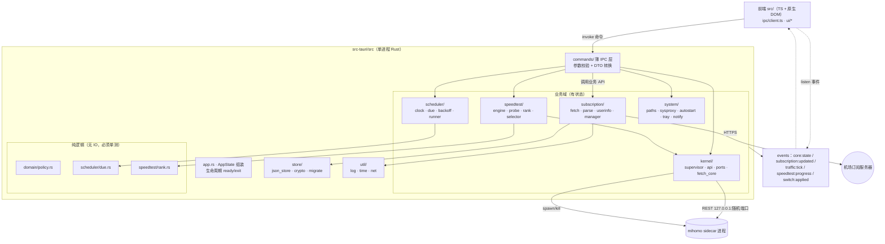

# 02 · 技术栈选型与总体架构

> **本章用途**：一次性定稿「用什么做、怎么分层、谁在什么线程上跑、允许引入哪些依赖」。
> 本章一旦确认，后续 03–13 章的所有代码片段都以本章的技术栈为前提；改栈等于重写全部章节。
>
> **投喂时机**：P0 阶段开始前，**只投喂一次**。与 `01-master-prompt.md` + `appendices/C-conventions.md` 一起投喂。
>
> **前置依赖**：必须已读 `01-master-prompt.md`（铁律与禁止行为）与 `appendices/C-conventions.md`
> （目录结构 C.2、数据模型 C.5、IPC C.6、错误码 C.8、性能预算 C.11、安全基线 C.12）。
> 本章**不得**修改契约；发现契约缺口只能输出 `CONTRACT-CHANGE-REQUEST:`。

---

## 1. 选型结论（先给答案）

| 项 | 定稿 | 一句话理由 |
| --- | --- | --- |
| 应用外壳 | **Tauri 2 + WebView2** | 安装包 3–6 MB 量级、Rust 侧零 GC、系统 WebView 复用，满足 C.11 包体 ≤12 MB 与 RSS ≤90 MB |
| 主语言 | **Rust stable**（MSRV 1.85+） | 内存可控、无运行时、与 mihomo 的 REST/进程交互最省胶水 |
| 异步 | **tokio `current_thread`** + 独立 blocking 线程池 | 空闲唤醒少、无多线程调度开销，符合 C.11「空闲不产生 <30s 定时唤醒」 |
| HTTP | **reqwest 0.13（rustls）** | 0.13 起 rustls 为默认后端，无 OpenSSL/无系统证书库依赖，交叉编译与体积都更稳 |
| YAML | **serde_yaml_ng 0.10** | 只做「解析 + 最小改写」，不做 AST 全量重排（保留机场原始结构） |
| 内核 | **mihomo 官方 Release 的 `mihomo-windows-amd64-compatible-*.zip`**，独立 sidecar 进程 | GPL-3.0 隔离（C.12.5）+ 崩溃隔离；GOAMD64=v1 兼容老 CPU |
| 前端 | **TypeScript + Vite + 原生 DOM**（无 React/Vue） | 不引入运行时框架，首屏与常驻内存更低（C.2 前端约束） |
| 持久化 | **单文件 JSON + 原子写 + DPAPI** | 无嵌入式数据库，避免体积与常驻内存（01 §4） |
| 打包 | **Tauri NSIS（x64）**，默认可选「首启下载内核」 | 满足包体预算与 GPL 合规 |

> 结论一句话：**Tauri 2 + Rust 单线程异步 + 原生 DOM 前端 + 独立 mihomo sidecar**。
> 这套组合是唯一能同时压住「包体 ≤12 MB」「RSS ≤90 MB」「冷启动 ≤1.2s」三条硬指标、
> 且不牺牲 Rust 侧网络/并发能力的方案。

---

## 2. 三种候选技术栈对比

### 2.1 总览对比

| 维度 | A：Tauri 2 + Rust（**选定**） | B：.NET 8 + WPF/WinUI 3 | C：Go + WebView2（wails/自建） |
| --- | --- | --- | --- |
| UI 渲染 | 系统 WebView2（Edge Chromium） | 原生 DirectX（WPF） / WinUI 3 | 系统 WebView2 |
| 主进程语言 | Rust | C# | Go |
| 运行时依赖 | WebView2 Runtime（Win10 1809+ 常已内置/可引导） | .NET 8 Desktop Runtime（自包含可免装，但 +60 MB） | WebView2 Runtime + Go 静态二进制 |
| 自包含发布体积（不含内核/WebView2） | **约 4–8 MB** | 约 65–90 MB（自包含） / 约 15 MB（框架依赖，需装运行时） | 约 12–25 MB |
| 安装包体积（NSIS，实测目标） | **≤ 12 MB**（可达成） | 15–95 MB | 20–35 MB |
| 常驻 RSS 目标 | **≤ 90 MB** | 80–140 MB（WPF 版偏低，WinUI 偏高） | 90–130 MB |
| 冷启动到托盘 | **0.5–1.0 s** | 0.6–1.5 s | 0.8–1.6 s |
| 内存安全 | 编译期保证（无 GC） | GC（有 STW 抖动风险） | GC（有 STW 抖动风险） |
| 与 mihomo REST/子进程交互 | 极佳（reqwest + tokio::process） | 极佳（HttpClient + Process） | 极佳（net/http + os/exec） |
| 二进制/依赖审计 | `cargo deny` / `cargo audit` 成熟 | NuGet 供应链较粗 | `go mod verify` 简单 |
| 单实例/托盘/自启生态 | Tauri 官方插件齐全 | 一等公民，最省事 | wails 插件较少，需手写 |
| 团队上手成本 | 中高（Rust 生命周期 + Tauri 2 新 API） | **低**（C#/XAML 生态最成熟） | 低中 |
| 本项目关键风险 | Rust 学习曲线；Tauri 2 插件版本需锁定 | 包体与 RSS 预算压力大 | WPF 级托盘/系统代理需 cgo 或 syscall 手写 |

### 2.2 与本项目硬指标的映射

| 硬指标（C.11） | A：Tauri 2 + Rust | B：.NET 8 | C：Go + WebView2 |
| --- | --- | --- | --- |
| 安装包 ≤ 12 MB | ✅ 4–8 MB | ❌ 自包含 65 MB+；框架依赖违背「装完即用」 | ⚠️ 20 MB+ 常见 |
| RSS ≤ 90 MB（隐藏） | ✅ 主进程典型 35–60 MB | ⚠️ WPF 60–90 MB；WinUI 更高 | ⚠️ 70–95 MB |
| 空闲 CPU ≤ 1.5% | ✅ 单线程 runtime + 事件降采样 | ✅ | ✅ |
| 冷启动 ≤ 1.2 s | ✅ 静态链接、无 JIT | ⚠️ JIT 预热 | ✅ |
| 空闲无 <30s 唤醒 | ✅ 自己控制 tick | ✅ | ✅ |
| GPL 内核隔离 | ✅ sidecar | ✅ | ✅ |

### 2.3 为什么否决 B（.NET 8）

1. **包体预算直接破线**：自包含发布 65 MB+，框架依赖发布要求用户装 .NET 8 Desktop Runtime——与「双击即用」的用户预期冲突。
2. **RSS 预算紧张**：WPF 空壳 60 MB 起步，本项目还要叠加 HTTP、YAML 解析、日志与托盘，90 MB 上限只剩很少余量。
3. **无技术收益**：本项目没有需要原生控件的复杂 UI（三页面 + 列表），WebView 渲染足够。

### 2.4 为什么否决 C（Go + WebView2）

1. **托盘/系统代理/开机自启要写 syscall 或 cgo**，Windows 侧成熟度不如 Tauri 插件与 `windows` crate。
2. **GC 抖动**：测速期并发 8 路 + 事件风暴时，GC 造成的尾延迟抖动会污染「用户感知的流畅度」。
3. **优势不明显**：Go 的构建简单性被 WebView2 胶水层抵消。

> **若用户在 P0 阶段明确选择 B 或 C**：本章的**分层、进程/线程模型、启动时序、ADR 结论**全部保持不变，
> 只把「语言与库」列做等价映射（Rust/tokio/reqwest/serde_yaml_ng → C#/async/HttpClient/YamlDotNet
> 或 Go/net-http/gopkg.in/yaml.v3）。契约（C 章）与行为语义**一个字节都不改**。

---

## 3. 分层架构

### 3.1 分层图



### 3.2 层职责与铁律

| 层 | 目录 | 允许做 | **禁止**做 |
| --- | --- | --- | --- |
| IPC 层 | `commands/` | 解析参数、`serde` DTO 转换、调业务函数、映射 `AppError` | 写业务逻辑、直接发 HTTP、直接写文件、`sleep`/重试 |
| 应用装配 | `app.rs` | 构造 `AppState`、注册托盘、启动/停止调度器、优雅退出 | 承载业务分支 |
| 业务域 | `subscription/ scheduler/ speedtest/ kernel/ system/` | 状态机、IO、并发、事件发射 | 直接读 `tauri::AppHandle` 做 UI 决策（只用于 emit） |
| 纯逻辑 | `domain/policy.rs`、`scheduler/due.rs`、`speedtest/rank.rs`、`subscription/userinfo.rs` 解析核心 | 纯函数，输入→输出 | 任何 IO、时间读取（时间必须由参数传入） |
| 持久化 | `store/` | 原子写、DPAPI、schema 迁移 | 业务判断 |
| 工具 | `util/` | 日志、时间、HTTP Client 构造 | 业务状态 |

> **依赖方向**：`commands → 业务域 → store/util → (std/第三方)`。
> 反向依赖（业务域去调 `commands`）一律视为架构违规，CI 用 `cargo clippy` + 代码评审拦截。

### 3.3 `AppState` 装配（可直接使用的骨架）

```rust
// src-tauri/src/app.rs
use std::sync::Arc;
use tokio::sync::{Mutex, RwLock};

use crate::domain::model::AppSettings;
use crate::kernel::supervisor::KernelSupervisor;
use crate::scheduler::runner::SchedulerHandle;
use crate::store::Store;
use crate::subscription::manager::SubscriptionManager;

/// 进程内唯一可变根。所有字段都必须是可被并发安全共享的句柄。
pub struct AppState {
    /// 设置：读多写少，用 RwLock；写入后按需 hot-apply（见 08 章）
    pub settings: RwLock<AppSettings>,
    /// 存储抽象（trait object，便于测试注入内存实现）
    pub store: Arc<dyn Store>,
    /// 订阅域：内部自己管索引与文件
    pub subs: Arc<SubscriptionManager>,
    /// 调度器句柄：只发命令，不直接跑任务
    pub scheduler: Mutex<Option<SchedulerHandle>>,
    /// 内核监管者
    pub kernel: Arc<KernelSupervisor>,
    /// 运行态快照（只读投影，供 core_status / 托盘读取）
    pub runtime: RwLock<crate::domain::model::RuntimeState>,
    /// 进程启动时刻（Unix 秒）
    pub started_at: i64,
}

pub type SharedState = Arc<AppState>;
```

装配顺序（`app.rs::bootstrap_sync`，**同步**、只读小文件、不发网络）：

1. `system::paths` 解析 Roaming/Local 目录并 `create_dir_all`；
2. `store::migrate` 读 `settings.json` → 失败则 `*.corrupt-<ts>` 备份 + 默认值（C.3）；
3. `store::json_store` 读 `profiles/index.json`；
4. 构造 `KernelSupervisor` / `SubscriptionManager`（此阶段**不**建 `reqwest::Client`，见下）；
5. `AppState` 返回给 `main.rs` 的 `app.manage(...)`；
6. `commands::settings::app_bootstrap` 首次被前端调用时，才在 `rt_handle` 上构造 `reqwest::Client`（章节 03）并启动 `SchedulerHandle`（章节 05）——**首屏不等内核**；
7. 若 `settings.start_core_on_launch` → `rt_handle.spawn(core_start())`（不阻塞首屏）。

> **为什么把 `reqwest::Client` 构造挪到第 6 步**：构造 Client 会做 TLS 后端初始化（rustls
> 加载平台根证书），实测有 20–80 ms 抖动；放在启动同步路径上会侵占「≤1.2 s 到托盘」的预算。
> 而 `app_bootstrap` 是异步命令，那里构造完全不影响首屏。

### 3.4 关键跨层接口：`SelectorApi`（契约 C.6.1 冻结面）

`speedtest/selector.rs`（07 章）与 `commands/speedtest.rs` **不得**直接拼 URL 调用内核。
所有 selector 相关 REST 调用必须经 `kernel/api.rs` 暴露的 trait，便于测试时注入假实现（06/07 章的单测依赖它）。

> **签名以 `C.6.1` + 07 章 §7.16 冻结表（`v1.3-freeze-1`）为准**，本章不重新发明类型。
> 下面这段是**照抄**冻结表的可编译落地版，任何章节改动必须先改冻结表。

```rust
// src-tauri/src/kernel/api.rs（签名冻结；实现细节见 08 章）
use std::future::Future;
use std::pin::Pin;

/// 内核 REST 调用的错误分类（C.6.1 五变体，**不得增删**）。
/// 与 `AppError` 解耦，便于 api.rs 内部复用与单测。
#[derive(Debug, Clone, PartialEq, Eq)]
pub enum ApiError {
    /// 401：secret 不一致 → `E_CORE_API_UNAUTH`
    Unauthorized,
    /// 404：节点/组不存在（合并后 `node_key` 变了会命中这个）
    NotFound(String),
    /// 请求超时 → `E_NET_TIMEOUT`
    Timeout,
    /// 其它 HTTP 状态（含「200 但响应体不是预期 JSON」→ `Status(200, detail)`）
    Status(u16, String),
    /// 连接层失败（内核没起来/端口不通）→ `E_CORE_START_FAILED`
    Transport(String),
}

/// `/proxies` 里可被 `PUT` 切换的组（字段名是 `members`，不是 `candidates`）。
/// 注意：`kind` 在这里**不出现** —— 筛选已在 `proxies_selectable` 内部完成。
pub struct SelectableGroup {
    pub name: String,
    pub members: Vec<String>,
    /// 当前选中项（内核返回的 `now`，可能缺失）
    pub now: Option<String>,
}

/// `/proxies/{name}` 的组详情。`kind` 是**内核 API 取值**（`"Selector"`），
/// 与 YAML 里的小写 `select` 不是一套（见 §3.4.2 陷阱）。
pub struct GroupInfo {
    pub name: String,
    /// 内核 API 原值：`Selector` / `URLTest` / `Fallback` / `LoadBalance`
    pub kind: String,
    pub now: Option<String>,
    /// 组成员（顺序即内核返回顺序）
    pub all: Vec<String>,
    /// `url-test` 等自动组才有；诊断时与 `settings.speedtest_probe_url` 比对
    pub test_url: Option<String>,
    pub hidden: bool,
}

/// 内核 selector 相关 API 的最小抽象。07 章 `switch_apply_best` 只依赖此 trait。
///
/// **dyn 兼容形式（C.6.1 v1.4 定稿）**：Rust 1.85 下 `async fn in trait` 默认不是 dyn 兼容的，
/// 而 07 章需要 `Arc<dyn SelectorApi>` 注入 `FakeApi`。因此一律用 boxed-future：
/// 实现侧 `Box::pin(async move { … })`，调用侧照常 `.await`，每请求一次装箱、成本可忽略。
pub type ApiFuture<'a, T> = Pin<Box<dyn Future<Output = Result<T, ApiError>> + Send + 'a>>;

pub trait SelectorApi: Send + Sync {
    /// GET /proxies → 过滤 `type == "Selector"` 的组
    fn proxies_selectable(&self) -> ApiFuture<'_, Vec<SelectableGroup>>;

    /// GET /proxies/{group} → 组详情
    fn proxy_group(&self, group: &str) -> ApiFuture<'_, GroupInfo>;

    /// PUT /proxies/{group} body {"name":"<node_key>"} → 204
    fn set_group_selected(&self, group: &str, node: &str) -> ApiFuture<'_, ()>;
}
```

> **`ApiFuture` 的两点纪律**（C.6.1 v1.4）：
> 1. 实现侧必须写 `Box::pin(async move { ... })`，**不要**留裸 `async fn`（那会失去 dyn 兼容）；
> 2. **不用 `async-trait` crate** —— 它等价于 boxed future，但多一层宏依赖，本项目不扩大依赖白名单（§5.1）。
>
> 调用侧用法与 `async fn` 完全一致：`api.proxy_group("Proxy").await?`。

#### 3.4.1 依赖方向约束

| 依赖方向 | 允许 | 说明 |
| --- | --- | --- |
| `speedtest/*` → `kernel/api.rs`（经 `SelectorApi`） | ✅ | 唯一允许的调用方式 |
| `commands/*` → `speedtest/selector.rs` | ✅ | 薄转发 |
| `kernel/api.rs` → `speedtest/*` | ❌ | **禁止**（内核层不得知道测速/切换策略） |
| `subscription/manager.rs` → `kernel/api.rs` | ✅ | 热更新 `PUT /configs`，见 04 章 §8 |
| `subscription/manager.rs` → `speedtest/selector.rs` | ❌ | **禁止**（合并不得直接改选中项；由 07 章在测速后应用） |

> `ApiError` **不是**对外错误码：`api.rs` 内部用它做细分类，向上必须映射回 C.8 的 `AppError`：
>
> | `ApiError` | `AppError.code` |
> | --- | --- |
> | `Unauthorized` | `E_CORE_API_UNAUTH` |
> | `Timeout` | `E_NET_TIMEOUT`（照抄 08 章 §08.17.1 的裁决） |
> | `NotFound(d)` / `Transport(d)` / `Status(_, d)` | `E_CORE_START_FAILED`（`d` 作为 `detail`，必须过脱敏） |
>
> **禁止**把 `ApiError` 变体名塞进 `AppError.code`。

#### 3.4.2 `kind` 取值陷阱（写错会导致自动切换完全失效）

两套取值**不可混用**（C.6.1）：

| 来源 | 取值 | 用在哪 |
| --- | --- | --- |
| 订阅 YAML（机场原始配置） | `select` / `url-test` / `fallback` / `load-balance`（全小写 + 连字符） | 我们用 `serde_yaml_ng` 写/读 `runtime/config.yaml` 时判断 |
| 内核 API `/proxies`、`/group` 的 `type` | `Selector` / `URLTest` / `Fallback` / `LoadBalance`（大驼峰、无连字符） | `GroupInfo.kind` / `SelectableGroup` 筛选 |

**规则**：`GroupInfo.kind` 只接受 `"Selector"`，且**大小写敏感精确匹配**。
禁止 `contains("select")`、`to_lowercase() == "select"` —— `"Selector"` 转小写是 `"selector"`，
与 YAML 的 `"select"` 并不相等，这正是最容易写错的地方。单测必须含一条：
`kind == "Selector"` → true、`kind == "select"`（错误传入）→ false。


### 3.5 数据模型摘要（仅列架构相关字段，权威定义见 C.5 v1.2）

| 结构 | 字段 | 架构含义 |
| --- | --- | --- |
| `AppSettings` | `schema_version: u32`（当前 **2**） | 存 `compliance_accepted_at` 后升版；`store/migrate.rs` 必须能把 1→2 |
| `AppSettings` | `compliance_accepted_at: Option<i64>` | `None` = 未接受合规提示 → 首启必弹（C.12.6）；`app_bootstrap` 据此决定是否显示模态 |
| `AppSettings` | `bind_address: String`（固定 `127.0.0.1`） | 决定 `external-controller` 前缀；校验失败直接拒绝启动内核。**该字段不可由用户修改**（UI 不暴露），仅作配置生成时的显式声明 |
| `SwitchPolicy` | `manual_override_min: u32`（默认 60） | **内存态**手动覆盖，锁在 `speedtest/selector.rs` 的 `SwitchRuntimeLocks`，**不进** `RuntimeState`（避免夹带进 2 s 的 `traffic:tick`） |
| `SwitchRecord` | `to_delay: Option<u32>` | `Manual` 切换可能无新鲜测速数据；**不得用 0 冒充**（0 是「0 ms」，语义错误） |
| `RuntimeState` | `sysproxy: SysProxyState` | 顶栏/托盘开关的初始化依据；`managed_by_us` 决定退出时是否恢复 |
| `TrafficSummary` | 见 C.5 | `traffic_summary` 命令返回；派生字段（`used`/`used_percent`/`days_left`）**由后端一次算好**，前端只展示不重算 |
| IPC | `switch_apply_best` → `Option<{primary, all}>` | **无生效组返回 `None`**（不存在 `primary: null`）；有生效时 `primary == all[0]`，`scope=Group` 时 `all.len() == 1` |
| 内部接口 | `SelectorApi` / `ApiError` / `GroupInfo` / `SelectableGroup` / `SwitchRuntimeLocks` | C.6.1 冻结面，**不是 IPC 命令**，不得为它们新增 `invoke` |

> 架构侧结论：以上变化**不改变分层与线程模型**，只在 `speedtest/selector.rs` 增加一个内存态锁表、
> 在 `commands/dto.rs` 增加 `Option<{primary, all}>` 的 DTO。无需新增线程、无需新增定时器。
> `traffic_summary` 是**纯计算**命令（读各订阅 `mgmt` + `now`），可复用 05 章的可注入时钟做单测。
> `switch_apply_best` 返回 `None` 时，`commands/` 层返回 `null` 给前端（前端已有 `null` 分支），
> **不得**构造一条「切了但没切」的假 `SwitchRecord` 去填充 —— 那会污染 `runtime/switch-history.json`（C.3）。

---

## 4. 进程与线程模型

### 4.1 进程表

| 进程 | 归属 | 生命周期 | 说明 |
| --- | --- | --- | --- |
| `clash-zhengl.exe`（主进程） | 本产品 | 用户退出/托盘退出 | 单实例（命名互斥 + `tauri-plugin-single-instance`） |
| `mihomo.exe`（sidecar） | 本产品 spawn | 随代理开关/崩溃重启 | 独立进程，GPL 隔离；`-d <Local>/runtime -f <Local>/runtime/config.yaml` |
| WebView2 子进程组 | 系统 WebView2 | 随窗口 | `msedgewebview2.exe`，内存**不计入**主进程 RSS（测量口径见 §4.3） |
| Windows 系统进程 | OS | — | `svchost`（WinINET）、`audiodg` 等，不干预 |

### 4.2 线程表（主进程）

| 线程名 | 数量 | 职责 | 预算 |
| --- | --- | --- | --- |
| `main` | 1 | Tauri 事件循环、窗口/托盘消息泵 | 必须无阻塞；禁止在此 `block_on` |
| `cz-rt` | 1 | tokio `current_thread` runtime：全部 async 业务（HTTP、内核 REST、定时 tick） | 空闲时 0 唤醒，除 tick |
| `cz-block` | ≤2 | `spawn_blocking`：DPAPI、大 YAML 解析、zip 解压、SHA256 | 单次 ≤200 ms，不常驻 |
| `cz-tick` | 1 | 调度器单线程 tick（章节 05），也可并入 `cz-rt`（见 ADR-08） | 每 30–60 s 一次唤醒 |
| `cz-log` | 1 | `tracing-appender` 非阻塞写盘 | 落盘 <1 ms/行 |

> **总线程数上限：5（不含 WebView2 与内核）**。新增常驻线程必须在此表登记并说明理由（01 铁律 5）。

### 4.3 线程/定时器预算表

| 定时任务 | 默认周期 | 精度 | 抖动 | 是否常驻唤醒 | 预算（C.11 / C.10） |
| --- | --- | --- | --- | --- | --- |
| 订阅自动更新检查 | 每 60 s 检查一次「谁到期」（非每次拉取） | ±10% | 启动 +`0..30s` | 是（1 次/60s） | 满足「无 <30s 唤醒」 |
| 订阅实际拉取 | 按 `update_interval_min`（下限 15 min） | ±10% | 每订阅独立 +`0..30s` | 否（到期才唤醒） | 串行，`sub_fetch_concurrency` 默认 2 |
| 测速 | `speedtest_interval_min`（默认 30，下限 5） | ±10% | +`0..30s` | 否 | 测速期 CPU ≤25% 单核 ≤5 s |
| `traffic:tick` 事件 | 2 s（窗口隐藏降 10 s） | ±20% | — | 是 | 后端合流，≤5 Hz |
| 内核健康检查 | 启动后 0.3/0.6/1.2/2.4 s 快检，稳定后 30 s | — | — | 是 | 只读 `/version` |
| 日志滚动 | 按天 + 单文件 2 MB | — | — | 否 | 保留 3 天 |
| 端口/临时文件清理 | 启动时一次 + 每 6 h | — | +`0..30s` | 是（低频） | — |

> **反例（禁止）**：每个订阅起一个 `tokio::time::interval`、每次测速起一个新 runtime、
> 用 `std::thread::sleep` 做重试退避。所有周期性行为必须收敛到 §4.2 的 `cz-tick` / `cz-rt`。

### 4.4 并发与取消约定

| 约定 | 内容 |
| --- | --- |
| 共享状态 | `tokio::sync::RwLock`（读多写少：settings/runtime）；`Mutex`（写多或临界区短：scheduler handle） |
| 短临界区 | 可用 `parking_lot::Mutex`（不跨 `.await`） |
| 禁止 | 在持锁期间 `.await` 网络 IO；`std::sync::Mutex` 跨 await（Clippy 报错） |
| 取消 | 所有长任务接受 `CancellationToken`（`tokio_util`）；退出时 `cancel()` 后 `join` 带 3 s 超时 |
| 裸 spawn | 禁止 `tokio::spawn` 不留句柄；必须入 `TaskGuard`（`Drop` 时 cancel） |
| 背压 | 事件发射走 `mpsc` + 合流器，禁止高频道直接 `emit`（C.7 限流） |

```rust
// src-tauri/src/util/task_guard.rs —— 所有后台任务必须经此创建
use tokio_util::sync::CancellationToken;

pub struct TaskGuard {
    token: CancellationToken,
    handle: tokio::task::JoinHandle<()>,
}

impl TaskGuard {
    pub fn spawn<F>(name: &'static str, fut: F) -> Self
    where
        F: std::future::Future<Output = ()> + Send + 'static,
    {
        let token = CancellationToken::new();
        let child = token.clone();
        let handle = tokio::spawn(async move {
            tokio::select! {
                _ = child.cancelled() => { tracing::debug!(task = name, "cancelled"); }
                _ = fut => {}
            }
        });
        Self { token, handle }
    }

    /// 优雅停止：先 cancel，再带超时等待，超时后 abort（防止线程泄漏）。
    pub async fn shutdown(self) {
        self.token.cancel();
        if tokio::time::timeout(std::time::Duration::from_secs(3), self.handle)
            .await
            .is_err()
        {
            tracing::warn!("task shutdown timeout, aborting");
        }
    }
}
```

---

## 5. 依赖白名单（唯一许可清单）

### 5.1 直接依赖（Rust）

> 版本为文档编写时 `crates.io` 最新稳定版，落地时锁 `Cargo.lock`（禁止 `^` 漂移）。
> 「体积」列为**增量估算**（相对空壳 Tauri 包），P6 阶段必须用 `cargo bloat --release --crates` 实测校正。

| crate | 版本 | 许可证 | 用途 | 体积增量（估） | 理由 / 不可替代性 |
| --- | --- | --- | --- | --- | --- |
| `tauri` | 2.12.x | Apache-2.0 OR MIT | 应用外壳、IPC、托盘、窗口 | 3.5–5 MB（含 WebView 胶水） | 契约 C.2 指定栈 |
| `tauri-plugin-single-instance` | 2.5.x | Apache-2.0 OR MIT | 单实例 + 唤起既有窗口 | <10 KB | 官方插件，比手写命名互斥更少 bug |
| `tauri-plugin-autostart` | 2.7.x | Apache-2.0 OR MIT | 开机自启（注册表 Run） | <20 KB | 官方实现，卸载可逆 |
| `tauri-plugin-notification` | 2.8.x | Apache-2.0 OR MIT | 系统通知，失败降级托盘气泡 | <30 KB | 避免自写 Shell_NotifyIcon |
| `tokio` | 1.54.x | MIT | 异步运行时（`rt`,`time`,`sync`,`process`,`macros`） | 0.6–0.9 MB | 生态默认；只用 `current_thread` |
| `tokio-util` | 0.7.x | MIT | `CancellationToken` | <50 KB | 统一取消语义 |
| `reqwest` | **0.13.x** | MIT OR Apache-2.0 | 订阅 HTTP + 内核 REST 客户端 | 1.2–1.8 MB（rustls+aws-lc） | 0.13 起 rustls 为默认，无 OpenSSL |
| `serde` / `serde_json` | 1.0.x | MIT OR Apache-2.0 | JSON 落盘与 IPC DTO | 0.2–0.3 MB | 契约指定 JSON 持久化 |
| `serde_yaml_ng` | 0.10.x | MIT | Clash YAML 解析 + 最小改写 | 0.15–0.25 MB | 保留 `Value` 原文结构，优于全量反序列化 |
| `tracing` / `tracing-subscriber` / `tracing-appender` | 0.1.x / 0.3.x / 0.2.x | MIT | 结构化日志 + 脱敏层 + 滚动 | 0.2–0.3 MB | C.9 要求 tracing 层脱敏 |
| `thiserror` | 2.0.x | MIT OR Apache-2.0 | `AppError` 派生（C.8 错误码） | <10 KB | 比手写 `Display` 稳定 |
| `sha2` | 0.11.x | MIT OR Apache-2.0 | 内核 zip SHA256、节点指纹 | <100 KB | 校验与指纹必需 |
| `base32` | 0.5.x | MIT OR Apache-2.0 | `uid`（8 位 base32，C.5） | <20 KB | 兼容大小写不敏感的 uid |
| `getrandom` | 0.4.x | MIT OR Apache-2.0 | 生成 32 hex secret、抖动随机数 | <20 KB | 不引入完整 `rand`（见 5.3） |
| `httpdate` | 1.0.x | MIT OR Apache-2.0 | `If-Modified-Since` / `Last-Modified` 解析 | <20 KB | 手写 RFC 7231 日期易错 |
| `zip` | 9.x | MIT | 解压 mihomo 发行包 | 0.1–0.2 MB | 只在 `fetch_core` 使用，务必关闭默认 zstd/bzip2 特性 |
| `windows` | 0.62.x | MIT OR Apache-2.0 | DPAPI、WinINET、Toolhelp（仅必要 feature） | 0.1–0.3 MB | 不引 `winapi`（已弃维护） |
| `parking_lot` | 0.13.x | MIT OR Apache-2.0 | 短临界区同步锁 | <50 KB | 无 poisoned 处理噪音 |

**feature 裁剪（必须显式声明，禁止 `features = ["full"]`）**

```toml
# src-tauri/Cargo.toml（关键片段）
[package]
name = "clash-zhengl"
version = "0.1.0"
edition = "2021"
rust-version = "1.85"

[dependencies]
tauri = { version = "2.12", features = ["tray-icon", "image-png"] }
tauri-plugin-single-instance = "2.5"
tauri-plugin-autostart = "2.7"
tauri-plugin-notification = "2.8"

tokio = { version = "1.54", default-features = false, features = ["rt", "time", "sync", "process", "macros"] }
tokio-util = { version = "0.7", default-features = false, features = ["rt"] }

reqwest = { version = "0.13", default-features = false, features = [
    "rustls",        # 0.13：rustls 已是默认后端，这里显式声明意图
    "gzip",          # 订阅常见 gzip；deflate 视样本再开
    "json",          # 内核 REST 响应
    "query",         # /proxies/{name}/delay?url=..&timeout=..
    "charset",       # 处理非 UTF-8 的 YAML（少量机场）
] }
# 明确不启用：http2（内核对端是本地 HTTP/1.1）、cookies、brotli、zstd、multipart、hickory-dns

serde = { version = "1", features = ["derive"] }
serde_json = "1"
serde_yaml_ng = "0.10"
tracing = "0.1"
tracing-subscriber = { version = "0.3", default-features = false, features = ["fmt", "env-filter", "json", "time"] }
tracing-appender = "0.2"
thiserror = "2"
sha2 = "0.11"
base32 = "0.5"
getrandom = "0.4"
httpdate = "1"
parking_lot = "0.13"
zip = { version = "9", default-features = false, features = ["deflate"] }

[target.'cfg(windows)'.dependencies]
windows = { version = "0.62", features = [
    "Win32_Foundation",
    "Win32_Security_Cryptography",   # DPAPI
    "Win32_Networking_WinInet",      # 系统代理 + InternetSetOption
    "Win32_System_Registry",
] }

[dev-dependencies]
tempfile = "3"
tokio = { version = "1.54", features = ["rt", "macros", "test-util"] }

# 体积预算的关键：release profile
[profile.release]
opt-level = "z"      # 优先体积；网络热路径不受影响（瓶颈在 IO）
lto = "fat"
codegen-units = 1
strip = true
panic = "abort"      # 注意：abort 后无法 catch_unwind，见 ADR-10
```

### 5.2 前端依赖

| 包 | 版本 | 许可证 | 用途 | 理由 |
| --- | --- | --- | --- | --- |
| `@tauri-apps/api` | 2.x | Apache-2.0 OR MIT | `invoke` / `listen` | 必需 |
| `vite` | 7.x | MIT | 构建 | 仅 devDependency |
| `typescript` | 5.x | Apache-2.0 | 类型 | 仅 devDependency |
| `@biomejs/biome` | 2.x | MIT | 格式化 + lint | 替代 eslint+prettier（更轻） |

**禁止**：React / Vue / Svelte / Tailwind / 任何 UI 组件库 / 任何图表库 / moment.js / lodash 全量。
（前端只做「列表 + 表单 + 进度条 + 虚拟滚动」，原生 DOM 足够，见 09 章。）

### 5.3 明确拒绝的依赖（白名单外一律先拒）

| 候选 | 拒绝理由 |
| --- | --- |
| `rand`（完整） | 只需要 `getrandom` 填 32 字节，完整 `rand` 带 1 MB+ 的 PRNG/分布实现 |
| `anyhow`（业务路径） | 会吞掉错误码，与 C.8 结构化 `AppError` 冲突；仅允许在 `tests/` 与 `scripts/` 用 |
| `serde_yaml`（旧） | 已停更；`serde_yaml_ng` 是维护分支 |
| `sqlite`/`rusqlite`/`sled` | 违背 01 §4「不使用嵌入式数据库」 |
| `openssl` / `native-tls` | 增加 DLL 依赖与体积，rustls 已足够 |
| `hyper`/`axum`（应用侧） | 本产品不对外监听端口，不需要服务端框架 |
| `regex`（用于日志脱敏） | 脱敏只需固定键名 + 分隔符扫描，手写 80 行足够；`regex` 约 0.4–0.6 MB |
| `chrono` / `time` | 只需要「Unix 秒 ↔ 本地展示」，用 `windows` 的时区 API + 手写格式化（见 09 章） |
| 任意遥测/上报 SDK | 违反 01 铁律 1 |

> **新增依赖流程**：在 PR 描述里贴「用途 / 体积增量（`cargo bloat` 对比）/ 许可证 / 不引入的替代方案」，
> 由 Lead 批准后写入本表。未登记的依赖视为违规。

---

## 6. 目录结构与契约映射

> 完整目录见 `C-conventions.md §C.2`，此处只标注**本章负责定义**的归属边界，避免后续章节重复造轮子。

| 契约路径 | 本章定义的关键点 | 由哪一章展开 |
| --- | --- | --- |
| `src-tauri/src/main.rs` | 单实例、日志、panic hook、tray 初始化的**顺序**（§7） | 08 章 |
| `src-tauri/src/app.rs` | `AppState` 字段与装配顺序（§3.3） | 本章 |
| `src-tauri/src/commands/*` | 只做校验/转发；DTO 在 `commands/dto.rs` 统一 `rename_all = "camelCase"` | 06/08 章按需 |
| `subscription/fetch.rs` | 共享 `reqwest::Client` 的唯一构造点（`util/net.rs`） | **03 章** |
| `subscription/parse.rs` | YAML → `ParsedProfile{proxies, groups}` | **03 章** |
| `subscription/userinfo.rs` | `parse_userinfo_header` 纯函数 | **03 章** |
| `subscription/manager.rs` | 多订阅去重、合并 runtime config、原子写 | **04 章** |
| `scheduler/runner.rs` | 单 tick 线程 | 05 章 |
| `speedtest/engine.rs` | 信号量并发探测 | 06 章 |
| `kernel/supervisor.rs` | sidecar 生命周期 | 08 章 |
| `store/json_store.rs` | 原子写（`*.tmp` → fsync → rename） | **04 章**（幂等实现） |

**文件命名纪律**：`docs` 目录下的文档必须 `NN-kebab-case-title.md`（C.4），
代码文件必须 `snake_case.rs`，**不允许**出现 `Fetch.rs`、`fetchSub.rs`、`fetch-sub.rs`。

---

## 7. 启动时序

### 7.1 主进程启动序列（目标 ≤1.2 s 到托盘可用）

```text
t0      main() 进入
t0+0    ├─ util::log::init()                      // 同步，≤15 ms（滚动文件 + 脱敏层）
t0+15   ├─ std::panic::set_hook()                 // 写入 logs 后弹中文提示
t0+18   ├─ single_instance::acquire()             // 命名互斥；已有实例 → ShowWindow + exit(0)
t0+25   ├─ system::paths::init()                  // Roaming/Local，create_dir_all
t0+35   ├─ tokio current_thread runtime 建立 + cz-rt 线程
t0+60   ├─ store: settings.json / profiles/index.json（异步读，损坏则 *.corrupt-<ts> 回退默认）
t0+110  ├─ AppState 组装（§3.3）
t0+130  ├─ Tauri Builder: tray 图标 + 菜单（不阻塞加载窗口）
t0+160  ├─ setup(): 注册 IPC handler、注入 AppState
t0+180  ├─ 窗口按 silent_start 决定「显示」或「隐藏」
t0+200  ├─ 前端 invoke("app_bootstrap") → 一次性返回 settings+subscriptions+runtime
t0+350  ◀── **托盘可用（验收点 A：≤1.2 s）**
t0+350  ├─ 异步：scheduler 启动（首个 tick 加 0..30 s 抖动）
t0+360  ├─ 异步：start_core_on_launch → ports 探测 → secret 生成 → spawn mihomo
t0+1800 ├─ 内核 /version 健康检查通过 → emit core:state=Running
t0+~3000◀── **代理可用（验收点 B：≤3 s）**
```

### 7.2 启动期三条硬规则

| 规则 | 原因 |
| --- | --- |
| **首屏只发 1 次 IPC**（`app_bootstrap`，C.6） | 多次往返会显著拉长「看起来卡」的时间 |
| **启动阶段禁止网络同步等待** | 订阅拉取、内核下载一律异步，失败不影响首屏 |
| **内核启动不阻塞托盘** | 内核冷启动 1–2 s，若同步等待则验收点 A 必挂 |

### 7.3 退出序列

```text
exit 请求（托盘退出 / 系统关机 / 单实例转发）
  ├─ 1. 置退出标志，拒绝新的 IPC 写操作（返回 E_BUSY）
  ├─ 2. scheduler.shutdown()（cancel + 3s 超时）
  ├─ 3. 若由本应用开启系统代理 → 恢复原值（见 08 章「恢复守卫」）
  ├─ 4. kernel.stop()：先 POST /configs 不需要；直接任务栏优雅结束：
  │      发送 CTRL_BREAK / 或 wait 500ms 后 kill（详见 08 章）
  ├─ 5. speedtest cancel、事件合流器 flush
  ├─ 6. store flush（如有待写 JSON，原子写落盘）
  └─ 7. 日志 flush → exit(0)
```

> **失败不崩**（01 铁律 4）：以上任一步失败只记录 `WARN`，继续下一步；退出路径**永不 panic**。

### 7.4 `main.rs` 骨架（可直接落地）

```rust
// src-tauri/src/main.rs
#![cfg_attr(not(debug_assertions), windows_subsystem = "windows")]

mod app;
mod commands;
mod domain;
mod kernel;
mod scheduler;
mod speedtest;
mod store;
mod subscription;
mod system;
mod util;

use std::sync::Arc;
use tauri::Manager;

fn main() {
    // 1) 日志必须先于一切（连 panic hook 都要能写日志）
    util::log::init();
    // 2) panic hook：记录后以中文提示用户，禁止裸崩
    util::log::install_panic_hook();
    // 3) 单实例守卫：命名互斥；第二实例唤起既有窗口后立即退出
    if let Err(e) = system::single_instance::acquire() {
        tracing::info!(?e, "another instance is running, forwarding activation");
        system::single_instance::activate_existing();
        return;
    }

    // 4) 建立 tokio current_thread runtime，并把它整体跑在独立的 cz-rt 线程上。
    //    注意：**不是**用 `tauri::async_runtime`（那是多线程 runtime，与 ADR-02 冲突），
    //    而是在 setup 里把 `rt_handle` 交给 AppState，所有业务 async 任务都 `rt_handle.spawn(...)`。
    let rt = match tokio::runtime::Builder::new_current_thread()
        .enable_all()
        .thread_name("cz-rt")
        .build()
    {
        Ok(rt) => rt,
        Err(e) => {
            util::log::fatal(&format!("无法创建异步运行时：{e}"));
            return;
        }
    };
    let rt_handle = rt.handle().clone();
    // 该线程常驻直到进程退出；`pending()` 永不完结，任务由 handle 驱动。
    // 句柄故意 drop（detach）：进程退出时随 OS 回收，无需 join。
    std::thread::Builder::new()
        .name("cz-rt".into())
        .spawn(move || rt.block_on(std::future::pending::<()>()))
        .expect("spawn cz-rt thread");

    let result = tauri::Builder::default()
        .plugin(tauri_plugin_single_instance::init(|app, _argv, _cwd| {
            // 第二实例被拉起 → 显示已有窗口（不新建状态）
            if let Some(w) = app.get_webview_window("main") {
                let _ = w.show();
                let _ = w.set_focus();
            }
        }))
        .plugin(tauri_plugin_notification::init())
        .setup(move |app| {
            // AppState 在 setup 内构造：保证 paths/log 已就绪。
            // **同步**构造（见下方说明），因此这里没有 block_on，符合 §4.2「main 禁止 block_on」。
            let state = app::bootstrap_sync(app.handle().clone(), rt_handle.clone(), None)?;
            app.manage(Arc::new(state));
            system::tray::build(app.handle())?;
            Ok(())
        })
        .invoke_handler(tauri::generate_handler![
            commands::settings::app_bootstrap,
            commands::settings::settings_get,
            commands::settings::settings_save,
            commands::subscription::subscription_list,
            commands::subscription::subscription_add,
            commands::subscription::subscription_refresh,
            commands::core::core_status,
            commands::core::core_start,
            commands::core::core_stop,
            commands::speedtest::speedtest_start,
            commands::speedtest::switch_apply_best,
        ])
        .build(tauri::generate_context!());

    match result {
        Ok(app) => {
            app.run(|_app, event| {
                if let tauri::RunEvent::ExitRequested { .. } = event {
                    // 退出前置：由 app.rs 的 shutdown 序列处理
                }
            });
        }
        Err(e) => util::log::fatal(&format!("应用启动失败：{e}")),
    }
}
```

**为什么 `bootstrap` 是同步函数（`bootstrap_sync`），不用 `block_on`**

| 方案 | 问题 |
| --- | --- |
| `tauri::async_runtime::block_on(app::bootstrap(...))` | ❌ ① 它在 **Tauri 自己的多线程 runtime** 上跑，与 ADR-02「单 current_thread」冲突，等于起了两套 runtime；② 在 `main` 的 setup 回调里阻塞，违反 §4.2 线程表对 `main` 的「必须无阻塞」约束；③ 若 `bootstrap` 内部又 `spawn` 到 `rt_handle`，还要等它完成，容易写出死锁 |
| 自建 runtime 上 `rt_handle.block_on(...)`（从 main 线程调用） | ❌ 在 runtime 之外阻塞等待该 runtime，且 `block_on` 会占用调用线程直到完成；语义可行但把「主线程同步等异步」的不透明依赖带进架构 |
| **同步 `bootstrap_sync`（选定）** | ✅ 启动期只有几次**小文件**读取（`settings.json`、`index.json`、`runtime/secret`，均 <100 KB），`std::fs` 读取总耗时 ≈ 10–30 ms；且此时还没进入事件循环，阻塞代价为零。异步业务（网络/内核）在 `app_bootstrap` 之后由 `rt_handle` 驱动 |

`app.rs` 对应签名（同步、无 IO 阻塞风险、可注入根目录便于测试）：

```rust
// src-tauri/src/app.rs
use std::path::PathBuf;
use std::sync::Arc;

use tauri::AppHandle;

use crate::domain::errors::AppError;

/// 启动期同步装配。必须满足：只读小文件、不发网络请求、不启动内核。
/// `root` 显式传入（默认取 system::paths），测试时指向临时目录。
pub fn bootstrap_sync(
    app: AppHandle,
    rt: tokio::runtime::Handle,
    root: Option<PathBuf>,
) -> Result<AppState, AppError> {
    let paths = crate::system::paths::init(root)?;          // Roaming/Local + create_dir_all
    let settings = crate::store::migrate::load_settings(&paths)?; // 损坏则 corrupt 备份 + 默认值
    let subs = crate::store::json_store::load_index(&paths)?;     // Vec<Subscription>
    let store = Arc::new(crate::store::json_store::JsonStore::new(paths.clone()));
    let kernel = Arc::new(crate::kernel::supervisor::KernelSupervisor::new(
        paths.clone(),
        rt.clone(),
    ));
    let subs_mgr = Arc::new(crate::subscription::manager::SubscriptionManager::new(
        paths,
        store.clone(),
        rt.clone(),
    ));

    Ok(AppState {
        settings: tokio::sync::RwLock::new(settings),
        store,
        subs: subs_mgr,
        scheduler: tokio::sync::Mutex::new(None),
        kernel,
        runtime: tokio::sync::RwLock::new(crate::domain::model::RuntimeState::default()),
        started_at: crate::util::time::now_unix(),
    })
}
```

> `AppHandle` 参数在 `bootstrap_sync` 内部**只**用于构造事件发射器（`Emitter` 包装），
> 不用于读窗口/UI 状态（§3.2 铁律）。若某段装配确实不需要它，就删掉该参数——
> 「参数占位」会诱导后续代码在主线程上做奇怪的事。

> 注：`generate_handler!` 中的命令名必须与 `C.6` 表**逐字一致**（`subscription_update_url` 不是 `subscription_update`）。

---

## 8. 架构决策记录（ADR）

### ADR-01 桌面外壳选 Tauri 2 + Rust

| 项 | 内容 |
| --- | --- |
| **背景** | 需要满足包体 ≤12 MB、RSS ≤90 MB、冷启动 ≤1.2 s（C.11），且要频繁做 HTTP、子进程、Win32 调用 |
| **选项** | A Tauri2+Rust / B .NET8 WPF / C Go+WebView2 |
| **决策** | 选 A |
| **理由** | 静态链接无运行时；Rust 无 GC 抖动；Tauri 2 插件覆盖托盘/单实例/自启/通知；`windows` crate 直连 DPAPI/WinINET |
| **后果** | 团队需 Rust 能力；需锁定 Tauri 2 插件版本；WebView2 Runtime 需引导（11 章）；包体预算可达成 |

### ADR-02 异步运行时用 `current_thread` 而非多线程

| 项 | 内容 |
| --- | --- |
| **背景** | 并发上限很低（订阅拉取 ≤4、测速 ≤16，且测速走内核 REST 而非本进程网络栈） |
| **决策** | `new_current_thread().enable_all()`，单 `cz-rt` 线程；CPU 密集（SHA256/zip/大 YAML）走 `spawn_blocking` |
| **理由** | 多线程 work-stealing 在低并发下只增加调度、线程栈（默认 2 MB/线程）与唤醒；C.11 要求空闲唤醒极少 |
| **后果** | 任何异步任务阻塞会拖慢全部异步（必须遵守「禁止阻塞 `cz-rt`」）；CPU 密集路径必须显式 `spawn_blocking`，否则测速期 CPU 指标会劣化 |

### ADR-03 YAML 处理用 `serde_yaml_ng` 的 `Value`，不全量反序列化

| 项 | 内容 |
| --- | --- |
| **背景** | 机场配置含大量我们**不认识也不该丢**的字段（`proxy-providers`、`rule-providers`、`tun`、`sniffer`、私有扩展） |
| **决策** | 一律先解析为 `serde_yaml_ng::Value`，只读写我们需要的键（`proxies`/`proxy-groups`/`rules`），其余**原样保留** |
| **理由** | 全量 `struct` 反序列化会丢字段、写回时破坏用户配置；`Value` 保序且保留类型 |
| **后果** | 需自写「安全取值」辅助函数（`as_seq`/`as_map`/`as_str_lossy`）；不复用全量 AST 重排，输出格式可能与输入不同（可接受，因为 runtime config 是**重建**的，见 04 章） |

### ADR-04 持久化用单文件 JSON + 原子写，不用 SQLite

| 项 | 内容 |
| --- | --- |
| **背景** | 数据量极小（≤5 订阅、1 份设置、若干历史），且要求崩溃不损坏（C.3） |
| **决策** | `settings.json`、`profiles/index.json` 用「`*.tmp` → `fsync` → `rename`」原子写；不使用数据库 |
| **理由** | `rusqlite` 带 ~1 MB+ 二进制与常驻页缓存；JSON 可直接人读排障、便于诊断包脱敏 |
| **后果** | 并发写必须串行化（单一 writer + `Mutex`）；schema 变更靠 `migrate.rs` + `schema_version`；无事务，跨文件一致性靠「先写数据文件、再写索引」的顺序保证 |

### ADR-05 内核以独立 sidecar 进程调用

| 项 | 内容 |
| --- | --- |
| **背景** | mihomo 为 GPL-3.0（C.12.5）；内核可能崩溃/OOM |
| **决策** | 不静态链接、不 cgo、不上 FFI；`std::process::Command` 启动官方二进制，`-d`/`-f` 指定目录与配置，用 REST 通信 |
| **理由** | GPL 隔离；崩溃只影响 sidecar，主进程可退避重启并保持 UI 可用（01 铁律 4） |
| **后果** | 需自实现 supervisor（健康检查、崩溃退避、日志分流，见 08 章）；两进程日志需时间对齐 |

### ADR-06 内核资产选 `amd64-compatible`（GOAMD64=v1）

| 项 | 内容 |
| --- | --- |
| **背景** | v1.19.33 的 Windows 资产同时存在 `mihomo-windows-amd64-compatible`、`mihomo-windows-amd64-v1/v2/v3` 与历史 `-go120..-go125` 变体；社区经验表明不带后缀的 `amd64` 对应 **GOAMD64=v3（AVX2）**，老 CPU 直接 `SIGILL` |
| **决策** | 默认下载 `mihomo-windows-amd64-compatible-<ver>.zip`；若 404 则回退 `mihomo-windows-amd64-v1-<ver>.zip`；**禁止**默认选 `amd64`/`v2`/`v3` |
| **理由** | 兼容性优先（C.1「不得硬编码 x64 假设」的同一精神）；`compatible` 是 v1 语义、老机器的安全解 |
| **后果** | 官方注明 `compatible` 命名「下一版将移除」，因此回退链必须存在且要有单测（08 章 `fetch_core.rs`）；性能略低于 v3（对代理场景无实质影响，瓶颈在网络） |

> 相关事实：该版本 Release **不含 `checksums.txt`**（实测 404），只有 `version.txt`（内容 `v1.19.33`）。
> 因此校验必须依赖**我们自己的固定 SHA256 清单**（见 08 章与 11 章），不得「下载后无校验即执行」。

### ADR-07 前端用原生 DOM + TypeScript

| 项 | 内容 |
| --- | --- |
| **背景** | UI 仅三页面；C.2 明确「不引入 React/Vue 等运行时框架」 |
| **决策** | `document.createElement` + 模板字符串 + 一个 30 行的 `h()` 辅助 + 事件委托；列表 >300 节点用虚拟滚动 |
| **理由** | 框架运行时常驻 30–60 MB 堆与首屏解析成本，对 RSS 预算是纯负担 |
| **后果** | 状态同步要手写（单一 `store.ts` + `render()` 全量重绘 + 局部 patch），需严格执行「事件降采样」（C.7） |

### ADR-08 调度器用单一 tick 线程，而非每任务一个定时器

| 项 | 内容 |
| --- | --- |
| **背景** | 若每订阅/每测速各起 `interval`，唤醒次数 = O(任务数)，且随机抖动缺失会撞车 |
| **决策** | 一个 60 s 对齐 tick（`tokio::time::sleep_until` 对齐到整分），每 tick 用纯函数 `due::collect(now, state)` 求出到期集合，串行执行 |
| **理由** | 唤醒次数固定为 1/min；到期判定是**纯函数**，可 100% 单测（05 章）；休眠唤醒/时钟跳变只需在一处处理 |
| **后果** | tick 内有任务执行超时 → 需「执行也带超时」保证不阻塞下一 tick；日志需打印 `next_in=Ns` 便于排障 |

### ADR-09 事件合流在后端完成

| 项 | 内容 |
| --- | --- |
| **背景** | 测速 128 节点会产生 128 次结果；直接 `emit` 会让前端重渲染风暴（C.7 要求 >5 Hz 必须后端合并） |
| **决策** | `speedtest:progress` 合流到 ≤4 条/秒（100 ms 一批，批量携带 `finished/total/latest`）；`traffic:tick` 固定 2 s（隐藏窗口 10 s） |
| **理由** | UI 线程是 WebView 的单线程，事件风暴直接体现为卡顿与 CPU 尖峰 |
| **后果** | 前端拿到的是「批次」而非逐条，需按 `finished` 单调递增做幂等合并 |

### ADR-10 release 开 `panic = "abort"`

| 项 | 内容 |
| --- | --- |
| **背景** | 需要压体积（`panic=abort` 约省 5–8% 体积与部分 unwind 表） |
| **决策** | release 开 `panic = "abort"`，但**强制**：① 生产路径无 `unwrap/expect`（C.13）；② 所有任务边界用 `Result` 收敛；③ panic hook 只负责写日志 + 中文提示 + 触发重启（不尝试恢复内存状态） |
| **理由** | unwind 在本产品里没有可用的恢复语义（配置/内核状态都在外部） |
| **后果** | 任何遗漏的 `unwrap` 会直接终止进程；因此 CI 必须开 `-D clippy::unwrap_used`（白名单 `main.rs` 启动期） |

---

## 9. 本章自检清单（Agent 必须逐条确认）

> 交付任何代码前逐条回答「是/否」，任一「否」不得进入下一章。

- [ ] 1. 我是否使用了**本章 §1 定稿的技术栈**？若改用 B/C 方案，是否只替换了「语言与库」而**未改动** C 章的目录、命名、数据模型、IPC、错误码、路径？
- [ ] 2. `Cargo.toml` 的每个依赖是否都在 **§5.1 白名单**内？有无 `features = ["full"]` 或未登记的 crate？
- [ ] 3. 是否所有异步任务都经 `TaskGuard`（或等价取消路径）创建？有无裸 `tokio::spawn` 不回收？
- [ ] 4. 是否存在**在 `cz-rt` 上做阻塞 IO**（`std::fs`、`sha2` 大文件、zip 解压、DPAPI）？是否改为 `spawn_blocking`？
- [ ] 5. 常驻线程数是否 ≤ 5（不含 WebView2 与内核）？是否更新了 §4.2 线程表？
- [ ] 6. 是否新增了周期性定时器？若有，是否已登记 §4.3 预算表、并加了 `0..30s` 抖动（C.10）？
- [ ] 7. 首屏是否只走**一次** `app_bootstrap`？启动路径是否不等待网络与内核？
- [ ] 8. `commands/` 里是否混入了业务逻辑、HTTP、文件写入或 `sleep`？（只允许校验 + 转发）
- [ ] 9. 纯逻辑（`domain/policy.rs`、`scheduler/due.rs`、`speedtest/rank.rs`、userinfo 解析）是否**完全无 IO**、时间由参数传入、并有单测？
- [ ] 10. 目录/文件名是否为 `snake_case`？IPC 命令是否为 `<domain>_<action>` 全小写蛇形？事件是否为 `<domain>:<event>`？（C.4）
- [ ] 11. 是否把 `%APPDATA%\ClashZhengl`（Roaming）与 `%LOCALAPPDATA%\ClashZhengl`（Local）混用？大文件/内核/日志/secret 必须在 Local（C.3）。
- [ ] 12. 是否出现「为了跑通先塞进一个巨型 struct」或「把逻辑写进 IPC 命令」？（01 §8 明令禁止）
- [ ] 13. 内核资产下载路径是否默认 `amd64-compatible` 并有 `v1` 回退？是否**校验 SHA256**后才执行？
- [ ] 14. release profile 是否 `lto="fat"`、`codegen-units=1`、`opt-level="z"`、`strip=true`、`panic="abort"`？
- [ ] 15. 离线/断网/内核缺失时，§7.1 时序能否仍然「托盘可用」，只是功能降级并给出中文提示（E_CORE_NOT_FOUND 等）？
- [ ] 16. 度量口径是否写清：C.11 的「应用进程 RSS」是否包含 WebView2 子进程？若不包含，是否在验收报告中同时给出「主进程 RSS」与「进程树合计 RSS」两组数字？
- [ ] 17. 本章是否**没有**修改 `01-master-prompt.md`、`appendices/C-conventions.md` 或其它章节文件？如有契约缺口，是否以 `CONTRACT-CHANGE-REQUEST:` 形式提出而非直接改？
- [ ] 18. `kernel/api.rs` 是否暴露了 `SelectorApi`（三个方法签名与 §3.4 / 冻结表 #4–#6 一致）与 `ApiError` 五变体？`speedtest/*` 是否只经该 trait 访问 selector（无直接拼 URL）？
- [ ] 19. `ApiError` 是否**只有** `Unauthorized` / `NotFound(String)` / `Timeout` / `Status(u16, String)` / `Transport(String)` 五个变体？有无残留自建的 `Unreachable` / `BadRequest` / `Decode` / `GroupSnapshot`？
- [ ] 20. `ApiError` 向上是否**全部**映射回 C.8 的 `AppError`（`Timeout`→`E_NET_TIMEOUT`）？有无把变体名写进 `AppError.code`？
- [ ] 21. 是否确认 `AppSettings.schema_version` 当前为 **2** 且有 1→2 的迁移用例（`compliance_accepted_at` 默认 `None`）？
- [ ] 22. `manual_override_min` 的锁表是否用 `SwitchRuntimeLocks` 放在 `speedtest/selector.rs` 的**内存态**，而**没有**塞进 `RuntimeState` / `traffic:tick` 负载？
- [ ] 23. `SwitchRecord.to_delay` 是否为 `Option<u32>`，且代码里**没有**用 `unwrap_or(0)` 把它填成 0？
- [ ] 24. `switch_apply_best` 的返回是否为 `Option<{primary, all}>`（无生效组 → `None`/`null`）？有无构造假 `SwitchRecord` 的代码？`primary == all[0]` 有单测吗？
- [ ] 25. `GroupInfo.now` 是否为 `Option<String>`、`SelectableGroup` 字段名是否为 `members`？有无残留 `GroupSnapshot` / `candidates`？
- [ ] 26. `kind` 比较是否**大小写敏感精确匹配** `"Selector"`？有无 `contains("select")` / `to_lowercase() == "select"`？单测是否断言 `"select"` 传入返回 false？
- [ ] 27. 是否**没有**引入 `async-trait`（白名单外）？若引入，是否已按流程登记 §5.1 并说明体积？
- [ ] 28. `bootstrap` 是否为同步函数（`bootstrap_sync`）？`main.rs`/`setup` 回调里有无 `block_on`？`reqwest::Client` 是否推迟到 `app_bootstrap` 才构造？

---

## 10. 契约对齐记录（v1.3）

> 本章原按 v1.2 落笔；C 章升到 **v1.3**（新增 §C.6.1 内部接口冻结面）后已回填。以下逐条记录「改了什么 → 对应 C 章哪节」。

| # | 本章做法 | 对应契约 |
| --- | --- | --- |
| 1 | 新增 §3.4：`kernel/api.rs` 暴露 `SelectorApi` trait（`proxies_selectable` / `proxy_group` / `set_group_selected`）；规定 `speedtest/*` 只能经该 trait 访问 selector，`kernel` 不得反向依赖 `speedtest` | C.2 `kernel/api.rs` 定位、C.6.1、07 §7.16 #4–#6 |
| 2 | **（v1.3 修正）** §3.4 的 `ApiError` 收敛为契约五变体：`Unauthorized` / `NotFound(String)` / `Timeout` / `Status(u16, String)` / `Transport(String)`。**删除**了先前自建的 `Unreachable` / `BadRequest` / `Decode` / `Status(u16)` | C.6.1 `enum ApiError`、07 §7.16 #3 |
| 3 | **（v1.3 修正）** 删除自建的 `GroupSnapshot`，改用冻结表的 `SelectableGroup { name, members, now: Option<String> }` 与 `GroupInfo { name, kind, now, all, test_url, hidden }`。字段名是 `members`（**不是** `candidates`）；`now` 为 `Option<String>`（**不是** `String`） | C.6.1、07 §7.16 #1–#2 |
| 4 | **（v1.3 新增）** §3.4.2 记录 `kind` 取值陷阱：YAML 是 `select`（小写），内核 API 是 `Selector`（大驼峰）；禁止 `contains("select")` / `to_lowercase() == "select"`；单测必须断言 `"select"` 传入返回 false | C.6.1「⚠️ `kind` 的取值陷阱」 |
| 5 | `ApiError` → `AppError` 映射表：`Unauthorized`→`E_CORE_API_UNAUTH`、`Timeout`→`E_NET_TIMEOUT`（照抄 08 §08.17.1）、其余→`E_CORE_START_FAILED`。禁止把变体名写进 `AppError.code` | C.8、C.6.1 |
| 6 | 新增 §3.5 数据模型摘要：`AppSettings.schema_version` 当前 **2**、`compliance_accepted_at`、`SwitchPolicy.manual_override_min`（内存态 `SwitchRuntimeLocks`，不进 `RuntimeState`）、`SwitchRecord.to_delay: Option<u32>`、`RuntimeState.sysproxy`、`TrafficSummary`、`Option<{primary, all}>` | C.5 v1.1 / v1.2、C.6 v1.2、C.6.1 |
| 7 | **（v1.2 修正）** `switch_apply_best` 返回改为 `Option<{primary, all}>`：无生效组返回 `None`，**不存在 `primary: null`**；`primary == all[0]`；`commands/` 层返回 `null` 给前端，**不得**造假 `SwitchRecord` | C.6 `switch_apply_best` 行、07 §7.12.2 |
| 8 | §3.3 `AppState` 未新增字段：手动覆盖锁表放 `speedtest/selector.rs` 的 `SwitchRuntimeLocks`，避免污染 2 s 的 `traffic:tick` | C.5「手动覆盖」、C.6.1 `SwitchRuntimeLocks` |
| 9 | §5.1 依赖白名单**不含** `async-trait`；`SelectorApi` 用手写 boxed future 实现 dyn 兼容（与冻结签名语义等价，换 `#[async_trait]` 不算契约变更） | 01 铁律 5 |
| 10 | §4.3 定时器预算表与 §7.1 启动时序**不变**：v1.1–v1.3 的新增项都是「事件/命令/字段/内部接口」，不引入新的周期唤醒 | C.7、C.11「无 <30s 唤醒」 |
| 11 | **（本轮自查新增）** §3.3/§7.2 把 `bootstrap` 定义为**同步** `bootstrap_sync`，删除 `tauri::async_runtime::block_on`；同时把 `reqwest::Client` 构造推迟到 `app_bootstrap`（异步），避免侵占「≤1.2 s 到托盘」预算 | C.11、§4.2「main 禁止 block_on」 |
| 12 | `core_versions_list`（v1.1 新增命令）由 08 章实现；本章只约束它不得阻塞首屏 | C.6 v1.1 |

### 已裁决事项存档（v1.4 Lead 确认，本章无需再改）

| # | 原未决项 | 裁决 | 本章落地 |
| --- | --- | --- | --- |
| 1 | `AppSettings.bind_address`「固定 `127.0.0.1` 但字段可编辑」 | **按强制校验处理**；该字段**不可由用户修改**，UI 不暴露，仅作配置生成时的显式声明 | §3.5 表格已注明；读入后强制校验 == `127.0.0.1`，否则拒绝启动内核并返回 `E_UNSUPPORTED` |
| 2 | `async-trait` 是否加入依赖白名单 | **不加**（等价但多一层宏依赖） | §5.1 白名单保持不含它 |
| 3 | 冻结表 #4–#6 的 `async fn` 与 `dyn` 不兼容 | **已解决**：C 章 v1.4 补 `ApiFuture<'a, T> = Pin<Box<dyn Future<Output = Result<T, ApiError>> + Send + 'a>>`，trait 一律用 boxed-future 形式 | §3.4 的实现即为该形式，**无需改动**；07/08 章已由 Lead 通知同步 |

> **`ApiFuture` 定稿要点**（C.6.1 v1.4，与本章 §3.4 一致）：
> - 实现侧：`fn proxy_group(&self, group: &str) -> ApiFuture<'_, GroupInfo> { Box::pin(async move { … }) }`
> - 调用侧：写法与 `async fn` 完全一致，直接 `.await`；
> - 成本：一次装箱/请求，可忽略；**不用 `async-trait` 宏**。
>
> **本章无遗留未决项。**

---
