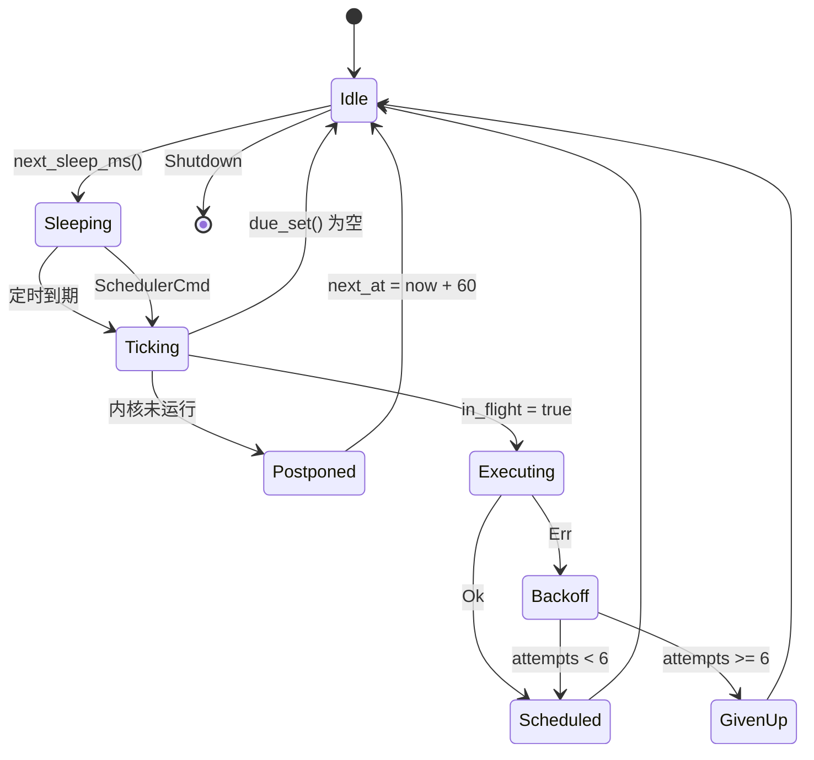

# 05 · 调度器与订阅自动更新

> **适用阶段**：P3（依赖 P1 内核、P2 订阅拉取与合并）
> **必读前置**：[01-master-prompt.md](01-master-prompt.md)（铁律）、[appendices/C-conventions.md](appendices/C-conventions.md)（C.5 数据模型 / C.6 IPC / C.7 事件 / C.8 错误码 / C.10 时间精度）
> **本文件定义**：`src-tauri/src/scheduler/` 全部四个模块 + 与内核解耦规则 + 可单测的纯函数边界。

---

## 5.1 设计目标与硬约束

| # | 目标 | 硬约束来源 | 落地手段 |
| --- | --- | --- | --- |
| S1 | 全应用只有**一个**定时唤醒源 | 01 §3-5、C.11「后台唤醒」 | 单一 tick 任务 + 最早到期优先，**禁止**每任务 `tokio::spawn` + `interval` |
| S2 | 空闲唤醒间隔 ≥ 30s | C.11 最后一行 | 基础节拍 60s 对齐整分；仅在临近到期时才缩短睡眠 |
| S3 | 周期下限：订阅 15 分钟、测速 5 分钟 | C.10 | `due.rs` 常量 + `subscription_set_interval` 入参校验 |
| S4 | 所有周期任务带 `0..30s` 抖动 | C.10 | 调度时写入 `next_at = 目标时刻 + jitter`，抖动只在**首次**与**重排**时采样 |
| S5 | 定时精度 ±10% | C.10 | 订阅 15min→允许 ±90s；测速 5min→允许 ±30s。见 §5.4 睡眠算法 |
| S6 | 内核未运行时不得空转重试 | 01 §3-4 | 内核门控：暂停到期集合，`next_at` 顺延，内核 Running 时立即补偿一次 |
| S7 | 失败必须退避且有上限 | 本任务验收 | 指数退避 `60×2^n` 秒，最多 6 次，单次上限 60 分钟 |
| S8 | 同类错误 30 分钟内只提示一次 | 本任务验收 + C.7 `notify` | `AlertThrottle` 内存表，键为 `code`，不落盘 |
| S9 | 时间跳变（休眠 / 改时钟）不引发任务风暴 | 本任务验收 | 双时钟采样 `ClockGuard`，偏差 > 60s 触发全量重算 |
| S10 | 纯逻辑 100% 可单测 | C.2 分层铁律 | `due.rs` / `backoff.rs` / `clock.rs` 不持 IO，不用 `SystemTime::now()` |

**唯一允许的例外**：`speedtest:progress` 之类的高频事件由测速引擎自己限流（见 06 章），调度器不参与。

---

## 5.2 模块职责切分

| 文件 | 职责 | 是否纯函数 | 允许的依赖 |
| --- | --- | --- | --- |
| `scheduler/clock.rs` | 可注入时钟：`now_wall()` / `now_mono()`；测试用 `FakeClock` | 否（薄封装） | `std::time` |
| `scheduler/due.rs` | 给定 `now` 与各槽位 `next_at` → 到期集合；重排算法；睡眠时长计算 | **是** | 无 |
| `scheduler/backoff.rs` | 指数退避 + 抖动 + 上限 + 放弃；告警节流；时钟跳变判定 | **是** | 无 |
| `scheduler/runner.rs` | 单 tick 循环、命令通道、串行执行、内核门控、发事件 | 否 | tokio、`kernel`、`subscription`、`speedtest` |

> **禁止**：把业务逻辑写进 `runner.rs`。runner 只做「取到期集合 → 交给执行器 → 回写结果」，
> 任何「订阅失败后该怎么处理」的判定必须在 `backoff.rs` 的纯函数里。

```rust
// scheduler/mod.rs —— 对外只暴露这三样
pub mod backoff;
pub mod clock;
pub mod due;
pub mod runner;

pub use runner::{Scheduler, SchedulerCmd, SchedulerHandle};
```

---

## 5.3 数据模型（本章自有，不入 C.5）

> C.5 定义的是**落盘模型**。调度槽位是**运行态**，不落盘；重启后由 `Subscription.last_update_at`
> 与 `settings` 重建（这样进程崩溃不会让用户的订阅「错档」到未来）。

```rust
// scheduler/due.rs

use std::cmp::Ordering;

/// C.10 硬下限
pub const SUB_MIN_INTERVAL_SEC: i64 = 15 * 60;
pub const SPEEDTEST_MIN_INTERVAL_SEC: i64 = 5 * 60;
/// C.10 抖动上限（含）
pub const JITTER_MAX_SEC: i64 = 30;
/// 基础节拍：空闲时最长 60s 醒一次，对齐整分（满足 C.11「不得 < 30s 唤醒」）
pub const BASE_TICK_SEC: i64 = 60;
/// 单次 tick 最多派发的任务数，防止休眠唤醒后一次性打爆
pub const MAX_BATCH: usize = 3;

#[derive(Debug, Clone, Copy, PartialEq, Eq, Hash)]
pub enum TaskKind {
    /// 订阅定时更新
    SubRefresh,
    /// 节点延迟测速（真正执行由 speedtest 引擎负责）
    Speedtest,
    /// 到期 / 流量告警检查（纯本地计算，不发网络请求）
    ExpireCheck,
}

impl TaskKind {
    /// 该类任务允许的最小周期（秒）
    pub fn min_interval_sec(self) -> i64 {
        match self {
            TaskKind::SubRefresh => SUB_MIN_INTERVAL_SEC,
            TaskKind::Speedtest => SPEEDTEST_MIN_INTERVAL_SEC,
            // 到期检查是本地比较，允许更密；但同样 ≥5 分钟，避免无意义唤醒
            TaskKind::ExpireCheck => SPEEDTEST_MIN_INTERVAL_SEC,
        }
    }
}

/// 一个调度槽位（运行态，不落盘）
#[derive(Debug, Clone)]
pub struct Slot {
    pub kind: TaskKind,
    /// 订阅 uid；全局任务（测速/到期检查）用固定键 "global"
    pub key: String,
    /// 生效周期（秒），已按 min_interval_sec 归一
    pub interval_sec: i64,
    /// 下次到期时刻（Unix 秒，UTC），已包含抖动
    pub next_at: i64,
    pub enabled: bool,
    /// 正在执行中，禁止重入
    pub in_flight: bool,
    /// 因内核未运行 / 网络离线而被挂起
    pub gate: Gate,
}

#[derive(Debug, Clone, Copy, PartialEq, Eq)]
pub enum Gate {
    Open,
    /// 内核未运行：不消耗退避次数，到期即刻顺延
    CoreDown,
    /// 手工暂停（用户关闭了自动更新开关）
    UserPaused,
    /// 上次还在跑
    Busy,
}

/// 归一化周期：小于下限时抬到下限并记一条 warn（由调用方打日志）
pub fn normalize_interval(kind: TaskKind, raw_sec: i64) -> i64 {
    raw_sec.max(kind.min_interval_sec())
}

/// 对齐到下一个整分边界（Unix 秒）。若 now 恰在整分上，取下一分。
pub fn align_next_minute(now: i64) -> i64 {
    (now.div_euclid(BASE_TICK_SEC) + 1) * BASE_TICK_SEC
}

/// 首次调度：对齐整分 + 抖动，避免所有订阅在同一秒并发
pub fn initial_next_at(now: i64, interval_sec: i64, jitter_sec: i64) -> i64 {
    let j = jitter_sec.clamp(0, JITTER_MAX_SEC);
    align_next_minute(now) + j.max(0)
}

/// 正常完成后重排。
/// `drift`: 上次计划与实际完成时间的偏差（秒），用于抑制长期漂移。
/// 关键点：**基准是 now 而不是 old_next_at**，否则任务每次晚 3s 完成都会永久偏移。
pub fn reschedule_after_ok(now: i64, interval_sec: i64, jitter_sec: i64) -> i64 {
    let j = jitter_sec.clamp(0, JITTER_MAX_SEC);
    now + interval_sec + j
}

/// 失败后的重排：走退避（见 backoff.rs），此处只做「不得早于 now + min」的兜底
pub fn reschedule_after_fail_delay(now: i64, delay_sec: i64) -> i64 {
    now + delay_sec.max(1)
}

/// 计算到期集合（按 next_at 升序、最多 max 条）。
/// 纯函数：同样的 (now, slots) 必然得到同样的结果 —— 单测基石。
pub fn due_set(now: i64, slots: &[Slot], max: usize) -> Vec<usize> {
    let mut hit: Vec<usize> = slots
        .iter()
        .enumerate()
        .filter(|(_, s)| s.enabled && s.gate == Gate::Open && !s.in_flight && s.next_at <= now)
        .map(|(i, _)| i)
        .collect();
    hit.sort_by(|&a, &b| match slots[a].next_at.cmp(&slots[b].next_at) {
        Ordering::Equal => slots[a].key.cmp(&slots[b].key), // 稳定：同刻按 key 字典序
        o => o,
    });
    hit.truncate(max);
    hit
}

/// 被门控挡住、但已经到期的槽位（用于「内核恢复后立即补偿」）
pub fn blocked_set(now: i64, slots: &[Slot]) -> Vec<usize> {
    slots
        .iter()
        .enumerate()
        .filter(|(_, s)| s.enabled && s.gate != Gate::Open && s.next_at <= now)
        .map(|(i, _)| i)
        .collect()
}

/// 下一个最早期望时刻（只考虑可执行的槽位）
pub fn first_deadline(slots: &[Slot]) -> Option<i64> {
    slots
        .iter()
        .filter(|s| s.enabled && s.gate == Gate::Open && !s.in_flight)
        .map(|s| s.next_at)
        .min()
}

/// **核心睡眠算法**：未来 60s 内没有到期任务 → 睡到下一个整分（空闲省电）；
/// 有到期任务 → 精确睡到该时刻（满足 C.10 的 ±10%）。
/// 下限 800ms，避免截止时刻刚好落在 now 时产生自旋。
pub fn next_sleep_ms(now: i64, slots: &[Slot]) -> u64 {
    let target = match first_deadline(slots) {
        Some(t) if t <= now + BASE_TICK_SEC => t.max(now),
        _ => align_next_minute(now),
    };
    let delta = (target - now).max(0);
    ((delta as u64) * 1000).max(800)
}
```

### 5.3.1 为什么是「对齐整分 + 最短到期优先」而不是时间轮

| 方案 | 内存 | 空闲唤醒 | 精度 | 结论 |
| --- | --- | --- | --- | --- |
| 每任务一个 `tokio::interval` | 每任务一个 timer ≈ 200B + 一个唤醒注册 | 每任务各自唤醒，N 个订阅 = N 次/周期 | 高 | ❌ 违反 S1 |
| 时间轮（哈希时间轮） | 固定 60 槽 × 桶链表 | 每 60s 一次 | ±1 槽（60s） | ⚠️ 订阅可达标，测速 5min 的 ±10%=30s 不达标 |
| **最早到期优先（本方案）** | `Vec<Slot>`，N 个订阅几十字节 | 空闲 60s，临近到期精确 | 亚秒级 | ✅ 采纳 |

> 时间轮在 N > 10000 时才划算。本产品订阅数 1~5、任务槽位 < 20，`Vec` 线性扫描（< 1μs）完全够用，
> 而且**代码少、无哈希碰撞、可直接单测**。

---

## 5.4 单 tick 循环（runner.rs）

```rust
// scheduler/runner.rs
use std::sync::Arc;
use std::time::Duration;

use tokio::sync::{mpsc, oneshot, watch};
use tokio::time::sleep_until;
use tokio::time::Instant;

use super::backoff::{BackoffPolicy, BackoffState, ClockGuard, AlertThrottle};
use super::due::{self, Gate, Slot, TaskKind};

/// 外部 → 调度器的命令（全部有界，容量 16，满则拒绝并回 E_BUSY）
#[derive(Debug)]
pub enum SchedulerCmd {
    /// subscription_refresh：立即刷新某订阅，忽略周期
    RefreshNow { uid: String },
    /// subscription_refresh_all
    RefreshAllNow,
    /// speedtest_start(trigger=Manual)
    SpeedtestNow,
    /// 订阅增删改后重建槽位
    Rebuild { slots: Vec<Slot> },
    /// 周期被用户修改（subscription_set_interval）
    SetInterval { uid: String, interval_sec: i64 },
    /// 内核状态翻转（core:state 的镜像）
    CoreStateChanged { running: bool },
    /// 网络恢复提示（可选，来自 sysproxy / kernel 健康检查）
    NetworkBack,
    /// 应用退出
    Shutdown,
}

pub struct Scheduler {
    slots: Vec<Slot>,
    policy: BackoffPolicy,
    states: std::collections::HashMap<(TaskKind, String), BackoffState>,
    throttle: AlertThrottle,
    clock: ClockGuard,
    core_running: bool,
    exec: Arc<dyn TaskExecutor>,
}

/// 执行器抽象：让 runner 与 subscription/speedtest 解耦，测试可注入 FakeExecutor
#[async_trait::async_trait]
pub trait TaskExecutor: Send + Sync + 'static {
    async fn run_sub_refresh(&self, uid: &str) -> Result<(), crate::domain::errors::AppError>;
    async fn run_speedtest(&self) -> Result<(), crate::domain::errors::AppError>;
    async fn run_expire_check(&self) -> Result<(), crate::domain::errors::AppError>;
}

impl Scheduler {
    /// 单 tick 主循环。全程只有一个 `sleep`，没有任何额外 spawn。
    pub async fn run(
        mut self,
        mut rx: mpsc::Receiver<SchedulerCmd>,
        mut shutdown: watch::Receiver<bool>,
        events: EventSink,
    ) {
        loop {
            // ① 只有一个睡眠点：时长由纯函数算
            let ms = due::next_sleep_ms(self.clock.wall(), &self.slots);
            tokio::select! {
                biased;
                _ = shutdown.changed() => {
                    tracing::info!("[scheduler] shutdown requested");
                    break;
                }
                Some(cmd) = rx.recv() => {
                    if self.on_cmd(cmd).await.is_err() { break; }
                }
                _ = sleep_until(Instant::now() + Duration::from_millis(ms)) => {
                    self.tick(&events).await;
                }
            }
        }
        tracing::info!("[scheduler] stopped");
    }

    async fn tick(&mut self, events: &EventSink) {
        // ② 时钟体检：休眠 / 改系统时间 / 手动拨钟
        if let Some(drift) = self.clock.sample_and_check() {
            tracing::warn!("[scheduler] clock jump drift={}s, rescheduling all", drift);
            let now = self.clock.wall();
            for s in &mut self.slots {
                // 全部按 now 重新对齐，丢弃可能落在极远未来的 next_at
                s.next_at = due::reschedule_after_ok(now, s.interval_sec, 0);
                // 把偏差前仍在未来的任务拉回：若原 next_at 已过期则立刻可执行
            }
            // 已过期的保持过期（next_at <= now），下一次 tick 会自然派发
        }

        let now = self.clock.wall();
        // ③ 内核门控：未运行时不做任何网络类任务
        let idx = due::due_set(now, &self.slots, due::MAX_BATCH);
        if idx.is_empty() {
            tracing::debug!("[scheduler] tick tasks=0 next_in={}s", due::next_sleep_ms(now, &self.slots) / 1000);
            return;
        }

        for i in idx {
            let (kind, key, interval) = {
                let s = &self.slots[i];
                (s.kind, s.key.clone(), s.interval_sec)
            };

            // ④ 内核门控二次判定（tick 期间状态可能已变）
            if kind.needs_core() && !self.core_running {
                let s = &mut self.slots[i];
                s.gate = Gate::CoreDown;
                s.next_at = now + 60; // 顺延 60s，不消耗退避次数
                tracing::info!("[scheduler] skip task={:?} key={} reason=core_down postponed={}s",
                               kind, key, 60);
                continue;
            }

            // ⑤ 串行执行：置 in_flight 防重入
            self.slots[i].in_flight = true;
            let started = self.clock.wall();
            let res = match kind {
                TaskKind::SubRefresh => self.exec.run_sub_refresh(&key).await,
                TaskKind::Speedtest => self.exec.run_speedtest().await,
                TaskKind::ExpireCheck => self.exec.run_expire_check().await,
            };
            let finished = self.clock.wall();
            self.slots[i].in_flight = false;

            match res {
                Ok(()) => {
                    self.states.remove(&(kind, key.clone()));
                    let jitter = self.clock.jitter_sec();
                    self.slots[i].next_at =
                        due::reschedule_after_ok(finished, interval, jitter);
                    tracing::info!(
                        "[scheduler] task={:?} key={} ok took={}s next_at={}",
                        kind, key, finished - started, self.slots[i].next_at
                    );
                }
                Err(err) => self.on_task_fail(i, &err, finished, events).await,
            }
        }
    }

    async fn on_task_fail(&mut self, i: usize, err: &AppError, now: i64, events: &EventSink) {
        let (kind, key, interval) = {
            let s = &self.slots[i];
            (s.kind, s.key.clone(), s.interval_sec)
        };
        let st = self.states.entry((kind, key.clone())).or_default();
        let action = super::backoff::next_backoff(&self.policy, st.attempts, self.clock.jitter_sec());
        let delay = match action {
            super::backoff::BackoffAction::RetryIn(d) => {
                st.attempts += 1;
                d
            }
            super::backoff::BackoffAction::GiveUp => {
                st.attempts = 0;
                // 放弃本次：等下一个正常周期，而不是继续狂试
                self.slots[i].next_at = due::reschedule_after_ok(now, interval, 0);
                tracing::error!("[scheduler] task={:?} key={} give up after {} attempts",
                               kind, key, self.policy.max_attempts);
                self.maybe_alert(err, now, events);
                return;
            }
        };
        self.slots[i].next_at = due::reschedule_after_fail_delay(now, delay);
        tracing::warn!(
            "[scheduler] task={:?} key={} fail code={} attempt={}/{} retry_in={}s",
            kind, key, err.code, st.attempts, self.policy.max_attempts, delay
        );
        self.maybe_alert(err, now, events);
    }
}

impl TaskKind {
    /// 只有需要读 mihomo API 的任务才受内核门控；订阅拉取和到期检查与内核无关
    pub fn needs_core(self) -> bool {
        matches!(self, TaskKind::Speedtest)
    }
}
```

**关键实现说明（每条都对应一个真实故障）**

| 设计点 | 为什么必须这样 |
| --- | --- |
| `biased;` 且 `shutdown` 排第一 | 否则退出时可能被长期 `sleep` 拖住，窗口关不掉 |
| 命令分支优先于 sleep 分支 | 用户点「立即刷新」要立刻响应，不能等 60s |
| `in_flight` 布尔而非 Mutex | 单线程串行，布尔足够；Mutex 会引入 await 跨越持有的隐患 |
| 每次只派发 ≤3 个任务（`MAX_BATCH`） | 笔记本合盖 8 小时后唤醒，避免 60 个订阅同时拉取把 CPU 打到 100% |
| 失败不重置 `in_flight` 之外的状态 | 退避计数挂在 `states` 上，不进 `Slot`，避免重建槽位时丢失 |
| `reschedule_after_ok` 基准用 `finished` | 用 `old_next_at + interval` 会累积漂移，长期可见「越来越晚」 |

---

## 5.5 backoff.rs：指数退避 + 抖动 + 上限

```rust
// scheduler/backoff.rs
use std::collections::HashMap;

#[derive(Debug, Clone, Copy)]
pub struct BackoffPolicy {
    pub base_sec: i64,     // 60
    pub factor: i64,       // 2
    pub max_attempts: u32, // 6
    pub cap_sec: i64,      // 3600 = 60 分钟
}

impl Default for BackoffPolicy {
    fn default() -> Self {
        Self { base_sec: 60, factor: 2, max_attempts: 6, cap_sec: 3600 }
    }
}

#[derive(Debug, Clone, Copy, PartialEq, Eq)]
pub enum BackoffAction {
    /// 还有次数：now + d 秒后重试
    RetryIn(i64),
    /// 次数用尽：等下一个正常周期
    GiveUp,
}

#[derive(Debug, Default, Clone, Copy)]
pub struct BackoffState {
    pub attempts: u32,
}

/// 纯函数：给定已用尝试次数 → 下一次退避时长。
/// 序列（base=60, factor=2, cap=3600）：
///   attempts=0 → 60      (2^0)
///   attempts=1 → 120     (2^1)
///   attempts=2 → 240
///   attempts=3 → 480
///   attempts=4 → 960
///   attempts=5 → 1920
///   attempts=6 → GiveUp
/// 抖动是**加性**的（+0..30s），且封顶后再加抖动也不得超过 cap + 30s。
pub fn next_backoff(policy: &BackoffPolicy, attempts: u32, jitter_sec: i64) -> BackoffAction {
    if attempts >= policy.max_attempts {
        return BackoffAction::GiveUp;
    }
    let exp = policy.factor.saturating_pow(attempts) as i64; // 1,2,4,8,... 防止溢出
    let raw = policy.base_sec.saturating_mul(exp);
    let clamped = raw.min(policy.cap_sec);
    BackoffAction::RetryIn(clamped + jitter_sec.clamp(0, 30))
}
```

### 5.5.1 告警节流（同类错误 30 分钟只提示一次）

```rust
#[derive(Debug)]
pub struct AlertThrottle {
    /// 节流窗口（秒），默认 1800
    window_sec: i64,
    /// key = 错误码（E_NET_TIMEOUT 等），value = 上次提示的 Unix 秒
    seen: HashMap<String, i64>,
}

impl Default for AlertThrottle {
    fn default() -> Self {
        Self { window_sec: 1800, seen: HashMap::new() }
    }
}

impl AlertThrottle {
    /// 纯逻辑：不读时钟，`now` 由调用方传入 → 可单测
    pub fn should_emit(&mut self, now: i64, code: &str) -> bool {
        match self.seen.get(code) {
            Some(&last) if now.saturating_sub(last) < self.window_sec => false,
            _ => {
                self.seen.insert(code.to_string(), now);
                true
            }
        }
    }

    /// 成功一次就清空：下次失败立刻可提示（用户修好了网络又坏，应该再提示）
    pub fn reset(&mut self) {
        self.seen.clear();
    }
}
```

> **节流键的选择**：用 `code` 而不是 `(uid, code)`。因为「3 个订阅同时超时」对用户是一件事，
> 提示三次是噪音。若后续要区分，改为 `code` 即可，不改契约。
> 提示走 C.7 的 `notify` 事件，`level = "warn"`，**不新增事件名**。

---

## 5.6 clock.rs：双时钟与跳变检测

```rust
// scheduler/clock.rs
use std::time::{Instant, SystemTime, UNIX_EPOCH};

/// 双时钟采样。`mono` 用单调递增的秒数（进程启动起算，休眠期间 Windows 上
/// `Instant` 包含休眠时间，这正是我们要的——据此判断「用户合盖睡了多久」）。
#[derive(Debug, Clone, Copy)]
pub struct ClockSample {
    pub wall: i64,
    pub mono: i64,
}

#[derive(Debug, Clone, Copy, PartialEq, Eq)]
pub enum ClockJump {
    None,
    /// 墙钟向后跳（用户改时间 / NTP 回拨）：任务会被「卡在未来」
    Rollback { drift_sec: i64 },
    /// 墙钟向前跳或休眠唤醒：大量任务同时到期
    Forward { drift_sec: i64 },
}

/// 阈值：|wall_delta - mono_delta| > 60s 视为异常（C.10 抖动最大 30s，留 2 倍余量）
pub const CLOCK_JUMP_THRESHOLD_SEC: i64 = 60;

/// 纯函数：输入前后两次采样 → 判定
pub fn detect_jump(prev: ClockSample, cur: ClockSample, threshold: i64) -> ClockJump {
    let wall_delta = cur.wall.saturating_sub(prev.wall);
    let mono_delta = cur.mono.saturating_sub(prev.mono);
    let drift = wall_delta.saturating_sub(mono_delta);
    if drift.abs() <= threshold {
        ClockJump::None
    } else if drift < 0 {
        ClockJump::Rollback { drift_sec: drift }
    } else {
        ClockJump::Forward { drift_sec: drift }
    }
}

/// 生产实现：带内部上次采样
pub struct ClockGuard {
    started: Instant,
    last: ClockSample,
    threshold: i64,
}

impl ClockGuard {
    pub fn new() -> Self {
        let wall = SystemTime::now().duration_since(UNIX_EPOCH).map(|d| d.as_secs() as i64).unwrap_or(0);
        Self { started: Instant::now(), last: ClockSample { wall, mono: 0 }, threshold: CLOCK_JUMP_THRESHOLD_SEC }
    }

    pub fn wall(&self) -> i64 {
        SystemTime::now().duration_since(UNIX_EPOCH).map(|d| d.as_secs() as i64).unwrap_or(0)
    }

    fn sample(&self) -> ClockSample {
        ClockSample { wall: self.wall(), mono: self.started.elapsed().as_secs() as i64 }
    }

    /// 返回 Some(drift_sec) 表示检测到跳变，调用方须重算全部 next_at
    pub fn sample_and_check(&mut self) -> Option<i64> {
        let cur = self.sample();
        let jump = detect_jump(self.last, cur, self.threshold);
        self.last = cur;
        match jump {
            ClockJump::None => None,
            ClockJump::Rollback { drift_sec } => Some(drift_sec),
            ClockJump::Forward { drift_sec } => Some(drift_sec),
        }
    }

    /// 抖动源：生产用系统随机，测试注入固定序列
    pub fn jitter_sec(&self) -> i64 {
        // 见 §5.7：不要用 rand crate 的全局线程 RNG（会拉入额外重量级依赖），
        // 用 std 的一个每线程 xorshift，或直接复用 uuid::Uuid::new_v4() 的一个字节
        crate::util::time::rng_0_30()
    }
}
```

### 5.6.1 跳变处置矩阵

| 场景 | `drift` | 判定 | 处置 |
| --- | --- | --- | --- |
| 正常 tick | ≈0 | `None` | 无动作 |
| 合盖 8 小时后唤醒 | +28800 | `Forward` | 重算全部 `next_at = now + interval`；**不**补偿执行 8 小时的欠账，仅执行一次（`MAX_BATCH` 兜底） |
| 用户在设置里把时间调快 1 天 | +86400 | `Forward` | 同上 |
| 用户把时间调回 1 天 | −86400 | `Rollback` | 同上（否则所有任务「卡在未来 24 小时」永不执行） |
| NTP 校时 +3s | +3 | `None`（< 60s 阈值） | 无动作，由 ±10% 精度吸收 |
| 进程刚启动 | `last.mono = 0` | 首次必定 `None` | 首 tick 只建槽位不执行 |
| 一次 tick 内部被挂起 90s（低内存） | +90 | `Forward` | 重算；日志 Warn，不弹窗 |

---

## 5.7 抖动采样：0..30s 且不引入 rand

```rust
// util/time.rs（补充片段）
use std::cell::Cell;

thread_local! {
    static SEED: Cell<u64> = const { Cell::new(0) };
}

/// 返回 0..=30 的伪随机秒数。
/// 用 xorshift64，不引入 `rand` crate（省 ~200KB 二进制 + 一个依赖）。
/// 种子取「启动纳秒 ⊕ 进程 id」，同机多次启动不会完全同步。
pub fn rng_0_30() -> i64 {
    SEED.with(|c| {
        let mut x = c.get();
        if x == 0 {
            x = std::time::SystemTime::now()
                .duration_since(std::time::UNIX_EPOCH)
                .map(|d| d.subsec_nanos() as u64 ^ ((d.as_secs() & 0xFFFF) << 16))
                .unwrap_or(0x9E37_79B9_7F4A_7C15)
                | 1;
        }
        x ^= x << 13;
        x ^= x >> 7;
        x ^= x << 17;
        c.set(x);
        // 取高 5 位 → 0..31，再 clamp 到 0..=30
        ((x >> 59) as i64).min(30)
    })
}
```

> **为什么抖动必须存在**：5 个订阅周期都设成 360 分钟、同一时刻添加，若不抖动会在同一秒发起 5 个
> HTTP 请求，加上测速引擎的 8 并发，瞬间 13 个连接，弱网下全部超时并触发 5 次告警。
> 抖动把并发摊到 30s 窗口，峰值并发从 13 降到 1~2。

---

## 5.8 状态机（文字图 + Mermaid）

```
                          ┌────────────────┐
         启动 / Rebuild ──▶│     Idle       │◀──────────────┐
                          └───────┬────────┘               │
                                  │ next_sleep_ms()        │ tick 完成
                                  ▼                        │ 且到期集合为空
                          ┌────────────────┐               │
                          │   Sleeping     │───────────────┤
                          └───────┬────────┘               │
                    sleep 到期 / 命令到达                   │
                                  ▼                        │
                          ┌────────────────┐               │
                          │   Ticking      │───────────────┘
                          └───────┬────────┘
                                  │ due_set() 非空
                                  ▼
                          ┌────────────────┐  Gate=CoreDown
                          │  Dispatching   │──────────────▶ Postponed ──┐
                          └───────┬────────┘                    │next_at=now+60
                                  │ in_flight=true               │
                                  ▼                              │
                          ┌────────────────┐                     │
                          │  Executing     │◀────────────────────┘
                          └───┬────────┬───┘
                     Ok       │        │   Err
                              ▼        ▼
                   ┌───────────┐   ┌──────────────┐
                   │ Scheduled │   │  Backoff     │
                   │ (next_at) │   │ attempts+1   │
                   └─────┬─────┘   └──────┬───────┘
                         │                │ attempts >= 6
                         │                ▼
                         │         ┌──────────────┐
                         │         │  GivenUp     │
                         │         │ (等下个周期) │
                         │         └──────┬───────┘
                         └────────┬───────┘
                                  ▼
                                Idle
```



**状态不变量（用于 code review 自查）**

1. 任一时刻至多一个槽位 `in_flight == true`（串行执行），除非未来显式改为并发——改之前必须先扩 `MAX_BATCH` 语义。
2. `Gate::CoreDown` 期间 `BackoffState.attempts` 不得递增（内核没起来不算订阅/测速的错）。
3. `next_at` 永远满足 `next_at >= now - interval_sec`（不允许无限滞留过去，由 `tick` 的跳变重算保证）。
4. `Shutdown` 后不再写任何事件（`events.send` 前检查 `shutdown.borrow()`）。

---

## 5.9 与内核生命周期的解耦

订阅拉取与内核**无关**（订阅是到机场的 HTTPS），测速与到期检查**必须**内核在线。

| 任务 | 依赖内核 | 内核 Down 时行为 |
| --- | --- | --- |
| `SubRefresh` | 否 | 正常执行 |
| `ExpireCheck` | 否 | 正常执行（纯本地比较 `expire_at`） |
| `Speedtest` | **是** | `gate = CoreDown`，`next_at = now + 60`，**不**计入退避 |

### 5.9.1 内核恢复后的补偿

```rust
async fn on_cmd(&mut self, cmd: SchedulerCmd) -> Result<(), ()> {
    match cmd {
        SchedulerCmd::CoreStateChanged { running } => {
            let was = self.core_running;
            self.core_running = running;
            if running && !was {
                let now = self.clock.wall();
                for s in &mut self.slots {
                    if s.gate == Gate::CoreDown {
                        s.gate = Gate::Open;
                        if s.next_at <= now {
                            // 已过期：立刻补一次，但用 now+5s 摊开，避免内核刚起来就打测速
                            s.next_at = now + 5;
                        }
                    }
                }
                tracing::info!("[scheduler] core up, resumed gated tasks");
            } else if !running && was {
                for s in &mut self.slots {
                    if s.kind.needs_core() {
                        s.gate = Gate::CoreDown;
                    }
                }
            }
        }
        SchedulerCmd::RefreshNow { uid } => { /* 见 5.10 */ }
        // ...
        _ => {}
    }
    Ok(())
}
```

> **反模式警告**：不要在内核 `supervisor.rs` 里直接调 `speedtest::run()`。那样会出现
> 「内核崩溃 → 自动重启 3 次 → 测速被触发 3 次」的雪崩。一律通过 `SchedulerCmd::CoreStateChanged`
> 投递到单线程，由调度器统一决定节奏。

---

## 5.10 「立即刷新」与周期变更

| 用户动作 | IPC | 调度器响应 |
| --- | --- | --- |
| 点「立即更新」（单条） | `subscription_refresh{uid}` | `RefreshNow`：将该槽位 `next_at = now`，`enabled` 不变 |
| 点「全部更新」 | `subscription_refresh_all` | `RefreshAllNow`：所有 `SubRefresh` 槽位 `next_at = now`，但**按 `sort_order` 排队**，靠 `MAX_BATCH=3` 分批 |
| 改周期 | `subscription_set_interval{uid, intervalMin}` | `SetInterval`：`interval_sec = normalize_interval(kind, interval*60)`，并把 `next_at` 改为 `now + interval`（**不**保留旧的相位，避免「刚改完 1 分钟就要跑」） |
| 新增订阅 | `subscription_add` | 建槽位 `next_at = now`（新订阅要立刻拉一次） |
| 停用订阅 | `subscription_set_enabled{false}` | `enabled = false`，槽位保留（重新启用不用重建） |
| 删除订阅 | `subscription_remove` | 槽位与 `states` 一并删除 |

**周期下限校验**（纯函数，可单测）：

```rust
pub fn validate_interval_min(kind: TaskKind, minutes: u32) -> Result<i64, AppError> {
    let sec = (minutes as i64).saturating_mul(60);
    let min = kind.min_interval_sec();
    if sec < min {
        return Err(AppError::new(
            "E_UNSUPPORTED",                       // C.8 已有错误码
            format!("周期不能小于 {} 分钟", min / 60),
        ).retryable(false));
    }
    Ok(sec)
}
```

> 契约对齐：`subscription_set_interval` 的下限 15 分钟写在 C.6 备注里，`Speedtest` 的 5 分钟写在 C.10。
> 两处都由本函数统一执行，**不允许**在 IPC 层另写一套判断。

---

## 5.11 离线队列与网络恢复

「离线」在本产品有两种语义，处理方式不同：

| 离线类型 | 判定 | 队列行为 |
| --- | --- | --- |
| 无网络（DNS 全失败） | 连续 2 次 `E_NET_DNS` | 全部 `SubRefresh` 槽位 `gate = Open` 但 `next_at = now + 300`；不退避、不告警（用户断网不是错误） |
| 单订阅 5xx / 超时 | `E_HTTP_STATUS` / `E_NET_TIMEOUT` | 走正常退避 |
| 收到 `NetworkBack` | 系统代理恢复 / 内核健康检查通过 | 清空 `states`、`throttle.reset()`，把 `next_at <= now + 60` 的槽位立即置 `now` |

```rust
SchedulerCmd::NetworkBack => {
    self.throttle.reset();
    let now = self.clock.wall();
    for (k, st) in self.states.iter_mut() {
        st.attempts = 0;
        let _ = k;
    }
    for s in &mut self.slots {
        if s.kind == TaskKind::SubRefresh && s.next_at > now + 60 {
            s.next_at = now + 5;
        }
    }
    tracing::info!("[scheduler] network back, fast-forward subscriptions");
}
```

---

## 5.12 边界用例表（单测 + 手工验收，≥10 条）

> 单测文件：`src-tauri/tests/scheduler_due.rs`、`src-tauri/tests/scheduler_backoff.rs`。
> 所有用例只依赖纯函数，**不需要** tokio runtime、不需要假时钟。

| # | 类别 | 输入 | 期望 | 断言点 |
| --- | --- | --- | --- | --- |
| 1 | 跨天 | `now = 2026-11-06T23:59:30Z`，interval=15min，jitter=0 | `next_at = 2026-11-07T00:14:30Z` | `reschedule_after_ok` 不因跨天少 1 秒 |
| 2 | 整分对齐 | `now = 1_800_000_000`（恰为 60 倍数） | `align_next_minute = now + 60` | 不在当前分重复触发 |
| 3 | 抖动上限 | `jitter_sec = 45` | 被 clamp 到 30 | `initial_next_at` 与 `reschedule` 都 clamp |
| 4 | 抖动下限 | `jitter_sec = -5` | clamp 到 0 | 负数不得产生「提前」 |
| 5 | 周期下限 | `validate_interval_min(SubRefresh, 10)` | `Err(E_UNSUPPORTED)` | message 含「15 分钟」 |
| 6 | 周期下限-边界 | `validate_interval_min(SubRefresh, 15)` | `Ok(900)` | 恰好等于下限放行 |
| 7 | 改动周期 | 旧 `next_at = now + 800`，改为 30min | `next_at = now + 1800` | 不保留旧相位 |
| 8 | 立即刷新 | `RefreshNow` 后立即 tick | 该槽位出现在 `due_set` 首位 | `next_at = now`，排序按 `next_at` 升序 |
| 9 | 离线 | 连续 2 次 `E_NET_DNS` | `next_at = now + 300`，`throttle` 只发 1 次 | 告警窗口内不重复 |
| 10 | 时钟回拨 | `prev(wall=1000,mono=100)`，`cur(wall=-8000,mono=400)` | `Rollback{drift=-9400}` | drift < −60 |
| 11 | 时钟前跳 | `prev(1000,100)`，`cur(29800,130)` | `Forward{drift=+29670}` | 休眠 ≈8h |
| 12 | 正常小偏差 | `prev(1000,100)`，`cur(1059,130)` | `None` | 29s 偏差被吸收（< 60） |
| 13 | 内核未运行 | `Speedtest` 到期，`core_running=false` | `due_set` 为空（gate≠Open）→ 顺延 60s | `attempts` 不变 |
| 14 | 内核恢复 | `CoreDown` 且 `next_at < now` | 恢复后 `next_at = now + 5` | 不立即 0 延迟触发 |
| 15 | 退避序列 | attempts 0..5 | 60,120,240,480,960,1920 | 全部 +jitter(0) |
| 16 | 退避上限 | attempts=6 | `GiveUp` | 且不返回 3840 |
| 17 | 退避封顶 | 自定义 `cap_sec=1000`，attempts=5 | `min(1920,1000)=1000` | clamp 生效 |
| 18 | 幂等 tick | 同 `now` 连调 `due_set` 两次（未回写 next_at） | 返回相同索引 | 便于断点重试 |
| 19 | 批量上限 | 10 个槽位全到期，`MAX_BATCH=3` | 只返回 3 个，且是最早的 3 个 | 防唤醒风暴 |
| 20 | 重入保护 | 槽位 `in_flight=true` 且已到期 | 不在 `due_set` 中 | 不会重复派发 |
| 21 | 全停用 | 所有 `enabled=false` | `first_deadline() == None`，睡到下一整分 | 不空转 |
| 22 | 同刻排序稳定 | 3 个槽位 `next_at` 相同 | 按 `key` 字典序 | 结果确定，可快照测试 |

### 5.12.1 手工验收（必须真机跑）

| 步骤 | 操作 | 通过标准 |
| --- | --- | --- |
| A1 | 订阅周期设 15 分钟，观察 45 分钟 | 触发 3 次，间隔落在 15min±90s，日志 `next_at` 单调递增 |
| A2 | 经济模式睡眠 30 分钟后唤醒 | 唤醒后 10s 内完成一次订阅更新，日志有 `clock jump drift=1800s` Warn，**没有**连续 3 次以上重试 |
| A3 | 手工把系统时间改到明天，再改回来 | 两次都只有一条 Warn，订阅不会连续拉 20 次 |
| A4 | 关闭内核后等一个测速周期 | 日志 `skip task=Speedtest reason=core_down`，**无**错误弹窗 |
| A5 | 断网 10 分钟后恢复 | 同一错误码 30 分钟内只弹 1 条通知；恢复后 10s 内补拉一次 |
| A6 | 加 1 个 5 个子订阅的配置，观察峰值并发 | `logs/app-*.log` 中同一秒内 `fetch start` ≤ 2 |

---

## 5.13 交付清单（P3 阶段验收）

| 项 | 文件 | 验收 |
| --- | --- | --- |
| 纯函数 | `scheduler/due.rs` | 22 条单测全绿，`cargo test scheduler` 无 warn |
| 纯函数 | `scheduler/backoff.rs` | 退避序列快照测试；`AlertThrottle` 3 条用例 |
| 纯函数 | `scheduler/clock.rs` | `detect_jump` 6 条用例（回拨/前跳/边界 60s/61s） |
| 运行时 | `scheduler/runner.rs` | `cargo clippy -D warnings` 通过；无 `unwrap/expect` |
| 集成 | `subscription_manager` 实现 `TaskExecutor` | 订阅更新实际走调度器，`last_update_at` 正确写入 |
| 文档 | 本文件 §5.12 表格 | 手工验收 A1–A6 记录到 `docs/acceptance-P3.md` |

### 5.13.1 常见坑（会真实踩到）

| 坑 | 现象 | 对策 |
| --- | --- | --- |
| 用 `tokio::time::interval` 且 `MissedTickBehavior::Burst` | 休眠唤醒后连发 N 次 | 本设计用 `sleep_until` 自算，天然无 Burst |
| `next_at` 用本地时间算 | 跨时区/夏令时（国区无 DST，但用户可能改时区）错 1 小时 | **一律 Unix 秒 UTC**，只在展示层转本地 |
| 退避计数存在 `Slot` 里 | `Rebuild` 后次数归零，失败任务立刻重试 → 打爆机场 | 计数存 `states: HashMap<(kind,key), BackoffState>` |
| 告警未节流 | 断网时每分钟弹一次 | `AlertThrottle` 30 分钟窗口 |
| 在 `tick` 里 `await` 长任务 | 用户点「立即更新」被 15s 的订阅拉取挡住 | 已用串行设计 + 但 `MAX_BATCH` 限流；若未来要并发，改为 `JoinSet` 并单独限流 |
| 用 `std::thread::sleep` | 阻塞 tokio worker | 全部用 `tokio::time` |

---

## 5.14 与其他章节的接口约定

| 对端 | 约定 |
| --- | --- |
| 03 章 订阅拉取 | `TaskExecutor::run_sub_refresh(uid)` 内部调 `fetch::fetch_once`，失败返回 `AppError`，**不得**自己吞掉错误 |
| 04 章 合并 | 订阅更新成功后由执行器触发 `runtime config` 重建；调度器不关心重建细节 |
| 06 章 测速引擎 | `run_speedtest()` 内部做并发与进度事件；调度器只负责「什么时候跑」 |
| 07 章 自动切换 | 测速完成后由引擎调用 `selector`，**不经过**调度器 |
| 08 章 内核 | 内核状态变化通过 `SchedulerCmd::CoreStateChanged` 单向投递 |
| 09 章 UI | 前端不感知调度器；只通过 `subscription:updated` / `notify` 感知结果 |

> **不新增 IPC / 事件**。本文件用到的 `AppError.code`、`notify`、`subscription:updated` 全在 C.6/C.7/C.8 内。

---

## 5.11 本章自检清单（Agent 必须逐条确认）

> 交付任何代码前逐条回答「是/否」，任一「否」不得进入下一章。

- [ ] 1. 是否只有**一个** `tokio::spawn` 的调度循环？有无另起 `interval`/`sleep` 做定时（会打破 C.11 的「常驻定时器 ≤ 1」预算）？
- [ ] 2. 空闲时是否**睡到下一个整分**而非固定 30s 轮询？固定轮询会白耗电（C.11）。
- [ ] 3. 首次到期时间是否加 `0..30s` 抖动（`rng_0_30`）？不加会让所有订阅在同一秒集中拉取。
- [ ] 4. `due.rs` 是否**纯函数**（`now` 入参、无 IO、无 `Instant::now()`），可在无 tokio 下跑完 §5.9 的 22 条用例？
- [ ] 5. 订阅周期是否 clamp 到 **≥ 15 分钟**（`normalize_interval`）？测速周期是否 **≥ 5 分钟**？
- [ ] 6. 每次 tick 派发是否 ≤ `MAX_BATCH`（3）？合盖 8 小时唤醒时不能一次性拉起全部订阅。
- [ ] 7. 退避是否 60×2^n 封顶 3600s、最多 6 次后 `GiveUp`？`GiveUp` 后是否发**一次**告警并非永久静默？
- [ ] 8. 告警节流是否 30 分钟窗口、以错误码 `code` 为键？是否在成功后 `reset()`（否则恢复后第一条错误会被吞）？
- [ ] 9. `select!` 是否带 `biased;` 且 `shutdown` 排第一？否则退出窗口会被长期 `sleep` 拖住。
- [ ] 10. `ClockJump` 检测阈值是否 60s？时钟回拨/前跳后是否**全量重算** `next_at` 而非增量修正？
- [ ] 11. 内核 Down 时测速任务是否 `Gate::CoreDown` 顺延 60s 且**不计退避**？内核没起来不该算订阅的错。
- [ ] 12. 内核恢复后是否给一个短补偿（now+5s）让用户尽快看到测速结果？
- [ ] 13. `in_flight` 是否用 `bool` 而非 `Mutex`？是否保证每个分支（成功/失败/取消）都能复位？
- [ ] 14. 重排基准是否用**实际完成时刻**（`reschedule_after_ok` 用 `finished`）而非 `old_next_at + interval`？后者会累积漂移。
- [ ] 15. 所有时间落盘是否用 **Unix 秒**（`i64`）？是否没有往 `store` 里写 `Instant`/`Duration`？
- [ ] 16. 是否**没有**新增 IPC 命令或事件？只用 C.6/C.7 里已登记的 `subscription:updated` / `notify`？
- [ ] 17. 错误码是否只取自 C.8（`E_NET_TIMEOUT` / `E_NET_DNS` / `E_HTTP_STATUS` / `E_STORE_IO` / `E_BUSY` 等）？
- [ ] 18. 日志是否可解释：每次派发带 `uid/trigger/next_at`，每次失败带 `code/attempt/backoff_sec`，跳变带 `delta_sec`？
- [ ] 19. 是否有单测覆盖「跨天整分」「时钟回拨」「批量上限」「重入保护」四类边界（§5.9）？
- [ ] 20. 本章是否**没有**修改 `01-master-prompt.md`、`appendices/C-conventions.md` 或其它章节文件？
